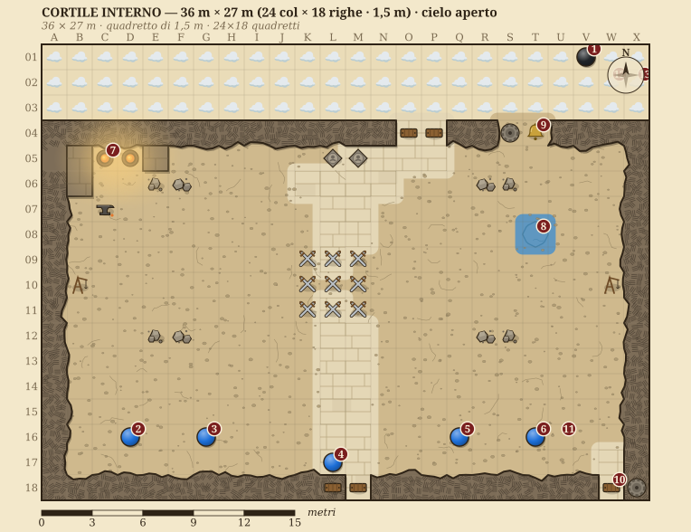
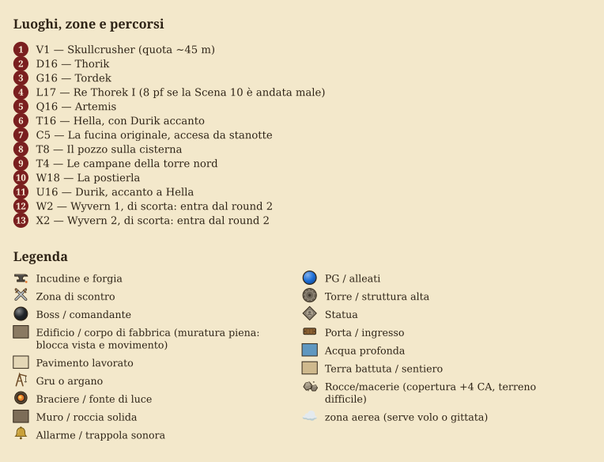

# M7-B · Il cortile del duello

La pianta del cortile dove Skullcrusher cala all'alba (Scena 11), con la legenda nella pagina dopo.<!-- apparato --> Le piante della notte, M7-C e M7-H, sono in fondo a `02-CHI-CE-STANOTTE.md`, subito prima del barile.<!-- /apparato -->

<!-- nuova-pagina -->

