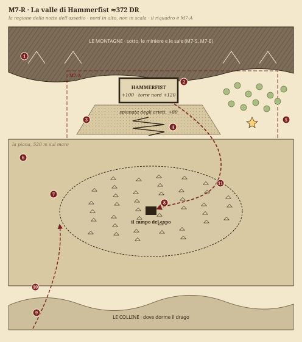
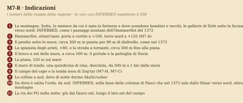

# Le terre di Hammerfist, ≈372 DR

Questa appendice raccoglie la regione come la trovano i PG mille anni prima della loro epoca, per averla tutta sotto mano senza aprire il modulo. Segue lo schema delle appendici di regione degli AP: la regione in breve, la storia, i luoghi, chi la abita, chi conta, le voci, e quello che ne resterà nel 1372. I fatti vengono dal master `ARC07-DEF-4-VIAGGIO-MILLE-ANNI.md`, dalle piante M7-A, M7-B, M7-C e M7-H e dalle schede del Bestiario. Dove il canone tace, l'appendice tace. Le proposte per i dati che un'appendice d'AP darebbe, con la loro base, stanno nel sorgente e aspettano il DM: in stampa non escono note di lavoro.

<!-- apparato -->
> **Proposte INFERRED per il DM** (in stampa non escono; approvate, entrano nella tabella «in breve» o nella geografia):
>
> - `[INFERRED — I mille difensori del banco sono gli ottocento del re più i duecento di Gunnvor?; base: Scena 4 «ottocento contro diecimila», Scena 5 «mille difensori» e «i duecento vecchi e ragazzi»]`
> - Abitanti: circa duemila, i mille difensori e le loro famiglie, scese nelle miniere `[INFERRED — Quanti abitanti ha la fortezza, famiglie comprese?; base: Scena 5, «una cittadina» delle regole PF1e degli insediamenti (da 201 a 2.000 abitanti), con «mille difensori e le famiglie nelle miniere»]`
> - Chi ci vive: nani dello scudo, quasi tutti `[INFERRED — Ci sono altri popoli oltre ai nani, a parte Zeth e i suoi scavatori?; base: Balvar è un nano dello scudo; Zeth, mezz'elfo, è l'unico non nano del master]`
> - Allineamento: legale buono `[INFERRED — Che allineamento ha la fortezza, come insediamento PF1e?; base: devota a Moradin, retta da un re e dal suo consiglio]`
> - Il pendio sotto le mura: circa 300 m in pianta per 80 m di dislivello (27%), strada a tornanti larga 6 m al 15%, come nel 1372 (ARC-08, mappe 2B e 2C) `[INFERRED — Il pendio del 372 è lo stesso del 1372?; base: la piana a 520 m e le quote +80, +100 e +120 coincidono nei due tempi]`
> - Valichi verso nord, come i passaggi montani dell'Hammerfist del 1372, e l'orda salita da sud, come la colonna di Fauci che nel 1372 sale dallo Shaar `[INFERRED — Da dove arriva l'orda, e la valle ha valichi a nord?; base: la geografia del 1372]`
>
> **Domande aperte per il DM** (il dato non c'è e manca una base per proporlo, quindi l'appendice non lo scrive): come si chiama la valle? Che cosa si estrae dalla miniera da cui è nata la fortezza? In che stagione cade la notte dell'assedio, e che tempo fa? Con quali fortezze o città commercia Hammerfist, e per quali strade? Da quali fortezze veniva Balvar?
<!-- /apparato -->

## Hammerfist in breve, la notte dell'assedio

La fortezza, chi la tiene e chi la vuole. Ogni riga rimanda a una scena del master.

| | |
|---|---|
| **Che cos'è** | una fortezza nanica giovane: ha circa ottant'anni `[CANONE — DM 2026-10-07, Q44]` |
| **Chi la governa** | Re Thorek I, Guerriero 16, 182 anni, con l'ascia Frostcleaver, e il suo consiglio di guerra |
| **Da dove nasce** | da una miniera: le stanze dove dormono i PG erano gli alloggi dei minatori, prima che la miniera diventasse fortezza `[CANONE — DM 2026-10-07, Q2]` |
| **Chi la difende** | ottocento nani in armi, dice il re; mille difensori, dice il conto del banco; e duecento vecchi e ragazzi che Gunnvor deve ancora armare. Una cinquantina di chierici di Moradin, e un diamante solo in tutta la fortezza |
| **Lingue** | nanico (la targa è in nanico); nel campo dell'orda comune e goblin |
| **Chi la assedia** | circa diecimila tra orchi e goblinoidi agli ordini del generale Zog'tar Deatheye, in una quindicina di clan, con il drago nero Skullcrusher legato all'orda da un contratto |
| **Quanto regge** | due ore di assalto, dice il re. Se all'alba Zog'tar guida ancora l'orda, la fortezza cade |
| **Dove sta** | su un gradone 100 m sopra la piana dell'orda, che sta a 520 m sul mare `[CANONE — DM 2026-10-22; 2026-11-04]` |
| **Chi pregano** | Moradin, nella cappella di Sorella Brynja. Il runaio esiliato Balvar incide con la mano tenuta ferma da Abbathor |
| **Cosa la rende diversa** | alla porta è appesa una targa di bronzo incisa stamattina. Profetizza quattro eroi, e quei quattro sono i PG |

## La storia, dalla fondazione a stanotte

Le date sono contate all'indietro dal 372 e portano il segno ≈, perché il canone le dà in anni e non in DR.

Hammerfist si fonda **intorno al 292 DR**. Fra quelli che la costruiscono c'è un nano che viene da altre fortezze ed è già un mastro runaio, Balvar Fuocospento. Ci arriva per la sua abilità, ne diventa il runaio e incide le protezioni sulle porte `[CANONE — DM 2026-09-30, D7]`. Le sue rune proteggono la fortezza per trent'anni. Poi il re lo esilia, senza processo, almeno a sentire lui. Che cosa abbia fatto, il canone non lo dice, e Balvar non lo racconta.

**Intorno al 322 DR** Skullcrusher il Nero scende sulla valle e uccide il re di Hammerfist. Era il nonno di due cugini, Re Thorek I e Thorgrim Barbadiferro. La Corona va perduta; l'ascia, Aegis Fang, resta nella famiglia e passa a Thorgrim `[CANONE — DM 2026-09-24]`. Dopo quella prima venuta del drago la cinta si rifà in pietra bianca, ed è per questo che stanotte le mura sembrano nuove. Il drago, da allora, non ha mai perso, e per lui i nani sono diventati una cosa da mangiare quando ha fame. Per il re la Corona è un lutto di famiglia che porta da cinquant'anni.

**Le dieci notti prima dell'assedio** l'orda di Zog'tar Deatheye sale dalla piana. Balvar è con lei. Ha trovato in Abbathor un dio che non gli chiede di perdonare, e a Zog'tar ha dato quello che nessun altro poteva: un drago. Sotto una scaglia di Skullcrusher ha inciso una runa-contratto, «quando la fortezza cade, il tesoro del re è tuo», e gli ha taciuto una riga. Quella riga è un guinzaglio: quando il corno dell'araldo Grask suona, il drago torna, che lo voglia o no. In quelle stesse notti le rune di Balvar fermano due incursioni di esploratori nanici, e da allora gli esploratori guardano soltanto dalle mura.

**La notte prima** Re Thorek I sogna una profezia, e all'alba la incide di sua mano sulla targa di bronzo della porta. **Al tramonto del 372** l'orda è sulla piana. I bambini e i vecchi scendono verso le miniere con un fagotto ciascuno, e le forge non si fermano. Nel bosco a est delle mura il portale posa quattro stranieri.

**All'alba** l'assalto sale alle mura e il drago cala sul cortile interno. Comunque vada, la fortezza regge, perché la profezia è già incisa. Si sa chi la salva; non si sa quanto costa.

## La geografia, dall'alto in basso

La mappa della regione è M7-R: la valle intera, con la fortezza, il campo e le colline. Il riquadro tratteggiato è M7-A, la vista strategica del capitolo delle mappe. Le distanze sono quelle del canone, e valgono anche nel 1372: in mille anni le montagne non si spostano.

- **La torre nord**, a +120 m sulla piana: il punto più alto della fortezza.
- **La porta e il cortile**, a +100 m. Si sale dalla piana per una strada a tornanti, oppure dal fianco est della montagna, che è la via dei PG nella notte.
- **Il pendio sotto le mura**, dalla spianata (+80 m) alla porta (+100 m).
- **Le mura**, sul ciglio del gradone. Sul fronte sud stanno 24,5 m sopra la spianata, e le scale non ci arrivano. Sul tratto est il fianco della montagna arriva al piede delle mura, ed è lì che salgono le scale d'assedio `[CANONE — DM 2026-11-04, P16]`.
- **La spianata degli arieti**, a +80 m. Gli arieti si montano lì e salgono alla porta per una rampa addossata al gradone.
- **La piana**, a 520 m sul mare: il mare di tende, fra 500 m e 1 km dalle mura.
- **Il bosco a est delle mura**, dove il portale posa i PG al tramonto, e dove pattuglia Durin Rocciadura.
- **Le colline**, dove di notte dorme il drago, lontano dal campo.
- **Sotto la montagna**: le miniere dove scendono bambini e vecchi, e le gallerie sotto la fucina dove lavora Mastro Costruttore Zeth.

## I luoghi della fortezza

Dentro le mura la fortezza è zona sicura: ci si muove senza tirare. Che cosa succede in ogni luogo lo dice la sua scena; qui c'è com'è stanotte, e chi ci si trova.

**La porta e la targa (Scena 3).** Due guardie giovani, con gli elmi troppo lucidi, e sopra di loro la targa di bronzo con la profezia. Sotto la targa, per terra, ci sono ancora i trucioli del cesello: il re l'ha incisa stamattina. È il primo nodo d'indizio della serata, e la targa nel 1372 non la ricorda nessuno.

**Il cortile (Scena 3) e il cortile interno (Scena 11).** Pietra chiara, spigoli vivi, la statua di un re: una sola, dove mille anni dopo ce ne saranno venti. Dietro la porta principale c'è il cortile interno, quello delle mappe M7-B: all'alba il drago cala lì, perché è la porta che gli arieti battono e il re la difende da dentro `[CANONE — DM 2026-11-15]`.

**La sala del consiglio (Scena 4).** Lunga quanto una strada, con i pilastri ancora bianchi e un seggio di pietra fredda senza cuscino. Quindici guardie, il re in piedi con l'ascia in pugno, e sulla panca un vecchio che non si alza. Qui il consiglio decide quanto fidarsi di quattro stranieri.

**La fucina originale (Scena 5).** Le forge battono giorno e notte. È la stessa fucina che Tordek conosce nel 1372, e i suoi Bracieri la riconoscono. Ci lavora Gunnvor, e da lei passa il banco della fortezza: quello che i PG vendono qui resta murato nella pietra per mille anni.

**La cappella di Moradin (Scena 5).** Al posto dell'altare c'è un'incudine vecchia, portata giù dalla prima forgia, e venti chierici dormono seduti con la schiena al muro. Sorella Brynja conta ad alta voce gli incantesimi che restano ai cinquanta chierici, e in tutta la fortezza c'è un diamante solo.

**Il laboratorio di Kettra (Scena 5).** Una porta bassa, foderata di piombo, e dentro un'aria che sa di zolfo. Il fuoco dell'alchimista è finito, è tutto alle mura; restano tre bombe di fuoco sue, e poi più niente.

**Le gallerie sotto la fucina (Scena 5, costa una tacca).** Sotto la fucina il caldo finisce di colpo. Zeth traccia rune col gesso sulle pareti e ne cancella metà col pollice; i suoi scavatori hanno l'unico piccone d'adamantio della fortezza. Più in basso, dove scendono i bambini e i vecchi, ci sono le miniere da cui la fortezza è nata.

**I camminamenti (Scena 10).** A 4,5 m da terra, sul ciglio del gradone. Il tratto est è quello dove il fianco della montagna arriva al piede delle mura: lì salgono le scale, e lì monta la guardia il gruppo di Hrodgar.

## L'economia e il mercato, stanotte

Con le regole PF1e degli insediamenti, Hammerfist è una **cittadina** (valore base 1.000 mo, limite d'acquisto 5.000 mo, incantesimi fino al 4° livello). È **devota**: i suoi cinquanta chierici di Moradin portano gli incantesimi a pagamento fino al 5° livello. E l'assedio la rende **impoverita**, cioè dimezza valore base, limite d'acquisto e oggetti in vendita (Scena 5). Il banco intero, con prezzi e quantità, sta nella Scena 5.

| Voce | Stanotte |
|---|---|
| **Valore base** | 500 mo: un oggetto che costa fino a questa cifra c'è con il 75% di probabilità |
| **Limite d'acquisto** | 2.500 mo: il massimo che il mercato paga per un oggetto solo |
| **Incantesimi a pagamento** | fino al 5° livello, dai chierici di Moradin; *rianimare morti* una volta, perché il diamante è uno |
| **Il forziere del re** | fino a 10.000 mo in tutto, solo con la fiducia piena del consiglio e solo per cose che servono all'alba `[CANONE — DM 2026-10-07, Q7]` |
| **Le monete del 1372** | valgono a peso: il pesatore della fucina le mette sulla bilancia `[CANONE — DM 2026-09-25]` |
| **Che cosa manca** | frecce, quadrelli, fuoco dell'alchimista, olio: tutto sulle mura. Gunnvor semmai li compra |

## Il campo dell'orda

L'orda dorme in due modi. Fuori stanno i clan degli orchi, una quindicina di bande in ripari di pelle bassi e storti, ognuna attorno al suo fuoco, con un tratto vuoto fra un clan e l'altro. Al centro c'è il campo del capo, senza recinto: la tenda nera del generale da sola in mezzo a uno spiazzo di terra battuta, con il fuoco del consiglio e i pali dei trofei davanti alla soglia. A venti o trenta metri, attorno, stanno le lance della Guardia della Mano, quattro tende da otto attorno a ogni fuoco. Gli squadroni marciano al passo, ma dormono come un'orda.

- **La tenda del comando** è un padiglione a tre pali di 13,5 × 7,5 m (M7-C). Dentro ci sono Zog'tar e le sue quattro guardie, Balvar sul suo sgabello, il sacerdote dell'orda su una stuoia dietro il seggio, e l'araldo Grask con il corno.
- **Quattro posti di guardia** agli angoli, GP1-GP4 (M7-A). La tenda del generale si riconosce perché è l'unico posto dove le pattuglie non passano (Osservare CD 18).
- **Di notte** ogni fuoco fa luce fioca per 3 m, e muoversi senza farsi vedere chiede CD 20.
- **Chi c'è nell'orda** (Appendice A.6 del master): orchi in bande e in ronde, squadroni di hobgoblin che mandano un corridore, vedette goblin, cavalieri goblin sui worg, una quindicina di sciamani orchi, e all'alba due wyvern di scorta al drago.

⚠️ **Nel 372 l'orda non è la Mano Rossa** `[CANONE — DM 2026-10-07, Q26]`. Ne è l'antenata: mille anni dopo la Mano Rossa discende anche da questa orda, e se Zog'tar sopravvive umiliato i suoi canti hanno un generale in più. Un oggetto della Mano Rossa del 1372, qui, non lo riconosce nessuno.

## Fazioni e poteri

Ogni fazione vuole qualcosa che non riguarda i PG, e per averlo paga un prezzo.

**Il re e chi gli crede.** Vogliono reggere le mura fino all'alba: ottocento contro diecimila, e il drago. Il re crede alla Corona e alla profezia, perché l'ha sognata lui. Il prezzo è nella cappella e nella fucina: ogni incantesimo che Brynja vende stanotte ai PG manca sulle mura, e ogni arma che Gunnvor dà a un forestiero è un braccio in meno sul camminamento.

**Thorgrim e i capitani.** Non credono alla Corona come ci crede il re, e discutono se affidare la notte a quattro stranieri `[CANONE — DM 2026-10-07, Q46]`. Thorgrim non è offeso: ha paura di dare a loro le pozioni e la mappa che sono tutto quello che la fortezza ha per la notte. La prova di fiducia del consiglio decide quanto il re dà ai PG.

**Balvar Fuocospento.** È una fazione da solo, e recuperabile. Vuole che Hammerfist cada in fretta, perché un assedio lungo è fame dentro le mura e lui l'ha già vista; a Zog'tar ha chiesto anche che chi si arrende non venga toccato, ma non gliel'ha mai detto in quei termini `[CANONE — DM 2026-10-07, Q23]`. E vuole un'altra cosa, più piccola: che qualcuno dica che c'era.

**Zog'tar e l'orda.** Vogliono Hammerfist. Zog'tar sa uccidere diecimila uomini, ma non sa dove colpire le mura: per quello c'è Balvar. Senza Zog'tar, all'alba, l'orda è un gregge, e il drago resta solo.

**Skullcrusher.** Vuole il tesoro del re, che il contratto gli promette ancora, e un secondo re ucciso davanti a diecimila bocche che poi lo raccontano. Teme una cosa sola: che l'orda veda il guinzaglio.

**Vatore, e chi lo manda.** Lavora per il Collezionista attraverso il tempo: ha portato a Zeth i componenti e stringe al petto il Sigillo di Ossidiana di Shar. Vuole potere, con il conto pagato da altri. Al tavolo nessuno sa chi sia, e qualunque cosa facciano i PG, sopravvive.

## Chi conta, nell'ordine in cui entra

Ogni PNG ha la sua scheda d'entrata nella scena in cui compare, e le statistiche nell'Appendice A del master. Qui c'è la sua storia, quello che vuole senza i PG, e la porta che lascia aperta. Gli agganci in corsivo partono tutti da un fatto già scritto nel master.

**Durin Rocciadura** (nano, guerriero 6; Scena 2). Il veterano della pattuglia del bosco a est delle mura. Sta davanti ai suoi sei e ha paura: si vede da come tiene l'ascia troppo stretta. Vuole riportarli a casa tutti, e intanto fa il suo lavoro. Quando è teso gli scappa la voce in alto, e ride un attimo prima di dire una cosa seria. Conosce il bosco e ha visto il campo da lontano; dei PG non sa niente finché non vede la Corona o sente il tuono. Di notte è lui alla postierla, e un esiliato lo riconosce. *Aggancio: Durin è l'antenato di Othrek. Se il consiglio dà ai PG la fiducia piena, è lui a dire a Gunnvor chi sono; se i PG portano Balvar alla postierla, lo lascia entrare solo se uno di loro garantisce per lui (Diplomazia CD 20).*

**Re Thorek I** (nano, guerriero 16; Scena 4). Ha 182 anni e li porta come un muro porta la pioggia. Armatura di mithral, l'ascia Frostcleaver in pugno anche al tavolo di guerra, una corona semplice senza gemme: quella vera l'ha persa suo nonno contro Skullcrusher, cinquant'anni fa. Parla di sé al plurale, «la fortezza pensa», e passa al passato remoto quando cita la profezia, che ha sognato e inciso lui. Vuole reggere le mura fino all'alba, e sa che sono ottocento contro diecimila. Quando vede la Corona sulla fronte di Thorik, si inginocchia. *Aggancio: se la fortezza regge, alla Scena 12 il re si toglie il torque con le sue mani e lo chiude al collo di Thorik. Nel 1372 i nani si scoprono il capo davanti a chi lo porta.*

**Thorgrim Barbadiferro** (nano, cugino del re; Scena 4). Un vecchio seduto sulla panca che non si alza, con Aegis Fang appoggiata accanto. Ha il callo nello stesso punto di Thorik, perché hanno tenuto la stessa ascia. Nomina il sangue e mai la persona, «il sangue riconosce il sangue». Vuole che l'ascia torni in una mano che sa perché la tiene. Al consiglio sta con i capitani che non si fidano: non è offeso, ha paura. Non combatte e non ha statistiche. *Aggancio: chiede di tenere l'ascia di Thorik, e quando le due prese si toccano il legno suona. Se il duello va male chiama gli antenati, e sono loro a ricacciare il drago `[CANONE — DM 2026-10-07, Q47]`. Nel 1372 lo ricordano l'affresco A3, «Portala bene, fratello. Ora è tua», e la Cerimonia delle 100 Asce.*

**Sorella Brynja** (nana, chierica di Moradin 9; Scena 5). Giovane per guidare una cappella, i capelli rasati ai lati come chi porta l'elmo, le mani screpolate dall'acqua santa fredda. Conta ad alta voce, sempre, e fa ogni domanda due volte, la seconda più piano. Vuole che all'alba ci siano incantesimi per chi sale sulle scale, non per chi paga, e teme di dover scegliere chi curare, e di sbagliare davanti a tutti. È lei che vende ai PG pozioni, bacchette e incantesimi. *Aggancio: ogni incantesimo di 4° o 5° che vende stanotte manca sulle mura, e se glielo chiedono lo dice. I caduti di quelle cure comprate tornano nel 1372 come nomi, nel pannello in più della Sala degli affreschi.*

**Kettra** (nana, l'alchimista del re; Scena 5). Mezza età, niente sopracciglia, bruciate da anni, e un grembiule pieno di buchi rotondi, ognuno di una goccia diversa. Ride solo quando qualcosa sta per andare storto. Vuole finire le fiasche per le mura prima dell'alba: ogni fiasca che vende è una fiasca in meno sulle scale. Le restano tre bombe di fuoco sue, e poi niente `[CANONE — DM 2026-10-07, Q3]`. *Aggancio: le bombe sono una sua invenzione, e nel 1372 nessuno sa più farle così.*

**Gunnvor** (nana, maestra armaiola; Scena 5). Braccia bruciate fino al gomito, un grembiule con più toppe che cuoio, il martello infilato nella cintura come un'arma. Conta tutto in braccia, cioè in quanti difensori arma una cosa: una pozione vale un braccio, le monete non armano nessuno. Vuole che i duecento vecchi e ragazzi vadano sulle mura con un'arma vera, e lo voleva prima dei PG. Teme di aver sbagliato mucchio: una lama incrinata data a un ragazzo è un ragazzo morto, e le è già successo una volta. Sa che le mura reggono due ore. *Aggancio: quello che i PG le lasciano stanotte resta nella fortezza, e fra mille anni qualcuno lo trova.*

**Mastro Costruttore Zeth** (mezz'elfo, druido 9; Scena 5). Occhi febbrili, polvere di roccia fino ai gomiti. Parla mentre lavora e finisce le frasi degli altri. Vuole che le gallerie non cedano, ed è disposto a legarci l'anima: con una Consacrazione, dice, i suoi leoni di pietra le proteggeranno per sempre. Un chierico incappucciato gli ha appena portato «i componenti perfetti». Non sa che servono a una lichificazione, né che dietro c'è il Collezionista. Vende rune scritte in fretta, che valgono una volta sola. *Aggancio: Zeth è il futuro Ghostlord, Zeth il Murato, e i PG assistono alla sua origine senza saperlo; il dilemma di Hella su di lui è in ARC-09. Chi cerca l'incappucciato in fortezza trova solo un odore di cera nera. I suoi scavatori hanno un piccone d'adamantio e non lo vendono: lo scambiano con qualcosa che faccia reggere le gallerie.*

**Hrodgar** (nano, il capitano delle mura; Scena 10). La barba bruciata da un lato, di un'altra battaglia, e un elmo senza cresta, perché la cresta si vede da lontano. Dà gli ordini con una parola sola. Vuole tenere il tratto est finché il re non gli dice di lasciarlo, e sa dove la pietra è più giovane. *Aggancio: è lo stesso punto che Balvar ha segnato sulla mappa di Zog'tar.*

**Hald** (nano, diciannove anni; Scena 10). Di guardia sul camminamento est col gruppo di Hrodgar, la barba ancora corta, l'ascia troppo nuova. Parla poco e a bassa voce, e si drizza quando passa il capitano. È il figlio della sorella di Balvar, e non sa che lo zio esiliato è vivo, né che è nel campo `[CANONE — DM 2026-10-07, Q22]`. *Aggancio: è la leva per recuperare Balvar. Se lo zio passa la notte nel cortile, in catene, è la notte in cui Hald lo vede dal camminamento, e la scena è del tavolo.*

**Balvar Fuocospento** (nano dello scudo, chierico 9 di Abbathor / runecaster 4, NE; Scena 7). Vecchio, il grembiule di cuoio, seduto su uno sgabello da bottega nell'angolo della tenda dove i bracieri non arrivano. Sulle ginocchia una lastra d'ardesia, e la punta di ferro non smette di incidere mentre parla. È l'unico in tutta Hammerfist che sa che i PG non sono di questo secolo. Crede che i re nanici mentano ai loro, e che le sue rune abbiano protetto per trent'anni una fortezza che l'ha cacciato. Non comanda l'orda: la consiglia, e per questo è più pericoloso del generale. *Aggancio: sull'ardesia c'è un nome, Hald, e sotto una data di nascita (Osservare CD 20). Recuperato, non combatte e dice dov'è la runa della Catena. Se i PG pronunciano il suo nome, in ARC-08 la Cronaca ha un pannello in più; se lo uccidono senza ascoltarlo, resta una lastra incisa a metà, che qualcuno trova in ARC-09.*

**Zog'tar Deatheye** (mezzo-ogre, il generale dell'orda; Scena 8). Grande quanto una porta di stalla, in un'armatura di mithral annerita presa ai nani, l'ascia a due mani sulla spalla. Al posto dell'occhio destro ha una pietra nera levigata, l'Occhio di Ossidiana: un occhio vero `[CANONE — DM 2026-09-24]`. Conta, sempre, «due file», «tre ore», «cento». Si fida di Balvar per tre ragioni che vede: gli ha dato un drago, le sue rune hanno fermato gli esploratori, e non chiede né comando né bottino. *Aggancio: come muore decide come comincia il duello. Se lo umiliano senza ucciderlo, l'orda che mille anni dopo sarà la Mano Rossa ha un generale in più nei suoi canti `[CANONE — DM 2026-10-07, Q26]`.*

**Grask** (hobgoblin, l'araldo col corno; Scena 6). Sta fuori dalla tenda del comando, dalla parte del campo, con la custodia del corno incatenata al polso e chiusa da un glifo. È sveglio fino alla quarta tacca della notte e dorme dalla quinta. Non lascia il corno. *Aggancio: il corno è gemello della Catena, e il drago ci ascolta dentro. Rubato, all'alba nessuno chiama Skullcrusher, che arriva a metà mattina, da solo e furioso; suonato dai PG, chiama il drago su chi lo tiene `[CANONE — DM 2026-10-18]`.*

**Vatore** (il ladro che diventerà Sal; Scena 9). Lo stesso volto di Sal, irriconoscibile nel portamento: seta grigia di taglio drow, cappuccio, niente ornamenti, un fagotto stretto al petto. Parla a monosillabi, col tono del collega e non del nemico, e il terrore reverenziale gli si legge lo stesso. È già marcio di avidità: ha rubato il Sigillo di Ossidiana sapendo che divora anime, e ha deciso di pagarle con quelle degli altri, poi con la propria. *Aggancio: è l'incappucciato di Zeth, con la stessa cera nera sulle dita (Osservare CD 15, se l'hanno cercato in fortezza). Qualunque cosa facciano i PG, sopravvive; nel 1372 Sal sanguina nello stesso punto, li teme e li odia.*

**Skullcrusher il Nero** (drago nero vecchio, il capostipite; Scena 11). Snello e arrogante, il collo lungo, le scaglie nere opache con un riflesso verde d'olio, l'acido che gli cola dalle fauci chiuse. Non ha mai perso. Ha accettato il patto di Balvar perché a un drago un contratto piace, e la riga piccola non l'ha cercata: un drago che non ha mai perso non la cerca. Odiando la Catena l'ha studiata, e ha imparato ad ascoltare nel corno. Dice il nome dell'avversario prima di colpire, ogni volta. *Aggancio: ha già dei figli. Ogni ferita che i PG gli fanno, la Forgia la ricorderà nel 1372 contro Fauci di Palude, che ne discende.*

## Le stirpi, le reliquie e i poteri

Il lore della notte sta quasi tutto in cose che i PG conoscono già nella forma del 1372. Qui hanno mille anni di meno, e qualcuno le tiene ancora in mano.

**La Corona.** Il nonno del re l'ha persa cinquant'anni fa contro Skullcrusher, e per il re è un lutto di famiglia. Stanotte la porta Thorik: il Topazio e lo Smeraldo accesi, un incasso vuoto. Il Rubino, la Possanza Nanica, si accende solo alla vittoria, ed è la sua luce a riportare i PG a casa.

**Aegis Fang e Frostcleaver.** Le due asce della famiglia reale. Frostcleaver è del re, con un disegno di brina sulla lama che non si scioglie, e nel 1372 nessuno la nomina. Aegis Fang è appoggiata alla panca di Thorgrim, mille anni più giovane dell'ascia di Thorik, ed è la stessa. *Aggancio: la prima frase che il giocatore di Thorik fa dire all'ascia alla Scena 12 diventa canone. Ottocento nani l'hanno sentita, e a Hammerfist, in ARC-08, qualcuno la ripeterà storta.*

**Il Torque di Thorek I.** Oro vecchio, ritorto come una corda, consumato liscio dove la barba lo sfrega da cent'anni. Un re nanico se lo toglie solo con le sue mani, davanti a tutti. Nel 1372 i nani si scoprono il capo davanti a chi lo porta.

**La Catena e il corno di Grask.** La Catena è la runa-contratto che Balvar ha inciso sotto una scaglia di Skullcrusher, con una riga che il drago non ha letto. Sul corno di Grask c'è la sua gemella: quando il corno suona, la Catena tira e il drago torna. Chi dice la Catena ad alta voce, dove l'orda sente, se lo tira addosso. *Aggancio: spezzata la Catena, il drago se ne va e l'assalto perde le ali; nel 1372 il figlio del drago incatenato ha una ragione in più per odiare i nani, o per non volere una catena addosso.*

**L'Occhio di Ossidiana.** La pietra nera al posto dell'occhio destro di Zog'tar. Non è una protesi: è un occhio vero `[CANONE — DM 2026-09-24]`. I PG non ne sanno niente finché non lo vedono.

**Il Sigillo di Ossidiana.** Un artefatto di Shar che divora anime, stretto al petto da Vatore (Appendice B del master). È il mezzo con cui Vatore diventerà Sal. Se i PG lo rubano, il filo del Sigillo prosegue in ARC-09.

**La stirpe di Skullcrusher.** Il drago ha già dei figli: se muore stanotte, la stirpe nasce lo stesso. Nel 1372 Fauci di Palude ne discende, e la Forgia ricorda contro di lui ogni ferita che i PG fanno al capostipite (tabella B4 del master).

**Le monete di re non ancora nati.** Quello che i PG spendono e vendono alla fucina resta murato nella fortezza. Nel 1372 qualcuno trova monete di re che nel 372 non sono ancora nati, e le cose vendute tornano come reliquie `[CANONE — DM 2026-10-07, Q14]`.

## Che cosa dice la gente della fortezza

Quando un PG ascolta o chiede in giro, si tira 1d8. Ogni frase è di un PNG del master, e dice soltanto quello che quel PNG sa. Le cose che sa solo il DM, cioè la Catena, Vatore e Zeth, non circolano.

| d8 | Che cosa si sente | Chi lo dice |
|---|---|---|
| 1 | «L'ha incisa il re stamattina, all'alba. Dice che gli è venuta in sogno stanotte.» | le guardie della porta |
| 2 | «Le mura reggono due ore.» | Gunnvor |
| 3 | «Una pozione vale un braccio. Le monete non armano nessuno.» | Gunnvor |
| 4 | «In tutta la fortezza c'è un diamante solo.» | Sorella Brynja |
| 5 | «Ogni incantesimo che vendo stanotte manca sulle mura.» | Sorella Brynja, se glielo chiedono |
| 6 | «Il fuoco dell'alchimista è finito: è tutto alle mura.» | Kettra |
| 7 | «Ottocento contro diecimila, e il drago.» | Re Thorek I, al consiglio; poi lo ripete tutta la fortezza |
| 8 | «La tenda nera al centro è del generale.» | Durin, alla postierla |

## Ieri e domani: che cosa resterà nel 1372

I PG conoscono la Hammerfist del 1372, e notano prima di tutto le differenze. Quello che fanno stanotte diventa la storia che hanno sempre letto.

| Nel 372 | Nel 1372 |
|---|---|
| la targa di bronzo con la profezia | nessuno la ricorda: le Cronache raccontano i Quattro Eroi, ma non che qualcuno li avesse annunciati |
| le mura bianche, gli spigoli vivi | le sale annerite dai secoli, le statue consumate, i nomi dei re incisi e reincisi |
| la statua di un re, una sola | ce ne sono venti |
| la fucina originale | la stessa fucina, e lo stesso cesello che userà Tordek |
| le monete e le cose vendute dai PG | monete di re non ancora nati murate nella fortezza; le cose vendute tornano come reliquie `[CANONE — DM 2026-10-07, Q14]` |
| le ferite inferte a Skullcrusher | la Forgia le ricorda contro Fauci di Palude (tabella B4 del master) |
| l'orda di Zog'tar | la Mano Rossa |
| Durin e Thorgrim | Othrek, e l'ascia Aegis Fang nelle mani di Thorik |

## In sei secondi, senza tirare

Quello che i PG notano in ogni zona senza tirare un dado.

| Zona | Occhi | Orecchie | Pelle e naso |
|---|---|---|---|
| Fortezza giovane | pietra bianca, spigoli ancora vivi; una statua di re, non venti | scalpelli | polvere di taglio fresco, che sa di calcare |
| Mare di tende | mille fuochi fino all'orizzonte; una tenda più alta, nera | un russare che non si interrompe mai del tutto | grasso bruciato, ferro, bestia |
| Mura all'alba | scale contro la pietra; nani spalla a spalla | il boato di diecimila gole che diventa uno solo | fumo, sangue di nano, corda bagnata degli arieti |

🚫 **Che cosa non dire al tavolo, nemmeno da qui.** Che la targa parla dei PG (è il nodo della Scena 3). Quale tenda è quella del generale, se non l'hanno dedotta. Che la linea terrà. Il nome di Hald, se Balvar non l'ha detto. Chi è Vatore.
