<!-- GENERATO da scripts/build_booklet_html.py --format hb (ADR-0013).
     Manifest: ARC07-VOLUME-ARCO.manifest.json — i capitoli CITANO i master (ADR-0003).
     Le immagini restano riferimenti relativi al repo: per la resa con
     immagini incorporate usa la via HTML (--format html). -->

{{frontCover}}

{{logo }}

# RUMBLING STONE
## Il Portale della Forgia Eterna
___

### Il Piano della Terra · gli affreschi · la resurrezione di Hella · Hammerfist mille anni fa · il ritorno del Rubino

{{banner VOLUME D'ARCO}}

{{footnote
  Avventura D&D 3.5 per 3-4 personaggi di 13° livello · Faerûn, 1372 DR e ≈372 DR · Campagna privata RumblingStone · i cinque master dell'arco in ordine di gioco, il barile sulla tenda, la tabella delle ferite, le schede e le mappe in appendice
}}

\page

# Il quadro dell'arco

**Questo è il volume da leggere e preparare.** Contiene i cinque master
dell'arco nell'ordine in cui si giocano, con il barile sulla tenda al suo
posto nella notte del −1000, le conseguenze, Durik e la cassetta del DM. Al
tavolo si usa il booklet della serata, che prende da qui solo le scene di
quella sera.

## L'arco in breve

I Rumbling Stones sono entrati nel Portale della Forgia Eterna per completare
la Corona di Adamantio e riportare in vita Hella Oakenshield, morta nella
Stanza della Corona (ARC-06). Il Topazio del Tempo è già forgiato. Restano lo
Smeraldo, il rito e il Rubino.

| Parte | Dove e quando | Che cosa si decide | Chi si oppone |
|---|---|---|---|
| **La Terra** (cap. I) | il Piano Elementale della Terra, gravità doppia | come si prende lo Smeraldo, che non si dona: si dimostra | Terros l'Antico, gli Xorn di Fauci di Diamante, la tentazione di Varis per Artemis |
| **Gli affreschi** (cap. II) | la Sala della Forgia, al ritorno | quali affreschi guardare, se aprire la Visione, dove dormire | nessuno in carne: l'orologio di A7, che scende a ogni sonno |
| **La resurrezione** (cap. III) | l'Altare del Cuore di Moradin | chi dona a Hella un potere del proprio artefatto, chi porta il debito | la morte, l'orologio di A7, la Custode delle Radici |
| **Mille anni fa** (cap. IV, con cap. V) | Hammerfist, circa 372 DR: tramonto, notte, alba | come uccidere Zog'tar nel campo e come affrontare il drago all'alba | l'orda di Zog'tar, Balvar e la sua catena, Skullcrusher |
| **Il ritorno** (cap. VII) | il Cuore della Montagna, Giorno 3 dell'assedio del 1372 | come salvare il re morente e fermare i sergenti mandati a ucciderlo | gli orchi alle porte, venti hobgoblin sergenti |

Dopo il duello la Forgia incide l'esito, e l'esito pesa su Fauci di Palude
(cap. VIII); gli echi armati per gli
archi 8 e 9 sono in cap. IX.

## Come si usa questo volume

| Capitolo | Per chi | Quando |
|---|---|---|
| I · Il Piano della Terra e Terros | ⚠ DM | prima di scendere nel Piano della Terra: la serata di Terros |
| II · Il ritorno e gli affreschi | ⚠ DM | al ritorno nella Sala, senza combattere: gli affreschi e il sonno |
| III · La resurrezione di Hella | ⚠ DM | la serata del rito: Hella torna, Durik si lega a lei |
| IV · Il viaggio a mille anni fa: il tramonto e la notte | ⚠ DM | il tramonto e la notte del −1000: il consiglio, le scelte, il campo |
| V · Il barile sulla tenda di Zog'tar | ⚠ DM | la notte, quando il gruppo vola sul campo con la botte |
| VI · La tenda, Vatore, le mura e il duello | ⚠ DM | dopo il barile e all'alba: la tenda, Vatore, le mura, il duello |
| VII · Il ritorno a Hammerfist | ⚠ DM | la serata dopo il duello: il Rubino, il Cuore della Montagna |
| VIII · La Forgia ricorda le ferite | ⚠ DM | dopo il duello, per preparare Fauci di Palude (ARC-08) |
| IX · Conseguenze ed echi dell'arco | ⚠ DM | a fine arco, prima di aprire gli archi 8 e 9 |
| X · Durik, il compagno di Hella | ⚠ DM | ogni serata dopo la resurrezione: è sempre al tavolo |
| XI · La cassetta del DM: cast, pronuncia, read-aloud, suoni | ⚠ DM | prima di ogni serata: chi c'è, come si pronuncia, che suoni |


\page

# I · Il Piano della Terra e Terros

{{note
##### ⚠ SOLO DM
Questo capitolo è materiale del DM: non mostrarlo ai giocatori.
}}

<!-- revisione-testo: r1 · 2026-10-03 -->
# ARC-07 · DEFINITIVO #1 — IL PIANO DELLA TERRA & TERROS L'ANTICO
## Il Portale della Forgia Eterna — Seconda Gemma (Smeraldo della Forza)


> **Il Piano della Terra e Terros l'Antico**: la seconda gemma, lo Smeraldo
> della Forza.
>
> **Stato al tavolo**: ✅ **GIOCATO** dal gruppo di oggi, fino al rito dello
> Smeraldo compreso (luglio 2026): cosa è successo lo dicono i blocchi
> «✅ CANONE GIOCATO» di ogni scena. Un **gruppo nuovo** parte dalla
> Scena 1, e per lui quei blocchi non valgono: le scelte sono aperte.
> **Ordine di gioco**: Terra (questo) → Resurrezione di Hella (cap. III) →
> Viaggio a 1.000 anni fa (cap. IV) → Ritorno a Hammerfist (cap. VII).
> **Canone a monte**: il viaggio dello spirito di Hella è **concluso e
> superato**; i PG
> **non lo sanno**, vedono solo Durik prendere forma (§9).

---

## INDICE DEL MODULO

| § | Sezione | Contenuto |
|---|---|---|
| §0 | **Quickstart DM** | dove siete, chi scende, cosa stampare, come finisce |
| §0-bis | **Quick-Reference** (1 pagina) | tutte le CD, pf/soglie, il giro di Terros, supporto PF1e |
| §1 | **Highlight per PG** | conoscenza asimmetrica: Tordek, Thorik, Artemis, Hella |
| §2 | **Ingresso** | apertura dell'affresco A5, iscrizione di Moradin, Benedizione, attraversamento |
| §3 | **Gravità 2×** | regole complete 3.5 (con/senza Benedizione, cadute) |
| §4 | **Il viaggio** (~2,5 h) | tappe, **Atlante delle Zone** (4 ambienti con prosa e callout), gestione del movimento lento, **ambiente dinamico** |
| §5 | **Incontro 1 — Xorn** | tre vie (demolizione/ordine/negoziato), Fauci di Diamante élite, **tattiche RHoD round-per-round** |
| §6 | **Incontro 2 (OPZIONALE) — Cristalli Viventi** | skill challenge, cristallo da riforgiare, costi del salto |
| §6-bis | **Seme-Mercato di Varis** | quest personale di Artemis, **nel Tempio dopo la Sentinella** (indipendente) |
| §7 | **Tempio di Mithral** | 7a salto gravitazionale co-op · 7b Sentinella + **risveglio pieno dei Bracieri** |
| §8 | **BOSS: Terros l'Antico** (CR 15) | statblock 3.5, scenografia, coreografia, **tattiche-regia RHoD**, DPR, contingenze |
| §8a-8b | **L'arrivo e il distacco** | la soglia, i primi sei secondi, l'Altare che si centra |
| **§8c** | **Manuale d'uso del guardiano** | **cosa fa Terros quando gli arrivano addosso Blast, tentacoli, lotta e sinergie** — e cosa cambia se i PG hanno dormito |
| §9 | **Rituale dello Smeraldo** | 3 fasi — scelta-costo di Thorik, sinergia di TUTTI, emersione di Durik |
| §10 | **La Forgia Ricorda** | pannelli-conseguenza negli affreschi (Sala + Stanza della Corona) |
| §11 | **Echo Ledger** | conseguenze a lungo termine del beat |
| §11-bis | **Avanzamento** | PX, tesoro ordinario, valore artefatti |
| §12 | **Ritorno alla Sala** | ponte al cap. II |
| §13 | **Handout & Asset** | stampabili, immagini per momento, musica |
| MAPPE | **T-1…T-6** | piante a 1,5 m/quadretto; T-1 e T-4 schemi non in scala |

---

## §0 — QUICKSTART DM (una pagina)

**Dove siete.** I Rumbling Stones sono entrati nel Portale della Forgia
Eterna per recuperare le tre gemme della Corona di Adamantio e riportare in
vita **Hella Oakenshield**, morta nella Stanza della Corona (ARC-06). Il
**Topazio del Tempo** è già stato forgiato nel Piano del Fuoco. Ora si scende
nel **Piano Elementale della Terra** per lo **Smeraldo della Forza** — e non
sarà una passeggiata: la fisica stessa del piano è un nemico. Lo Smeraldo lo
custodisce **Terros l'Antico**, che non odia nessuno ed esegue un voto: la
Forza non si dona, si dimostra. Lungo la strada gli Xorn di Fauci di Diamante
vogliono il mithral, e una gemma di **Varis**, un mercante di Rethmar, tenta
Artemis con un affare. Al tavolo servono anche la scheda dei Bracieri di
Tordek e l'orologio di Hammerfist, che parte da **3g 20h**.

**Chi scende (composizione reale, D8/D15).**

| PG | Classe | Artefatto | Ruolo |
|---|---|---|---|
| **Thorik** | Guerriero 13 | Aegis Fang (pre-risveglio) + **Corona (solo Topazio)** | Ancora/tank, portatore della Corona |
| **Tordek** | Guerriero 4 / Monaco 9 | **Bracieri Gemelli (solo Fuoco)** + Cintura della Devastazione | ⚡ **completa i Bracieri qui** (§7b) |
| **Artemis** | Warlock 13 | Ring of Chaotic Illumination (riforgiato) | Artigliere volante + **il predone avido** (§1) |
| ~~Hella~~ | — | — | ❌ **MORTA**; corpo vegliato da Therysol nella Sala. Spirito in viaggio (§1) |
| ~~Therysol~~ | — | — | ❌ **NON scende** (veglia il corpo) |

APL effettivo **12** (3 PG, **niente guaritore**). Gli scontri sono **duri di
proposito**: gli artefatti unici compensano l'assenza di Hella.

**Cosa stampare.** La **Quick-Reference §0-bis** (una pagina, tutto lo
scontro); gli **handout del §13**; le 6 mappe (§MAPPE); gli statblock di
**Terros** (§8), della **Sentinella di Mithral** (§7b), degli **Xorn** (§5);
la scheda Bracieri completa di Tordek: lo stadio Terra si sveglia col rito dopo
la Sentinella (§7b), prima di Terros. A un gruppo futuro copri il §7 della
scheda, *Diventare una Collina*, che si sblocca solo abbattendo Terros;
il PDF **Benedizioni di Moradin** (i dati che servono al tavolo sono anche nella
Scena 1, e i poteri Terra dei Bracieri nella Scena 7).

**Quanto si prepara, e in quante serate.** Al tavolo di oggi il modulo ha preso
due serate: il 24 luglio fino alla Sentinella compresa, il 31 il Seme, Terros e
il rito. Il punto naturale di stacco è l'anticamera dopo il duello, e staccare
la serata non vuol dire che i PG riposino. Con un'ora sola, leggi per intero
§0 e §0-bis. Della Scena 7 leggi la Sentinella fino alla regia del duello;
della Scena 8 lo statblocco e le Tattiche; della Scena 9 la Fase 1 e il
riquadro «Il giro del round in quattro battute». Delle Scene 1-6 bastano le CD
della Quick-Reference: i box si leggono al tavolo, dal file. Le Contingenze e
il §8c si consultano durante lo scontro. In preparazione si salta anche il
§6-bis dall'ora della pergamena in giù, che si gioca nel cap. IV, e i
§10-§11-bis, che servono dopo.

**Un gruppo nuovo non eredita il canone giocato.** I blocchi «✅ CANONE GIOCATO»
dicono cosa ha fatto il gruppo di oggi. Per un gruppo nuovo il Diapason, se l'ha
guadagnato, c'è finché non lo suona, e alla soglia dei 172 pf è lo stordimento
del §8.

**L'orologio all'inizio.** Countdown di Hammerfist **3g 20h** al risveglio
nella Sala (cap. II §0-bis, riposo R2). Il viaggio nel Piano non lo muove:
lo muovono solo i riposi (§8c-4).

**Come finisce.** Smeraldo forgiato nella Corona con la **volontà e i poteri
combinati di tutti e tre** (§9) → gli affreschi della Sala **e** della Stanza
della Corona incidono un nuovo pannello (§10, "La Forgia Ricorda") → si apre
la strada alla resurrezione di Hella (cap. III). Countdown Hammerfist a fine parte:
**~3g 20h** — o **~3g 08h** se hanno dormito prima di Terros. Le due tariffe
del riposo (ordinario **−12 h**, Sala della Forgia **−4 h**) e il registro
completo stanno in cap. II §0-bis.

### La parte in trenta secondi

Le scene in ordine di gioco: la 5 si gioca dopo la 7.

| Scena | Cosa succede | Chi agisce | Se i PG fanno l'inatteso |
|---|---|---|---|
| 1 · La Sala | preghiera, Benedizioni, l'affresco A5 si apre | Moradin parla; Thorik guida | se vogliono partire subito: la preghiera dura dieci minuti e non muove l'orologio (§2) |
| 2 · Le piattaforme | viaggio in gravità doppia, un evento d6 per zona | il piano; Aegis Fang fa da bussola | se si perdono: Aegis Fang vibra verso il Tempio, nessuna prova (§4) |
| 3 · La foresta | gli Xorn mangiano il pilastro di mithral | Fauci di Diamante; Tordek, Thorik o Artemis, una via ciascuno | se volano o restano sospesi: la percezione tremorica non li sente (§5) |
| 4 · Il giardino | skill challenge dei Cristalli, opzionale | la Madre Cristallo; tutti e tre | se lo saltano: Terros a piena forza, senza Frequenza (§6) |
| 6 · L'oceano | il salto verso il cubo, in tre ruoli | Thorik, Artemis, Tordek | se inventano un'altra via: yes-and con i denti (§7a) |
| 7 · La Sentinella | il duello di Tordek nella Magnetite | Tordek; gli altri possono solo aiutare | se Tordek cade: si ritenta dopo un riposo, −12 h (§7b) |
| 5 · Il Seme | la gemma di Varis, solo per Artemis | Artemis e la voce di Varis | se la passa a un compagno: il marchio si chiude su chi la tocca a pelle nuda (§6-bis) |
| 8 · Terros | il boss in gravità zero, sull'Altare | Terros; tutti e tre | se fuggono: Terros non insegue, e al ritorno è guarito (§8, Contingenze) |
| 9 · Il rito | tre round insieme per incastonare lo Smeraldo | Thorik, Tordek, Artemis; poi Durik | se Thorik crolla: lo Smeraldo si incastona lo stesso (§9) |
| 10 · Il ritorno | il portale dorato verso la Sala | nessuno | se tornano a piedi: ritrovano gli Xorn sopravvissuti (§12) |

**Esiti possibili della parte.**

- **Esito pieno.** Smeraldo nella Corona, Durik prende forma, la Forgia incide
  «La Forza Sostenuta» (§10).
- **Esito a caro prezzo.** Lo stesso finale, con Thorik crollato nel rito o
  con un riposo in più prima di Terros: i malus del §9, −12 h al countdown.
- **Esito di sconfitta.** Terros espelle i caduti sulla riva: affaticamento,
  −12 h, un pannello velato su A5, e si ritenta (§8, Contingenze).

**Modi di fallimento al tavolo.** Nessuno di questi chiude la parte: ognuno
è un costo, non un blocco.

- **Il tavolo non trova la Radice a Terra.** Senza gli indizi riesce il 15%
  delle volte, e Terros si arrocca sull'Altare dai 172 pf. Lo scontro si
  allunga di qualche round; alla soglia, fai vibrare Aegis Fang come
  nell'indizio (§8).
- **Nessuno canta la Frequenza.** Niente apertura sonica e niente pugni sonici:
  lo scontro dura di più, e lo Scudo di Geodi resta in piedi più a lungo.
- **Il gruppo cerca una porta sul cubo.** Il portale è sulla faccia inferiore.
  La deduzione sbagliata costa tempo, e Aegis Fang vibra verso il basso.
- **Artemis tiene la distanza.** Terros centra le Stalattiti su di lui un
  round su due (8c-1): la scena non si spegne.

**Se lo divinano**. Una riga per segreto:
è quello che una divinazione dice, se i PG la tentano. Le risposte sono del
modulo, non giocate.

| Segreto | Cosa risponde la divinazione |
|---|---|
| la presenza verde che regge Thorik nel rito | per immagini, mai per nome: una druida, un cane di pietra. L'asimmetria del §1 regge |
| il BOOM delle caverne | i cristalli vivi che risuonano (§6) |
| la gemma nel corridoio | un Marchio di Credito di un mercante di Rethmar. Il nome no: neanche *identificare* lo dà (§6-bis) |
| la Sentinella | la aprono tre crepe dei Bracieri, prima dei pf (§7b) |
| Terros | vulnerabile al suono, legato all'Altare, non insegue fuori dalla camera (§8) |
| Durik | un compagno che aspetta il corpo di chi lo amava (§9) |
| la Sala della Forgia | lì il riposo costa meno tempo; i giocatori non lo sanno (§12) |

---

## §0-bis — QUICK-REFERENCE DM (da stampare: tutto lo scontro in una pagina)

### CD chiave della parte
| Prova | CD | Dove |
|---|---|---|
| Viaggio (colore/affaticamento) — Sopravvivenza/Equilibrio | 12 | §4 |
| Xorn: demolizione pilastro — Conoscenze / colpo mirato | 18 / 20 | §5 |
| Xorn: negoziazione — Diplomazia (Terran) | 18 | §5 |
| Xorn: ordine tattico (via B) — Intimidire o Diplomazia (Thorik) | 18 | §5 |
| Cristalli: skill challenge (6 successi / 3 fallimenti) | 15–22 | §6 |
| Seme-Mercato di Varis: analisi/estirpo — Sapienza Magica | 20 | §6-bis |
| Tempio: salto di Tordek — Saltare (Take 10 = 26 ✓) | 25 | §7a |
| Tempio: corda — Scalare; Ancora Thorik — FOR | 15; 20 | §7a |
| Sentinella: liberarsi dalla Magnetite — FOR (Thorik; si libera del tutto; +2 se Artemis gli è adiacente e lo aiuta) · se Tordek cade, si ritenta dopo un riposo, e a −1 pf o meno resta stabile | 25 | §7b |
| Risveglio Bracieri — Volontà / Tempra | 20 / 22 | §7b |
| Frequenza della Confusione — Intrattenere Canto (Anello +4 a chi canta con Artemis): all'apertura una prova per PG, ne servono 2; in combattimento azione standard, vale fino al turno successivo di chi canta | 18 | §8 |
| Terros: **Spinta** — prova di FOR nega (**+4 ai nani a terra**; **1/round**, sceglie Terros) | 25 | §8 |
| Terros: Onda Gravitazionale / Pioggia di Stalattiti — Riflessi | 22 | §8 |
| **«Radice a Terra»** (Thorik inchioda Terros) — prova di FOR vs **CD statica** (non contrapposta) | 25 | §8 |
| Rituale F2: Thorik Tempra/FOR (**16** se Tordek riesce) · Tordek TxC/Conc. · Artemis UMD/TxC | 26 · 25 · 25 | §9 |

### Iniziativa tipo & pf da tracciare
`Artemis, Tordek, Thorik: dalla scheda · Terros −1` · Xorn e Fauci di Diamante +0 · Sentinella +2 — **Terros 348 pf**
(soglie: 260 = usa Scudo di Geodi; 172 = difesa sull'Altare/rigenera;
0 = si sbriciola, emerge lo Smeraldo). **Sentinella 160 pf** (1ª crepa = Overdrive
3 attacchi/CA 23; 3ª crepa o 0 pf = petto aperto → colpo finale). **Fauci di Diamante 181
pf** (90 = si rifugia nel cristallo +4 CA). Xorn 52 pf (15 = scava via).

### Il giro di Terros, in breve (3.5: UNA azione per round)
1. **Full-attack** 2 schianti +33 (2d10+12). **UNO** dei colpi a segno porta
   la **Spinta** (3 m, prova di FOR CD 25, nani a terra +4) — gratis, la
   scegli tu, **una sola volta per round**. Nessun attacco di opportunità
   per nessuno.
2. **Onda Gravitazionale** (poi ricarica 1d4): tutti "cadono" 9 m; chi trova una superficie entro 9 m la colpisce (Rifl 22 o 4d6 e prono), gli altri restano sospesi. Tordek resta sull'Altare, e chi vola non si sposta. Finita l'Onda, chi è entro 9 m dall'Altare ci ricade alla fine del suo turno successivo e perde il movimento (Rifl 15 o prono); chi è più lontano deriva di 3 m a round fino alla parete.
3. **Stalattiti** (ricarica 5-6/d6): 8d6 raggio 9 m, Rifl 22 ½ — *Artemis
   con azione preparata abbatte il masso sopra un compagno a scelta, che non
   prende danni; gli altri tirano Riflessi 22. Il masso ha CA di contatto 12*.
4. **Scudo di Geodi** (ricarica 1d3): +4 CA, no critici — *Tordek lo frantuma
   con >15 danni sonici in un colpo → Terros frastornato*.
5. **Earth Glide** (movimento): entra/esce dall'Altare — *Thorik lo inchioda
   con «Radice a Terra»: prova di FOR contro **CD 25 statica** (errata nello
   statblocco, §8)*.
Guarisce **15 pf/round** a contatto con pietra (guarigione rapida, non la rigenerazione dell'SRD: il danno resta letale). Sonico **×1,5**. −4 vs volanti.
⚠️ **Se il party ha SALTATO i Cristalli (§6)**: niente Frequenza, niente
Diapason, niente +2 TS → Terros a piena forza, nessun round intontito.
⚠️ **Diapason**: c'è solo per un gruppo che l'ha preso e non l'ha ancora
suonato. Il gruppo di oggi l'ha speso sulla Sentinella (§7b).
La Frequenza in combattimento sta nel §8, «Cantare durante lo scontro»; la
modalità sonica del Blast di Artemis in 8c-1.

### 🐾 Supporto Pathfinder 1e (dove il 3.5 è vago) — opzionale, dichiarato
> Il 3.5 non ha regole formali per l'assenza di gravità e per le polveri
> tossiche ambientali; PF1e sì. Se vuoi crunch più solido, usa queste (fonte
> PF1e, ambiente planare) al posto delle improvvisazioni:
> - **Zero-G (camera di Terros)**: chi non vola si muove solo **spingendosi da
>   una superficie** (linea retta, metà velocità) o con **Volare CD 20** per
>   manovrare; senza appigli è **in balia** (può solo derivare). Combattere
>   fluttuando: **−4 agli attacchi in mischia** senza un punto d'appoggio.
>   Prima esposizione: **Tempra CD 15** o **nauseato 1 round** (vertigine da
>   caduta libera — i nani, gente di pietra, la odiano).
> - **Polvere di cristallo (caverne, §4)**: trattala come **inalazione
>   tossica** PF1e — Tempra CD 16, 1d3 COS, la CD **cala di 1** per ogni TS
>   superato (assuefazione); filtro sul volto = +4 al TS; *Endure Elements*
>   NON protegge (non è caldo/freddo), serve aria pulita o trattenere il fiato.
> - **Stalattiti innescate**: attacco mirato contro **CA 5** dell'attacco a
>   distanza (bersaglio statico), 3d10 nell'area sotto — regola PF1e degli
>   oggetti in caduta.

---

## §1 — HIGHLIGHT ASIMMETRICI PER PG (conoscenza divisa)

> **Principio di regia (richiesto dal DM).** In questa parte i quattro non
> condividono lo stesso mondo. I tre nel Piano della Terra **non sanno** nulla
> di ciò che accade sopra — né a Hammerfist, né nel Faerûn. Hella, morta,
> **non sa** cosa fanno i compagni: percepisce solo sensazioni, echi, il tocco
> delle forze della morte e di Moradin. Dai a ciascuno il SUO riflettore.

### ⚒️ TORDEK — «Incudine e Martello» (il beat centrale della parte)
- I **Bracieri Gemelli** sono ancora solo Fuoco quando scende. Nell'**Anticamera
  della Magnetite** (§7b) si completano: Fuoco **+** Terra. Da qui **ha appena
  acquisito i pieni poteri** (RD 5/adamantio, Pugno Frana, Tremore del
  Forgiatore).
- I Bracieri **hanno coscienza propria**: non parlano di continuo, ma danno
  **suggerimenti in nanico, tono da vecchio fabbro**; possono **rifiutare i
  poteri** se Tordek tradisce gli ideali nanici
. Falli parlare al completamento
  («*Incudine e Martello. Ora sei completo.*») e almeno un'altra volta.
- Il suo beat è **terreno, geologico**: la pietra, l'incudine, il martello.
  (Le visioni di Fauci di Palude sono di **Thorik**, non sue — vedi sotto.)

### 🛡️ THORIK — il peso della Corona, e la ferita che si porta dentro
- La **Corona (Topazio)** lo guida (bussola tattile di Aegis Fang, §4) e
  **reagisce agli affreschi** (è a LUI che Moradin, nell'affresco A3, gira la
  testa). Thorik è l'unico che «legge» la Cronaca Vivente (§10).
- Al **Rituale dello Smeraldo** (§9) è **Il Ricettacolo**: porta nel corpo il
  peso della montagna. Qui si consuma la sua scelta-costo (§9 Fase 1).
- **Non sa** di portare quel peso **per** Hella: sente solo una presenza
  verde, fredda, che gli allevia le spalle (un'eco dello spirito di lei).
- **La ferita che si porta dentro (canone, Corona/Topazio).** Quando risvegliò
  la Corona (prima prova del Topazio, ARC-06), l'anima di Thorik fu proiettata
  in **forma spirituale** su un campo di battaglia futuro: vide **FAUCI DI
  PALUDE** (Drago Nero Adulto, GS 15) e un cavaliere hobgoblin puntare le
  **Cantitrici della Pietra**. In quella forma *«i nemici non possono
  bersagliarlo o danneggiarlo direttamente»* — **Fauci non poteva vederlo** —
  ma ogni round vicino a un comandante nemico gli costava **1d8 di
  contraccolpo spirituale**. Thorik **ha già incrociato Fauci senza corpo.**
 È il
  **seme** che il #4 (duello con **Skullcrusher**, capostipite di Fauci) fa
  fruttare col carry-over «La Forgia ricorda le ferite» e che pagherà a
  Hammerfist (ARC-08). Falla riaffiorare come **peso/premonizione**, non come
  informazione tattica.

### 🔮 ARTEMIS — il predone avido (NIENTE tentazioni divine)
> Le tentazioni di Lathander/Mask **non sono mai
> state giocate**: Artemis **non sa nemmeno che esistono**. Sono materiale
> aggiunto a valle. **In questo master non compaiono** (né qui, né come
> «Occhio di Lathander» nello scontro con Terros). Il beat di Artemis nasce
> dal suo tratto vero: è **avidissimo di tesori.**
- L'**Anello** capta un'esca di **Varis "Seta-Argento"**: il **Seme-Mercato**
  nel Tempio (§6-bis, Scena 5). La runa alla Madre Cristallo delle stesure
  vecchie **non si gioca** (canone del §6). Varis gli offre un **affare da predone** —
  sconto a vita sul Mantello dei Tiri Salvezza e un canale per **piazzare il
  bottino del Sottosuolo**. È il suo bivio grigio (stile Andor): **avidità vs
  lealtà**, nessuna scelta pulita.
- La sua avidità lo tira per tutta la parte: il **mithral** che gli Xorn
  strappano (§5), il **Geode Titanico** e il **Cuore di Terros** (componente
  da 20.000 mo, §8/§9) — e proprio quel bottino sarà ciò che il Rituale gli
  chiederà, forse, di **sacrificare** (§9 Fase 1 Opzione A). Metti il tesoro
  davanti ai suoi occhi e lascialo scegliere.
- In volo (Ali d'Ombra) è **quasi intoccabile** da Terros (Earth Mastery −4 vs
  chi è in aria): è lo **star DPS**, se sfrutta la vulnerabilità sonica (§8).
- **La tentazione più pericolosa non è un mostro: è una gemma.** Dentro il
  Tempio, **dopo la Sentinella e prima di arrivare a Terros**, visibile solo
  a lui, c'è il **Seme-Mercato di Varis** (§6-bis): un'esca calibrata sulla sua
  avidità, indipendente da ogni altro incontro. È lì che l'Anello — e il
  giocatore — mostrano chi è Artemis davvero. *(In questa run Artemis non è
  mai stato tentato alle rune della Madre Cristallo: questa è la sua UNICA
  tentazione, pulita.)*

### 🌙 HELLA — solo echi (nano dei sogni, morta)
- Hella **non ha scene "sopra"**: highlight **percettivo**. Da' alla giocatrice
  2-3 **immagini brevi** senza spiegazione: il peso di una testa sul petto
  (Durik); una mano fredda che regge una schiena che cede (quando Thorik porta
  il peso, §9); pietra che si assesta attorno a ossa care.
- Meccanicamente non agisce. Ma **i Cristalli Viventi rilevano il suo spirito**
  (§6): un'eco senza parole passa per la Madre Cristallo, e si traduce così:
  *«il cuore della pietra ha abbracciato le ossa del suo caduto; preparate il
  guscio, portate la Forza»*. Di tattico non c'è niente: è un moto spirituale
  che i PG **non sanno interpretare** finché non torna Hella.
- **Eco-sogno (recuperato dall'Interludio, adattato all'asimmetria).** L'Interludio
  Fuoco→Terra aveva un **contatto pieno** con Hella (Tordek la raggiungeva via
  Topazio; lei parlava: *«La Terra è stabilità. Ho bisogno di stabilità per
  tornare… vedo germogli sotto la cenere»*). ⚠️ Un dialogo lucido **rompe
  l'asimmetria** che hai chiesto. **Default qui**: non un dialogo, ma un
  **frammento onirico a senso unico** — Tordek, sfiorando la Corona, riceve
  **tre parole nel nanico dei sogni**, senza voce (*«stabilità… germogli…
  tornare»*) e nient'altro. **✅ CANONE: frammento onirico** —
  il contatto telepatico pieno dell'Interludio è superato.

---

## §2 — INGRESSO E BENEDIZIONE (Gravità 2× «Iraconda»)

### SCENA 1 — Il risveglio nella Sala, e l'affresco che si apre

**In scena** — Dove: la Sala · l'affresco A5 — Chi: Moradin · Therysol

**Comparse**

| Chi | Com'è | Come parla |
|---|---|---|
| Moradin | non si vede: parla attraverso la Corona e Aegis Fang, dopo la preghiera all'Altare | non con le orecchie, con le ossa. Chiama i PG «figli» |
| Therysol | una tiefling mezzodrago: veglia il corpo di Hella accanto all'Altare da giorni. Non scende nel Piano (§0) | in silenzio: monta la guardia (cap. II §8) |

**Nella Sala della Forgia Eterna, dopo la notte di sonno.** Il corpo di Hella
riposa accanto all'Altare del Cuore di Moradin, vegliato da Therysol; la luce
verde sotto la pelle pulsa piano — lo spirito è ancora legato, ancora in
attesa. Al risveglio, controllate l'**Affresco A7** (Battaglia di Hammerfist):
il countdown è sceso. Dieci minuti di preghiera all'Altare riaccendono le
Benedizioni; la voce di Moradin arriva quando la preghiera finisce.

> **Read-aloud — la Sala.** *Il primo sonno vero
> da giorni. La Sala non è cambiata di un riflesso: ha la costanza di
> un'incudine in un mondo che frana. Davanti all'Altare le Benedizioni sono
> brace sotto la cenere, e aspettano soltanto una preghiera per riaccendersi.
> Quando la preghiera tace, parla Moradin. La voce passa per le ossa.*

> **MORADIN (attraverso Corona/Aegis):** *«Figli. Il Piano della Terra non vi
> odierà col calore, come il Fuoco. Vi opprimerà col peso: è portare una
> montagna sulle spalle. Ma ho preparato: la vostra Pelle di Pietra diventerà
> Forza di Pietra. Reggerete. Cercate il Tempio di Mithral, al centro. Là
> l'Altare della Forza custodisce lo Smeraldo, e un guardiano più duro di
> quello del Fuoco. E incontrerete i Cristalli Viventi: non sono malvagi. Vi
> giudicheranno. Se degni, aiuteranno. Se no… ostacoleranno.»*

*Quando la voce tace, la pelle dei PG si scalda e indurisce, un istante, e
Aegis Fang vibra una volta.*

La «Forza di Pietra» di cui parla Moradin è la Benedizione «Forza della
Montagna», qui sotto. Non è una quarta Benedizione, e Pelle di Pietra resta
com'è.

**Benedizione «Forza della Montagna»** (mentre il party prega, pre-partenza):
- **Effetto**: riduce le penalità della gravità 2× (fino a 2× normale) a
  quelle della colonna «Con Benedizione» della tabella del §3: −25% alla
  velocità, −5 a Saltare e a Scalare.
- **Durata**: 24 ore vissute dalla preghiera, come le altre Benedizioni, e solo
  nel Piano della Terra.
- **Bonus**: +2 di competenza a **Forza** per le sole prove contro la gravità
  (Scalare, Saltare, trasportare carichi).
- **Aspetto**: pelle grigio-pietra, vene che brillano d'argento.

**Le altre Benedizioni di Moradin**, che la preghiera riaccende. Ogni PG ha le
sue, con le sue cariche; i dati sono quelli di cap. II §6 e del PDF.

| Benedizione | Effetto |
|---|---|
| Pelle di Pietra | passiva, 24 h: resistenza al fuoco 10 e al freddo 5 |
| Cuore Incrollabile | passiva, 24 h: immunità al caldo e al freddo ambientali non letali, +2 ai TS su Tempra contro gli effetti ambientali |
| Vigore della Forgia | 3 cariche al giorno, che nel Piano tornano dopo ogni riposo. Azione standard: cura 3d8+5 a sé, oppure 2d8+2 a un alleato a contatto. Toglie anche la fatica del viaggio (§4) e riforgia un cristallo (§6) |

### L'apertura dell'Affresco A5 (recuperato dall'Interludio — non tagliare)

> Prima di attraversare, la Sala **si prepara da sola**. (Gli altri affreschi
> sono già cambiati dopo il Fuoco — A4 chiuso, A7-Hammerfist peggiorato, A8 che
> registra le vostre gesta: quella è la **Cronaca Vivente**, dettaglio nel
> cap. II. Qui conta l'apertura della Terra.)

> **Read-aloud — l'affresco A5 e la Corona.** *Un rombo basso
> sale dal pavimento ed entra nelle ossa; le colonne tremano tutte sulla
> stessa nota, come le corde di un'arpa sotto una mano sola. L'Affresco Est, pietra grigia e inerte, si sgretola senza cadere,
> e la pietra dipinta si fa pietra vera. Arriva l'odore di terra umida, di
> caverne profonde, il sentore metallico dei minerali preziosi. Un peso
> nuovo tira verso l'affresco. Le rune della Corona di Thorik cambiano
> colore, dall'arancione del Fuoco al verde di uno smeraldo profondo. Aegis
> Fang batte a terra da sola: tump, tump, come un passo pesante che scende una
> scala senza fondo.*

> **Iscrizione che affiora (il messaggio di Moradin):**
> *«Il Fuoco ha purificato lo Spirito.*
> *Ora la Terra deve testare la Resistenza.*
> *Nella Profondità, dove la luce non tocca, troverete la Verità.*
> *Cercate l'incudine che non può essere spostata.*
> *Cercate lo Smeraldo della Forza.»*

**Attraversamento dell'Affresco A5 (Est).** La superficie non è fuoco liquido:
è **solido liquido**, mercurio denso e verticale. Oltre: cristalli giganti,
roccia che galleggia, gravità impossibile. Thorik, il Topazio acceso sulla
fronte, guida. Aegis Fang canta: *«Seconda gemma. Seconda prova. Avanti.»*

> **Read-aloud — l'attraversamento.** *Il passaggio è fango
> denso e freddo, poi il peso arriva tutto insieme, uno zaino di pietre posato
> senza preavviso. Le ginocchia cedono un istante, respirare costa fatica,
> l'aria è sciroppo. Poi la Benedizione morde: la pelle indurisce, le ossa si
> fanno dense, il peso resta. Mai comodo. Sopportabile. Benvenuti nell'Incudine
> del Mondo.*

---

## §3 — GRAVITÀ AUMENTATA: REGOLE 3.5 COMPLETE (movimento lento)

> **Non tagliare questa gestione: è ciò che rende il piano un nemico.** Ogni
> spostamento è lento e faticoso; i PG **non corrono** qui.

**Gravità del Piano della Terra: 2× normale.**

| Attività | **Senza** Benedizione (ipotetico) | **Con** Benedizione «Forza della Montagna» |
|---|---|---|
| Movimento | −50% velocità (9 m → 4,5 m) | −25% velocità, arrotondata per difetto al quadretto: da 9 m a 6 m, e i 6 m dei nani a 4,5 m |
| Saltare | −10 | −5 |
| Scalare | −10 (quasi impossibile) | −5 (difficile ma possibile) |
| Attacco in mischia | −2 (armi pesanti ×2 ingombro) | nessuna penalità |
| Prove di FOR/DES | −4 | **+2** di competenza alla FOR (aiuta) |
| Carico | ×2 (Medio → Pesante) | +2 FOR per il calcolo (compensa) |
| Volo (Artemis, Ali d'Ombra) | — | deve atterrare ogni round **oppure** superare una prova di Destrezza CD 20 a fine round, o precipita dalla quota a cui vola, col danno da caduta qui sotto. ⚠ Non SRD: il 3.5 non ha una prova per il volo in gravità doppia; quando manca l'abilità l'SRD chiede la caratteristica, e la CD è del modulo. Nella camera di Terros, in gravità zero, la prova non si tira |

**Cadute in gravità aumentata.** Danno **1d10 per 3 m** (non 1d6) — versione
"Iraconda" del RICALIBRATO; velocità terminale raggiunta prima. CD dei
Riflessi d'atterraggio **+2** (più difficile rotolare via l'impatto).

**Effetto al tavolo.** Rallenta il ritmo: descrivi la fatica, il respiro
pesante, i passi che affondano. Le distanze del §4 sono lunghe **apposta**.

---

## §4 — IL VIAGGIO VERSO IL TEMPIO (~2,5 ore, movimento rallentato)

### SCENA 2 — Le piattaforme di cristallo

**In scena** — Dove: le piattaforme — Chi: nessuno

La scena copre l'arrivo e la Zona 1. Le zone dopo hanno la loro scena: la
foresta è la Scena 3 (§5), il giardino dei cristalli la Scena 4 (§6),
l'oceano di roccia la Scena 6 (§7a). Il box d'ingresso di ogni zona si legge
là; qui sotto l'Atlante tiene il terreno e cosa succede.

**Piattaforma d'arrivo**: cristallo opaco grigio-verde, durissimo (Aegis Fang
non lo scalfisce), 12 m di diametro, sospesa nel buio punteggiato di cristalli
luminescenti. Non c'è un "su/giù" netto: l'attrazione tira verso la
piattaforma, ma un *pull* laterale debole chiama verso i cristalli giganti
lontani.

**Effetti sensoriali (occhi, orecchie e pelle dei PG — ripristinati dalla fonte):**
- **Vista**: luce bianco-azzurra pallida dai cristalli sparsi — non la
  violenza luminosa del Fuoco: qui le **ombre ESISTONO**, profonde,
  minacciose. Oltre i 30 m, il buio ha peso.
- **Udito**: silenzio quasi **totale** — inquietante dopo il crepitio del
  Piano del Fuoco. Ogni tanto un **BOOM** profondo, lontano: i cristalli
  giganti che risuonano come campane sepolte. Il proprio respiro,
  amplificato dall'aria densa, diventa il rumore più forte del mondo.
- **Olfatto**: pietra bagnata (come una caverna dopo la pioggia che non c'è
  mai stata), ozono leggero di magia elementale, terra ricca e minerale.
- **Tatto**: l'aria **densa** preme sulla pelle, una pressione costante; la
  gravità tira, sempre (2× ridotta a "solo" opprimente dalla Benedizione);
  i cristalli sono freddi al tocco, mai ghiacciati — il freddo educato
  della pietra che non ha fretta.
- 🚫 **Cosa NON dire** *(vincolante quanto le quattro righe sopra —
  [ADR-0057](../../../plans/adr/ADR-0057-la-quarta-colonna-e-di-tutto-il-repo.md))*:
  - **che il BOOM sono i cristalli *vivi*.** È la rivelazione dell'**Incontro
    2** (§6, Campo Cristalli Viventi): qui si sente solo una campana sepolta
    che nessuno ha suonato. Se lo dici adesso, §6 diventa una conferma.
  - **che il *pull* laterale indica la strada.** La bussola è **Aegis Fang che
    vibra**, e si guadagna orientandosi. Il pull è una stranezza del posto: se
    lo trasformi in un'indicazione, togli l'unica prova di orientamento del §4.
  - **«magia elementale».** I PG sentono **ozono**. La categoria sta nello
    statblock, non nel naso di chi cammina (ADR-0014 §2, il mostro spiegato).

> **Read-aloud — le piattaforme, l'orizzonte.** *Aegis Fang tira
> il braccio da una parte sola. Da quella parte, a portata di mano, piattaforme
> di cristallo unite da ponti di pietra che galleggiano. Più in là una foresta
> di cristalli alti come torri, accesi di luce interna. Oltre ancora, in
> silenzio, scorre lento un oceano di roccia grigia, liquida. E lontanissimo,
> sopra quell'oceano, un cubo d'argento perfetto ruota piano su sé stesso: il
> Tempio di Mithral.*

Il cubo è il **Tempio di Mithral**, cento metri di lato, nella direzione che
indica Aegis Fang; i cristalli della foresta sono alti trenta-sessanta metri.
Le misure restano al DM: al tavolo bastano «torri» e «lontanissimo».

**Aegis Fang guida (bussola tattile).** Nell'aria densa il suono viaggia male:
l'ascia non canta, **vibra** — pulsa più forte man mano che ti orienti verso
il Tempio. Nessuna prova di Sopravvivenza necessaria.

| Zona | Distanza | Tempo (rallentato) | Evento |
|---|---|---|---|
| Piattaforme di cristallo | 0–300 m | ~20 min | Orientamento; primo assaggio del peso |
| Foresta Cristalli Giganti | 300 m–1 km | ~40 min | **Incontro 1 — Xorn** (§5) |
| Campo Cristalli Viventi | 1–1,5 km | ~30 min | **Incontro 2 — Cristalli** (§6) |
| Oceano di Roccia + Tempio | 1,5–2 km | ~40 min | **Puzzle gravitazionale** (§7a) |

### Atlante delle Zone (guida-struttura del viaggio — prosa e crunch per ogni ambiente)

> Ogni zona ha: **read-aloud** (da leggere all'ingresso), **caratteristiche del
> terreno** (callout meccanici, stile RHoD) e **cosa succede qui**. È la spina
> dorsale del viaggio: quattro ambienti, quattro atmosfere, un piano che
> diventa sempre più ostile man mano che ci si avvicina al Tempio.

#### ZONA 1 — Le Piattaforme di Cristallo (0–300 m)
> **Read-aloud — le piattaforme.** *Il primo passo fuori dal
> portale è come camminare sul dorso di una bestia addormentata. Da vicino il
> cristallo è grigio-verde e venato come un'unghia, e il primo ponte non ha né
> fune né pilastro: sta su e basta. Sotto, sopra, intorno:
> nulla, solo cristalli lontani che brillano come stelle affogate. Ogni ponte
> oscilla appena sotto il peso raddoppiato, e il cristallo, sotto gli stivali,
> risponde: un suono basso, breve, come una campana che prova la voce.*

**Terreno (callout):** ponti di pietra galleggiante larghi 2-3 m (Equilibrio
CD 10 con la Benedizione, CD 15 se si corre); caduta dal ponte = deriva nel
vuoto laterale (recupero con corda o volo, non danno immediato). Le
piattaforme risuonano: **impossibile muoversi in silenzio** (Muoversi
Silenziosamente −5).
**Cosa succede qui:** orientamento, primo assaggio del peso; Aegis Fang
calibra la sua vibrazione-bussola. Nessun incontro: lascia respirare
l'ambiente.

#### ZONA 2 — La Foresta dei Cristalli Giganti (300 m–1 km)
**Read-aloud**: si legge in apertura della Scena 3 (§5), all'ingresso nella foresta.

**Terreno (callout):** colonne = **copertura totale** (indistruttibili);
terreno frastagliato = **difficile** (movimento ×2, già ridotto dalla
gravità, §3: strisciate); linee di vista spezzate ogni 6-9 m (agguati facili);
**stalattiti d'adamantio** sul soffitto a 50 m (vedi Ambiente dinamico).
**Cosa succede qui:** **Incontro 1 — gli Xorn** (§5), al pilastro corroso
(MAPPA T-2, G08).

#### ZONA 3 — Il Campo dei Cristalli Viventi (1–1,5 km)
**Read-aloud**: si legge nella Scena 4 (§6), all'uscita dalla foresta, anche se il gruppo non si ferma.

**Terreno (callout):** corridoio libero centrale (riga 06 della MAPPA T-3);
fra i cristalli si passa per i varchi dei disegni (triangoli a ovest, due
cerchi attorno alla Madre, un esagono a est). Ogni cristallo occupa il suo
quadretto e dà copertura ½; **entrarci o rompersi addosso a uno** (carica,
caduta) = 1d6 perforante e **un fallimento** allo skill challenge, come al §6.
**Cosa succede qui:** **Incontro 2 (OPZIONALE) — i Cristalli Viventi** (§6);
la zona si può **aggirare** da sud (+30 min).

#### ZONA 4 — L'Oceano di Roccia e il Tempio (1,5–2 km)
**Read-aloud**: si legge in apertura della Scena 6 (§7a), sulla riva.

**Terreno (callout):** l'oceano **non è lava** — chi ci finisce dentro affonda
lentamente (3 round; Nuotare CD 20 faticoso; sommerso = soffocamento + 2d6
schiacciamento/round, vedi Contingenze §8); riva = detriti instabili
(Equilibrio CD 12); attorno al Tempio **gravità zero** con detriti fluttuanti.
**Cosa succede qui:** **§7a salto gravitazionale co-op** → Tempio (la quest
privata di Artemis, **§6-bis**, si gioca più avanti: dentro il Tempio, dopo
la Sentinella).

### Eventi di viaggio (d6 — uno per zona attraversata, a discrezione)

| d6 | Evento (colore + meccanica leggera) |
|---|---|
| 1 | **Sciame di cristalli-spora**: minuscoli cristalli volanti circondano il party e ne **imitano le sagome in miniatura** — un piccolo Thorik di quarzo, un piccolo Tordek. Innocui, indimenticabili. (Se qualcuno ne conserva uno: 50 mo da un collezionista, e un gancio.) |
| 2 | **Caduta di stalattiti** (vedi Ambiente dinamico): 1d4 stalattiti, Riflessi CD 18, 3d10 nell'area |
| 3 | **Sacca di polvere densa**: Tempra CD 16 o 1d3 COS (assuefazione come da regola PF1e) |
| 4 | **L'eco della montagna**: la Corona di Thorik pulsa — per un istante SENTE Hammerfist (il countdown, §0), il fumo, i martelli. Nessuna meccanica: solo il peso. |
| 5 | **Xorn solitario** (neutrale, curioso): per 100 mo di metallo racconta qualcosa di vero (a scelta: il pilastro corroso, la Madre Cristallo, "il cubo che ruota schiaccia chi porta ferro"). Se lo attaccano, si rituffa nella pietra e non torna |
| 6 | **Il Sogno della Terra sfiora Hella**: da' alla giocatrice UNA immagine (§1) — la più vicina a dove si trova ora il party. |

> **Gestione del viaggio (per il DM).** Tra un incontro e l'altro chiedi
> **una prova di gruppo** ogni zona (Sopravvivenza/Equilibrio CD 12 con la
> Benedizione) non per bloccare, ma per **colorare la fatica**: tira ognuno
> per sé, e chi fallisce arriva all'incontro **affaticato**, fino alla fine di
> quello scontro. La fatica non si somma, e una carica di *Vigore della
> Forgia* la toglie. È il piano che consuma le risorse prima ancora
> del boss.

### Ambiente dinamico del piano (recuperato da TACTICAL-GRIDS MAP 5 — non tagliare)

> Il Piano della Terra **non è uno sfondo**: è un avversario che agisce da solo,
> round dopo round. Applica questi elementi durante il viaggio **e** durante
> l'agguato degli Xorn (§5), così l'ambiente ha una sua "tattica".
>
> **Nel viaggio**, polvere e stalattiti arrivano **solo come evento del
> d6** (il 2 e il 3 degli Eventi di viaggio), più la prova di gruppo per zona
> della «Gestione del viaggio». Niente tiri a orologio.

| Elemento | Effetto (3.5) | Uso tattico |
|---|---|---|
| **Stalattiti d'adamantio** (20+ dal soffitto a 50 m) | **1d4 cadono** col 2 del d6 di viaggio (o su innesco): 3d10 perforanti, raggio 3 m, Riflessi **CD 18** per schivare | Si possono **innescare con Spaccare/tiro mirato** per farle cadere su un nemico — leva per i PG (e per Terros che scava). |
| **Polvere di cristallo** (nell'aria) | **Tempra CD 16 o 1d3 danni COS** col 3 del d6 di viaggio; cumulativa a rovescio (−1 CD per ogni TS già superato: ci si abitua al respiro) | Attrito: **premia chi cura la COS** e chi si copre il volto (filtro +4, §0-bis; *Endure Elements* non serve). Senza guaritore (Hella morta) morde davvero. |
| **Fenditure della terra** (2, larghe 3 m, profonde 18 m) | caduta **6d10**, 1d10 ogni 3 m come al §3; risalita Scalare **CD 20** | Barriere tattiche: spingervi dentro un nemico, o finirci spinti da Fauci di Diamante, che ha Spinta Migliorata. |
| **Geodi giganti** (cristallo, alti 3-5 m) | **copertura totale (+8 CA)**; PF 80, Durezza 8 — **distruttibili** | Copertura che si può **spaccare** per esporre chi ci si nasconde (l'Xorn élite ci si rifugia sotto il 50%, §5). |

> **Illuminazione**: buio quasi totale (serve scurovisione); i geodi danno solo
> luce fioca verde-violetta a 3 m. L'Anello di Artemis (Scurovisione 36 m) e la
> Vista della Corona guidano il party.

Vedi **MAPPA T-1** (orizzonte) e **MAPPA T-2** (foresta).

---

## §5 — INCONTRO 1: GLI XORN DELLA FORESTA (grigio, ma DURO)

### SCENA 3 — La foresta, e gli Xorn al pilastro

**In scena** — Dove: la foresta — Chi: Fauci di Diamante · gli Xorn

> **Read-aloud — la foresta.** *Le piattaforme
> finiscono e comincia la foresta. Nessun albero è mai cresciuto così: colonne
> di cristallo spesse come torri di guardia, che salgono nel buio finché la
> vista si arrende. Dentro ognuna una luce lenta pulsa e migra, sangue luminoso
> in vene di vetro. I passi rimbalzano fra le colonne e tornano sbagliati, più
> lenti, più gravi, come se la foresta li masticasse prima di restituirli. In
> alto, dove le colonne si perdono, qualcosa scricchiola: il peso di ere che si
> assestano.*

> **Percorso.** Per raggiungere il Campo dei Cristalli Viventi bisogna
> **attraversare la Foresta di Cristalli Giganti**: colonne prismatiche alte
> 30–60 m che spezzano le linee di vista (copertura totale, indistruttibili),
> terreno frastagliato (difficile, movimento ×2). È qui, a metà foresta, che
> il party trova gli **Xorn**.

**La scena (il momento di Tordek & Thorik).** Un pilastro di cristallo gigante
è corroso alla base: gli Xorn ne stanno **divorando le vene di mithral** — per
loro il metallo è cibo, e il party ne porta molto. Se il pilastro cade travolgerà
chi è sotto. **Gli Xorn NON
sono malvagi: sono affamati** (INT 10, parlano Terran). Ma il loro capo,
**«Fauci di Diamante»**, è vecchio, scaltro e famelico: negozia… o spezza.

> **Read-aloud — il pilastro corroso.** *A
> metà foresta una colonna geme. Alla base il cristallo è roso a morsi, e dalle
> ferite pendono vene d'argento masticate. Sotto i piedi sale un rumore di
> macina, lento e paziente: qualcosa mastica la pietra, e si avvicina.
> Che fate?*

Il box si ferma prima dell'emersione: la risposta del tavolo sceglie la via.
Se i PG avanzano in armi è l'agguato del round 1 delle Tattiche; se si fermano
a parlare, gli Xorn emergono a metà e parla Fauci di Diamante (via C).

**Tre vie (agency, nessuna "giusta"):**
- **A — Demolizione ingegneristica (Shine Time di Tordek).** Conoscenze
  (Ingegneria/Dungeoneering) **CD 18** per l'angolo di rottura (oltre la CD
  10 serve avere gradi; i nani possono tirare invece Cercare CD 18 sulla
  pietra, come al §6), poi colpo
  mirato (FOR o attacco) **CD 20** sul punto di stress → il pilastro crolla
  sugli Xorn (**10d6**, Riflessi **CD 22** dimezza). Chi è dentro la pietra
  prende metà danni ed esce stordito per 1 round; lo scontro si fa comunque
. Il pilastro cade dove sceglie chi ha letto
  l'angolo di rottura; se la Conoscenze è fallita, la direzione si tira col d8,
  e i PG sulla traiettoria tirano i Riflessi anche loro
. L'area è una striscia larga 3 m e lunga
  30 m dalla base G08.
  *Costo:* perdi il mithral (loot che Artemis brama).
- **B — Ordine tattico (Shine Time di Thorik).** Azione di comando
  (Intimidire o Diplomazia **CD 18**, come la via C) per accerchiarli in
  un'imboscata perfetta (−2 CA nemici, +2 TxC al party) **salvando** il
  mithral, ma combattendoli. Se la prova fallisce, gli Xorn non sono
  accerchiati e si combatte senza il bonus. La via B non li coglie di
  sorpresa: la percezione tremorica li avverte comunque, ed emergono loro per
  primi. Il bonus viene dal terreno: Thorik schiera il gruppo sui punti
  d'emersione, e uno Xorn che emerge dentro lo schieramento ha −2 alla CA
  mentre il gruppo ha +2 per colpirlo. Non è fiancheggiamento, che sugli Xorn
  non vale.
- **C — Negoziazione (e l'avidità di Artemis).** Diplomazia CD 18 in Terran
  + tributo di metallo alternativo (~500 mo/Xorn = 1.500 mo). **Fauci di
  Diamante** accetta e dà un'informazione: *«Il Tempio schiaccia gli intrusi.
  Ma i Cristalli Viventi… se aiuti loro, aiutano te. Trova la Madre Cristallo.
  Lei è saggia.»* — *Nota:* Artemis può opporsi al tributo (non vuol dare via
  bottino): tensione interna, ottima RP. Se la Diplomazia fallisce, o il
  tributo non arriva, Fauci rifiuta e gli Xorn attaccano come al round 1 delle
  Tattiche.

**Scheda d'entrata — Fauci di Diamante, il capo degli Xorn** *(statistiche: qui sotto, «Se si combatte»)*

| | |
|---|---|
| **Aspetto** | uno Xorn anziano e avanzato, più vecchio e più grosso dei due che lo seguono. Quando il suo morso spezza del metallo, gli occhi gli si accendono di fame |
| **Vuole** | il mithral del pilastro, che per lui è cibo. E il metallo che il gruppo porta addosso |
| **Suona** | parla Terran. Vecchio, scaltro e famelico: negozia, o spezza |
| **Sa** | che il Tempio schiaccia gli intrusi, e che i Cristalli Viventi aiutano chi li aiuta. Lo dice solo se il tributo è pagato (via C) |
| **Combatte** | élite, GS 12. Sotto i 90 pf si chiude dentro un geode gigante, sotto i 40 fugge nella pietra, a meno che il pilastro sia ancora intatto: la fame lo tiene lì un round di troppo |

La prima battuta, quando emerge: a metà parlamento con la via C, oppure al
round 2 se si combatte. Parla Terran; a chi non lo capisce arriva il tono.

> **FAUCI DI DIAMANTE (in Terran, a bocca piena):** *«Ferro che cammina.
> Pesante. Saporito.»*

*Ingoia; la pietra intorno a lui scricchiola.*

> **FAUCI DI DIAMANTE:** *«Paga il pasto, piccolo. O il pasto lo porti
> addosso.»*

**Comparse**

| Chi | Com'è | Come parla |
|---|---|---|
| gli Xorn | due Xorn comuni, Medi, che pattugliano sotto il sentiero dentro la pietra. Affamati, non malvagi (INT 10) | parlano Terran, come il capo. Sotto i 15 pf scavano via: la fame non vale la morte |

### Se si combatte — e sarà DURO (EL ~13-14)

**Tattiche.** Gli Xorn usano **Earth Glide** come nell'SRD: aspettano sotto la
pietra ed emergono quando un nemico è a portata. Emergere è movimento e il
morso è l'azione standard, quindi lo Xorn che emerge e morde finisce il turno
in superficie: per tornare sotto nello stesso turno servirebbe *Attacco
Rapido*, che nessuno dei tre ha. Al turno dopo, se il bersaglio è ancora lì,
fa l'**attacco completo** (morso e tre artigli); se no, si rituffa, scivola
sotto la pietra e riemerge accanto a un altro con un morso solo. Le **azioni
preparate** dei PG servono contro le riemersioni. Fauci di Diamante punta **Thorik** e tenta di **spezzargli
lo scudo o l'arma** (Spaccare, morso che ignora la durezza; Aegis Fang non si spezza); gli altri due puntano
Artemis. Sotto il 50% dei pf, Fauci di Diamante si ritira **dentro** un
geode gigante (Ambiente dinamico, §4: PF 80, Durezza 8) e lo usa come corazza
(+4 CA), colpendo da dentro. Da dentro morde attraverso le crepe, quindi ha
copertura normale (+4) e non la copertura totale della tabella del §4. Le colonne della foresta sono indistruttibili:
il rifugio è sempre un geode.

{{monster,frame
## Xorn «Fauci di Diamante» (élite)
*Esterno (Terra, Extraplanare) Grande · Xorn Anziano dell'SRD avanzato da 15 a 21 DV* · GS 12
___
**Taglia** Grande · **Spazio** 3 m (2×2 quadretti) · **Portata** 3 m (2 quadretti)
**Iniziativa** +0 · **Sensi** scurovisione 18 m, percezione tremorica 18 m, visione a 360° (niente fiancheggiamento); Ascoltare +24, Osservare +24

**DIFESA**
___
**CA 28** (−1 taglia, +19 nat), contatto 9, colto 28 · **pf 181** (DV 21d8+87: 21 × 4,5 = 94,5, più COS +4 × 21 = 84, più Robustezza 3) · TS Tempra +16, Riflessi +12, Volontà +14 (buoni da esterno a 21 DV: +12; Volontà di Ferro +2) · **RD 10/contundente** · immune freddo e fuoco · resistenza all'elettricità 10  

**ATTACCO**
___
Vel 6 m, Scavare 6 m (non lascia tunnel), Earth Glide · **Mischia** morso +29 (4d8+8: BAB 21, FOR +8, taglia −1, Arma Focalizzata +1); attacco completo morso +29 (4d8+8) e 3 artigli +26 (1d6+4; secondari, −2 con Multiattacco) · Spazio 3 m, portata 3 m  

**TATTICHE**
___
Sotto il 50% dei pf si ritira dentro un geode gigante e morde dalle crepe (+4 CA). La regia round per round è più sotto, nelle tattiche degli Xorn.  

**STATISTICHE**
___
For 27, Des 10, Cos 19, Int 10, Sag 11, Car 10 (+2 alla FOR dai DV 16 e 20) · BAB +21; Lotta +33 (21, FOR +8, taglia +4) · **Talenti** (8 per 21 DV, più Incalzare bonus come nell'SRD) Attacco Poderoso, Incalzare (bonus), Spingere Migliorato, Colpo Terrificante, Multiattacco, Robustezza, Spezzare Migliorato, Arma Focalizzata (morso), Volontà di Ferro · **Abilità** Ascoltare +24, Osservare +24, Cercare +24  

**CAPACITÀ SPECIALI**
___
- **Divoratore d'armi**: se morde un'arma o uno scudo magico che non è un artefatto, fa Spaccare (prova contrapposta, morso +37: +4 di Spaccare Migliorato e +4 perché è Grande contro un'arma Media, SRD *Spezzare*) e il morso ignora la durezza sotto 20; Aegis Fang non si spezza; se riesce, l'oggetto è distrutto **e lo Xorn cura 30 pf**.  
- **Contro la RD**: i pugni di Tordek passano interi; l'ascia di Thorik, che è tagliente, no.  
}}

⚠ **Non SRD**: la RD dell'SRD è 5/contundente, l'armatura naturale è +16, e lo Spaccare che ignora la durezza e cura è del modulo.

**Boost log**: avanzamento SRD di 6 DV (esterno: +1 GS ogni 2 DV, quindi +3), armatura naturale +3, RD da 5 a 10/contundente, Spaccare che cura. GS 8, poi 12. Serve un capo che regga 4-5 round contro tre PG di 13°.

**Benchmark** (tabella PF1e dei mostri per GS): CA 28 e 181 pf come la riga 13; attacco +29, sopra la riga 16; danno pieno medio ~48, come la riga 10-11; TS +16/+12, Volontà +14: la riga 13. Il GS che i numeri valgono è **12**.

L'incontro, con i due Xorn comuni (GS 6), è **EL 13**: sotto il tetto di APL + 4 (APL effettivo 12, quindi 16).

{{monster,frame
## Xorn standard (2)
*Esterno (Terra) Medio* · GS 6
___
**Taglia** Media · **Spazio** 1,5 m (1 quadretto) ciascuno · **Portata** 1,5 m (1 quadretto)
**Sensi** percezione tremorica 18 m, onnidirezionale

**DIFESA**
___
**CA 24** (+14 nat), contatto 10 · **pf 52** (DV 7d8+21) · TS Tempra +8, Riflessi +5, Volontà +5 · **RD 5/contundente** · immune freddo e fuoco · resistenza all'elettricità 10  

**ATTACCO**
___
Scavare 6 m · **Mischia** morso +10 (4d6+3) e 3 artigli +8 (1d4+1)  

**TATTICHE**
___
Sotto 15 pf scavano via.  

**STATISTICHE**
___
For 17, Des 10, Cos 17  
}}

⚠ Non SRD: lo Xorn medio dell'SRD ha COS 15, 48 pf (7d8+17) e Tempra +7. COS 17, 52 pf e Tempra +8 sono un potenziamento del modulo.

### Tattiche degli Xorn — regia round per round (stile RHoD, agganciata a MAPPA T-2)

> Scritte dal punto di vista dei MOSTRI: cosa fanno, dove, e perché. Gli Xorn
> non sono stupidi (INT 10) e non sono kamikaze: sono **predatori di metallo
> con la pazienza della pietra**.

- **Prima del contatto.** Fauci di Diamante (🟣 **G09**, Grande: G09-H10) sta divorando la vena
  di mithral alla base del pilastro (💠 G08); i due Xorn standard pattugliano
  in Earth Glide sotto il sentiero (🕳️ **G02** e **O05**). **Percezione
  tremorica 18 m**: sentono il party dai passi appesantiti dalla gravità ben
  prima di vederlo. Se il party si ferma a parlamentare (via C), emergono a
  metà; se avanza in armi, tendono l'agguato.
- **E se sorvolano, sono invisibili o silenziosi.** La percezione tremorica
  (SRD) localizza chi è a contatto col suolo, e basta. Chi si è alzato da
  terra, finché non la ritocca, non lo sentono: Artemis con le Ali d'Ombra (che qui chiedono
  una prova di Destrezza CD 20 a ogni fine round, §3) sparisce dalla loro percezione, e il
  bersaglio preferito del round 1 diventa il PG più arretrato fra quelli a
  terra. L'invisibilità e Muoversi Silenziosamente, da soli, non servono: gli
  Xorn non guardano e non ascoltano, sentono il peso.
- **Round 1 — l'agguato.** I due standard emergono **sotto/dietro** i PG più
  arretrati (bersaglio preferito: **Artemis**, il più leggero e il più
  metallico di anelli). Le 🕳️ G02 e O05 sono dove pattugliano: mentre il
  party si avvicina si portano sotto il bersaglio, e al round 1 emergono già
  accanto a lui. Se il party non li ha sentiti, è un round di sorpresa, in
  cui emergere è la loro sola azione; il morso arriva col round normale. Fauci di Diamante NON emerge: aspetta di sentire dove
  si pianta il "peso grosso" (Thorik).
- **Round 2 — il morso al ferro.** Fauci di Diamante emerge **sotto Thorik**
  (morso +29 ignora durezza <20; **Spaccare +37** su scudo/arma — se spezza,
  **cura 30 pf** e i suoi occhi si accendono di fame). I due standard, già in
  superficie dal round 1, fanno l'attacco completo su chi hanno accanto; se
  il bersaglio si è spostato, si rituffano e riemergono accanto a un altro.
- **Round 3+ — logoramento.** Emersioni alternate dai punti 🕳️; Fauci di
  Diamante ruota attorno a Thorik per tenere il pilastro (la sua dispensa)
  alle spalle. Se un PG resta isolato oltre una colonna (copertura totale che
  taglia le linee di vista), è LUI il prossimo bersaglio.
- **Soglie e morale.** Standard sotto **15 pf**: scavano via (fame ≠ morte).
  Fauci di Diamante sotto **90 pf**: si ritira **dentro** un geode gigante
  (+4 CA) e combatte da lì — stanarlo = spaccare il geode (PF 80, Durezza
  8) o danni sonici. Sotto **40 pf** fugge in Earth Glide… **a meno che** il
  pilastro di mithral non sia ancora intatto: la fame lo fa restare un round
  di troppo (la sua debolezza caratteriale).
- **Sviluppi.** Xorn fuggiti NON avvertono nessuno (non hanno padroni), ma se
  il party ripassa di qui, li ritrova — affamati e più prudenti. Combattono
  come al round 1 e scavano via a metà dei loro pf.

> **Calibrazione rapida.** Blast di Artemis ~25/colpo: il d6 di fuoco e quello
> di freddo non contano, perché gli Xorn ne sono immuni. Manca solo con l'1 naturale.
> La Raffica di Tordek è contundente e passa la RD di tutti e tre. Thorik
> colpisce Fauci col 7+, ma la RD 10 gli lascia poco: il suo lavoro è la via B e
> reggere lo Spaccare. Scontro atteso 4-5 round, Artemis a ~2/3 pf in uscita.

**Con un gruppo diverso: la riga di scala**. Il
gruppo che ha giocato questa scena era di tre PG di 13° (APL effettivo 12), e
per lui la scena resta com'è. La riga serve a un gruppo diverso: le statistiche
sono quelle qui sopra, cambia quanti Xorn ci sono e quando emerge il capo.

- **Con tre PG**, o se in un gruppo di quattro manca un PG: lo scontro com'è
  scritto, Fauci di Diamante e due Xorn comuni, EL 13.
- **Con quattro PG** (APL 13): un terzo Xorn comune pattuglia sotto il
  sentiero con gli altri due, e al round 1 emerge sotto il PG rimasto più
  indietro. L'EL resta 13.
- **Con cinque PG** (APL 13, perché la correzione per il numero scatta solo
  da sei PG): quattro Xorn comuni, e Fauci di Diamante non aspetta il round 2.
  Emerge già al round 1 sotto il PG che porta più metallo, come fa con Thorik.
  È la versione più forte, ed è a EL 13, sotto il tetto di 17.

**XP**: **1.700 a testa** al gruppo di oggi, **≈ 1.200** ai gruppi futuri (Fauci di Diamante GS 12 + 2 Xorn GS 6, §11-bis). **Loot**: vene di **mithral grezzo** (~2.000 mo) se il pilastro
non crolla, cioè con le vie B e C; 2 geodi d'ametista (400 mo l'uno) e un granato stellato dagli Xorn uccisi (§11-bis B).

---

## §6 — INCONTRO 2 (OPZIONALE): I CRISTALLI VIVENTI — Skill Challenge

### SCENA 4 — Il giardino che canta

**In scena** — Dove: il giardino dei cristalli — Chi: la Madre Cristallo · i Cristalli Viventi

All'uscita dalla foresta, anche se il gruppo non ha intenzione di fermarsi:

<!-- scelta del DM: versione vincitrice del voto cieco, eccezione al tetto voluta -->
> **Read-aloud — il giardino dei cristalli.** *La foresta si apre di colpo, e il buio si accende. Davanti a voi, un
> giardino: migliaia di cristalli non più alti di un nano, cresciuti in
> triangoli, esagoni, cerchi concentrici — la geometria di una mente, non del
> caso. E si MUOVONO: si inclinano verso di voi come girasoli verso un sole
> che non c'è, e cantano. Non è metafora: ogni cristallo tiene una nota, e le
> migliaia di note insieme formano un accordo così vasto che arriva allo
> sterno prima che alle orecchie. Al centro del giardino, alta come tre nani,
> una madre di luce: sfaccettature a migliaia, e dietro ognuna, un pensiero.*

> **Correzione (coerenza).** I file-fonte facevano "consigliare Hella dal regno
> degli spiriti" **attivamente**. **Errato**: Hella è morta e dà solo **echi**.
> La Madre Cristallo **rileva** il suo spirito e ne riferisce un moto **senza
> parole tattiche** (§1 Hella). Mantieni l'atmosfera, togli il "consiglio".
>
> **Canone di questa run.** La **runa parassita di Varis alla
> Madre Cristallo NON è mai stata giocata**: Artemis **non è mai stato tentato
> qui** — quella scena è rimossa dal canone di questo incontro. La quest
> personale di Artemis è **il Seme-Mercato lungo la strada** (§6-bis), che
> funziona **anche se il party salta del tutto questo incontro**.
>
> **✅ CANONE GIOCATO.** Il party HA affrontato i Cristalli
> Viventi e ha **superato lo skill challenge**: ha ottenuto la **Frequenza
> della Confusione** E il **Diapason Armonico** (successo critico). ⚠️ Il
> **Diapason è stato poi SPESO** contro la Sentinella (§7b): al boss non è
> più disponibile. La **Frequenza resta** — è conoscenza, non un oggetto —
> quindi l'**apertura sonica del §8 è ancora attivabile** (vedi nota §8).

### L'incontro si può SALTARE (e come)
Il Campo dei Cristalli è sul percorso più diretto, ma **si può aggirare**:
costeggiando la faglia a sud (**+30 minuti** di marcia in gravità 2×, una
prova di gruppo del §4 in più). I PG possono anche attraversare il corridoio
libero della MAPPA T-3 **senza fermarsi a parlare** (i cristalli si limitano a
inclinarsi e cantare più piano al loro passaggio).

**Costo del salto (che il party NON conosce in anticipo):** niente
**Frequenza della Confusione**, niente **Diapason Armonico**, niente **+2 TS
contro Terros**, niente presagio dello spirito di Hella → **Terros si combatte
a piena forza, senza apertura sonica** (§8). Il modulo regge comunque: è una
scelta, non un errore.

### Se invece entrano — il giardino che canta
Uscendo dalla foresta i PG trovano un **giardino**: migliaia di cristalli
piccoli (1–3 m) cresciuti in **pattern geometrici perfetti**, che si inclinano
verso di loro come girasoli e **cantano** un accordo impossibile. Sono vivi. Al
centro, alto 5 m, la **MADRE CRISTALLO**. Vedi **MAPPA T-3**.

**Scheda d'entrata — la Madre Cristallo, il pensiero del giardino** *(nessuno statblocco: non combatte)*

| | |
|---|---|
| **Aspetto** | un cristallo alto cinque metri al centro del giardino, sfaccettature a migliaia: dietro ognuna un pensiero |
| **Vuole** | che il giardino resti intero. Chi passa oltre può passare; chi si ferma ad ascoltare viene giudicato |
| **Suona** | telepatia, senza voce. Chiama i PG «carne-morbida», e parla per frasi corte |
| **Sa** | che Terros è vulnerabile al suono; e che lo spirito della druida morta ha sfiorato il giardino. Lo riferisce senza capirlo, come un presagio |
| **Combatte** | no. Se lo skill challenge fallisce, il giardino urla (qui sotto, «Fallimento Critico») |

**Comparse**

| Chi | Com'è | Come parla |
|---|---|---|
| i Cristalli Viventi | migliaia di cristalli alti da uno a tre metri, cresciuti in triangoli, esagoni e cerchi. Si inclinano verso chi passa come girasoli | cantano: ognuno tiene una nota. Al passaggio di chi non si ferma cantano più piano |

> **MADRE CRISTALLO (telepatia):** *«Intrusi carne-morbida. Perché disturbate
> il nostro giardino? Passate oltre, se volete: il canto non vi tratterrà. Ma
> chi si ferma ad ascoltare… viene ascoltato.»*

### Skill Challenge — Guadagnare la fiducia dei Cristalli
**Complessità: 6 successi prima di 3 fallimenti.** Tutti e 3 i PG contribuiscono.
Si tira a giri: a ogni giro ogni PG tira almeno una volta, e ogni abilità vale
una volta per PG a giro. Utilizzare Oggetti Magici si usa solo con i
gradi, come nell'SRD. Chi non ha un'abilità utile può Aiutare un compagno (+2)
o passare il giro senza fallimento; e i nani hanno la loro prova, qui sotto
. Ogni prova fallita è uno dei tre
fallimenti, Diplomazia compresa; il canto fallito, in più, toglie un successo.
Riforgiare un cristallo è la prova del giro di quel PG: tira Osservare, e se
fallisce conta un fallimento. Ogni cristallo crepato si riforgia una volta.
Con quattro o cinque PG la soglia resta 6 successi prima di 3 fallimenti: chi
non ha una prova sicura aiuta o passa il giro, che non costa niente.

Se qualcuno stacca o rompe un cristallo vivo, conta un fallimento, e se è il
terzo il giardino urla. Se lo skill challenge non è cominciato, comincia lì,
con quel fallimento già segnato. Il cristallo staccato si spegne in mano e
smette di cantare: è vetro, e non vale niente.

| Abilità (chi) | CD | Effetto |
|---|---|---|
| Diplomazia (Thorik/Tordek) | 20 | Spiegare la missione altruista → +1 successo (fallito: freddi) |
| Conoscenze (Natura/Dungeoneering) | 18 | Dimostrare di capire l'ecosistema → +1 |
| Intrattenere (Canto) | 22 | Cantare in armonia coi cristalli → **+2** (fallito: **−1** ai successi) |
| Utilizzare Oggetti Magici (Corona/Anello) | 15 | Riconoscono Moradin → +1 |
| Conoscenze (architettura e ingegneria) o Cercare sulla pietra (i nani) | 18 | Leggere come crescono i cristalli e dove la pietra li regge → +1 |
| **Riforgiare un cristallo crepato** (Osservare CD 18 per trovarlo + 1 carica di **Vigore della Forgia**, una delle Benedizioni di Moradin che il gruppo ha dalla Sala (Scena 1): 3 cariche al giorno, 3d8+5) | auto | Moradin benedice l'atto: le crepe guariscono → **+2** e Madre Cristallo commossa |

> **La prova del cristallo crepato è il cuore emotivo della scena** (il tuo
> "riforgiare il cristallo"): non tagliarla. Cristalli curabili in **E02** e
> **O07** sulla mappa. È l'unico modo per portare a casa 2 successi in un colpo,
> e mostra ai Cristalli che i "carne-morbida" sanno **guarire**, non solo
> spezzare.

**Fallimento Critico (3 fallimenti).** I Cristalli Viventi **urlano**: **10d6
sonico a tutti, nessun TS**; e l'urlo **sveglia Terros e lo prepara** (non
potrà essere colto di sorpresa, niente apertura sonica al §8). Punizione vera.

**Successo (6).** Percorso sicuro; **info sul boss** (Terros è **vulnerabile
al sonico**); **+2 TS contro Terros** e una **Lacrima di Cristallo Vivente**
(dono della Madre, 750 mo, §11-bis). Soprattutto i
Cristalli consegnano la **Frequenza della Confusione** (arma sonora, §8) e,
come **Successo Critico** (6 successi senza nessun fallimento), il **Diapason Armonico** (frammento: **stun Terros
1 round, senza TS, una volta sola** — spezza il ciclo di rigenerazione).

> **MADRE CRISTALLO (dopo il successo):** *«Carne-morbida… onesti. Rari.
> Aiuteremo. E… un messaggio dallo spirito della vostra druida. Ci ha
> sfiorati. Il cuore della pietra ha abbracciato le ossa del suo caduto. Noi
> prepareremo il guscio. Voi portate la Forza.»*

I PG non capiscono: è un presagio, non un'istruzione. Non spiegarlo.

---

## §6-bis — IL SEME-MERCATO DI VARIS (quest personale di Artemis, NEL TEMPIO)

### SCENA 5 — Il Seme-Mercato (si gioca dopo la Scena 7)

**In scena** — Dove: il corridoio — Chi: Varis

La scena sta qui perché è nata come seguito del §6; al tavolo si gioca **dopo
la Sentinella** (Scena 7), sul corridoio che scende verso Terros.

> **Dove e quando.** **Dentro il Tempio di Mithral,
> DOPO la Sentinella** (§7b), lungo il corridoio che scende verso la camera
> del guardiano — l'ultimo tratto di strada prima di Terros. La scena resta
> **indipendente** da tutto il resto (funziona anche se il party ha saltato
> il Campo dei Cristalli) ed è **privata**: gioca lo scambio col solo
> giocatore di Artemis, a voce bassa, mentre gli altri si rimettono in
> marcia dopo il duello. Nessun altro PG vede o sente nulla.
> La posizione precedente, la riva dell'Oceano di Roccia del §7a, è superata:
> la scena vale identica, cambia solo il dove.

> **Come fa a essere QUI (per il DM).** Il Seme è un **innesto planare**
> piantato **lungo la linea di forza** che porta al Tempio, e il Tempio ne è
> il capolinea: il seme è cresciuto verso il punto più ricco della linea,
> come una radice verso l'acqua. Il colpo che ha abbattuto la Sentinella ha
> **spaccato il mithral** dell'anticamera, e nella crepa è affiorato ciò che
> per secoli era rimasto sepolto nel muro. *Nessuno l'ha portato qui a mano:
> è il mercato che cresce dove passa la ricchezza.*

> **Read-aloud (solo per Artemis) — il corridoio, 1 di 2.** *Il corridoio riprende
> a scendere, e i compagni sono già avanti: il nano coi guanti nuovi cammina
> come se il pavimento gli dovesse dei soldi. Mezzo passo indietro, l'Anello,
> freddo, ti morde il dito. Quel morso lì.*

> **Read-aloud — il corridoio, 2 di 2.** *Nella crepa che
> il duello ha aperto nel mithral, qualcosa cattura la luce in un modo che il
> metallo non fa: un **cabochon violetto**, grande come l'unghia del pollice,
> incastonato nella pietra come una zecca nel cuoio. È **caldo**. In un piano dove tutto è
> freddo educato, quella cosa è tiepida come una mano appena tolta da una
> tasca. Tu sai leggere i tagli delle gemme come altri leggono le insegne
> delle locande. Quel taglio l'hanno fatto mani civili, in un posto dove
> esistono i banchi e i registri. Qualcuno l'ha
> lasciata qui per qualcuno come te. Che fai?*

**Cosa vede Artemis (e solo lui).** La **Vista Potenziata** e la **Sapienza
Forgiata** dell'Anello gliela rivelano; **Sapienza Magica (CD 20, gratis via
l'Anello)** gli dice che è un **innesto planare**: un'esca-esploratore del
mercato di Varis "Seta-Argento", piantata lungo la linea di forza che porta al
Tempio — dove passano cose preziose, prima o poi passa un compratore. È un
**Seme-Mercato**.

**Scheda d'entrata — Varis «Seta-Argento», la voce nella gemma** *(statistiche: la sua scheda nel Bestiario)*

| | |
|---|---|
| **Aspetto** | non c'è: è a Rethmar. Arriva come voce a ogni tocco della gemma, anche col guanto o col panno; firma solo la pelle nuda. Nel Bestiario è un uomo sulla cinquantina, in sete grigie e argento |
| **Vuole** | un socio che gli sia debitore: il Seme è un Marchio di Credito, e l'esca è tagliata sull'avidità di Artemis |
| **Suona** | mielato, telepatico. Non mente mai direttamente: usa omissioni, e tratta Artemis da pari |
| **Sa** | che Artemis ha già fatto tre affari con lui (Bestiario). Del Collezionista non conosce la vera natura |
| **Combatte** | no: in questa scena non c'è |

La voce di Varis arriva a ogni tocco della gemma, anche col guanto.

> **VARIS (telepatico, mielato):** *«Bravo. Solo tu potevi vederla.
> Consideralo un pegno di fiducia tra futuri soci: prendila, incastonala
> nell'Anello, e hai lo sconto a vita e la mia Falla come tuo magazzino
> personale. Il grande collezionista non lascerà mai un tesoro simile nella
> pietra di un piano dimenticato… vero?»*

**La verità (DM).** Il dono è un **guinzaglio**. Il Seme-Mercato è un
**Marchio di Credito** planare. Chi lo accetta si lega alla Falla di Varis
**come debitore**, non come cliente: Varis potrà **localizzarlo** finché il
marchio è attivo e, una volta, **riscuotere** (chiamare un favore, chiudere un
mercato al momento peggiore, o "vendere" la posizione di Artemis a chi paga,
p.es. Il Collezionista). L'esca è tarata **esattamente** sull'avidità di
Artemis: un tesoro invisibile agli altri, un affare gratis a prima vista.

Da qui alla fine del §6-bis c'è anche la scena dell'ora della pergamena: non
si gioca nel Piano della Terra, ma nella notte del Viaggio a mille anni fa,
nella fortezza del 372. Là Brynja è la sacerdotessa della cappella, Kettra
l'alchimista della bottega, e le tacche sono quelle dell'orologio della notte.

<!-- blocco: contratto-del-seme -->
### La reazione dell'Anello — coerente col suo carattere (Caotico Buono)
L'Anello **sussurra segreti del divino e dell'arcano** e **rispetta la scelta
di Artemis di forgiare il proprio destino** (non lo comanda mai): non gli
impedirà di sbagliare. Ma **odia i guinzagli** (è *Caos e Luce*, non
sottomissione). Il DM sceglie il tono in base a come Artemis ha gestito
finora la propria avidità nell'arco:

- **A) L'Anello avverte (se finora è stato leale coi compagni).** Prima che
  tocchi la gemma, una riga in infernale gli affiora nella mente: *«Il Caos lo
  amo. Un guinzaglio no. Quella gemma è una mano — e non è la tua.»* Gli
  concede la scelta, informato.
- **B) L'Anello TACE (se l'avidità ha già vinto altre volte) — e osserva.** Il
  Caos è curioso: vuole vedere cosa fa il suo portatore quando crede di non
  essere guardato. Se Artemis **prende comunque** la gemma per pura cupidigia,
  l'Anello interviene **dopo**, a modo suo:
  - **Deride e neutralizza** — con un lampo di *Dawn's Defiance*
    (anti-dominazione) l'Anello **spezza il controllo** di Varis sul marchio
    (Varis non può più *comandare* Artemis) ma **lascia il debito**, e si
    prende gioco di lui: *«Così il grande collezionista è stato…
    collezionato. Terrò io il tuo guinzaglio, portatore. Vediamo se impari.»*
    → il Seme diventa un **jolly caotico** dell'Anello (una carica extra
    imprevedibile 1/arco, effetto a scelta del DM), ma Varis conserva la
    **localizzazione** finché il marchio non è dissolto.
  - **Vincola** (variante più dura) — l'Anello lega Artemis a un piccolo
    **geas caotico** («paga sempre i tuoi debiti, ma mai nel modo atteso»);
    finché non lo onora, i poteri *attivati* dell'Anello hanno un −1 di
    circostanza. Puro colore, leva narrativa.

### Meccanica sintetica (3.5)
| Scelta di Artemis | Effetto immediato | Eco a lungo termine |
|---|---|---|
| **Rifiuta / distrugge la gemma** (Sapienza Magica CD 20 per estirparla pulita, o la lascia dov'è) | Varis perde l'esca; l'Anello approva (+1 morale al prossimo TS di Artemis, colore) | Varis lo segna come "sfuggito": nemico che rispetta, non pollo (→ #4/ARC-09) |
| **Prende la gemma** | **Esca reale**: un **Frammento di Mercato** (una volta: −25% su un acquisto o +4 di circostanza a una prova commerciale/UMD) — la cupidigia è **premiata sul serio**, per un attimo | **Marchio di Varis**: Varis lo **localizza**; una volta potrà riscuotere (favore/tradimento). L'Anello può spezzare il *controllo* (Dawn's Defiance) ma **non** il debito. → grande gancio grigio per ARC-09 |

> **Perché è bello (stile Andor/BG3).** Più che "una trappola cattiva", è un
> **affare vero con un amo vero**. Artemis può vincerci (se è furbo o retto) o
> pagarlo caro (se è avido), e in entrambi i casi la scelta **torna** più
> avanti. Registra l'esito nell'**Echo Ledger** (§11).

#### ✅ CANONE GIOCATO — la terza strada: PRESO, MAI TOCCATO

**Cos'è successo davvero.** La gemma **è caduta da sola** dalla parete e,
pesantissima per la sua taglia, si è **conficcata nel pavimento** come una
punta di trapano — *«densa in un modo che le gemme non sono»*. Artemis **non
ha rifiutato** e **non ha accettato**: l'ha recuperata **senza toccarla a
mani nude** e l'ha fatta **mettere nello zaino di TORDEK**. Il Seme viaggia
col party, sigillato in una sacca che non è la sua.

**Cosa ha rilevato Artemis** (Vista Potenziata + Sapienza Forgiata
dell'Anello): oggetto magico, **Trasmutazione + Ammaliamento**. Le due scuole
raccontano da sole cos'è, per chi sa leggerle: la **Trasmutazione** è
l'innesto che cresce e si radica; l'**Ammaliamento** è **la parte che parla**.
Un mercante non pianta una trappola: pianta un **venditore**.

**La visione del bazar (giocata).** Prima ancora del contatto, ad Artemis è
arrivato **negli occhi della mente** il mercato di Varis: banchi, teli,
registri, la ricchezza ordinata di un posto dove tutto ha un prezzo scritto.
⚠️ **La visione NON è il contratto**: è la **vetrina**. L'Ammaliamento serve
a far vedere la merce; il **Marchio si chiude solo col tocco**. Artemis ha
guardato la vetrina e non è entrato — ma adesso **sa cosa c'è dentro**, e
quello non si dimentica.

**Stato meccanico — il Marchio NON è attivo.** Il vincolo si chiude **col
tocco a pelle nuda**: la voce arriva a ogni tocco, anche col guanto o col
panno, ma firma solo la pelle, e Varis chiede di incastonarla
nell'Anello. Quindi, oggi:

| | Stato |
|---|---|
| **Marchio di Varis** | ❌ **non attivo**. Varis **non** localizza Artemis, non ha crediti da riscuotere |
| **Frammento di Mercato** (lo sconto/+4) | ❌ non ottenuto: il premio si paga col tocco |
| **+1 morale del rifiuto** | ❌ non ottenuto: non ha rifiutato |
| **Il Seme** | ✅ **posseduto**, integro, tiepido, nello **zaino di Tordek** |

**Come reagisce Varis (e perché è meglio così).** Il mercante **non sa** che
gli è successo. La sua esca non è stata né morsa né distrutta: è stata
**presa e messa da parte**, che per un mercante è la risposta più
inquietante di tutte — significa che il cliente ha capito il prezzo e **ha
deciso di decidere dopo**. Il Seme resta un'offerta aperta a tempo
indeterminato, e Varis, quando se ne accorgerà, la leggerà come una
**contro-mossa**: non un pollo, non uno sfuggito, ma **qualcuno che tratta**.
Aggiorna così la nota su Vatore al #4: non riconosce la firma di un
debitore, riconosce quella di un collega.

**Il dettaglio che vale la campagna: è nello zaino di TORDEK.** Artemis la
tentazione l'ha **rimandata**, e nel rimandarla l'ha **appoggiata sulla
schiena di qualcun altro**. Tordek porta un innesto
planare tiepido, e **non sa cosa sia**. Non serve nessuna meccanica per
renderlo pesante: basta ricordarsene.

- **Se Tordek lo tocca** (curiosità, inventario, un compagno che rovista):
  la voce di Varis arriva **a lui**, ricalibrata su un monaco nanico — non
  offre tesori, offre **certezze** («posso dirti dove sarà tuo fratello
  quando servirà»). Il Marchio si chiuderebbe su **Tordek**, non su Artemis.
- **Se lo tocca Artemis più avanti**: vale la riga «Prende la gemma» della
  tabella qui sopra, senza sconti — l'offerta non scade.
- **Se lo distruggono** (Sapienza Magica CD 20): vale la riga «Rifiuta», ma
  **tardi** — Varis ha già capito che è stato riconosciuto.

**Semi da far germogliare (nessuna meccanica, solo memoria).** Lo zaino di
Tordek è **appena più caldo** degli altri quando lo posa. I Bracieri, che
hanno una coscienza e un carattere da vecchio fabbro, **non commentano** —
e quel silenzio, per chi lo nota, dice più di un avvertimento.

→ **Echo Ledger (§11): «Il Seme dorme nello zaino sbagliato».**

> **Nota su Sal/Vatore (per il DM).** Questo marchio si intreccia col #4
> (Viaggio a 1.000 anni fa), dove **Sal è presente come "Vatore"**: se Artemis
> porta il Marchio di Varis, il DM può far riconoscere a Vatore la "firma" del
> mercato — un filo che lega passato e presente della rete di **Varis ↔ Il
> Collezionista** (le due reti sono collegate).

### Il contratto del Seme, per intero

Fino a qui il §6-bis diceva cosa **fa** il Seme, sparso in tre posti. Questa
è la scheda completa, scritta perché Artemis lo identifica con la pergamena
del re a ≈372 DR (il Viaggio a mille anni fa, «Le dieci pozioni del gruppo»).
Il contratto e il riquadro delle regole sono quelli del foglio che va ai
giocatori, l'handout «Il contratto del Seme»: è **tutto ciò che *identificare*
rivela**. Il riquadro «Solo per il DM» e il paragrafo che lo segue restano
al DM.

> **Quando darlo**: ad Artemis, **alla fine dell'ora della pergamena**, subito
> dopo il read-aloud in cui la gemma mostra la scrittura da libro mastro.
> Il DM legge il contratto a voce **in due tempi**, con una pausa dopo la
> clausola 4, poi consegna il foglio. Il riquadro di regole si dà insieme.

> *Dentro la pietra, in scrittura fitta da libro mastro:*
>
> *Contratto di un seme. Chi firma è debitore; l'altro capo è del creditore.*
>
> *1. Firma il primo che tocca la pietra a pelle nuda. Basta un dito, anche
> senza volerlo. Guanto, panno o pinza non firmano, ma la voce del creditore
> passa lo stesso: l'offerta si ascolta senza firmarla.*
>
> *2. Alla firma la pietra si scioglie nella pelle e lascia nel palmo una vena
> viola. Se su quella mano c'è un anello o un gioiello, si incastona lì.*

> *3. Al debitore, una volta sola, l'anticipo: il Frammento di Mercato. Vale
> un quarto in meno su un acquisto, oppure un aiuto a strappare un prezzo o a
> farsi obbedire da un oggetto magico.*
>
> *4. Il creditore sa sempre in che direzione e a che distanza sta il
> debitore, purché siano sullo stesso piano.*

> *5. Il creditore parla al debitore nella testa, un minuto al giorno. Una
> volta alla settimana gli dà un consiglio, e chi non sta in guardia lo segue.*
>
> *6. La riscossione è una sola, e la tiene il creditore. Chiede una volta:
> un favore, una consegna, un silenzio. Nessuno obbliga a pagare. Chi rifiuta
> diventa insolvente, e da quel giorno il creditore vende il filo a chi vuole.*
>
> *7. Prima della firma, chi conosce il mestiere della magia estirpa la pietra
> pulita, o la disfa. Un incanto che dissolve la spegne per pochi istanti.*

> *8. Dopo la firma, il contratto si chiude pagando la riscossione. Lo scioglie
> anche chi spezza gli incanti o toglie le maledizioni, se ha la forza che
> serve. Oppure un desiderio.*
>
> *In fondo alla pagina, al posto del nome, una bilancia con un filo d'argento
> avvolto al giogo.*

> **Per il giocatore di Artemis — le regole** (fuori dal gioco)
>
> **L'oggetto.** Oggetto magico: **non** è un artefatto e **non** è
> maledetto. *Identificare* (Identify) funziona e rivela tutto, senza il
> controllo dell'1% delle maledizioni. Aura moderata di Trasmutazione e
> Ammaliamento, livello dell'incantatore 9. Un cabochon violetto grande come
> l'unghia del pollice, pesante come un pugno di piombo, sempre tiepido.
>
> 1. **Chi firma.** Contatto a pelle nuda, anche involontario. Nessun tiro
>    salvezza. Con guanto, panno o pinza non firmi, ma la voce arriva lo stesso.
> 2. **La firma.** Vena violetta nel palmo. Se sulla mano porti un anello o un
>    gioiello, il Seme ci si incastona: per Artemis, nell'Anello. Come reagisce
>    l'Anello te lo dice il DM.
> 3. **L'anticipo.** Il Frammento di Mercato, una volta sola: −25% su un
>    acquisto, **oppure** +4 di circostanza a una prova di contrattazione o di
>    Usare Oggetti Magici (Use Magic Device).
> 4. **Il filo.** Il creditore conosce direzione e distanza del debitore, se è
>    sullo stesso piano.
> 5. **La voce.** Telepatia, 1 minuto al giorno. 1 volta alla settimana
>    una *suggestione* (Suggestion), tiro salvezza sulla Volontà (Will)
>    **CD 16**. È il controllo che l'Anello può spezzare con *Dawn's Defiance*.
> 6. **La riscossione.** 1 carica, e appartiene al creditore, non a chi porta
>    il Seme: un favore, una consegna, un silenzio. Niente ti obbliga a pagare.
>    Se rifiuti diventi insolvente, e il creditore può vendere il filo a chiunque.
> 7. **Uscirne prima della firma.** Estirparlo pulito o disfarlo: Sapienza
>    Magica (Spellcraft) **CD 20**. *Dissolvi magie* (Dispel Magic) lo spegne
>    per 1d4 round.
> 8. **Uscirne dopo la firma.** Pagando la riscossione. Oppure *spezzare
>    incantamento* (Break Enchantment), *rimuovi maledizione* (Remove Curse)
>    o *dissolvi magie superiore* (Greater Dispel Magic) con prova di livello
>    dell'incantatore **CD 20**, oppure *desiderio* (Wish). Il contratto si
>    scioglie, l'anticipo già speso resta speso.
>
> **Cosa *identificare* non dice.** Chi è il creditore e cosa vuole. Mostra
> soltanto la firma della bottega, incisa dentro la pietra: la bilancia con il
> filo d'argento avvolto al giogo.
>
> **A ≈372 DR il creditore non c'è ancora.** Il contratto è intero, ma il filo
> non porta da nessuna parte e la voce tace. Se firmi qui, l'anticipo arriva
> subito e la vena si chiude; filo, voce e riscossione si accendono solo al
> ritorno nel 1372.

> **Solo per il DM: *dissolvi magie superiore* (Greater Dispel Magic).**
> Vale la regola 3.5
> com'è scritta, ed è nella clausola 8. *Dissolvi magie superiore* ha una
> possibilità di dissolvere tutto ciò che *rimuovi maledizione* può rimuovere
> (PHB 3.5, p. 223), e la clausola 8 dice che *rimuovi maledizione*
> funziona. Quindi:
> - **prima della firma**, sulla pietra: come *dissolvi magie*, la spegne per
>   1d4 round e non la distrugge;
> - **dopo la firma**, sul debitore: prova di dissolvere (1d20 + livello
>   dell'incantatore, massimo +20) contro **CD 20** (11 + LI 9 del Seme). Se
>   riesce, il contratto si scioglie come con *rimuovi maledizione*: la vena
>   sparisce, filo, voce e riscossione si spengono. L'anticipo già speso resta
>   speso.
> - *Dawn's Defiance* dell'Anello spezza solo la voce (clausola 5), non il
>   debito.

**Quello che il foglio non dice, e il DM sa.** Il creditore è Varis, e
*identificare* non rivela il suo nome, le sue intenzioni né il legame con il
Collezionista. Per Artemis l'incastonatura nell'Anello della clausola 2 è
proprio quello che Varis gli chiede. La firma della bottega si vede solo
alla luce dell'incantesimo; i PG la rivedranno a Rethmar, sull'insegna di Varis, e
allora capiranno. A ≈372 DR Varis nascerà fra quasi mille anni: se qualcuno
firma lì, al ritorno nel 1372 Varis scopre un debitore che ha firmato mille
anni prima di lui, e per un mercante non c'è niente di più interessante.

#### La scena al tavolo — l'ora della pergamena

*Si gioca di persona, con il giocatore di Artemis, e gli altri presenti.*

1. **Lo zaino di Tordek.** Il Seme è lì dal 31 luglio. Artemis deve chiederlo,
   e quello che dice a Tordek, o che non gli dice, è canone (eco E-07b). Se
   Tordek chiede «cos'è?», la risposta la sceglie il giocatore.
2. **La pergamena.** Usare Oggetti Magici **CD 21**. Il warlock può prendere 10
   (*Deceive Item*, `[Private source — Complete Arcane]`).
3. **L'ora.** Un'ora con il guanto sulla gemma. Conta **1 tacca** sul foglio
   della notte: con le 3 già segnate, una scelta lenta in più porta verso le
   7 tacche (si arriva alle mura correndo). In alternativa la si rimanda a
   dopo la missione nel campo. È la scelta del tavolo, e va detta prima.
4. **Il posto.** Brynja non la vuole sull'incudine della cappella («non qui»,
   una volta, e la seconda più piano). Kettra la lascia fare nella bottega,
   dietro la porta foderata di piombo.
5. **Il DM legge il contratto.** Alla fine dell'ora, prima il read-aloud qui
   sotto, poi il contratto del riquadro «Il contratto del Seme, per intero»,
   a voce e in due tempi, con una pausa dopo la clausola 4. Poi consegna ad
   Artemis il foglio, con il riquadro delle regole. Niente sul creditore.
6. **Dopo**, il gruppo decide: estirparlo (CD 20), tenerlo com'è, darlo a
   qualcuno, firmarlo. Ogni strada è nella tabella «Meccanica sintetica» qui
   sopra, con la correzione del paragrafo «A ≈372 DR il creditore non c'è
   ancora» per chi firma a ≈372 DR.

> **Read-aloud — per Artemis, alla fine dell'ora.** *La pergamena
> si accartoccia in cenere tiepida. Sotto il guanto la gemma pesa e scalda
> come prima, ma dentro la pietra c'è una scrittura fitta e ordinata, da libro
> mastro. In fondo alla
> pagina, una bilancia con un filo d'argento avvolto al giogo. Per tutta l'ora
> hai aspettato una voce, e dall'altra parte del filo non c'è ancora nessuno.*
<!-- /blocco -->

---

## §7 — IL TEMPIO DI MITHRAL: PUZZLE GRAVITAZIONALE + SENTINELLA

### SCENA 6 — L'oceano di roccia, e il salto verso il Tempio

**In scena** — Dove: l'oceano di roccia — Chi: nessuno

> **Read-aloud — l'oceano di roccia e il cubo sospeso.** *Qui il suolo
> smette di fingere di essere solido. Fino a un orizzonte che non esiste si
> stende un oceano di roccia grigia: onde lente come pensieri di montagna,
> creste che impiegano un'ora a rompersi, correnti di granito liquido senza
> suono. Toccarlo è come toccare il fianco di un toro: cede, e sotto c'è il
> muscolo. Sopra le onde, sospeso nel vuoto, ruota il Tempio: un cubo
> d'argento perfetto come un dado lanciato da un dio e mai atterrato. Aegis
> Fang, nella mano di Thorik, vibra così forte che il braccio duole. Fra la
> riva e la porta del Tempio c'è soltanto aria. Che fate?*

### 7a. Raggiungere il Tempio (co-op: Ancora, Traghettatore, Navigatore)
Il portale è **sotto** il cubo, 50 m sopra l'oceano di roccia; il Tempio ha
**gravità propria** e intorno c'è **gravità zero** con detriti fluttuanti.
Conoscenze (Arcane) **CD 18** o Osservare **CD 20** per capire il campo
gravitazionale. Chi riesce vede da sé i tre ruoli qui sotto e il punto, a metà
strada, dove la gravità del Tempio cattura; chi fallisce li scopre per tentativi, senza aiuti: Aegis Fang vibra, ma la
strada non la indica. L'attraversamento **non è un singolo tiro**: è uno sforzo
combinato che valorizza ognuno (vedi **MAPPA T-4**):
- **L'Ancora — Thorik**: pianta i piedi sul bordo (o conficca Aegis Fang) e fa
  da perno di salvataggio. Se un tiro va storto, **FOR CD 20** per fermare la
  deriva nel vuoto. Se fallisce anche l'Ancora (o la Scalare sulla corda), chi
  scivola finisce nell'oceano di roccia: affonda in 3 round, Nuotare CD 20 come
  al §4, e Artemis può ripescarlo col cavo.
  Attorno al Tempio la gravità è zero, quindi non si cade: si deriva piano
  verso l'oceano, senza danno, e lo si tocca al round successivo. Artemis
  ripesca chi è legato al cavo con un'azione di round intero e una prova di
  FOR CD 15, prima che i 3 round dell'affondamento finiscano. Al cavo sono
  legati Thorik e Tordek. Se Artemis non ce
  la fa entro i 3 round, l'oceano risputa il sommerso sulla riva dopo 1d4
  round, a 0 pf e stabile, e il riposo che gli serve costa −12 h. Thorik sale
  per ultimo, e dal Tempio gli fa da Ancora Tordek.
  Con un quarto o un quinto PG, gli altri sono legati al cavo e salgono la
  corda come Thorik, con la stessa Scalare CD 15, prima di lui.
- **Il Traghettatore — Artemis**: con le **Ali dell'Ombra** ignora la gravità
  invertita; vola portando un cavo di mithral agganciato a Thorik e a Tordek.
- **Il Navigatore — Tordek**: balza tra i detriti fluttuanti (**Saltare CD 25**,
  Take 10 = 26 ✓) fino al cubo e colpisce le **Rune di Attracco** esterne,
  stabilizzando l'ingresso per far attraccare Artemis e trainare Thorik.
  I 20 m di gravità zero fino alla cattura sono **una spinta sola**: un tiro di
  Saltare dà la direzione, e Tordek arriva in linea retta; se fallisce, entra
  l'Ancora. ⚠ Non SRD: i tratti planari
  dell'SRD danno la gravità assente, non una regola di movimento.

**Da dove si salta, e quanto è lontano**. Il
Tempio è a **40 m** dalla riva, e il suo portale sta **50 m** sopra l'oceano:
le due misure non si contraddicono, una è la distanza e l'altra l'altezza. La
MAPPA T-4 mostra il ramo dei tre ruoli: Tordek salta, a 20 m la gravità del
Tempio lo cattura, all'arrivo colpisce le Rune di Attracco, e poi gli altri
salgono la corda. La strada non c'è: la si crea cantando la **Frequenza** o
suonando il **Diapason**, e tenendo la musica. Con la sola Frequenza la
scala arriva a metà strada e il resto si fa coi tre ruoli; col Diapason arriva
fino al portale. Chi ha saltato i Cristalli non ha né l'una né l'altro, e
attraversa coi tre ruoli. Ogni prova riuscita solleva dall'oceano un blocco di pietra,
e i blocchi fanno una scala; **Tordek salta da un detrito sopra l'oceano, a
metà strada**, e da lì al portale. La prova è quella della Frequenza (§8):
Intrattenere (Canto) **CD 18**, l'Anello di Artemis dà +4
. Suonarlo per la scala **non lo consuma**: il suo uso unico è lo stordimento.
Servono **4 prove riuscite**, e una fallita fa ricadere l'ultimo blocco
. Le quattro fanno la scala intera, che con la
sola Frequenza arriva a metà strada e col Diapason al portale. Canta un PG alla
volta, con un'azione standard, come nel §8. Ogni prova prende un round. Al
terzo fallimento la scala crolla, e chi sta sui blocchi cade nell'oceano di
roccia dalla quota a cui è arrivato, con la regola delle cadute del §3
.

> **✅ CANONE GIOCATO — «la salita cantata».** Al tavolo
> l'attraversamento è stato risolto in variante: il party ha **cantato la
> Frequenza della Confusione** e la risonanza ha **sollevato blocchi di
> pietra dall'oceano sottostante**, impilandoli in una scala ascendente
> (stile scalinata che si costruisce sotto i piedi) — **fino a metà strada,
> dove i blocchi sono crollati** 🙂; il resto della salita è stato completato
> coi ruoli co-op. La scena è canone: la Forgia se la ricorda (e i canti dei
> nani pure).

**Yes-and con i denti: quando il tavolo inventa una strada.** La salita
cantata è il modello. Il tavolo ha avuto un'idea che il modulo non aveva, il
DM l'ha presa, e l'idea è entrata nel canone con un prezzo: i blocchi crollano
a metà, e il resto si fa coi ruoli. Se un gruppo inventa un'altra via
(l'ascia di Thorik come rampino, un detrito cavalcato, un incantesimo che il
modulo non prevede), funziona, e costa qualcosa che si vede: una prova in più,
un blocco che cade, un compagno che resta indietro sul cavo. Mai gratis, mai
negata.

**Una riga di storia profonda**, da leggere se i PG toccano il muro del Tempio.

> **Read-aloud — il muro.** *Sotto le dita il mithral è
> tiepido, e vibra appena, come un'incudine che ricorda ancora l'ultimo colpo.*

Con Conoscenze (religioni) CD 15 chi ha toccato il muro sa il resto, e il DM
lo dice così:

> **Read-aloud — la Scoria Santa.** *Questo Tempio fu forgiato in
> un solo colpo, quando Moradin batté qui il primo mithral del creato: la
> scoria, raffreddandosi, prese la forma di un cubo perfetto. Nei canti più
> vecchi i nani la chiamano la Scoria Santa, e nessuno l'ha mai vista da
> vicino. Qui dentro si cammina in un colpo di martello di un dio.*

Interno: corridoi di mithral che brillano di luce propria; ogni 20 m la
gravità **ruota di 90°** (incubo alla Escher). Aegis Fang vibra verso il
centro. Due hazard opzionali, ognuno con il suo esito:

| Hazard | Prova | Riuscita | Fallimento |
|---|---|---|---|
| Trabocchetto di gravità | Riflessi CD 15 | ci si aggrappa alla nuova parete-pavimento | 1d6 contundenti, e prono |
| Rune di guardia | Conoscenze (arcane) CD 18 | le si riconosce e le si passa senza toccarle | 2d6 da forza a chi le attraversa |


### SCENA 7 — L'anticamera della Magnetite

**In scena** — Dove: l'anticamera — Chi: la Sentinella · i Bracieri · Moradin

### 7b. ⚒️ ANTICAMERA DELLA MAGNETITE — La Sentinella (risveglio pieno dei Bracieri)

> **Il beat di Tordek.** Stanza esagonale (18 m), pareti di **Magnetite
> Stellare** (roccia nera venata di viola elettrico). La porta si sigilla con
> un tonfo; un **ronzio** acuto riempie l'aria, le vene viola pulsano — e la
> stanza **divide gli intrusi per natura**. Vedi **MAPPA T-5**.

La stanza divide gli intrusi in tre: un box per ciascuno, letto al suo
giocatore, poi la meccanica.

> **Read-aloud (per Thorik) — l'anticamera.** *«Il metallo
> chiama il metallo.» Armatura, scudo e ascia pesano di colpo tonnellate, e
> tirano di lato, verso le pareti. Sei scagliato contro la parete nord, nera e
> venata di viola, e la Magnetite ti tiene incollato come una mosca nel miele.*

**Thorik è immobilizzato**: FOR CD 25 per liberarsi; finché non riesce non si
muove, ed è fuori dallo scontro, costretto a guardare.

> **Read-aloud (per Artemis) — l'anticamera.** *«Ciò che
> sfida la terra dev'essere abbattuto.» Qui la gravità si stringe, dieci volte
> la sua forza. Le ali d'ombra si frantumano, a malapena sollevi la testa, e
> i gesti della magia pesano troppo.*

**Artemis è prono**: la magia con componenti somatiche non passa (qui sotto).

> **Read-aloud (per Tordek) — l'anticamera.** *Le ossa
> reggono, temprate dal Vigore della Montagna, e addosso non hai metallo che ti
> tradisca. Attorno a te i Bracieri accendono una bolla calda di
> stabilità: sei l'unico in piedi. Nel ronzio, gli occhi senza volto della
> Sentinella si girano verso di te. Che fate?*

**La Sentinella è una prova, come Terros è un voto**.
- **Se Tordek cade** (0 pf o meno), la Magnetite si spegne. A −1 pf o meno
  Tordek resta stabile, e non muore nel duello. Spenta la Magnetite, la Sentinella
  torna immobile al suo posto. Thorik e Artemis sono di nuovo liberi. Il duello
  si ritenta dopo un riposo: **−12 h** al countdown di Hammerfist, la tariffa
  ordinaria. Al secondo tentativo la Sentinella riparte dai pf e dalle crepe a
  cui era rimasta. Tordek ritenta coi pf che
  il riposo gli rende (senza guaritore, uno per livello: 13) più le cariche di
  *Vigore della Forgia*, che nel Piano tornano dopo ogni riposo; le Benedizioni
  di Moradin durano 24 ore vissute dalla preghiera, e scadute non si rinnovano
  fino alla Sala. Caduto Tordek, la porta
  dell'anticamera si riapre. Ogni riposo, anche questo, vale −12 h, e il ramo
  «hanno dormito» di 8c-4 scatta una volta sola.
- **Se qualcuno tocca la Sentinella ferma**, o prova a scavalcarla, lei si
  risveglia e la Magnetite si riaccende. La porta verso Terros resta chiusa
  finché non la batte Tordek.
- **Thorik**, durante il duello, si libera **del tutto** con la prova di
  **FOR CD 25**, una volta per round. L'aiuto di Artemis dà **+2** solo se gli
  è adiacente, come ogni aiuto dell'SRD: prona sotto dieci volte la gravità
  non si sposta, e la Magnetite la lascia accanto a lui (MAPPA T-5). Nessuna
  scheda degli artefatti dà un aiuto a distanza.
- **Artemis**, prono, può parlare, e un suo incantesimo **senza componenti
  somatiche** passa. Con un'azione standard aiuta Thorik (+2 alla sua prova di
  FOR) oppure incita Tordek (+2 al suo prossimo attacco).
  Dentro la Magnetite passano solo le invocazioni su sé stesso o sui compagni:
  *Chilling Tentacles* e *Flee the Scene* lì non funzionano, perché la gravità
  10× schiaccia anche loro.
- **Thorik libero** può solo Aiutare Tordek: +2 alla CA o al tiro per colpire.
  Se attacca la Sentinella, lei lo ignora, e la prova resta di Tordek.
- **Al secondo tentativo il gruppo conosce la stanza.** Se Thorik entra senza
  metallo, la Magnetite non lo incolla, ma vale la riga qui sopra: può solo
  Aiutare, e la Sentinella lo ignora. Se Artemis entra a piedi, la
  gravità dieci volte lo schiaccia lo stesso, perché nella stanza cade su
  chiunque non sia Tordek, che voli o no. Resta prono e vale la sua riga:
  aiuta o incita, e passano solo le invocazioni su sé stesso o sui compagni. In ogni
  caso il duello resta di Tordek.

**Comparse**

| Chi | Com'è | Come parla |
|---|---|---|
| la Sentinella | un golem di mithral, Enorme, veloce e fluido, non goffo. Occhi senza volto che si girano verso l'unico in piedi | non parla. Ogni pugno che riceve risuona come una campana; il mithral non si ammacca, vibra |
| i Bracieri | i guanti di Tordek, con una coscienza da vecchio fabbro | in nanico, dentro la mente di Tordek, per frasi corte. Parlano al completamento, e poi di rado |

{{monster,frame
## Sentinella Silenziosa (Golem di Mithral)
*Costrutto Enorme*
___
**Taglia** Enorme · **Spazio** 4,5 m (3×3 quadretti) · **Portata** 4,5 m (3 quadretti)
**Iniziativa** +2

**DIFESA**
___
**CA 29** (−2 taglia, +2 DES, +19 nat), contatto 10, colto 27 · **pf 160** (DV 18; con 18d10 e i +40 di un costrutto Enorme la media SRD sarebbe 139, i 160 sono del modulo) · TS Tempra +6, Riflessi +8, Volontà +6 (costrutto: BAB ai tre quarti dei DV, tre TS scarsi, SRD *Costrutto*) · **RD 15/adamantio e contundente** (solo i pugni di Tordek coi Bracieri passano pieni) · immunità da costrutto · **immunità alla magia** (non al Diapason, qui sotto)  

**ATTACCO**
___
Vel 9 m · **Mischia** 2 schianti +19 (2d10+8 **+1d6 elettrico**) · BAB +13; Lotta +29  

**STATISTICHE**
___
For 27, Des 14, Cos —, Int —, Sag 11, Car 1  

**CAPACITÀ SPECIALI**
___
- **Pugno Voltaico**: se colpisce, Tempra **CD 22** o **barcollante** 1 round.  
- **Attrazione Fatale** (azione veloce): strappa un oggetto metallico non-artefatto entro 9 m, Riflessi **CD 22** nega.  
- **Vulnerabilità alla Risonanza degli artefatti**: i Bracieri **ignorano la RD** e infliggono pieno, e i loro colpi sono **attacchi di contatto** (la Risonanza: CA di contatto 10). Il primo che va a segno in un round crea una **crepa**, al massimo una a round. **3 crepe → guscio infranto, ed è la vittoria**.  
}}

**Scontro in 3 fasi.** (1) *Il guscio* — la Sentinella è veloce, fluida, non
goffa: Tordek usa mobilità/CA per sopravvivere e colpire **duro** (ogni pugno
risuona come una campana; il mithral non si ammacca, **vibra**). (2) *La
Risonanza* — alla prima crepa il guscio si apre in luce verde;
il Golem entra in *Overdrive* (**3 attacchi/round, CA scende a 23**), voce di
Moradin: *«Il metallo cede al calore e alla pressione insieme: usa entrambi!»* (attiva
i Colpi del Fuoco). (3) *Il colpo finale* — alla terza crepa (o a 0 pf) il petto si apre; un colpo
senz'armi automatico estrae il **Geode di Smeraldo** prima che si rigeneri.

`[HDYWTDT — al giocatore di Tordek]` Alla terza crepa non descrivere tu il
colpo. Chiedi al giocatore: *«Come lo finisci?»*, e lascia che racconti il
pugno che apre il petto e strappa il Geode. Il colpo è automatico: il
racconto non tira dadi.

**Scalare lo scontro: il PG del duello, non il gruppo.** Il duello è di un PG
solo, quindi la scala segue lui. Con un PG del duello **più debole** di
Tordek (livello 12 o meno, o CA sotto 26), l'Overdrive dà comunque tre
attacchi a round: la rete è il secondo
tentativo, che riparte dalle crepe aperte. Con un PG **più
forte** la Sentinella resta com'è: la prova è aprire il guscio, e le tre
crepe non dipendono dai pf. Un **PG abbattuto** fuori dal duello non cambia
niente, perché la Sentinella ignora tutti tranne il PG del duello.

**Regia del duello**. Il primo tentativo è il più duro: dalla
prima crepa l'Overdrive picchia tre volte a round, e a raffica piena Tordek
cade spesso prima della terza. Prima di aprire la porta, ricorda al gruppo che
Tordek entrerà da solo, e lascia che lo curino. In sala, se il giocatore
combatte sulla difensiva, con Maestria, i colpi di contatto lo fanno vincere
comunque in tre turni, e la CA più alta lo tiene in piedi. Se cade, il secondo
tentativo riparte dalle crepe già aperte. **Le tattiche della Sentinella**:
Attrazione Fatale strappa a Tordek l'oggetto di metallo più vicino che non
sia un artefatto, mai l'Anello; se Tordek non ne porta, non la usa. Se Tordek
si allontana lo insegue; Thorik e Artemis li ignora.

**Il Risveglio (visione, stile Salvatore).** Il Geode galleggia verso Tordek,
il guanto sinistro si apre come petali d'acciaio. TS **Volontà CD 20** (fallito:
stordito 1 minuto dopo la visione). La visione si legge al solo giocatore di
Tordek, tutta in un box.

> **Read-aloud (per Tordek) — la visione.** *La
> stanza svanisce. Sepolto vivo nella roccia, la terra fredda nei polmoni. Poi
> una voce tettonica, nello scheletro: Moradin. «Il fuoco brucia in fretta e
> muore. La roccia attende. La roccia sostiene. La roccia vince perché non ha
> fretta.» Ere geologiche in pochi battiti: montagne che nascono dallo scontro
> dei continenti, magma che si fa granito indistruttibile. Un nano solitario,
> grande come una catena montuosa, batte sull'incudine del mondo: ogni colpo
> apre una valle, ogni scintilla un filone di mithral. «Hai il fuoco, figlio. Ma il
> fuoco senza controllo è distruzione. Serve il peso per dare forma,
> l'incudine per dare scopo.»*

La voce della visione è Moradin, e il box la nomina: Tordek lo conosce da archi interi.

TS **Tempra CD 22** (successo: Tordek si raddrizza, la pelle brilla
d'adamantio; fallito: crolla in ginocchio, 4d6 non letali mentre le ossa si
densificano). Al risveglio i guanti sono striati d'argento e smeraldo; quando
Tordek unisce i pugni, il suono è quello di due placche continentali che si
assestano.

> **I BRACIERI (vecchio fabbro, nella mente):** *«Incudine e Martello. Ora sei
> completo.»*

> **✅ CANONE GIOCATO — il Diapason è stato SPESO qui.**
> Durante il duello con la Sentinella il party ha attivato il **Diapason
> Armonico** innescandolo con la **Frequenza della Confusione**: il
> frammento ha scatenato un **Grido Superiore** (*greater shout*) contro il
> golem. Uso **consumato** — il Diapason era monouso: **contro Terros (§8)
> non è più disponibile** (niente stun anti-arrocco alla soglia del 50%;
> resta «Radice a Terra» di Thorik, 8c-2b). La Frequenza,
> invece, è conoscenza e resta utilizzabile.

**Per un gruppo futuro**. Se il gruppo suona il
Diapason contro la Sentinella, fa quello che ha fatto al tavolo: un *grido
superiore*, con il suo danno sonico. La Sentinella è un costrutto e non resta
stordita, e il Diapason è speso: contro Terros non c'è più. L'Immunità alla
magia non la protegge dal Diapason, che è un dono della Madre e passa come
passa la Risonanza dei Bracieri. Diverge dall'SRD, dove l'immunità dei golem
copre ogni incantesimo che ammette resistenza, *grido superiore* compreso.

**Bracieri Gemelli — COMPLETI (Fuoco + Terra):** RD 5/adamantio; **Pugno
Frana** (atterra i giganti); **Tremore del Forgiatore**; + i poteri Fuoco già
attivi. *(Scheda piena: la scheda dei Bracieri di Tordek.)*

| Potere Terra | Uso | Effetto (dalla scheda dei Bracieri, §2-5) |
|---|---|---|
| Pugno Frana | 3 al giorno, azione standard | colpo normale più 4d6 contundenti, che ignorano la RD da durezza. Riflessi CD 19 o prono; chi è adiacente al bersaglio, Equilibrio CD 15 o prono |
| Tremore del Forgiatore | 1 al giorno, azione standard | raggio 6 m attorno a Tordek: chi è a terra, Riflessi CD 18 o prono e 2d6 contundenti |
| Ancoraggio della Montagna | 2 al giorno, azione immediata | ignora il movimento forzato, +4 al TS contro l'effetto (8c-2) |

I poteri Fuoco, già attivi prima del duello, nella forma del riepilogo della
scheda dei Bracieri:

| Potere Fuoco | Uso | Effetto |
|---|---|---|
| Pugni di Magma | 3 al giorno, azione veloce | per 1 round, il bonus di Saggezza come danni da fuoco su ogni colpo senz'armi; Tempra CD 18 o infermo 1 round |
| Colpi del Fuoco | 3 al giorno, azione standard | colpo normale più 4d6 fuoco; Tempra CD 18 o spinto di 1,5 m; 2d6 fuoco agli adiacenti, Riflessi CD 18 dimezza |
| Salto Fiammeggiante | 3 al giorno, azione di movimento | salto potenziato; all'atterraggio 2d6 fuoco in 3 m di raggio, Riflessi dimezza |
| Cariche di Devastazione | 3 al giorno, 4 con la Benedizione della Forgia | su un critico confermato in mischia: +2d6, +3d6 o +4d6 da forza con 1, 2 o 3 cariche |
| Frantumare | 1 al giorno, azione gratuita | dopo un critico confermato, *frantumare* a LI 13, CD 16, sul bersaglio |
| Martello di Fuoco e Pietra | 1 a round, azione gratuita | su un critico, Colpi del Fuoco o Pugno Frana senza spendere usi |

**XP Sentinella**: **1.500 a testa** al gruppo di oggi, **≈ 650** ai gruppi futuri (CR ~11, §11-bis). **Loot**: residuo del
golem (~5.000 mo di frammenti di mithral).

---

## §8 — BOSS: TERROS L'ANTICO (CR 15 · «Hard Mode» voluto) — economia d'azione 3.5

### SCENA 8 — Terros l'Antico

**In scena** — Dove: la soglia · l'Altare — Chi: Terros

**Scheda d'entrata — Terros l'Antico, l'Incudine del Mondo** *(statistiche: qui sotto, dopo 8b)*

| | |
|---|---|
| **Aspetto** | una collina di roccia a strati (basalto, granito, marmo, una vena d'adamantio) alta dieci metri, addormentata in fondo all'Altare. Quando si sveglia, una fenditura si apre come una palpebra su due occhi di cristallo grezzo |
| **Vuole** | custodire lo Smeraldo. È un voto vecchio quanto il piano, e non lo odia nessuno: lo esegue |
| **Suona** | parla Terran (INT 10) e ascolta **una** frase. Poi dice il suo voto: «la Forza non si dona: si dimostra» |
| **Sa** | quello che sa la pietra: chi la tocca, e dove (percezione tremorica, 18 m). Se il gruppo ha curato i Cristalli, il suo ultimo suono sarà di assenso, non d'odio |
| **Combatte** | GS 15, fino alla morte: non fugge mai, non insegue fuori dalla camera, non inizia mai una lotta (8c-2b). Non colpisce chi è già caduto a 0 pf o meno; chi è solo prono resta un bersaglio |

> **UN SOLO PROFILO.** I file-fonte avevano due boss in conflitto (Elementale
> Anziano **CR 13** / Terros **CR 15**) **e** usavano "azioni del covo a
> iniziativa 20" (meccanica **5e**). Il definitivo è **Terros l'Antico CR 15**
> con **economia d'azione 3.5 pura**: i suoi poteri sono **attacchi speciali
> con ricarica usati nel SUO turno** (una azione standard o full-round ciascuno),
> non azioni gratuite a init 20. I contro-momenti dei PG sono **azioni
> preparate** o **prove contrapposte**.

### 8a. L'ARRIVO — la soglia, l'attracco e i primi sei secondi

**Dati per il DM (non da leggere).** Camera **sferica**, Ø **60 m**, a
**gravità zero** ovunque tranne l'**Altare della Forza** (piattaforma di
mithral, **13,5 × 9 m** = **9 × 6 quadretti** da 1,5 m con gli angoli
smussati, gravità normale, rune verde smeraldo). Dormiente sull'Altare, **Terros**: **10 m**
di mole stratificata (basalto, granito, marmo, adamantio), geologia
vivente — ma sulla griglia **occupa 3×3 quadretti** (Enorme, spazio 4,5 m):
i 10 m sono l'altezza che vedono i PG, non l'impronta. Vedi **MAPPA T-6**
(che ritrae la situazione **dal round 2 in poi**, ad Altare centrato).

**Come ci si entra.** Nessuna porta da forzare,
nessun enigma: il corridoio finisce in una **soglia circolare** di mithral
che **si apre da sola** al passaggio della Corona e dei Bracieri — il Tempio
riconosce i suoi. Non c'è un ponte da attraversare e non si «sbuca nel
vuoto»: **l'Altare è attraccato alla soglia**, bordo contro bordo, come una
chiatta ormeggiata a un molo. **Si esce direttamente sull'Altare**, in
gravità normale, con Terros dormiente all'altro capo della piattaforma.

> ⚠️ **ERRATA di scenografia.** Questa soglia-attracco **supera** il «ponte
> di cristallo di 45 m» della vecchia MAP 6: la lastra non serve più, perché
> è l'Altare stesso a fare da approdo. Il rischio «ritirata tagliata» resta,
> in forma migliore — vedi il distacco qui sotto.

> **Read-aloud — i sei secondi della soglia, 1 di 2.** *La soglia si apre come una pupilla, e il mondo si apre con lei. Siete
> dentro una bolla. Una sfera di cristallo grande come la piazza di un
> mercato, e la sua parete è l'unica cosa che vi separa dal Piano della Terra:
> fuori, il buio preme contro il vetro, e dentro quel buio passano lentissime
> le sagome dei geodi giganti, come pesci troppo grandi intorno a una
> lanterna. L'aria qui dentro è pulita — la prima aria pulita da ore. Le
> narici se ne accorgono prima della testa.*

> **Read-aloud — la soglia, 2 di 2.** *Davanti
> agli stivali, una lastra d'argento vivo larga quanto la sala comune di una
> locanda, incisa di rune verdi che pulsano piano. Oltre il bordo non c'è un
> pavimento, c'è niente: il «sotto» finisce dove finisce la lastra. Sopra il centro pende una luce verde senza
> catena: una gemma grande come un pugno di nano, che gira lentissima e tinge
> le mani del suo colore. All'altro capo, una collina. Roccia a strati,
> basalto, granito, marmo e una vena scura dal lucore d'adamantio, accatastati
> come pagine di un libro chiuso da troppo tempo. Non si muove, non respira, e
> occupa un terzo della piattaforma. Che fate?*

**Se attaccano la collina**. I due box si leggono con
il gruppo ancora sulla soglia. Terros si sveglia appena qualcuno mette piede
sull'Altare o lo attacca dalla soglia, e il gruppo ha il round di sorpresa:
nell'SRD agisce ogni PG pronto, con un'azione standard o di movimento a testa. Terros non è indifeso: un elementale non dorme davvero. Agisce dal
round 1, e l'Altare si stacca all'inizio del round 1. Poi si legge il
risveglio qui sotto.

> **Read-aloud — il risveglio del guardiano.** *Poi la collina respira. Una fenditura si apre lungo la parete di roccia, e
> la parete è una palpebra: due occhi di cristallo grezzo si accendono di una
> luce minerale, fredda, senza odio e senza pietà, come guarderebbe una
> montagna. Terros si erge, e ogni suo movimento è il suono di una faglia che
> si assesta, un boato basso che fa tremare i denti. La gravità
> della sala si piega verso di lui, come verso il padrone. Aegis Fang, nella
> mano di Thorik, si fa fredda e tace di colpo: davanti all'Incudine del Mondo
> anche una voce antica abbassa il capo.*

### 8b. IL DISTACCO — l'Altare si centra sul guardiano

**Cosa succede.** All'inizio del **round del risveglio** (round 1), l'Altare **molla
l'ormeggio** e scivola fino al **centro esatto della sfera**, come se il
piano stesso ricentrasse il proprio peso attorno a chi lo custodisce. Non è
un attacco e non è un potere di Terros: è **il piano che si riassesta**.
Nessun tiro, nessun TS.

| Dove sei quando l'Altare si stacca | Cosa ti succede |
|---|---|
| **Sull'Altare** | viaggi con lui, in piedi, in gravità normale: sei nell'arena |
| **Sulla soglia** (non sei uscito, o sei tornato indietro) | resti al bordo della sfera: fra te e l'Altare si aprono **~27 m di gravità zero** |
| **A cavallo del bordo** nell'istante del distacco | **scegli tu**, senza tiro: parti o resti (il bordo scorre piano, c'è il tempo di un passo) |

**Perché conta (per il DM).** L'attracco è la vera **domanda d'apertura**
della scena: chi mette piede sull'Altare sceglie la stabilità — e finisce
dentro l'*Earth Mastery* del guardiano (**+1** att/danni per Terros contro
chi tocca terra/pietra); chi resta indietro evita quel bonus ma dovrà
**attraversare lo zero-G** per rientrare (volo, o spinta da una superficie
in linea retta a metà velocità — §0-bis). **La ritirata non viene tagliata
da una trappola: se la tagliano da soli**, ed è molto più bello. Da qui in
poi vale la **MAPPA T-6**.

> **Read-aloud — il distacco, l'Altare.** *Prima della
> collina si muove il bordo. Con un suono di ghiaccio che si stacca da un
> tetto, la lastra si scolla dalla soglia, e la soglia comincia ad
> allontanarsi: piano, con la calma di una chiatta che lascia il molo mentre
> tu sei ancora mezzo sul molo e mezzo sulla chiatta. Le rune verdi sotto gli
> stivali si accendono tutte insieme: il mondo ha deciso dove deve stare il suo
> centro, e il centro è il posto dove state voi. L'Altare si ferma proprio in
> mezzo alla bolla, sospeso in un nulla più largo di prima. La porta d'ingresso
> è un cerchio di luce lontano, di là da un vuoto senza appigli, e la collina
> si alza ancora. Che fate?*

**Scenografia della Camera (recuperata da TACTICAL-GRIDS MAP 6).** L'arena non è
una sfera nuda:
- **Pareti sferiche di cristallo** semitrasparente (spesse 3 m, invulnerabili):
  attraverso di esse si vede il **Piano della Terra oscuro** — geodi giganti,
  roccia infinita, la polvere tossica che turbina *fuori* (dentro l'aria è pura,
  creazione divina).
- **Soglia d'ingresso a nord** (~~ponte di cristallo di 45 m~~, superato da
  §8a): pupilla di mithral al polo nord della sfera, dove l'Altare era
  attraccato. Dopo il distacco resta **un cerchio di luce a ~27 m**
  dall'Altare, oltre lo zero-G: è la via di fuga, raggiungibile solo in
  volo o spingendosi dalle superfici. **A metà non ci si ferma**: nel vuoto
  senza appigli si è in balia (§0-bis).
- Niente piattaforme laterali: la sfera è a gravità zero tranne l'Altare, e
  Artemis tira in volo.
- **Altare di Smeraldo levitante** al centro: lo Smeraldo **levita +1,5 m**
  sopra l'Altare; finché Terros è vivo la piattaforma è la sua roccaforte
  (rigenera al contatto). **Alla vittoria, l'Altare scende lentamente** e lo
  Smeraldo diventa raggiungibile per il rito (§9).
- **Acustica drammatica**: i passi di Terros rimbombano; un suo colpo pieno è un
  **tuono** che (nel Piano) si sente a un chilometro. Non lo sente nessuno che
  conti: nel Tempio non ci sono altri guardiani, e Terros non sente il duello
  dell'anticamera.

> **✅ CANONE RISOLTO: il boss è TERROS, l'Elementale della
> Terra (CR 15).** Le vecchie mappe/immagini "Boss Mithral Golem" (MAP 6,
> `Camera Nodo Terra - Boss Mithral Golem…webp`) appartengono a una
> generazione superata del design: **il Golem delle immagini È la Sentinella
> di Mithral dell'Anticamera (§7b)**, non il boss del Nodo. Usa pure quelle
> immagini per la Sentinella; per Terros usa le immagini delle caverne/nodo.
> La scenografia ricca della MAP 6 (l'altare levitante)
> resta — è la casa di Terros. **Un solo boss, zero doppioni.**

**Apertura sonica.** Se il party entra cantando la **Frequenza della
Confusione** (Intrattenere Canto **CD 18**, l'Anello di Artemis dà +4 a
chiunque canti con lui; tira ognuno dei tre PG, una volta, e servono
2 successi su 3) — Terros si sveglia **intontito dal canto**: **−4 ad attacco e
CA il round 1**, e agisce normalmente. Non è la condizione *nauseato* dell'SRD,
che gli lascerebbe la sola azione di movimento. Vale **solo** se hanno guadagnato la Frequenza dai Cristalli (§6): se
hanno **saltato** l'incontro non la possiedono, e se hanno fatto **fallimento
critico** l'urlo ha già svegliato e preparato Terros. In entrambi i casi: boss
a piena forza — la scelta al campo dei Cristalli SI SENTE qui.

**Cantare durante lo scontro**. Dopo l'apertura, la Frequenza la
canta un PG alla volta: **azione standard**, Intrattenere (Canto) **CD 18**
(+4 se canta Artemis, che ha l'Anello). Se riesce, vale fino all'inizio del suo turno successivo, ed
è il round in cui i colpi di Tordek sono sonici (Scudo di Geodi, qui sotto):
diventano sonici il danno senz'armi e i 4d6 del Pugno Frana, e il fuoco dei
Bracieri resta fuoco. La
modalità sonica di Artemis è un'altra cosa: passa dall'Anello con un'azione
veloce, non rende sonici i pugni di Tordek, e la regola è in 8c-1.

> **✅ CANONE GIOCATO — stato delle armi soniche al boss.**
> Il party **possiede la Frequenza** (skill challenge superato, §6) → il
> **malus round 1 si attiva con la SOLA Frequenza**: il Diapason non serve
> per questo (è — era — l'arma separata anti-arrocco: stun 1 round senza TS,
> spezza-rigenerazione). Il **Diapason è stato SPESO** sulla Sentinella
> (§7b) → alla soglia dei 172 pf niente stun: resta «Radice a Terra» di
> Thorik (la spallata non è legale contro un Enorme, 8c-2b).
> Il **+2 ai TS contro Terros** (dono della Madre, §6) resta attivo.

{{monster,frame
## Terros l'Antico, l'Incudine del Mondo
*Elementale (Terra, Extraplanare) Enorme, neutrale · Elementale della Terra Anziano avanzato (30 DV)* · GS 15
___
**Taglia** Enorme · **Spazio** 4,5 m (3×3 quadretti) · **Portata** 4,5 m (3 quadretti)
**Iniziativa** −1 (DES 8) · **Sensi** scurovisione 18 m, percezione tremorica 18 m; Ascoltare +20, Osservare +20

**DIFESA**
___
**CA 26** (−2 taglia, −1 DES, +19 naturale), contatto 7, colto 26 · **pf 348** (30d8+210, +3 Robustezza) · TS Tempra +24, Riflessi +9, Volontà +14 · **RD 10/—** · immune acido, veleno, sonno, paralisi, stordimento (tranne il Diapason, dono della Madre), critici, fiancheggiamento, effetti di forma · **Debolezza** sonico ×1,5 (la Frequenza dei Cristalli morde; i pugni di Tordek, sonici col canto, sono la fonte di danno chiave)  

**ATTACCO**
___
Vel 9 m; Earth Glide 9 m (attraverso pietra). Non vola: in zero-G si spinge dalle superfici (azione di movimento, Equilibrio CD 10) · **Mischia** schianto +33 (2d10+12, 19-20/×2); attacco completo 2 schianti +33/+33 (2d10+12) · **Distanza** lancio di roccia (18 m) +19 (2d8+12) · Portata 4,5 m · **Poteri con ricarica**: ognuno è la sua azione del round, sostituisce l'attacco completo quando lo usa e non è gratuito (sotto, nelle capacità speciali)  

**TATTICHE**
___
*Round 1*: Onda gravitazionale verso il soffitto per staccare il party dall'Altare. È la sua azione del round: niente altro. Se nessuno è sull'Altare, al posto dell'Onda: lancio di roccia su Artemis, o carica su Thorik se è a portata. *Round 2*: Earth Glide nell'Altare: un'azione di movimento per entrarci, e per un turno è dentro la pietra, fuori portata, e guarisce 15. Al turno dopo riemerge (movimento) accanto al PG a terra più fragile, di solito chi è atterrato per tirare, e lo colpisce con uno schianto. Ogni riemersione dall'Altare è il momento delle azioni preparate e di «Radice a Terra». *Round 3*: se i PG sono dispersi, Stalattiti sul gruppo più fitto; se sono compatti sull'Altare, Scudo di geodi e attacco completo. *Dal round 4*: alterna i turni dentro l'Altare, le riemersioni con uno schianto, l'Onda e lo Scudo: in 3.5 non entra, colpisce ed esce nello stesso turno (servirebbe Attacco Rapido). Sotto il 50% combatte in difesa sull'Altare (rigenera) e costringe i PG ad avvicinarsi. **Morale**: non fugge mai, guardiano fino alla morte.  

**STATISTICHE**
___
For 34 (+12), Des 8 (−1), Cos 25 (+7), Int 10, Sag 15 (+2), Car 11 · BAB +22; Lotta +42 · **Talenti** Attacco Poderoso, Incalzare, Incalzare Potenziato, Spingere Migliorato, Critico Migliorato (schianto), Spezzare Migliorato, Volontà di Ferro, Colpo Terrificante, Allerta, Robustezza, Arma Focalizzata (schianto) · **Abilità** Ascoltare +20, Osservare +20, Intimidire +15  

**CAPACITÀ SPECIALI**
___
(regole 3.5, tutte nel turno di Terros)  
- **Earth Mastery** (Str, costante): +1 att/danno contro chi tocca terra o pietra (l'Altare conta come terra); −4 att/danno contro chi è in aria o in volo. È il dilemma dei PG: la stabilità dell'Altare, o evitare il bonus del boss nello zero-G.  
- **Spingere** (Str): una volta per round, a scelta di Terros, uno degli schianti andati a segno porta con sé la spinta. Non costa nulla: cavalca l'attacco (nei round in cui usa Onda, Stalattiti o Scudo non ci sono schianti, quindi non c'è spinta). Terros non si muove e non provoca: nessun attacco di opportunità da nessuna delle due parti, perché il movimento forzato non ne provoca mai. Il bersaglio tira una **prova di Forza** (d20 + mod. FOR) **CD 25** o è spinto 3 m in linea retta lontano da Terros; non cade prono. ⚒️ I nani con i piedi a terra sommano +4 (Stabilità nanica: vale sulle prove di caratteristica contro spinta e sgambetto, ma solo stando saldi, non fluttuando nello zero-G). Thorik sull'Altare +9 (serve 16+), nello zero-G +5 (serve 20); Tordek sull'Altare +6 (serve 19+), nello zero-G +2 (mai). **Fuori dal bordo** si entra nello zero-G, a 3 m dall'Altare, e vale la regola dell'Onda: ci si ricade alla fine del turno successivo e si perde l'azione di movimento (Riflessi CD 15 o prono). I 2d6 contro la parete valgono solo se si è già a meno di 3 m da essa (di norma la parete è a ~25 m). Per Tordek, che non vola, è un turno perso: è lui il vero bersaglio della Spinta.  
- **Earth Glide** (Str): come azione di movimento entra nell'Altare o nella parete; riemerge (fino a 9 m) al turno dopo, accanto a un bersaglio a terra, e colpisce con uno schianto solo. *Move Earth* lo blocca 1 round, senza stordirlo (Tempra CD 15). L'Altare, mithral consacrato, conta come pietra anche per l'Earth Glide, come per l'Earth Mastery: Terros ci entra e ne esce, e la parete di cristallo vale come pietra. Diverge dall'SRD, dove l'Earth Glide non attraversa il metallo: qui vale la versione più forte del guardiano.  
- **Assorbimento terrestre** (Sop, passiva): a contatto con l'Altare o la pietra rigenera 15 pf/round. È una guarigione rapida, non la Rigenerazione dell'SRD: il danno resta letale e Terros muore a 0 pf.  
- **A) Onda gravitazionale** (azione standard; ricarica: 1 round ogni 1d4 dopo l'uso): sceglie una direzione, e la gravità della camera si sposta là per 1 round. Tutti «cadono» 9 m in quella direzione. Chi trova una superficie entro 9 m (l'Altare, la parete) la colpisce: Riflessi CD 22 o 4d6 contundenti e prono. Chi non la trova resta sospeso a 9 m, senza danni. Finita l'Onda, la gravità dell'Altare riprende chi è entro 9 m: ci ricade alla fine del suo turno successivo e perde l'azione di movimento (Riflessi CD 15 o prono, senza danni). Chi è più lontano deriva di 3 m a round nella direzione dell'Onda finché tocca la parete, e da lì si spinge, o vola. Tordek, con l'Ancoraggio dei Bracieri, resta sull'Altare, e non spende un uso. Thorik resta con Riflessi CD 22, conficcando Aegis Fang nel bordo. Terros non è spostato dalla sua Onda. Nemmeno chi vola: Artemis, in volo con le Ali d'Ombra all'inizio dell'Onda, non si sposta. È il «volo controllato» delle Sinergie, e il primo scambio lo mostra.  
- **B) Pioggia di stalattiti** (azione standard; ricarica 5-6 su d6): raggio 9 m centrato a scelta, 8d6 (contundente e perforante), Riflessi CD 22 dimezza. ► *Contro-momento di Artemis, avido di gloria*: con un'azione preparata «quando Terros scaglia le stalattiti», Eldritch Blast (contatto a distanza contro la CA di contatto 12 dei massi) disintegra a mezz'aria il masso sopra un compagno a scelta di Artemis: quel compagno non prende danni, gli altri tirano Riflessi CD 22 come sempre. Un'azione preparata è un attacco solo, quindi un blast salva un compagno.  
- **C) Scudo di geodi** (azione standard; ricarica 1d3 round): solleva lastre di diamante, +4 CA e nega i critici per 1d3 round. ► *Contro-momento di Tordek, «Frantuma-Scudo»*: un colpo dei Bracieri che infligga più di 15 danni sonici in un colpo manda in frantumi lo scudo e lascia Terros frastornato per il round di Thorik. Il Frantumare dei Bracieri qui non scatta (vuole un critico, e Terros ne è immune): i colpi di Tordek sono sonici nel round in cui il gruppo canta la Frequenza.  
}}

⚠ **Non SRD**: l'anziano dell'SRD ha armatura naturale +15, COS 21 e SAG 11; qui +19, COS 25 e SAG 15. La FOR 34 è quella dell'SRD (33, più 1 punto ai 28 DV). Lancio di roccia, immunità all'acido e agli effetti di forma, debolezza al sonico, percezione tremorica e poteri con ricarica sono del modulo.

**Il contro-momento di Thorik, «Radice a Terra»**. Quando Terros usa Earth Glide per sfuggire o ricaricarsi, Thorik conficca Aegis Fang nelle crepe e lo inchioda in superficie per 1 round (niente guarigione), attirando su di sé gli schianti. È la barriera inamovibile del party, ed è la risposta all'arrocco dei 172 pf ora che il Diapason è speso.

- ► **Errata.** La vecchia stesura chiedeva una prova contrapposta contro Lotta +42. Era ingiocabile (Thorik massimo 27 contro minimo 43: nessuna combinazione di dadi vince). Si risolve invece con una **prova di Forza** (d20 + mod. FOR) contro **CD 25 statica**: stessa soglia della Spinta, stessa famiglia di manovra.
- ► **Come si arriva a farla** (i due indizi degli artefatti, §13):

| Elemento | Bonus |
|---|---|
| Thorik, FOR 20 | +5 |
| Azione preparata «quando Terros riemerge» invece di inseguirlo (indizio di Aegis Fang: «non era stato lui a raggiungerlo») | +4 |
| Ascia piantata e peso addosso, invece che impugnata (indizio della Corona: due mani sotto un architrave) | +4 |
| Aiuto in azione (Tordek o Artemis) | +2 |

- Con entrambi gli indizi colti: +15, **serve 10+** (55%). Senza indizi, alla cieca: +7, serve 18+ (15%). ⚠️ Non aggiungere la Stabilità nanica: vale per *resistere* a una spinta, non per inchiodare qualcun altro.
- ► La differenza fra 15% e 55% è il premio per aver letto gli hint. Se il giocatore descrive uno dei due gesti senza nominarlo, concedi il bonus lo stesso: si premia il gesto, non la citazione.
- ► **Dove e quando.** Terros dev'essere nella portata di Thorik. L'azione preparata scatta quando Terros riemerge entro quella portata; se riemerge lontano, l'azione va persa. Senza azione preparata, «alla cieca», Thorik la tenta nel proprio turno contro un Terros in superficie e adiacente, e il blocco vale fino al suo turno successivo.

Prima di leggerlo, Thorik tira Riflessi CD 22: se fallisce, la sua riga si
salta e Thorik cade con gli altri. Il box è un giro solo, una frase per PG.

> **Read-aloud — il primo scambio.** *Terros si lascia cadere in avanti, e la camera intera cade con lui:
> l'Onda strappa l'Altare da sotto i piedi come una tovaglia. Thorik,
> l'armatura è àncora e bandiera insieme: Aegis Fang morde il bordo dell'Altare
> con un suono di ferro, il braccio urla, e il morso tiene e vibra fino alla
> spalla. Tordek, il mondo ruota e tu con lui: i Bracieri sussurrano una parola
> sola, «peso», e i piedi restano piantati sull'Altare come su un pavimento.
> Artemis, per te nulla è cambiato: le ali d'ombra non obbediscono alla terra.
> Sotto di te restano Terros, l'Altare, i compagni aggrappati a un mondo
> capovolto. La testa di roccia si volta lentamente verso l'unico che non è
> caduto. Che fate?*

**Sinergie dei PG ("Shine Time").**
- **Tordek — lo Scassa-Scudi**: RD 5/adamantio per reggere gli schianti; il
  vero ruolo è balzare nello zero-G e usare l'onda **sonica** dei pugni per
  frantumare lo Scudo di Geodi e aprire la visuale (i pugni sono sonici nel
  round in cui il gruppo canta la Frequenza, e Terros li subisce ×1,5).
- **Artemis — l'Artigliere/predone**: con le Ali d'Ombra resta fuori dalla
  mischia e **immune all'Onda Gravitazionale se in volo controllato**; i suoi
  Blast intercettano le stalattiti (contro-momento B) e macinano pf a contatto
  (vs contatto 7: manca solo con l'1 naturale; in modalità sonica ×1,5). **Star DPS.**
- **Thorik — l'Ancora**: prende il controllo del terreno inchiodando Terros in
  superficie (contro-momento "Radice a Terra"), assorbendo gli schianti dietro
  Aegis Fang + Corona.

### Analisi DPR (guida di bilanciamento DM)

| PG | Danno medio/round vs CA 26 | Nota |
|---|---|---|
| **Thorik** (Aegis Fang +21) | ~3 dopo RD 10 | serve 5+; 1d10+7 ≈ 12, −RD 10. Il sacro arriva allo stadio 1 di Aegis Fang: il suo contributo vero è la Radice a Terra |
| **Tordek** (Raffica +12/+12/+7: BAB +10 con monaco 9 e guerriero 4, SRD *Monaco*) | ~11 dopo RD 10 | la RD morde il monaco; i danni **sonici** (×1,5) e il Pugno Frana sono il suo vero contributo |
| **Artemis** (Blast +16 vs **contatto 7**) | ~33; **~49 in modalità sonica**; **~63** nel round quickened | manca solo con l'1 naturale; la RD **non** si applica (abilità magica); **star DPS designato** — regole della modalità sonica in **§8c-1** |
| **Party** | **~50/round**, ~35 netti con la rigenerazione | Terros 348 pf → **~10 round** |

| Bersaglio di Terros | Danno medio/round | Letalità |
|---|---|---|
| **Thorik** (CA ~28) | 2 schianti ≈ 46 + Push | ~3 round per abbatterlo — gestibile dietro lo scudo |
| **Tordek** (CA ~27) | simile, ma il Push lo sbatte in zero-G | **pericoloso senza cure**: deve muoversi, non tankare |
| **Artemis** (in volo) | quasi mai colpito (−4 vs aria) | minacciato solo da Stalattiti e Lancio di roccia |

### Scalare lo scontro (sidebar stile RHoD)

> | Situazione al tavolo | Aggiustamento |
> |---|---|
> | Party arriva **già al 14°** o straripante di risorse | Terros **avanzato a 34 DV** (391 pf, attacchi +36, CD +1) e lo Scudo di Geodi parte **già attivo**. Il +1 vale per le CD dei poteri a ricarica, Onda e Stalattiti, e per la Spinta, che sale a 26; la Radice a Terra resta a 25, perché è la risposta di Thorik all'arrocco. Oppure aggiungi 2 Elementali della Terra Grandi (CR 5) che emergono dall'Altare al round 3. Il segno, un round prima: le rune dell'Altare si spengono in due punti e lì la pietra si gonfia come una bolla. Non volano: combattono sull'Altare, uno per nano, e non inseguono nello zero-G. Quando Terros cade tornano nella pietra |
> | Party **logorato** (niente Frequenza, molte risorse spese, qualcuno sotto metà pf) | Terros usa l'Onda Gravitazionale **una sola volta**; la guarigione scende a 10/round; NON insegue chi resta in zero-G ai margini |
> | **Quattro o cinque PG** (gruppo nuovo) | con quattro PG, il profilo a **34 DV** della prima riga; con cinque, i 34 DV e i **due Elementali della Terra Grandi** al round 3, col loro segno. Il rito del §9 e il salto del §7a hanno la loro riga per il quarto PG |
> | **Therysol scende** (deroga a D15 decisa al tavolo) | Conta come mezzo PG (supporto a distanza): riporta Terros al profilo pieno e togli il Diapason, che è monouso |
> | Un PG scende a **−1 pf o meno** sull'Altare | la gravità del Nodo lo espelle subito sulla riva dell'Oceano di Roccia, stabile. Terros passa al bersaglio in piedi: il voto è custodire lo Smeraldo, non uccidere i caduti. L'espulso non rientra nello scontro: dalla riva si torna solo rifacendo il salto del §7a, che dura più dello scontro. Il rito del §9 lo aspetta: lo Smeraldo resta sopra l'Altare finché non ci sono tutti e tre, e chi è rimasto torna a prenderlo rifacendo il §7a, con la Sentinella già battuta. Se l'espulso è Thorik, il rito aspetta lui, perché la Corona è legata al portatore. Il ritorno non muove l'orologio, se non riposano |

### Tattiche di Terros — regia round per round (stile RHoD, agganciata a MAPPA T-6)

> Scritte dal punto di vista del GUARDIANO. Terros non odia: **esegue un voto
> vecchio quanto il piano**. Combatte come una frana: lento, inevitabile,
> paziente. Non ha fretta — la roccia vince perché non ha fretta.

- **Apertura (348–303 pf).** Se il party è entrato cantando la Frequenza:
  primo round **intontito dal canto** (−4/−4), usa comunque l'**Onda** per
  disorientare. Altrimenti: si alza dall'Altare (K08-L09) e apre con **Onda
  Gravitazionale verso il soffitto** — vuole i PG **staccati dall'Altare**,
  fluttuanti e goffi nello zero-G, dove il suo Push li tiene lontani
  dall'Altare. Bersaglio prioritario: **chi tocca l'Altare** (Earth Mastery
  +1 su di loro).
- **Fase di pressione (303–260 pf).** Full-attack su **Thorik** (la minaccia
  che tiene la piattaforma): 2 schianti +33 e **Push FOR CD 25** per
  scaraventarlo fuori dal bordo 🟡 — un tank che fluttua non è più un tank.
  *(Concedi il momento Aegis Fang: l'ascia Returning lanciata come gancio per
  rientrare — azione di movimento, puro colore Salvatore.)* Contro Artemis in
  volo NON spreca schianti (−4): usa il **Lancio di roccia** (+19) nei round
  in cui non ha di meglio.
- **Soglia 260 pf — lo Scudo.** Quando i colpi sonici cominciano a mordere
  (×1,5), alza lo **Scudo di Geodi** (+4 CA, no critici) e combatte da dietro
  le lastre di diamante. *Contromossa firmata: il Frantuma-Scudo di Tordek
  (>15 sonici in un colpo) lo lascia frastornato per il round di Thorik.*
- **Il trucco della frana (qualsiasi momento).** **Earth Glide** nell'Altare:
  sparisce nella pietra (rigenera 15 al contatto), ci passa un turno fuori
  portata, e al turno dopo **riemerge accanto al bersaglio più fragile a
  portata** (di solito chi si è appena posato per tirare) con uno schianto solo. Le **azioni preparate** del party sono la risposta corretta — e
  **"Radice a Terra" di Thorik** (prova di FOR contro CD 25 statica,
  errata nello statblocco) può inchiodarlo fuori dalla pietra.
- **Soglia 172 pf (50%) — l'arrocco.** Si ritira SULL'Altare e combatte in
  difesa totale alternata a schianti: rigenera 15/round e costringe i PG a
  venire da lui, dentro l'Earth Mastery. È il momento del **Diapason
  Armonico** (stun 1 round, cade in zero-G, niente rigenerazione) o di
  «Radice a Terra» di Thorik, che lo tiene fuori dalla pietra.
- **Ultimi 60 pf — il crollo.** Niente ritirata, niente pietà chiesta: un
  guardiano muore in piedi. Un'Onda ogni volta che la ricarica lo permette, schianti più lenti, e
  quando cade — cade come cade una montagna: **prima il silenzio, poi il
  boato**.
- **`[HDYWTDT — al giocatore che porta il colpo]` Il colpo che lo porta a 0.**
  Non descriverlo tu. Chiedi a chi l'ha messo a segno: *«Come lo abbatti?»*, e
  lascia che lo racconti; poi leggi tu il silenzio e il boato. Se il colpo è
  di Artemis da lontano, chiedigli anche dove guarda la testa di roccia
  quando si spegne.
- **Sviluppi.** Alla morte si sbriciola sull'Altare; lo Smeraldo emerge dal
  torace (→ §9). Se il party era FUGGITO a metà scontro e torna: Terros è al
  massimo dei pf e lo Scudo di Geodi parte già attivo (vedi Contingenze).
  L'Altare scende a livello del pavimento solo a guardiano caduto.

### Contingenze — «Se i PG fanno X…» (risposte pronte, niente panico)

| Mossa imprevista | Risposta del modulo |
|---|---|
| **Parlano con Terros invece di combattere** | Terros è INT 10 e parla Terran: ascolta **una** frase. Ma è un **guardiano con un voto** («la Forza non si dona: si dimostra») — non cede lo Smeraldo, MAI. Può concedere un **duello formale** (campione singolo, niente aiuti: onore nanico — EL folle, sconsigliato ma leggendario), che si combatte **fino all'arrocco**: Terros ha il profilo pieno, e quando scende a 172 pf la Forza è dimostrata, si inginocchia e assiste vivo al rito; il campione che cade è espulso come nella riga della sconfitta. Oppure concede rispetto post-combattimento: se i PG hanno curato i Cristalli, il suo ultimo suono è di **assenso**, non d'odio. |
| **Provano a prendere lo Smeraldo senza uccidere Terros** (volo/Mano Impetuosa/furto) | Lo Smeraldo levita dentro il **campo dell'Altare**: chi non ha superato il guardiano riceve **respinta** (come *repulsion*, TS Vol CD 20) + Terros, se il ladro è entro 6 m dall'Altare, ci entra in Earth Glide e riemerge sotto di lui. Il rito (§9) richiede comunque il guardiano caduto o il duello onorato. |
| **Fuggono a metà scontro** | Terros NON insegue oltre la camera (è vincolato all'Altare). Ma la Forgia registra: al ritorno lo trovano **guarito del tutto** e lo Scudo di Geodi parte già attivo. Il countdown di Hammerfist scende solo se riposano prima di tornare: −12 h a riposo. |
| **Distruggono/danneggiano l'Altare** | Impossibile scalfirlo (mithral consacrato, Durezza 20, autoriparante) — ma il TENTATIVO è sacrilegio: Terros entra in **furia** (+2 att/danni, −2 CA) e i Bracieri di Tordek **si raffreddano** di disapprovazione (nessun malus meccanico: solo il gelo del vecchio fabbro nella mente). |
| **Qualcuno precipita nell'oceano di roccia (fuori dal Tempio)** | Non è lava: è **roccia semi-liquida**. Affonda lentamente (3 round per sommersione): Nuotare CD 20 (faticoso) o corda dei compagni; sommerso = soffocamento + 2d6 schiacciamento/round. Drammatico, non istantaneamente letale. Se nessuno lo tira fuori, l'oceano lo risputa sulla riva dopo 1d4 round, a 0 pf e stabile, e il riposo costa −12 h. |
| **Vogliono riposare dentro il Tempio prima del boss** | Possibile (l'Anticamera post-Sentinella è sicura), e **probabile**. Costa **−12 h** di orologio (tariffa ordinaria, cap. II §0-bis) — ma il prezzo vero **non è il timer**: è che **Terros ti arriva a risorse piene**, quindi scatta il ramo «party straripante di risorse» del riquadro *Scalare lo scontro* (**§8c-4**). Al ritorno nella Sala mostra l'affresco A7, e non minacciare la scadenza: a 3g 08h la soglia critica è ancora lontana. |
| **I PG CADONO (sconfitta contro Terros)** | Niente TPK gratuito: il voto di Terros è **custodire**, non massacrare. I caduti vengono **espulsi** — la gravità del Nodo li sputa fuori e si risvegliano sulla riva dell'Oceano di Roccia, interi ma **segnati**: 1 livello di affaticamento che nessun riposo qui rimuove, e nemmeno il *Vigore della Forgia*, che toglie solo la fatica del viaggio del §4, e il countdown di Hammerfist è sceso di **−12 ore** (tariffa ordinaria). Nella Sala, l'affresco A5 mostra ora un **pannello velato** (la Forgia registra anche le sconfitte). Possono ritentare: Terros li aspetta, guarito. Si torna rifacendo il salto del §7a e il corridoio, e la Sentinella resta battuta. *La sconfitta costa tempo e orgoglio, non la campagna.* |

**Durata attesa circa 10 round**. **XP** ~5.400/PG al gruppo di oggi, ≈ 2.600 ai gruppi futuri (CR 15, 3 PG).
**Loot**: **Geode Titanico** (5.000 mo, cristalli d'adamantio) + **Cuore di
Terros** (oggetto meraviglioso: componente da **20.000 mo**, o base per un
*Amuleto di Armatura Naturale +5*) — l'occhio di Artemis ci si posa subito.

---

### 8c. QUANDO ARRIVA ADDOSSO A TERROS — manuale d'uso del guardiano

> **Cos'è questa sezione e cosa NON è.** Non è un prontuario di combo per i
> giocatori: è la **lista delle cose che il party può tirare fuori e cosa fa
> Terros quando succede**. Ogni voce è scritta nell'ordine: *cosa arriva →
> quanto fa male davvero → come reagisce il guardiano*. Serve a non dover
> improvvisare la risposta a tavolo aperto, non a suggerire tattiche a nessuno.

#### 8c-1. Artemis — il Blast, e i tentacoli neri

**Cosa arriva.** Eldritch Blast **7d6** + 1d6 fuoco + 1d6 freddo (*Dual Flame
Blessing*), tocco a distanza **contro CA di contatto 7**. Con *Eldritch Spear*
la gittata è **75 m**: dentro una sfera di 60 m, **Artemis colpisce da
ovunque a ovunque**. Con *Quicken Spell-Like Ability* (**3/giorno**) ne tira
**due** in un round.

| Fatto | Cosa comporta per te |
|---|---|
| È un'**abilità magica**, non un'arma | **la RD 10/— non la ferma**. Non toglierne 10: è l'unico danno del party che entra pieno |
| Colpisce vs **contatto 7** | colpisce con tutto tranne l'1 naturale, che nell'SRD manca sempre |
| ~**33** a colpo · ~**63** nel round quickened | è lo **star DPS designato**, previsto dal design |

**«Modalità sonica» — la regola che mancava.** Le tabelle DPR citavano un
`~49 in modalità sonica` senza definirlo da nessuna parte. Definizione a
canone: Artemis può far passare il Blast attraverso l'**Anello** intonando la
**Frequenza della Confusione** (che il party possiede, §6) — **azione
veloce**, il danno diventa **sonico**, Terros lo subisce **×1,5** (~49).
**Costo:** è la stessa azione veloce del Quicken → **o** un blast sonico
**o** due blast normali, mai entrambi. Se il party non avesse la Frequenza,
la modalità non esisterebbe.

**Come reagisce Terros.** Non spreca schianti contro chi vola (**−4**). I
suoi due soli agganci su Artemis sono il **Lancio di roccia** (+19, 18 m) e
soprattutto la **Pioggia di Stalattiti**, che si centra **dove vuoi tu**,
anche a 40 m. ⚠️ **Se Artemis fa il kiting a distanza di sicurezza, centragli
addosso le stalattiti almeno un round su due**: altrimenti diventa
intoccabile e la scena si spegne. Non è cattiveria, è l'unica risposta che il
mostro ha.

**Se Artemis vola invisibile.** Terros non ha niente che veda l'invisibile, e
la percezione tremorica non legge chi vola. Gli resta l'udito (SRD,
*invisibilità*): chi combatte fa rumore, con CD di Ascoltare 0 più 1 ogni 3 m
di distanza, e chi supera la CD di 20 conosce il quadretto. Con Ascoltare +20
Terros sa sempre da che parte arriva il Blast, e da 40 m ne trova il quadretto
4 volte su 10. Le Stalattiti le centra dove l'ha sentito: un'area non tira la
probabilità di mancare. Un'*invisibilità* normale, poi, finisce al primo Blast.

**Chilling Tentacles (i «tentacoli neri»).** Invocazione *Greater*: *black
tentacles* a **CL 13** + **2d6 freddo/round** a chiunque sia dentro. Area
**raggio 6 m** (cerchio da 12 m). Presa dei tentacoli **+21**. I tentacoli
sono **immuni a ogni danno**. Durata 1 round per livello.

| Interazione | Verdetto per il DM |
|---|---|
| Presa **+21** vs **Lotta +42** di Terros | **inutile**: anche col 20 naturale fa 41 contro un minimo di 43 (8c-2b). Non è una tattica |
| **2d6 freddo/round** | **funziona e non si può parare**: niente TS, niente tiro per colpire, ed è energia → **la RD non la ferma**. ~7/round |
| Contro la **rigenerazione 15/round** | è qui il valore vero: la rigenerazione effettiva **scende da 15 a 8** finché Terros è nel campo |
| **Earth Glide** | **la tua risposta**: Terros sprofonda nell'Altare, è *dentro* la pietra, fuori dall'area, e riemerge dove vuole. Il campo non lo segue nel sasso |
| **Zero-G** | i tentacoli nascono da una **superficie**: nel vuoto non c'è nulla. Si possono ancorare **solo sull'Altare** (o sulla parete) |
| **Onda Gravitazionale** | non dissipa il campo: i tentacoli si rovesciano verso il nuovo «sotto». Immagine gratis, nessun effetto |

⚠️ **Il campo colpisce anche il party, e tu non devi avvisarli.** Presa +21
contro Thorik (~+18) e Tordek: agguantati spesso, e **agguantato** significa
niente attacco completo, niente muro di scudi, −2 DES alla CA — mentre
incassa due schianti da 2d10+12. **Un campo di tentacoli sull'Altare fa
saltare anche il rito del §9**: il rito comincia solo quando il campo si
spegne, dopo 13 round. Se Artemis lo cala sui compagni, lascia che
succeda: è una sua scelta, ed è il tipo di errore che si ricorda.
*L'unico piazzamento buono esiste* (sulla metà d'Altare occupata da Terros,
con i due nani arretrati oltre i 6 m di raggio) — se lo trovano da soli, se
lo sono guadagnati.

**Le altre invocazioni, e cosa devi sapere prima che le usino.**

| Invocazione | Contro Terros |
|---|---|
| *Word of Changing* (**Baleful Polymorph**) | **morta**: Terros è immune agli **effetti di forma**. Dillo al giocatore **prima** che la bruci — non è un gotcha, è informazione che il personaggio ha |
| *Dark Foresight* | funziona: +2 intuizione a CA e Riflessi, mai colto alla sprovvista. È il TS Riflessi contro Onda e Stalattiti |
| *Flee the Scene* | la sua uscita di sicurezza: azione di movimento, rompe la presa, attraversa lo zero-G. Il doppio illusorio **inganna davvero** Terros in volo (la percezione tremorica legge solo la pietra) |
| *See the Unseen* · *Voidsense* | inerti qui |

#### 8c-2. Tordek — l'Ancoraggio contro la Spinta, e perché non può lottare

⚒️ **Preparati a questa, perché è già sulla sua scheda e cambia il duello.**
I Bracieri completi hanno **Ancoraggio della Montagna (Su), 2/giorno, azione
IMMEDIATA**: *«quando verresti spinto/mosso contro volontà, diventi
inamovibile — ignori il movimento forzato, +4 al TS contro l'effetto
scatenante»*.

**È il contro esatto della Spinta**, e arriva **dopo** che hai annunciato il
risultato — azione immediata, quindi il giocatore può bruciarlo a colpo già
descritto. Conseguenze pratiche:

- Tordek è il bersaglio designato della Spinta (niente volo, niente ascia
  Returning) **ma ha due «no» in tasca**. Se lo spingi al round 1, probabilmente
  ne consuma uno subito: **quello è il momento in cui il combattimento diventa
  una gara di risorse**, ed è giusto così.
- **Vale solo su sé stesso**: non può ancorare Thorik. Se sbatti fuori il tank,
  Tordek può solo guardare.
- Al terzo tentativo l'Ancoraggio è finito. **Tienilo a mente prima di
  "sprecare" le prime due Spinte su di lui**: se lo prosciughi presto,
  l'arrocco dei 172 pf lo trova senza rete.
- Nella fiction è la stessa immagine dell'indizio della Corona a Thorik (le due
  mani sotto l'architrave): **i nani non schivano, reggono**. Falli sentire
  parenti.

#### 8c-2b. La lotta: perché Tordek non può, e perché Terros non deve

**La regola prima di tutto: in 3.5 NON esiste alcun limite di taglia alla
lotta.** La taglia entra solo come modificatore (Enorme **+8**). Quindi
Tordek **può legalmente provarci** — e va detto così al tavolo, perché il
muro non è un divieto del DM, è aritmetica sulla scheda.

| | Lotta |
|---|---|
| **Tordek** (Guerriero 4/Monaco 9 → BAB +10, FOR 14, taglia +0) | **+12** · con *Lotta Migliorata* **+16** |
| **Terros** | **+42** |

- Tordek massimo **36**. Terros minimo **43**. **Non esiste tiro in cui vince.**
- **Ingrandito** (Grande: FOR 16, taglia +4) → **+21**: massimo 41 contro
  minimo 43. **Ancora
  impossibile.** Servirebbe la taglia Mastodontica.

> **⚠️ TERROS NON INIZIA MAI UNA LOTTA. Decisione di design, applicala.**
> Rovesciati, i numeri sono automatici: tocco +32 contro CA di contatto ~20,
> poi +42 contro +16. Tordek agguantato non ha uscite, e Terros gli
> infliggerebbe **2d10+12 a ogni prova**, senza dover colpire. Sarebbe un
> bottone che uccide un PG in due round e chiude male la serata.
> **E non è nemmeno in personaggio:** il suo strumento è la **Spinta**, che
> allontana. Lottare avvicina, ed è l'opposto del voto, che è liberare l'Altare.
> **Se sono i PG ad aprire la porta**, Terros può rispondere per le rime **una
> volta sola**, poi lascia andare: *«La collina chiude la mano attorno al tuo
> braccio, e per un istante capisci cosa significa che una montagna ti abbia
> notato.»* Un round di terrore, non una condanna.

**E la spallata coordinata dei 172 pf?** Non è legale. Nell'SRD (*Spingere*)
si spinge solo chi è al massimo di una taglia più grande, e Terros è Enorme
contro un Tordek Medio. Se un giocatore la chiede, diglielo prima del tiro.
**La risposta all'arrocco è «Radice a Terra»** (§8 statblock), che è stata
riportata a CD 25 statica proprio per questo.

#### 8c-3. Le sinergie degli artefatti — cosa cambia e cosa no

**Due dati di Terros azzoppano metà delle clausole: è di allineamento
Neutrale, e la sua RD è 10/—.**

| Sinergia | Effetto reale su Terros |
|---|---|
| **S1 — Paradox Blessing** (Corona+Anello): +1 CA schivare vs **Legali** entro 3 m | ❌ **inerte**: Terros è Neutrale |
| **S2 — Corona+Anello attiva**: Visione Planare + dissolvi illusioni | ⚠️ nessuna illusione. Ma concedi che la **Visione Planare** mostri Terros **dentro la pietra** durante l'Earth Glide, negandogli l'agguato per un round |
| **S3 — Colpo dell'Alba Oscura** (Aegis Fang+Anello, 1/giorno) | ✅ +2 attacco, +2d6 sacro. I sacri stanno **sopra** l'unica sottrazione della RD → entrano interi (+7). Vale il massimo **quando è alzato lo Scudo di Geodi** (CA 30) |
| **S4 — Trinità Divina** (i tre portatori entro 9 m, una azione di movimento a testa) | vedi la scomposizione qui sotto |

**La Trinità Divina, clausola per clausola.**

| Clausola | Su Terros |
|---|---|
| Immunità a **paura e charme** | ❌ **inerte**: Terros non ha un solo effetto di paura o mentale |
| **+4 sacro ai TS** | ✅✅ **l'unico motivo per cui vale**: Riflessi 22 (Onda, Stalattiti). Non vale sulla Spinta, che è una prova di Forza e non un TS |
| **+2 CA sacro** | ⚠️ quasi cosmetico: attacca a **+33**, colpisce comunque |
| I colpi **superano la RD come Buono/Legale** | ❌ **inerte**: la RD è **10/—**, non la supera nulla. **È la clausola su cui conteranno: chiariscila prima che brucino la carta per questo** |
| **Aura di Timore** (Vol CD 20, 18 m) | ✅ gli elementali **non** sono immuni al mentale: Terros ha Vol +14 → **fallisce il 25%** e resta **Scosso** (−2 anche alla Lotta contrapposta) |

> **Sintesi da tenere a mente mentre arbitri: contro Terros la Trinità è uno
> scudo di tiri salvezza, non un potenziamento del danno.** Se al tavolo se la
> vendono come «adesso gli passiamo la RD», correggili subito — meglio la
> delusione prima che l'accusa di aver barato dopo.
>
> **E il conto che nessuno fa:** la Trinità è **1/giorno**, dura **5 round**,
> e il rito del §9 chiede a Thorik **Tempra CD 26 ogni round per tre round**.
> Se la accendono negli ultimi round dello scontro e Terros cade in fretta, i
> round residui **traboccano nel rito**. Non suggerirlo. Ma se ci arrivano da
> soli, concedilo pieno: è una giocata bellissima.

#### 8c-4. Se hanno dormito prima di entrare

Il riposo costa **−12 h** di countdown (§0), ma la conseguenza che ti riguarda
è un'altra: **tornano tutti i poteri 1/giorno** — Trinità, Colpo dell'Alba
Oscura, Firestorm, i 3 Quicken di Artemis. I poteri di Mask e di Lathander
qui non ci sono (§1). Arrivano a **risorse piene**, cosa che le tabelle DPR non assumono.

**Allora usa il ramo già previsto dal riquadro *Scalare lo scontro*:** Terros
**avanzato a 34 DV** (391 pf, attacchi +36, CD +1) e **Scudo di Geodi già
attivo all'ingresso**. Serve a tenere lo scontro sui ~12 round invece che
sui ~10, e chi ha riposato non viene punito. E ti regala l'immagine giusta:
**riposando hanno dato tempo anche a lui**; quando la soglia si apre, il
guardiano è **già in piedi, già schermato, già in attesa**. Il prezzo del
sonno lo vedono in faccia prima che sull'affresco. L'apertura sonica non vale:
Terros è già sveglio, e il canto della Frequenza resta per lo scontro.

**Orologio, estratto**. Il registro completo dei
riposi, con le tariffe e la progressione dell'affresco A7, vive in
**cap. II §0-bis**, che è il file che possiede l'orologio: se i numeri
divergono, vale quello.

Le due tariffe: **riposo ordinario −12 h** (Faerûn, Sottosuolo, Piano del Fuoco,
Piano della Terra) · **riposo nella Sala della Forgia Eterna −4 h** (la Sala è
un luogo divino, il tempo vi scorre più lento — i giocatori **non lo sanno**).

| Ramo | Prima di Terros | Al rito di Hella | In consegna all'ARC-08 |
|---|---|---|---|
| **Entrano senza dormire** | 3g 20h | **3g 16h** | ≈ 3g 15h |
| **Dormono prima di Terros** (probabile) | **−12 h** | **3g 04h** | ≈ 3g 03h |

La soglia dei **2 giorni** (cap. II §8, pannello velato su A8 + ARC-08 in
Fase 0 dura) resta **lontana in entrambi i rami**: servirebbero altri due riposi
ordinari per avvicinarla. **Quindi non recitare un'urgenza che i numeri non
sostengono.** Il prezzo del riposo qui **non è il timer: è Terros**, che ti
arriva a risorse piene. Mostra l'affresco, non minacciare l'orologio.

---

> ### ✅ CANONE GIOCATO — TERROS È CADUTO
>
> Il party è entrato nella camera **senza aver riposato** (niente ramo «34 DV»:
> Terros è stato affrontato al profilo pieno standard) e **ha vinto**. Il
> guardiano si è sbriciolato sull'Altare, lo Smeraldo è emerso dal torace, e
> l'Altare è sceso a livello del pavimento. Il rito del §9 è stato giocato
> subito dopo (vedi il blocco lì).
>
> **Conseguenze già maturate:**
> - **Loot dell'arco disponibile**: Geode Titanico (5.000 mo) + **Cuore di
>   Terros** (20.000 mo) + residuo golem + geodi.
> - Sbloccato **«Diventare una Collina»** sui Bracieri Gemelli: Tordek ha
>   dimostrato il proprio valore contro il guardiano. Il potere è scritto sulla
>   scheda dei Bracieri, §7:
>   come *ingrandire persona*, taglia Grande per 1 minuto, 1 volta al
>   giorno; la prima volta si attiva da sé, quando un nemico Enorme o più grande
>   lo porta sotto metà dei pf.
> - L'ultimo suono di Terros è stato di **assenso**, non d'odio (il party aveva
>   curato i Cristalli, §6).

## §9 — IL RITUALE DELLO SMERALDO: «L'Incudine del Mondo» (volontà + poteri di TUTTI)

### SCENA 9 — Il rituale dello Smeraldo

**In scena** — Dove: l'Altare — Chi: Moradin · Durik

**Comparse**

| Chi | Com'è | Come parla |
|---|---|---|
| Durik | prende forma solo nella Fase 3: fauci enormi, zampe da cane da galoppo, mithral intrecciato a pietra scura, occhi di topazio. È il compagno di Hella, riforgiato | non abbaia: fa un click di roccia, lo strofinio di una faglia lontana. Si mette sempre fra Hella e il pericolo |

> Sconfitto Terros, si sbriciola e dal torace, tenuto a galla dal magnetismo
> sul centro dell'Altare, emerge un nucleo di luce verde così denso da
> **piegare la gravità**: lo **Smeraldo della Forza**. Il rituale segue le
> regole della Corona (Rituale 3). È uno **skill
> challenge ad alta tensione** in **tre fasi**: prendere la Forza — e presto
> riportare un morto — **ha un prezzo, e ogni compagno deve volerlo e donare
> qualcosa.**

### FASE 1 — Il Peso del Mondo (la scelta di Thorik, e l'avidità di Artemis)
L'Altare porta la gravità a livelli intollerabili. Thorik si inginocchia.

> **MORADIN:** *«La Forza non si prende. Si sostiene. Sei disposto a portare il
> peso della montagna per gli altri, figlio mio?»*

La domanda è per il portatore. Se un altro PG si offre per il Peso, la Corona
non lo accetta: è legata a Thorik.

- **Opzione A — Sacrificio materiale (il prezzo del predone)**: offrire
  gemme/metallo per **40.500 mo**. Il loot dell'arco (Geode Titanico 5k +
  Cuore di Terros 20k + residuo golem 5k + geodi ~3k) **non basta da solo**:
  significa spogliarsi di **quasi tutto l'equipaggiamento magico personale**.
  *È qui che l'avidità di Artemis diventa scelta drammatica:* dà via il Cuore
  di Terros e il bottino che ha bramato per tutta la parte? *Conseguenza:*
  party impoverito all'ingresso di Hammerfist (il delta WBL si colma dopo).
- **Opzione B — Sacrificio personale (il vero pathos)**: Thorik **accetta il
  Peso** nel corpo. Sotto la gravità le ossa scricchiolano; poi una **luce
  verde tenue** (lo spirito di Hella, telepatico e freddo) gli si stringe alle
  spalle: *«Non sei solo a portare questo peso. Mai più solo.»* La pressione si
  stabilizza. Thorik perde **permanentemente 2 DES** (le articolazioni fondono
  con la pietra) e guadagna **permanentemente +2 COS** e **+4 CAR** (chi ha
  accettato il Peso del Mondo lo porta addosso, e gli altri lo vedono)
.
- **Se Thorik rifiuta e nessuno paga**: il rito non parte. Dopo un riposo,
  −12 h all'orologio, Moradin ripete la domanda davanti a tutti; al secondo
  rifiuto la Corona prende il Peso da sola, col prezzo dell'Opzione B
.

> **Regia (asimmetria).** Thorik **non sa** che la presenza verde è Hella; per
> la giocatrice di Hella è uno dei suoi echi (§1). **Non spiegarlo finché non
> torna Hella (cap. III).**

> ### ✅ CANONE GIOCATO — scelta B: il PESO NEL CORPO, e lo prende THORIK
>
> **Nessun sacrificio materiale.** Il bottino dell'arco è **intatto**: Geode
> Titanico, **Cuore di Terros**, residuo golem e geodi restano al party, e
> nessuno si è spogliato dell'equipaggiamento. Il party **non** entra povero a
> Hammerfist.
>
> ✅ **Esito giocato: il Peso l'ha accettato THORIK, il portatore** — come
> scrive l'Opzione B qui sopra.
>
>
> | | Effetto permanente |
> |---|---|
> | **THORIK** | **−2 DES**, **+2 COS** e **+4 CAR**, permanenti. Le articolazioni hanno fatto lega con la pietra |
> | **Tordek** | nessun cambiamento: il malus non è mai stato suo |
> | **Bottino** | ✅ **integro**, Cuore di Terros compreso |
>
> **Come giocarlo.** Thorik è il portatore: la Corona gli ha chiesto *«un pezzo
> di te stesso»* e lui l'ha dato, senza delegarlo. Perdere 2 DES per guadagnare
> 2 COS è, per chi già fa l'ancora, **diventare ancora più immobile**: più duro
> da spostare, più lento a schivare. *«Incudine e Martello»*, e l'incudine non
> schiva — ma qui l'incudine è quella che porta la Corona.
>
> - **Ricalcola sulla scheda di Thorik**: CA, Riflessi, iniziativa, prove di
>   DES — tutti **−1**. Pf massimi **+1/DV** e Tempra **+1**. Prove di CAR
>   **+2** (Diplomazia, Intimidire, Raggirare).
> - **La presenza verde** (§9 Fase 1) si è stretta alle spalle di **Thorik**:
>   è Hella, e lui **non lo sa** — l'asimmetria originale del modulo, intatta.
>   Per la giocatrice di Hella è un eco. Non spiegarlo fino al #3. È l'eco
>   **E-07f** nel registro degli echi, ed è la più forte che esca da questa scena.
> - **Che cosa cambia davvero per Thorik.** La DES era già la sua statistica
>   povera — **10 di base**, e la Corona gliene aveva già tolti 2 quando se
>   l'è messa in testa (le «Limitazioni» della Corona: *DES 10 → 8*). Questi altri due lo portano a **6**: **un punto solo** di CA,
>   Riflessi e iniziativa in più. Il tavolo non lo vedrà. Il +2 COS invece lo
>   rende *migliore* nell'unica cosa per cui lo misurano. **Ha pagato dove non
>   si vede e lo elogeranno per la metà che si vede** — è l'eco **E-07c**.
> - **Nessuna eco per Tordek da questa scena.** L'eco E-07e è **annullata**:
>   registrava una scelta che non c'è stata. Le righe vive di Tordek restano
>   quelle del Seme di Varis (E-07a/E-07b).

### FASE 2 — Forgiare la Connessione (3 round, TUTTI insieme) ⭐
> **QUESTO è il cuore meccanico ed emotivo che era andato perso nella
> sintesi.** La Corona va **forzata fisicamente** contro lo Smeraldo nudo, ma
> la fusione di energie divine minaccia di **tramutare tutti in statue di
> roccia**. Il rituale dura **3 round consecutivi**; **tutti e tre agiscono
> insieme ogni round**, creando una sinergia contro un ambiente letteralmente
> letale. È volontà **e** potere combinati.

- **Thorik — Il Ricettacolo.** Tiene la Corona contro lo Smeraldo **a mani
  nude**, sopportando la forza disgregante che cerca di fossilizzargli il
  sangue.
  - **Prova**: **TS Tempra o FOR CD 26** ogni round.
  - **Malus cumulativo (se fallisce)**: 1° fallimento → **Esausto**; 2° →
    **Barcollante**; 3° → **crolla Prono e Stordito**, il fiato bloccato,
    **4d6 danni** dall'energia che lo stritola.
  - **Durante il rito la DES di Thorik non scende sotto 1**, qualunque malus
    si sommi (esausto, la calcificazione da Artemis): il Peso del Mondo lo
    tiene in piedi.
  - **Al terzo fallimento** lo Smeraldo **si incastona lo stesso**: il prezzo
    sono i malus qui sopra.
- **Tordek — Il Sisma Contrario.** Coi **Bracieri (Terra)** batte i pugni
  sull'Altare di mithral **al ritmo esatto del cuore di Thorik**, dominando un
  terremoto indotto: un'onda d'urto uguale e contraria alla gravità dello
  Smeraldo.
  - **Prova**: **Attacco (mischia) CD 25** o **Concentrazione/Saggezza CD 25**
    contro la superficie dell'Altare.
  - **Vantaggio (se riesce)**: la risonanza nanica assorbe lo sforzo →
    **abbassa la CD della Tempra di Thorik di 10 punti** quel round (CD 26 →
    gestibile **16**). *È il gesto che salva Thorik.*
  - **Malus (se fallisce)**: onda fuori sincrono, il pavimento esplode in
    scaglie → **3d6 perforanti/contundenti a Tordek E Thorik**.
- **Artemis — La Valvola di Sfogo.** Il surplus di energia verde sprizza come
  plasma ustionante dalla fusione: Artemis si frappone da **parafulmine**,
  usando le aure caotiche e l'Anello per intercettare e disperdere le scorie.
  - **Prova**: **Utilizzare Oggetti Magici (Anello) CD 25** oppure **Eldritch
    Blast (contatto a distanza) CD 25** usato "involutamente" come scudo
    respingente.
  - **Malus (se fallisce)**: la pressione non è deviata → Artemis **cade prono,
    2d6 danni da forza**, e Thorik viene investito dai residui (**1d4 danni DES
    temporanei** da calcificazione).

> **Con un quarto o un quinto PG.** Ogni round aiuta Tordek o Artemis con
> un'azione standard (Aiutare, SRD: CD 10, +2 alla loro prova). La tenuta di
> Thorik resta sua. Se l'aiuto fallisce non costa niente.

> **Al tavolo**: gioca i 3 round come un **crescendo** — batti tu stesso il
> ritmo sul tavolo. Se Tordek riesce, Thorik regge; se Artemis riesce, nessuno
> prende le scorie; se falliscono, il costo è **corpo su corpo**. È la vittoria
> che si guadagna insieme, non un tiro solo.

---

### FASE 2 — LA REGIA DEI TRE ROUND (descrizioni da leggere)

> **Perché serve.** I tre agiscono **insieme**, ma al tavolo si parla **uno
> alla volta**: senza una descrizione per ogni battuta i giocatori tirano
> dadi al buio e il pathos evapora. Qui sotto: **cosa leggere, quando**.
> Ogni round sono **sei secondi** — descrivi poco e concreto, poi passa il
> turno. Le CD e i malus restano quelli di sopra: **niente numeri nuovi**.

> **Il giro del round in quattro battute** *(risolve anche l'ordine dei
> tiri: il ritmo di Tordek deve esistere **prima** che Thorik lo usi)*:
> **1)** *Thorik — la presa*: descrive e **dichiara** che tiene (nessun tiro).
> **2)** *Tordek — il ritmo*: **tira** (riuscita → la CD di Thorik scende di
> **10** per questo round). **3)** *Thorik — la tenuta*: **tira** con la CD
> risultante. **4)** *Artemis — la valvola*: **tira**. Poi leggi la chiusura
> del round e ricomincia.

#### ROUND 1 — «Il contatto»

> **Read-aloud — apertura del round 1.** *Lo Smeraldo
> galleggia sopra l'Altare e non proietta ombra: la sua luce verde va
> all'indietro, dentro le cose. Quando Thorik alza la Corona verso la gemma, l'aria
> fra le due si fa densa, lo spazio fra due calamite che si rifiutano. E la
> sala, d'un tratto, non ha più un rumore.*

- **① Thorik — la presa.**
  > *Le mani nude sulla Corona. Né freddo né caldo: **compatto**, come
  > stringere il fianco di una montagna che stringe indietro. Alla prima
  > spinta la gemma risponde nei denti, e nelle dita arriva una cosa che non
  > ha nome: il sangue che, per un istante, sa di sabbia.*
- **② Tordek — il ritmo.**
  > *Sei in ginocchio sull'argento, i pugni chiusi, e non hai idea di dove
  > battere. Poi lo senti: il **cuore di Thorik**, attraverso la lastra. Il
  > mithral porta i battiti come una porta porta i passi nel corridoio.*
  - **Riuscita** → *Il primo colpo entra dentro al battito e sparisce
    dentro di esso. La lastra **canta** una nota sola, bassissima, e la
    schiena di Thorik smette di tremare.*
  - **Fallimento** → *Il colpo arriva mezzo battito in ritardo. L'argento
    si increspa come acqua e sputa schegge: le prendete in due.*
- **③ Thorik — la tenuta.**
  - **Riuscita** → *Reggi. La montagna spinge e tu resti dove sei, e per un
    attimo hai il pensiero assurdo di uno che regge una porta perché
    dall'altra parte c'è qualcuno che deve ancora entrare.*
  - **Fallimento** → *Il peso trova la sua strada: le ginocchia cedono di
    un dito, il fiato esce e non rientra. **(Applica il malus cumulativo.)***
- **④ Artemis — la valvola.**
  > *Dalla giuntura fra Corona e gemma comincia a uscire **roba**: non
  > fuoco, non fumo, ma polvere verde incandescente, che sfrigola dove tocca.
  > E tu conosci il valore delle cose a colpo d'occhio: con un certo disagio,
  > quella polvere **vale**. È gemma che si disfa.*
  - **Riuscita** → *Metti l'Anello in mezzo e la polvere gira attorno a te
    come acqua attorno a un masso. Ti costa un guanto e mezzo mantello.*
  - **Fallimento** → *La polvere passa. **(Applica il malus.)** L'odore è
    quello del metallo bagnato, e ti resta addosso per giorni.*

> **Read-aloud — chiusura del round 1.** *La gemma è entrata
> di un'unghia nel castone della Corona. Un'unghia. Dalla lastra sale un
> ronzio basso, e la polvere del rito non ricade: resta ferma a mezz'aria, in
> attesa.*

#### ROUND 2 — «La resistenza»

> **Read-aloud — apertura del round 2.** *Al secondo giro la
> sala ha scelto da che parte stare, e non è la vostra. La polvere sospesa
> gira attorno all'Altare in un cerchio lento; le rune verdi sotto i piedi
> brillano tutte, calde attraverso il cuoio. Lo Smeraldo adesso tira: vuole la Corona, e vuole anche le mani che
> la tengono.*

- **① Thorik — la presa.**
  > *Le vene delle braccia sono diventate strade grigie sotto la pelle. Il
  > dolore non c'è, ed è peggio. È come guardare la propria mano diventare **utensile**.
  > E in mezzo a tutto questo, assurdo, le spalle sono meno pesanti di
  > un momento fa, come se qualcuno di **freddo e verde** ci avesse appoggiato
  > le mani da dietro.*

  È l'eco di Hella (§1): Thorik **non** sa cos'è.
- **② Tordek — il ritmo.**
  > *Il battito di Thorik sta accelerando e tu devi seguirlo, non guidarlo. I
  > guanti sono caldi. Sotto il rumore c'è una **seconda** nota, più profonda
  > della lastra: batti sul dorso di qualcosa di molto più grande
  > dell'Altare.*
  - **Riuscita** → *Le due note vanno d'accordo. Per un intero secondo la
    gravità della camera dimentica di esistere e tutti e tre siete leggeri.*
  - **Fallimento** → *Le due note litigano. Il pavimento vi morde i piedi.*
- **③ Thorik — la tenuta.**
  - **Riuscita** → *Tieni. La gemma scende di un altro dito nel castone e
    lo senti come lo sentirebbe un fabbro: **incastro**, non frattura.*
  - **Fallimento** → *Qualcosa dentro di te scivola. **(Malus cumulativo.)***
- **④ Artemis — la valvola.**
  > *Adesso non è più polvere: è un **getto**. Ti passa accanto qualcosa che
  > somiglia a una moneta fusa e ti manca la faccia per un palmo. Dietro di
  > te ci sono i tuoi compagni. Davanti a te c'è il getto. In mezzo, tu.*
  - **Riuscita** → *L'Anello ride, ride proprio, e la scoria si
    apre in due attorno a voi come una tenda.*
  - **Fallimento** → *Passa. **(Malus.)** E Thorik incassa anche la tua parte.*

> **Read-aloud — chiusura del round 2.** *Metà. Sulla Corona
> il Topazio della fronte e il verde della tempia si guardano. La polvere gira
> più veloce. Sulla parete di cristallo della sfera, fuori, il buio del Piano
> si è avvicinato a guardare.*

#### ROUND 3 — «L'assestamento»

> **Read-aloud — apertura del round 3.** *Il
> terzo giro arriva come l'ultimo tratto di una salita, quando le gambe hanno
> già dato tutto. La luce verde ha riempito la camera fino a farne un fondale, e
> ogni cosa, le mani, il metallo, la polvere ferma, ha lo stesso colore. Il
> respiro non si sente più. Resta il peso.*

- **① Thorik — la presa.**
  > *Non stai più tenendo una corona contro una gemma. Stai tenendo **due
  > pezzi di mondo** che hanno deciso di diventare una cosa sola, e ti hanno
  > scelto come giuntura.*
- **② Tordek — il ritmo.**
  > *L'ultimo colpo lo devi dare **prima** che il cuore di Thorik lo chieda:
  > il fabbro non insegue il ferro, lo aspetta.*
  - **Riuscita** → *Il colpo arriva un istante prima del battito, e il
    battito ci si appoggia sopra come un uomo stanco su una sedia.*
  - **Fallimento** → *Un istante dopo. L'argento vi urla contro.*
- **③ Thorik — la tenuta.**
  - **Riuscita** → *Tieni fino in fondo — e senti il momento esatto in cui
    la cosa smette di essere due cose.*
  - **Fallimento** → *Cedi all'ultimo passo. **(Malus cumulativo.)** Nessuno
    ti guarderà mai come uno che ha ceduto: ma tu lo saprai.*
- **④ Artemis — la valvola.**
  > *L'ultimo sfogo è breve e cattivo, e sa di temporale. Poi finisce.*
  - **Riuscita** → *Rimani in piedi, mezzo bruciato, con addosso l'aria di
    uno che ha appena dato via qualcosa senza chiedere il prezzo.*
  - **Fallimento** → ***(Malus.)** La camera ti sbatte per terra come una
    porta chiusa dal vento.*

Dopo il terzo giro si legge la chiusura, riusciti o no.

> **Read-aloud — chiusura, l'assestamento.** *Poi, semplicemente,
> smette, con il rumore di una montagna che trova la sua posizione e decide di
> restarci per sempre. Lo Smeraldo è dentro la Corona. La polvere sospesa cade
> tutta insieme, in silenzio, come neve che ha aspettato tutto il giorno. Per un
> istante la luce verde disegna sopra l'Altare la forma di qualcosa con quattro
> zampe; poi non c'è più.*

→ **Fase 3**.

### FASE 3 — L'Incastonatura e il Ritorno di Durik
Comunque sia andata la Fase 2, anche con Thorik crollato al terzo fallimento
, lo Smeraldo — verde e pulsante come linfa — si **incastona
nella tempia sinistra** della Corona. Onda d'urto smeraldo: per un'ora la carne
diventa **pietra vivente** (RD 10/adamantio gratis). Thorik, toccando la gemma,
sente che **l'ancoraggio dello spirito di Hella si è cristallizzato: ora è
impossibile perderla.** E la Forgia dà una **vibrazione di assestamento**: la
polvere di Terros e i cristalli strappati collassano in un vortice
gravitazionale accanto all'Altare.

> **Read-aloud — l'Altare, Durik prende forma.** *L'onda verde
> percuote la camera con un tuono basso, e nel vortice la polvere di Terros si
> mescola ai frammenti di cristallo vivente: quelli che una polvere più antica,
> sparsa nel Sogno della Terra da mani che amavano, ha già trovato e riempito.
> La materia prende forma, guidata da qualcosa che preme sul mondo dei vivi
> prima del suo tempo. Fauci enormi, zampe massicce da cane da galoppo, un
> dorso dove il mithral si intreccia alla pietra scura come muscolo a osso. Gli
> occhi si aprono: topazio. Non abbaia. Il suono che fa è uno schiocco di roccia,
> lo strofinio di una faglia lontana. E prima ancora di guardare i vivi, si
> mette fra il corpo che non c'è e il pericolo che non c'è più. Protegge
> qualcuno. Anche adesso. Anche qui.*

> Comportamento canonico — risposta di Hella alla domanda di Moradin,
> «Protegge Hella»: Durik **si muove sempre tra Hella e la fonte di pericolo
> percepita**. Finché lei non torna, orbita il suo corpo nella Sala; i PG lo
> vedranno chiaramente al #3.

> **CORREZIONE DI CANONE (importante).** I file-fonte lo chiamavano «Cane da
> Guerra **COSTRUTTO/animato**». **Errato**, e lo stato della campagna lo segna
> come confusione. È **DURIK RIFORGIATO, il Guardiano di Pietra**: il **compagno
> animale vivente** di Hella, riforgiato (12 DV, mithral intrecciato a pietra
> scura, occhi di topazio, aspetto «Protegge Hella»), non un golem generico.
> Qui, nel Piano della Terra, **prende forma** grazie allo spirito di Hella e
> all'Impronta caduta nel Sogno della Terra (Prova II del suo viaggio);
> diventa **suo compagno a pieno titolo** solo alla resurrezione (cap. III), evocato
> dal **terzo seme della Collana**. Non parla, e i suoi versi sono suoni di
> pietra: schiocchi, faglie lontane.

**Poteri sbloccati dallo Smeraldo (Corona 2/3):**
- **Volontà Adamantina** (passiva): immunità totale a *charme/compulsione* quando
  Thorik **tocca terra/roccia nuda**, e +4 razziale ai TS contro gli effetti
  mentali.
- **Manto di Pietra e Spirito** (passivo): *Mente Vuota* permanente, **RD 5/epico
  e male**, e *Comunione* 1/mese da un Nodo. È il potere più forte della Corona,
  e lo sblocca questo rito.
- **Gemma della Vera Terra** (Mag., 1/settimana): *Muro di Pietra*, guarigione
  di terreno corrotto o *Terremoto* controllato; ogni uso richiede preghiera e
  offerta (1.000 mo per Moradin).
- **Chiave del Tempo**: assieme al Topazio, lo Smeraldo **stabilizza la matrice
  temporale** → rende sicuro il Viaggio a 1.000 anni fa (cap. IV).

**Aspetto Corona**: gemma oro-arancio (fronte, Tempo) + gemma verde profondo
(tempia sinistra, Solidità). Manca solo il **Rubino** (si accenderà alla
vittoria del -1000, cap. IV).

---

## §10 — «LA FORGIA RICORDA»: CONSEGUENZE NEGLI AFFRESCHI (Cronaca Vivente)

> **Sistema definitivo** (progettato qui, sviluppato a pieno nel cap. II).
> Gli affreschi della **Sala della Forgia** e le incisioni della **Stanza della
> Corona** non sono arte statica: sono la **cronaca vivente di Moradin**. Ogni
> gesta dei Custodi vi **incide un pannello nuovo**. Al ritorno alla Sala
> (cap. II) i PG troveranno i cambiamenti qui elencati — in **entrambe** le
> stanze.

| Luogo | Pannello che appare | Dettaglio |
|---|---|---|
| **Sala — A5 (Est)** | *«La Forza Sostenuta»* | L'affresco-portale della Terra si **richiude e diventa statico**: i tre eroi reggono l'Altare mentre Terros si dissolve; sul margine, una zampa che si solidifica (Durik). |
| **Sala — A6 (Sud-Ovest, Tempo)** | si fa **nitido** | Le due traiettorie sovrapposte (−1000 e 1372) si **mettono a fuoco**; al centro pulsa un **portale dorato**: pronto per il #4. |
| **Sala — A2 (Nord-Ovest, «I Quattro Eroi»)** | **la quarta figura è meno sfocata** | Man mano che il party prova il proprio valore, la sagoma di Hella (finora nebbia) prende contorno: presagio di resurrezione. |
| **Stanza della Corona** (specchio) | incisione *«La Seconda Gemma»* | Sulla parete dietro il trono (dove morì Hella) si incide la Corona con **due** gemme accese; accanto, la sagoma di una druida **meno cava** di prima. Sala e Stanza sono **una sola cronaca**. |

**Gancio meccanico lieve — «Benedizione della Cronaca».** Meditare 1 minuto
davanti a un pannello **completato**: **1/giorno per pannello**, **+1 morale
(sacro)** a UN tiro legato al tema del pannello (la Forza Sostenuta → una prova
di FOR o un TS Tempra), non cumulabile con sé stesso. In più, un Custode può
**"leggere" un pannello completato** per rammentare un **fatto vero** già
vissuto (aiuto-memoria diegetico su gesta/nemici passati, non divinazione sul
futuro). *Lista completa degli 8 affreschi e del gancio → cap. II.*

---

## §11 — ECHI E CONSEGUENZE A LUNGO TERMINE (Echo Ledger di questa parte)

| Evento (qui) | Eco | Quando riemerge | Dove si gestisce |
|---|---|---|---|
| **Avidità di Artemis** (§5/§9) | Se dà via il bottino al Rituale: rinuncia dolorosa; se lo trattiene: party sceglie il sacrificio personale di Thorik | ARC-08 (WBL) / RP continuo | Echo Ledger |
| **Seme-Mercato di Varis** (§6-bis) | Preso → **Marchio di Varis** (localizza Artemis, riscuote una volta); Rifiutato → Varis lo rispetta come "sfuggito" | ARC-09 (Varis/Il Collezionista); eco possibile già al #4 con Vatore | §6-bis + fili di Varis e del Collezionista |
| **Scelta-costo di Thorik** (§9 Fase 1) | Materiale → party povero a Hammerfist; Personale → −2 DES/+2 COS/+4 CAR **permanenti** | ARC-08 ingresso / sempre | stato del party e degli artefatti |
| **Bracieri completi + coscienza** (§7b) | Possono **rifiutare i poteri** se Tordek tradisce gli ideali nanici | ogni scelta morale dura | scheda dei Bracieri |
| **Thorik ha già visto Fauci in forma spirituale** (Corona/Topazio, §1) | Il "sangue Skullcrusher" che riconosce; premonizione di Hammerfist | #4 (Skullcrusher) → ARC-08 | carry-over «La Forgia ricorda le ferite» + guida della Corona |
| **Durik prende forma** (§9) | Il seme III della Collana lo evocherà; carta emotiva a Hammerfist | #3 → ARC-08 | scheda della Collana |
| **Pannelli della Cronaca** (§10) | La quarta figura di Hella si "riempie" → presagio resurrezione | #2 e #3 | cap. II |

---

## §11-bis — AVANZAMENTO DEI PG: PX, TESORO E VALORE ARTEFATTI

> **A cosa serve.** Per valutare la progressione al tavolo servono **tre**
> numeri, non uno: i **PX** guadagnati, il **tesoro ordinario** (conta verso il
> WBL) e la **ricchezza speciale/artefatti** (conta verso il *potere* effettivo,
> anche se non verso il WBL).

### A. Budget PX del modulo, sezione per sezione (party 3 PG, APL eff. 12 · PG di 13°)

| § | Incontro / prova | GS / tipo | PX/PG |
|---|---|---|---|
| §4 | Ambiente dinamico superato (polvere, stalattiti, fenditure — se attraversato senza scorciatoie) | premio di storia | 300 |
| §5 | Xorn: «Fauci di Diamante» (GS 12) + 2 Xorn (GS 6) — **qualunque via** (combattuta, demolita o negoziata) | EL ~13 | 1.700 |
| §6 | Skill Challenge dei Cristalli Viventi (solo se affrontato) — successo pieno | EL 11 (sfida) | 900 |
| §6 | Bonus Successo Critico (Diapason ottenuto) | premio | +200 |
| §6-bis | Seme-Mercato: scelta consapevole (qualunque esito, se la scena è stata giocata) | premio di storia | 200 |
| §7a | Attraversamento co-op del vuoto (Ancora+Traghettatore+Navigatore riusciti) | EL 10 (hazard) | 600 |
| §7b | Sentinella di Mithral (Golem, CR ~11) — duello di Tordek | EL 11 | 1.500 |
| §8 | **TERROS L'ANTICO (CR 15 "Hard", power-up voluto D8)** | EL 15+ | **5.400** (range 4.800–6.000) |
| §9 | Rituale dello Smeraldo completato (3 fasi, premio di storia maggiore) | premio | 800 |
| | **TOTALE MODULO (percorso completo)** | | **~11.600/PG** |
| | *Totale se i Cristalli sono saltati* | | *~10.500/PG* |

> **I PX al conto SRD, per i gruppi futuri**. La tabella qui sopra è
> quella data al gruppo di oggi, e per lui resta. Al conto della tabella della
> DMG (totale dell'incontro, diviso fra i tre PG di 13°) gli incontri valgono
> meno: Terros (GS 15) **≈ 2.600** a testa invece di 5.400, gli Xorn **≈ 1.200**,
> la Sentinella (GS 11) **≈ 650**, i Cristalli (EL 11) **≈ 650**, il vuoto
> (EL 10) **≈ 450**. I premi di storia restano. Il modulo intero vale
> **≈ 7.000** a testa, **≈ 6.200** senza i Cristalli.

> **Lettura**: al 13° servono **13.000 PX** per il 14° (da 78.000 a 91.000, SRD). Questo modulo vale
> **~0,8 livelli** (al conto SRD, per un gruppo futuro, circa mezzo livello); con il Piano del Fuoco già alle spalle, i PG **maturano il
> 14° verso Hammerfist** (D8: il 14° si consolida nell'ARC-08, non qui). Le
> parti già giocate non si ritoccano (ERRATA §6).

### B. Tesoro PREGENERATO, sezione per sezione (conta verso il WBL ~110.000 mo/PG)

> Oggetti **specifici**, pronti da leggere quando i PG frugano — non "monete
> generiche". Chi trova cosa dipende dalle scelte (le vie che distruggono il
> tesoro lo dicono).

| § | Dove | Oggetti (pregenerati) | Valore |
|---|---|---|---|
| §5 | Vena del pilastro (SOLO se non crollato — via B o C) | **4 barre di mithral grezzo** già staccate dagli Xorn (500 mo l'una), ancora tiepide del loro morso | 2.000 mo |
| §5 | Ventrigli degli Xorn uccisi | **2 geodi d'ametista** (400 mo l'uno) + **1 granato stellato** inghiottito chissà dove (300 mo) | 1.100 mo |
| §5 | Tributo pagato (via C) | −1.500 mo in metallo/gemme del party | −1.500 mo |
| §6 | Dono della Madre (solo successo pieno) | **Lacrima di Cristallo Vivente** — gemma-diapason che vibra vicino alla pietra magica (funge da focus per incantesimi terra; 750 mo) + la **Frequenza** e il **Diapason** (senza prezzo: sono armi della scena) | 750 mo |
| §6-bis | Il Seme-Mercato (se preso) | **Frammento di Mercato** (vedi §6-bis — valore commerciale nullo, valore narrativo enorme) | — |
| §7b | Carcassa della Sentinella | **Piastre di mithral lavorato** recuperabili (5.000 mo dal fabbro giusto) + **nucleo di magnetite stellare** (curiosità arcana, 400 mo) | 5.400 mo |
| §8 | Resti di Terros | **Geode Titanico** (5.000 mo — dentro: cristalli d'adamantio grezzi) + **Cuore di Terros** (oggetto meraviglioso: componente da **20.000 mo** o base per *Amuleto di Armatura Naturale +5*) | 25.000 mo |
| §8 | Sotto l'Altare (Osservare CD 25, solo dopo la vittoria) | **Offerta antica**: 7 monete di platino di conio nanico pre-imperiale (100 mo l'una per un collezionista; Varis pagherebbe il doppio…) | 700 mo |
| | **LORDO ordinario massimo** | | **~34.950 mo** |

> ⚠️ **Il Rituale può azzerare quasi tutto** (§9 Fase 1): l'**Opzione A
> (sacrificio materiale)** richiede **40.500 mo** → si dà via **tutto** questo
> loot **e** parte dell'equipaggiamento magico personale; l'**Opzione B
> (sacrificio personale)** lascia il loot ma costa a Thorik **−2 DES / +2 COS / +4 CAR**
> permanenti. **Traccia quale via prende il party**: cambia il WBL d'ingresso a
> Hammerfist.

### C. Ricchezza speciale / artefatti acquisiti qui (conteggio SEPARATO)

> Metodo dell'audit del tesoro dell'arco: gli artefatti sono **ricchezza
> campagna-definente**, contati a parte, **non** colmano il WBL ordinario. Ma
> il loro **valore di mercato** è la misura del *potere* dei PG — ecco perché va
> registrato per valutare l'avanzamento.

| PG | Artefatto toccato in questo beat | Valore di riferimento | Stato dopo il beat |
|---|---|---|---|
| **Thorik** | **Corona di Adamantio** — +**Smeraldo** (2ª gemma) | (artefatto maggiore, non a listino) | 2/3 gemme (Topazio+Smeraldo); manca il Rubino (cap. IV) |
| **Tordek** | **Bracieri Gemelli di Moradin** — **completati** (Fuoco+Terra) | (artefatto maggiore) | pieni poteri + coscienza attiva |
| **Tordek** | Cintura della Devastazione (già posseduta) | ~18.000 mo (MIC) | invariata |
| **Artemis** | **Ring of Chaotic Illumination** (Reforged) | **163.400 mo** (unico) | invariato; +eventuale **Frammento di Mercato** se prende il Seme (§6-bis) |
| **Hella** | (Collana/Durik prendono forma, ma **si legano a lei solo al #3**) | — | Durik "abbozzato"; Collana germoglia alla resurrezione |

> **Verdetto del beat (per il DM).** PX **~11.600/PG** (percorso completo; ~10.500
> se i Cristalli sono saltati — vedi §11-bis A; per i gruppi futuri ≈ 7.000 al conto SRD) verso il 14° a Hammerfist;
> WBL ordinario **sotto** i 110.000 mo/PG (l'arco è povero di loot ordinario,
> ricchissimo di artefatti — il delta si colma a Hammerfist, ARC-08 B4); potere
> effettivo **molto alto** grazie agli artefatti unici (è il motivo per cui gli
> EL sono "Hard", D8). **Nessun doppio conteggio** degli artefatti tra gli archi.

---

## §12 — RITORNO ALLA SALA (ponte al cap. II)

### SCENA 10 — Il ritorno alla Sala

**In scena** — Dove: la Sala — Chi: nessuno

> **Read-aloud — la Sala.** *Dall'altra parte del portale la luce
> dorata della Sala è quella di sempre, immutabile. Il resto no. L'affresco di Est si è
> chiuso come una porta; quello del Tempo brucia nitido; nella nebbia della
> parete di Nord-Ovest, la quarta figura ha un contorno. Sulla fronte di
> Thorik la Corona pesa di una gemma in più.*

**Da dove si esce**. Finito il rito, sopra l'Altare si apre un portale
dorato, come quello che nel Piano del Fuoco si apriva sopra la piattaforma alla
vittoria, e porta nella Sala. Il ritorno a piedi, i 2 km di Oceano di Roccia
all'indietro, resta una scelta: chi lo fa ritrova gli Xorn sopravvissuti (§5).

Countdown Hammerfist: **~3g 20h**, o **~3g 08h** se hanno dormito prima di
Terros (registro completo: cap. II §0-bis). Il party è esausto: Moradin
consiglia di dormire otto ore — **nella Sala costano solo −4 h**, e loro non sanno
perché. **Poi**: gli affreschi e la Stanza della
Corona (cap. II), quindi la **resurrezione di Hella** (cap. III).

**Tesori ordinari della parte**: mithral grezzo + geodi (~3.100 mo) + Geode
Titanico (5.000) + Cuore di Terros (20.000, spesso sacrificato al Rituale) +
residuo golem (5.000). **XP** per incontro come sopra `[totale e ripartizione
→ ERRATA per APL 12/D15]`. Ricchezza speciale (Smeraldo, Bracieri completi)
contata a parte (audit WBL).

---

## §13 — HANDOUT & ASSET DEL BEAT (cosa mostrare, cosa suonare, quando)

### Handout giocatore (stampabili da questo master)
1. **L'Iscrizione di Moradin** (§2) — consegnala scritta in caratteri runici
   quando l'affresco A5 si apre: *«Il Fuoco ha purificato lo Spirito. / Ora la
   Terra deve testare la Resistenza. / Nella Profondità, dove la luce non
   tocca, troverete la Verità. / Cercate l'incudine che non può essere
   spostata. / Cercate lo Smeraldo della Forza.»*
2. **Carta «Corona 2/3»** (fine §9) — aggiorna l'handout della Corona: Topazio
   (fronte, oro-arancio) + Smeraldo (tempia sinistra, verde profondo) +
   l'incavo vuoto del Rubino che *aspetta*. I nuovi poteri (Volontà Adamantina,
   Manto di Pietra e Spirito, Gemma della Vera Terra) sul retro.
3. **Benedizioni di Moradin** — carte singole dal PDF (`BenedizioniDiMoradin.pdf`),
   inclusa la nuova **Forza della Montagna** (§2).
4. *(Solo se Artemis prende il Seme-Mercato, §6-bis)* — bigliettino privato con la
   «ricevuta» di Varis: *«Un favore, a mia scelta, a mio tempo. — V.»*

### Immagini (da `Immagini/`, momenti d'uso — atlante C1)
| Momento | Immagine |
|---|---|
| Attraversamento A5 / arrivo | `Caverne-Cristallo-con-Geodi-Giganti.webp` |
| Campo dei Cristalli Viventi | `Piano Terra - Caverne Cristallo con Geodi Giganti (Parte 4).webp` |
| Anticamera / Sentinella (§7b) | `MitralGolem.webp` + `Mithral Golem Rooms e altare di smeraldo.webp` — **canone risolto: il Golem delle immagini È la Sentinella** |
| Camera del Nodo / Terros + Altare | `camera-nodo-terra.webp`, `Camera Nodo Terra - …Altare Smeraldo Levitante (Parte 4).webp` (ignora il titolo "Boss Mithral Golem": vale l'ambiente) |

### Musica
- **`Musica/LaCanzoneDellePietre.mp3`** — qui ha UN momento: la **Fase 2 del
  Rituale** (§9), quando Tordek batte i pugni sull'Altare al ritmo del cuore di
  Thorik. Falla partire al primo colpo: il tema pietra/forgia È quel ritmo.
  (Il suo momento principale resta la resurrezione, cap. III.)

---


---

## MAPPE (scala 1,5 m/quadretto)

> Le mappe tattiche stanno su pagine intere, disegnate come le piante delle
> città, con luoghi, zone e legenda nella pagina dopo. Le griglie da cui sono
> generate restano nel sorgente: si modifica la griglia e si rigenera la pianta.
> T-5 è ridisegnata in scala; T-1 e T-4, che non sono in scala, sono schemi
> disegnati nello stesso stile.
>
> 📗 **Versione a piena scheda tattica** (posizioni PG/PNG/villain, terreno &
> altitudini, tattiche di villain/mostri, evoluzione) nell'**Atlante Mappe
> Definitivo**. Le griglie qui sotto sono
> identiche; là hanno gli add-on DM.

### MAPPA T-1 — PIANO DELLA TERRA: orizzonte & percorso (schematica)

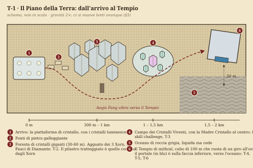


### MAPPA T-2 — FORESTA DI CRISTALLI: agguato degli Xorn (§5, tattica)

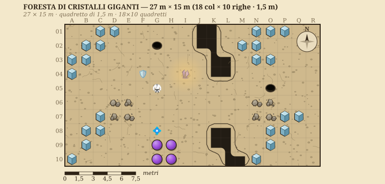

<!-- nuova-pagina -->

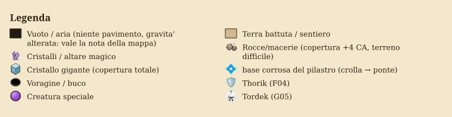

<!-- nuova-pagina -->


### MAPPA T-3 — CAMPO DEI CRISTALLI VIVENTI (skill challenge, §6)

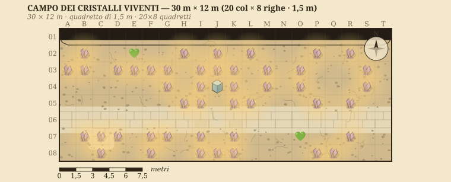

<!-- nuova-pagina -->

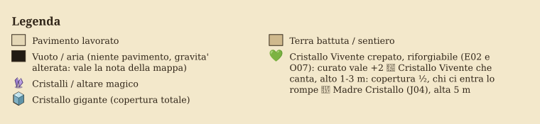

<!-- nuova-pagina -->


La runa di Varis in J05 delle stesure vecchie non si gioca (canone del §6): in
questa griglia J05 è suolo, il varco a sud del cerchio interno da cui si
arriva alla Madre Cristallo dal corridoio.

### MAPPA T-4 — TEMPIO DI MITHRAL: approccio & salto gravitazionale (§7a)

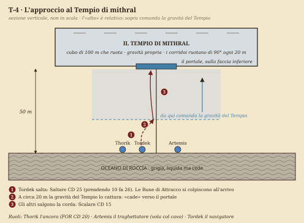


### MAPPA T-5 — ANTICAMERA DELLA MAGNETITE: la Sentinella (§7b, tattica)

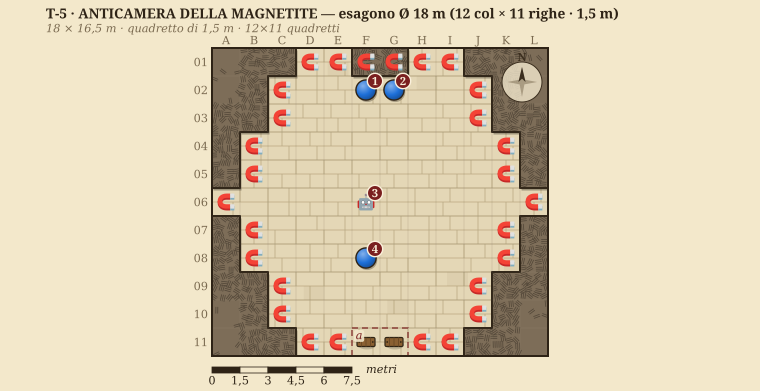

<!-- nuova-pagina -->

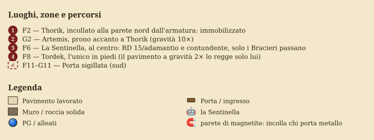

<!-- nuova-pagina -->


### MAPPA T-6 — CAMERA DELL'ALTARE: TERROS L'ANTICO (§8, tattica)

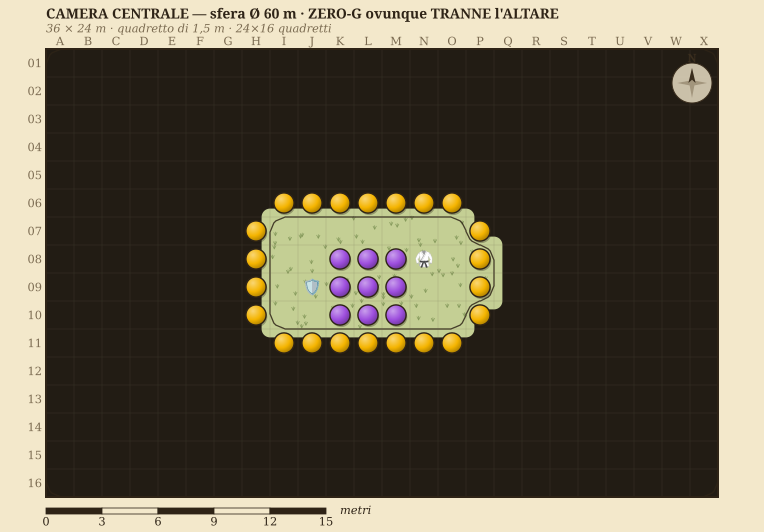

<!-- nuova-pagina -->

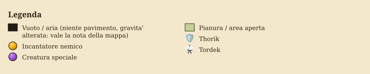

<!-- nuova-pagina -->


\page

# II · Il ritorno e gli affreschi

{{note
##### ⚠ SOLO DM
Questo capitolo è materiale del DM: non mostrarlo ai giocatori.
}}

<!-- module-type: hub -->
# ARC-07 · DEFINITIVO #2 — IL RITORNO E GLI AFFRESCHI (La Cronaca Vivente)
## Il Portale della Forgia Eterna — la Sala, gli Otto Affreschi, la Stanza della Corona


> **Il capitolo della Sala e della sua memoria.** Qui vive il sistema **«La
> Forgia Ricorda»**: gli otto affreschi, le Benedizioni, la Stanza della Corona.
> Non è un dungeon di combattimento: vive di atmosfera, scelte e conseguenze.
>
> **Stato al tavolo**: ✅ **GIOCATO** dal gruppo di oggi fino al sonno: hanno
> dormito nella Sala (R4, §0-bis). La resurrezione (cap. III) è il prossimo
> beat e non è ancora giocata. Un **gruppo nuovo** trova aperte le
> scelte che qui sono scritte come giocate (dove dormire, cosa guardare).
>
> **Quando si gioca**: **al ritorno dal Piano della Terra**, **prima** della
> resurrezione di Hella (cap. III). **Com'è il mondo a quel punto**: Topazio (Fuoco) e Smeraldo (Terra) presi; corpo di Hella
> vegliato da Therysol nella Sala; il suo spirito ha già viaggiato (i PG **non
> lo sanno**). Countdown Hammerfist all'arrivo: **~3g 20h** (> sono entrati da Terros senza riposare). **Registro completo dei riposi in
> §0-bis**; il sogno del riposo qui nella Sala è il **§7-bis**.

---

## INDICE DEL MODULO

| § | Sezione | Contenuto |
|---|---|---|
| §0 | **Quickstart DM** | in trenta secondi, dove siete, cosa stampare, cosa si consegna e quando, come si chiude |
| §0-bis | **Quick-Reference** | CD delle interazioni, countdown, la Cronaca in una pagina; box PF1e |
| §1 | **Highlight per PG** | cosa vive ciascuno tra gli affreschi (conoscenza asimmetrica) |
| §2 | **Le due Zone** | Atlante: la Sala della Forgia (ottagono) + la Stanza della Corona |
| §3 | **«La Forgia Ricorda»** | il sistema definitivo della Cronaca Vivente (regole + gancio) |
| §4 | **Gli Otto Affreschi** | A1-A8: stato dopo la Terra, interazione, cosa incidono, Sviluppi |
| §4-bis | **La rete della Sala** | cosa si può capire e da dove: i nodi d'indizio, cosa non dire, se lo divinano |
| §5 | **La Visione Condivisa** | il rito corale dei Quattro Eroi Predestinati (A2) |
| §6 | **La Stanza della Corona** | il luogo della morte di Hella: le incisioni-specchio |
| §7 | **Le Benedizioni di Moradin** | rinnovo all'Altare (sostituti delle pozioni) |
| §7-bis | **Le quattro ore rubate** | il sonno nella Sala e i quattro sogni |
| §8 | **Contingenze & fallimento** | «Se i PG fanno X»; sprecare il countdown; toccare ciò che non va toccato |
| §9 | **Echo Ledger** | conseguenze a lungo termine del beat |
| §10 | **Avanzamento** | budget PX per scena + tesoro/benedizioni pregenerate |
| §11 | **Ponte** verso la resurrezione di Hella + **Handout & Asset** |
| App. | **Mappe**: S-1 Sala ottagonale · S-2 Stanza della Corona | griglie 1,5 m, su pagina A4 a una colonna |

---

## §0 — QUICKSTART DM

> 🧭 **La serata in tre frasi.** Stasera non combatte nessuno: i tre Custodi
> tornano dal Piano della Terra nella Sala, trovano la loro vittoria incisa
> sulle pareti, guardano gli affreschi, forse aprono la Visione di A2 e
> scendono nella Stanza della Corona. L'unico avversario è l'**orologio di
> A7**, che scende a ogni sonno. Poi dormono, ognuno fa il suo sogno, e il
> corpo di Hella è pronto per la resurrezione del cap. III.

### In trenta secondi

| Domanda | Risposta |
|---|---|
| **Cosa succede** | I tre Custodi tornano dal Piano della Terra nella Sala. Le pareti hanno inciso la loro vittoria. Guardano gli affreschi, ricevono i doni, dormono, preparano il corpo di Hella al rito |
| **Chi agisce, e cosa vuole** | **Therysol** veglia il corpo e non vuole vegliarne un altro (§2). **Durik**, mosso dalla giocatrice di Hella, sta fra il corpo e il pericolo. **La Sala** incide ciò che i PG fanno. **Aegis Fang** vuole il sangue del drago (A7) |
| **Chi si oppone** | Nessuno in carne. L'avversario è l'**orologio di A7**: ogni sonno lo fa scendere |
| **Cosa decidono i PG** | quali affreschi guardare, se tentare la Visione (§5), se scendere nella Stanza (§6), dove dormire, quando chiudere e andare al rito |
| **Se fanno l'inatteso** | §8, una riga per mossa. Se interrogano la Sala con la magia: §4-bis, «Se lo divinano» |
| **Quanto dura** | circa due ore: Scena 1 dieci minuti, Scena 2 tre quarti d'ora, Scena 3 un quarto d'ora, Scena 4 venti minuti, Scena 5 mezz'ora. Se dopo un'ora e mezza non siete al sonno, comincia a tagliare |
| **Se hai un'ora per prepararti** | leggi §0, §0-bis, A1, A3, A7, A8 e la Scena 5; il resto si legge al tavolo, quando i PG ci arrivano |
| **Se manca tempo** | taglia in quest'ordine: A4, A5, la lettura di Artemis su A6, la Stanza. Non tagliare A7 (l'orologio), A3 (la catarsi), A8 (la manifestazione di Hella, che consegna H3 e la Ghianda) né il sogno di Hella |

Tutto il beat si gioca **senza combattere**: nessun nemico entra nella Sala.

**Dove siete.** Attraversato a ritroso il portale della Terra, i tre Custodi
(Thorik, Tordek, Artemis) rientrano nella **Sala della Forgia Eterna** — l'hub
divino dell'arco: un ottagono di basalto e oro, l'Altare del **Cuore di
Moradin** al centro, **otto affreschi** viventi alle pareti, il corpo di Hella
vegliato da Therysol. La Corona porta ora **due gemme** (Topazio + Smeraldo).

**Cosa fa questo beat.** È il **respiro tra due immersioni** — ma non è tempo
morto. Qui: (1) la **Cronaca Vivente** incide nelle pareti ciò che i PG hanno
compiuto (§3-4), in **entrambe** le stanze; (2) ogni PG ha un momento personale
davanti a un affresco (§1); (3) il **countdown di Hammerfist** (A7) preme sul
riposo; (4) si preparano corpo e cuore alla **resurrezione** (cap. III). È il
capitolo in cui la campagna si guarda allo specchio.

**Chi c'è.** Thorik, Tordek, Artemis (vivi); **Therysol** (veglia il corpo, ora
presente); **Durik**, il cane di Hella riforgiato, che gira attorno al corpo e non
è ancora legato a lei; **Hella** morta (spirito in viaggio — solo echi). Nessun nemico.

**Con che cosa arrivano dal cap. I.**

| Fatto | Gruppo di oggi | Gruppo nuovo |
|---|---|---|
| Hanno dormito nel Piano della Terra? | no: A7 segna **3g 20h** | se sì, **3g 08h** (§0-bis) |
| Il Seme di Varis | nello zaino di Tordek, mai toccato; il Marchio non è attivo (cap. I §6-bis) | come l'hanno lasciato; senza Seme, il sogno di Tordek si ferma alla fiera (§7-bis) |
| La visione del bazar di Varis | Artemis l'ha avuta (cap. I §6-bis) | se non l'ha avuta, vale la variante del suo sogno (§7-bis) |
| Che cosa Artemis ha detto a Tordek del Seme | è canone, ma non è scritto: chiedilo ai due giocatori prima di cominciare | lo stesso |
| La luce verde alle spalle di Thorik, al rito dello Smeraldo (eco E-07f) | l'ha avuta, e la crede di Moradin (§7-bis) | se il rito del cap. I §9 non l'ha data, il sogno delle mani fredde resta lo stesso: le mani sono di Hella comunque |
| Il Bane di Aegis Fang contro Fauci | la versione forte del 25 settembre (§4, A7) | lo ricevono stasera, davanti ad A7 |
| pf e cariche di Vigore della Forgia | come a fine Terros. Il sonno di stasera dà la guarigione naturale e ricarica il Vigore, se la Benedizione è attiva (§7, §7-bis) | lo stesso |

**Cosa stampare.** La **Quick-Reference §0-bis**; gli **handout §11** (le
iscrizioni degli affreschi, la tavola degli Otto); il PDF **Benedizioni di
Moradin**; le mappe **S-1** e **S-2**.

### ✉ Cosa si consegna, e quando

| ✉ | Handout (§11) | Si consegna | Dove nel testo |
|---|---|---|---|
| **H1** | La Tavola degli Otto Affreschi | dopo il box dell'arrivo nella Sala | §2, Zona A |
| **H2** | Le Iscrizioni (Fuoco e Moradin) | quando guardano A4, o chiedono cosa diceva la Sala | §4, A4 |
| **H3** | Il simbolo di Hella, quercia e martello | alla fine della manifestazione di A8 | §4, A8 |
| **H4** | Le carte delle Benedizioni | dopo la preghiera all'Altare | §7 |
| **H5** | Il sogno di Hella, solo alla sua giocatrice | nella Scena 5, quando tocca a lei | §7-bis |

**Come si chiude.** Gli affreschi hanno registrato la vittoria della Terra; il
portale del Tempo (A6) è all'**80%** e attende la terza tappa; il corpo di
Hella è pronto per il rito. Countdown a fine beat: **~3g 16h** (per un gruppo
nuovo che ha dormito nel Piano della Terra, 3g 04h: §0-bis) — il riposo nella
Sala costa solo **−4 h** (tariffa divina, §0-bis) e porta con sé il sogno del
**§7-bis**. → **la Resurrezione di Hella (cap. III).**

---

## §0-bis — QUICK-REFERENCE DM (una pagina)

### CD delle interazioni (tutte opzionali — nessuna obbligatoria)
| Interazione | CD | Dove |
|---|---|---|
| A1 — Benedizione dell'Osservatore (meditare 1 min) | auto | §4 |
| A2 — Visione Condivisa (TS Volontà, 2 successi su 3) | 18 | §5 |
| A3 — Catarsi di Thorik (TS Volontà; il **fallimento è il dono**, e Thorik può rinunciare al tiro) | 17 | §4 |
| A6 — Artemis legge il Tempo (Sapienza Magica) | 18 | §4 |
| A7 — Aegis Fang «sente» Fauci (appoggiare l'ascia alla cornice) | auto | §4 |
| A8 — la manifestazione di Hella (posare il corpo davanti) | auto | §4 |
| Benedizioni all'Altare (pregare 10 min, nessuna prova) | auto | §7 |
| Cronaca — leggere un pannello completato (aiuto-memoria) | 15 | §3 |
| Dettagli nascosti (scritti solo per A1) | Osservare 20 | §4 |

### Countdown di Hammerfist (A7) — l'orologio che non si ferma

> 📍 **Questo è il file che possiede l'orologio.** cap. I §8c-4 e la regia di
> sessione ne riportano solo l'estratto: se i numeri divergono, **vale questo**.

#### Le due tariffe del riposo

| Dove dormono | 8 ore di sonno costano | Perché |
|---|---|---|
| **Ovunque**: Faerûn, Sottosuolo, Piano del Fuoco, Piano della Terra | **−12 h** | il sonno più il campo, le guardie, il rimettersi in marcia (`PortaleForgia-P1` r.987) |
| **Sala della Forgia Eterna** | **−4 h** | la Sala è un luogo divino: **il tempo vi scorre più lento**. Otto ore di sonno vero ne costano quattro al mondo di sopra |

⚠️ **La tariffa della Sala era −6 h: ora è −4 h.** Vale **per tutti** i riposi
nella Sala, anche quelli **già giocati** (il ri-prezzo è già dentro il registro
qui sotto). I giocatori **non lo sanno e non devono saperlo**: non annunciare
mai lo sconto. Se qualcuno chiede perché il timer è sceso meno del previsto, la
risposta è dentro il mondo — *«Moradin non conta le ore come le contano gli
uomini»* — non è una concessione del DM.

**Lo sconto vale solo per il sonno.** Le ore da svegli costano per intero,
nella Sala come fuori: un pomeriggio davanti agli affreschi è un pomeriggio
del mondo di sopra, come l'ora del rito.
**E vale solo prima del rito.** Dopo il rito la Sala conta per intero anche
il sonno: otto ore di sonno costano otto ore, come scrive cap. III §9
. Il registro qui sotto è giocato, e non
cambia.

#### Il registro dei riposi (giocato + previsto)

**Convenzione di calcolo:** il valore pubblicato **~3g 18h al rientro dal Piano
della Terra**, calcolato con la tariffa vecchia della Sala (−6 h), è l'**ancora**;
col ri-prezzo di R2 diventa **3g 20h**, il numero da leggere su A7 all'arrivo, e comprende già i riposi **R1 e R2**. Non
ri-sottrarli: sono dentro. Da lì in poi il registro è additivo.

| # | Dove | Stato | Effetto | Orologio |
|---|---|---|---|---|
| **R1** | Piano del Fuoco, prima della piramide | ✅ giocato | dentro l'ancora | — |
| **R2** | **Sala**, dopo il Piano del Fuoco | ✅ giocato | **+2 h** (ri-prezzato −6 h → −4 h) | **3g 20h** |
| **R3** | Piano della Terra, prima della camera di Terros | ❌ **NON fatto** — sono entrati da Terros senza dormire | 0 | **3g 20h** |
| **R4** | **Sala della Forgia**, dopo Terros e prima del rito | ✅ **giocato: dormono nella Sala** | **−4 h** | **3g 16h** |
| — | il rito di resurrezione | prossimo | ~1 h | 3g 15h |
| — | viaggio a −1.000 (cap. IV) | previsto | **0 h** — il viaggio non consuma orologio; il Rubino li riporta nel Cuore della Montagna (cap. VII §3) | 3g 15h |
| — | **consegna all'ARC-08** | | | **≈ 3g 15h** |

> ✅ **RAMO RISOLTO AL TAVOLO.** Hanno tirato dritto su Terros senza riposare e
> hanno dormito **qui**, nella Sala: l'orologio è a **3g 16h** e la consegna
> all'ARC-08 sarà a **≈ 3g 15h** → **Fase 0 piena** (cap. VII). Il ramo
> «Fase 0 accorciata» **non si applica**. Delle otto ore di sonno il mondo ne
> ha contate quattro, e in quelle rubate è successo il **§7-bis**.

**Un gruppo nuovo che ha dormito nel Piano della Terra** (R3 fatto, −12 h) arriva
nella Sala a **3g 08h**, ed esce a **3g 04h** se dorme qui: si parte da quelle due
righe della tabella di A7.

**Dove sta il pericolo.** La soglia dei **2 giorni** (§8) è lontana: da 3g 16h
ne servono **quattro ordinari** (−48 h) per scendere sotto; tre la sfiorano (2g 04h). **Il tempo non è più la minaccia principale di questo beat**:
la minaccia è diventata il *costo delle scelte*. Evita di fingere un'urgenza che i
numeri non sostengono; mostra l'affresco e lascia che sia lui a parlare.

#### Cosa mostra A7, valore per valore

L'affresco cambia quando cambiano le ore del mondo di sopra, cioè a ogni
riposo: mostra l'ultima riga che l'orologio ha raggiunto, e la breccia solo
sotto i due giorni. **Mostralo ogni volta**: è l'unico
posto in cui i PG vedono il prezzo di ciò che hanno appena scelto.

| Orologio | Cosa si vede sull'affresco |
|---|---|
| **3g 20h** | l'orda si è **accampata**: fuochi ordinati fino all'orizzonte, le torri d'assedio ancora **in costruzione**. Le mura sono intatte. Sui camminamenti si vedono figure che portano acqua |
| **3g 16h** | le torri d'assedio sono finite, e una avanza su rulli verso il lato est, a metà strada dalle mura. Sui camminamenti le figure con l'acqua si sono fatte più rade, e una sta ferma a guardare in basso |
| **3g 08h** | **prima ondata**. Una torre è in posizione contro il lato est; sui camminamenti ci sono i primi corpi coperti. Il fumo non sale più dritto: c'è vento |
| **3g 04h** | la torre di **nord-ovest** ha preso un colpo che non è stato riparato, e alle porte lavora un **ariete**. Nella pietra dipinta c'è una **crepa sottile che non si richiude più** |
| **sotto 2g** | **breccia aperta**, combattimento *dentro* le mura → scatta il §8: pannello velato su A8 e ARC-08 in Fase 0 dura |

> **Read-aloud — l'affresco A7, ogni volta che il timer scende.** *I
> numeri nanici nell'angolo dell'affresco sono cambiati, senza un rintocco: la
> volta prima erano altri. Nella pietra dipinta qualcosa si è mosso mentre
> nessuno guardava, una torre più vicina nel fumo, un tratto di camminamento
> vuoto che prima non lo era. La battaglia non aspetta nessuno.*

### La Cronaca, in tre righe
Ogni gesta compiuta **incide un pannello** negli affreschi della Sala **e**
nelle incisioni della Stanza della Corona. Al ritorno dalla Terra: **A5 si
chiude** («La Forza Sostenuta»), **A6 si fa nitido all'80%**, **A2 sale
all'80%** (la 4ª figura, Hella, prende contorno), **A8 al 60%**. Meditare
davanti a un pannello completato = **Benedizione della Cronaca** (§3).

### 🐾 Supporto Pathfinder 1e (dove il 3.5 è vago) — opzionale, dichiarato
> - **Effetti «morale/sacro» cumulativi**: il 3.5 non fa sommare due bonus
>   di tipo morale; le benedizioni degli affreschi sono **sacre** (fonte
>   divina diretta) e in PF1e i bonus sacri di fonti diverse **non** si
>   sommano tra loro ma **si sommano** ai morale. Usa questa distinzione per
>   evitare lo stacking illimitato: i bonus sacri degli affreschi non si
>   sommano fra loro. Se due sono attivi insieme (A1, A3, A8), restano attivi
>   tutti e due, e per ogni tiro vale il più alto, come per due bonus dello
>   stesso tipo nell'SRD. Per Thorik, che ha già +2 sacro a tutti i TS dalla
>   Risonanza della Corona con Aegis Fang, i premi di A1, A3 e A8 diventano
>   bonus **morale** dello stesso valore, e si sommano al sacro
>.
> - **«Guarigione emotiva» (A3)**: vale il numero del §4 (3d8+13 col
>   fallimento, 2d8+13 col successo), sul solo Thorik e **una volta sola** nel
>   beat, non a ogni visita.

---

## §1 — HIGHLIGHT ASIMMETRICI PER PG

> La Sala offre a ciascuno uno specchio diverso. Da' a ognuno **il suo** momento
> — e ricorda: Hella non parla, si manifesta.

### 🛡️ THORIK — l'unto che ancora non porta la corona
- È a LUI che gli affreschi parlano: Moradin gli **gira la testa** (A1), la sua
  anima è dipinta sulla parete (A3), Aegis Fang riconosce il sangue del drago
  (A7). Thorik è il fulcro della Cronaca.
- **A3 — la catarsi.** Rivivere il momento in cui prese la Corona (e perse
  Hella) è il suo beat più intimo: qui il **pianto è forza**, non debolezza (il
  fallimento del TS è il dono). Gioca lento, senza fretta.
- **A7 — la ferita che ritorna.** Aegis Fang nomina **Skullcrusher il Nero** e
  **Thorgrim Barbadiferro**: si salda con la **visione spirituale** che Thorik
  ebbe al risveglio della Corona (cap. I §1, dove combatté Fauci senza
  corpo). Ora sa *perché* quel drago conta. È un peso che diventa scopo, più che
  un'informazione tattica.

### ⚒️ TORDEK — il testimone
- Non è il protagonista degli affreschi, ed è giusto così: il suo ruolo qui è
  **esserci per gli altri** (regge Thorik nella catarsi senza giudicare; è lui
  che, sfiorando la Corona, riceve il **frammento onirico** di Hella — Piano della Terra, §1).
- I **Bracieri** (ora completi, con la loro coscienza) commentano gli affreschi
  con una riga da vecchio fabbro. Davanti ad A1:

  **I Bracieri (vecchio fabbro, a mezza voce):** *«Quello sì che sapeva battere il ferro.»*

  Piccolo colore, grande personaggio.

### 🔮 ARTEMIS — il predone davanti alla porta del Tempo
> A6 **non** gli mostra la partita a scacchi di
> Lathander/Mask: **quella visione non è mai stata giocata e Artemis non la
> conosce**. I poteri «Luce di Lathander / Ombra di Mask» che porta li ha già
> **dall'Anello** (reforging alla Forgia — scheda Ring), non da un dono
> divino. Qui A6 è tutt'altro (sotto).
- Davanti ad **A6 (il Tempo)** l'Anello vibra sul caos temporale: Artemis
  **legge** la sovrapposizione −1000/1372 e capisce, prima di tutti, che il
  Topazio+Smeraldo stanno **aprendo una porta** (Sapienza Magica CD 18). È
  curiosità **avida**: una porta sul passato è il più grande «mercato» che
  esista — tesori dimenticati, occasioni. Il DM tenga il gancio: al #4 la sua
  cupidigia avrà cosa mordere (e Vatore lo aspetta).
- Se ha preso il **Marchio di Varis** (cap. I §6-bis), qui l'Anello lo
  «pizzica» ogni volta che passa davanti ad A6: il marchio e il caos temporale
  risuonano (conseguenza canonica del Marchio).

### 🌙 HELLA — la promessa dipinta (solo manifestazione, mai dialogo)
- Hella non ha coscienza di ciò che accade: il suo spirito ha attraversato
  l'Incudine del Mondo e ora è trattenuto nel Sogno della Terra, dalle radici
  del suo Voto (§8, cap. III §6). Ma **il suo corpo** è nella Sala, e la Forgia lo tiene: se i PG lo
  posano davanti ad **A8** (§4), lei **si manifesta senza parole** — una mano
  premuta sul vetro dall'interno, un simbolo lasciato (**Quercia e Martello
  intrecciati**), poi il nulla. È speranza, non conversazione. *(Nessuna
  battuta lucida: coerente con l'asimmetria — frammento onirico canonizzato.)*
- **La giocatrice di Hella muove Durik** dalla Scena 1 alla Scena 4.
  Decide dove va il cane, a chi si avvicina e quando fa il suo click di roccia;
  non lo fa parlare né combattere, e non gli fa sapere niente che Durik non
  senta da sé. Durik resta sempre fra il corpo e ciò che sente come pericolo:
  se lei vuole allontanarlo dal corpo, il cane torna indietro. Nella Scena 5 la
  giocatrice riceve il sogno di Hella.

---

## §2 — LE DUE ZONE (Atlante)

### SCENA 1 — Il ritorno nella Sala

**In scena** — Dove: la Sala — Chi: Therysol · Durik

**Comparse**

| Chi | Com'è | Come parla |
|---|---|---|
| Therysol | una tiefling mezzodrago: veglia il corpo di Hella accanto all'Altare, sul lato sud, da giorni, e ora è presente (§0). **Want**, che non riguarda i PG: non vegliare un altro corpo. Ha perso il fratello nel Piano del Fuoco. La scheda intera è in cap. III §2 | in silenzio, e quando parla usa frasi corte, non chiede mai niente e di Hella parla al presente. Sa di aver contato i respiri che il corpo non faceva, e che il corpo si gira verso sud: l'ha rimesso dritto più volte. Non sa niente di dove sia lo spirito. Se spostano il corpo non lo impedisce, cammina accanto. Se le chiedono di risvegliare Hella, spiega che serve il Cuore di Moradin e il dono di ognuno (§8) |
| Durik | il cane di Hella, riforgiato nel Piano della Terra: mithral intrecciato a pietra scura, occhi di topazio. Gira attorno al corpo e si mette sempre fra il corpo e ciò che sente come pericolo (cap. I §9) | non abbaia: fa un click di roccia. Non risponde ai PG, non è ancora di Hella: si lega a lei al rito (cap. III §7). Lo muove la giocatrice di Hella (§1) |

Se qualcuno le chiede del corpo, Therysol dice quello che sa e niente di più:

**Therysol (piano, senza alzarsi):** *«L'ho rimessa dritta. Si gira ancora verso sud.»*

È il primo indizio della rete (§4-bis, N1): a sud c'è A8.

**Cosa sa fare Therysol** (Esperto 2 / Acolita 6).
Lancia spontaneamente tre incantesimi di 1° livello e due di 2° al giorno,
cinque e quattro con le perle, scelti fra *cura ferite leggere*,
*benedizione*, *cura ferite moderate*, *aiuto* e *ristorazione inferiore*.
Se gliele chiedono, cura. Le sue divinazioni sono *individuazione del
magico* e *guida*: sugli affreschi vale la riga di «Se lo divinano», e di
dove sia lo spirito non sa niente. Non ha incantesimi che riportano in vita:
a chi glielo chiede risponde che non è il suo rito.

**Chi si trova qui**

| Chi | Nella Sala |
|---|---|
| **comando** | nessuno: Moradin parla dagli affreschi e all'Altare, ma non dà ordini |
| **culto** | l'Altare del Cuore di Moradin: la preghiera rinnova le Benedizioni (§7) |
| **rimedi** | le Benedizioni e il Vigore della Forgia (§7); le cure di Therysol, qui sopra |
| **bottega** | nessuno: non c'è un fabbro, e niente da comprare né da vendere. La Forgia Eterna arde solo per i riti: un'arma messa sul suo fuoco senza un rito torna intatta e fredda |
| **messaggi** | nessuno: A7 mostra Hammerfist, ma nessuno nella Sala porta una voce fin là |
| **guardia** | Durik, fra il corpo e il pericolo; Therysol, che veglia |

La scena è l'arrivo nella Sala (Zona A). La Stanza della Corona (Zona B) ha la
sua scena, la 4 (§6).

### ZONA A — La Sala della Forgia Eterna (l'ottagono divino)

> **Read-aloud — la Sala, l'arrivo.** *Il
> portale vi posa sul pavimento di adamantio tiepido, e la Sala vi accoglie
> come una madre i figli tornati dalla guerra: senza una parola, con la luce
> dorata di sempre. Intorno, otto pareti e otto affreschi grandi come porte di
> titani; al centro l'Altare del Cuore di Moradin, dove la Forgia arde di un
> fuoco che non consuma. Dopo il peso del Piano della Terra, respirare qui è
> come bere acqua di fonte: l'aria sa di ozono e di pietra pulita, e per un
> istante il mondo non frana. Ma le pareti sono cambiate: la Sala ha guardato
> ciò che avete fatto, e lo ha scritto. Che fate?*

✉ **Si consegna qui: H1**, la Tavola degli Otto Affreschi.

**Dati per il DM (non da leggere).** Ottagono Ø 40 m (26 quadretti), soffitto
15 m; muri basalto+oro (Durezza 20); 4 colonne sacre (1 mithral a nord, 3
adamantio); Altare centrale 2×2 m con la Forgia Eterna; **Portale P1** a nord
(sempre aperto, verso la Stanza della Corona). Pavimento perfetto (corsa ×4
possibile). Zona **sicura**: nessun nemico. Vedi **MAPPA S-1**.

**Cosa cambia dopo la Terra (stato degli affreschi all'arrivo):**
- **A4 (Fuoco)**: chiuso e statico da tempo (vulcano spento, dominio).
- **A5 (Terra)**: si **chiude ORA** → «La Forza Sostenuta» (§4).
- **A2 (Quattro Eroi)**: sale all'**80%** — la 4ª figura (Hella) prende contorno.
- **A6 (Tempo)**: **80%**, il portale dorato pulsa: pronto per il #4.
- **A8 (Ritorno)**: **60%** — i quattro e Hammerfist sullo sfondo.
- **A7 (Hammerfist)**: countdown **~3g 20h** all'arrivo, **3g 16h** dopo il
  riposo (§0-bis). Mura più segnate, orda accampata, torri ancora in costruzione.

### ZONA B — La Stanza della Corona (il luogo della morte)
**Read-aloud**: si legge in apertura della Scena 4 (§6), quando il gruppo passa il Portale P1.

**Terreno (callout):** sala rettangolare di 15 × 19,5 m (vedi **MAPPA S-2**); trono
a nord su dais +1,5 m (ora vuoto: la Corona è di Thorik); colonne, statue e
alcove come nella mappa; si entra da sud, dal Portale P1. Ora è un **Santuario Sicuro**: sotto
l'effetto di *Consacrare* automatico, come l'incantesimo SRD: i non morti hanno
−1 ai tiri per colpire, ai danni e ai TS, e le prove per scacciarli hanno +3 sacro. Vedi §6 per le incisioni.

---

## §3 — «LA FORGIA RICORDA»: il sistema definitivo della Cronaca Vivente

> **Questa è la casa del sistema** (nato nel Piano della Terra, cap. I §10). Regole
> uniche, valide per tutto l'arco.

**Il principio.** Gli affreschi della Sala e le incisioni della Stanza della
Corona **non sono arte**: sono la **memoria di Moradin**, che scrive la storia
dei Custodi mentre accade. Alcuni pannelli sono **statici** (storia antica),
alcuni **progressivi** (si chiariscono col valore dimostrato), alcuni **portali**
(si aprono e poi si chiudono), uno è **live** (Hammerfist in tempo reale), uno
è **vuoto** (il finale, che i PG stanno scrivendo).

**Come un beat incide un pannello.** Ogni tappa maggiore dell'arco fa due cose,
**in entrambe le stanze**: chiude/apre un pannello e ne chiarisce altri (tabelle
di progressione in §4). Il DM lo descrive al ritorno: i PG **vedono** la loro
storia guadagnata.

**Gancio meccanico — «Benedizione della Cronaca» (unico, non-cumulabile).**
Meditare 1 minuto davanti a un pannello **completato**: **1/giorno per
pannello**, concede **+1 sacro** a UN tiro legato al tema del pannello (la
Forza Sostenuta di A5 → una prova di FOR o un TS Tempra; A1 «La Fede» ha un
effetto suo, scritto nel §4). Massimo **un** bonus della Cronaca attivo alla volta, e quello di A1 dura 24 h:
chi ha meditato davanti ad A1 non prende il +1 di A5 o di un altro pannello
finché A1 è attivo (PF1e:
i sacri non si sommano tra loro). Il tetto vale per le meditazioni: i doni di
A3 e di A8 si prendono lo stesso, e per ogni tiro vale il sacro più alto (box
PF1e del §0-bis). In più, un Custode può **«leggere» un pannello
completato** (Sapienza/Conoscenze CD 15) per rammentare un **fatto vero** già
vissuto — aiuto-memoria diegetico su gesta/nemici passati, **mai** divinazione
sul futuro.

**Regola d'oro (coerenza).** La Cronaca **non anticipa**: A2 e A8 mostrano un
futuro *possibile*, non garantito: il destino non è scritto, e un PG può ancora
fallire o cadere. Gli affreschi sono uno specchio e non un binario, e non
servono a railroadare.

---

## §4 — GLI OTTO AFFRESCHI (stato dopo la Terra, interazione, cosa incidono)

### SCENA 2 — Gli otto affreschi

**In scena** — Dove: gli affreschi — Chi: Moradin · Aegis Fang · Hella

**Comparse**

| Chi | Com'è | Come parla |
|---|---|---|
| Moradin | la figura dipinta di A1, alta dieci metri, che batte sull'incudine. Al tocco della Corona gira la testa verso Thorik | una frase sola, per Thorik, poi sorride e torna a battere (A1). In A3 parla dopo il pianto |
| Aegis Fang | l'ascia di Thorik, appoggiata alla cornice di A7. Vuole il sangue del drago, da mille anni | vibra e parla, ed è un evento rarissimo: nomina Skullcrusher e Thorgrim (A7) |
| Hella | la sua manifestazione in A8, per dieci battiti: semitrasparente, serena | non parla. Preme una mano sul vetro dall'interno e lascia inciso il suo simbolo |

> **Proprietà comuni.** 8×5 m; cornice oro+adamantio (irremovibile, Durezza 20);
> superficie di **vetro liquido** che si muove quando non osservata; **vetro
> indistruttibile** (divinamente protetto). Reagiscono al tocco del portatore
> della Corona e degli altri artefatti. *Dettagli nascosti: Osservare CD 20.
> Il modulo li scrive solo per A1; sugli altri un tiro alto mostra la fattura
> del vetro e dell'oro, mai il futuro.*

**Come si gioca la scena.** I PG girano l'ottagono nell'ordine che vogliono.
Leggi il box dell'affresco a cui si fermano, poi chiedi cosa fanno: ogni
affresco ha la sua interazione e i suoi Sviluppi qui sotto. A7 si mostra a
ogni riposo anche se nessuno lo guarda.

### A1 — «L'Alba del Mondo» (NORD · statico)

<!-- scelta del DM: versione vincitrice del voto cieco, eccezione al tetto voluta -->
> **Read-aloud — gli affreschi, A1 «L'Alba del Mondo».** *Il primo affresco mostra un'era in cui il mondo era ancora caos. Al centro,
> alto dieci metri, MORADIN: muscoli di granito, barba intrecciata d'oro,
> mithral e adamantio, e negli occhi le fiamme della creazione. Davanti a lui
> un'incudine titanica, grande quanto una montagna. Nella sinistra, Frostforge
> — il martello leggendario, testa di adamantio stellare, manico di ferro
> grezzo. Nella destra, la CORONA DI ADAMANTIO in fase di nascita, che brilla
> come una stella appena accesa.*

> **Read-aloud — gli affreschi, A1, dopo che hanno guardato.** *Intorno,
> il caos primordiale: fiamme alte chilometri, fulmini che spaccano il cielo,
> pietra liquida che ribolle, ombre antiche che tentano di avvolgere tutto.
> Ma Moradin è calmo. Guarda la Corona con amore paterno, e forgia per
> proteggere figli nanici che ancora non esistono. Thorik, quella Corona
> sulla tua fronte è la stessa. Diecimila anni non l'hanno cambiata. Cambia
> solo chi la porta.*

**Dati per il DM (non da leggere).** La figura è Moradin; il martello è
Frostforge, testa di adamantio stellare e manico di ferro grezzo; la corona è
la Corona di Adamantio. Il box li nomina già.

*Dettagli nascosti (Osservare CD 20): altre divinità osservano — Corellon per
gli elfi, Garl per gli gnomi, Gruumsh con invidia orchesca; nella fucina, altri
artefatti nascono — un Aegis Fang primordiale, altri martelli senza nome.*
- **Interazione (Thorik, tocco della Corona).** Moradin **gira la testa** e lo
  guarda attraverso il tempo, mentre lontano batte un colpo d'incudine:

  **Moradin (paterno, a Thorik):** *«Figlio della Pietra. Porti il mio dono più prezioso. Portalo con onore, con umiltà, con speranza. Non deludere la compagna caduta. Non deludere Hammerfist. Completa il destino.»*

  Poi Moradin sorride e torna a battere.
- **Effetto — Benedizione dell'Osservatore.** Chi medita 1 min: **+1 sacro a
  tutti i TS per 24 h** (Thorik +2). Si rinnova una volta ogni 24 ore vissute. È la Benedizione della Cronaca
  di A1, «La Fede», e prende il posto del +1 a un tiro del §3: davanti ad A1 non
  si prendono tutte e due.
- **Sviluppi.** A1 non cambia mai — è l'ancora. Ma se Thorik gli parla dopo aver
  fallito qualcosa di grave (una promessa rotta, §Echo), Moradin **non gira la
  testa**: la parete resta pietra. Un silenzio che pesa più di mille parole.

### A2 — «I Quattro Eroi Predestinati» (NORD-OVEST · progressivo → 80%)

> **Read-aloud — gli affreschi, A2.** *Quando
> siete partiti, questo affresco era nebbia: quattro sagome vaghe contro
> qualcosa di indistinto. Dopo il Fuoco e la Terra la nebbia si è quasi
> diradata, e le sagome hanno una faccia. Un nano con una stella sulla fronte
> e un'ascia che vibra e canta; un nano più snello, le mani avvolte di ki
> dorato; un umano con un anello che pulsa e scaglia raggi viola. La quarta
> figura, che fino a ieri non c'era, prende contorno: una druida cinta di luce
> verde, tre treant attorno a lei come guardie. È Hella. La parete la disegna
> un colpo di scalpello alla volta, mentre voi la riportate indietro.*

**Progressione** (80% dopo la Terra): riconoscete l'equipaggiamento esatto, lo
sfondo cristallino. *La quarta figura si «riempie» perché Hella sta per
tornare — presagio della resurrezione, non garanzia.*
- **Interazione corale:** la **Visione Condivisa** → §5.
- **Sviluppi.** Se al #3 la resurrezione riesce, A2 salta al 90%; se il ramo del
  rifiuto viene giocato (cap. III), la quarta figura **torna nebbia** — la
  Cronaca registra anche ciò che non è stato.

### A3 — «La Visione del Risveglio» (NORD-EST · personale Thorik)

> **Read-aloud — gli affreschi, A3.** *Questo
> affresco mostra eventi di pochi giorni fa, e la figura dipinta sei tu,
> Thorik. Si avvicina esitante al trono della Stanza della Corona e tocca la
> Corona. Poi il lampo di luce dorata, e il campo di battaglia dove hai
> combattuto fianco a fianco con gli eroi che ti hanno preceduto. Fra loro c'è
> Thorgrim Barbadiferro, barba grigia, che mille anni fa portò la tua stessa
> ascia. Nel frastuono senza suono dell'affresco muove le labbra:
> «Portala bene, fratello. Ora è tua.» All'alba la luce dorata inonda il
> campo, e la Corona non è più posata: è fusa alla fronte, calda come pelle.
> L'affresco si ferma dove comincia il presente, come se la Sala avesse
> aspettato te per finire di dipingerlo.*

L'affresco dipinge solo il passato: il tocco, il lampo, Thorgrim che gli passa
l'ascia. La visione del futuro che Thorik ebbe risvegliando la Corona (Fauci di
Palude e le Cantitrici, in forma spirituale) resta sua, e la Sala non la
mostra.


- **Interazione (Thorik osserva 1 min, TS Volontà CD 17 — il fallimento è il
  dono).**

  **Esito — fallimento:** rivive tutto — paura, speranza, la **perdita di Hella**
  — e **piange**; catarsi. La Corona brilla come *Daylight*.

  **Moradin (dopo il pianto, piano):** *«Piangere non è debolezza. È forza. Riconoscere il dolore e continuare: questo è coraggio.»*

  → **guarigione 3d8+13 pf** + **+2 sacro Volontà 24 h**.

  **Esito — successo:** resta composto, commosso; guarigione minore 2d8+13.

  **Esito — rinuncia:** se il giocatore dichiara che Thorik si lascia andare, non tira, e
  vale come fallimento: la catarsi è una scelta sua.
  ⚠ Non SRD: l'SRD lascia rinunciare al tiro salvezza solo contro un
  incantesimo, e qui la regola vale per un effetto divino che non lo è.
- **Regia — il pianto lo racconta il giocatore.** Prima del tiro chiedi:
  *«Che cosa rivedi per primo?»* L'**invenzione del giocatore** entra nel
  canone, e ha i denti: la parete la dipinge, e da quel momento chiunque passi
  davanti ad A3 la vede, chiunque sia. Il ricordo più intimo di Thorik diventa
  pubblico.
- **Sviluppi.** Dopo la resurrezione, A3 **aggiunge una scena**: Hella viva che
  posa una mano sulla spalla di Thorik. Chiude il cerchio del lutto.

### A4 — «Il Portale del Fuoco» (OVEST · portale CHIUSO)
Già attraversato e vinto: la superficie, un tempo lava liquida e reale, è ora
**statica** — il vulcano spento, il lago di lava calmo. Simbolo di **dominio**.
Non serve tornarci. *(La sua iscrizione originale — «Il Fuoco purifica la
memoria…» — è ora un handout, §11.)*

✉ **Si consegna qui: H2**, le Iscrizioni, se guardano A4 o chiedono cosa
diceva la Sala.
- **Sviluppi.** Nessuno: è memoria conclusa. Colore: se Tordek gli passa
  vicino, i Bracieri (metà Fuoco) si scaldano di nostalgia.

### A5 — «Il Portale della Terra» (EST · portale che si CHIUDE ORA) → «La Forza Sostenuta»
Al ritorno, la superficie liquida della Terra **si solidifica** e diventa il
pannello-conseguenza del Piano della Terra.

> **Read-aloud — gli affreschi, A5, la Terra che si chiude.** *L'affresco
> di est, che era una finestra di gravità e cristallo, si raffredda come un
> ferro tolto dal fuoco, dal rosso al grigio. La scena si fissa: tre figure
> reggono un altare mentre una montagna vivente si dissolve in polvere di
> stelle che brilla. Sul margine, piccola e quasi nascosta, una zampa di
> pietra si solidifica, con occhi di topazio. La Forgia ha visto anche lui.*
- **Cosa incide:** «La Forza Sostenuta» — i tre eroi + Durik che prende forma.
- **Benedizione della Cronaca:** +1 sacro a una prova di FOR o TS Tempra.

### A6 — «Il Viaggio Attraverso il Tempo» (SUD-OVEST · temporale → 80%)

> **Read-aloud — gli affreschi, A6 «Il Viaggio Attraverso il Tempo», 1 di 2.** *Questo affresco fa
> male a guardarlo a lungo: due scene sovrapposte, come una doppia
> esposizione che l'occhio rifiuta di separare. Nella prima, mille anni fa,
> Hammerfist è giovane, le mura appena erette; i nani respingono un'orda di
> orchetti, e un drago nero giovane si tuffa sulle fortificazioni. Nella
> seconda è adesso: la stessa fortezza assediata, le mura segnate dal fumo,
> un'orda sterminata. Sopra gira un drago enorme dalle ali nere, dello
> stesso sangue del primo e con mille anni in più. Le due scene si alternano
> ogni tre battiti, e nessuno di voi sa dire quale sia quella vera.*

> **Read-aloud — gli affreschi, A6, 2 di 2, dopo tre battiti.** *Dopo la Terra
> le immagini si mettono a fuoco, e al centro della doppia esposizione pulsa
> un portale dorato. Una porta. Sul passato. La Corona sulla fronte di
> Thorik, con due gemme accese, risponde al suo battito e si scalda. Che
> fate?*

**Dati per il DM (non da leggere).** La prima scena è l'**Anno −1000**, la
seconda l'**Anno 1372**. L'orda di oggi è l'esercito della Mano Rossa, e il
drago è **Fauci di Palude**, dello stesso sangue del drago giovane: quello è il
capostipite della stirpe, che i PG riconosceranno (A7). Se chiedono, dillo.

**Attivazione:** il portale del Tempo si apre con **Topazio +
Smeraldo** (che i PG ora hanno), ma **non adesso**: se provano ad attraversarlo
prima del rito, il varco non si apre: conta quattro, cioè si apre per i quattro
Custodi insieme (cap. III §8-ter), e Hella è ancora morta. Lo apre la Corona alla soglia
del cap. III; il **Rubino NON apre il portale** — si
accende **solo alla vittoria antica** e riporta i PG al 1372 (cucitura al
Cuore della Montagna → cap. VII).
- **Interazione (Artemis — NON la visione divina).** L'Anello vibra sul caos
  temporale; **Sapienza Magica CD 18**: Artemis capisce che la porta si sta
  aprendo e *dove* porta (il passato). Beat di **curiosità avida** (§1). Nessun
  effetto meccanico regalato: la ricompensa è **sapere per primo**. Se la prova
  fallisce, Artemis vede la doppia esposizione e basta: niente di male, e lo
  saprà con gli altri al cap. III, quando la Corona apre il varco.
- **Se provano ad attraversarlo.** Il vetro resta vetro, e la Corona si
  scalda appena. Sotto la mano il portale dorato pulsa quattro volte, e il
  quarto battito è più debole degli altri:
  è la porta fisica del nodo N3 (§4-bis).
- **Sviluppi.** Alla vittoria del cap. IV, A6 va al 100% e il Rubino si accende: la
  scena si unifica in una sola linea temporale — la profezia compiuta.

### A7 — «La Battaglia di Hammerfist» (SUD-EST · LIVE)
Hammerfist **adesso**, aggiornata a ogni riposo (§0-bis): l'orda, le torri d'assedio,
**Fauci di Palude** in volo, e un **timer** in numeri nanici. All'arrivo:
**~3g 20h** all'arrivo, **3g 16h** dopo il riposo nella Sala (un gruppo nuovo
che ha dormito nel Piano della Terra: 3g 08h e 3g 04h). È l'orologio del
beat: il registro completo dei riposi e la progressione dell'affresco stanno in
**§0-bis «Countdown di Hammerfist»**, e lì c'è il box da leggere.
- **Interazione (Aegis Fang, appoggiata alla cornice, come nel Piano della
  Terra, cap. I §1).** L'ascia **vibra e parla** (evento rarissimo), e la
  lama di Aegis Fang trema contro la cornice:

  **Aegis Fang (voce di metallo, a Thorik):** *«Drago. Fauci di Palude. Il capostipite della sua stirpe, Skullcrusher il Nero, cadde sotto i miei colpi mille anni fa. Mi impugnava Thorgrim Barbadiferro. Il sangue riconosce il sangue. Quando lo incontrerai, io sentirò. Canterò il canto di morte dei draghi. E lui tremerà.»*

  Poi Aegis Fang tace, e la lama smette di tremare.
  - **Effetto — Bane Draconico specifico (permanente, solo vs Fauci di Palude):**
    **+1d6** danni oltre il *Dragondoom* dell'ascia
    (per un gruppo futuro), e
    **1/incontro (azione gratuita)** infliggere *Scosso* a Fauci 1d4 round
    (Volontà CD 22 nega; se fallisce, ha il flashback ancestrale della morte del
    capostipite). *Questo prepara meccanicamente il boss di Hammerfist (ARC-08),
    e si intreccia col carry-over «La Forgia ricorda le ferite» del #4.*
  - **Il gruppo di oggi** ha avuto al tavolo, nella serata del 25 settembre, una versione più
    forte, e tiene quella: contro Fauci di Palude **+2 al tiro per colpire,
    +3d6 ai danni, critico ×4**, più lo *Scosso* qui sopra; contro gli altri
    draghi vale il *Dragondoom*.
- **Sviluppi.** Ogni riposo qui fa avanzare il timer: descrivi il cambiamento
  (una torre nuova, una breccia). Se i PG «sprecano» il countdown → §8.

### A8 — «Il Ritorno Trionfale» (SUD · vuoto → 60%)
La tela un tempo vergine ora è al **60%**: i quattro (Hella compresa, viva) e
Hammerfist sullo sfondo, i festeggiamenti abbozzati. È il finale che i PG stanno
dipingendo con le loro scelte.
- **Interazione (posare il corpo di Hella davanti — manifestazione muta).**
  Leggi il box solo dopo che il corpo è davanti alla tela.

> **Read-aloud — gli affreschi, A8, la manifestazione.** *Il
> corpo di Hella è davanti alla tela, e la luce verde della sua anima
> druidica esce dalle ossa e tocca il vetro nel silenzio. Per dieci battiti
> del cuore Hella appare nell'affresco, semitrasparente e serena. Non parla.
> Preme una mano contro il vetro freddo dall'interno, come chi saluta
> attraverso una finestra ghiacciata, e dove tocca lascia un segno inciso,
> una quercia e un martello intrecciati che brillano. Poi svanisce, e il
> segno resta sul vetro a dire una cosa sola: tornerò.*

✉ **Si consegna qui: H3**, il simbolo di Hella.
- **Effetto.** Nessun dialogo (asimmetria). **+1 sacro a tutti i TS per 1 ora**
  (speranza rinnovata); e Thorik *sa*, senza sapere come, che il rito del #3
  può riuscire. Alla fine dei dieci battiti, fuori dal box, di' che la ghianda
  annerita stretta nel pugno di Hella ha la stessa luce verde, e si spegne con
  lei: è la Ghianda di Speranza che l'affresco «mostra» (§10 B).
- **Sviluppi.** Dopo la resurrezione, A8 sale all'80%; alla vittoria di
  Hammerfist, 100% (il pannello che le Cronache dei Quattro Eroi promettono).

---

## §4-bis — LA RETE DELLA SALA: cosa si può capire, e da dove

> Il beat non ha un colpevole da trovare, ma ha **cinque cose da capire**. Ogni
> nodo d'indizio ha tre strati: il **Fatto** si dà gratis a chi guarda, la
> **Lettura** vuole una prova, il **Nome** arriva incrociando due Letture o
> da chi lo sa già. Ogni nodo ha almeno tre porte, e una è fisica. Le CD nuove
> di questa sezione sono canone; quelle già
> scritte in §4 restano quelle.

| Nodo | Fatto (gratis) | Lettura (prova) | Nome | Cosa NON dire |
|---|---|---|---|---|
| **N1 · Dove va il corpo** | Therysol: il corpo si gira verso sud (§2) | Conoscenze (religioni) CD 15: i corpi dei fedeli si volgono a ciò che li chiama | A8, «Il Ritorno Trionfale», a sud (H1 lo mostra) | che la manifestazione riporti Hella: è un saluto, non il rito |
| **N2 · La sagoma che si riempie** | A2: la quarta figura prende contorno | Conoscenze (religioni) CD 15 sulla Cronaca: mostra il possibile, mai il garantito (§3) | incrociando A2 e l'incisione della Stanza: la Forgia ricorda Hella viva prima che lo sia | che il rito riuscirà |
| **N3 · Il varco conta quattro** | A6: il portale dorato pulsa e la Corona risponde | Sapienza Magica CD 18 (§4): porta al passato | provando ad attraversarlo: non si apre finché i Custodi non sono quattro | che il Rubino lo apra: non lo apre |
| **N4 · Lo stesso sangue** | A6: il drago giovane e il drago di oggi | Sapienza Magica CD 20 sull'aura di A6, che Artemis può tirare: Hammerfist resse un assedio di drago mille anni fa | Aegis Fang lo dice ad A7: Skullcrusher il Nero, capostipite di Fauci | niente: qui la verità è tutta dicibile |
| **N5 · Le mani fredde** | il sogno di Thorik (§7-bis) | nessuna prova la apre in questo beat | arriva solo al #3 (cap. III) | **di chi sono le mani**. Se il giocatore indovina: *«non lo sai.»* È l'eco E-07f |
| **N6 · Il tempo che manca** | al risveglio A7 è sceso meno del previsto | nessuna: è un residuo | *«Moradin non conta le ore come le contano gli uomini»* | lo sconto di −4 h, mai |

**Le porte fisiche.** N1: chi sposta il corpo lo sente tornare a girarsi
verso sud, senza tiro. N2: la mano sull'incisione della Stanza trova la pietra
calda (§6). N3: il vetro di A6 non cede. N4: Aegis Fang appoggiata alla
cornice di A7. Se nessuno usa la porta della prova, quella fisica basta.

**Innocenza: cosa gli indizi non provano.** La sagoma che si riempie e la
manifestazione di A8 **non** garantiscono il rito: il ramo del rifiuto
 (cap. III) riporta la quarta figura a nebbia. Il giro del corpo verso sud non
dice dove sia lo spirito: lo spirito è trattenuto nel Sogno della Terra (§8), e
nessuno qui lo sa.

**Errore fecondo.** Se il tavolo decide che le mani fredde sono di Moradin, o
che la Visione di A2 è una promessa, **non correggere**. La prima convinzione
rende più forte la scoperta del #3; la seconda prepara il confronto fra il
dipinto e il vero al 100% di A8 (§5, Sviluppi).

**Porta chiusa: i Dipinti Invisibili (J11-J12 sulla S-2).** Restano come in
ARC-06, e nessun file del repo dice che cosa siano. In questo beat non si
aprono: chi li esamina li trova muti, e restano muti per tutto l'arco
.

### Se lo divinano

| Se usano… | Che cosa ottengono |
|---|---|
| *parlare con i morti* sul corpo di Hella | l'incantesimo SRD legge la memoria del corpo, non l'anima: il corpo sa ciò che Hella sapeva da viva, fino alla Stanza. Di dove sia lo spirito non sa niente |
| *comunione* o *divinazione* rivolta a Moradin | risposte nella voce della Cronaca. Sul rito: *«Dipende da voi.»* Sulle mani fredde: *«Nessuno regge da solo.»* Sul tempo: *comunione* risponde «sì» a «abbiamo tempo?», perché l'SRD le concede sì, no o una frase di cinque parole; *divinazione* dà la frase di N6 |
| *comunione* o *divinazione* su dove sia lo spirito di Hella | il Sogno della Terra, trattenuto dalle radici del suo Voto (§8, cap. III §6). *Comunione* risponde «no» a «è libero di tornare?»; *divinazione* dà *«La terra la tiene per il voto.»* Nessuna delle due dice come strapparla di lì: lo dice il rito del cap. III |
| *leggende e tradizioni* sulla Corona o su Aegis Fang | ciò che dicono A3 e A7, niente di più: Thorgrim, Skullcrusher, il sangue del drago |
| *individuazione del magico* sugli affreschi | aure divine troppo forti per essere lette una per una. Nessuna informazione sul futuro |

---

## §5 — LA VISIONE CONDIVISA (rito corale dei Quattro Eroi — A2)

### SCENA 3 — La Visione Condivisa

**In scena** — Dove: l'affresco A2 — Chi: nessuno

> Il momento corale del beat: i tre vivi + il corpo di Hella davanti ad A2.

**Procedura.** Thorik tocca A2 con la Corona; **tutti e 3 TS Volontà CD 18**;
con **≥2 successi** la visione si apre per tutti. Il corpo di Hella davanti ad
A2 è un gesto che il rito non pretende: bastano i tre tiri.

> **Read-aloud — l'affresco A2, la visione.** *Per
> dieci battiti l'affresco si fa limpido come vetro lavato, e mostra un
> futuro che nessuno ha promesso. Hammerfist è salva, le bandiere naniche al
> vento. Voi quattro siete davanti a Re Thorek, e Hella è viva, la mano
> nella mano di Thorik; accanto, Artemis ha le ali d'ombra spiegate e Tordek
> medita, l'aura di ki visibile intorno. Sotto il balcone mille nani gridano
> fino a far tremare la pietra: «Eroi! Salvatori!» Poi la visione svanisce,
> e nel vetro tornano a specchiarsi tre facce.*

**Dati per il DM (non da leggere).** La fortezza salva è Hammerfist; il re è
Re Thorek; la mano nella mano è quella di Hella in quella di Thorik; le ali
d'ombra sono di Artemis, il ki di Tordek.

- **Esito — Speranza Rinnovata (≥2 successi).** **+1 morale all'attacco per 1 ora**; e la
  determinazione del party ha un àncora (usala come DM se esitano: la Cronaca
  ha mostrato la posta in gioco, non un finale garantito).
- **Esito — fallimento (meno di 2 successi):** la visione resta sfocata, dolorosa —
  vedete Hella ma non riuscite a metterla a fuoco. Nessun malus: solo il peso
  di un futuro che non si lascia afferrare. Stasera non si ritenta.
  Ritentabile dopo la resurrezione
  (allora è automatico).
- **Sviluppi (BG3-eco).** Ciò che i PG **vedono** qui torna al 100% di A8: se il
  finale reale diverge dalla visione (un PG cade, Hella non torna), la
  differenza tra il dipinto e il vero diventa una delle immagini più forti
  della campagna.

---

## §6 — LA STANZA DELLA CORONA (le incisioni-specchio)

### SCENA 4 — La Stanza della Corona

**In scena** — Dove: la Stanza della Corona — Chi: nessuno

> **Read-aloud — la Stanza della Corona, l'ingresso.** *Oltre
> il Portale sempre aperto c'è il posto da cui tutto è cominciato: la Stanza
> della Corona, nel cuore del Sottosuolo, dove Hella è morta. Ma non è più
> la stanza che avete lasciato. Il gelo, i muschi viola, le ragnatele dei
> drow si ritirano lentamente, come una marea, e la luce sacra che scende
> dal Portale lavora sulla pietra come lisciva: dove c'era muffa ora c'è
> polvere di roccia pulita che brilla. Sull'arco la runa del Fuoco arde di
> un arancione fermo, come un faro. E dietro il trono, dove il sangue di
> Hella si è asciugato, la pietra si incide da sola, lettera dopo lettera.*

**Dati per il DM (non da leggere).** L'aura che si ritira è quella del
santuario corrotto di Karrn il Senza-Volto; la luce sacra viene dal Portale P1.
Posizioni e terreno: **MAPPA S-2** e il callout della Zona B (§2).

> La Sala e la Stanza sono **una sola cronaca**: ciò che la Sala dipinge, la
> Stanza incide nella pietra dove Hella è morta. Il DM le mostri **insieme** —
> è il cuore della richiesta «conseguenze in entrambe le stanze».

**Stato (dopo la Terra).** Il santuario si sta purificando (Zona B, §2). Sulla
parete dietro il trono — dove il corpo di Hella giacque — si incide, lettera
dopo lettera, la **Cronaca dei Custodi** in rune naniche:
- **Runa del Fuoco**: accesa (arancione permanente) dal ritorno dal Fuoco.
- **Runa della Terra**: si accende ORA (verde smeraldo), specchio di A5.
- **Incisione «La Seconda Gemma»**: la Corona con **due** gemme; e accanto, la
  sagoma di una druida che era **cava** (un'assenza scavata nella pietra il
  giorno della morte) e ora è **meno cava** — la pietra si sta *riempiendo*,
  come A2. Presagio della resurrezione, scolpito nel luogo della morte.

> **Read-aloud — la Stanza della Corona, l'incisione, per Thorik.** *Thorik,
> questa parete la ricordi coperta del sangue di Hella. Ora il sangue non c'è
> più, e la pietra si scolpisce da sola: la Corona, con due gemme che ardono,
> e accanto lei, o la sua ombra, scavata nel granito il giorno in cui è
> caduta. L'ombra si chiude dal fondo, come una ferita che rimargina. La
> montagna ricorda Hella viva prima ancora che lo sia.*

**Interazione (opzionale, molto intima).** Se un PG posa una mano
sull'incisione della druida e pronuncia il suo nome (nessun tiro): la pietra è
**calda**. Solo quello. È il segno che il legame regge, sotto il mondo.
**Effetto:** al rito del cap. III, chi ha toccato l'incisione ha **+1** al TS di
Volontà dello Step 5 (la Stanza «partecipa» alla resurrezione). Il +1 non ha
tipo e si somma a tutto, anche al +1 sacro di A1.
⚠ Non SRD: un dono divino senza tipo è raro, e qui è un'eccezione voluta. Il bonus viene dal **tocco**, non dal
dormire nella Stanza. *(Pannello-Cronaca «Il Ritorno».)*

**Perché tornare qui — e perché forse no.** La Stanza è ora un **Santuario
Sicuro** (*Consacrare*), ed è il posto **emotivamente** giusto per le otto ore
di sonno prima del rito: dormire dove Hella è morta, la sera prima di riportarla
indietro. Ma da quando la tariffa della Sala è **−4 h** contro le **−12 h** di
qualunque altro posto (§0-bis), dormire lì ha un prezzo:

| Dove dormono | Costa | In cambio |
|---|---|---|
| **Sala della Forgia** | **−4 h** | niente bonus, e A7 ticchetta sotto gli occhi |
| **Stanza della Corona** | **−12 h** | la scena giusta. Il **+1** al TS dello Step 5 viene dal toccare l'incisione (qui sopra), e si prende anche senza dormirci |

**Per il gruppo di oggi la scelta è già fatta**: hanno dormito nella Sala (R4,
§0-bis). La tabella vale per un gruppo nuovo.

**Non suggerire tu la Sala.** Se scelgono la Stanza pagando otto ore in più
per il senso della cosa, e lasciando i sogni della Sala per il solo sogno di
Hella (§7-bis), quella è esattamente la decisione che questo beat esiste per
far prendere. Il +1 non è in gioco: si prende col tocco, ovunque dormano.

---

## §7 — LE BENEDIZIONI DI MORADIN (rinnovo all'Altare)

Il party non ha pozioni: le **Benedizioni divine** le sostituiscono. Pregare
10 minuti all'Altare del Cuore di Moradin basta, senza prove: Moradin risponde
sempre, i Custodi sono scelti. Durano **24 ore vissute** dai PG, contate dalla preghiera, o fino a consumo, e si
rinnovano tornando alla Sala, una volta ogni 24 ore vissute: due sonni nella Sala
a poche ore l'uno dall'altro non rinnovano niente. Lontano dalla Sala, e a
−1000 nel viaggio del cap. IV, si spengono allo scadere delle 24 ore, e da lì il
gruppo ha solo le cure che trova. All'arrivo dalla Terra sono scadute: il Piano
è stato un giorno intero di marcia e di scontri, e la preghiera all'Altare le
rinnova.

| Benedizione | Effetto 3.5 | Sostituisce (valore) |
|---|---|---|
| **Pelle di Pietra** | passiva, 24 h: resistenza al fuoco 10 e al freddo 5 | *Resist Energy* (1.000 mo) |
| **Cuore Incrollabile** | passiva, 24 h: immunità al caldo e al freddo ambientali non letali, +2 ai TS su Tempra contro gli effetti ambientali | *Endure Elements* (~500 mo) |
| **Vigore della Forgia** | 3 cariche **per PG**, che tornano dopo ogni sonno di otto ore, come le capacità al giorno dopo un sonno (§7-bis). Per il Piano della Terra lo dice anche cap. I; qui la regola vale per ogni sonno, ovunque, finché la Benedizione è attiva. Quando la Benedizione si spegne, le cariche rimaste si spengono con lei. Azione standard: cura 3d8+5 a sé (o a un cristallo, cap. I §6); a contatto, 2d8+2 a un alleato | pozioni di cura |
| **Forza della Montagna** *(solo nel Piano della Terra)* | ignora la gravità 2×, +2 FOR vs gravità | — (specifica dell'arco) |

> Le carte sono il PDF `BenedizioniDiMoradin.pdf` (§11): tre benedizioni, e ogni PG le ha tutte e tre.
> Forza della Montagna vale solo nel Piano della Terra e non ha una carta.
> Se il PDF non c'è, le tre carte si scrivono dalla tabella qui sopra.

✉ **Si consegna qui: H4**, le carte delle Benedizioni, a preghiera finita.

---

## §7-bis — «LE QUATTRO ORE RUBATE»: cosa si sogna dormendo nella Forgia

### SCENA 5 — Le quattro ore rubate

**In scena** — Dove: la Sala — Chi: nessuno

### Prima la regola, perché è la domanda che nasce sempre

**Dormire nella Sala sono otto ore vere**, e valgono **come ovunque**:
incantesimi preparati di nuovo, capacità al giorno ricaricate, affaticamento
tolto, e la guarigione naturale dell'SRD (1 pf per livello, 1 punto per ogni
caratteristica danneggiata). Lo sconto
è **solo sull'orologio del mondo**: fuori ne passano **quattro**.

> Non è un mezzo riposo. È un riposo intero **che costa metà**.

E qui c'è la cosa bella, che non è una scappatoia ma il **motore di questa
scena**: se dormono otto ore e il mondo ne conta quattro, **quattro ore devono
stare da qualche parte**. Stanno nel sogno. Il tempo che la Forgia non spende
fuori, lo spende **dentro di loro**.

> **Read-aloud — la Sala, l'addormentarsi.** *Il
> basalto è tiepido sotto la schiena, e la Sala fa una cosa che nessuna
> locanda ha mai fatto: abbassa il tono. La luce dorata non si spegne, si
> ritira come una brace coperta per la notte. L'ultima cosa prima di andare
> giù è un rumore minutissimo, uno scalpello che lavora molto lontano,
> dall'altra parte di una parete che non esiste. Poi dormite. E il sonno è
> lungo, molto più lungo di una notte.*

### Quando si attiva

**La prima volta che dormono nella Sala dopo che la Cronaca ha inciso un
pannello nuovo.** Cioè, adesso: la vittoria contro Terros è appena entrata
nella parete. Il sogno non si ripete a comando: se dormono di nuovo senza aver
compiuto nulla, la Sala tace, e quel silenzio è a sua volta un'informazione.
Se dormono nella **Stanza della Corona** (−12 h, §6) il sogno non c'è: senza lo
sconto non ci sono ore rubate. Resta solo il sogno di
Hella, perché è lei a sognare, non la Sala.

**Niente tiri. Niente CD. Nessun effetto meccanico.** È regia pura: quattro
scene brevi, una per giocatore, giocate **una alla volta e in privato se
puoi** — o almeno lette a turno mentre gli altri ascoltano senza commentare.
Chiudi ogni scena e passa oltre: **non spiegare nulla**.

| Ordine | Chi | Quanto | Cosa non dire |
|---|---|---|---|
| 1 | Thorik | un box | di chi sono le mani |
| 2 | Tordek | due box, o uno se il Seme non c'è | che cosa fa il Seme: niente, per ora |
| 3 | Artemis | due box | il nome di chi ha aperto la porta |
| 4 | Hella | due box, consegnati come handout | niente: è lei a sognare |

### 🛡️ THORIK — le mani fredde sotto la trave

> **Read-aloud — la Sala, il sogno di Thorik.** *Sogni di essere ancora
> in ginocchio sull'Altare, col peso addosso, ma non lo porti da solo: sotto
> la trave c'è un secondo paio di mani, più piccole delle tue, fredde come
> pietra all'ombra, e non tremano. Provi a girare la testa per sapere di chi
> sono. E il sogno, con la gentilezza ottusa dei sogni, ti gira la testa
> dall'altra parte.*

È il compimento dell'immagine che la Corona gli aveva mostrato alla vigilia —
*due mani sotto un architrave che scende*. Al rito dello Smeraldo, nel Piano della Terra, quelle mani
erano le sue, e non erano sole.
⚠️ Le mani fredde sono di **Hella**, come la luce verde che nel Piano della Terra
gli si strinse alle spalle, e Thorik **non lo sa**: la crede Moradin, o
non se lo chiede. **Non confermarlo fino al #3.** Se il giocatore indovina:
*«non lo sai.»* È l'eco **E-07f**.
⚠️ **Non trasformarlo in orgoglio né in senso di colpa.** Il punto è più
sottile: è un uomo la cui identità è *reggere*, e che per la prima volta ha
scoperto di **non aver retto da solo** — e la cosa non lo ha diminuito. Se il
giocatore ne parla, ascolta e non risolvere.


### ⚒️ TORDEK — lo zaino

Al rito **non gli è stato chiesto niente**, e non ha pagato niente: il Peso era
del portatore. La sua notte è **una scena sola**, e non parla dell'Altare.
Per il gruppo di oggi, nello zaino di Tordek c'è il Seme di Varis, la gemma che Artemis ha preso nel
Tempio senza toccarla a mani nude, e quello che Artemis gli ha detto, o
taciuto, è canone (Piano della Terra, §6-bis).

> **Read-aloud — la Sala, il sogno di Tordek.** *Sogni
> una fiera, e non è una fiera nanica: banchi bassi, teli chiari, una lingua
> che non conosci e che capisci lo stesso, un odore di spezie che non
> crescono in nessun posto in cui sei stato. Nessuno ti guarda: sei un
> cliente come un altro, e qualcuno ti pesta un piede senza chiedere scusa.
> In fondo al vicolo dei banchi c'è un tavolino, e sopra c'è il tuo zaino,
> aperto. Un uomo che non riesci a mettere a fuoco conta le tue cose una per
> una e le scrive in un registro, in un sussurro, con la pazienza di chi fa
> l'inventario. Non ne prende nessuna. Ti svegli con la mano già sulla
> cinghia.*

Il Seme **non è stato toccato** e il Marchio **non è attivo**: non è la gemma
che agisce, è la Sala che gli mostra **cosa si è caricato in spalla senza
chiedere**. Se Tordek racconta il sogno al gruppo, lascia che sia Artemis a
decidere se dire la verità: **quella conversazione vale una scena**.
Se il Seme è stato rifiutato o distrutto, leggi solo il primo box, la fiera, e
fermati lì.

### 🔮 ARTEMIS — la porta, dopo che hai già visto il negozio

> **Read-aloud — la Sala, il sogno di Artemis, 1 di 2.** *Il bazar te lo
> ricordi ancora: i teli bianchi, i registri, tutto quel disordine
> ricchissimo e rumoroso tenuto in ordine da qualcuno molto bravo. Nel sogno
> ci torni, ma da fuori, e la porta del mercato ha la cornice d'oro e
> adamantio dell'affresco del Tempo.*

> **Read-aloud — la Sala, il sogno di Artemis, 2 di 2, quando ha riconosciuto la porta.** *È socchiusa, e dallo
> spiraglio viene aria vera che sa di fumo di forgia e di neve: mille anni
> di aria. Oltre c'è tutto quello che il mondo ha dimenticato di aver perso.
> E qualcuno l'ha già aperta prima di te, perché sullo stipite, all'altezza
> della mano, il legno è consumato da un pollice che ci si è appoggiato
> molte volte.*

Il bazar è la vetrina di Varis, che Artemis ha visto prima di estrarre il Seme
(cap. I §6-bis, giocata). Se un Artemis nuovo non l'ha vista, al posto del
primo box leggi una riga sola:

> **Read-aloud — la Sala, il sogno di Artemis, senza il bazar.** *Sogni l'affresco del Tempo, e nel sogno l'affresco è una porta.*

Il gancio è **Vatore** (cap. IV). Non nominarlo. Se Artemis chiede di chi è il
pollice: nel sogno lo sapeva, sveglio non se lo ricorda. E se chiede se il
bazar c'entra — *sì, ma non sai come*.

### 🌙 HELLA — dall'altra parte `[handout per la sua giocatrice]`

✉ **Si consegna qui: H5**, i due box qui sotto, alla sola giocatrice di Hella.

> **Read-aloud — la Sala, il sogno di Hella, dall'altra parte, 1 di 2.** *Tu non dormi più,
> e questo non è un sogno. Ma per la prima volta da quando sei qui qualcuno
> dorme vicino a te: nel silenzio, tre respiri lenti che conosci come
> conosci il tuo nome. Accanto a te c'è una quarta cosa che non respira, una
> forma di polvere e mithral scuro che aspetta, con la pazienza dei cani, di
> essere chiamata.*

> **Read-aloud — la Sala, il sogno di Hella, dall'altra parte, 2 di 2.** *Tu non l'hai ancora
> chiamata. Non sai come. Poi, lontanissima, la voce di un nano che hai
> tenuto per mano dice il tuo nome nel sonno, in un sussurro. E per la prima
> volta da quando sei morta hai freddo. È bellissimo. Il freddo è dei vivi.*

È il ponte diretto alla resurrezione di Hella (cap. III). **Durik c'è già** ma non è ancora suo. Il
freddo è il primo sintomo del ritorno.

### Al risveglio

> **Read-aloud — la Sala, il risveglio.** *Vi svegliate insieme, e
> per un po' c'è solo silenzio. Sulla parete di sud-est i numeri nanici sono
> cambiati, e molto meno del previsto. Il basalto è ancora tiepido nel punto
> esatto in cui avete dormito, e da nessun'altra parte. Che fate?*

⚠️ **Non spiegare lo sconto delle ore.** Se qualcuno lo nota — ed è previsto
che lo notino, la riga sopra serve a questo — la risposta è dentro il mondo:
*«Moradin non conta le ore come le contano gli uomini.»*

---

## §8 — CONTINGENZE & FALLIMENTO («Se i PG fanno X…»)

| Mossa | Risposta del modulo |
|---|---|
| **Vogliono staccare le cornici d'oro** (5.000 mo l'una) | Impossibile: irremovibili (Durezza 20, e la Sala è sacra). Provarci **offende** — Moradin non concede Benedizioni per 24 h a chi ci ha provato. Un Custode che ruba alla Forgia non è più un Custode, per un giorno. |
| **Vogliono lavorare il metallo alla Forgia Eterna** (riparare, migliorare un'arma) | La Forgia arde per Moradin, e solo nei riti. Chi ci mette un'arma senza un rito la ritira intatta e fredda. Se il giocatore insiste, il gesto vale per la Cronaca (la riga del gesto, qui sotto). |
| **Attaccano/danneggiano un affresco** | Il vetro è indistruttibile. Ma A1 **smette di girare la testa** a Thorik finché non c'è un atto di contrizione (una preghiera sincera, o un gesto verso Hella). La Cronaca registra anche gli affronti. |
| **Vogliono riposare all'infinito nella Sala** | A7 **ticchetta**: mostra il countdown scendere, le mura di Hammerfist cedere. Ogni riposo extra **nella Sala** = **−4 h** (tariffa divina), **fuori** dalla Sala = **−12 h**, e in entrambi i casi un cambiamento visibile sull'affresco. Non c'è un cancello, c'è un **prezzo**. |
| **Saltano del tutto gli affreschi** (fretta verso il rito) | Legittimo: nessun affresco è obbligatorio. Perdono le Benedizioni della Cronaca, il Bane di Aegis Fang vs Fauci (A7) e la catarsi di Thorik (A3). La resurrezione del #3 resta possibile, ma **più fredda**: nessuno ha visto la promessa. |
| **Cercano un'altra via**: *rianimare morti*, *resurrezione*, una pergamena, un tempio nel Sottosuolo o in superficie | Non funziona, e il motivo sta nell'SRD: l'incantesimo riporta in vita solo un'anima libera di tornare, e lo spirito di Hella è trattenuto nel Sogno della Terra, il Debito della Radice del cap. III §6. Nessuna via ordinaria lo strappa di lì: lo fa solo il rito col Cuore di Moradin. E fuori non si va: finché il ciclo non è compiuto, dalla Forgia si esce solo dai portali dei Piani e da quello del Tempo. La Stanza della Corona non porta fuori, e il portale drow resta sigillato. Un chierico del gruppo che lancia l'incantesimo sul corpo, qui, sente che l'anima non risponde. |
| **Chiedono a Therysol di risvegliare Hella subito** | Therysol non può (non è quello il rito): spiega che serve il Cuore di Moradin e i sacrifici del party (cap. III). Ma la sua veglia è **canone vivo**: raccontala (una tiefling mezzodrago che monta la guardia a una druida morta, in silenzio, da giorni). |
| **Inventano un gesto per la Cronaca**: incidere un nome, lasciare un'offerta, giurare davanti a una parete | **Yes-and con i denti.** Il gesto entra nel canone: la Sala lo incide su A8 la notte stessa, e lo mostri al risveglio. Il prezzo è che resta: se era un giuramento e lo rompono, vale la regola di A1, e Moradin non gira più la testa (§4, Sviluppi). E il pannello di A8 che porta il giuramento si vela, come per l'orologio sprecato (l'ultima riga qui sotto) |
| **FALLIMENTO — sprecano l'orologio** (riposi ripetuti, indugio) | Nessun «game over»: ma se il countdown A7 scende sotto **2 giorni** prima del rito, la Cronaca incide un **pannello velato** su A8 (un'ombra sul finale trionfale) e il DM apre l'ARC-08 con Hammerfist **già in breccia** (Fase 0 più dura). Il costo delle scelte si paga anche in tempo, e il tempo si perde in silenzio, come in Andor. |

**Modi di fallimento dell'indagine (§4-bis).** Se nessuno guarda A2, la rete
di N2 passa dalla Stanza; se nessuno scende nella Stanza, passa da A8. Se il
tavolo non capisce niente di N1-N4, il beat funziona lo stesso: la Sala è uno
specchio, non un enigma, e il rito del cap. III non chiede nessuna di queste
risposte. Nessun vicolo cieco blocca il gioco.

---

## §9 — ECHO LEDGER (conseguenze a lungo termine)

| Evento (qui) | Eco | Quando riemerge | Dove si gestisce |
|---|---|---|---|
| **Aegis Fang «sente» Fauci** (A7) | Bane draconico permanente vs Fauci di Palude | ARC-08 (boss avanguardia) | statblock Fauci ARC-08 + carry-over cap. IV |
| **Catarsi di Thorik** (A3) | Il lutto accettato → A3 aggiunge la scena di Hella viva dopo cap. III | cap. III e oltre | §4 |
| **Visione Condivisa** (A2/A5) | Il futuro *visto* torna al 100% di A8; la differenza dipinto-vero è un'immagine di campagna | cap. III, ARC-08 | A8 + Echo cap. I |
| **La Stanza si «riempie»** (§6) | +1 sacro al primo TS del rito (cap. III); se il rito fallisce (ramo del rifiuto), l'ombra torna a scavarsi | cap. III | cap. III |
| **Countdown sprecato** (§8) | Hammerfist entra in breccia prima → Fase 0 ARC-08 più dura | ARC-08 | ARC-08 |
| **Artemis legge il Tempo** (A6) | Curiosità avida verso il passato → mordente al viaggio (Vatore, tesori del −1000) | cap. IV | cap. IV |

---

## §10 — AVANZAMENTO (budget PX per scena + tesoro/benedizioni pregenerate)

### A. Budget PX del beat (party 3 PG, APL eff. 12 · PG di 13°)
> Beat **hub**: PX di **storia e interpretazione**, non di combattimento.

| Scena | Tipo | PX/PG |
|---|---|---|
| Ritorno e lettura della Cronaca (entrambe le stanze) | storia | 400 |
| A3 — catarsi di Thorik (beat personale riuscito, per chiunque lo giochi bene) | roleplay | 300 |
| A5/§6 — incisione della Forza Sostenuta + Stanza | storia | 200 |
| A7 — Aegis Fang & la ferita di Skullcrusher | storia/setup boss | 300 |
| §5 — Visione Condivisa (rito corale) | roleplay corale | 400 |
| A8 — la manifestazione di Hella | roleplay | 300 |
| **TOTALE beat** | | **~1.900/PG** |

> Piccolo di proposito (è un interludio): somma al modulo Terra (~11.600) e
> avvicina i PG al 14° verso Hammerfist. Le parti giocate non si ritoccano.

### B. Tesoro pregenerato & benedizioni
> La Sala non è una stanza-loot: la sua «ricchezza» sono le **Benedizioni**
> (sostituti di pozioni, con valore-equivalente) e due oggetti trovabili.

| Dove | Oggetto / dono (pregenerato) | Valore |
|---|---|---|
| Altare (§7) | **3 Benedizioni** per PG, rinnovabili, più Forza della Montagna nel solo Piano della Terra: equivalenti a Resist Energy (1.000), Endure Elements (500), pozioni di cura (3 cariche per PG) | ricchezza speciale (non-WBL) |
| A8 (manifestazione) | **Ghianda di Speranza**: è la **stessa ghianda annerita** che Hella stringe nel pugno dalla morte (cap. III §11 C); l'affresco A8 la «mostra» come segno. Al rito del #3 diventa un piccolo àncora druidico (+1 sacro 1/g al Radicamento, la capacità di Hella risorta in cap. III Appendice A.1) **o** va nel 1° seme della Collana. Curiosità sacra, 0 mo. | — |
| Stanza della Corona | Sotto il dais del trono (Cercare CD 22): **reliquia dei Custodi caduti** — un anello sigillo nanico annerito, appartenuto a un portatore della Corona di ere fa (200 mo per un collezionista; +2 di circostanza a Diplomazia coi nani devoti se indossato) | 200 mo |

Ricchezza speciale (Corona 2/3, Bracieri completi) già contata nel Piano della Terra.

---

## §11 — PONTE verso la resurrezione di Hella + HANDOUT & ASSET

**Ponte.** Riposato il party (Sala **−4 h** o Stanza della Corona **−12 h**: è una
scelta, §6; il **+1** al rito viene dal toccare l'incisione), rinnovate le Benedizioni, viste le pareti riempirsi della propria storia — resta
un solo atto prima di lasciare la Forgia: **riportare indietro Hella**. Il corpo
è pronto davanti all'Altare; il Cuore di Moradin attende di essere speso; ogni
PG dovrà **volerlo e donare qualcosa**. → **la Resurrezione di Hella
 (cap. III).**

### Handout giocatore
1. **H1 · La Tavola degli Otto Affreschi** — schema dell'ottagono (MAPPA S-1) con i
   titoli, da consegnare così i giocatori «leggono» la Sala. La S-1 è del DM:
   per H1 si tengono solo l'ottagono, gli otto titoli, i punti cardinali,
   l'Altare e il Portale P1. Restano fuori percentuali, timer, Bane, nomi dei
   PG e il corpo.
2. **H2 · Le Iscrizioni**: quella del Fuoco (A4, ora storica: «Il Fuoco purifica la
   memoria. / Il Fuoco forgia la volontà. / Il Fuoco risveglia il tempo. /
   Portatore della Corona, se cerchi il Cuore della Montagna, / attraversa e
   affronta le Fiamme Primordiali. / Recupera il Topazio del Tempo, / e il
   passato si aprirà davanti a te.»), quella di Moradin
   (dal Piano della Terra: «Il Fuoco ha purificato lo Spirito. / Ora la Terra
   deve testare la Resistenza. / Nella Profondità, dove la luce non tocca,
   troverete la Verità. / Cercate l'incudine che non può essere spostata. /
   Cercate lo Smeraldo della Forza.»).
3. **H3 · Il simbolo di Hella** (quercia+martello) da A8.
4. **H4 · Benedizioni di Moradin** — carte singole (`BenedizioniDiMoradin.pdf`).
5. **H5 · Il sogno di Hella** (§7-bis), per la sua giocatrice: si consegna nella
   Scena 5, quando tocca a lei.

### Immagini (atlante C1 — momenti d'uso)
| Momento | Immagine |
|---|---|
| Arrivo nella Sala | `Sala-Forgia-Eterna.webp` |
| La tavola degli 8 affreschi | `Sala Forgia Eterna - Camera Ottagono con 8 Affreschi Divini (Parte 2).webp` |
| L'Altare / il Cuore | `ilCuoreDiMoradin.png` |

### Musica
- **`Musica/LaCanzoneDellePietre.mp3`**: qui, sottovoce, durante la lettura
  della Cronaca e la manifestazione di Hella (A8). È il tema pietra/forgia:
  suonala piano quando la Sala «ricorda».

---


---

<!-- pagina: una-colonna -->

## APPENDICE — MAPPE (scala 1,5 m/quadretto)

> Le mappe tattiche stanno su pagine intere, disegnate come le piante delle
> città, con luoghi, zone e legenda nella pagina dopo. Le griglie da cui sono
> generate restano nel sorgente: si modifica la griglia e si rigenera la pianta.
> La Sala S-1 è la pianta di PF-2 con gli affreschi come stanno dopo la Terra.
>
> 📗 **Versione a piena scheda tattica** (posizioni PG/PNG/villain, terreno &
> altitudini, tattiche di villain/mostri, evoluzione) nell'**Atlante Mappe
> Definitivo**. Le griglie qui sotto sono
> identiche; là hanno gli add-on DM.

### MAPPA S-1 — LA SALA DELLA FORGIA ETERNA (ottagono, 8 affreschi)

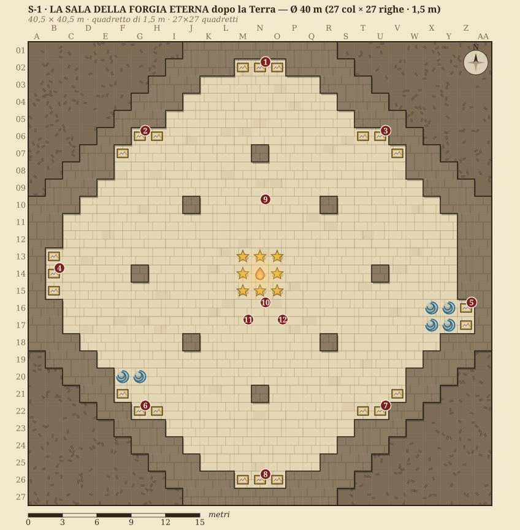

<!-- nuova-pagina -->

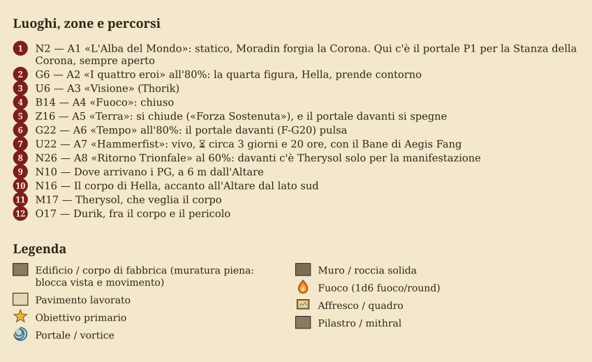

<!-- nuova-pagina -->


### MAPPA S-2 — LA STANZA DELLA CORONA DI ADAMANTIO (santuario in purificazione)

> **Geometria CANONICA** (invariata dall'incontro giocato di ARC-06):
> quella della Stanza della Corona in ARC-06 — stessi
> posizionamenti di trono, muro, colonne, statue, alcove, macerie e ingresso.
> Qui è mostrata nello **stato ARC-07** (santuario in purificazione).

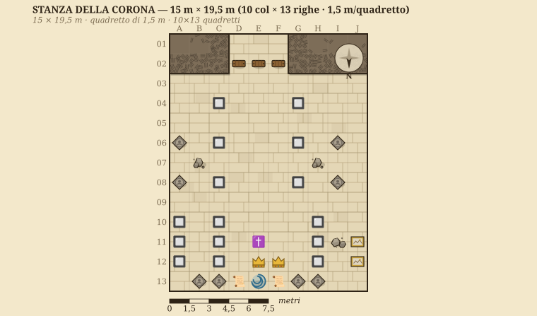

<!-- nuova-pagina -->

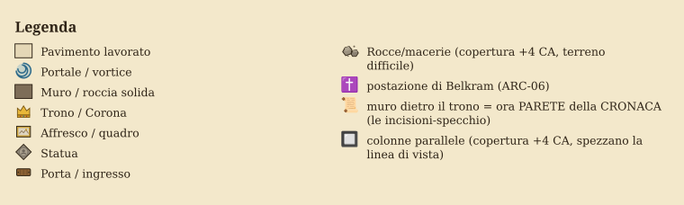

<!-- nuova-pagina -->

- **Tipo / scala**: hub scenico specchio, 10×13 (15×19,5 m), 1,5 m/quadretto.
  La navata utile è A-J/03-13 (15 × 16,5 m): la porta D-F02 sta nel muro sud
  e dà sull'androne D-F01.
  Ora **santuario sicuro** (Consacrare) — il *desecrate* di ARC-06 è dissolto.
- **Terreno & luce**: pavimento pulito; macerie 🪨 (B07/H07/I11) = terreno
  difficile; colonne 🔲 e statue 🗿 = copertura +4. La luce viola-verde delle
  torce drow è **sostituita** dalla luce calda del Portale: illuminazione
  normale (niente miss chance).
- **Posizioni notevoli (INVARIATE da ARC-06)**: trono **E-F12**; muro dietro il
  trono **D-F13** (durezza 8, 360 pf/3 m, Spezzare CD 35) → ora vi si incide la
  **Cronaca** («La Seconda Gemma», la sagoma-druida che si riempie, §6);
  **portale drow E13** dietro il muro, **sigillato e inerte**; Dipinti
  Invisibili **J11-J12** (porta chiusa, §4-bis); ingresso **D-F02** (sud).
  Reliquia nascosta sotto il trono (Cercare CD 22, §10).
- **Memoria del luogo (regia)**: qui sedeva Belkram (✝️ E11) col worg, qui
  cadde **Hella** (ARC-06). I muschi e le ragnatele drow **seccano** sulle
  macerie e nelle alcove (la purificazione avanza a vista, sessione dopo
  sessione). Chi posa la mano sull'incisione della druida e ne dice il nome
  sente la **pietra CALDA** (§6).
- **Evoluzione**: ogni beat dell'arco aggiunge una riga alla Parete della
  Cronaca (specchio della Sala S-1). A resurrezione avvenuta, la sagoma-druida
  è **piena**.

<!-- /pagina -->


\page

# III · La resurrezione di Hella

{{note
##### ⚠ SOLO DM
Questo capitolo è materiale del DM: non mostrarlo ai giocatori.
}}

<!-- module-type: hub -->
# ARC-07 · DEFINITIVO #3 — LA RESURREZIONE DI HELLA
## Il Portale della Forgia Eterna — il Cuore di Moradin, i Doni, il Debito della Radice


> **Il cuore emotivo dell'arco.** Non è un combattimento: è un **rito corale**,
> tre sacrifici che sono scelte, un risveglio, e un **prezzo che il mondo
> esige** (il filo grigio).
>
> **Quando si gioca**: **dopo** il Ritorno e gli Affreschi (cap. II) e
> **prima** del Viaggio a 1.000 anni fa (cap. IV). **Com'è il mondo a quel
> punto**: lo spirito di Hella **ha già
> compiuto il viaggio nell'Incudine del Mondo**, con tutte le prove superate:
> verità piena, ferita aperta, Via della Radice. I PG **non lo sanno ancora**:
> lo scopriranno qui, dalla sua voce (§8).
>
> **L'orologio di Hammerfist.** Si arriva a **~3g 16h**
>; il registro dei riposi è in cap. II §0-bis,
> che possiede l'orologio. Il rito dura circa un'ora e porta l'orologio a
> **~3g 15h**; un'altra ora se c'è l'indagine
> del Sud (§9). Da lì il tempo si conta tutto
>: **10 minuti** per ogni tentativo fallito degli
> Step 1-3, **un'ora** per la prima ora dopo il rito (§8-bis). Senza tentativi
> falliti né indagine, alla soglia segna **3g 14h**. La scaletta non prevede
> riposo prima della soglia; se il gruppo lo chiede, si dorme e costa otto ore
> (§9): dopo il rito la Sala conta il sonno per intero
>. L'orologio conta quanto manca alla breccia di Hammerfist, e i PG lo
> leggono sull'affresco A7, che cambia a ogni riposo. Sotto i **2 giorni** la
> breccia è aperta e l'ARC-08 parte in Fase 0 dura (cap. II §0-bis e §8).
>
> **Come arrivano.** Riposati, perché hanno dormito nella Sala, e col sogno di
> cap. II §7-bis addosso: Hella, dall'altro lato, **ha già sentito Tordek dire
> il suo nome nel sonno**.
>

---

## INDICE DEL MODULO

| § | Sezione | Contenuto |
|---|---|---|
| §0 | **Quickstart DM** | dove siete, cosa fa questo beat, la serata scena per scena, se lo divinano, cosa stampare, **cosa si consegna e quando** |
| §0-bis | **Quick-Reference** | CD del rito, tabella dei Doni, box PF1e |
| §1 | **Highlight per PG** | il sacrificio come beat di ciascuno; il risveglio di Hella |
| §2 | **La scena** | la Sala che trattiene il fiato: sensi, sei porte |
| §2-bis | **Le due gemme accese** | la terza che manca, e la riga che nessuno ha detto a Thorik |
| §3 | **Il Cuore di Moradin** | il reliquiario che si apre |
| §4 | **Il rito corale, Step 1-4** | la regia degli step, le prove, l'apertura dello Step 5 |
| §5 | **Step 5 · i Tre Doni, poi il richiamo** | Moradin chiede; chi dona; il rifiuto; la Volontà dei tre |
| §6 | **Step 5 · il Debito della Radice** | la Custode entra dal Sud, tre risposte |
| §7 | **Step 6 e il risveglio** | Moradin manifesto, Hella respira, Durik si lega, la Collana nasce |
| §8 | **Il racconto delle prove** | l'asimmetria si scioglie |
| §8-bis | **La prima ora dopo il rito** | Hella prova il corpo nuovo; le Benedizioni; Hella e Tordek |
| §8-ter | **La soglia** | l'affresco del Tempo, la scelta, Therysol |
| §9 | **Contingenze & fallimento** | «se i PG fanno X»; i modi di fallimento dello Step 5 |
| §10 | **Echo Ledger** | conseguenze a lungo termine |
| §11 | **Avanzamento** | PX, artefatti, il corredo di Hella |
| §12 | **Ponte + Handout & Asset** | verso il viaggio a mille anni fa (cap. IV); handout, immagini, musica |
| App. A | **Statistiche** | la scheda completa di Hella risorta, il Treant di Adamantio |
| App. B | **Mappe** | la pianta della Sala della Forgia, il cerchio del rito |

---

## §0 — QUICKSTART DM

> 🧭 **La serata in tre frasi.** Stasera non combatte nessuno: i tre Custodi
> riportano in vita Hella con un rito in sei step all'Altare del Cuore di
> Moradin, e ciascuno sceglie se donarle un potere del proprio artefatto. Si
> oppongono la morte, l'**orologio di A7** e **la Custode delle Radici**, che
> non combatte e vuole che qualcuno porti il debito. Prima di cominciare si
> danno **gli echi privati** del volume *Il Cuore e la Porta*, e la serata
> finisce davanti al portale del Tempo.

**Dove siete.** Nella **Sala della Forgia Eterna**, davanti all'Altare del Cuore
di Moradin. La Corona porta due gemme; gli affreschi hanno registrato la vittoria
della Terra (cap. II); il corpo di Hella riposa, vegliato da Therysol. Resta
un solo atto prima di lasciare la Forgia: **riportarla indietro.**

**Cosa fa questo beat.** È **il momento per cui l'arco esiste**. (1) Moradin
rivela il **Cuore di Moradin** (§3), reliquia single-use che sola può
resuscitarla; (2) il **rito corale** chiede a ogni PG una **prova e un
sacrificio** — e ognuno deve *volerlo* (§4-5); (3) strappare un'anima al Sogno
della Terra lascia un **debito** che il mondo verrà a riscuotere (§6, il filo
grigio); (4) Hella si risveglia **Ibrido Treant**, Durik si lega a lei, nasce la
**Collana dei Semi Eterni** (§7); (5) per la prima volta i PG **odono** cosa ha
attraversato il suo spirito (§8). Poi il party è di **4**, pronto per il #4.

**Chi c'è.** Thorik, Tordek, Artemis (officianti); **Therysol** (veglia, testimone);
**Moradin** (divino, manifesto per 3 secondi allo Step 6); **Hella** (morta →
viva); **Durik**, il suo cane, che non si è mai allontanato dal corpo e si fa
avanti al risveglio (§7); e — al momento del richiamo — **la Custode delle Radici** (§6; il ramo A/B/C si gioca).

**Quanto dura.** Al tavolo, circa **novanta minuti** dal §2 al §8-bis, e un
quarto d'ora per la soglia del §8-ter, dopo una pausa.

**Se hai un'ora per prepararti**, leggi il §0, il §0-bis, la tabella dello
Step 5 in fondo al §5 e il §9: sono le pagine che servono quando un tiro va
male. Il resto si legge al tavolo, in avanti.

**Cosa stampare.** Il volume dei giocatori *Il Cuore e la Porta*, con i fogli
della tabella qui sotto: **gli echi privati si danno prima di cominciare**. Poi
la **Quick-Reference §0-bis** (rito + sacrifici); le mappe dell'**Appendice B**
(la pianta della Sala e il cerchio R-1); la scheda completa di Hella
(**Appendice A**); il PDF Benedizioni.

**Come si chiude.** Hella viva, i Doni tessuti (o i debiti aperti), il Debito
della Radice registrato, la Collana al collo, Durik al fianco. La Corona può ora
aprire il **portale del Tempo** (Topazio + Smeraldo). → **il Viaggio a 1.000 anni fa
 (cap. IV)** (Hella è il 4° PG, APL 13 pieno).

### La serata, scena per scena

Una riga per scena: che cosa succede, chi agisce, quando si passa oltre, e dove
andare se i PG fanno quello che il master non ha previsto.

| Scena | Cosa succede | Chi agisce | Si passa oltre quando | Se i PG fanno altro |
|---|---|---|---|---|
| **1 · L'Altare** (§2, §2-bis) | la Sala trattiene il fiato; sei porte facoltative; la Corona con l'incasso vuoto | i PG; Therysol si scosta dalla veglia | qualcuno tocca l'Altare o chiede del rito | vogliono dormire prima → §9; chiedono a Therysol del corpo → §9, «Il nodo del Sud» |
| **2 · Il Cuore** (§3) | Moradin rivela il reliquiario e il Cuore | Moradin, dalla Corona; Thorik ha le mani sul mithral | il Cuore è posato sul petto di Hella | provano a incastonarlo nella Corona, o a non spenderlo → §9 |
| **3 · Il rito, Step 1-4** (§4) | tre prove, una a testa, in ordine fisso | Thorik, poi Tordek, poi Artemis; lo Step 4 è di Moradin | lo Step 4 è riuscito, ed è automatico | uno step fallisce tre volte → riesce lo stesso e paga il prezzo (§4) |
| **4 · I Doni e il richiamo** (§5) | Moradin chiede; ciascuno dona o rifiuta; poi i tre tirano Volontà | Thorik, Tordek, Artemis | i tiri di Volontà sono fatti | rifiuto totale → §5; un PG offre la propria vita → §9; richiamo sotto soglia → §9 |
| **5 · La Custode** (§6) | entra dal Sud e chiede chi porta il debito | la Custode; poi Hella, dalla soglia | Hella dice la sua frase, o tace, e vale B | la attaccano o la cacciano → §9, ramo B |
| **6 · Il risveglio** (§7) | Step 6; Hella respira; Durik si fa avanti; nasce la Collana | Moradin, poi la giocatrice di Hella | la Collana è al collo | Hella non sa ancora niente del rito: chi glielo racconta per primo conta (§8) |
| **7 · Il racconto** (§8, §8-bis) | Hella racconta le tre prove; la prima ora nel corpo nuovo | la giocatrice di Hella; poi Tordek | le tre prove sono dette e Tordek ha avuto il suo momento | il tavolo vuole andare subito → si salta il §8-bis, non il §8 |
| **8 · La soglia** (§8-ter) | l'affresco A6, due gemme su tre, la scelta | Moradin, Therysol, tutti | il tavolo risponde a «Che fate?» | dormire prima → §9; mandare avanti uno solo → Moradin rifiuta |

**Chi si oppone.** Nessun nemico. Si oppongono **la morte**, che non molla la
presa (Volontà CD 18 allo Step 5); **il tempo**, che scende dall'orologio di
Hammerfist a ogni tentativo fallito; e **la Custode delle Radici**, che non
combatte e non se ne va senza una risposta.

**Se il tempo stringe.** Si tagliano, in quest'ordine: le sei porte del §2
(restano la riga di Therysol e la ghianda); il box della Corona del §2-bis; le
prove di Hella nel corpo nuovo del §8-bis. Non si tagliano mai i Doni (§5), la
Custode (§6) e il racconto (§8): sono la serata.

**Se manca un giocatore, o ce n'è uno in più.**
Se manca il giocatore di un officiante, il PG è nel cerchio lo stesso, e il suo
step e la sua Volontà li tira un giocatore presente. Le scelte di canone
restano del giocatore assente: il Dono, il finisher, una risposta alla Custode.
Se servono, gliele si chiede prima della serata. Se non ha risposto, il Dono non
lo decide nessuno al suo posto: il seme resta dormiente, e il giocatore lo potrà
colmare quando torna, col riempimento del §5. Con un quinto PG al tavolo, i
punti del cerchio restano tre, come i semi: il quinto non officia, e può tenere
il Sud con la regola del Sud occupato (§9).

**Se manca la giocatrice di Hella**, la serata si rinvia: è la sua. Se il
tavolo non può aspettare, il DM le chiede prima quale delle tre risposte del §6
sceglie, e con quale frase.

### Se lo divinano

Una riga per segreto: con che cosa si rompe, che cosa ottiene chi lancia, e come
va avanti il modulo.

| Segreto | Lo rompe | Chi lancia ottiene | Il modulo va avanti così |
|---|---|---|---|
| la presenza verde del Piano della Terra era Hella (§8) | *divinazione*, *comunione* | una frase sola: *«Una radice ti ha tenuto in piedi.»* Nessun nome | il §8 resta uguale, e la rivelazione di Hella diventa una conferma invece di una sorpresa |
| la risposta del rito che fallisce è il Sud (§9) | *divinazione*, durante l'ora; *augurio* su «occupiamo il Sud» risponde solo «bene» | *«Guardate dove nessuno sta.»* | vale come il Sud trovato: qualcuno lo occupa e lo Step 5 si ritira |
| il Rubino è di là, a mille anni fa (§8-ter) | *divinazione* | *«La terza pietra è dove il varco porta.»* | niente cambia: Moradin lo dice lo stesso alla soglia |
| chi è la Custode delle Radici (§6) | *individuazione del male*, *comunione* | non è malvagia, e non è una creatura da combattere: è l'ordine del Sogno della Terra | le tre risposte del §6 restano tutte aperte |
| che cosa c'è nell'Altare (§2) | *individuazione del magico* | una presenza divina, forte, e nessun nome | niente cambia |
| la forma dei Doni (§5) | *divinazione*, prima del sì | niente sulla forma: un Dono si conosce solo dopo il sì di chi dona | il §5 resta uguale |
| che cosa sa Hella (§8) | *parlare con i morti* sul corpo | quello che Hella sapeva alla morte, fino alla Stanza: l'incantesimo dell'SRD legge il corpo, non l'anima, e del Sogno della Terra non sa niente | il racconto del §8 resta di Hella |


### ✉ Cosa si consegna, e quando

Il DM ha sul tavolo i fogli per i giocatori, in sette consegne. Si danno **in quest'ordine**, e
mai prima del momento scritto: ognuno risponde a una domanda che il tavolo si
deve essere già fatto.

| Quando | Cosa | A chi | Nel volume dei giocatori |
|---|---|---|---|
| prima di cominciare la serata, piegati | gli **echi privati** | Thorik, Tordek, Artemis, uno a testa | «Echi», una pagina per PG |
| quando il gruppo si sveglia nella Sala dopo il riposo (cap. II §7-bis), prima del rito: non è il risveglio di Hella del §7 | l'**eco privato di Hella** | alla giocatrice di Hella, che legge ad alta voce la prima metà, «Mentre gli altri dormono», senza la riga «Solo per te», che resta sua; la seconda è il suo promemoria per il §8 | «Echi — Hella» |
| §3, subito dopo il box del reliquiario | **Il Cuore di Moradin**, l'immagine | a tutti | «Il Cuore di Moradin» |
| §4, Step 1 | **la preghiera della resurrezione** | al giocatore di Thorik | «La preghiera della resurrezione» |
| §5, **dopo il sì** di chi dona | **la carta del Dono** | solo a chi ha donato | «La carta del Dono», una per chi dona |
| §7, dopo il box di Durik | **Hella, tornata** e **Durik** | alla giocatrice di Hella | «Hella, tornata» · «Durik, il guardiano di pietra» |
| §8-ter, mentre la Corona apre il varco | **Le Cronache dei Quattro Eroi** | a tutti | «Le Cronache dei Quattro Eroi» |

**Che cosa dicono i fogli, per il DM.** Sono nel volume dei giocatori; qui una
riga ciascuno, per sapere a che cosa reagirà il tavolo.

| Foglio | Che cosa dice |
|---|---|
| eco di Thorik | due mani piccole e fredde reggevano il Peso con lui; la riga privata gli promette che stanotte saprà di chi erano |
| eco di Tordek | una fiera straniera e un uomo che cataloga il suo zaino; la riga privata gli dice che nello zaino c'è una cosa messa da Artemis |
| eco di Artemis | l'affresco del Tempo è una porta socchiusa che qualcuno ha già usato; la riga privata gli dice di cercare chi si muove come lui |
| eco di Hella | prima metà: tre respiri, Durik che aspetta, la voce di un nano che dice il suo nome. Seconda metà: le tre prove, e le sue mani sotto quelle di Thorik |
| la preghiera | il nanico e quattro strofe in italiano; la terza chiude su *«Quello che manca, chiedilo adesso, e lo paghiamo»*, che è la porta dei Doni |
| le carte del Dono | che cosa germoglia in Hella, una carta per chi ha donato (§5) |
| le Cronache | Thorgrim Barbadiferro racconta i Quattro Eroi che salvarono Hammerfist dal drago nero e poi svanirono; Moradin, nella mente di Thorik: *«Siete voi.»* |

⚠️ **Il prezzo dei Doni si dice, la carta no.** Moradin dice a voce cosa costa
(§5); la carta, con quello che germoglia in Hella, arriva dopo il sì. Se la
carta arrivasse prima, il tavolo farebbe i conti invece di scegliere.

---

## §0-bis — QUICK-REFERENCE DM (una pagina)

### Il Rito, in sei passi (CD esplicite)
| Step | Chi | Prova | CD | Fallimento |
|---|---|---|---|---|
| 1 — Invocazione | Thorik | Conoscenze (religioni) · senza gradi SAG −4 | 15 | riprova, −2 cumulativo · max 3 tentativi, poi riesce (§4) |
| 2 — Canalizzazione | Tordek | Concentrazione | 20 | 2d6 non letali, riprova · max 3 tentativi, poi riesce (§4) |
| 3 — Stabilizzazione | Artemis | Utilizzare Oggetti Magici · senza gradi CAR −4 | 18 | corpo rifiuta, riprova · max 3 tentativi, poi riesce (§4) |
| 4 — Germinazione semi | (Moradin) | automatico | — | — |
| 5 — Richiamo dello spirito | **tutti e 3** | Volontà | 18 | ≥2 successi su 3 (3 su 3 se i Doni versati sono uno o nessuno, §5) · sotto la soglia vale una riga del §9 (la tabella in fondo al §5), anche con un successo solo · +1 senza tipo a chi ha toccato l'incisione della Stanza, cap. II §6 |
| 6 — Fusione | (Moradin manifesto) | automatico | — | — |

**Niente 10 e niente aiuti**. Sulle prove
degli Step 1-3 e sulla Volontà dello Step 5 non si prende 10 e non si aiuta:
il rito è una distrazione, e ogni officiante tira da solo. Valgono gli
incantesimi lanciati prima del rito. ⚠ Non SRD solo in parte: l'SRD lascia al
DM decidere che cosa distrae.

### I Tre Doni — il trapianto (§5)
| PG | Dona, **per sempre** | 🌱 Hella riceve |
|---|---|---|
| 🛡️ **Thorik** | **metà del +2 di deflessione** della Corona, che scende a +1: **−1 CA permanente** | **Lo Scudo del Custode** — 1/g, immediata: prende il danno di un alleato entro 9 m, **dimezzato**. 🔄 E Thorik è **accelerato 3 round, verso chi è stato protetto** |
| ⚒️ **Tordek** | **Ancoraggio della Montagna** (2/g), che lascia i Bracieri | **Pelle di Adamantio — RD 3/adamantino** (la sua **unica** RD) |
| 🔮 **Artemis** | **1d6 di Eldritch Blast**, per sempre (7d6 → 6d6) | **Il Rovo Eldritch** — **a volontà**, contatto a distanza 18 m, **2d6** |

> **Un Dono è un trapianto, non una tassa**: il potere **esce dall'artefatto del
> donatore** e **germoglia in un seme della Collana**. Il party non perde la
> capacità — cambia mano e forma.
> 🔗 **I tre si moltiplicano**: colpo da 40 → dimezzato (20) → meno la RD (17) →
> Thorik scatta → e Hella ha il Rovo a volontà, quindi non perde il turno.
> **Chi rifiuta** lascia il **seme dormiente**, e il suo **artefatto reagisce**
> (§5, tabella delle reazioni). La resurrezione NON è in ostaggio: il Cuore
> basta da solo — i doni comprano la **qualità** del ritorno, non la vita.

### 🐾 Supporto Pathfinder 1e (dove il 3.5 è vago) — opzionale, dichiarato
> - **Il costo della resurrezione**: nel 3.5 *rianimare morti* fa **perdere un
>   livello** al risorto; in PF1e dà **due livelli negativi permanenti**, che si
>   tolgono con *ristorare*. Qui il Cuore di Moradin **assorbe** il costo
>   (miracolo divino), salvo la riga «1 su 3» del §9.
>   Il default di questo master è nessun livello negativo: paga il Cuore.
> - **Il Debito della Radice** (§6): trattalo come un **patto/geas PF1e** non
>   coercitivo (nessun TS, nessun danno finché non violato): è un obbligo
>   narrativo con effetti solo se onorato o tradito.


---

## §1 — HIGHLIGHT ASIMMETRICI PER PG

> Qui l'asimmetria si **scioglie**: i tre che hanno agito nel mondo e Hella che
> ha viaggiato nell'aldilà si ritrovano. Ma fino al risveglio (§7), ognuno sa
> solo la sua metà.

### 🛡️ THORIK — l'unto che paga il prezzo del re
- Porta il peso della Corona **e** dona la protezione che la Corona dà a lui:
  il DM lo dica chiaro — Thorik **non le regala un potere, le passa il suo
  mestiere**, e resta con **−1 alla CA** per il resto della campagna. È la sua
  natura di leader-che-si-sacrifica, non un'ingiustizia.
- 🔄 **E il suo dono gli torna addosso**: ogni volta che Hella scuda qualcuno,
  lui **scatta verso quella persona**. Il DM lo narri come un riflesso, non come
  un bonus — *«ti muovi prima di decidere di muoverti»*.
- **Non sa** che la «presenza verde» che gli alleviò le spalle al Piano della
  Terra (cap. I §9) era lei. Lo scoprirà al §8, e sarà uno dei momenti più
  forti della campagna: *ha già portato peso per Hella, senza saperlo.*

### ⚒️ TORDEK — il faro nel buio
- È **il suo** beat emotivo: è la voce che Hella ha sentito nel buio, il legame
  che l'ha tenuta ancorata. Al richiamo (Step 5) **dà al giocatore la scena**:
  lascialo chiamare Hella con parole sue.
- Dona **l'Ancoraggio della Montagna**: il potere che lo tiene piantato passa a
  lei. È coerente con quel che è stato per Hella nel buio — **l'ancora** — e i
  Bracieri lo dicono in una riga sola e poi tacciono: questo è un momento suo,
  non loro.

### 🔮 ARTEMIS — la scintilla, non il serbatoio
- Il suo Dono **non è il più leggero, ed è il DM a doverlo dire**: cede **un
  dado dell'*Eldritch Blast*, per sempre**, cioè un pezzo di quel che fa a ogni
  singolo turno per il resto della campagna. Un warlock non è forte perché
  colpisce duro: è forte perché **può farlo tutto il giorno** — e quella è
  esattamente la cosa che regala.
- 🌱 Al tavolo la nota da far cadere una volta sola: Hella ha **vulnerabilità al
  fuoco ×1,5**, prezzo della Via della Radice, e adesso **porta il fuoco**.
- Se porta il **Marchio di Varis** (cap. I §6-bis; al tavolo non lo porta,
  perché il Seme è nello zaino di Tordek e nessuno l'ha toccato): l'Anello, durante la
  stabilizzazione (Step 3), «pizzica» — il caos vitale e il marchio del mercato
  risuonano. Gancio muto, conseguenza canonica del Marchio.

### 🌙 HELLA — il ritorno (da qui, PG a pieno titolo)
- Fino al risveglio: **nessuna coscienza** (solo le sensazioni del viaggio,
  ormai concluse), tranne la soglia del §6: lì, per una frase sola, la
  giocatrice lascia Durik e parla da Hella.
- 🐾 **Fino al risveglio la giocatrice di Hella gioca Durik**, dalla
  Scena 1. Durik non parla e non abbaia: gira attorno al corpo, si sdraia ai
  piedi dell'Altare, fa il click quando qualcosa si muove sotto i piedi, e il DM
  le dice che cosa sente entro 18 m. Non sa niente che Durik non sappia, e non
  entra nel cerchio del rito. Al §7, quando appoggia la testa sul petto di
  Hella, la giocatrice torna a giocare lei. Al risveglio: **torna con i doni PIENI vinti da sola**
  (§INTEGRAZIONE, sotto) + i Doni del party. È **Dream Dwarf Ranger 1 / Druida
  12**, Ibrido Treant.
- **Il Racconto delle Prove** (§8) è il suo grande momento-spotlight: racconta
  ai compagni cosa ha attraversato — la Verità, la Ferita, il Voto. Da' alla
  giocatrice la scena.

**INTEGRAZIONE — i doni PIENI del viaggio (canone giocato, sovrascrivono i base):**
Resist. Freddo **15** + guarigione rapida 1 (terra); **Marchio della Veritade**
(+4 Diplomazia coi nani di Moradin; 1/g verità→Volontà CD 17 o scosso); **Radice
Silenziosa** (+2 Percepire Intenzioni; 1/g empatia); **Radici del Mondo**
(la guarigione rapida vale anche su suolo sacro/druidico; 1/g Radicamento 5 round, +1 morale TS
alleati entro 9 m); **costo**: Vulnerabilità al fuoco (+50%). Bonus fissi:
Ibrido Treant, Empatia vegetale +4, Fotosintesi, Earth Dream amplificato (1/g
*Divination* CL 12), Scurovisione 27 m.


---

## §2 — LA SCENA: L'ALTARE DEL CUORE (Atlante)

### SCENA 1 — L'Altare del Cuore

**In scena** — Dove: l'Altare — Chi: Therysol

> Il beat vive in un solo luogo — l'Altare al centro della Sala — ma è il luogo
> più sacro dell'arco. Trattalo come un tempio, non come una stanza.

> **Read-aloud — l'Altare.** *La Sala della Forgia si è fatta
> silenziosa in un modo nuovo. Non il silenzio del vuoto: il silenzio di una
> sala che trattiene il fiato. Gli otto affreschi guardano dalle pareti —
> Moradin che forgia, i Quattro Eroi che prendono contorno, Hammerfist che
> brucia nel suo riquadro. Al centro, l'Altare arde di una fiamma dorata che
> non consuma. E lì, sulla pietra di mithral, giace il corpo di Hella: le mani
> incrociate sul petto, la pelle color cera, i tre semi di treant posati, uno
> su ciascuna mano e uno sulla fronte, che pulsano piano come se già
> sapessero. Therysol si scosta dalla veglia. Per la prima volta in giorni non
> ha più bisogno di montare la guardia, e non sa dove mettere le mani.*

**Terreno (callout):** l'Altare 2×2 m al centro dell'ottagono (MAPPA S-1 del
cap. II; la pianta dell'Appendice B è la stessa Sala); attorno, un **cerchio rituale di 3 m di raggio** — Thorik a Nord,
Tordek a Est, Artemis a Ovest, il Sud lasciato **vuoto** (da lì fluisce
l'energia). I tre semi sul corpo formano un **triangolo** inscritto nel cerchio
dei tre officianti. Vedi le mappe dell'**Appendice B**. Zona **sacra e sicura** — ma non
«comoda»: chi partecipa al rito non può fare altro (nessuna azione esterna
durante gli step).

**Scheda d'entrata — Therysol, la veglia**

| | |
|---|---|
| **Vuole** | non vegliare un altro corpo. Ha perso il fratello nel Piano del Fuoco e ne porta il secondo respiro nel petto: sei giorni accanto a Hella le hanno riaperto quella notte |
| **Suona** | frasi corte e complete. Non chiede mai niente. Quando parla di Hella usa il presente |
| **Sa** | ogni respiro che il corpo non ha fatto: ha contato fino a undicimila. Che il corpo **si gira verso sud**: l'ha rimesso dritto undici volte |
| **Non sa** | cosa ha attraversato lo spirito di Hella. Niente del viaggio a −1000 |
| **Eco che porta** | la sua scheda: il cristallo di Theron fuso nel petto. Quando Hella inspira, Therysol si tocca lo sterno, e nessuno le chiede perché |
| **Eco che arma** | alla soglia (§8-ter) non vuole che vadano. Se nessuno glielo chiede, **se ne ricorda**: in ARC-08 aiuta con meno calore chi non l'ha guardata |

**THERYSOL (piano, senza voltarsi):** *«Undicimila. Poi ho smesso di contare.
Non perché fosse troppo. Perché avevo paura del numero dopo.»*

### La Sala per sensi, e cosa non dire

| 👁 Occhi | 👂 Orecchie | ✋ Pelle e naso | 🚫 **Cosa NON dire** |
|---|---|---|---|
| l'oro dell'Altare non proietta ombre: le cose vicine sembrano **ritagliate** | il silenzio ha un **fondo basso**, come una nota tenuta troppo a lungo da qualcuno che non respira | il pavimento è **tiepido sotto le suole**, più caldo dell'aria | ❌ che il fondo basso **è il Cuore che batte dentro l'Altare**: è la rivelazione di §3, e detta qui §3 diventa una conferma |
| i semi sul corpo hanno una **venatura che si muove**, lenta, come linfa in un tronco tagliato | quando qualcuno parla, la voce **non ha eco**: la sala se la prende | odore di **ferro caldo e di terra piovuta**, due cose che non stanno insieme | ❌ che la terra piovuta **è Hella**: che il corpo stia già cambiando è ciò che i PG devono **notare da soli** |
| la Corona sulla fronte di Thorik ha **due gemme accese e un incasso vuoto** | | il metallo dell'Altare **non è freddo**, e un nano lo trova sbagliato | ❌ che l'incasso vuoto **è il Rubino e si apre col viaggio**: vedi §2-bis, si guadagna |

### Le sei porte — interagire con la Sala

Nessuna richiede un grado speso. Sono **opzionali**: chi non le tocca non perde
niente, chi le tocca entra nel rito già dentro la scena.

| Prova | CD | Cosa dà |
|---|---:|---|
| **SAG** grezza — ascoltare il fondo basso | 14 | il ritmo è **sessanta al minuto**: un cuore a riposo. Non dice di chi |
| **INT** grezza — leggere l'affresco A6 | 16 | la scena del portale ha **tre punti di luce**, non due: qualcuno, mille anni fa, aveva tutte e tre le gemme |
| **COS** grezza — restare a mani nude sul mithral | 12 | il metallo **restituisce** calore invece di prenderlo: +1 al primo tiro del rito di chi l'ha superata, e la sensazione che la pietra sia d'accordo |
| **CAR** grezza — parlare a Therysol mentre si scosta | 13 | dice a bassa voce la cosa che non ha detto in sei giorni: *«Sei giorni mi hanno riportato a quella notte, col fuoco. Non ditelo a lei, quando si sveglia.»* → eco, la notte del fratello |
| **FOR** grezza — spostare l'Altare per allineare il Sud | 18 | non si muove di un dito. **Il fallimento è l'informazione**: l'Altare è ancorato alla montagna, non appoggiato |
| **DES** grezza — posare i semi in un triangolo perfetto | 15 | il triangolo tiene: allo Step 4 le radici dei tre semi entrano nello stesso istante, e Therysol lo vede. Nessun bonus, perché lo Step 4 è automatico. ⚠️ **Thorik ha DES −4** per il prezzo delle gemme (Corona e Smeraldo), cioè **−2 alla prova**: se prova lui, è la statistica che ha venduto |

**Sul corpo di Hella**, a chi lo guarda da vicino: con Osservare CD 20 si vede la
**ghianda annerita** stretta nel pugno (cosa diventa, §11 C).

**Se la giocatrice usa la percezione di Durik sull'Altare**, il DM le dice il
vero: sotto i piedi qualcosa batte, sessanta al minuto, e non si sposta. Non
le dice dove né che cosa sia: è il ritmo che dà anche la porta di SAG, più la
fermezza, e il §3 resta la rivelazione di *che cosa* batte, e dentro che cosa.


---

## §2-bis — LE DUE GEMME ACCESE, E LA TERZA CHE MANCA

> **Perché sta qui.** I PG hanno speso due archi a cercare quelle pietre. Se il
> rito le ignora, quelle sessioni diventano un corridoio verso questa. Questa
> sezione è **breve apposta**: non è una scena, è la riga che fa pesare il
> passato dentro il presente.

| Gemma | Come è entrata nella Corona | Cosa si vede **adesso**, nel rito |
|---|---|---|
| **Topazio** | recuperato nel **Piano del Fuoco** (P3) | quando l'Altare arde allo Step 1, il topazio **arde insieme** e prende lo stesso ritmo. È l'unica gemma che *risponde* al fuoco della forgia |
| **Smeraldo della Forza** | forgiato dopo Terros l'Antico, al rito in cui **Thorik ha versato un pezzo di sé** | allo Step 5 lo smeraldo **si raffredda**, e Thorik lo sente. La Terra riconosce chi le ha già pagato una volta |
| **Rubino** | ❌ **manca** | l'incasso vuoto sulla Corona, per tutta la scena, **non riflette la luce dorata**. È un buco nero piccolo come un'unghia in mezzo all'oro |

**Scheda d'entrata — Aegis Fang e la Corona, le due voci di metallo**

| | Aegis Fang | Corona di Adamantio |
|---|---|---|
| **Vuole** | servire il popolo nanico, **prima** del portatore | la montagna. Non sta dalla parte di Thorik |
| **Suona** | nomina il sangue, mai la persona: *«il sangue riconosce il sangue»* | stasera **non parla**: calore sulla fronte, immagini. La voce arriva col Rituale 4 |
| **Eco che porta** | Thorgrim Barbadiferro, mille anni fa; lo dice davanti ad A7 | l'incasso vuoto che non riflette la luce (§2-bis) |
| **Eco che arma** | se Thorik rifiuta il dono, **lo giudica** nelle scene che riguardano Hella o nani da proteggere | se Thorik rifiuta, al Rituale 4 arriva **fredda**. Se dona, si scalda ogni volta che l'Eco del Custode lo fa scattare |

### La riga che nessuno ha ancora detto a Thorik

Il registro degli echi la tiene: al rito dello Smeraldo gli è
stato chiesto *«un pezzo di te stesso»*, e non l'ha delegato. Ha pagato
**−2 DES e +2 COS**, che sommati ai −2 DES della Corona fanno **−4 al
punteggio**, cioè **−2 al modificatore** di CA, Riflessi e iniziativa. Al
tavolo, rispetto a prima dello Smeraldo, è un punto solo in più.

> 🎭 **Grigio politico — il Want di Thorik che non riguarda i PG.** Nessuno al
> tavolo se n'è accorto, e lui **non corregge nessuno**. Lo elogiano per quanto
> sa incassare, cioè per il +2 COS: per la metà che si vede. Fra un attimo
> §5 gli chiederà di pagare **di nuovo**, e il DM che conosce questa riga sa
> perché Thorik si muove per primo — non per generosità, ma perché adesso
> conosce il cambio e non si fida a lasciarlo accettare a un altro.

> **Read-aloud — solo se un PG guarda la Corona.** *La
> Corona sulla fronte di Thorik ha due pietre vive e un vuoto. Il topazio è caldo
> come la sala, lo smeraldo è freddo, e in mezzo l'incasso scoperto resta
> nero: la luce gli arriva addosso e non ne torna indietro niente. È un
> difetto di un'unghia su un oggetto che ha attraversato due ere, e chi lo
> fissa abbastanza a lungo finisce per non vedere altro.*

⚠️ **Non dire** che l'incasso si riempie col viaggio a −1.000: **è la posta
della soglia, §8-ter**. Qui è un difetto che si nota, non una promessa che si annuncia.

> **Assorbi e rilancia.** Se un giocatore inventa una spiegazione per il vuoto
> — «l'ha persa qualcuno», «è stata rubata», «non è mai esistita» — **prendila
> nel canone** e dalle un prezzo: quella diventa la versione che i nani di
> Hammerfist raccontano, e sarà **sbagliata** in un modo che a −1.000 costerà
> mezz'ora di diffidenza a chi la ripete.


---

## §3 — IL CUORE DI MORADIN (rivelazione del reliquiario)

### SCENA 2 — Il Cuore di Moradin

**In scena** — Dove: l'Altare — Chi: Moradin

La voce arriva dalla Corona e dall'ascia insieme, dentro la testa di tutti e
tre. Non alza mai il tono, e la Corona si scalda sulla fronte di Thorik.

**MORADIN (dalla Corona, lento):** *«L'Altare è un reliquiario. Dentro, da millenni, riposa il Cuore di Moradin: un frammento della mia essenza, diventato pietra. Non lo si tocca per poco. Riportare una druida dalla morte… non è poco.»*

> **Read-aloud — l'Altare, il reliquiario.** *Sotto le mani di Thorik il
> mithral si apre lentamente, lungo cuciture che un istante fa non c'erano.
> Una camera si schiude come un fiore di metallo, un petalo dopo l'altro.
> Dentro, sospeso nella luce dorata, c'è un cristallo di rubino sanguigno
> grande come un pugno, trasparente, con la forma di un cuore nanico: le
> quattro camere, i vasi visibili. Pulsa sessanta volte al minuto, il ritmo di
> un cuore a riposo, e a ogni battito il rosso si schiarisce. A chinarsi, il
> calore arriva in faccia asciutto, come dalla bocca di un forno appena aperto.*

**Scheda d'entrata — Moradin, tre secondi di voce vera**

| | |
|---|---|
| **Vuole** | che il focolare regga. Hella gli serve viva per la guerra che viene, e lo dice senza vergogna |
| **Suona** | tramite la Corona e l'ascia, sempre. Parla **una sola volta** con voce fisica, allo Step 6, e fa tremare la Sala. Non spiega, non consola, non ripete |
| **Sa** | tutto quello che la Forgia ha visto. Non dice mai di più di quello che serve al passo dopo |
| **Eco che arma** | le sue reazioni ai Doni (§5): *«La Forgia piega il metallo che riceve»* al dono, *«la paura del prezzo è già il prezzo»* al rifiuto. Sono le frasi che i giocatori si ripeteranno |

> **⚠️ Canone:** il Cuore di Moradin è **single-use**. Dopo il
> rito è **SPESO** — NON torna nell'Altare. Se un file/engine lo «riusa» dopo
> l'arco, è una violazione da segnalare.


**✉ Si consegna qui: *Il Cuore di Moradin*.** Subito dopo il box, mostra a tutti
la pagina con l'immagine. Il Cuore sta **dentro** l'Altare, che si apre come un
fiore di metallo; al rito si posa sul petto di Hella.

---

## §4 — IL RITO CORALE (Step 1-4, e l'apertura dello Step 5)

### SCENA 3 — Il rito corale

**In scena** — Dove: il cerchio — Chi: Moradin · Therysol

> **Setup.** Corpo di Hella al centro, il Cuore di Moradin posato **sopra** il
> suo cuore (allineamento preciso). I tre semi (mani + fronte). I tre officianti
> ai punti cardinali, il Sud vuoto. Moradin guida telepaticamente.

### ⚙️ Come si gioca questo rito: la regia

> **Il difetto che questa sezione chiude.** Sei step con sei CD sono una lista
> di tiri. Un rito è una **scena a turni**: ha un'apertura, un giro in cui
> ciascuno fa la sua cosa, un esito detto per la riuscita **e** uno per il
> fallimento, e una chiusura. Senza, il tavolo tira dadi e aspetta.

**Ordine di gioco fisso**: Thorik → Tordek → Artemis → Moradin. Non è
iniziativa: è **liturgia**, e l'ordine è parte del rito. Chi salta il turno lo
salta davanti agli altri tre.

**Apertura di round**, una per step — una riga, non di più:

| Step | Apertura di round da leggere |
|---|---|
| 1 | *L'oro dell'Altare si alza di un dito.* |
| 2 | *Il battito rallenta, e chiede a qualcuno di seguirlo.* |
| 3 | *La pelle di Hella ha ancora il colore della cera.* |
| 4 | *I semi smettono di pulsare. Stanno decidendo.* |
| 5 | *Il Sud del cerchio è vuoto, e qualcosa lo sta guardando da lì.* Se il Sud è già tenuto: *Dietro chi tiene il Sud l'aria si fa fredda, e qualcosa guarda da lì.* |
| 6 | *La sala prende fiato al posto vostro.* |

**Esito, in due righe già scritte.** Una per la riuscita, una per il fallimento.
Il DM le legge senza inventare, e la scena non si spegne mai sul numero:

| Step | ✅ Riuscita | ❌ Fallimento *(mai «non succede niente»)* |
|---|---|---|
| **1** | l'oro sale fino alla volta e **gli otto affreschi si illuminano in fila**, da Moradin fino a Hammerfist | la preghiera esce **storta** — una sillaba antica sbagliata. Therysol alza la testa: lo ha sentito. Ritenta, ma adesso c'è un testimone |
| **2** | i due battiti si sovrappongono e per un istante **non si distingue quale sia di chi** | Tordek prende **2d6 non letali** e la cosa peggiore: per un secondo ha sentito il buio in cui lei era, e adesso lo sa |
| **3** | le ferite si chiudono **al contrario**, dall'interno, e il colore torna dal petto alle dita | l'Anello sputa **un colore solo**. Il corpo si stabilizza a metà: ha colore ma non calore |
| **4** | le radici entrano **senza sangue**, e il corpo le accetta come se le avesse sempre avute | nessuno: lo Step 4 è automatico e non fallisce. Le radici entrano sempre; un seme resta dormiente, senza niente che germogli sopra, solo se il suo donatore rifiuta allo Step 5 (§5) |
| **5** | tre voci diventano **una voce**, e la sala la restituisce più forte di come è entrata | il richiamo torna indietro **vuoto**, come una corda che non ha preso. Quando l'esito è la riga «0 su 3» (0 successi, o 1 solo se i Doni versati sono uno o nessuno: tabella in fondo al §5) si ritenta **una volta sola**, dopo che qualcuno ha occupato il Sud (§9) |
| **6** | → §7 | nessuno: lo Step 6 è automatico e non fallisce |

> **Chiusura di round, ogni volta.** Il DM chiude lo step guardando i giocatori
> e chiedendo: **«Che fate?»** — anche quando la risposta giusta è «il prossimo
> tira». Un rito in cui non si può scegliere niente è un filmato.

**Se uno step fallisce, Step 1-3**. Ogni step
si tenta **al massimo tre volte**, e ogni tentativo costa **10 minuti**. Restano
i costi del fallimento scritti sotto (il −2 cumulativo dello Step 1, i 2d6 non
letali dello Step 2). Al **terzo fallimento lo step riesce lo stesso**, e il suo
esito ❌ della tabella qui sopra resta come prezzo: il testimone dello Step 1,
il buio sentito dello Step 2, il corpo con colore ma senza calore dello Step 3.
Chi non ha gradi usa la **prova grezza** della caratteristica con **−4**: **SAG**
per l'Invocazione, **CAR** per la Stabilizzazione. La Concentrazione dello
Step 2 si tira anche senza gradi.


**STEP 1 — Invocazione (Thorik · Conoscenze religioni CD 15).** La preghiera
nanica antica: *«Vorrak Moradin, hragn tul-vesh! Hella
drenn-okh hald: torn, torn-vrath!»* (*Padre Moradin, ferro sotto la montagna!
Hella, figlia della pietra: torna, la strada non è finita!*). Poi la preghiera
per intero, in italiano, dall'handout.
**✉ Si consegna qui: *la preghiera della resurrezione*** al giocatore di
Thorik, che la legge ad alta voce, in piedi a nord del cerchio, con la mano
sull'Altare. La legge dal foglio, come si legge un contratto davanti a chi lo
deve firmare.
Successo: l'Altare arde d'oro, il Cuore accelera a 90 bpm.


**Pronuncia della preghiera**: **VÒR-rak mo-RA-din, HRAGN tul-VESH**, con la
erre battuta e le vocali brevi.

**STEP 2 — Canalizzazione (Tordek · Concentrazione CD 20).**
> **Read-aloud — il cerchio, lo Step 2.** *Il respiro di Tordek rallenta da
> sé. Nel silenzio c'è un battito, quello del Cuore di Moradin, e il suo ki lo
> prende come misura. La vita passa dal Cuore, attraverso di lui, verso Hella. Dall'altra
> parte qualcosa tira: lo spirito vuole tornare, e la morte non molla la presa.
> La corda è tesa fra le due.*
Fallimento: 2d6 non letali, riprova (al massimo tre tentativi, sopra).

**STEP 3 — Stabilizzazione (Artemis · Utilizzare Oggetti Magici CD 18).** L'Anello
esplode in **due colori insieme**, oro per la vita e argento per la
transizione. È la sua dualità *riforgiata*, che viene dal reforging alla Forgia
e non da una visione divina. Il box si legge quando la prova riesce.

> **Read-aloud — lo Step 3.** *Nell'Anello di Artemis c'è una luce d'oro e
> una d'argento, accese insieme. Le ferite del corpo si richiudono dall'interno, e
> il colore torna alla pelle dal petto verso le dita. Il respiro, non ancora.
> Ma quasi.*

**STEP 4 — Germinazione (automatico, Moradin).** I semi **germogliano
istantaneamente**: radici dorate penetrano la pelle senza dolore, avvolgono
cuore, polmoni, mente. Il DNA treant si fonde col nano: Hella diventa **Ibrido**.


**STEP 5 — Il Richiamo (tutti e 3).** Lo Step 5 è tre scene in una, e il master
le mette in fila: prima **Moradin chiede i Doni** (§5), poi **i tre chiamano**
e tirano Volontà (in fondo al §5), infine **la Custode delle Radici** entra dal
Sud vuoto (§6). Lo **Step 6** apre il §7. Leggi l'apertura di round dello
Step 5 (*«Il Sud del cerchio è vuoto…»*) e passa al §5.

---

## §5 — I TRE DONI (il trapianto)

### SCENA 4 — I tre Doni

**In scena** — Dove: il cerchio — Chi: Moradin

> **La regola d'oro.** La resurrezione **non è in ostaggio**: col Cuore, Hella
> torna comunque. I doni comprano la **qualità del ritorno**. Moradin **chiede,
> non impone**, e prima di chiedere dice **perché** e **a cosa serve**: il
> discorso è qui sotto.

### 🔨 Come lo chiede Moradin: il perché, lo scopo, il prezzo


**Battuta 1 · il perché.** Si legge appena i tre sono in cerchio per lo Step 5,
**prima** dei tiri di Volontà. La voce di Moradin è lenta e bassa, e non
alza mai il tono: il peso ce l'hanno le parole.

> **Read-aloud — il cerchio, battuta 1 di 4.** *Sul petto di Hella il
> Cuore batte una volta, più forte degli altri. La voce che segue non passa
> dall'aria: arriva nello sterno e lo fa vibrare, come il colpo di un maglio dall'altra parte
> della montagna.*

**MORADIN (lento, basso):** *«Voi tre, che l'avete portata fin qui. Io sono il fuoco. Il fuoco scalda e fonde, e da solo non ha mai forgiato niente: alla forgia serve il metallo. Hella torna, e questo lo do io, senza chiedere niente in cambio. Ma la morte l'ha svuotata, e nel petto ha tre semi che la mia mano non apre.»*

**Battuta 2 · a cosa serve.**

> *Il battito torna al suo passo. La voce resta.*

**MORADIN:** *«Un seme così germoglia soltanto da quello che un compagno dà di sé. Chi dà, lo perde per sempre. Ma non va sprecato: mette radice in lei, prende la sua forma, e da domani combatte accanto a voi con le sue mani. Io non lo prendo. Il ferro lavorato a freddo si crepa alla prima tempra, e un dono strappato è ferro freddo. Chi non dà non perde niente: il suo seme resta chiuso, e Hella torna senza quella parte.»*

**Battuta 3 · il prezzo, a ciascuno.** La voce si posa su un giocatore alla
volta, e il DM lo guarda. Dopo la frase di Moradin, **fuori dalla voce**, il DM
dice il numero: un sacrificio fatto senza sapere quanto costa è una trappola.

| A chi | Moradin | Poi il DM, a voce normale |
|---|---|---|
| 🛡️ Thorik | *«Thorik. La Corona ti fa da scudo. Metà di quello scudo passerà a lei, e non tornerà.»* | la deflessione della Corona scende da **+2** a **+1**: **−1 alla CA, per sempre** |
| ⚒️ Tordek | *«Tordek. Quando il mondo ti spinge, i Bracieri ti piantano nella pietra. Quella radice passerà a lei. Da domani, chi ti spinge ti sposta.»* | **Ancoraggio della Montagna** lascia i Bracieri **per sempre** |
| 🔮 Artemis | *«Artemis. Un pezzo del tuo fuoco passerà a lei. Colpirai meno forte, a ogni colpo, finché vivi.»* | ***Eldritch Blast*** da **7d6** a **6d6**, **per sempre** |

**Battuta 4 · la domanda.**

> *Il Cuore rallenta. Sotto l'Altare, il battito aspetta.*

**MORADIN:** *«Non vi chiedo se le volete bene: l'avete portata fin qui. Vi chiedo che cosa di voi siete disposti a lasciare nella sua carne. Nessuno è obbligato, e io non giudicherò nessuno. Chi di voi dà?»*

Poi **si tace**, e si gioca di ruolo: chi dona lo dice e lo fa, come nei tre box
qui sotto. **La Carta del Dono si consegna dopo il sì**, e solo a chi ha donato.

**Cosa sanno i giocatori quando scelgono, e cosa no.** Il perché, lo scopo e il
prezzo si dicono; la **forma** del dono resta una scoperta, perché se il tavolo
la conosce si mette a fare i conti e la scena diventa un confronto fra numeri.

| Moradin lo dice | Resta da scoprire |
|---|---|
| il Cuore riporta Hella in ogni caso; i semi no | che cosa germoglia: lo Scudo, la Pelle, il Rovo |
| quello che date diventa suo, e combatte con voi | che i tre doni fanno catena |
| il prezzo di ciascuno, col numero | che la Collana può **restituire** il dono, una volta |
| chi rifiuta lascia il suo seme chiuso | come reagisce l'**artefatto** di chi rifiuta |
| | che il seme chiuso si può riempire più avanti, in ARC-09 |

⚠️ *«Io non giudicherò nessuno»* è vero alla lettera: Moradin non giudica. Gli
artefatti sì (tabella delle reazioni, più sotto). Se un giocatore lo nota dopo,
la frase ha fatto il suo lavoro.

> **🌱 Che cos'è un Dono, in questo rito.** Non è una tassa: è un **trapianto**.
> Il donatore dà **un potere del proprio artefatto**. Quel potere **lascia il suo
> artefatto per sempre** e **germoglia in un seme della Collana dei Semi Eterni**,
> dove diventa druidico. **Il party non perde la capacità: cambia mano e cambia
> forma.** È il potere **#6** della Collana che si accende: i tre semi, dice la
> scheda, *«custodiscono i sacrifici che i compagni offrirono al rituale»*, e da
> oggi si sa **quali**.

### I tre doni, in una tabella

| Chi | Dona — **esce dal suo artefatto per sempre** | 🌱 Nel seme germoglia | Seme |
|---|---|---|---|
| 🛡️ **Thorik** | **Metà del +2 di deflessione** della Corona di Adamantio, che scende a +1 | **Lo Scudo del Custode** | I |
| ⚒️ **Tordek** | **Ancoraggio della Montagna** (2/giorno) dei Bracieri | **Pelle di Adamantio** | II |
| 🔮 **Artemis** | **1d6 di Eldritch Blast**, per sempre (7d6 → 6d6) | **Il Rovo Eldritch** | III |

---

### DONO 1 — THORIK: «La Forza» → **Lo Scudo del Custode**

> **Read-aloud — il primo Dono.** *Thorik si toglie la
> corona, la seconda volta da quando la porta, e la posa sul petto freddo
> della druida. Non prega. Dice soltanto:* **«Io so come si sta davanti. Adesso lo
> sai anche tu.»**

**Cosa dona.** **Metà del +2 di deflessione alla CA** che la Corona dà **a lui**: la deflessione scende a **+1**.
**Thorik non le dà un potere: le dà il suo mestiere.**

**Costo permanente**: **−1 alla CA**. La Corona non lo protegge più come prima.

🌱 **Hella riceve — Lo Scudo del Custode.**
**1/giorno**, azione immediata: quando un alleato entro **9 m** sta per subire
danno, Hella lo prende **su di sé, dimezzato**.

🔄 **L'Eco del Custode** *(si attiva ogni volta che lei usa lo Scudo)*
Nel momento in cui Hella incassa per qualcun altro, **qualcosa in Thorik
scatta**: è **accelerato** (*haste*) per **3 round**, e in quei round **si muove
verso chi lei ha appena protetto** — almeno un'azione di movimento per round che
riduca la distanza, o l'accelerazione si spegne. Il passo di 1,5 m non è
un'azione di movimento (SRD, *Azioni in combattimento*) e non conta. Quando
Thorik è adiacente al protetto, il vincolo è soddisfatto: resta al suo fianco,
e da lì può fare un attacco completo.

> 🎲 **Al tavolo si gioca in una frase**: *«Sei accelerato. E vai da lui.»*
> Nient'altro da ricordare: la direzione è già sul tavolo.
> ⚠️ **Si taglia il costo da sola**: in 3.5 non si fa attacco completo dopo un
> movimento, e l'attacco extra di *velocità* esiste solo nell'attacco completo
> (SRD, *velocità*). Nei round in cui Thorik deve ancora avvicinarsi l'attacco
> extra **non scatta**, e restano la velocità (+9 m, ma al massimo il doppio:
> per Thorik, nano a 6 m, sono +6 m), +1 CA, +1 Riflessi, +1 al colpire. Scatta solo nei round in cui è già accanto al protetto.
> ⚠️ **I 3 round sono una taratura, non un dogma**: se domina la scena, **1
> round**; se non si nota, **1 round ogni 10 danni assorbiti** (massimo 3).

---

### DONO 2 — TORDEK: «Il Respiro» → **Pelle di Adamantio**

> **Read-aloud — il secondo Dono.** *Tordek non parla. Preme i
> palmi sulla pietra ai due lati del corpo, e i bracieri si spengono di un
> tono. Quando li rialza, il calore è passato in lei, e la pelle della druida
> è tiepida.*

**Cosa dona.** **Ancoraggio della Montagna** (2/giorno, azione immediata: nega
lo spostamento forzato), **che lascia i Bracieri per sempre**.

**Costo permanente**: nel P5 e nell'ARC-08, dove i giganti spingono e i draghi
afferrano, quel bottone **non c'è più**.

🌱 **Hella riceve la Pelle di Adamantio: RD 3/adamantino.**
🔎 **Non si somma a niente**, ed è verificato: l'Ibrido Treant le dà Resistenza
al Freddo 15, guarigione rapida e Radicamento, **nessuna riduzione del danno**; e la
**Via della Guardia**, l'unica strada del Viaggio che le avrebbe dato RD 2/−,
**non è quella che ha scelto**. Questa è la **sua unica RD**.

> 🎲 **Perché «/adamantino» e non «/−»**: *solo l'adamantio taglia l'adamantio*.
> È il motivo del nome, ed è quel che la rende una riduzione **inferiore** a
> quella che Tordek aveva addosso.

---

### DONO 3 — ARTEMIS: «La Scintilla» → **Il Rovo Eldritch**

> **Read-aloud — il terzo Dono.** *Artemis apre la mano sopra il
> cuore fermo e lascia andare una scheggia della sua fiamma. L'Anello, per la
> prima volta da quando lo porta, non commenta.*

**Cosa dona.** **1d6 di Eldritch Blast, per sempre**: da **7d6** a **6d6**.

**Costo permanente**: l'*Eldritch Blast* è quel che Artemis fa **a ogni turno**.
È ~11% del suo colpo, sentito **ogni round della campagna**.

🌱 **Hella riceve — Il Rovo Eldritch.**
**A volontà**, azione standard, **contatto a distanza**, gittata 18 m:
**2d6 danni**, metà da rovi che si avvitano fuori dal terreno, metà **fuoco**.
Non si prepara, non si consuma, **non finisce mai**.

> 🎲 **Perché pochi danni sono la cosa giusta.** 2d6 al 13° livello non spostano
> uno scontro, e non devono: il valore è che **c'è sempre**, anche a slot finiti,
> anche in forma selvatica. È la cosa più warlock che esista — un warlock non è
> forte perché colpisce duro, è forte perché **può farlo tutto il giorno** — ed è
> l'unica casella che né Thorik né Tordek potevano riempire.
> 🌱 **E l'ironia va detta al tavolo, una volta sola**: Hella ha **vulnerabilità
> al fuoco ×1,5** — è il prezzo della Via della Radice — e adesso **porta il
> fuoco**.

---

### 🔗 I tre doni sono una catena, non tre regali

Un colpo da **40** che arriverebbe su Artemis:

| | Di chi | Cosa succede |
|---|---|---|
| **1** | 🛡️ Thorik | Hella se lo prende addosso, **dimezzato** → **20** |
| **2** | ⚒️ Tordek | passa attraverso la sua **RD 3/adamantino** → **17** |
| **3** | 🔄 l'Eco | **Thorik scatta verso Artemis**, accelerato: arriva dove il pericolo si è appena manifestato |
| **4** | 🔮 Artemis | e Hella, che ha speso l'azione immediata, **non resta ferma nel suo turno**: il **Rovo** è a volontà |

**Quaranta danni diventano diciassette, il bersaglio è ancora in piedi, il
guardiano è arrivato e la druida non ha perso il turno.** Nessuno dei tre doni,
da solo, fa questo.

⚠️ **Contro l'energia la catena si accorcia.** La riduzione del danno vale solo
contro i danni fisici (SRD, *Riduzione del danno*): contro fuoco, acido,
elettricità o un soffio, la RD 3 di Hella non toglie niente. Il fuoco le arriva
**×1,5** per la vulnerabilità: un soffio di fuoco da 40 destinato ad Artemis
diventa 20 con lo Scudo, poi **30** su Hella, prima della resistenza al fuoco
delle Benedizioni (§8-bis). Pelle di Pietra (10) e Mantello della Fiamma (20) non
si sommano: vale la più alta. Se lo stesso effetto ad area
prende anche lei, Hella subisce il suo danno **e**, sopra, la metà di quello del
protetto.

---

### ⚒️ Le reazioni degli artefatti — al dono e al rifiuto

Non serve inventare premi né punizioni: **tutti e quattro gli artefatti hanno
già una personalità in scheda**, e reagiscono da soli. Il DM le gioca come
personaggi, non come effetti.

| Artefatto | 🟢 **Se il portatore dona** | 🔴 **Se rifiuta** |
|---|---|---|
| **Corona di Adamantio** *(Thorik)* | La Corona **non protesta**: la pietra accetta di essere spesa, è quello che fa la pietra. E da qui in poi, quando Thorik scatta per l'Eco, **la Corona si scalda** — l'unico segno che dà. Al **Rituale 4** la sua Senzienza si sveglierà avendo **già una cosa da dire su di lui** | La Corona **tace**, ma il **−2 DES** che gli ha preso resta: si è pagata la gemma e non si è pagato lei. ⚠️ Al Rituale 4 la Senzienza arriva **fredda** — i poteri sì, il tono no |
| **Aegis Fang** *(Thorik)* | L'ascia è **senziente, Ego 14**, *«serve il popolo nanico prima del portatore»*, e ha visto. 🟢 **Non chiede più prove di opposizione a Thorik per un arco intero**: ha smesso di dubitare di lui | 🔴 **Lo giudica.** Quando Thorik le chiede qualcosa in una scena che riguarda **Hella o dei nani da proteggere**, c'è un conflitto di personalità: **Thorik tira Volontà CD 14**, l'Ego dell'ascia. Se fallisce, comanda l'ascia per un giorno, o finché non arriva una situazione critica (SRD, *Oggetti intelligenti*, «Oggetti contro personaggi»; la scheda lo prevede già: *«in disaccordo grave l'arma può opporsi»*). 🔓 **Finisce** la prima volta che Thorik rischia qualcosa di suo per lei |
| **Bracieri Gemelli** *(Tordek)* | La **Voce nella Forgia** commenta una volta sola, e poi non ci torna più: *«Bene. Un'ancora serve a chi affonda, non a chi sta a riva.»* 🟢 E da lì in avanti **avvertono Tordek un round prima** quando lui sta per essere spostato con la forza — non lo impediscono più, ma lo **vedono arrivare** | 🔴 **Tacciono una settimana.** Niente avvertimenti, niente commenti, niente battute. Al settimo giorno riparlano, e **la prima frase è sul rifiuto** |
| **Anello dell'Illuminazione Caotica** *(Artemis)* | L'Anello **non commenta** — e per un oggetto nato dal *caos ordinato* della Forgia il silenzio è assenso. 🟢 Poi, la prima volta che Hella usa il **Rovo** davanti ad Artemis, **l'Anello si illumina di riflesso**: riconosce la propria fiamma | 🔴 **Si spegne 24 ore**, tutto compreso — Ali d'Ombra, Passo d'Ombra, i quattro 1/giorno, la Doppia Fiamma. Non è Moradin: è l'Anello, **nato dalla Colonna di Mithral della Forgia**, che ha visto il portatore dire di no **alla Forgia**. Dopo, tutto come prima. ⚠️ E il DM segna in privato che **«ciò che dorme nell'Anello» ha visto** |

⚠️ **Le reazioni al rifiuto sono relazionali e reversibili, per costruzione**:
l'ascia smette di giudicare, i Bracieri riparlano, l'Anello si riaccende.
Nessuna è un malus permanente, e **nessuna tocca il seme**: quello ha la sua
conseguenza qui sotto.

---

### 🚪 Il rifiuto — e cosa succede alla Collana

**Il Cuore basta**: Hella torna comunque, ma **senza i doni mancanti**. La
Collana nasce lo stesso; il **seme resta dormiente** — evoca il suo guardiano
come da scheda, ma **non germoglia niente sopra**.

| Chi rifiuta | 🌱 Conseguenza sul seme e su Hella |
|---|---|
| 🛡️ **Thorik** | Seme I dormiente: **niente Scudo del Custode**, e 🔗 **la catena non esiste** — senza il dimezzamento, la RD di Tordek lavora su danno pieno. Nessun Eco: Thorik non scatterà mai |
| ⚒️ **Tordek** | Seme II dormiente: **Hella resta senza nessuna RD**, e non ne ha di base. Si sente la prima volta che un commando drow le arriva addosso di lama |
| 🔮 **Artemis** | Seme III dormiente: **niente Rovo**. A slot finiti, o in forma selvatica, Hella **non ha un'opzione a distanza** |

**Il riempimento retroattivo resta** *(canone v1, invariato)*: ciascun PG può
colmare il proprio slot **in gioco** più avanti — quest personali ARC-09 — e
quando uno slot si riempie con un atto di sacrificio, **il Dono si attiva
all'indietro**. *Il rifiuto è una quest, non una punizione.*

🌱 **E la Collana restituisce — il potere #6, finalmente definito.**
*Una volta sola, per sempre, per ciascun seme germogliato*: nel momento del
bisogno **Hella decide**, azione immediata, e il seme **rende al donatore ciò
che aveva dato, per una scena intera** — la Corona torna a proteggere Thorik,
l'Ancoraggio torna nei Bracieri, l'*Eldritch Blast* di Artemis torna a 7d6. Il
seme resta germogliato, ma **non restituirà mai più**.
> È la riga che rende il dono un **deposito** invece che una perdita — e chi lo
> rende è **la resuscitata**.

### Reazioni di Moradin (senza giudizio)

Al dono: *«La Forgia piega il metallo che riceve.»* — Al rifiuto: *«Lo ricorderò.
E lo ricorderà anche lei. Ma la paura del prezzo è già il prezzo.»* — Al rifiuto
totale: *«Allora la riporto io. Ma torna come la morte la lasciò, e ciò che non
le avete dato oggi, glielo dovrete domani.»*

**Al risveglio (§7):** Hella nomina **solo chi ha donato** (*«Il tuo scudo,
Thorik. La tua ancora, Tordek. La tua fiamma, Artemis.»*). Per chi ha rifiutato:
lo guarda un istante più a lungo del necessario, e non dice nulla. *Lo sente.*


---

### Il richiamo — lo Step 5 si tira adesso

Quando i Doni sono versati, o rifiutati, i tre chiamano insieme:
**«Hella Oakenshield! Ritorna! La tua strada non è finita!»** Se Tordek vuole
la scena, è sua: le parole possono essere le sue.

- **Volontà CD 18**, tutti e tre. Servono **2 successi su 3**; ne servono **3 su
  3** se i Doni versati sono **uno o nessuno**. Gli esiti, riuscita e
  fallimento, sono nella tabella di regia del §4; i modi di fallimento, uno per
  numero di successi, nel §9.
- Chi ha toccato l'incisione della druida nella Stanza della Corona (cap. II
  §6) ha **+1** a questa Volontà. Il +1 non ha tipo, e si somma a tutto, anche
  al +1 sacro di A1. ⚠ Non SRD: un dono
  divino senza tipo è raro, e qui è un'eccezione voluta.

**Lo Step 5 in una tabella**.
Si legge la riga dei Doni versati, poi la colonna dei successi: la cella è la
riga del §9 che si gioca.

| Doni versati | Soglia | 3 successi | 2 successi | 1 successo | 0 successi |
|---|---|---|---|---|---|
| due o tre | 2 su 3 | «3 su 3» | «2 su 3» | «1 su 3» | «0 su 3», poi il Sud e il ritiro |
| uno o nessuno | 3 su 3 | «3 su 3» | «1 su 3» | «0 su 3», poi il Sud e il ritiro | «0 su 3», poi il Sud e il ritiro |
| **il ritiro**, col Sud occupato | 2 su 3 | «1 su 3» | «1 su 3» | «1 su 3» | «1 su 3» |

Il ritiro finisce sempre sulla riga «1 su 3», qualunque sia il tiro: riuscito
paga quella riga, e anche a zero il rito riesce con quel prezzo. Se il Sud era
già occupato prima del primo Step 5, il ritiro parte subito, senza l'ora
d'indagine. La Custode entra una volta sola, dopo il richiamo che riesce o dopo
il ritiro.

> **`[HDYWTDT]`** Allo **Step 5**, se il richiamo riesce, il colpo finale della
> scena **non lo descrive il DM**: si chiede al giocatore di Tordek — o a chi ha
> tirato meglio — *«Hella torna. Com'è la tua voce, l'ultima volta che la
> chiami?»* La frase che dice diventa canone, e Hella la ricorderà al risveglio:
> al §7 la ripete lei, al posto di «Chiamavi».

Se il richiamo riesce, lo spirito di Hella attraversa la soglia, e in quel
momento entra la Custode: §6.

---

## §6 — IL DEBITO DELLA RADICE (il filo grigio del piano spirituale)

### SCENA 5 — La Custode delle Radici

**In scena** — Dove: la Sala — Chi: la Custode delle Radici

> **Cosa fa questo filo (richiesta DM).** Riportare Hella è giusto, e costa
> qualcosa **al mondo**. Nel viaggio, Hella scelse la **Via della Radice** e
> fece il Voto *«io li tengo ancorati»*: la sua anima affondò radici nel **Sogno
> della Terra**. Quando Moradin la richiama, la Radice **non lascia la presa
> pulita**: un capo del filo resta piantato di là, e il vuoto che lei lascia
> dev'essere colmato. Lo esige **l'ordine naturale**, né un dio né un demone:
> implacabile come la pietra, né buono né cattivo. È il tuo
> «stile Andor / non bianco né nero».

**La manifestazione (allo Step 5, quando lo spirito attraversa la soglia).**
> **Read-aloud — la Sala, la soglia fra i mondi.** *Lo spirito di Hella varca la
> soglia, e la luce dorata dell'altare vacilla come la fiamma di una lucerna
> quando qualcuno apre la porta. Al sud del cerchio, dove non
> stava nessuno, adesso c'è qualcuno. Ha la forma di una donna di radici e di
> pietra, alta come Therysol, e gli occhi sono due nodi di legno antico. Non ha
> fretta. È come la montagna: c'è, e aspetta. Quando parla, la voce è il rumore
> di una faglia che si assesta.*

Se qualcuno tiene già il Sud (§9), la seconda frase del box diventa: *Alle
spalle di chi tiene il Sud, dove un attimo fa c'era solo aria, adesso c'è
qualcuno.*

**LA CUSTODE DELLE RADICI (senza guardare nessuno):** *«Una radice strappata lascia un vuoto. Il vuoto va colmato: è legge, non capriccio. Non oggi, e non con lei. Il Forgiatore la protegge, e io con il Forgiatore non discuto. Ma il debito resta. Chi lo porta?»*

**Scheda d'entrata — La Custode delle Radici, la creditrice**

| | |
|---|---|
| **Vuole** | che il vuoto lasciato dalla radice strappata si colmi. Non odia nessuno e non ha fretta |
| **Suona** | come una faglia che si assesta: lenta, bassa, **senza pronomi di cortesia**. Il DM la gioca come un funzionario, cortese e inflessibile. Non guarda mai chi parla, guarda Hella |
| **Sa** | il Voto della Radice, parola per parola. Che il Forgiatore protegge Hella, e che con lui non si discute |
| **Non sa** | chi sono gli altri tre, e non le interessa |
| **Eco che arma** | il **Debito della Radice**, A/B/C (§6). Paga in ARC-09, al Cerchio Sacro. Qualunque risposta scelgano, **Hella al risveglio sa che è suo**: la battuta è nel §8 |
| **Tavola** | qui sotto. Solo per il DM fino allo Step 5: mostrata prima, toglie la sorpresa della presenza |

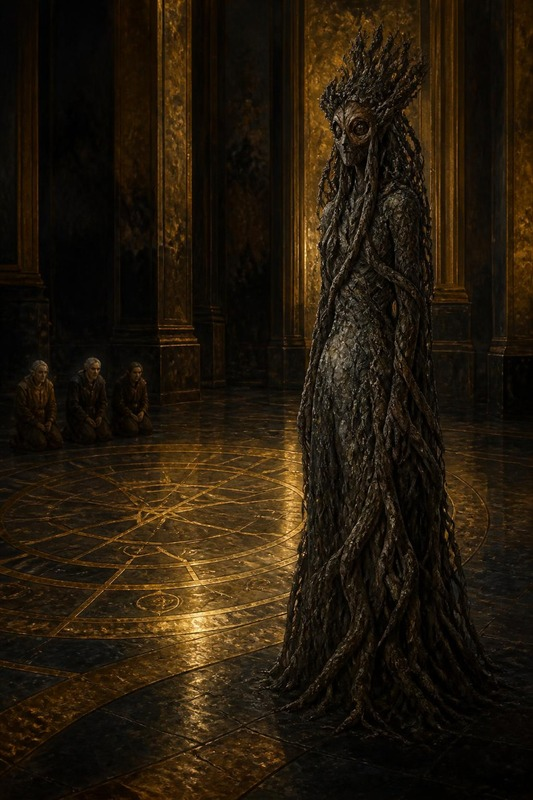

**Chi/cosa è.** La Custode delle Radici è un **psicopompo neutrale** del Sogno
della Terra, e **si aggancia al Cerchio Sacro di ARC-09**, la quest della
druida Hella. **Contratta**, senza combattere e senza minacciare. Il DM la
gioca come un funzionario dell'ordine naturale, cortese, inflessibile, senza
malizia (Andor: la macchina non odia, esegue).

**Le tre risposte del party (tutte grigie — nessuna pulita):**

| Risposta | Cosa comporta subito | Eco a lungo termine |
|---|---|---|
| **A. Accettare il pegno** (Hella, dalla soglia, si impegna a un servizio futuro verso il Sogno) | La Custode si inchina e svanisce; Hella torna con un **legame più forte** col Sogno della Terra (**Earth Dream** utilizzabile **2/giorno**). | Il Debito diventa una **quest ARC-09**: custodire un luogo del Sogno, o un servizio al Cerchio Sacro / al Ghostlord. Onorato = alleanza druidica rafforzata; ignorato → si degrada in «B». |
| **B. Rifiutare / sfidare** (Hella, dalla soglia, nega il debito; o i PG cacciano la Custode, o nessuno risponde) | La Custode **non combatte**: china il capo e si ritira. *«Come volete. Ma il vuoto si colma da sé — e la natura non è delicata.»* | Sessioni dopo, **qualcosa risale** dal Sogno per riempire il vuoto: un aggancio a un nemico ARC-09 (un non-morto della terra nel dominio del Ghostlord, o una **crepa** che la corruzione fungina di Sonjak sfrutta). Il rifiuto non è punito da un dio: è la natura che riempie i vuoti. |
| **C. Offrire Durik** (il collaterale vivente) | Durik — riforgiato **dal** Sogno della Terra — è già «metà di là». Offrirlo come **pegno vivente**: resta il **ponte** tra Hella e il Sogno. Il Debito è saldato con qualcosa che si ama. | Durik non è del tutto «suo»: **1 volta per sessione** può rispondere al Sogno prima che a Hella (il DM lo muove per un round secondo il Sogno — gancio RP doloroso, mai letale). In cambio il Debito è **saldato subito**: niente quest del Sogno in ARC-09, a differenza di A, e nessun vuoto che risale, a differenza di B. |

**Chi risponde**. L'ultima parola è di Hella. Il gruppo può parlare
prima, e lo spirito sulla soglia lo sente; poi la giocatrice dice **una frase
sola**, dalla soglia, e quella frase sceglie A, B o C. Se il gruppo propone
Durik, la sua frase può solo accettare o rifiutare, e al §8 Hella ricorda chi
l'ha proposto. Se nemmeno lei risponde, la Custode prende il silenzio per un
rifiuto: vale B.

La frase si sente nella Sala con la voce di Hella, bassa, come se venisse dal
Cuore sul suo petto; nessuno la vede. Se un PG si offre («lo porto io»), la
Custode non lo guarda: il debito è della radice, e la radice è di Hella.
L'offerta resta detta e lo spirito la sente, ma la frase che sceglie resta a
Hella. Al §8 lei ricorda chi si è offerto.

> **Registrazione (obbligatoria).** Segna la scelta nel registro di fine serata
> (il filo «[DEBITO DELLA RADICE]») e nell'Echo Ledger (§10). È un filo
> **a lungo termine**: paga in ARC-09, non subito. **Nessuna meccanica coercitiva
> ora** (PF1e: patto non-coercitivo): è un obbligo che il mondo ricorda.

> **Perché non è «cattivo» (nota di tono).** La Custode ha ragione: strappare un
> morto all'ordine *è* uno strappo. I PG hanno ragione: Hella merita di tornare.
> Due ragioni che non si annullano — il cuore di ogni buona scena grigia. Non
> c'è una risposta giusta; c'è la risposta che i **tuoi** giocatori scelgono, e
> che li segue.


---

## §7 — STEP 6 E IL RISVEGLIO (Hella torna, Durik si lega, la Collana nasce)

### SCENA 6 — Il risveglio

**In scena** — Dove: l'Altare — Chi: Moradin · Durik

**STEP 6 — La Fusione (Moradin manifesto, 3 secondi).**
> **Read-aloud — l'Altare, lo Step 6.** *La luce esplode
> dall'altare. Per tre secondi, sopra il corpo, c'è Moradin: traslucido, più
> alto di chiunque. Stavolta la voce passa dall'aria, e la sala trema.*

**MORADIN (voce vera, l'unica volta):** *«Hella Oakenshield. Druida antica. Ti richiamo per il servizio reso, per il sacrificio compiuto, per l'amicizia che vi lega. Ritorna. Vivi. Cresci. Combatti. In nome di Moradin, Forgiatore di Anime: resurrezione!»*

> **Read-aloud — il ritorno.** *Cinque secondi. Dieci. Il
> Cuore di Moradin, sul petto di Hella, rallenta, novanta battiti, sessanta, e
> si ferma. Poi lei inspira, di colpo e a fondo, come chi riemerge dall'acqua un istante prima di
> annegare. Il petto si alza e ricade. Gli occhi si aprono alla luce. Erano
> marroni; adesso sono color ambra. La pelle ha un sottotono di muschio pallido,
> fra i capelli biondi corre una venatura di corteccia, e l'aria sa di terra
> bagnata e di linfa. Hella respira.*

**Aspetto (Ibrido Treant):** pelle verdastra sottile, occhi ambra-dorati,
capelli biondi mossi con una venatura di corteccia fine, orecchie appuntite come
foglie giovani, com'è nei ritratti, dita un po' più lunghe (unghie come corteccia,
funzionali). Stessa personalità, stessi ricordi, stesse abilità druidiche — più
i doni del viaggio (§1) e i Doni del party (§5).

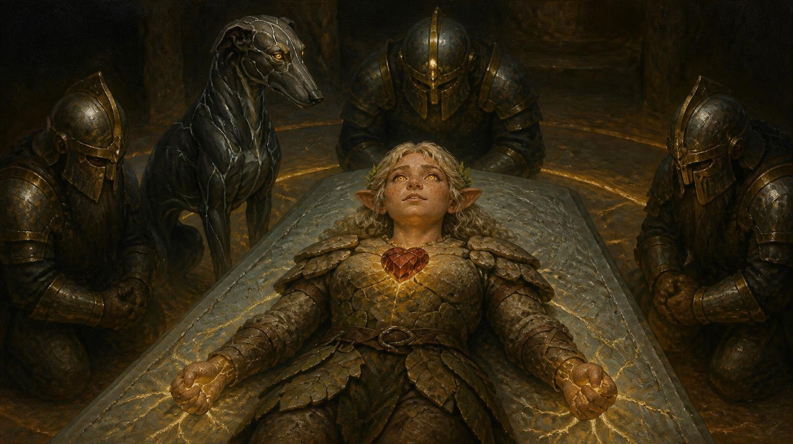

> **Read-aloud — le prime parole, con la voce rauca.** *«Io…
> dove… respirare è difficile.» Gli occhi ambra cercano, e si fermano su
> Tordek. «Tordek? Sei vero, o sto ancora sognando? Ero sotto terra. Buio.
> Freddo. Ma sentivo te. La voce era la tua. Chiamavi. E sono tornata.» Si porta una mano al petto,
> sente il battito sotto le dita, e la voce le si spezza. «Viva? Come?»*

Se allo Step 5 il giocatore di Tordek ha detto la sua frase (§5, `[HDYWTDT]`),
Hella la ripete qui al posto di «Chiamavi». Da questa riga in poi le parole di
Hella sono della sua giocatrice: il box le dà l'attacco, non la scena.

**Durik si lega.**
> **Read-aloud — il ritorno del fedele.** *Un rumore di pietra
> su pietra. Il grande cane di mithral e roccia scura, che non si è mai
> allontanato dal corpo, si fa avanti. Non abbaia: non sa più farlo. Appoggia la
> testa massiccia sul petto di Hella, gli occhi di topazio socchiusi, e resta
> così. Lei alza una mano che trema e la posa fra le orecchie di granito. «Durik?» Il cane
> risponde con il click lontano di una faglia che si assesta. Quel suono,
> lo conosce solo lei.*

**Scheda d'entrata — Durik, il fedele**

| | |
|---|---|
| **Vuole** | stare fra Hella e il pericolo. Ha orbitato il corpo da quando è nato dalla polvere di Terros |
| **Suona** | **non parla, non abbaia.** Suoni di pietra: un click, uno strofinio, il rumore lontano di una faglia |
| **Sa** | dove si muove qualcosa sotto i piedi, entro 18 metri |
| **Eco che porta** | la lastra del ricordo caduta nella Prova II del viaggio, l'Impronta nel terzo seme. E la zampa col topazio sul margine dell'affresco A5 |
| **Eco che arma** | il primo scontro accanto a Hella, contro Zog'tar in cap. IV. Il giorno in cui viene distrutto per la prima volta, e torna polvere nel seme, è una scena: la scheda della Collana la chiede con un read-aloud |

Da questo momento Durik è il suo **compagno animale** a pieno titolo, sempre al
suo fianco. Se viene distrutto, lo richiama il **terzo seme** della Collana.

**La Collana dei Semi Eterni nasce.** I tre semi assorbono i sacrifici e si
fondono in un **torc vivente** di legno e metallo (la giocatrice la trova nel
foglio *Hella, tornata*):
- **Saggezza della Terra** (+4 SAG), **Corteccia del Guardiano** (+3 CA naturale);
- **Avatar della Radice** (1/g: Ibrido Treant/Nano Enorme 10 round, +8 FOR,
  portata 4,5 m, due schianti da Treant; profilo completo in Appendice A.3);
- **Evocazione dei Guardiani** (3/g, un seme per volta): i semi I e II
  evocano ciascuno un **Treant di Adamantio** per 1 ora (statblocco in
  Appendice A), quindi al massimo due Treant. Il seme III richiama **Durik**
  solo se è stato distrutto: torna subito, per un'ora, e all'alba è di nuovo
  intero. I semi usati tornano all'alba. Chiamare i due Treant nello stesso
  momento spegne l'Evocazione per un mese: niente Treant, e se in quel mese
  Durik cade non torna subito, ma all'alba;
- la Collana **funziona anche in forma selvatica**;
- **I Doni dei Semi** (3 slot): custodiscono i sacrifici del party — se un PG ha
  rifiutato (§5), il suo slot è **vuoto** e si potrà colmare in gioco.


Lo statblocco del **Treant di Adamantio** è in **Appendice A**.

**✉ Si consegna qui, alla giocatrice di Hella**: **Hella, tornata** (le righe da
aggiungere alla sua scheda, che per il resto resta la sua), **Durik** nel
momento in cui appoggia la testa sul petto di Hella. Il suo **eco privato**
ce l'ha già dal risveglio del gruppo (tabella del §0): la seconda metà, «Quello che hai attraversato», le
serve adesso, per il racconto del §8.
Le caselle dei Doni sul foglio di Hella le segni tu, dopo il rito. La scheda
completa per il DM è in Appendice A.

---

## §8 — IL RACCONTO DELLE PROVE (l'asimmetria si scioglie) — spotlight di Hella

### SCENA 7 — Il racconto delle prove

**In scena** — Dove: la Sala — Chi: nessuno

> Il momento in cui i due mondi si toccano: i PG hanno agito nel Piano della
> Terra **senza sapere** cosa attraversava lei; lei ha viaggiato **senza sapere**
> cosa facevano loro. Ora si raccontano. **Da' la scena alla giocatrice di Hella.**

Quando è pronta a parlare, Hella racconta le **tre prove** dell'Incudine del Mondo
(canone giocato):
- **Il Fuoco della Verità** — ha dichiarato ad alta voce una verità scomoda
  (verità piena): *«Ho dovuto dire una cosa che non avevo mai detto. E bruciava
  più del fuoco.»*
- **La Pietra che Ricorda** — ha scelto di tenere il dolore **come ferita aperta**,
  non di razionalizzarlo: *«Mi hanno chiesto di dimenticare per non soffrire. Ho
  detto no. Certe ferite vanno tenute aperte, o si dimentica perché fanno male.»*
- **Il Martello e il Voto**: ha scelto la **Via della Radice**. *«Io vi tengo
  ancorati. Non un muro davanti a voi: una radice sotto di voi. Ho giurato.»*

**Le rivelazioni incrociate (i momenti forti):**
- **Thorik scopre** che la presenza verde che gli alleviò il peso al Piano della
  Terra (cap. I §9) **era lei**: *ha già portato peso per lui, dall'aldilà.*
> **Read-aloud — la Sala, il debito che si scioglie.** *Hella si volta verso Thorik, e c'è qualcosa nei suoi occhi ambra che lui
> non sa ancora leggere. «Quando eri nel Piano della Terra, sotto la montagna
> che ti schiacciava le spalle — ti sei sentito una mano fredda, una luce
> verde, che ti alleggeriva il peso. Ricordi?» Thorik ricorda: l'aveva
> scambiata per una benedizione senza nome. «Ero io, Thorik. Non potevo fare
> altro, da dove ero, che starti vicina. Hai portato peso per me senza
> saperlo, e io ho portato il tuo. Anche da morta. Siamo pari, tu e io — e non
> lo eravamo mai stati.»*

Le battute qui sotto sono l'attacco, per la giocatrice che le vuole; se ha
parole sue, valgono le sue.

- **Durik**: Hella capisce che l'Impronta caduta nel Sogno (Prova II) è tornata a
  riempirsi — *è* Durik. *«Non l'ho perso davvero. È andato dove serviva.»*
- Se il party ha vissuto **il Debito della Radice** (§6): Hella **lo sa** — il
  Voto della Radice è la ragione del debito. Il suo commento cambia la scena:
  *«Il prezzo… lo pago io, non voi. La radice è mia.»* (o, se hanno offerto Durik:
  *«Avete dato lui. Lo capisco. Ma una parte di me non ve lo perdonerà mai del
  tutto — e una parte vi ringrazierà per sempre.»*). Se un PG si è offerto di
  portarlo (§6), Hella lo guarda: *«Ti sei offerto. Non era tuo da portare, e lo
  sapevi.»*

**Sviluppi.** Questo racconto **incide** l'affresco A3 (cap. II): dopo il rito,
A3 aggiunge la scena di Hella viva che posa una mano sulla spalla di Thorik. Il
cerchio del lutto si chiude.


---

## §8-bis — LA PRIMA ORA DOPO IL RITO

Hella torna come con *resurrezione* dell'SRD: pf pieni, e gli incantesimi e
gli usi del giorno che aveva preparato prima di morire. Le prove di quest'ora
spendono slot e usi veri.

Hella cammina, prova il corpo nuovo (*«la pietra mi parla: antica, forte,
protettiva»*), prega, ripassa gli incantesimi che aveva preparato. Prova *Produce Flame*: la fiamma
verde-oro funziona **ma la sente ostile** (vulnerabilità). Evoca un orso: appare
mezzo-corteccia, cambiato dalla sua nuova affinità.

> **Read-aloud — la fiamma.** *Hella apre la mano, e la
> fiamma viene, verde e oro. Arde come deve. Ma è calda sul palmo più del giusto,
> e lei la tiene lontana dal viso, come si tiene un cane che non la conosce
> ancora.*

**Le Benedizioni di Moradin su Hella** (Moradin: *«Combatterai i miei figli.
Proteggili. Proteggi il focolare.»*) — le tre del PDF, che hanno tutti
(cap. II §7: **Pelle di Pietra**, resistenza al fuoco 10 e al freddo 5 per
24 ore; **Cuore Incrollabile**, immunità al caldo e al freddo ambientali e +2 ai
TS su Tempra contro gli effetti ambientali; **Vigore della Forgia**, 3 cariche
che tornano dopo un sonno di otto ore: azione standard, cura 3d8+5 a sé o
2d8+2 a contatto a un alleato) **+**:
- **Mantello della Fiamma** (Resist Fuoco **20**) — **cruciale**: mitiga la sua
  vulnerabilità per 24 ore vissute dalla preghiera, come le altre, e non si somma
  alla Pelle di Pietra: vale la più alta.
  Conta se è ancora accesa agli scontri di cap. IV.
- **Benedizione di Moradin Incarnato**: +2 sacro att/danni, +4 vs paura/charme,
  **1 ri-tiro**; attiva per 24 ore vissute dalla preghiera, come le altre
. Si accende una volta al giorno, con un'azione
  veloce, e dura 1 minuto ogni volta.

> **Momento privato Hella + Tordek** (5 min di RP, lasciar improvvisare): la
> gratitudine, la paura della morte perduta, le promesse di un dopo. È il
> pagamento emotivo del legame che ha tenuto Hella ancorata nel buio. Se al §5
> Tordek ha rifiutato il Dono, Hella non ne parla per prima: lascia che sia lui
> a cominciare, e se lui non comincia resta seduta accanto a lui senza dire
> niente. Lo sa dal momento del risveglio (§5, «Al risveglio»).


---

## §8-ter — LA SOGLIA

### SCENA 8 — La soglia

**In scena** — Dove: l'affresco A6 — Chi: Moradin · Therysol

> Riformato il cerchio, resta l'ultima soglia dell'arco: la Corona,
> con Topazio e Smeraldo, può aprire il **portale del Tempo** (affresco A6).

> **Il difetto che questa sezione chiude.** Scrivere «poi si apre il portale» è
> una didascalia. L'ultima scena di un arco è il posto dove **la scelta costa**, e
> qui ce n'è una vera: la Corona può aprire il portale **con due gemme su tre**,
> e nessuno sa cosa vuol dire attraversare un varco tenuto aperto da un oggetto
> incompleto.

> **Read-aloud (la tensione che non alza la voce) — l'affresco A6.** *L'affresco
> A6 non è cambiato in mille anni, ma adesso ha tre punti di luce e due sono
> accesi. Il terzo resta un cerchio inciso e vuoto, alto sulla parete, alla
> stessa altezza dell'incasso scoperto sulla Corona. Nel silenzio nessuno lo
> nomina, e la luce degli altri due si ferma sul bordo.*

**Il fatto da mettere sul tavolo, con parole da DM e non da manuale**: Moradin
non promette. Dice quello che sa, e non di più.

**MORADIN (piano, senza enfasi):** *«Con due pietre il varco si apre. Con due pietre si richiude quando decide lui, non quando decidete voi. La terza non ve la posso dare: è di là.»*

| La scelta | Cosa costa | Cosa apre |
|---|---|---|
| **Attraversare adesso** | il ritorno non è garantito dal lato di qua: si torna **solo** trovando il Rubino a −1.000 | il viaggio a mille anni fa (cap. IV) parte con una posta reale invece che con un viaggio turistico |
| **Riposare e prepararsi prima** | otto ore di sonno: l'orologio di Hammerfist scende di otto ore oltre a quello che segna adesso (il conto è nel §0), e i PG lo sanno | incantesimi e capacità al giorno recuperati, e un arrivo a Hammerfist con meno tempo |
| **Uscire per un'altra via** | non c'è: finché il ciclo non è compiuto, dalla Forgia si esce solo dai portali dei Piani e da quello del Tempo | niente: la Sala non ha altre porte |
| **Mandare avanti uno solo** | Moradin rifiuta: *«Il varco conta quattro. Ne ha contati quattro anche mille anni fa.»* | niente — ma la battuta dice al tavolo **che di là li aspettano in quattro** |

> 🎭 **Grigio politico.** Therysol non vuole che vadano. Il suo *Want* non
> riguarda i PG: ha vegliato un corpo per sei giorni e non ha nessuna
> intenzione di rifarlo. Se qualcuno glielo chiede, lo dice. Se nessuno glielo
> chiede, **resta zitta e se ne ricorda**.

Se glielo chiedono, ecco come lo dice:

**THERYSOL (senza alzare la voce):** *«Ho vegliato un corpo per sei giorni. Non chiedetemi di vegliarne quattro.»*

La chiusura della scena, e dell'arco, si legge quando i giocatori hanno sentito
Moradin e hanno davanti le tre scelte.

> **Read-aloud — la chiusura.** *Il portale è chiuso. La Corona è
> pronta, e due pietre su tre brillano nel silenzio. Quattro persone stanno in piedi davanti a un affresco, e una di loro
> respira da un'ora. Che fate?*

⚠️ **Non dire** che il Rubino sta *dentro* la battaglia di −1.000 e si spende
lì: è la posta del viaggio (cap. IV), e lo stato della campagna la registra come
**spesa nella battaglia antica**. Qui il tavolo deve solo sapere che di là c'è una
pietra, non cosa le succederà.

**✉ Si consegna qui, a tutti: *Le Cronache dei Quattro Eroi***, mentre la Corona
apre il varco. È il momento in cui i giocatori scoprono di essere la profezia.

---

## §9 — CONTINGENZE & FALLIMENTO

| Mossa | Risposta del modulo |
|---|---|
| **Vogliono resuscitarla PRIMA (Parte 2, appena ritrovata)** | Impossibile: i semi di treant e il viaggio dello spirito non sono ancora avvenuti. Moradin: *«Non ancora. Deve prima attraversare la Terra dentro di sé.»* |
| **Non vogliono spendere il Cuore** (temono la perdita) | Legittimo, ma è l'unico modo. Moradin non forza. Se rimandano, Hella resta morta e **il varco non si apre**: conta quattro, e non apre per meno. Il rito si può fare quando vogliono, ma ogni ora che passa scende dall'orologio di Hammerfist, e Tordek la passa accanto al corpo. |
| **Chiedono a Moradin di resuscitarla senza costi** | *«La magia non basta. Serve la vita. Io do il Cuore; voi date il resto — o lei torna monca di ciò che potevate donarle.»* (rifiuto totale, §5). |
| **Vogliono dormire prima della soglia** | Prima del rito vale la tariffa della Sala di cap. II §0-bis, che possiede l'orologio; dopo il rito la Sala conta il sonno per intero. Prima della soglia si dorme. Otto ore di sonno: l'orologio di Hammerfist scende di otto ore, e si recuperano incantesimi, capacità al giorno e 1 pf per livello (SRD). L'Anello di Artemis, se si è spento al rifiuto, resta spento fino alle 24 ore. |
| **Provano a incastonare il Cuore nella Corona** (è un rubino, e l'incasso è vuoto) | Non entra: il Cuore è grande come un pugno, l'incasso come un'unghia, e non è una gemma della Corona. Se insistono, Moradin: *«Quello è un cuore, non una pietra. Si spende, non si porta.»* Non dire altro sull'incasso (§2-bis) |
| **Attaccano/scacciano la Custode delle Radici** (§6) | Non combatte: si ritira (ramo B). Nessun scontro — ma il vuoto si colmerà da sé, peggio. |
| **Un PG vuole sacrificare la PROPRIA vita** (oltre il richiesto) | Moradin **rifiuta**: *«Non chiedo una morte per una vita. Chiedo un dono, non un baratto di anime. Rimetti via quel coraggio: ti servirà domani.»* (evita il martirio gratuito). |
| **Se i PG chiedono a Therysol del corpo, prima del rito** | Risponde, perché lo sa e nessuno gliel'aveva chiesto: *«Si gira verso sud. L'ho rimesso dritto undici volte.»* Se qualcuno occupa il Sud prima dello Step 5, vale la regola del Sud occupato, sotto. Il Sud lo può tenere solo chi non officia: Therysol, Durik o un quinto PG. |
| **Esaminano o toccano il Cuore prima di posarlo** | Scalda la mano e batte sotto le dita, sessanta al minuto. Nient'altro: è la reliquia di un dio, e non si lascia studiare. Moradin: *«Si spende, non si porta.»* |
| **FALLIMENTO — lo Step 5 va male** (meno di 2 successi; **3 successi su 3** se i doni versati sono **uno o nessuno**) | Il rito non finisce in un «game over»: cosa succede dipende da **quanti** successi ci sono stati, ed è la tabella qui sotto. |

---

### I modi di fallimento — zero successi apre gioco, non lo chiude

> **Il principio.** Un rito che può solo riuscire non è una prova. Un rito che
> può solo fallire è una punizione. Qui **ogni esito produce una scena
> successiva**, e la peggiore è anche la più giocabile.

Con uno o nessun Dono la soglia è 3 su 3, e la riga si sceglie da quanto manca: 2 successi valgono la riga «1 su 3», 1 successo la riga «0 su 3», e 0 successi anche, perché una riga peggiore non c'è. La tabella in fondo al §5 mette tutti i casi in fila.

Quattro regole valgono per tutte le righe:
- **Il ritiro riuscito paga sempre la riga «1 su 3»**: l'indagine del Sud salva
  Hella, ma non la fa tornare meglio di chi ha tirato 2.
- **Se Hella torna, in qualunque riga, si giocano la Custode (§6) e lo Step 6.**
  Col richiamo a zero, dopo il ritiro.
- **Il Sud occupato prima del primo Step 5** conta come la risposta trovata in
  anticipo: se lo Step 5 va a zero, il ritiro parte subito, senza l'ora d'indagine.
  Se il richiamo riesce, non cambia niente. Allo Step 5 tirano sempre i tre
  officianti; chi tiene il Sud non tira allo Step 5.
- **Il livello negativo** della riga «1 su 3» segue l'SRD tranne in una cosa,
  che è regola di questo rito: dopo 24 ore non chiede il TS su Tempra e non
  diventa mai perdita di livello. Si toglie con *ristorare* (il gruppo ne ha le
  pergamene).

| Successi allo Step 5 | Cosa torna | Cosa apre |
|---:|---|---|
| **3 su 3** | Hella intera, i tre doni attecchiscono | la soglia (§8-ter) parte pulita |
| **2 su 3** | Hella intera, un dono **attecchisce a metà** | il PG che ha fallito lo scopre **a −1.000**, nel momento peggiore: il primo uso del suo dono non funziona, e si consuma. Se chi ha fallito aveva rifiutato, attecchisce a metà il dono di un altro. ⚠ Non SRD |
| **1 su 3** | Hella torna con **1 livello negativo** e non ricorda i nomi per 1d4 minuti | una scena vera al risveglio: **chi le dice il proprio nome per primo** conta, e Hella lo ricorderà per tutto l'arco |
| **0 su 3** | Hella **non torna adesso** | 🔎 **Questo non è un game over.** Il Cuore regge per **un'ora**, e Moradin lo dice: *«Il canale è aperto. Non è lei a non voler tornare.»* La sala diventa un'indagine di un'ora — cosa manca al cerchio? Il Sud vuoto. Il seme dormiente, se qualcuno ha rifiutato. La gemma mancante. La risposta esiste ed è nei §2, §2-bis e §6, e il tavolo la ricompone da sé. **La risposta è il Sud**: qualcuno che non officia occupa il punto vuoto del cerchio: Therysol, Durik o un quinto PG. Fatto questo, lo Step 5 **si ritira una volta**, e servono **2 successi su 3**. Tirano i tre officianti, agli altri punti. Se il ritiro dà di nuovo 0, il rito riesce lo stesso e paga il prezzo della riga «1 su 3». La **Custode delle Radici** entra lo stesso, una volta sola, dopo il ritiro riuscito, come nel rito che va bene (§6) |

⚠️ **Il vicolo cieco ha una porta**: se l'ora scade senza che il tavolo trovi
niente, **Therysol** parla — e dice la cosa che ha visto in sei giorni di
veglia, non una soluzione ma un fatto: *«Il corpo si gira verso sud. L'ho
rimesso dritto undici volte.»* Da lì si riparte: il rito non è perso, e il
Cuore regge finché il tavolo lavora sul Sud. L'ora dice solo quando parla
Therysol.

### Il nodo del Sud, per l'ora d'indagine

Tre indizi portano alla stessa risposta, e ne basta uno. Il DM li ha già messi
sul tavolo nelle scene di prima: qui li ritrova.

| Indizio | Il fatto | La lettura | Il nome |
|---|---|---|---|
| il cerchio (§2, Terreno) | tre officianti, e il Sud lasciato vuoto, da cui fluisce l'energia | il cerchio è aperto da un lato | il Sud |
| il corpo (§2, scheda di Therysol) | si gira verso sud, e Therysol l'ha rimesso dritto undici volte | qualcosa, di là, la tira da quella parte | il Sud |
| la voce di Moradin (§9, riga «0 su 3») | *«Il canale è aperto. Non è lei a non voler tornare.»* | manca qualcosa al cerchio, non a Hella | chi tiene il punto vuoto |

**Le risposte sbagliate portano comunque da qualche parte.**
- **La gemma mancante**: il Cuore non entra nella Corona (riga sopra), e la
  Corona resta fredda. Il tavolo ha escluso una pista, e ha speso tempo.
- **Il seme dormiente**, se qualcuno ha rifiutato: Moradin risponde *«Quello
  che non hai dato lo darai più avanti. Non è questo che manca.»* Il dono non
  si recupera adesso: il seme resta chiuso fino ad ARC-09, col riempimento del §5.
  **Nessuna idea**: allo scadere dell'ora parla Therysol, come sopra.


---

## §10 — ECHO LEDGER (conseguenze a lungo termine)

| Evento (qui) | Eco | Quando riemerge | Dove si gestisce |
|---|---|---|---|
| 🛡️ **Thorik dona metà della deflessione** (da +2 a +1) | −1 CA permanente; e ogni volta che lei scuda qualcuno **lui scatta** (Eco del Custode). Hella gli deve un debito morale | **ogni scontro** in cui lo Scudo si accende | registro di fine serata |
| ⚒️ **Tordek dona l'Ancoraggio** | i Bracieri non lo hanno più; in cambio **avvertono un round prima** dello spostamento forzato | P5, ARC-08 (giganti, draghi che afferrano) | scheda dei Bracieri |
| 🔮 **Artemis dona 1d6 di EB** | l'*Eldritch Blast* resta a **6d6** per il resto della campagna | **ogni round in cui spara** | scheda dell'Anello |
| **Chi rifiuta un Dono** (§5) | **seme dormiente** (niente Scudo / niente RD / niente Rovo) **e l'artefatto reagisce**: Aegis Fang giudica, i Bracieri tacciono 7 giorni, l'Anello si spegne 24 h | ARC-08 (1ª ferita critica / 0 pf / lame drow) | registro delle perdite di ARC-08, ganci di ARC-09 |
| 🌱 **La Collana restituisce** (potere #6) | **una volta sola per seme**: Hella rende al donatore ciò che aveva dato, per una scena | quando lei decide | scheda della Collana |
| **Rifiuto totale** | 3 slot-dono vuoti sulla Collana | quest personali ARC-09 (un atto di sacrificio per slot) | registro dei ganci di campagna |
| **Il Debito della Radice** (§6) | pegno al Sogno della Terra (A: quest / B: vuoto che risale / C: Durik ponte) | ARC-09 (Cerchio Sacro / Ghostlord / corruzione fungina) | registro di fine serata, §6 |
| **Thorik scopre «la presenza verde»** (§8) | il legame Thorik-Hella si approfondisce (fama/anointing) | ARC-08/09 (bond, Cerimonia 100 Asce) | registro degli echi |
| **Cuore di Moradin SPESO** | catalizzatore consumato per sempre | tutto l'arco a valle | stato degli artefatti |
| **Aegis Fang, se Thorik ha donato** | l'arma **smette di dubitare di lui**: nessuna prova di opposizione per un arco intero | ARC-08 | scheda di Aegis Fang |


---

## §11 — AVANZAMENTO (budget PX + artefatti)

### A. Budget PX del beat (party 3→4 PG, APL eff. 12-13 · PG di 13°)
> Beat **hub** rituale: PX di storia, sacrificio e roleplay.

| Scena | Tipo | PX/PG |
|---|---|---|
| Il rito corale completato (Step 1-6) | rito corale | 800 |
| La scelta-costo di ogni PG (§5, qualunque strada) | roleplay/sacrificio | 400 |
| Il Debito della Radice affrontato (§6, qualunque risposta) | roleplay grigio | 400 |
| Il Racconto delle Prove (§8) | roleplay/spotlight | 300 |
| **TOTALE beat** | | **~1.900/PG** |

> I PX del beat li prende anche Hella, tutti, come gli altri tre: è morta fino allo
> Step 6, ma risponde alla Custode e fa il racconto.

> Interludio come il ritorno nella Sala (cap. II): piccolo in PX, enorme in campagna. Somma alla
> Terra (~11.600) e all'Affreschi (~1.900) → il 14° matura a Hammerfist.

### B. Artefatti & tesoro (ricchezza speciale, conteggio separato)
| Oggetto | Chi | Stato dopo il rito | Valore di riferimento |
|---|---|---|---|
| **Collana dei Semi Eterni** | Hella | **nasce ora** (Radicata): +4 SAG, +3 CA nat, Avatar della Radice, Evocazione dei Guardiani (Treant/Durik), 3 slot-dono | artefatto minore (non-WBL) |
| **Durik Riforgiato** (12 DV) | Hella | compagno a pieno titolo, sempre presente; il 3° seme lo richiama se è distrutto | — |
| **Cuore di Moradin** | (altare) | **SPESO** (single-use) — non torna | — |
| **Corona di Adamantio** | Thorik | invariata (2/3 gemme); pronta ad aprire il portale del Tempo | già contata (cap. I) |

### C. Tesoro PREGENERATO — il ritorno del corredo di Hella
> Un rito non è una stanza-tesoro, ma questo beat ha il suo loot naturale: alla
> resurrezione, **l'equipaggiamento che Hella portava alla morte** (recuperato
> dal suo corpo nell'ARC-06 e custodito con lei nella Sala) **torna a lei** —
> ricchezza ordinaria che rientra nel WBL del party, itemizzata:

| Oggetto (corredo di Hella, restituito: la scheda della giocatrice) | Valore |
|---|---|
| **Corazza di piastre di pelle di drago +1** (*dragonhide full plate*: niente metallo, la porta un druido; armatura +9, DES max +1, penalità −5; SRD, materiali speciali: costo doppio della versione perfetta) | ~4.300 mo |
| **Cristallo del riposo** sulla corazza (*restful crystal*, cristallo d'armatura; dormire con l'armatura addosso non affatica) `[Private source — Magic Item Compendium]` | 500 mo |
| **Brocchiere** (CA +1) | ~15 mo |
| **Anello di Deviazione +1** | ~2.000 mo |
| **Mantello dello Svanire** (*vanisher cloak*, spalle; 3 cariche al giorno, azione standard: 1 carica invisibile 4 round, 2 cariche lei e un alleato adiacente 3 round, 3 cariche lei e fino a tre alleati adiacenti 2 round, come *invisibilità*) `[Private source — Magic Item Compendium]` | 2.500 mo |
| **Anello degli Incantesimi Silenziosi** (*ring of silent spells*; 1 volta al giorno, azione veloce: *silenzio* centrato su di lei, e finché dura lancia fino a tre incantesimi di 3° livello o meno senza componenti verbali, senza slot più alti né tempo in più) `[Private source — Magic Item Compendium]` | 2.000 mo |
| **Guanti del Potere Orchesco +2** (FOR 14 → 16) | ~4.000 mo |
| **Periapto di Saggezza +2** (⚠️ **non si somma** al +4 della Collana: due bonus di potenziamento alla stessa caratteristica non si sommano, vale il più alto; resta utile se la Collana è soppressa o perduta) | ~4.000 mo |
| **Ascia nanica di adamantio** con il **cristallo del ritorno minore** (*crystal of return*, lesser, cristallo d'arma: la estrae come azione gratuita e, se nessuno la tiene, la richiama in mano da 9 m come azione di movimento; il superiore aggiunge solo «ritornante», che vale per le armi da lancio) `[Private source — Magic Item Compendium]` | ~3.030 mo + 1.000 mo |
| **LORDO restituito** | **~23.345 mo** |


> **Sorpresa nascosta (Osservare CD 20, sul corpo di Hella prima del rito):**
> la **ghianda annerita** stretta nel pugno da quando è morta — l'ultima che
> raccolse in vita (è la stessa **«Ghianda di Speranza»** che l'affresco A8
> mostra, cap. II). Al risveglio Hella la pianta nel primo suolo sacro che
> tocca: diventa un piccolo **àncora druidico** (+1 sacro
> 1/giorno al Radicamento) **o** va nel 1° seme-dono vuoto della Collana — scelta
> della giocatrice. Se tutti e tre hanno donato non ci sono semi vuoti, e la
> ghianda diventa l'àncora. 0 mo commerciali, peso emotivo enorme.

> **Cuore di Moradin — dopo la spesa:** non lascia loot (si dissolve), ma sulla
> superficie dell'Altare resta un'**impronta a forma di cuore**, tiepida per
> sempre: la Sala ricorda anche questo (pannello-Cronaca, cap. II).

Le Benedizioni si rinnovano all'Altare (cap. II §7), pregando dieci minuti,
una volta ogni 24 ore vissute. Nessun altro loot
ordinario (è un rito).


---

## §12 — PONTE verso il viaggio a mille anni fa + HANDOUT & ASSET

**Ponte.** Hella è viva, il party è di **quattro**, e la soglia (§8-ter) è
stata attraversata. Al di là c'è Hammerfist come era **mille anni fa**, e una
battaglia che deciderà, nel passato, le sorti del presente. → **il Viaggio a 1.000 anni fa
 (cap. IV)** (Hella è il 4° PG).

### Handout giocatore

Sono i fogli della tabella di §0, «Cosa si consegna, e quando»: gli echi, il
Cuore, la preghiera, le carte dei Doni, Hella tornata con Durik, le Cronache.
Sono nel volume dei giocatori, *Il Cuore e la Porta*, un foglio ciascuno.

### Immagini (atlante C1 — momenti d'uso)
| Momento | Immagine |
|---|---|
| Il Cuore di Moradin, dopo il §3 | la tavola del reliquiario aperto, fedele al box |
| La Custode delle Radici, allo Step 5 | la tavola della Custode, in §6 |
| Il risveglio di Hella | la tavola del risveglio, in §7 dopo il box |
| Durik e Hella, dopo il risveglio | la tavola di Durik e Hella, copertina della scheda di Durik |
| La Sala durante il rito | la **pianta** dell'Appendice B. ⚠️ La vecchia mappa del rituale è un grafico, non un'illustrazione |

### Musica
- **La Canzone delle Pietre**. **Qui è il suo momento pieno**: falla
  partire al richiamo dello spirito (Step 5) e lasciala salire fino
  all'inspirazione del risveglio (§7). È il tema pietra/forgia dell'arco: la
  resurrezione è la sua nota più alta.

---


<!-- pagina: una-colonna -->

## APPENDICE A — STATISTICHE

> Una pagina A4 a una colonna. La giocatrice di Hella ha la sua versione, le
> righe da aggiungere alla scheda (*Hella, tornata*, nel volume dei giocatori); questa è la
> scheda completa per il DM, e i numeri stanno qui una volta sola.

### A.1 · Hella Oakenshield, risorta (§7)

{{monster,frame
## Hella Oakenshield, risorta
*Dream Dwarf · Ranger 1 / Druida 12 · Ibrido Treant (risorta) · Neutrale Buono · Media* · PG di 13°
___
**Taglia** Media · **Spazio** 1,5 m (1 quadretto) · **Portata** 1,5 m (1 quadretto)
**Iniziativa** +1 · **Sensi** scurovisione 27 m (Dream Dwarf)

**DIFESA**
___
**CA 25** (+9 corazza di piastre di pelle di drago +1, +1 brocchiere, +1 deviazione, +3 naturale della Collana, DES +1), contatto 12, colta alla sprovvista 24 · **pf 80** (13 DV, dalla scheda della giocatrice) · TS Tempra +11, Riflessi +7, Volontà +13 (base Ranger 1 + Druida 12 +10/+6/+8, COS +1, DES +1, SAG +5; tabelle SRD) · **Vulnerabilità al fuoco** ×1,5 · resistenza al freddo 15 · guarigione rapida 1 (a contatto con terra o pietra; sospesa nel round dopo un danno da fuoco): è la guarigione rapida SRD, Hella muore come chiunque altro  

**ATTACCO**
___
Vel 6 m (nana: l'armatura non la riduce) · BAB +10; Lotta +13  

**STATISTICHE**
___
For 16 (14 più i Guanti del Potere Orchesco +2), Des 13, Cos 12, Int 12, SAG 20(+5), con il +4 della Collana, Car 10 · **Talenti** Augment Summoning, Spell Focus (Conjuration), Natural Spell, Extend Spell, Combat Casting, Extra Wild Shape, Power of Nature (SNA +2 CL, custom) · **Equipaggiamento** (recuperato dal corpo, §11 C; la scheda della giocatrice) corazza di piastre di pelle di drago +1 con cristallo del riposo, brocchiere, ascia nanica di adamantio con cristallo del ritorno minore, Anello di Deviazione +1, Anello degli Incantesimi Silenziosi, Mantello dello Svanire (3 cariche al giorno), Guanti del Potere Orchesco +2, Periapto di Saggezza +2 (non si somma alla Collana: vale il +4) · **Artefatto** Collana dei Semi Eterni (§7)  

**CAPACITÀ SPECIALI**
___
- **Ibrido Treant** (dal viaggio e dal rito): doppio tipo Umanoide (Nano) / Vegetale.  
- **Empatia Vegetale** +4 · **Fotosintesi** (1/g: 2d8 pf a 1 ora di sole).  
- **Radicamento** (1/g, 5 round): immune a spinta, travolgere e sbilanciare; immobile.  
- **Marchio della Veritade** (Prova I): +4 Diplomazia coi nani di Moradin; 1/g verità → Volontà CD 17 o scosso.  
- **Radice Silenziosa** (Prova II): +2 Percepire Intenzioni; 1/g empatia immediata.  
- **Radici del Mondo** (Prova III): guarigione rapida 1 anche su suolo sacro o druidico; 1/g Radicamento corale (+1 morale ai TS degli alleati entro 9 m, 5 round, lei immobile).  
- **Doni del party** (§5, solo se donati: segna quelli veri dopo il rito): ☐ *Scudo del Custode* (Thorik): 1/g, immediata, prende il danno di un alleato entro 9 m **dimezzato**; Thorik accelerato 3 round verso il protetto. ☐ *Pelle di Adamantio* (Tordek): RD 3/adamantino (la sua **unica** RD). ☐ *Rovo Eldritch* (Artemis): **a volontà**, standard, contatto a distanza 18 m, 2d6 (metà rovi, metà fuoco).  
- **Restituzione** (Collana #6): una volta sola per seme, immediata, Hella rende al donatore ciò che aveva dato per una scena intera. Poi mai più.  
- **Incantesimi da druida** (LI 12), slot dal 0 al 6°: 6/5+2/4+1/4+1/3+1/3+1/2 (base SRD del druido di 12°, più i bonus di SAG 20). Preparati tipici prima di una battaglia: 1° Entangle, Faerie Fire, Produce Flame · 2° Barkskin, Bull's Strength, Flaming Sphere, Heat Metal · 3° Call Lightning, Cure Moderate, SNA III · 4° Cure Serious, Spike Stones, Freedom of Movement, Ice Storm, SNA IV · 5° Cure Critical, Call Lightning Storm, Wall of Thorns, SNA V · 6° Mass Cure Light, Transport via Plants, SNA VI.  
- **Compagno, Durik riforgiato** (12 DV, 102 pf): CA 21 (contatto 12, sprovvisto 19) · morso +15 (2d6+6), attacco completo morso +15 e 2 artigli +13 (1d4+3) · Temp +11 Rifl +10 Vol +6 · RD 5/adamantio · percezione tellurica 18 m · legame telepatico entro 18 m · senza ordini si frappone tra Hella e il pericolo. Scheda completa: il foglio «Durik, il guardiano di pietra». Sempre presente; il 3° seme della Collana lo richiama se è distrutto. Il rinoceronte visto in gioco è la **forma selvatica** di Hella, non un compagno.  
}}


### A.2 · Treant di Adamantio, evocato dalla Collana (§7)

Il Treant dell'SRD 3.5, tenuto **Grande** come nel canone, con i numeri del
canone dove sono più alti. *«Corteccia di ferro freddo, foglie di
mithral affilato, un cuore di energia terrestre.»*

{{monster,frame
## Treant di Adamantio (evocato dalla Collana)
*Vegetale Grande · Neutrale Buono* · GS ~10
___
**Taglia** Grande · **Spazio** 3 m (2×2 quadretti) · **Portata** 3 m (2 quadretti)
**Iniziativa** +0 · **Sensi** visione crepuscolare; Ascoltare +8, Osservare +8

**DIFESA**
___
**CA 24** (−1 taglia, +15 naturale), contatto 9, colto alla sprovvista 24 · **pf 95** (10d8+50) · TS Tempra +12, Riflessi +3, Volontà +8 · **RD 10/adamantio** · tratti dei vegetali · **Vulnerabilità al fuoco**  

**ATTACCO**
___
Vel 9 m · **Mischia** schianto +18 (2d8+9); attacco completo 2 schianti +18 (2d8+9) · Spazio 3 m, portata 3 m · BAB +7; Lotta +20 (+7 BAB, +4 taglia, +9 FOR)  

**TATTICHE**
___
Obbedisce a Hella, che gli dà ordini a voce o col gesto. Senza ordini si mette fra lei e il nemico più vicino, e colpisce chi le arriva entro 3 m. Contro chi vola fuori portata non può niente: si pianta accanto a Hella e la copre. Se c'è una porta, un muro o una macchina d'assedio, ci va contro prima che contro le persone. Non fugge e non si arrende: allo scadere dell'ora, o a 0 pf, torna seme.  

**STATISTICHE**
___
For 29, Des 10, Cos 21, Int 12, Sag 16, Car 12 · **Talenti** Attacco Poderoso, Arma Focalizzata (schianto), Spezzare Migliorato, Volontà di Ferro · **Abilità** Ascoltare +8, Osservare +8, Percepire Intenzioni +8  

**CAPACITÀ SPECIALI**
___
- **Travolgere** 2d8+13 (Riflessi CD 24 dimezza).  
- **Colpi d'adamantio**: danni doppi a oggetti e strutture, ignora la durezza sotto 20; i suoi colpi contano come adamantio.  
- **Durata**: 1 ora, al massimo due Treant, uno per seme (§7).  
- **Legami**: Tordek donatore entro 9 m, resistenza al fuoco 10. Artemis donatrice entro 9 m, quando usa Luce di Lathander (il potere 1/giorno dell'Anello): Rigenerazione 1 per tutta la durata.  
}}

**I conti.** Base: il Treant SRD (Vegetale Enorme, 7 DV, FOR 29, DES 8,
COS 21, INT 12, SAG 16, CAR 12, Ascoltare/Osservare/Percepire Intenzioni +8,
Attacco Poderoso, Spezzare Migliorato, Volontà di Ferro). Avanzato a **10 DV**
(SRD, *Avanzamento*: il Treant avanza per DV), che porta il quarto talento,
Arma Focalizzata. Tenuto Grande: DES 10, come vuole la tabella SRD dei cambi
di taglia, e taglia −1. DV 10d8 più COS +5 per dado danno 95 di media: vale il
90 del canone. TS da vegetale con 10 DV: Tempra 7 + 5 = **+12**, Riflessi 3 + 0
= **+3**, Volontà 3 + 3 + 2 (Volontà di Ferro) = **+8**. Lotta 7 + 4 + 9 = **+20**.
CA 10 − 1 + 0 + 15 = **24**. Travolgere (SRD): danno dello schianto più 1,5 × FOR
= 2d8+13, CD 10 + ½ DV + FOR = 10 + 5 + 9 = **24**.

⚠ **Non SRD**, e vale il canone: FOR 29, COS 21, armatura naturale +15 e RD
10/adamantio restano quelle del canone anche da Grande (l'SRD, scendendo di
taglia, darebbe FOR 21, COS 17 e +10); lo schianto fa **2d8** invece dell'1d8 di una creatura Grande; e
il colpire è **+18** invece del +16 dei conti (+7 BAB, +9 FOR, −1 taglia, +1
Arma Focalizzata): i due punti in più sono i colpi d'adamantio. Il Treant non
anima gli alberi, come invece fa quello dell'SRD.


### A.3 · L'Avatar della Radice (§7)

Hella diventa un Ibrido Treant/Nano **Enorme** per 10 round, 1 volta al
giorno, con un'azione standard. Prende gli schianti e la portata del Treant
SRD, più il +8 FOR del canone.

{{monster,frame
## Hella, Avatar della Radice
*Ibrido Treant/Nano Enorme · 10 round, 1 volta al giorno* · forma di Hella
___
**Taglia** Enorme · **Spazio** 4,5 m (3×3 quadretti) · **Portata** 4,5 m (3 quadretti)

**DIFESA**
___
**CA 21** (−2 taglia, +13 naturale), contatto 8, colta alla sprovvista 21 · **pf** quelli di Hella · restano la vulnerabilità al fuoco, la guarigione rapida e i Doni del party  

**ATTACCO**
___
Vel 9 m · **Mischia** schianto +13 (2d6+5); attacco completo 2 schianti +13 (2d6+5) · Spazio 4,5 m, portata 4,5 m · BAB +10; Lotta +23 (+10 BAB, +8 taglia, +5 FOR)  

**STATISTICHE**
___
For 20 (12 + 8); le altre caratteristiche restano quelle di Hella  

**CAPACITÀ SPECIALI**
___
- **Travolgere** 2d6+7 (Riflessi CD 21 dimezza); danni doppi a oggetti e strutture.  
- **Equipaggiamento**: si fonde nella forma e smette di funzionare, come nella forma selvatica; la Collana continua a funzionare.  
- **Incantesimi**: con Incantesimi Naturali, come nella forma selvatica.  
}}

**I conti.** Schianti, portata e armatura naturale +13 vengono dal Treant SRD;
quell'armatura naturale non si somma al +3 della Collana, e vale la più alta.
Colpire 10 + 5 − 2 = **+13**, Lotta 10 + 8 + 5 = **+23**, CA 10 − 2 + 0 + 13 =
**21**. Travolgere (SRD): 2d6 + 1,5 × 5 = 2d6+7, CD 10 + 6 (½ di 13 DV) + 5 =
**21**. La velocità è quella del Treant SRD, 9 m.

⚠ **Non SRD**: la taglia sale di due categorie con il solo +8 FOR del canone
(l'SRD ne darebbe +16 e cambierebbe COS e DES), e Incantesimi Naturali vale
qui anche se l'Avatar non è forma selvatica.


<!-- nuova-pagina -->

## APPENDICE B — MAPPE

### La Sala della Forgia Eterna

La pianta tattica della Sala, con l'Altare al centro. Il cerchio del rito sta
attorno all'Altare: Thorik a nord, Tordek a est, Artemis a ovest, il Sud vuoto.

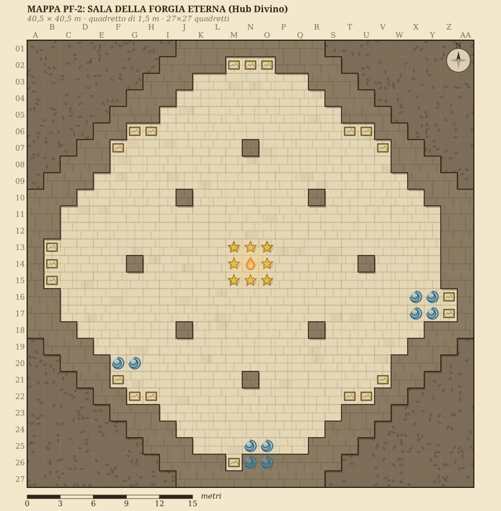

<!-- nuova-pagina -->

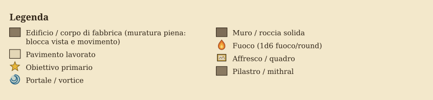

<!-- nuova-pagina -->

### Il cerchio del rito, in griglia (scala 1,5 m/quadretto)

> 📗 **Versione a piena scheda tattica** (posizioni PG/PNG/villain, terreno &
> altitudini, tattiche di villain/mostri, evoluzione) nell'**Atlante Mappe
> Definitivo**. Le griglie qui sotto sono
> identiche; là hanno gli add-on DM. La pianta della Sala è
> all'inizio di questa appendice.

#### MAPPA R-1 — IL CERCHIO DEL RITO (Altare del Cuore di Moradin)

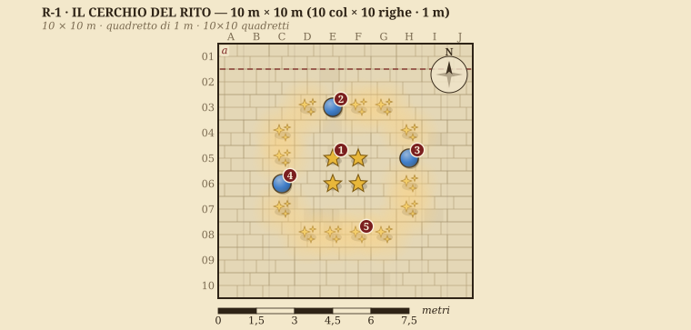

<!-- nuova-pagina -->

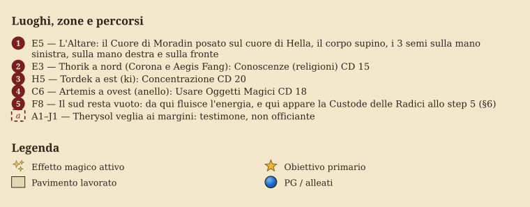

<!-- nuova-pagina -->


<!-- /pagina -->


\page

# IV · Il viaggio a mille anni fa: il tramonto e la notte

{{note
##### ⚠ SOLO DM
Questo capitolo è materiale del DM: non mostrarlo ai giocatori.
}}

## Il Portale della Forgia Eterna — Hammerfist ≈372 DR, il duello con Skullcrusher, il Rubino


> **Una sessione-leggenda a montaggio**, con **un solo scontro tattico** (il
> duello con Skullcrusher). Il viaggio è a **1.000 anni prima, ≈372 DR**.
>
> **Quando si gioca**: **dopo** la resurrezione di Hella (cap. III):
> il party è di **4 PG** (Hella tornata), **APL 13 pieno**. Alla vittoria il
> **Rubino** si accende e riporta i PG al 1372 → **cap. VII** (raccordo al
> Cuore della Montagna).
>
> **Da dove riparte il gruppo di oggi**: dalla
> notte del 372, con **3 tacche segnate** (§4, «Dove si riprende»). Consiglio e
> giro della fortezza sono giocati; della Scena 5 restano solo le scelte della
> notte (sosta, sonno, veglia dei semi), poi il campo (Scena 6). Un gruppo nuovo parte dalla Scena 1. **Canone**: la Corona ha Topazio + Smeraldo (aprono il
> portale del Tempo); il **Rubino si accende SOLO alla vittoria antica**.
>

---

## INDICE DEL MODULO

| § | Sezione | Contenuto |
|---|---|---|
| §0 | **Quickstart DM** | dove siete, come si gioca, chi c'è nell'ordine in cui entra, cosa stampare |
| §0-bis | **Quick-Reference** | le CD delle prove, il giro di Skullcrusher, box PF1e |
| §0-ter | **Idee che non sono scritte qui** | assorbi e rilancia; il finisher al giocatore |
| §1 | **Highlight per PG** | il beat di ciascuno dei quattro |
| §2 | **Le zone di Hammerfist ≈372 DR** | atlante: fortezza giovane, mare di tende, mura all'alba |
| §3 | **Atto I · Il tramonto** | Scena 1 il portale e il bosco · 2 la pattuglia di Durin · 3 la porta e la targa · 4 il consiglio di guerra |
| §4 | **Atto II · La notte** | l'orologio della notte · Scena 5 la notte nella fortezza · 6 il mare di tende · 7 la tenda del comando · 8 Zog'tar · 9 Vatore |
| §5 | **Atto III · L'alba** | Scena 10 le mura · 11 il duello con Skullcrusher · 12 il Rituale della Forgia Eterna · 13 il Rubino e il ritorno |
| §6 | **Contingenze & sconfitta** | «se i PG fanno X»; il paradosso; una sconfitta nel passato |
| §7 | **Echo Ledger** | carry-over B4, Vatore→Sal, tono del Rubino |
| §8 | **Avanzamento** | budget PX per scena, tesoro pregenerato |
| §9 | **Ponte + Handout & Asset** | le Cronache, il piano di battaglia, immagini, musica |
| App. A | **Statistiche** | Skullcrusher, Zog'tar e le guardie, Durin, Balvar, le creature del campo |
| App. B | **Il Sigillo di Ossidiana** | l'artefatto che Vatore ha appena rubato |
| App. C | **Le versioni veloci** | le stesse scene a montaggio, per chi ha poco tempo |
| App. D | **Mappe** | M7-A Hammerfist · M7-B il cortile · M7-C la tenda del comando |

---

## §0 — QUICKSTART DM

> 🧭 **La serata in tre frasi.** Il portale posa i PG in un bosco a est delle
> mura di Hammerfist, al tramonto: la fortezza è giovane e un'orda la assedia
> sotto le ali di un drago nero, che combatte per l'orda solo perché un runaio
> gli ha inciso un contratto in una scaglia. Al consiglio di guerra **Re Thorek I chiede di
> uccidere nella notte il generale Zog'tar**, dentro il campo nemico, e di
> affrontare **all'alba il drago Skullcrusher**. Se falliscono, la fortezza
> regge lo stesso, perché la profezia è già incisa: la salvano gli avi, e il
> prezzo lo pagano loro.
> Il gruppo di oggi non parte dal tramonto: riprende dalla notte, con 3 tacche
> segnate sul foglio: si apre con Durin nel cortile, *«Quando uscite?»*, poi
> gli acquisti al banco e la scelta fra fermarsi, dormire o uscire; chi vola
> subito atterra alla tenda con Grask sveglio, tratta con Balvar o colpisce
> Zog'tar, e la serata si ferma sull'esito del duello all'alba. L'ordine
> della serata, chi parla per primo e la lista di lettura da un'ora stanno
> nella regia della serata, il primo capitolo del booklet: per questo gruppo
> vince su questo riquadro. La lista qui sotto è per chi prepara senza la
> regia.

> 🗓️ **La vostra serata** — per il gruppo che riparte dalla notte del 372.
> **Senza la regia della serata, leggi solo questo, in quest'ordine, in un'ora e dieci minuti**: §4 «L'orologio della
> notte», con la tabella d'uscita (5 min) · Scena 6, lo skill challenge, la
> variante dall'alto, le rune di Balvar alla tenda, Grask e «Come torna il
> drago» (15 min) · Scene 7 e 8, le schede d'entrata, «Da dove entrano», la
> Catena, le tattiche, il ritorno a piedi o in volo con Balvar o Zog'tar, la
> mappa M7-C, le Appendici A.2 e A.4 e, in §8 B, «Il bottino della tenda e il
> tempo» (25 min) · Scena 9, solo la tabella di Vatore (5 min) · Scena 10, solo la
> tabella «Dalla notte», le tre vie e la tabella dei successi (5 min) · Scena 11, la scheda d'entrata,
> il giro round per round, «Chi sceglie» e le corde, con l'Appendice A.1-bis,
> il Vecchio che si usa stasera, e le wyvern di A.6 (15 min). Il resto si apre quando serve. Gli scontri possibili per strada
> (pattuglia, lupi, sciamani) hanno le statistiche in Appendice A.6. Ci si ferma sull'esito del duello, prima
> della Scena 12. Al tavolo sono circa tre ore; la
> regia della serata, nel suo booklet, dice dove tagliare. Il resto del master
> (Atto I, la fortezza, il banco) è già giocato: lo apri solo se ti chiedono
> qualcosa.
> **La prima battuta.** Si riapre nel cortile, dopo il giro della fortezza e
> dopo gli echi che la regia fa leggere. Durin li raggiunge con la mappa del campo arrotolata sotto il braccio e
> chiede una cosa sola: *«Quando uscite?»*. Prima si chiudono gli acquisti
> rimasti aperti al banco (*silenzio*, la pietra di Brynja, *identificare*),
> senza tacche in più (Scena 5). Le scelte ancora aperte sono tre:
> fermarsi, dormire, o uscire subito; e Hella può vegliare i semi (Scena 5).
> Con 3 tacche segnate e il volo, quando atterrano alla tenda Grask è
> **sveglio** (la tacca del volo si segna alla partenza). Se prima Hella veglia
> i semi, il volo è la 5ª tacca e Grask dorme.
> **Dove eravate**: consiglio fatto, giro della fortezza fatto (fucina,
> alchimista, cappella, Zeth nelle gallerie), **3 tacche** sul foglio, nessuno
> ha dormito. La fiducia del consiglio, le pozioni in mano, cosa hanno venduto
> e comprato stanno nella Scena 5, «Il conto della fucina, come l'ha giocato
> il tavolo»: fiducia piena, dotazione dall'alto, 5 *volare* e 4 cure del re,
> più gli acquisti. Le cose comprate non sono ancora
> state date a nessuno, perché non sono ancora entrate in gioco: chi porta
> cosa si chiede al tavolo prima della Scena 6. La cura con la cera nera
> Kettra l'ha fermata, e finché nessuno la beve il segno non c'è. Il Nome
> della targa serviva al consiglio, che è giocato.
> **Due cose della Scena 5 servono stasera.** I Treant di Hella non hanno
> ancora un posto: la tabella «I Treant: … dove possono andare» dice cosa
> cambia fuori dalla tenda, dentro, sul fianco o al duello. E il **dado dei
> caduti** per le cure comprate alla cappella: quattro tiri alla Scena 10.
> Le due insieme sono altri 10 minuti di lettura, da fare prima della lista.

**Dove siete.** La Corona (Topazio + Smeraldo) ha aperto il portale del Tempo
(affresco A6). I **quattro** Custodi — Hella di nuovo tra loro — precipitano
attraverso mille anni e atterrano a **Hammerfist ≈372 DR**: la fortezza è
giovane, le mura nuove, e un'orda primitiva la assedia sotto le ali di un drago
nero. Su una targa di bronzo alle porte, una profezia già incisa parla di
**«quattro eroi dal fuoco e dalla pietra»**. Quei Quattro sono loro, e il tavolo deve capirlo da sé (il nodo della targa, Scena 3): la leggenda che hanno
sempre creduto passato è il loro presente. **Paradosso bootstrap.**

**Come si gioca**. Il corpo di questo master è
scritto **a scene complete**, nell'ordine in cui si giocano. Gli scontri si
fanno su griglia: la tenda del comando (Scena 8, mappa **M7-C**) e il cortile
del duello (Scena 11, mappa **M7-B**). Le scene senza scontro hanno una prova di
gruppo a CD fissa per un party di 4 all'APL 13: se **almeno due** PG la superano
la scena riesce, altrimenti riesce lo stesso ma con una **complicazione**. Ogni
scena registra un **esito** (► Esito), e gli esiti alimentano il carry-over B4
verso Fauci di Palude (§7).

> 🎚️ **Se hai poco tempo**, ogni scena lunga ha la sua **versione veloce**,
> C.1 per l'Atto I, C.2 per la tenda, C.3 per il duello: è la stessa scena a
> montaggio, in 10-15 minuti. Si possono mescolare, scena per scena.

**Chi c'è, nell'ordine in cui entra.** Durin Rocciadura (Scena 2) · Re Thorek I
e Thorgrim Barbadiferro (Scena 4) · Mastro Costruttore Zeth (Scena 5) · Balvar
Fuocospento e Zog'tar Deatheye, nella stessa tenda (Scene 7 e 8) · Vatore
(Scena 9) · Skullcrusher il Nero (Scena 11). Ognuno ha una **scheda d'entrata**
nella sua scena; le statistiche sono in **Appendice A**.

**Cosa stampare.** La Quick-Reference (§0-bis); il **piano di battaglia** di Re
Thorek, da dare al consiglio (Scena 4, handout in §9); l'**Appendice A**; le
**mappe** dell'Appendice D, con la griglia di M7-C per la tenda; la scheda del
**Seme-Mercato** (Scena 5, «Le dieci pozioni del gruppo»); la tabella **B4** (§7; il testo intero è il capitolo «La Forgia ricorda» del volume del DM). Le **Cronache dei Quattro
Eroi** i giocatori le hanno già in mano: si consegnano alla soglia, prima di
partire (cap. III §8-ter).

**Come si chiude.** Vinta la battaglia antica, il **Rubino** si accende («la
Possanza Nanica»): la profezia è compiuta — era sempre stata vostra. La luce vi
strappa al passato. → **cap. VII: il ritorno a Hammerfist** (riemersione al
Cuore della Montagna, Giorno 3 dell'assedio del 1372).

---

## §0-bis — QUICK-REFERENCE DM (una pagina)

### Le prove di gruppo delle scene a montaggio (party 4, ≥2 successi)
| Scena | Prova | CD |
|---|---|---|
| 3 — la targa | non è una prova di gruppo: è il nodo d'indizio della Scena 3. Il Fatto è gratis, la Lettura vuole una porta, il Nome due | 12-18, secondo la porta |
| 4 — il consiglio | Diplomazia/Intimidire | 20 (16 se hanno il Nome) |
| 6 — il campo | una prova di gruppo per blocco, cinque blocchi: Muoversi Silenziosamente, poi Nascondersi quando l'invisibilità finisce | 20 · 22; con gli aiuti dimezzati, −2 alle prove (la CD non cambia) |
| 9 — Vatore | Percepire Intenzioni o Diplomazia · Rapidità di Mano (a seconda dell'approccio) | 18 · 22 |
| 10 — le mura | Forza / Diplomazia-Guarire / Disattivare (scelta collettiva) | 18 / 18 / 20 |

### Le Benedizioni della Sala, a mille anni fa
Pelle di Pietra, Cuore Incrollabile e *Vigore della Forgia* durano 24 ore
vissute dalla preghiera all'Altare, e a −1000 non si rinnovano. Allo scadere
si spengono, e con loro le cariche di *Vigore* rimaste. Da lì le cure sono
quelle del re e del banco della fucina (Scena 5). Finché sono attive, ogni
sonno di otto ore ricarica il *Vigore*, anche a mille anni fa. Finché durano danno questo
 (cap. II §7): Pelle di Pietra, resistenza al fuoco 10 e al freddo 5; Cuore
Incrollabile, immunità al caldo e al freddo ambientali non letali e +2 ai TS su Tempra
contro gli effetti ambientali; *Vigore della Forgia*, 3 cariche per PG, che
con un'azione standard curano 3d8+5 a sé o 2d8+2 a un alleato toccato.
Quando il gruppo ha pregato l'ultima volta lo si chiede al tavolo prima
dell'Atto I. Se ha pregato all'ingresso nella Sala, di solito all'alba le
Benedizioni ci sono ancora.

### Il giro di Skullcrusher (boss, Scena 11) — 3.5, niente 5e
- **Quale drago.** Con il gruppo di stasera si usa il **Vecchio** (Appendice
  A.1-bis) con le 2 wyvern: EL 17, il tetto esatto di APL+4.
  L'**Adulto** (Appendice A.1) resta per un gruppo di 13° più debole, per tre
  PG, o se il DM non conferma il Vecchio. Qui sotto, fra parentesi, i suoi numeri.
- **Soffio acido** in **linea** di 30 m, 16d4 (14d4), Riflessi CD 31 (30) ½, **ricarica 1/1d4 round**;
  se lo vuole **aderente**, chi ne prende danno ne riprende metà al round dopo, e la ricarica sale di 1 round (Appendice A.1).
- **Full-attack** (se a terra/quota bassa): morso +34 (+30), 2 artigli +29
  (+25), 2 ali +29 (+25), coda +29 (+25).
- **La passata e il nome.** Non si ferma mai in aria, finché non ha paura.
  Con Attacco in Volo attraversa il cortile e a metà della passata soffia, o
  morde, o grida il nome di un PG (*colpo accurato*); con *Virare* torna
  indietro sulla stessa linea. Il PG nominato lo morde al round dopo, a +54
  (+50), e l'occultamento non lo salva. Il nome non lo chiede: lo ha sentito
  di notte attraverso il corno, o usa un epiteto.
  Fra un turno e l'altro sta a circa 15 m (Scena 11, «La passata, il nome,
  la prima paura»).
- ***Fluttuare*** **una volta sola**, a ⅓ dei pf: è la prima paura.
  ***Oscurità*** **una volta sola**, per coprire la fuga verso le paludi.
- **Dal round 2, due wyvern** (Appendice A.6) su chi tiene la corda e su chi
  vola. Fuggono quando il drago fugge o muore. Il duello è EL 17 col Vecchio,
  EL 14 con l'Adulto.
- **La Catena**: la runa sotto la scaglia si colpisce contro **CA 44** (41), e il
  primo colpo a segno la spezza: il drago se ne va (Scena 11).
- **Aegis Fang**: il Bane contro Fauci qui **non vale**; la *Dragondoom* sì.
- **Presenza Terrificante** CD 26 (25) all'ingresso (Volontà o scossi), raggio 72 m (63).
- **Le campane e le balestre**: chi le usa prende la coda in passata, e il
  soffio resta per i PG.
- **Danno massiccio** (regola SRD, attiva nelle regole della casa): un
  colpo o un soffio da 50 danni o più, Tempra CD 15 o si muore.
- **«La Forgia ricorda»**: CONTA i colpi a segno (ferite ancestrali, N≤3) e
  l'esito → tabella B4 (§7). La Cintura di Tordek **rifiuta** di attivarsi qui.

### 🐾 Supporto Pathfinder 1e (dove il 3.5 è vago) — opzionale, dichiarato
> - **Viaggio nel tempo & paradosso**: il 3.5 non ha regole. Usa il principio
>   **«timeline auto-consistente»** (Novikov): tutto ciò che i PG fanno è già
>   accaduto, e non possono cambiare che vincono, solo COME. Nessun
>   TS/meccanica: è una **cornice**, non un puzzle da rompere.
> - **Sincronizzazione di Vatore** (Scena 9): danno/marchio inflitto a Vatore a −1000
>   → si manifesta su **Sal nel 1372** (ARC-09). Trattalo come un **legame
>   simpatico** permanente (stile *sympathy/antipathy* narrativo): nessun TS,
>   è un eco garantito. Registra il tipo di segno.

---

## §0-ter — QUANDO UN GIOCATORE HA UN'IDEA CHE NON È SCRITTA QUI

> **Una pagina sola, e serve mentre giochi.** Questo master ha molte vie
> scritte. I giocatori ne troveranno una che non c'è — è quello che si spera —
> e quel momento decide se la serata resta in piedi o si affloscia in un
> «mmh, non credo si possa».

### La regola, dalla skill dello stile: **assorbi, poi rilancia**

Al tavolo la chiamano *«yes-and with teeth»*:
**l'invenzione del giocatore entra nel canone *e* genera una complicazione.**
Non «sì»; non «no». **Sì, e adesso c'è un problema nuovo.**

| Il giocatore dice | ❌ Come si spegne | ✅ Come si assorbe e si rilancia |
|---|---|---|
| *«Conosco un nano di qui — mio bisnonno me ne parlava»* | «Non c'è nessuno così» | «C'è. È il fratello di Durin, e ti riconosce dal naso. **Ma sta sul camminamento est, e stanotte non dovrebbe esserci nessuno lì.**» |
| *«Verso l'olio delle lanterne sulle scale e do fuoco»* | «Non è previsto» | «Funziona: due scale bruciano. **Il fumo sale dritto sul camminamento dove siete voi**, e adesso non vedete chi arriva» |
| *«Grido ai nani che la profezia parla di noi»* | tira Diplomazia | «La linea si rinsalda, +2 morale. **E l'orda sente il nome**: da adesso puntano voi» |
| *«Prendo la lastra di Balvar e la porto via»* | «È troppo pesante» | «Te la carichi. **Pesa, −1 alla DES finché non la posi**, e Balvar adesso sa esattamente dove sei» |

**Il metro, in una riga**: se l'idea è **specifica** e il giocatore accetta che
il mondo reagisca, **funziona**. Se è generica («cerco un modo»), chiedi
*«come, di preciso?»* — e poi funziona.

### Tre cose da non fare, che costano il tavolo

1. **Non chiedere un tiro per dire di no.** Un tiro è una domanda vera solo se
   entrambi gli esiti ti vanno bene. Se l'idea non deve riuscire, dillo e di'
   **perché**, in finzione.
2. **Non far pagare l'ingegno più della forza bruta.** Se spaccare la porta
   costa un round e aprirla con l'astuzia ne costa tre, hai insegnato al tavolo
   a spaccare le porte.
3. **Non salvare la scena scritta.** Se l'idea del giocatore salta un incontro
   che avevi preparato, **è saltato**. Il tempo che avanza lo spendi
   sull'orologio della notte — e i giocatori se ne accorgono, e ti ringraziano.

### 🎁 Il finisher va al giocatore — `[HDYWTDT]`

È una regola della campagna: al colpo che uccide un boss,
**la narrazione passa a chi l'ha tirato**. In questo master ci sono **tre**
punti, e li trovi marcati nel testo:

- `[HDYWTDT — il finisher a chi abbatte Balvar]` → Scena 7, se si arriva a combatterlo
- `[HDYWTDT — il finisher a chi abbatte Zog'tar]` → Scena 8
- `[HDYWTDT — il finisher a chi abbatte Skullcrusher]` → Scena 11


⚠️ **Come si fa senza che diventi imbarazzante**: non si dice «descrivi tu».
Si dice **«com'è che lo fai?»**, e si aspetta. Se il giocatore non vuole,
descrivi tu in una riga e vai avanti: è un regalo, non un compito.

---

## §1 — HIGHLIGHT ASIMMETRICI PER PG (i QUATTRO, Hella è tornata)

### 🛡️ THORIK — la profezia fatta carne
- È la SUA leggenda: la Corona che porta è la stessa che il nonno di Thorgrim
  perse contro Skullcrusher. Aegis Fang, nelle sue mani e in quelle di Thorgrim,
  **canta la stessa nota** attraverso mille anni. Thorik non compie la profezia:
  **la profezia era sempre stata Thorik.**
- Al duello, **Aegis Fang scaglia la Cicatrice Ancestrale** (Scena 11): è il gesto che
  segna Skullcrusher e, mille anni dopo, Fauci (carry-over B4).

### 🌙 HELLA — la seconda vita alla prova (il ritorno che conta)
- È il suo **primo scontro da risorta**: Ibrido Treant, Collana, Durik al
  fianco. Il DM lo faccia pesare — la morte l'ha cambiata, e ora combatte in un
  passato dove non è mai esistita.
- ⚠️ **Vulnerabilità al fuoco** (costo del viaggio): Skullcrusher è acido, non
  fuoco — ma l'orda ha incendiari. E se evoca l'**Avatar della Radice** (Enorme),
  diventa un bersaglio: gioca il dilemma.
- 🐾 **Durik c'è, sempre**: attraversa il portale con
  lei, perché è legato alla Collana. Contro Skullcrusher conta una riga della sua
  scheda: **vulnerabile all'acido, +50%**. Il soffio del drago è l'unica cosa in
  questo viaggio che lo corrode davvero, e la giocatrice lo sa. Se Durik ha
  la runa di Zeth, prima si aumenta il danno del 50% e poi si tolgono i 20
  della resistenza: l'SRD non dà l'ordine, e vale quello che gli fa più male.
  Il resto, per il duello: Media, **102 pf**, CA **21**, RD 5/adamantio, morso
  **+15** (2d6+6) e 2 artigli **+13** (1d4+3), Tempra +11, Riflessi +10, Volontà
  +6. La scheda intera è quella consegnata alla giocatrice.
- 🌱 **Il dono «a metà»** *(cap. III §9, riga «2 su 3»)*: se al rito i successi
  dello Step 5 sono stati **due su tre**, il PG che ha fallito lo scopre **qui**,
  al primo uso: il seme che porta il suo dono **non risponde al primo
  tentativo**. Risponde al secondo. Dillo in una riga, nel momento peggiore, e
  non spiegarlo.

### ⚒️ TORDEK — il pugno che deve trattenersi
- La **Cintura della Devastazione rifiuta di attivarsi** contro Skullcrusher,
  nella Scena 11 (*«il vero scontro appartiene al futuro»*); contro Zog'tar, nella
  Scena 8, funziona: è coerenza, non nerf — Tordek deve vincere **senza**
  la sua arma migliore, che è riservata a Fauci nel 1372. Beat di disciplina.
- I **Bracieri** (coscienza) riconoscono la fucina antica di Hammerfist: *«Qui
  è dove tutto è cominciato, ragazzo. Batti bene.»*

### 🔮 ARTEMIS — il predone davanti al ladro
- **Vatore** (Scena 9) è il suo specchio oscuro: un ladro che ruba attraverso il
  tempo. L'Anello lo **percepisce** (aura temporale) prima di chiunque. È il PG
  giusto per fiutare che quel ladro «non è di qui» — e per decidere cosa farne
  (grigio: robarlo? ucciderlo? lasciarlo?). La sua avidità incontra un pari.
- ⚠️ **Il Marchio di Varis non è attivo**: Artemis
  ha preso il Seme senza toccarlo e l'ha fatto mettere nello zaino di Tordek, e
  il Marchio si chiude col tocco. Quindi la risonanza qui sotto **non scatta**.
  Scatta solo se, prima del viaggio, qualcuno ha toccato il Seme: allora la
  sente chi lo ha toccato, anche se è Tordek. *Se scatta*: il marchio
  «riconosce» la firma temporale di Vatore, due fili della **stessa rete**
  (Varis ↔ Il Collezionista), mille anni prima che esista.

---

## §2 — LE ZONE DI HAMMERFIST ≈372 DR (Atlante)

> Mappa **M7-A**. Tre ambienti, una notte e un'alba: la fortezza giovane, il
> mare di tende dell'orda, le mura all'assalto.

### 🎚️ Scheda sensoriale delle tre zone — e cosa NON dire

> **Come si usa.** Le prime tre colonne sono quello che i PG colgono **in sei
> secondi** senza tirare. La quarta è **vincolante quanto le altre**
> ([ADR-0057](../../../plans/adr/ADR-0057-la-quarta-colonna-e-di-tutto-il-repo.md)):
> sono le cose che il tavolo deve **scoprire**, e che l'atmosfera, se ti scaldi,
> racconta al posto loro.

| Zona | Occhi | Orecchie | Pelle / naso | 🚫 Cosa NON dire |
|---|---|---|---|---|
| **1** Fortezza giovane | Pietra bianca, spigoli ancora vivi. **Una** statua di re, non venti | Scalpelli. Di giorno, a quest'ora, in tempo di guerra | Polvere di taglio fresco, che sa di calcare e non di fuliggine | **Che la targa è la profezia su di loro.** Lasciala leggere: è il nodo della Scena 3 |
| **2** Mare di tende | Mille fuochi fino all'orizzonte; una tenda più alta, nera | Un russare che non si interrompe mai del tutto | Grasso bruciato, ferro, bestia | **Quale tenda è quella del generale.** Si deduce da dove *non* passano le pattuglie (Osservare CD 18). Se Durin l'ha già indicata alla postierla (Scena 6, «La tenda nera al centro è del generale»), la prova non serve |
| **3** Mura all'alba | Scale contro la pietra; nani spalla a spalla che non indietreggiano | Il boato di diecimila gole che diventa **una** | Fumo, sangue di nano (ferro dolce), corda bagnata degli arieti | **Che la linea terrà.** Non lo sai nemmeno tu: dipende dalla prova di gruppo |

⚠️ **Le tre righe «non dire» non sono suggerimenti di stile.** Ognuna protegge
una prova che sta più avanti in questo stesso documento. Dirle in anticipo non
rovina l'atmosfera: rovina **la scena dopo**.

### ZONA 1 — La Fortezza Giovane (Hammerfist appena eretta)

Il read-aloud si legge alla porta, nella **Scena 3**.

**Terreno (callout):** cortili di pietra chiara (movimento normale); la Sala del
Trono di Re Thorek I; la fucina originale (i Bracieri di Tordek la
riconoscono). Zona **sicura** (dentro le mura). Il portale lascia i PG fuori, nel bosco a est (Scena 1): ci si entra dalla porta (Scena 3).
Porta e cortile stanno a **+100 m** sulla piana dell'orda, la torre nord a
+120; il profilo è sotto la mappa M7-A, in Appendice D.

**Dati per il DM (non da leggere).** Hammerfist ha **circa ottant'anni**. La
cinta di pietra bianca è nuova: è stata rifatta dopo la prima venuta del drago,
cinquant'anni fa, quando il nonno del re perse la corona. Per questo le mura
sono fresche e la fortezza ha già una storia.

### ZONA 2 — Il Mare di Tende (l'orda, di notte)

Il read-aloud si legge all'uscita dalla postierla, nella **Scena 6**.

**Terreno (callout):** tende fitte (copertura, difficile in mischia); 4 posti di
guardia (GP1-GP4 agli angoli); la **tenda del comando** (Zog'tar) al centro;
notte = furtività CD 20; ogni fuoco è luce fioca a 3 m. La mappa è la M7-A, in Appendice D.
Il campo sta sulla **piana**, 100 m sotto le mura: le tende stanno fra 500 m
e 1 km dalle mura, e dalla fortezza ci si scende per la strada a tornanti o,
come i PG, per il fianco est.

**Com'è fatto il campo.** Ha due facce. Fuori stanno i clan degli orchi, una
quindicina di bande: ripari di pelle bassi e storti, a gruppi attorno al fuoco
della banda, con un tratto vuoto fra un clan e l'altro. Al centro c'è il campo
del capo, senza recinto, come quello di un khan o di un khal: la tenda del
generale sola in mezzo a uno spiazzo di terra battuta, il fuoco del consiglio
e i pali dei trofei davanti alla soglia, e attorno, a venti o trenta metri,
le lance della Guardia della Mano, quattro tende da otto attorno a ogni
fuoco, a gruppi staccati. Gli squadroni «marciano al passo», ma dormono come
un'orda. La tenda del comando è un padiglione a tre pali,
13,5 × 7,5 m: le misure, e da dove vengono, sono in Appendice D (M7-C).

### ZONA 3 — Le Mura all'Alba (l'assalto)

Il read-aloud apre la **Scena 10**, ed è quello su cui si chiude la prima delle due
sessioni del viaggio.

**Terreno (callout):** camminamenti sopraelevati (+4,5 m); brecce dove gli
arieti mordono; scale d'assedio (Forza per rovesciarle); il cortile interno
dove, alla fine, Skullcrusher cala. Vedi M7-B (arena del duello).

**Dove sale l'assalto**. Gli arieti si
montano sulla spianata degli arieti, a +80, e salgono alla porta, a +100, per
una rampa addossata al gradone. Le scale salgono sul tratto est, dove il fianco
della montagna arriva al piede delle mura; sul fronte sud le mura stanno sul
ciglio, 24,5 m sopra la spianata, e le scale non ci arrivano.

---

## §3 — ATTO I · IL TRAMONTO

> **Il percorso dell'atto.** Dal portale al consiglio di guerra passa circa
> un'ora e mezza del mondo, e al tavolo 50-60 minuti. L'ordine è quello del
> viaggio: il bosco dove il portale li lascia, la pattuglia che li trova, la
> porta della fortezza, la sala del re.

| Scena | Dove | Chi entra | Prova | Se fanno l'inatteso | Al tavolo |
|---|---|---|---|---|---:|
| **1** · Il portale e il bosco | un bosco a est delle mura, al tramonto | — | TS Volontà **CD 20** | chi fallisce arriva confuso alla pattuglia | 10 min |
| **2** · La pattuglia di Durin | lo stesso bosco | **Durin Rocciadura** e sei veterani | nessuna, se sono sinceri | attaccano: Durin getta l'ascia alla prima ferita, e al consiglio la CD sale di 4 (§6) | 10 min |
| **3** · La porta e la targa | la porta principale | — | nodo d'indizio, sei porte | non leggono la targa: il consiglio resta a CD 20 invece di 16 | 15 min |
| **4** · Il consiglio di guerra | la sala del trono | **Re Thorek I**, **Thorgrim Barbadiferro** | Diplomazia o Intimidire **CD 20** | il consiglio fallisce: aiuti dimezzati e −2 alla Scena 6, ma si esce lo stesso | 25 min |

<!-- pagina: una-colonna -->
### C.1 · Atto I in quindici minuti (Scene 2-4)

La pattuglia si riassume in tre righe: Durin vede la Corona e cade in ginocchio
(via A). Il consiglio e Thorgrim diventano una prova sola:

- **Prova di gruppo**: Diplomazia/Intimidire **CD 20** → fiducia piena
  (le pozioni dell'antica fucina, benedizioni, mappa del campo, e la
  dotazione che il tavolo sceglie: invisibilità dal basso o *volare*
  dall'alto). Fallimento: aiuti dimezzati (−2 alla Scena 6).

<!-- /pagina -->

### SCENA 1 — Il portale e il bosco al tramonto

**In scena** — Dove: il passaggio · la fortezza — Chi: nessuno

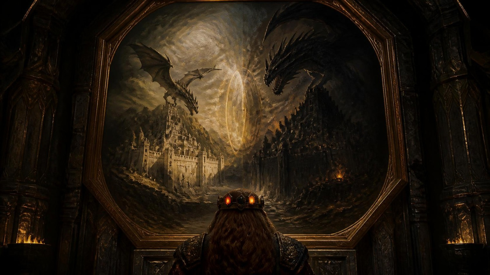

> **Read-aloud — il passaggio.** *Per un istante lunghissimo i
> colori si rovesciano, e vi passano davanti vite intere di nani: nascono,
> battono il ferro, invecchiano, in un tempo più corto di un respiro. Poi torna
> il peso, e con il peso il freddo. Le ferite non ci sono più.*
>
> *Siete in piedi in un bosco. Gli alberi sono vecchi, le radici grosse come un
> uomo sdraiato, e l'aria sa di foglie marce e di fumo lontano. Il sole è già
> dietro il crinale. Uno di voi ha le ginocchia bagnate e non si ricorda di
> essere caduto.*

- ⚕️ **GUARIGIONE DEL PASSAGGIO (all'arrivo, automatica)**: attraversare mille anni **rimette in ordine il corpo**. I quattro
  arrivano a **pf pieni**, senza livelli di affaticamento, con danni da
  caratteristica temporanei azzerati e **tutti gli usi giornalieri ricaricati**
  (invocazioni, poteri dei Bracieri, sinergie 1/giorno, incantesimi di Hella).
  **Nessun tiro, nessun costo, non è una scelta.**
  - **Cosa NON guarisce**: i costi **permanenti** di Thorik — **−4 DES** fra Corona
    e rito dello Smeraldo, e il **−1 CA** se al rito di cap. III §5 ha donato il +2 di
    deflessione (sono prezzi pagati, non ferite) — gli oggetti spesi (Cuore di Moradin, Diapason, Rubino
    quando si accenderà) e le condizioni narrative dell'Echo Ledger.
  - **Perché esiste**: senza questa regola il party arriva al duello con
    Skullcrusher con quello che è avanzato da Terros e dal rito — cioè, molto
    probabilmente, **con dei nani mezzi morti**. Il #4 è una sessione-leggenda,
    con due scontri su griglia prima dell'alba: deve partire pulita.
  - **Come si racconta** (mai come una ricarica): *«Il portale non vi trasporta:
    vi RIFÀ. Per un istante lunghissimo siete scomposti nei vostri mille anni —
    e quando vi ricomponete dall'altra parte, le ferite che avevate non ci sono
    più, perché in questo momento della storia non le avete ancora ricevute.»*
  - Il **costo sull'orologio di Hammerfist è zero**: il viaggio non consuma
    orologio, e il Rubino li riporta sempre nel Cuore della Montagna
 (cap. VII §3).
- **Shock temporale (all'arrivo)**: TS Volontà **CD 20** o, per 1d4 round,
  **−2 agli attacchi e alle prove**, poi chiarezza. *(È l'unico prezzo del
  passaggio: il corpo torna intero, la testa no.)*
- **Le Cronache dei Quattro Eroi** i giocatori le hanno in mano da prima di
  partire (cap. III §8-ter): non si consegnano qui.

Quando la testa torna a posto, guardano dove sono.

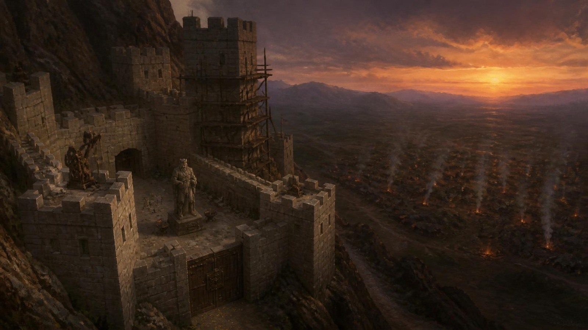

> **Read-aloud — la fortezza, da lontano.** *A ovest, fra i
> tronchi, si vedono le torri di una fortezza che conoscete, più basse di come
> le ricordate. Più in là, verso sud, i fuochi dell'orda cominciano ad
> accendersi uno alla volta, e non finiscono. Sopra le mura gira un'ombra con le
> ali. Fa un cerchio lento, poi un altro, e non scende.*

**Dati per il DM (non da leggere).** Il portale li lascia **a circa 500 m a est
delle mura**, un quarto d'ora prima del buio. Il bosco copre la spalla della
montagna a est: dove il portale li lascia è poco sopra la quota delle mura, e
da lì scende fino al margine del campo, sulla piana, 100 m più in basso
. È autunno inoltrato: **5 °C**, il
fiato si vede, una nebbia bassa comincia a salire dal bosco. Dall'arrivo
all'alba mancano **circa dodici ore**; l'orologio della notte (§4) comincia a
contare con il consiglio, che è la prima delle sue otto tacche: le prime
quattro ore se ne vanno fra l'arrivo e la porta, poi il consiglio apre
l'orologio.
Se il tavolo chiede l'ora: circa un'ora a tacca, tranne la sosta e il sonno.
Una tacca non è un'ora esatta: è un pezzo di notte, e le cose lunghe ne costano meno
di quanto durano, perché intanto il resto del campo non si muove. Il drago è Skullcrusher e **non attacca**: aspetta
l'alba, e i nani lo sanno. Dentro le mura le forge battono giorno e notte, e il
rumore arriva fin qui.

- ► **Esito**: chi ha fallito il TS arriva alla pattuglia ancora confuso, e Durin
  lo nota.

### SCENA 2 — La pattuglia di Durin

**In scena** — Dove: il bosco — Chi: Durin · i sei veterani

> **Read-aloud — il bosco.** *Fra gli abeti sale una nebbia bassa,
> e il sentiero scende verso le mura. Dal sottobosco si alzano sette elmi:
> sette nani in armatura completa, gli scudi accostati, le asce basse. Quello davanti è più
> vecchio degli altri e stringe l'ascia così forte che ha le nocche bianche, e
> da lontano arriva il tonfo sordo dei tamburi dell'orda. Poi il vecchio grida,
> e la voce gli scappa in alto: «Fermi, chi siete?» Che fate?*

**Scheda d'entrata — Durin Rocciadura, la pattuglia** *(statistiche: Appendice A)*

| | |
|---|---|
| **Aspetto** | veterano, armatura completa, scudo pesante e ascia da guerra nanica. Sta davanti ai suoi sei e ha paura. Si vede dal modo in cui tiene l'ascia troppo stretta |
| **Vuole** | riportare a casa i suoi sei. Ha paura e fa il suo lavoro lo stesso |
| **Suona** | la voce gli scappa in alto quando è teso. Ride un attimo prima di dire una cosa seria |
| **Sa** | il bosco a est delle mura, il campo dell'orda visto da lontano |
| **Non sa** | chi siano i PG, finché non vede la Corona o sente il tuono |
| **Eco** | è l'**antenato di Othrek**, a Hammerfist nel 1372 |
| **Ritratto** | qui sotto. Ai giocatori si mostra dopo l'incontro, non prima |

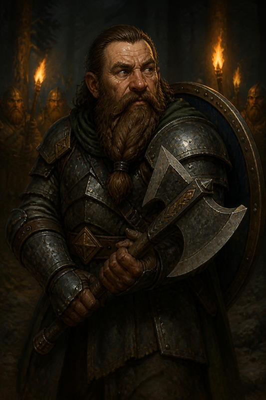

**La pattuglia di Durin (riconoscimento — 3 vie).** Nel bosco a est delle mura,
una pattuglia nanica (6 veterani) li ferma.

**Comparse**

| Chi | Com'è | Come parla |
|---|---|---|
| i sei veterani | nani sui cinquant'anni, armature ammaccate e rifatte, uno con la mano fasciata. Guardano Durin prima di guardare i PG | non parlano finché Durin non parla. Poi ripetono la sua ultima parola, sottovoce |

Il vecchio che grida è **Durin Rocciadura** (Guerriero 6, statistiche in
Appendice A), veterano spaventato e onesto. Fissa la Corona sulla fronte di
Thorik.

**DURIN (piano, quasi a sé stesso):** *«Quella cosa… brilla come il sole
forgiato. È… una leggenda?»* **Tre modi di farsi riconoscere** (tutti
funzionano, nessun tiro se sinceri):
- **A — Mostrare la Corona**: Durin cade in ginocchio.
  **DURIN (rotto):** *«La Corona dei Padri. Pensavo fosse un mito.»*
- **B — Invocare Moradin** (preghiera sincera): un **tuono** solo, dal cielo
  sereno. Durin e i suoi si inginocchiano.
  **DURIN (fermo, per la prima volta):** *«Il Padre ha parlato.»*
- **C — Mostrare potere divino** (Benedizione della Forgia, aura dorata su
  Aegis Fang):
  **DURIN (a bassa voce, ai suoi):** *«Dio ha parlato attraverso l'arma.»*
Esito identico: Durin passa da diffidente a **fedele fino alla morte**, li porta
a cavallo al castello. *(Se attaccano la pattuglia: è un tragico
malinteso — i nani che erano venuti a salvare li credono spie; §6 Contingenze.)*

**La cavalcata.** Dieci minuti al passo fino alle mura, girando largo dal campo, con i cavalli bassi e
robusti della pattuglia. Durin parla poco, e le cose che dice sono quelle che il
tavolo deve sapere prima del consiglio:

> **DURIN (a mezza voce, senza voltarsi):** *«Attaccano all'alba. Sono
> diecimila. E il drago è tornato da due settimane: qui ha un nome vecchio, e
> non lo diciamo volentieri.»*

- ► **Esito**: *Durin fedele* (qualunque delle tre vie) · *Durin ferito e la
  pattuglia ostile* (se attaccano: §6).

### SCENA 3 — La porta e la targa di bronzo

**In scena** — Dove: la porta — Chi: Durin · le guardie della porta

Durin li porta alla porta principale. Le guardie vedono la Corona e non
toccano nessuno. Prima di entrare c'è la targa.

**Comparse**

| Chi | Com'è | Come parla |
|---|---|---|
| le guardie della porta | due nani giovani, barbe corte, elmi troppo lucidi per aver visto una battaglia. Uno tiene la lancia al contrario e se ne accorge tardi | rispondono a chi chiede della targa con un orgoglio da cantiere: *«L'ha voluta il re»* |

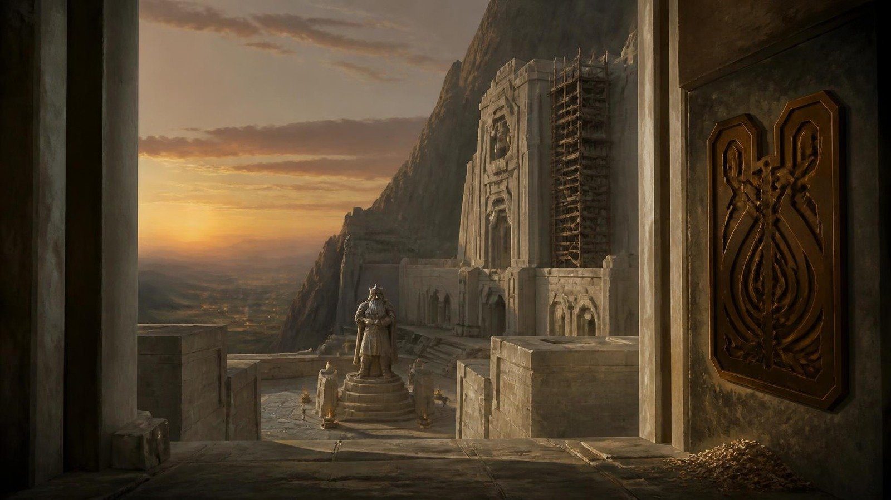

> **Read-aloud — la porta, deep time al contrario.** *Conoscete Hammerfist:
> le sale annerite dai secoli, le statue consumate, i nomi dei re incisi e
> reincisi. Questa Hammerfist non ha ancora storia. Le mura sono bianche di
> pietra appena tagliata, gli spigoli ancora vivi, e nel cortile c'è la statua
> di un re, una sola. Dietro le mura le forge battono giorno e notte.
> Accanto al battente è appesa una targa di bronzo lucida
> come una pentola nuova, e sotto, sul selciato, qualcosa luccica.*


**Il testo intero della targa**, per chi la legge da vicino:

> **Read-aloud — la targa.** *«Quando il nero verrà dal
> cielo e il ferro dal piano, quattro eroi dal fuoco e dalla pietra staranno
> sulle mura. Uno porta la pietra in fronte, uno il fuoco nei pugni. Uno tiene
> in mano la luce e l'ombra, e una ha passato la morte. Moradin li ha visti.»*

#### 🔍 Nodo d'indizio — la targa di bronzo *(Fatto · Lettura · Nome)*

> **Perché è un nodo e non una prova.** Questo master ha un'indagine dentro — i
> PG devono capire **che la profezia parla di loro** — e finora era una prova
> sola, **CD 18**, che si superava o si sbagliava. La skill `rumblingstone-indagine`
> chiede tre strati e **almeno tre porte**, perché un tavolo di picchiatori
> deve poterci entrare lo stesso.

| Strato | Cosa dà | Come si prende |
|---|---|---|
| **Fatto** | *«La targa dice: quattro eroi dal fuoco e dalla pietra.»* | **gratis**, chiunque sappia leggere il nanico. Non si tira |
| **Lettura** | *«I solchi del cesello sono ancora lucidi. È stata incisa oggi.»* | **una** porta qualsiasi, sotto |
| **Nome** | *«Quei quattro siamo noi, e lo eravamo già prima di partire.»* | **due** porte diverse, o una porta + la Lettura |

**Le sei porte** — tre bastano, e almeno una è fisica, così anche chi non ha
gradi entra:

| Porta | Prova | Cosa vede |
|---|---|---|
| 🧠 Sapere | Conoscenze (storia) **CD 18** | le Cronache che hanno in mano raccontano i Quattro Eroi, ma non dicono che qualcuno li avesse **annunciati**: la profezia della targa, nel 1372, non la ricorda nessuno |
| 👁️ Guardare | Osservare **CD 15** | i trucioli di bronzo sono ancora per terra sotto la targa |
| ✋ **Toccare** | **FOR o DES grezza CD 12** — passarci sopra il pollice | il taglio è **vivo**, taglia il polpastrello. Chiunque, nessun grado richiesto |
| 👃 Annusare | Sopravvivenza **CD 14** o un nano, gratis | odore di metallo caldo: il cesello ha lavorato **stamattina** |
| 🗣️ Chiedere | Diplomazia **CD 12** a un qualsiasi nano di guardia | *«L'ha incisa il Re stamattina, all'alba. Dice che gli è venuta in sogno stanotte»* |
| ⚒️ Mestiere | Artigianato (fabbro) **CD 15** — Tordek, gratis | riconosce la **mano**: è lo stesso cesello della fucina che userà tra mille anni |

🚫 **Cosa NON dire**: che la profezia parla di loro. Anche se nessuno prende il
**Nome** subito, non si regala: torna al consiglio (Scena 4) quando Thorgrim prende
l'ascia, e alla Scena 13 quando il Rubino si accende. **Un vicolo cieco non
esiste** — l'indizio ripassa, cambiato.

- **Se prendono il Nome alla porta** → arrivano al consiglio di guerra sapendo
  chi sono: Re Thorek I li riconosce **prima** di guardare la Corona, e la
  prova di gruppo della Scena 4 scende a **CD 16**.
- **Se non lo prendono** → non perdono niente. Lo prendono dopo, e la scena in
  cui lo prendono diventa la più forte della serata.
- ► **Esito**: accettano/subiscono il ruolo. Imposta il tono «nessuna pietà» vs
  «misericordia» del Rubino (eco §7).

### SCENA 4 — Il consiglio di guerra di Re Thorek I

**In scena** — Dove: la sala del consiglio — Chi: Re Thorek I · Thorgrim · Durin

Durin li porta dentro per il corridoio principale. La fortezza si prepara
all'assedio: i bambini e i vecchi scendono verso le miniere con un fagotto
ciascuno, le forge delle stanze laterali non si fermano, e dove passano i PG
la gente smette di parlare.

> **Read-aloud — la sala del consiglio, il re.** *Lungo il corridoio
> i bambini e i vecchi scendono verso le miniere con un fagotto ciascuno, e al
> vostro passaggio la gente smette di parlare. La sala è lunga quanto una
> strada, e i pilastri sono ancora bianchi. In fondo, su un seggio di pietra
> fredda senza cuscino, c'è un nano vecchissimo in armatura. Tiene una grande
> ascia appoggiata al ginocchio, e sulla lama c'è un disegno di brina che non si
> scioglie. Il vecchio si alza piano, un pezzo alla volta, come si carica un
> carro, e guarda solo la fronte di chi porta la corona.
> Sulla panca accanto, un altro vecchio resta seduto.*

**Scheda d'entrata — Re Thorek I, il re di una fortezza giovane**

| | |
|---|---|
| **Aspetto** | 182 anni, e li porta come un muro porta la pioggia. Armatura di mithral, l'ascia **Frostcleaver** in pugno anche al tavolo di guerra. Una corona semplice, senza gemme |
| **Vuole** | reggere le mura fino all'alba. Ottocento nani contro diecimila |
| **Suona** | lento, al passato remoto quando cita la profezia. Parla al plurale anche di sé, *«la fortezza pensa»* |
| **Sa** | la profezia, perché l'ha incisa lui: gli è venuta in sogno. Che suo nonno perse la Corona contro Skullcrusher |
| **Non sa** | che la profezia parla di questi quattro, finché non vede la Corona |
| **Non combatte** | Guerriero 16, e nessuno statblocco completo: non serve |
| **Eco** | la prova di fiducia qui sotto, e il **Torque di Thorek I**, che dà con le sue mani alla Scena 12 (§8). Nel 1372 i nani si scoprono il capo davanti a chi lo porta |
| **Ritratto** | qui sotto. Ai giocatori si mostra dopo l'incontro, non prima |

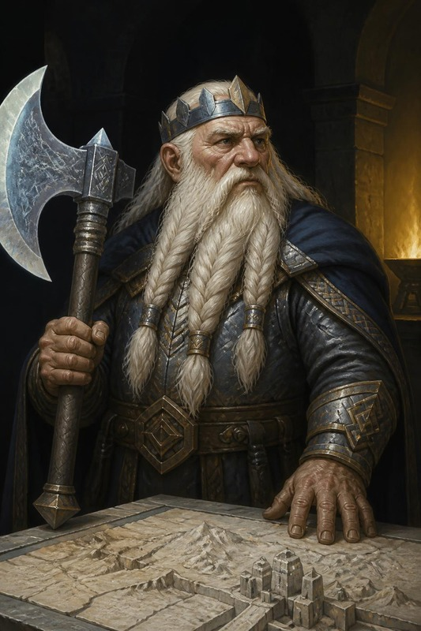

⚠️ A voce **Thorek** e **Thorik** si confondono: di' sempre **«Re Thorek»**.

**Scheda d'entrata — Thorgrim Barbadiferro, l'antenato**

| | |
|---|---|
| **Aspetto** | un vecchio seduto che non si alza. Le mani aperte verso la luce, i palmi in su, e il callo nello stesso punto in cui ce l'ha Thorik, perché hanno tenuto la stessa ascia |
| **Vuole** | che l'ascia torni in una mano che sa perché la tiene |
| **Suona** | la voce non trema, gli occhi sì. Nomina il sangue, mai la persona: *«il sangue riconosce il sangue»* |
| **Non combatte** | è un vecchio, vivo e fragile: nessuno statblocco, e non va inventato. Nella sconfitta del duello (§6) non impugna niente: chiama gli antenati, e sono loro a ricacciare il drago |
| **Eco** | l'affresco A3 (*«Portala bene, fratello. Ora è tua.»*) |
| **Ritratto** | qui sotto. Ai giocatori si mostra dopo l'incontro, non prima |

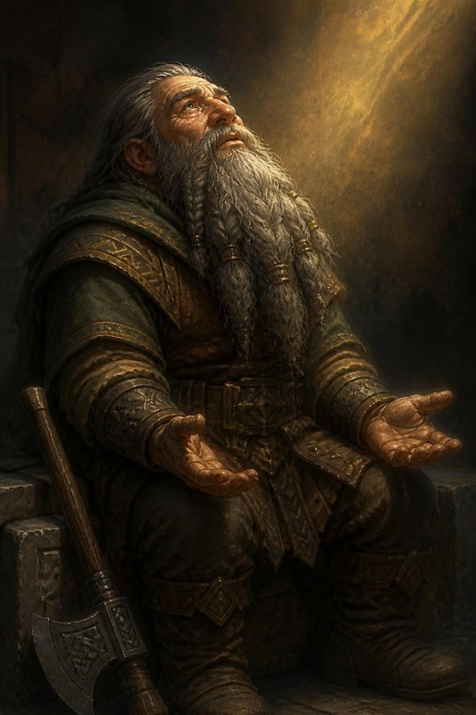

**Il re.** Re Thorek I (Guerriero 16, 182 anni, Frostcleaver in pugno) vuole
vedere da vicino la Corona che suo nonno perse contro Skullcrusher cinquant'anni
fa. La riconosce, e si inginocchia; con lui si inginocchiano le quindici guardie
della sala. Poi, ancora in ginocchio, recita la profezia.

⚠️ **Thorik non si toglie la Corona.** Se l'è già tolta una volta, sul petto di
Hella (cap. III §5). Il re scende i gradini e la guarda dov'è: due pietre accese
e un incasso vuoto.

**RE THOREK I (lento, passato remoto, come chi cita a memoria):** *«Quattro
eroi dal fuoco e dalla pietra… nella notte più oscura salveranno gli antenati
e i futuri.»*

**Thorgrim.** Mentre il re recita, il vecchio sulla panca guarda l'ascia di
Thorik, e quando il re tace parla lui.

> **Read-aloud — il vecchio sulla panca.** *Il vecchio sulla panca
> non si è mosso. Tiene le mani aperte verso la luce, i palmi in su, e sono mani
> che hanno tenuto la stessa ascia di Thorik: si vede dal callo, nello stesso
> punto. Guarda la corona sulla fronte di Thorik per il tempo di tre respiri. Poi gli occhi gli si riempiono, e lui non se ne accorge,
> perché sta già parlando, e la voce non trema: «Mio nonno ha perso la
> corona. L'ascia no. Se dite il vero, fatemi tenere la vostra.»*

**Se Thorik gliela porge**, e solo allora:

> **Read-aloud — le due prese.** *L'ascia passa da una mano
> all'altra, e per un istante le due prese si toccano sul legno. E il legno
> suona.*

**Se Thorik non gliela dà**, il vecchio annuisce, ritira le mani e non chiede
più niente. Al consiglio resta fra quelli che non si fidano, come già dice la
prova qui sotto: non è offeso, ha paura.

⚠️ *L'ascia di Thorgrim è appoggiata alla panca: è **Aegis Fang**, mille anni
più giovane. Quando prende quella di Thorik tiene in mano la stessa arma due
volte, e il legno suona per questo (§1: «canta la stessa nota»).*


> 🩸 **Re Thorek I e Thorgrim sono cugini**: nipoti
> dello **stesso re**, quello caduto contro Skullcrusher cinquant'anni prima.
> Per questo dicono tutti e due *«mio nonno»*, e nessuno dei due mente. La
> Corona è il lutto del re; l'ascia, Aegis Fang, è rimasta a Thorgrim.

**La tavola di guerra.** Poi il re li porta alla mappa, e dice i numeri come li
direbbe a un suo capitano:

**RE THOREK I (in piedi, adesso, con le dita sulla mappa):** *«Ottocento
contro diecimila, e il drago. Le mura reggono due ore. Se all'alba Zog'tar guida
ancora l'orda, cadiamo. Se lui non c'è, l'orda è un gregge, e il drago resta
solo.»* L'unica possibilità è **uccidere Zog'tar di notte**, per fiaccare
l'orda, e **affrontare Skullcrusher** all'alba.
- **Handout — il piano di battaglia** (§9): forze, obiettivi, cosa dà il re. Si
  consegna qui, sul tavolo di guerra.
- **Su cosa si discute**. Il re crede alla Corona; Thorgrim e i
  capitani no. La domanda non è chi siano i PG, ma se affidare a quattro
  stranieri le **quattro pozioni** dell'antica fucina e la **mappa del campo**,
  che sono tutto quello che la fortezza ha per la notte. La prova dice quanto ne
  danno.
- **Prova di gruppo**: Diplomazia/Intimidire **CD 20** (**CD 16** se alla porta
  hanno preso il **Nome**) → **fiducia piena**: le quattro pozioni dell'antica
  fucina (*cura ferite gravi* all'11°, la *Benedizione degli Antenati* di §8 B),
  la benedizione dei chierici di Hammerfist, +2/+2 (morale, al colpire e ai danni, 12 ore; non è una delle Benedizioni della Sala, Scena 5), la mappa accurata del campo **e la dotazione
  per entrare nel campo, scelta dal tavolo** (qui sotto). Fallimento: aiuti
  dimezzati, −2 alle prove della Scena 6. **Dimezzati** vuol dire: 2 pozioni
  dell'antica fucina invece di 4, metà della dotazione (2 pozioni
  d'*invisibilità* o 2 di *volare*, per difetto), la benedizione dei chierici di Hammerfist a +1/+1, e
  niente mappa. Il −2 alle prove della Scena 6
  vale **in più**: le due cose insieme sono il prezzo del consiglio fallito.
- **Come pensate di entrare?**. Il re lo
  chiede, e dà quello che serve al piano che i PG gli dicono. È una scelta loro:

  | Dotazione | Cosa dà il re | Il piano che serve |
  |---|---|---|
  | **Dal basso** | 4 pozioni d'*invisibilità* all'incantatore di 12°, **12 minuti** l'una, dal forziere del re: un dono, che non tocca i 10.000 mo con cui il forziere compra dai PG | il mare di tende a piedi (Scena 6, lo skill challenge) |
  | **Dall'alto** | 5 pozioni di *volare* al 5°, **5 minuti** l'una, portate dal sergente | la variante dall'alto (Scena 6) |

  Al tavolo il gruppo ha avuto la seconda. Un gruppo di 13°

  che vola già da sé (incantesimi, oggetti, forme selvatiche) di solito
  sceglie la prima, e allora vola **e** è invisibile: segue la variante
  dall'alto, con l'invisibilità del re che copre tutta l'andata. Va bene così:
  il rischio, come dice la variante, si sposta alla tenda e sull'orologio del
  drago.
- **Il fianco est**. Mentre il re parla con
  chi porta la Corona, un capitano batte il dito sul fianco est della mappa e
  lo dice al tavolo, non al re: *«Di qua, se avessimo qualcosa che carica, li
  prenderemmo di traverso. Non abbiamo niente che carica.»* È l'indizio per i
  semi di Hella; il resto è in Scena 5, «I Treant».

**I numeri del re** *(per il DM; sono anche nel piano di battaglia, §9)*:

| Hammerfist | L'orda di Zog'tar Deatheye |
|---|---|
| 800 guerrieri nanici veterani | 7.000 orchi |
| 200 cittadini armati, vecchi e ragazzi | 2.000 goblin |
| 50 chierici di Moradin | 800 hobgoblin |
| Re Thorek I e 15 guardie reali | 200 ogre |
| — | Zog'tar Deatheye e il drago |

Le mura reggono **due ore** dall'inizio dell'assalto. Il piano del re è quello
della prova qui sopra: Zog'tar di notte, il drago all'alba.

- **Gancio**: Thorgrim riecheggia nell'affresco A3 della Sala della Forgia.
- **I doni del re** se la fiducia è piena: le pozioni di cura, portate dal
  sergente. Il **Torque di Thorek I** non è fra questi: un torque non si manda
  per mano d'altri, e il re lo dà di persona alla Scena 12, Momento 5 (§8 B).
- ► **Esito**: *aiuti pieni / dimezzati*.

🕯️ **Adesso metti l'orologio della notte sul tavolo** (§4): il consiglio ha già
preso la prima tacca.

---

## §4 — ATTO II · LA NOTTE

> **Il percorso dell'atto.** Dalla fine del consiglio all'alba. I PG scelgono
> cosa fare nella fortezza, poi escono da una postierla, attraversano il campo,
> entrano nella tenda del comando e tornano indietro. Tutto costa tacche.

| Scena | Dove | Chi entra | Se fanno l'inatteso | Tacche · al tavolo |
|---|---|---|---|---:|
| **5** · La notte nella fortezza | quartieri ospiti, fucina, gallerie | **Zeth**, **Gunnvor** | escono subito: zero tacche, e niente di quello che la fortezza vende | da 0 a 7, a scelta · 40-60 min |
| **6** · Il mare di tende | dalla postierla al centro del campo | — | tre fallimenti: la pattuglia, EL 10; vanno di notte sulle colline del drago: §6 | 2, più 1 per fallimento · 30-40 min |
| **7** · La tenda del comando | la tenda di Zog'tar | **Balvar** | colpiscono prima di parlare: Balvar combatte con Zog'tar | 1 se gli parlano prima di colpire · 20 min |
| **8** · Zog'tar | la stessa tenda | **Zog'tar** | lo catturano o lo umiliano vivo: Via A, ed eco in §7 | — · 30-45 min |
| **9** · Vatore | fra le tende, al ritorno | **Vatore** | provano a ucciderlo: il Cronolito lo salva a 1 pf | — · 10 min |

### ⏳ L'OROLOGIO DELLA NOTTE — otto ore, e ogni cosa ne costa

> **Perché esiste.** La scelta del riposo della Scena 5 era già un orologio, scritto
> a parole, in ore che non tornavano con queste tacche. Ma un tempo che non si segna non si sente,
> e il tavolo non può *scegliere di correre un rischio* se non sa quanto ha in
> mano.

**Dove si riprende**. Al tavolo del 25 settembre
il gruppo ha fatto il consiglio e poi il giro della fortezza: la fucina,
l'alchimista, la cappella, e sono scesi nelle gallerie a cercare Zeth. Sul
foglio ci sono quindi **3 tacche**. Ne restano 5: il campo e il ritorno ci
stanno, le otto ore di sonno no.

**Si segna su un foglio, in vista.** Dal tramonto all'alba ci sono **8 tacche**,
e quando il foglio arriva sul tavolo la prima è già segnata: il consiglio. Ogni
tacca è mezz'ora scarsa di gioco reale.

| Cosa | Tacche |
|---|---:|
| Il consiglio di guerra (Scena 4), già segnato | **1** |
| Fermarsi **tre ore** · dormire **otto ore** (Scena 5) | **2** · **6** |
| Banchetto e benedizioni (Scena 5, facoltativo, +1 morale 12 h) | **1** |
| Hella veglia i semi della Collana: i Treant dell'alba (Scena 5); un Treant chiamato alla tenda non costa tacche | **1** |
| Cercare il Mastro Costruttore Zeth (Scena 5) | **1** |
| Identificare il Seme-Mercato con la pergamena del re (Scena 5, un'ora; si può rimandare a dopo la missione) | **1** |
| Sorvolare il campo invece di attraversarlo (Scena 6, variante dall'alto) | **1** |
| La fucina di notte: comprare, vendere, barattare con Gunnvor, e nella stessa tacca la cappella, la bottega di Kettra e le rune di Zeth (Scena 5) | **1** |
| Attraversare il mare di tende (Scena 6, skill challenge) | **2** |
| Ogni **fallimento** nello skill challenge | **+1** |
| Parlare con Balvar prima dello scontro (Scena 7) · parlargli **durante** lo scontro nella tenda costa **0** | **1** · **0** |
| Spogliare la tenda delle armature (Scena 8, solo se nessuno ha dato l'allarme) | **1** |
| Curarsi nella tenda con più di 20 cariche di bacchetta, prima di ripartire (Scena 8) | **1** |
| Tornare a piedi dalla tenda alle mura (Scena 8) | **1** |
| … e ogni blocco **fallito** del ritorno | **+1** |
| Tornare in volo dalla tenda alle mura, al posto del ritorno a piedi (serve un secondo *volare*) | **1** |
| Uno scontro con la squadra dei lupi (Scena 6), come la pattuglia | **+1** |
| … e una banda chiamata da uno sciamano (Scena 6) | **+1** |
| Attaccare il drago di notte, sulle colline (§6) | **2** |

Se il gruppo si divide (metà vola, metà cammina), vale il conto del gruppo più
lento.

**Quando le tacche finiscono, sorge il sole.** Non è una punizione: è la Scena 10
che comincia, con i PG dove sono in quel momento.

| Tacche spese all'arrivo alle mura (il ritorno compreso) | Come si arriva alle mura |
|---|---|
| ≤ 6 | in tempo. Si rientra, si schiera, le mura e il duello vanno come scritto. Le tacche che restano prima dell'8 si spendono con la tabella qui sopra, come nella Scena 5: tre ore di sosta (2) ci stanno, otto ore di sonno (6) no. La fucina, la cappella e la bottega sono aperte come nella Scena 5 |
| 7 | 🟡 si rientra **correndo**: nessun riposo prima del drago, −1 a tutti i TS del primo round del duello (Scena 11) |
| 8 o più | 🔴 **l'alba vi coglie fuori dalle mura.** Non morite: attraversate un campo che si sta svegliando. Prova di gruppo Muoversi Silenziosamente **CD 20**, o Nascondersi **CD 22** per chi non è più invisibile, poi il duello (Scena 11) comincia con i PG **fuori**. La Scena 10 **non si gioca**: le mura valgono «a stento» (2-3 successi). Se la prova fallisce, il drago ha già scelto il suo bersaglio: il duello si apre con il suo round di sorpresa, e il soffio va sul PG che ha tirato peggio. Con 3 tacche già spese e il campo a piedi (3), una scelta lenta porta al giallo (7), e una scelta lenta più un fallimento portano qui; il margine viene da Balvar, a cui si parla durante lo scontro senza spendere tacche |

**Se l'alba arriva prima della tenda**. Zog'tar è vivo all'alba (riga
della tabella «Dalla notte», Scena 10), e siccome la Scena 10 non si gioca,
durante il duello sta sotto le mura a guardare, come nella sua tattica sulla
breccia. Balvar resta nella tenda: la Catena si può solo spezzare. Vatore, mai
incontrato, non si perde: il filo [VATORE/SAL] passa ad ARC-09.

⚠️ **L'orologio corre sulle SCELTE, non sul tempo reale.** Un tavolo che discute
mezz'ora su cosa fare non spende una tacca; un tavolo che decide di andare a
cercare Zeth sì. È la regola dell'Abbazia (`ADR-10` interno: *l'oppressione
avanza sulle scoperte*), e serve a non punire proprio il comportamento che
questo master vuole ottenere — **guardarsi intorno**.

🔎 **E qui l'orologio dice una cosa**: parlare con
Balvar prima di colpire, cercare Zeth e fare il banchetto costano **3 tacche** in tutto
(parlargli mentre si combatte non ne costa nessuna). Sono i
tre pezzi migliori della notte, e sommati sono anche il rischio più grosso. È
il bivio, ed è **vero** — non una finta scelta con una risposta giusta.

<!-- pagina: una-colonna -->
### C.2 · La tenda in dieci minuti (Scene 6-8)

- **Infiltrazione (3 tiri di gruppo invece di cinque blocchi)**: le prove e le
  CD della Scena 6, cioè Muoversi Silenziosamente **CD 20** finché dura
  l'invisibilità, poi Nascondersi **CD 22** (−2 se aiuti dimezzati); un tiro
  riesce se riesce la metà del gruppo. Costa **2 tacche**, più 1 per ogni tiro
  fallito. Tre tiri riusciti = raggiungete la tenda non visti; **due falliti** =
  la pattuglia (Scena 6), come i tre blocchi falliti del corpo. Il ritorno è un tiro solo,
  Nascondersi **CD 22**, e costa 1 tacca.
- **Zog'tar (risoluzione veloce, GS 15)**: un **assalto coordinato** (sorpresa +
  il colpo più forte del party) lo abbatte se dichiarano tattica sensata e
  fanno **un** tiro: il colpo più forte del gruppo contro la sua CA (**26**, 24 in Ira). Se l'infiltrazione è fallita, è sveglio: −4
  alla sorpresa, un solo scambio.

<!-- /pagina -->

### SCENA 5 — La notte nella fortezza

**In scena** — Dove: i quartieri ospiti · la cappella · la bottega · le gallerie · la fucina — Chi: Durin · Sorella Brynja · Kettra · Zeth · Gunnvor · il pesatore

**Chi si trova qui** *(di notte, mentre la fortezza si prepara all'alba)*

| Ruolo | Chi, e dove |
|---|---|
| comando | Re Thorek è ancora col consiglio; per i PG chi decide è **Durin**, che li accompagna |
| culto | **Sorella Brynja**, nella cappella, la porta dopo i quartieri lungo il corridoio |
| rimedi | **Kettra**, la bottega dell'alchimista in fondo al corridoio della fucina |
| bottega | **Gunnvor** alla fucina, e il **pesatore** con la sua bilancia; prezzi e tetti nel banco qui sotto |
| messaggi | nessuno: stanotte gli ordini li porta Durin a voce |
| guardia | sulle mura, agli ordini di **Hrodgar**, il capitano (scheda nella Scena 10) |

> **Mappe M7-D, M7-E e M7-F** (Appendice D). Il livello −1 (quartieri,
> cappella, bottega, fucina di Gunnvor e armeria), le gallerie di Zeth sotto la
> fucina, e dall'affaccio delle gallerie la fucina grande. La sezione M7-S dice
> come si scende.

**I quartieri ospiti.** Durin li accompagna, e da qui all'uscita decidono
loro: ogni cosa costa tacche. Nei quartieri ci sono il banchetto (+1 morale ai TS per 12 h se
mangiano: il +2 morale della benedizione dei chierici di Hammerfist non vale sui TS, quindi i due non si
sommano sullo stesso tiro), fabbri che affilano le armi, chierici che benedicono.

> **Read-aloud — i quartieri ospiti.** *Una sala bassa e fredda,
> scavata nella roccia: il soffitto porta ancora i colpi dello scalpello, dritti e
> fitti come le righe di un registro. Sei brande di legno nuovo lungo il muro,
> e su ognuna una coperta piegata in quattro da qualcuno che aveva fretta.
> In fondo un focolare che tira male. Nel soffitto c'è una crepa chiusa col
> piombo, e sotto non ci dorme nessuno.
> Dalla porta aperta entra il rumore della fortezza che non dorme: martelli,
> passi, un bambino che piange e poi smette.*

*Il luogo*: erano gli alloggi dei minatori,
prima che la miniera diventasse fortezza. Nel soffitto c'è una crepa chiusa col
piombo, del primo crollo, e nessuno ci dorme sotto.

**La cappella dei chierici.** È la porta dopo i quartieri, lungo lo stesso
corridoio. È qui che si comprano pozioni, bacchette e incantesimi (il banco
della fucina, più sotto, ha i prezzi).

> **Read-aloud — la cappella.** *Al posto dell'altare
> c'è un'incudine vecchia, portata giù dalla prima forgia, e intorno ai piedi
> la pietra è consumata a conca da generazioni di ginocchia. Venti chierici
> dormono seduti, con la schiena al muro freddo, per essere già in piedi quando
> li chiameranno. Una sola è sveglia: conta fiale su un panno in un sussurro, e
> ricomincia da capo ogni volta che arriva a trenta.*


**Scheda d'entrata — Sorella Brynja, la chierica che conta**

| | |
|---|---|
| **Aspetto** | nana giovane per guidare una cappella, i capelli rasati ai lati come chi porta l'elmo, le mani screpolate dall'acqua santa fredda |
| **Vuole** | che all'alba ci siano incantesimi per le mura. Non per chi paga, per chi sale sulle scale |
| **Teme** | di dover scegliere chi curare, e di scegliere male davanti a tutti |
| **Suona** | conta ad alta voce, sempre. Fa ogni domanda due volte, la seconda più piano |
| **Sa** | quanti incantesimi restano ai cinquanta chierici, e che in tutta la fortezza c'è un diamante solo |
| **Vende** | le pozioni, le bacchette e gli incantesimi del banco della fucina. Chierica di Moradin di 9° livello, perché *rianimare morti* è di 5° |
| **Eco** | ogni incantesimo di 4° o 5° che vende stanotte manca sulle mura: lo dice lei, se glielo chiedono |

**La bottega dell'alchimista.** In fondo al corridoio della fucina, dove
l'odore di zolfo copre quello del carbone.

> **Read-aloud — la bottega.** *Una porta bassa, foderata di
> piombo. Dentro l'aria sa di zolfo e punge gli occhi. Sul banco, in fila come
> soldati, fiasche di terracotta tappate con la cera, e sotto il banco una cassa di
> sabbia per quando qualcosa va storto. Una nana senza sopracciglia riempie
> una fiasca col cucchiaio, piano. A metà il cucchiaio le trema, e lei ride.*

**Scheda d'entrata — Kettra, l'alchimista del re**

| | |
|---|---|
| **Aspetto** | nana di mezza età senza sopracciglia, bruciate da anni. Un grembiule pieno di buchi rotondi, ognuno di una goccia diversa |
| **Vuole** | finire le fiasche per le mura prima dell'alba. Ogni fiasca che vende è una fiasca in meno sulle scale |
| **Suona** | ride quando qualcosa sta quasi per andare storto, e solo allora |
| **Vende** | il fuoco dell'alchimista è finito, è tutto alle mura. Ha **tre bombe di fuoco** sue, e poi più niente: una fiasca da lanciare che fa una *palla di fuoco* da 5d6, Riflessi CD 14, raggio 6 m, a 750 mo, prezzata come una pozione di 3° livello al 5° dell'incantatore. Si lancia come un'arma a spargimento dell'SRD, incremento 3 m, mirando a un'intersezione |
| **Eco** | le bombe sono una sua invenzione, e nel 1372 nessuno sa più farle così |

- **HELLA — i Treant dell'alba.** All'alba Hella usa l'**Evocazione dei Guardiani** sui semi
  I e II: **due Treant di Adamantio** (statblocco in cap. III Appendice A.2: Grandi, 95 pf, RD
  10/adamantio, CA 24, Vel 9 m, 2 schianti +18 (2d8+9), danni doppi alle
  strutture, durano 1 ora; FOR 29, TS Temp +12, Rifl +3, Vol +8, vulnerabili al fuoco, come in cap. III A.2) che caricano il
  fianco dell'orda. Costa **due** delle tre cariche del giorno, e la tacca della
  notte resta **una**: vegliare i semi che si aprono. È il beat di potere della
  druida risorta, e ha un prezzo: se Durik viene distrutto nel duello, resta
  **una carica sola** per richiamarlo, e torna per un'ora. Chiamarli insieme all'alba non spegne
  l'Evocazione per un mese: è l'unica eccezione che la scheda della Collana
  concede.
  Se al rito Hella ha trovato la **ghianda
  annerita** e non l'ha ancora piantata, «il primo suolo sacro che tocca» è
  questo: niente Treant in più, ma una quercia che fra mille anni sarà
  vecchia di mille anni.

#### I Treant: come lo viene a sapere Hella, e dove possono andare

Il re al consiglio parla con chi porta la Corona e non sente gli altri. Al
tavolo del 25 settembre nessuno ha detto a Hella che i suoi semi potevano
servire, e la giocatrice non l'ha deciso. Per i gruppi futuri l'indizio arriva
da due parti, perché uno solo si perde:

- **Al tavolo di guerra** (Scena 4, «Il fianco est»): un capitano, al tavolo
  e non al re, dice che di traverso sul fianco est servirebbe qualcosa che
  carica.
- **Di notte, alla Collana.** Se Hella resta ferma al buio anche solo un
  minuto, i semi I e II si scaldano e si girano verso est, come aghi.

Per **questo** gruppo, che non l'ha deciso, i Treant restano dove la
giocatrice li vuole, interi o uno per parte. Le regole della Collana sono
quelle del rito dello Smeraldo: tre evocazioni al giorno, un'ora l'una, e i semi tornano
all'alba. Le scelte, con quello che cambiano:

| Dove | Cosa cambia | Quanto costa |
|---|---|---|
| **Fuori dalla tenda, contro i rinforzi** (Scena 8, dopo un allarme) | la RD 10/adamantio rende un Treant quasi intoccabile per le ronde (orchi combattenti, falchion 2d4+4, Appendice A.6) e per gli squadroni (spada lunga 1d8+3). **Uno** tiene un lato: le ronde arrivano in **2d4+2** round invece di 1d4+2, gli squadroni in **3d4+2**. **Due** tengono la tenda: dentro non entra nessuno finché restano in piedi, e lo scontro resta contro il generale. Gli sciamani passano, perché la RD non ferma un incantesimo | un Treant nel campo si vede da tutto il pendio: è l'allarme, anche se il corno non ha ancora suonato. **Due** chiamati insieme di notte spengono l'Evocazione per un mese. Il drago arriva al corno come sempre, in 70 round, e sui Treant soffia per primo |
| **Dentro la tenda, contro Zog'tar** (Scena 8) | un Treant Grande sotto il colmo da 6 m ci sta. Fa da compagno per il fiancheggiamento e prende i colpi: l'ascia di Zog'tar (3d6+20) perde 10 sulla RD. Il **Colpo Terrificante** su di lui non funziona, perché l'SRD lo vuole contro un avversario più piccolo e il Treant è Grande come Zog'tar: il generale lo colpisce con l'Attacco Poderoso e tiene il Colpo Terrificante per i PG. La *barriera di lame* di Balvar sul palo centrale lo taglia come chiunque (13d6). Con due Treant dentro, chi si muove nella tenda ha poco spazio: i PG che volano restano sotto i 6 m del telo | lo scontro si accorcia, e Zog'tar cade prima. Il colpo finale resta al giocatore che lo dà, mai al Treant (`[HDYWTDT]`) |
| **Sul fianco dell'orda, all'alba** (come scritto qui sopra) | **un successo in più** sulle mura (Scena 10, Q49), solo con **tutti e due** sul fianco | i Treant non sono nel duello |
| **Nel duello con Skullcrusher** (Scena 11), uno o due | il drago vola, e un Treant non lo raggiunge finché resta in quota. Conta quando lo tirano giù: un Treant che tira la **corda** dell'ala (Scena 11, Forza CD 25) dà il suo aiuto +2 come chiunque, e quando il drago è a terra picchia con i colpi d'adamantio. Un albero non ha un nome da gridare (Scena 11, «Chi sceglie»): il drago li ignora finché non tengono la corda, e allora il soffio va sulla linea della corda | un Treant al duello è un Treant tolto al fianco: con uno solo sul fianco, niente successo in più. Il duello diventa più facile, ed è il prezzo pagato sulle mura |

Un Treant chiamato di notte, alla tenda, è un seme speso prima dell'alba: per
la Collana torna all'alba, ma se di notte se ne chiamano **due insieme**
l'Evocazione si spegne per un mese, e all'alba non c'è niente da chiamare.
La regola del mese ha una sola eccezione, scritta nella scheda della Collana:
i due Treant chiamati **insieme all'alba** di questa notte. Le tre cariche
sono una sola riserva per i Treant e per Durik fino all'alba: quello che si
spende alla tenda manca per il resto della notte, e all'alba i semi tornano
tutti e tre, come dice la scheda della Collana in cap. III §7.
Un Treant solo, chiamato alla tenda, non
toglie quindi niente ai due dell'alba.

> **Read-aloud — le gallerie.** *Sotto la fucina il caldo finisce
> di colpo. Le gallerie sono strette, puntellate con travi nuove che sanno
> ancora di resina, e ogni dieci passi una lampada a olio fa il suo cerchio di
> luce e poi niente. Sulle pareti ci sono segni a gesso, e metà sono stati
> cancellati col pollice. Da un punto più in fondo arriva il suono paziente di
> un martelletto su pietra.*

**Scheda d'entrata — Mastro Costruttore Zeth, il seme del Ghostlord** *(nelle
gallerie sotto la fucina; cercarlo costa una tacca)*

| | |
|---|---|
| **Aspetto** | mezz'elfo, occhi febbrili, polvere di roccia fino ai gomiti. Traccia rune sulle pareti dei tunnel. Col gesso, e ne cancella metà col pollice |
| **Vuole** | che le gallerie non cedano. È disposto a legarci l'anima |
| **Suona** | parla mentre lavora. Finisce le frasi degli altri |
| **Sa** | che un chierico incappucciato gli ha dato «i componenti perfetti» |
| **Non sa** | che quei componenti servono a una **lichificazione**, e che la mano è del **Collezionista** attraverso il tempo |
| **Eco** | il **dilemma di Hella su Zeth il Murato** in ARC-09. I PG assistono all'origine del Ghostlord **senza saperlo** |
| **Ritratto** | qui sotto. Ai giocatori si mostra dopo l'incontro, non prima |

- **⚫ SEME DEL GHOSTLORD (hook a lunghissimo termine — CANONE).**
  Il party incrocia il **Mastro Costruttore Zeth** nelle gallerie, un mezz'elfo dagli occhi
  febbrili, che traccia rune sui tunnel: *«Le mura di Thorek potrebbero cedere.
  Ma legherò la mia anima alla montagna in una Consacrazione. I miei leoni di
  pietra proteggeranno queste gallerie per sempre. Un chierico incappucciato mi
  ha appena dato i componenti perfetti.»* → **È il futuro Ghostlord / Zeth il
  Murato**: i «componenti» sono in realtà per una **Lichificazione**, inflittagli
  dalla fazione del **Collezionista** che viaggia tra i piani e le epoche. I PG
  seminano (senza saperlo) il dilemma etico di Hella su Zeth in ARC-09. Registra
  nell'Echo Ledger (§7) e nel registro di fine serata.
  **Il chierico incappucciato** non è più in fortezza, e nessuno l'ha visto
  entrare né uscire. Se i PG lo cercano: le guardie delle porte non hanno fatto
  passare nessun incappucciato, e nelle gallerie, dove Zeth dice di averlo
  incontrato, resta solo un odore di cera nera. **Era Vatore**, che lavora per
  il Collezionista attraverso il tempo: i PG
  lo incontrano più tardi, fra le tende (Scena 9), e possono riconoscerlo dal
  mantello o dalla stessa cera nera sulle dita (Osservare **CD 15** se l'hanno
  cercato qui). Zeth non sa chi sia.
  Le rune che traccia stanotte sui tunnel e sui camminamenti sono **colore**:
  nel 372 non hanno effetto (scrive in fretta, e quelle d'uso le vende ai
  PG, qui sotto). Nel 1372 sono le difese del Ghostlord.
- **Le rune di Zeth, se gliele chiedono**.
  Zeth sa incidere rune di tre famiglie: **d'abiurazione e di protezione**;
  **d'annullamento**, come quelle della miniera di Belkram, che spengono la
  magia dove sono scritte; e rune che **spengono un incantesimo solo**, quello
  che il PG gli nomina. Ma stanotte non ha il tempo di forgiarle come si deve:
  le scrive in fretta, col gesso e col pollice, e ognuna **vale una volta**.
  Per quelle d'annullamento e per quelle che spengono un incantesimo solo, il
  modello SRD è *dissolvi magie* (ad area o mirato) al livello dell'incantatore
  di Zeth, che nel 372 è un druido di **9°**, e per il druido *dissolvi magie* è
  di 4° livello: come una pergamena a quel livello, 4 × 9 × 25 = **900 mo**
  l'una.
  Il tavolo ne ha comprate **due**, rune di protezione da un colpo solo:
  ***resistere all'energia*, acido 20** (7° livello
  dell'incantatore), **70 minuti** dall'attivazione, come vuole l'SRD. Attivarla
  è un'azione standard. Contro il soffio di Skullcrusher (14d4) toglie 20 danni a
  ogni soffio. Se la attivano uscendo dalla postierla, all'alba è scaduta. Si
  attiva al corno dell'alba o dopo: il drago arriva 70 round dopo il corno,
  e la runa dura 70 minuti. Prezzo di pergamena SRD, 350 mo. Per
  **Durik** vale di più: la sua scheda gli dà +50% di danni dall'acido. La
  attiva chi la porta, toccando il bersaglio, perché *resistere all'energia*
  è a contatto (SRD): su Durik la mette Hella.
- **Fermarsi o dormire — scelta.** In 3.5 ci sono solo le otto ore di sonno
  e il tempo che passa. **Tre ore di sosta** (2
  tacche) non ridanno incantesimi, perché l'SRD li restituisce solo dopo otto
  ore di riposo (il chierico prega alla sua ora e non ha bisogno di dormire; la druida
  prega all'alba come lui, ma gli slot spesi stanotte restano spesi, perché
  sono dentro le otto ore);
  servono a curarsi con quello che resta, a smaltire i danni non letali e a
  far tornare *affaticato* chi era *esausto*. **Dormire otto ore** (6 tacche:
  con il consiglio già segnato, prima dell'alba non resta il tempo per il
  campo) ridà gli incantesimi e le capacità al
  giorno, toglie l'affaticamento e rende 1 pf per livello, la guarigione
  naturale dell'SRD: non i pf pieni. Il momentum spinge alla sosta. ⚠️ La guarigione del passaggio (Scena 1) li ha già rimessi in
  piedi: il riposo serve solo a chi ha speso qualcosa da allora.
- **Le Benedizioni della Sala, e le cure**. Le
  Benedizioni della Sala della Forgia (Pelle di Pietra, Cuore Incrollabile,
  *Vigore della Forgia*) durano **24 ore vissute** dalla preghiera all'Altare,
  e si rinnovano una volta ogni 24 ore vissute tornando alla Sala. A mille anni
  fa non si rinnovano: allo scadere si spengono, e con loro le cariche di
  *Vigore* rimaste. Finché sono attive, le cariche di *Vigore della Forgia*
  tornano a ogni sonno di otto ore. Il viaggio, dal tramonto al duello, sta di solito dentro le 24 ore; se
  sconfina in un secondo giorno, da lì il gruppo ha solo le cure del re (le
  pozioni dell'antica fucina) e quelle comprate al banco della fucina. La
  benedizione dei chierici di Hammerfist (+2/+2, 12 ore, Scena 4) è un'altra
  cosa, e dura le sue 12 ore.

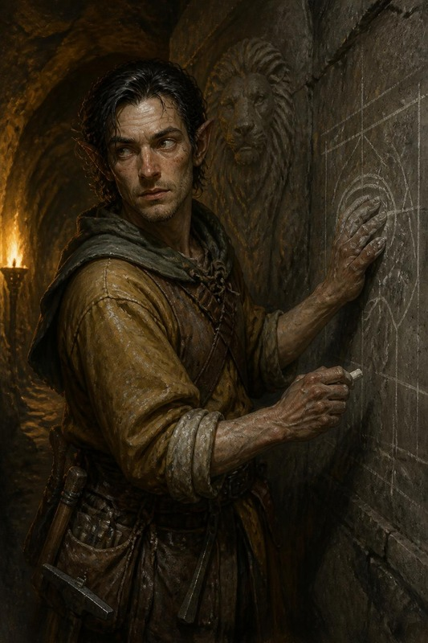

#### ⚒️ La fucina di notte — Gunnvor, e lo scambio *(1 tacca)*

Si arriva qui se i PG vogliono comprare, vendere o barattare. La fortezza
non ha un mercato: ha una fucina che lavora per l'alba, e una maestra armaiola
che decide cosa ne esce.

> **Read-aloud — la fucina e il banco.** *La
> fucina è l'unico posto della fortezza dove nessuno parla sottovoce, e l'aria
> sa di carbone e di scoria. Davanti a
> tre forge accese aspettano file di ragazzi con quello che hanno trovato: un piccone,
> una vanga, la spada del padre. Una nana con le braccia bruciate fino al gomito
> guarda ogni lama di taglio contro la brace e la mette in uno di due mucchi,
> senza dire quale sia il buono. Sul banco dietro di lei, poco: qualche fiasca
> chiusa con la cera, un mazzo di frecce, un'ascia avvolta in un panno grigio che nessuno
> tocca. La nana non smette di lavorare quando la porta si apre. Alza il mento verso
> quello che avete addosso, e aspetta.*

**GUNNVOR (asciutta, senza alzare gli occhi):** *«Stanotte non vendo. Scambio.
Quello che serve sulle mura lo pago bene, e lo pago in braccia.»*

*Solleva una fiasca contro la brace.*

**GUNNVOR:** *«Questa vale un ragazzo che non va su con la vanga. Il resto
tenetevelo: non ho tempo di pesarlo.»* **Che fate?**

**Scheda d'entrata — Gunnvor, maestra armaiola della fortezza giovane**

| | |
|---|---|
| **Aspetto** | nana di mezza età, braccia bruciate fino al gomito, un grembiule di cuoio che ha più toppe che cuoio. Porta il martello infilato nella cintura come un'arma |
| **Vuole** | che i duecento vecchi e ragazzi vadano sulle mura con un'arma vera. Non riguarda i PG: c'era prima di loro e ci sarà dopo |
| **Teme** | di aver sbagliato mucchio. Una lama incrinata data a un ragazzo è un ragazzo morto, e l'ha già fatto una volta |
| **Suona** | conta tutto in **braccia**: quanti difensori arma una cosa. Una pozione «vale un braccio», le monete «non armano nessuno» |
| **Sa** | cosa c'è in fortezza, cosa manca, e che le mura reggono due ore |
| **Non sa** | chi sono i PG, a meno che al consiglio non abbiano avuto la **fiducia piena**: allora lo sa da Durin, e comincia da *amichevole* |
| **Eco** | quello che le lasciano stanotte resta qui, e fra mille anni qualcuno lo trova (§7) |

**Dati per il DM (non da leggere)**

- **Convincerla.** Parte *indifferente*. Una prova di **Diplomazia** con
  risultato **15** la porta ad *amichevole* (tabella degli atteggiamenti dei PNG
  dell'SRD): allora apre il banco. Con la **fiducia piena** del consiglio parte
  già *amichevole* e la prova non serve. Se un PG porta **in vista** roba d'orchi (armi, insegne, pelli
  dipinte), parte *ostile*: sa delle tende là fuori. Una mano rossa dipinta,
  presa nel 1372, a lei non dice niente: nel 372 la Mano Rossa non esiste.
- **Chi aiuta a smistare.** Un PG che si mette al banco con lei, **Artigianato
  (fabbricare armi) o Valutare CD 15**, le fa guadagnare un'ora, e lei lo ricambia con lo sconto del mestiere: **−10%**
  sul prezzo SRD delle armi e armature che il gruppo compra da lei. Il premio di
  guerra qui sotto è un'altra cosa: è quello che la fortezza paga quando il
  gruppo **vende**. È un posto per chi, nel gruppo, ha le
  mani da fabbro: Gunnvor lo guarda lavorare per un minuto, poi gli passa il
  mucchio buono.
- **La tacca.** Tutta la trattativa costa **una** tacca, anche se il gruppo
  compra e vende dieci cose.

**Il profilo della fortezza come mercato** *(supporto Pathfinder 1e,
opzionale e dichiarato, come quello di §0-bis)*

Le regole degli insediamenti di Pathfinder 1e danno un numero a una cosa che il
3.5 lascia al DM. Hammerfist ≈372 DR, con i suoi mille difensori e le famiglie
nelle miniere, è una **cittadina** (*small town*: valore base 1.000 mo, limite
d'acquisto 5.000 mo, incantesimi fino al 4° livello). È **devota**: cinquanta
chierici di Moradin alzano gli incantesimi al **5° livello**. E l'assedio fa
quello che fa la qualità *impoverita*: dimezza valore base, limite d'acquisto e
oggetti magici in vendita.

| Voce | Stanotte |
|---|---|
| **Valore base** (un oggetto che costa fino a questa cifra c'è con il 75% di probabilità) | **500 mo** |
| **Limite d'acquisto** (il massimo che il mercato paga per un oggetto solo) | **2.500 mo** |
| **Incantesimi a pagamento** | fino al **5° livello**, dai chierici di Moradin |
| **Il forziere del re** | fino a **10.000 mo** in tutto, **solo** con la fiducia piena del consiglio, e **solo** per cose che servono all'alba |

Il forziere del re paga solo quello che arma o cura un difensore.

**Le monete del 1372 valgono a peso**. Cinquanta
monete fanno mezzo chilo, come sempre; il pesatore della fucina le mette sulla
bilancia e ne trattiene **una su dieci** per il disturbo. Sopra c'è la faccia di un re che nessuno conosce, e un nano la
morde. Un PG che vuole farle passare per buone senza discussioni: **Raggirare
contro Percepire Intenzioni** del pesatore, un esperto con **+8**.
Se fallisce, qualcuno comincia a
chiedersi da quale regno vengano quattro stranieri che pagano in oro mai visto.

**Comparse**

| Chi | Com'è | Come parla |
|---|---|---|
| il pesatore | nano magro con gli occhiali di quarzo legati dietro la testa, le dita nere di limatura. Non alza mai gli occhi dalla bilancia | dice il peso ad alta voce, sempre in once, e aspetta che qualcuno protesti |

##### Il banco di Gunnvor — cosa vende stanotte

Prezzi dell'SRD 3.5; i servizi col metodo SRD (livello dell'incantesimo ×
livello dell'incantatore × 10 mo, più le componenti costose), come nel
`KIT-ANTI-IMPROVVISAZIONE-VALLE` §2. Le quantità sono quelle del banco: finite
quelle, non ce ne sono altre.

| Cosa | Prezzo | Quante | Nota per il DM |
|---|---:|---:|---|
| Pozione di *cura ferite leggere* | 50 mo | 6 | le *gravi* ci sono, ma sono i doni del re (§8 B) |
| Pozione di *cura ferite moderate* | 300 mo | 2 | |
| Pozione di *volare* | 750 mo | 5 | 5° livello dell'incantatore, 5 minuti. Non si vendono: le **regala il re**, tramite il sergente, a chi sceglie la dotazione dall'alto (Scena 4) (il conto della fucina, più sotto) |
| Pozione di *invisibilità* | 300 mo | 5 | 3° livello, 3 minuti. Da Brynja: sono scorte della cappella |
| Bacchetta di *cura ferite leggere*, 50 cariche | 750 mo | 2 | da Brynja, come sopra |
| Acqua santa, la fiasca | 25 mo | 10 | temprata nella vasca della forgia |
| Antitossina | 50 mo | 4 | |
| Borsa del guaritore | 50 mo | 3 | |
| Ascia da guerra nanica perfetta | 330 mo | 3 | |
| Corazza di piastre completa perfetta | 1.650 mo | 1 | di una guardia reale caduta cinquant'anni fa, ripulita |
| Ascia da guerra nanica d'adamantio | 3.030 mo | 1 | sopra il valore base: c'è, ma Gunnvor la dà solo contro qualcosa che le serve |
| Frecce, quadrelli, fuoco dell'alchimista, olio | — | 0 | tutto sulle mura. Semmai li compra lei, qui sotto |
| Mithral lavorato | — | 0 | nella fortezza giovane non ce n'è |
| *Ristorare inferiore* · *rimuovi malattia* | 60 · 150 mo | a richiesta | |
| *Neutralizza veleno* · *ristorare* | 280 · 380 mo | a richiesta | *ristorare* con 100 mo di polvere di diamante inclusi. **Non** toglie il −4 alla DES di Thorik: è il prezzo del rito, non un risucchio |
| *Rianimare morti* | 5.450 mo | 1 | le 5.000 di diamante incluse, e c'è un diamante solo in tutta la fortezza |

⚠️ **Ogni cura comprata stanotte alla cappella è una cura che all'alba manca
sulle mura.** Alla Scena 10 si tira **1d4** per ogni **tipo**: i servizi e le
pergamene di 4° o 5° livello, un tiro ciascuno; le bacchette di cura, un tiro
per tutte. Se la Scena 10 non si gioca, si tira all'alba, prima del duello: sono
i difensori del 372 che muoiono sulle mura per quella cura mancata, e il DM li
annota fra i caduti del 372.
È il **dado dei caduti**, e riguarda solo la fortezza di mille anni prima: nel
1372 non toglie niente al *Registro delle Perdite* di ARC-08. Torna soltanto
come eco (§7), nei nomi che i PG troveranno fra i caduti dell'assedio antico:
sono scritti nel pannello in più della Sala degli affreschi, lo stesso di
Balvar (Scena 7).
Gunnvor non lo dice; il chierico che lancia sì, se glielo chiedono.

##### Cosa compra, e a quanto

| Cosa portano i PG | Chi la prende | A quanto | Perché |
|---|---|---|---|
| Pozioni di cura, pergamene di cura | i chierici | **×1,5** il prezzo SRD, dal forziere del re | braccia rimesse in piedi |
| Fuoco dell'alchimista, olio, borse dell'impedimento, pietre del tuono | Gunnvor | **×1,5** | sulle mura, contro le scale |
| Frecce e quadrelli, anche comuni | Gunnvor | **×1,5** | se ne consumano più di quante se ne facciano |
| Armi e armature magiche | il forziere del re | **metà** del prezzo SRD, come sempre | le dà alle guardie reali |
| Razioni, corda, bende | Gunnvor | prezzo pieno | le famiglie nelle miniere mangiano anche loro |
| Barre di mithral, piastre della Sentinella, cristalli d'adamantio | Gunnvor | prezzo pieno, **fuori** dal forziere del re, e non oltre il limite d'acquisto: il Geode Titanico (5.000 mo) lo paga 2.500 | è metallo: l'SRD lo scambia a valore pieno. Ma stanotte non si forgia niente |
| Gemme (i geodi d'ametista, il granato stellato) | il pesatore | **metà** | una pietra non ferma un ogre |
| Monete del 1372 | il pesatore | a peso, meno una su dieci | vedi sopra |

Il **Cuore di Terros** (20.000 mo) non lo compra nessuno: nella fortezza non ci sono
ventimila monete in un posto solo, e i chierici non lo toccano.

⚠️ **Il premio di guerra ha un tetto**: il ×1,5 si paga col forziere del re, e
il forziere ha 10.000 mo. Oltre, si torna al prezzo SRD. Un gruppo che prova a
fare cassa sull'assedio se ne accorge alla terza fiasca, quando Gunnvor smette
di contare in braccia.

**Cosa non compra, e cosa non vende**

- **Niente che venga da un drago.** Una squama, un dente, una pelle conciata:
  Gunnvor la getta sul pavimento. Il drago è sopra le loro teste.
- **Niente d'orchi**, come sopra.
- **Niente che odori di non morte.** I chierici la vedono prima di lei.
- **Non vende** l'ascia di Thorgrim, né il Torque del re, né le armi delle
  quindici guardie. Se i PG le chiedono, la risposta è una sola, e la dà senza
  guardarli.

##### La notte già giocata: cosa hanno chiesto, e quanto c'era

Al tavolo del 25 settembre i PG hanno chiesto pergamene di *silenzio*,
*identificare*, *rimuovi maledizione* e *rimuovi paralisi*, hanno fatto
identificare le pozioni e hanno venduto parecchio. I numeri non si sono tirati:
era il primo posto da mesi dove si poteva contrattare davvero. Questi sono
quelli che l'SRD permette, con la mano larga che il DM ha chiesto: quello che
esiste si trova, niente arriva in regalo.

**Le pergamene.** Prezzo SRD: livello dell'incantesimo × livello
dell'incantatore × 25 mo, più le componenti costose. Brynja non ne può
scrivere di nuove stanotte (una pergamena chiede un giorno di lavoro), quindi
sono quelle che la cappella ha già.

| Pergamena | Prezzo | Quante | Da chi, e perché |
|---|---:|---:|---|
| *Silenzio* (chierico 2°, incantatore di 3°) | 150 mo | 2 | Brynja. Dura 3 minuti (1 minuto per livello, SRD): copre l'ultimo tratto del volo e l'atterraggio, non il volo intero. Alla tenda vale la regola della pietra: a meno di 6 m la bolla è l'allarme, quindi chi l'ha letta la congeda prima, perché per l'SRD *silenzio* lo congeda chi l'ha lanciato, cioè chi ha letto la pergamena, e non chi porta la bolla (Scena 6, «La bolla alla tenda»). La legge un chierico o un bardo; Hella no (non è sulla lista del druido), Artemis con Usare Oggetti Magici CD 23 |
| *Rimuovi paralisi* (chierico 2°, incantatore di 3°) | 150 mo | 3 | Brynja. Sono quelle che tiene per le mura |
| *Rimuovi maledizione* (chierico 3°, incantatore di 5°) | 375 mo | 1 | Brynja, l'ultima. Se la compra un PG, all'alba sulle mura non ce n'è |
| *Identificare* (mago 1°, incantatore di 1°) | 125 mo | 1 | dal forziere del re, presa anni fa a un mercante. Nessuno in fortezza la sa lanciare: Moradin non dà il dominio della Magia, e Zeth è un druido. Si lancia in un'ora e brucia una perla da 100 mo, già nel prezzo. Artemis la legge con Usare Oggetti Magici CD 21 |

Come servizio, Brynja lancia lei gli stessi incantesimi al 9° livello (prezzo
SRD: livello × livello dell'incantatore × 10 mo). La pietra di *silenzio*: la
lancia su un sasso all'8° livello, 160 mo, e
dura **8 minuti** (la durata SRD, 1 minuto per livello): copre il volo di
andata, che con le pozioni di *volare* dura al massimo 5 minuti, e
l'atterraggio. Alla tenda si lascia fuori: a meno di 6 m le guardie si
accorgono che la loro voce è sparita (Scena 6). Conviene lanciarla alla postierla, non in cappella, perché ogni
minuto speso a camminare è un minuto tolto sopra il campo;
*rimuovi paralisi* 180 mo; *rimuovi maledizione* 270 mo. Ogni slot di 3°
che spende stanotte manca all'alba, come dice la sua scheda.

**Identificare le pozioni.** Kettra e Brynja ci hanno dedicato **35 minuti**,
poi sono tornate alle fiasche e alle armi per le mura. L'SRD identifica una
pozione con **Sapienza Magica CD 25**, un minuto, senza ritentare. Kettra ha
**+15** e prende 10: in 35 minuti
identifica **fino a 35 pozioni**, senza sbagliarne una. Brynja, nello stesso
tempo, lancia *individuazione del magico* sugli altri oggetti e dice di ognuno
la **scuola** (Sapienza Magica 15 + livello dell'incantesimo): la scuola, non
cosa fa. Per sapere cosa fa un'arma o un anello serve la pergamena qui sopra.

##### Le dieci pozioni del gruppo

Sono le pozioni che il gruppo si portava dietro senza sapere cosa fossero,
alcune dal 2022 del tavolo. Kettra le identifica tutte e dieci in dieci
minuti, con il 25 che le dà il prendere 10. Due la fermano. La n. 2 la
riconosce subito, ed è la brodaglia degli sciamani. Sulla n. 4 sa **cosa fa**,
e sa che **c'è dell'altro**, ma per dire cosa servirebbe un 30.
Brynja ci passa sopra *individuazione del magico* e dice la scuola di
quell'altro. Ai giocatori si dà l'handout «Le dieci boccette», che sta nel volume dei giocatori della serata.

| # | Dove l'hanno presa | Cosa è (SRD) | Cosa nota Kettra |
|---:|---|---|---|
| 1 | carro ribaltato, il goblin cavalcatore | *cura ferite leggere*, LI 1: 1d8+1 | etichetta in Comune e cera d'api, una bottega di Drellin's Ferry. Pulita |
| 2 | stesso carro | **brodaglia degli sciamani**, vedi sotto | la riconosce subito e smette di ridere |
| 3 | i quattro gnoll pompati | *forza del toro*, LI 3: +4 For per 3 minuti | pulita. È il motivo per cui gli gnoll erano pompati, con la *grazia del gatto* trovata insieme |
| 4 | i minotauri | *cura ferite gravi*, LI 5: 3d8+5 | funziona, **ma c'è dell'altro**. Tappo di **cera nera**. Brynja: Divinazione. Vedi sotto |
| 5 | stessi minotauri | *eroismo*, LI 5: +2 morale ad attacchi, TS e prove di abilità per 50 minuti | pulita |
| 6 | i nani sulla piattaforma d'osso | *cura ferite moderate*, LI 3: 2d8+3 | pulita. Stessa partita di quelle di Adrick Garthun |
| 7 | il trono | *resistere all'energia* (fuoco), LI 3: resistenza 10 per 30 minuti | pulita. Vetro verde e spesso, tappo piombato, rune Dethek sul collo. Kettra ci passa il pollice sopra più del necessario: è il segno **della fucina del re**, la sua. Il vetro però non l'ha soffiato lei |
| 8-9 | la stanza sotto la tomba, la chierica drow | *cura ferite moderate* ×2, LI 3 | pulite. È il kit personale della chierica, dalla sua scheda |
| 10 | stessa stanza | *invisibilità*, LI 3: 3 minuti | pulita |

**La brodaglia degli sciamani** (n. 2). Una pozione di 2° livello che gli
adepti dell'orda fanno bere a chi sale per primo sulle scale. Su un orco, un
mezzorco o un goblinoide fa l'effetto di *eroismo* per 10 minuti. Su chiunque
altro non dà niente: Tempra **CD 15** o **nauseato per 1d4 round**. Kettra l'ha
già vista sui morti sotto le mura, e lo dice. È un'informazione, non un
tranello: chi l'ha presa da un goblin della Mano Rossa nel 1372 scopre che la
ricetta ha mille anni, e che gli sciamani di stanotte (Scena 6) la preparano
ancora.

**La cura con la cera nera** (n. 4). Viene dal covo del Collezionista, e la
cera è quella che **Vatore** ha sulle dita (Scena 9, Osservare CD 15). È un
oggetto maledetto con **difetto** (tabella SRD dei difetti, 26-29: un segno di
riconoscimento): cura come una *cura ferite gravi*, e chi la beve si porta
addosso **un riflesso violaceo sotto la pelle del polso**, che vedono soltanto
gli agenti della gilda del Collezionista. Vatore lo vede. Il segno se ne va con
*rimuovi maledizione*: Brynja ha l'ultima pergamena, e se la vendono, sulle
mura all'alba manca.

> **Perché la maledizione si vede.** Per l'SRD *identificare* rivela una
> maledizione solo con l'1% per livello dell'incantatore. Qui la prova di
> Kettra la segnala sempre: chi identifica deve essere premiato, non
> ingannato. Nessuna delle dieci è un'*illusione* (01-15 della tabella delle
> maledizioni), l'unico tipo che nessuna prova potrebbe scoprire.

Il **Seme-Mercato** di Varis non è fra queste: lo identifica Artemis, con la
pergamena del re, e la scena si gioca al tavolo. Le pozioni le riconoscono sia
Brynja sia Kettra; la pergamena di *identificare* nessuna delle due la sa
usare, e la legge Artemis con Usare Oggetti Magici. La sua scheda è nel
Piano della Terra, §6-bis, «Il contratto del Seme», e va stampata con questo
master. La pergamena è una sola, a 125 mo, dal forziere del re. La scena costa **1 tacca**: un'ora col guanto sulla gemma,
nella bottega di Kettra, perché Brynja non la vuole in cappella. In breve, il
DM dice a voce quello che *identificare* rivela: è un oggetto magico, non
maledetto; firma il primo che lo tocca a pelle nuda, e se porta un anello il
Seme ci si incastona; alla firma dà un anticipo, uno sconto o un +4 una volta
sola; poi un filo che dice al creditore dove sta il debitore, una voce di un
minuto al giorno con una *suggestione* a settimana (Volontà CD 16), e una
riscossione che il debitore può rifiutare diventando insolvente. Prima della
firma si estirpa con Sapienza Magica CD 20. Il nome del creditore non lo
rivela: si vede solo la firma della bottega, una bilancia con un filo
d'argento sul giogo. A ≈372 DR il creditore non c'è ancora, e filo, voce e
riscossione si accendono solo al ritorno nel 1372.

**Quanto hanno potuto vendere.** I nani sono ricchi di gemme e avari, ma
l'assedio li frena. Il conto della notte, qualunque cosa il gruppo abbia
venduto:

- ciò che serve all'alba (cure, fuoco dell'alchimista, frecce, armi e armature
  magiche per le guardie) lo paga il **forziere del re**, fino a **10.000 mo**
  in tutto, con le regole della tabella qui sopra;
- il resto (gioielli, oggetti d'arte, magia che non combatte) lo compra il
  pesatore **a metà prezzo, in gemme**, fino a **15.000 mo** in tutto:
  le gemme i nani le hanno, le monete no;
- nessun oggetto oltre il **limite d'acquisto di 2.500 mo**, da nessuno dei
  due, salvo le armi e le armature naniche d'adamantio, che il forziere del re
  compra anche oltre (tabella qui sotto).

**Cosa hanno venduto davvero**: armi e armature
**naniche**, anche d'adamantio, asce e balestre. Lame e picche degli orchi le
hanno lasciate, e hanno fatto bene. Con i prezzi dell'SRD viene così:

| Cosa | Chi paga | Quanto | Perché |
|---|---|---|---|
| Asce e balestre naniche comuni o perfette | Gunnvor | **prezzo pieno** SRD | ognuna arma un ragazzo che salirebbe con la vanga. È l'unica merce per cui alza gli occhi dalla lama |
| Armature naniche comuni o perfette | Gunnvor | **prezzo pieno** | come sopra |
| Armi e armature naniche **d'adamantio** | il forziere del re | **metà** del prezzo SRD, anche **oltre** il limite d'acquisto, finché il forziere ha monete | le vuole il re per la guardia reale. Sono l'unica eccezione al limite: una piastra completa d'adamantio vale 16.500 mo e ne frutta 8.250, cioè quasi tutto il forziere. Un'ascia d'adamantio (3.030: il costo dell'adamantio comprende già l'arma perfetta, SRD) ne frutta 1.515 |
| Armi e armature magiche | il forziere del re | **metà**, entro il limite | la tabella qui sopra |
| Lame, picche, scudi degli orchi | nessuno | — | hanno il segno dell'orda, o l'odore delle tende là fuori |

⚠️ Il forziere è **uno solo**, 10.000 mo: le armi d'adamantio e le cure pagate
a ×1,5 se lo dividono. Il gruppo che vende una piastra d'adamantio e poi
chiede il premio sulle pozioni trova il forziere quasi vuoto, e Brynja lo dice.

Oltre quei tetti la risposta è la stessa di Gunnvor: *«Tenetevelo. Non ho tempo
di pesarlo.»* Per chiudere il conto, il DM somma quello che ricorda di aver
venduto al tavolo, dimezza, e taglia ai tetti.

##### Il conto della fucina, come l'ha giocato il tavolo

Il resoconto l'ha mandato il giocatore di Artemis dopo la sessione. Il DM ha
tenuto la mano larga: era il primo banco da mesi, e i nani sono ricchi di gemme
e un po' avidi. Dove questo conto e le quantità del banco qui sopra non
coincidono, vale questo conto.

Per il tavolo ci sono altri due personaggi, inventati al momento:

- **il sergente**, che per ordine del re porta ai PG i doni per la missione nel
  campo degli orchi. Resta senza nome: è una comparsa;
- **il capo fabbro**, che vende loro i due pezzi rari della forgia. È Gunnvor.

**I doni del re**, portati dal sergente (la fiducia al consiglio era piena, e il
tavolo aveva scelto la dotazione **dall'alto**, Scena 4):

| Cosa | Quante | Nota |
|---|---:|---|
| Pozione di *volare* (5° livello, 5 minuti) | 5 | per sorvolare il campo (Scena 6) |
| Pozione di *cura ferite gravi* all'11° livello, 3d8+11 | 4 | la *Benedizione degli Antenati* di §8 B. Al tavolo si chiamano «di CFC»: in 3.5 una pozione arriva al 3° livello, e *cura ferite critiche* è di 4° |

**Cosa hanno venduto.** Gunnvor paga a prezzo pieno le armi e le armature
naniche comuni. Il forziere del re paga la magia a metà, al massimo 2.500 mo per
oggetto, fino a 10.000 mo in tutto. Quello che il forziere non copre lo paga il
pesatore, **in gemme**.

| Cosa | Quante | Prezzo SRD | Chi paga | Incasso |
|---|---:|---:|---|---:|
| Corazza di piastre completa | 6 | 1.500 | Gunnvor | 9.000 |
| Scudo pesante di metallo perfetto | 1 | 170 | Gunnvor | 170 |
| Ascia da guerra nanica perfetta | 3 | 330 | Gunnvor | 990 |
| Balestra leggera perfetta | 4 | 335 | Gunnvor | 1.340 |
| Balestra pesante | 3 | 50 | Gunnvor | 150 |
| Balestra pesante a ripetizione | 1 | 400 | Gunnvor | 400 |
| Corazza di piastre completa +1 | 2 | 2.650 | forziere | 2.650 |
| Corazza di piastre completa di mithral +1 | 1 | 11.500 | forziere | 2.500 (limite d'acquisto) |
| Battleplate nanica +1 (non è nell'SRD: il DM la valuta 4.500) | 1 | 4.500 | forziere | 2.250 |
| Scudo pesante di metallo +1 | 7 | 1.170 | forziere | 4.095 |
| Scudo pesante di metallo +3 | 1 | 9.170 | forziere | 2.500 (limite d'acquisto) |
| Ascia da guerra nanica +1 | 1 | 2.330 | forziere | 1.165 |
| Morning star +1 | 1 | 2.308 | forziere | 1.154 |
| **Totale** | | | Gunnvor 12.050 · forziere 10.000 · pesatore 6.314 **in gemme** | **28.364** |

La magia vale 16.314 mo a metà prezzo: il forziere si ferma a 10.000, e i
6.314 che restano li paga il pesatore in gemme. Le gemme valgono anche nel
1372, le monete del 372 no.

**Cosa hanno comprato.** Le pozioni e le pergamene sono **scorte** della
cappella e della bottega: nessuno le prepara in una notte, e in 3.5 un
alchimista senza incantesimi non fa pozioni magiche. Kettra le vende, non le ha
fatte lei.

| Cosa | Quante | Da chi | Prezzo | Totale |
|---|---:|---|---:|---:|
| Ascia da guerra nanica d'adamantio +2 | 1 | il capo fabbro | SRD 11.030, pagata col −15% fatto al tavolo | 9.350 |
| Scudo pesante di metallo +2, spuntoni +1 *gelidi* | 1 | il capo fabbro | SRD 12.480, pagato col −15% sul conto del tavolo (12.520) | 10.642 |
| Runa di *resistere all'energia*, acido 20 (Zeth) | 2 | Zeth | 350 | 700 |
| Bacchetta di *cura ferite leggere*, 50 cariche | 10 | Brynja | 750 | 7.500 |
| Pergamena di *ristorare* | 4 | Brynja | 800 (polvere di diamante compresa) | 3.200 |
| Pergamena di *cura ferite critiche* | 3 | Brynja | 700 | 2.100 |
| Pergamena di *cura ferite gravi* | 5 | Brynja | 375 | 1.875 |
| Pergamena di *neutralizza veleno* | 3 | Brynja | 700 | 2.100 |
| Pozione di *cura ferite gravi* (5° livello) | 3 | Brynja | 750 | 2.250 |
| Pozione «di CFC»: una quinta della scorta di §8 B, 3d8+11 | 1 | Brynja | 1.650 | 1.650 |
| Pozione di *neutralizza veleno*, un'eccezione: l'SRD non fa pozioni oltre il 3° livello, e queste sono le ultime della cappella | 5 | Brynja o Kettra | 750 | 3.750 |
| Pozione di *invisibilità* | 2 | Brynja | 300 | 600 |
| Pozione di *velocità* | 3 | Kettra | 750 | 2.250 |
| **Totale** | | | | **47.967** |

Il saldo a carico del gruppo è di **19.603 mo**, pagate in monete del 1372:
per questo conto il pesatore non ha trattenuto niente.

**Chi legge le pergamene.** Nel gruppo non c'è un chierico. *Ristorare* è
della lista del chierico e del paladino, non del druido: la legge Artemis con
Usare Oggetti Magici, CD 27 (20 più il 7° livello dell'incantatore, come il
*silenzio* a CD 23 qui sopra). Le *cure* e *neutralizza veleno* le legge Hella
senza prove di Usare Oggetti Magici: sono nella lista del druido (SRD 3.5:
*cura ferite gravi* 4°, *cura ferite critiche* 5°, *neutralizza veleno* 3°)
. Le serve solo una prova di livello
dell'incantatore (CD pari al livello della pergamena più 1) se la pergamena è di
livello più alto del suo (SRD 3.5, «Scrolls»).

L'ascia e lo scudo **non sono stati fatti stanotte**: erano già nella forgia,
pezzi rari che il capo fabbro teneva da parte. Tornano nel 1372 con i PG, che li
portano addosso, e là sono **reliquie** (§7).

**Le richieste rimaste aperte**, con la risposta del banco. Si chiudono
all'inizio della serata, dentro la tacca della fucina già segnata: chi le
compra le paga, e non spende una tacca in più.
L'ora per identificare il Seme-Mercato resta a parte, e costa la sua tacca.

| Richiesta | Risposta |
|---|---|
| Identificare le pozioni | sì: Kettra, fino a 35 pozioni in 35 minuti (vedi sopra). Brynja degli altri oggetti dice solo la scuola |
| Piccone d'adamantio | non è nel banco, ma la fortezza era una miniera: uno c'è, degli scavatori di **Zeth**. Piccone pesante, 3.008 mo. Non lo vendono: lo scambiano con qualcosa che faccia reggere le gallerie, per esempio i cristalli d'adamantio |
| Pergamene di *silenzio* | 2, a 150 mo. Oppure la pietra di Brynja, 160 mo, 8 minuti |
| Pergamene di *identificare* | 1, a 125 mo, dal forziere del re |
| *Rimuovi paralisi* | 3 pergamene a 150 mo. Pozioni no. Come servizio, 180 mo |
| *Rimuovi maledizione* | 1 pergamena, l'ultima, a 375 mo. Come servizio, 270 mo |
| Pozioni di *ingrandire persona* | nessuna: nella fortezza nessuno lancia incantesimi arcani, e il forziere del re non ne ha |

Il prossimo banco, per quello che qui non c'è, è l'armeria nanica del 1372,
dopo la battaglia (ARC-08 B4). cap. VII comincia nel mezzo dell'assedio, e un
mercato non ce l'ha.

⚠️ **Quello che i PG hanno comprato manca sulle mura.** Dieci bacchette sono le
cure della cappella per l'alba, e le pergamene di 4° livello le ha scritte
Brynja per lo stesso motivo. Se la Scena 10 non è ancora stata giocata, si tira
il **dado dei caduti** (Scena 5) una volta per le bacchette e una per ogni tipo di
pergamena di 4° comprata (*ristorare*, *cura ferite critiche*, *neutralizza
veleno*): quattro tiri in tutto.

**L'ascia nel panno.** È un'**ascia da guerra nanica +1 del gelo** (SRD: +2 di
bonus equivalente, 8.330 mo), finita ieri per la guardia del re, e sulla lama
ha lo stesso disegno di brina dell'ascia di Re Thorek. È del re: la vende solo
lui, e solo con la fiducia piena. Se la prendono i PG, una
guardia reale fa l'alba con un'ascia comune, e alla Scena 10 è lei il nano con
un nome che muore sulle mura. Nel 1372 nessun fabbro sa fare quel disegno.

**Quello che nel 372 non esiste ancora.** Il DM non deve sapere quando è nato
un incantesimo o un oggetto. La timeline è **auto-consistente** (§6): quello che
i PG insegnano, vendono o lasciano qui **è già stato** insegnato, venduto,
lasciato. Una pergamena venduta ai chierici diventa l'origine di una preghiera
che i nani del 1372 recitano senza sapere da dove venga. Ai nani sembra strano,
e basta: nessun paradosso, solo un'eco da scrivere in §7.

**Cosa torna nel 1372**: quello che i PG **portano
addosso** quando il Rubino si accende. Quello che hanno **consumato** qui resta
qui. Quello che hanno **venduto** resta qui, e ritorna come **reliquia** (§7).

**Gli echi della fucina**, uno per ogni cosa lasciata:

- **le monete del 1372**: un pugno di monete con la faccia di re che nel 372 non
  erano nati, murate nella fucina o nelle fondamenta. Riemergono in ARC-08 la
  prima volta che a Hammerfist si scava o si ripara un muro. I nani non se le
  spiegano; i PG sì;
- **gli oggetti venduti**: un'arma dei PG appesa nella sala degli antenati con
  un nome che non è il loro, il loro mithral nei cardini di una porta, una
  pergamena diventata «la preghiera dei quattro». Una riga per oggetto, quando
  serve al DM;
- **l'ascia del gelo**, se la comprano: la guardia che l'ha ceduta è fra i
  caduti del 372, e in ARC-08, davanti a un'arma nanica antica, la
  brina sulla lama è quella che nessuno sa più fare.
- **i due pezzi del capo fabbro**: l'ascia
  d'adamantio +2 e lo scudo dagli spuntoni gelidi tornano nel 1372 addosso ai
  PG. La prima volta che un fabbro di Hammerfist li vede, riconosce il segno
  della forgia di Thorek I, e li tratta come tratta il Torque.

<!-- nuova-pagina -->

### SCENA 6 — Il mare di tende

<!-- scheda-da-tavolo -->
<!-- tabella: larga -->

| Scena 6 · EL 10 se arriva la pattuglia | **La scheda da tavolo**: che cosa succede, chi c'è, cosa vuole e come si conduce; il testo intero segue |
|---|---|
| **Succede** | Dalla postierla alla tenda del generale, al centro del campo, di notte: è la prova di gruppo del viaggio |
| **Dove** | La postierla · il campo |
| **Chi c'è** | L'orda che dorme: cavalieri dei lupi fuori, ronde di orchi, squadroni hobgoblin e vedette goblin dentro. Grask col corno davanti alla tenda. La **pattuglia** di 8 hobgoblin Guerriero 4 (EL 10) solo al terzo fallimento |
| **Chi vuole cosa** | L'orda dorme e non aspetta nessuno. Grask non lascia il corno; il corridore porta le notizie alla tenda |
| **Si comincia** | A piedi: cinque blocchi, prova di gruppo; il blocco riesce se riesce almeno metà del gruppo. Invisibili: Muoversi Silenziosamente **CD 20**. Senza: Nascondersi **CD 22**. Le pozioni del re durano 12 minuti: il primo blocco e quasi tutto il secondo, che si tira già a Nascondersi |
| **Il primo blocco** | È l'anello dei lupi, e al ritorno è l'ultimo. Prima della prova 1d6: con 1-2 una squadra passa entro fiuto, l'invisibilità non serve e la CD sale di +2; se il blocco fallisce, conta doppio verso la pattuglia e costa una tacca sola |
| **Complicazioni** | Agli altri blocchi 1d6. **3** la ronda di orchi a 6 m: chi non è invisibile tira Nascondersi CD 18, e se fallisce più di metà il blocco è fallito e gli orchi gridano: un fallimento in più verso la pattuglia. **4** le vedette goblin: se il blocco fallisce, il prossimo è a CD +2. **5** il falò: Nascondersi CD +4. **6** lo squadrone: se il blocco fallisce parte il corridore |
| **Dall'alto** | Sopra i 20 m nessuno li vede e non si tira: costa una tacca. Il rischio è l'atterraggio: Grask è sveglio fino alla 4ª tacca e dorme dalla 5ª. Se è sveglio, chi scende invisibile tira Muoversi Silenziosamente contro il suo Ascoltare; chi scende visibile, Nascondersi contro il suo Osservare, da dietro una tenda |
| **Le rune di Balvar** | Scattano solo se **un nano** varca la soglia, anche invisibile; Hella in forma selvatica conta come nana. La soglia toglie l'invisibilità entro 19,5 m e non fa rumore. Il telo sopra il seggio e la custodia del corno scoppiano: sonoro, 5d8, Riflessi CD 18 dimezza, e il boato è l'allarme. Il *silenzio* spegne i glifi, non la soglia |
| **Se va male** | Un blocco fallito si ritenta e costa **una tacca**. Al terzo fallimento arriva la pattuglia: a ogni round 1d6, e con 1 un corridore parte per la tenda; lo scontro costa un'altra tacca. Il corridore si ferma con la Via B: Destrezza CD 14, Raggirare CD 16 o Forza CD 16 |
| **Sviluppo** | All'allarme Grask va al corno e lo suona entro 1d4 round: ha 6 pf, e lo ferma un colpo o Forza CD 16. Il drago arriva in 70 round. Corridore arrivato o allarme: campo pre-allertato, e alla Scena 8 niente sorpresa. Se il corno suona di notte, il ritorno è a Nascondersi CD 26 |
| **Il corno** | 300 mo, incatenato al polso di Grask, nella custodia col glifo; toccare la custodia sveglia Grask. Rubato o rotto: all'alba nessuno chiama il drago, che arriva a metà mattina, da solo e furioso. Suonato dai PG: il drago arriva lo stesso, su chi lo tiene. Si legge: nanico antico o Sapienza Magica CD 22 |
| **Come finisce** | Davanti alla tenda: non visti, con la pattuglia alle calcagna o col campo pre-allertato |
| **Dove guardare** | «Variante — dall'alto, invisibili e in silenzio»; «Le rune di Balvar alla tenda»; Grask fra le comparse; le mappe M7-H e M7-C |

<!-- /scheda-da-tavolo -->

> **Read-aloud — la postierla.** *A notte fonda si apre una
> feritoia bassa nella roccia viva, di quelle che gli esploratori usano da
> sempre e che nessun cronista mette per iscritto. Il fiato esce bianco nel
> freddo. Durin vi accompagna fino all'imboccatura, vi mette una mano guantata
> sul braccio, apre la bocca e la richiude.*

**DURIN (piano, alla fine):** *«Tornate. Il Padre non butta via un dono così.»*

**Prima di uscire**, se la fiducia al consiglio è stata piena: ognuno beve la
**Pozione di Invisibilità** del re, se il tavolo ha scelto la dotazione dal
basso (CL 12, 12 minuti: l'SRD dà 1 minuto per livello), e la **benedizione
dei chierici di Hammerfist** è già addosso (+2 morale al colpire e ai danni, 12 ore).

Con la dotazione **dall'alto**, come al tavolo, nessuno ha
l'invisibilità del re: chi ne ha una comprata alla cappella (3 minuti) copre
mezzo blocco, e quel blocco lo tira già a **Nascondersi CD 22** come gli altri
(«Quanto dura l'invisibilità», qui sotto); oppure si vola, con la
variante qui sotto.

**Cosa sanno gli esploratori nanici, e cosa non è esatto.** Hanno guardato il
campo dalle mura da quando è arrivato, senza mai entrarci. Durin lo dice alla
postierla, prima di aprire, anche se nessuno glielo chiede: manda fuori quattro
persone e vuole che sappiano quello che sa lui. Non sa quali cose sono esatte.
Se al tavolo i giocatori l'hanno già saputo prima (dal re, o da te), non lo
ripete: conferma soltanto la prima riga, *«il drago va sulle colline al
tramonto»*, perché è quella su cui si decide se uscire stanotte.

| Cosa dicono | Com'è davvero |
|---|---|
| «Il drago va sulle colline al tramonto e torna all'alba» | vero a metà: torna quando il corno lo chiama. Il sesto giorno il corno ha suonato tardi e il drago è arrivato tardi. L'hanno notato, e l'hanno preso per caccia |
| «Ogni mattina gli orchi suonano la sveglia» | è il corno che chiama il drago, e loro non l'hanno collegato |
| «Nel campo c'è un nano prigioniero, lo fanno lavorare a una forgia» | non esatto: il nano è Balvar, e nessuno lo sorveglia. All'alba gira fra le tende con uno scalpello: sono le sue rune |
| «La tenda nera al centro è del generale» | vero |

La terza riga è un **errore fecondo**: un tavolo che va a «salvare il nano
prigioniero» trova Balvar lo stesso, e la trattativa della Scena 7 comincia con
un equivoco che gli conviene.

> **Read-aloud — il campo.** *Fuori dalle mura il buio è vivo.
> Diecimila fra orchetti, hobgoblin e cose peggiori dormono attorno a mille
> fuochi, e il campo si stende fino all'orizzonte: un mare in cui ogni onda è
> una gola che russa. L'aria sa di grasso bruciato, di ferro e di bestia, e da
> qualche parte, al centro, c'è la tenda del generale. Fra i fuochi passano le
> ronde, e lontano ulula un lupo. Un passo falso, e il mare si sveglia tutto
> insieme.
> Che fate?*


#### Lo skill challenge: attraversare il mare di nemici

Il campo è largo circa **2 km**, e la tenda del
generale sta al centro: dalla postierla sono circa **1 km**, cioè **cinque
blocchi** da 200 m.

**La discesa**. La postierla è a +100 m, il campo
sulla piana. Il primo blocco è il fianco est della montagna: 100 m di
dislivello su un pendio ripido, per il sentiero degli esploratori, e al piede
gira l'anello dei lupi.
- **Prima di scendere, la vista.** Dalla postierla il campo si guarda
  dall'alto: è qui che si tira l'Osservare **CD 18** della scheda sensoriale
  (§2) per capire quale tenda è del generale, se Durin non l'ha già detto.
- **Scalare non serve**: il fianco è un pendio ripido (DMG, Colline), non una
  parete. La prova del primo blocco resta Muoversi Silenziosamente **CD 20**,
  e la CD copre già i sassi del sentiero. Chi corre giù, inseguito, tira
  Equilibrio **CD 10** (DMG).
- **Il tempo.** In discesa il passo furtivo non cambia: i conti
  dell'invisibilità qui sotto valgono come scritti. La salita del ritorno no
  (Scena 8, «Il ritorno a piedi»).

- **Ogni blocco è una prova di gruppo** (SRD): tirano tutti, e il blocco
  riesce se riesce almeno la metà del gruppo. Durik non tira: è alla postierla
  o nel seme.
- **Cosa si tira.** Finché dura l'invisibilità, **Muoversi Silenziosamente
  CD 20**: Nascondersi non serve, perché il +20 dell'invisibilità lo supera da
  solo. Quando l'invisibilità finisce, **Nascondersi CD 22**. Chi non ha
  una pozione (con gli aiuti dimezzati sono due per quattro) tira Nascondersi
  CD 22 fin dal primo blocco: ognuno tira la sua prova, e il blocco riesce se
  riesce almeno la metà del gruppo.
- **Quanto dura l'invisibilità.** Le pozioni del re durano 12 minuti. Un nano in
  armatura, a passo furtivo, fa 3 m a round: 12 minuti coprono circa **360 m**,
  cioè il primo blocco intero e quasi tutto il secondo. Il secondo, quindi, si
  tira già a Nascondersi, come vuole la regola del blocco in cui finisce,
  a meno che qualcuno abbia altra invisibilità da
  spendere. I minuti corrono anche sui blocchi ritentati: un blocco fallito
  consuma la sua parte d'invisibilità come uno riuscito. Una pozione comprata alla cappella dura
  3 minuti, circa 90 m: mezzo blocco. Non ne toglie uno, e il blocco in cui
  finisce si tira a Nascondersi.
- **Cinque blocchi riusciti**: si arriva alla tenda. Un blocco fallito non fa
  avanzare: si ritenta lo stesso tratto. **Tre blocchi falliti** prima dei
  cinque: **la pattuglia**. Ogni blocco fallito costa anche una
  tacca, come dice l'orologio. Dopo la pattuglia il conto riparte da zero:
  altri tre blocchi falliti ne portano una seconda, con la sua tacca. Il
  ritorno a piedi ha un conto suo, che parte da zero all'uscita dalla tenda.
- **La pattuglia**: otto hobgoblin guerrieri
  di 4° livello, EL 10. Non serve vincerla, serve che nessuno scappi. A ogni
  round di scontro si tira 1d6: con 1 un hobgoblin corre verso la tenda, ed è
  il corridore della Via B, qui sotto. Se arriva, Zog'tar è pre-allertato.
  Dopo lo scontro si riparte dal blocco in cui si era, e lo scontro costa una
  tacca in più.
- **Come combatte la pattuglia**. Sono
  soldati, non predoni: marciano in due file da quattro e combattono in coppia,
  due su ogni PG che vedono, ai due lati opposti del PG per darsi il
  fiancheggiamento (+2, SRD). **Non gridano**, perché in un campo che dorme un grido sveglia il
  generale, e il generale frusta chi l'ha svegliato. Per questo mandano un
  corridore, ed è il tiro di 1d6 qui sopra.
  - *Contro chi è invisibile* colpiscono il quadretto da cui è venuto il colpo,
    con il 50% di mancare (occultamento totale, SRD). Non hanno modo di vederlo.
  - *Contro chi vola* non hanno armi da lancio: si stringono attorno a chi è a
    terra, e il corridore parte comunque.
  - *Quando metà è a terra*, i quattro rimasti fanno quadrato e arretrano verso
    la tenda più vicina, per prendere tempo. Da lì il corridore parte con
    **1-2** su 1d6.
  - Non inseguono oltre il blocco: tornare in fila conta più di vincere.
  - *Chi sente*: non gridano, ma il clangore sì. La ronda di orchi più vicina
    arriva in **1d4+2 round**, come per i lupi qui sotto. La ronda **grida**:
    se arriva e vede lo scontro, il campo è pre-allertato (un successo in meno
    sulle mura, Zog'tar sveglio), e il blocco dopo si tira a CD +2. Se la si
    abbatte in 2 round, prima che arrivi alle tende, non grida nessuno.

**Come si sorveglia un campo di diecimila**. I numeri sono una proposta costruita sulle
organizzazioni dell'SRD (una tribù goblin ha da 10 a 24 worg).

| Chi | Quanti | Dove | Cosa sente |
|---|---|---|---|
| **i cavalieri dei lupi**, goblin su worg | 6 squadre da 10 in giro alla volta: 60 worg sui circa 120 del campo | l'anello **fuori** dal campo, circa 6 km di giro. Ogni squadra tiene un chilometro e ripassa dallo stesso punto ogni quarto d'ora | il worg: Ascoltare e Osservare **+6**, olfatto a **9 m** (18 m col vento a favore, 4,5 m contro), scurovisione 18 m. Il goblin in sella: +2 |
| **le ronde degli orchi** | quattro orchi e un sergente di 3°, una ogni 200 m circa | dentro, fra i fuochi | Ascoltare e Osservare **+1** |
| **gli squadroni hobgoblin** | sei in fila, uno per quartiere | dentro, verso il centro | Ascoltare e Osservare **+2**. Sono i soli che marciano al passo |
| **le vedette goblin** | due per carro, sui carri dei viveri | dentro, ai margini dei fuochi | Ascoltare e Osservare **+2**, scurovisione 18 m. Strillano prima di pensare |

- **Il primo blocco è l'anello dei lupi**, e al ritorno lo è l'ultimo. Prima
  della prova si tira 1d6: con **1-2** una squadra passa entro fiuto. Contro il
  naso l'invisibilità non serve: il worg sente che qualcuno c'è, e la squadra
  si ferma a cercare. La CD del blocco sale di **+2**; se il blocco fallisce,
  il fallimento conta doppio verso la pattuglia, ma costa una tacca sola (più
  quella dello scontro, se c'è). Chi vola sopra i 20 m resta
  fuori dal fiuto.
  **Se la squadra dei lupi li trova**
  (il blocco fallito col fiuto addosso, o un PG che attacca per primo): dieci
  worg con dieci goblin in sella, EL 9, statistiche in A.6. Il worg **sbilancia**
  con il morso (SRD): due lupi su un bersaglio, uno lo butta a terra e l'altro
  morde chi è prono. I goblin non scendono di sella e tirano giavellotti. **Il
  rumore di uno scontro con i lupi si sente**: è fuori dal campo, ma la ronda di
  orchi più vicina arriva in **1d4+2 round**, come alla tenda (Scena 8), e lo
  scontro costa una tacca in più, come la pattuglia. Quando
  metà dei worg è a terra, la squadra scappa ululando verso le altre, e il
  primo blocco dentro il campo si tira a CD +2. Contro l'invisibile il worg
  segue il fiuto: l'olfatto dà la direzione, e da adiacente il quadretto
  (SRD). Morde con il 50% di mancare, ma non deve indovinare dove colpire.
  Contro chi vola i goblin tirano i giavellotti (incremento 9 m) e i worg
  girano sotto, ad aspettare l'atterraggio. **Thorik e Tordek sono nani**: la
  stabilità dà loro +4 contro lo sbilanciare (SRD), e sono i due che i lupi
  non buttano giù (anche Hella, se la sua scheda di nana del sogno ha la
  stabilità).
- **Gli sciamani.** Gli esploratori di Durin non li hanno visti, e non vuol dire
  che non ci siano: uno sciamano non esce dal campo, e di giorno dorme. Nel 3.5
  lo sciamano di una tribù è un **adepto** (classe da PNG dell'SRD). Settemila
  orchi fanno una quindicina di bande, e ognuna ha il suo: **circa quindici
  adepti orchi di 5° livello**, più qualche goblin (un adepto lancia incantesimi
  di 2° livello solo dal 5°). Dormono vicino al fuoco
  della loro banda; uno su tre veglia e canta. Nello skill challenge si
  sentono e basta, finché non suona il corno: **dopo il corno**, ogni sciamano
  sveglio lancia *vedere invisibilità* (2° livello, lista dell'adepto) e va
  verso il rumore. Al ritorno a piedi, allora, nei blocchi in cui esce il
  **5** (il falò) l'invisibilità non protegge: c'è uno sciamano che la vede.
  **Se uno sciamano li vede**: non
  combatte da solo. Grida il nome della sua banda, e dal blocco dopo la CD
  sale di +2, come per le vedette, e si somma al +4 del corno. Se lo
  colpiscono prima che gridi (vincendo l'iniziativa, o con un'azione
  preparata), cade in silenzio: è un adepto di 5° con
  una ventina di pf. Se grida, la sua banda arriva in **1d4+2 round**: venti
  orchi guerrieri di 1° livello, che contro PG di 13° non sono un pericolo ma
  un rumore, e il rumore costa una tacca (è la riga «una banda chiamata»
  dell'orologio, §4).

- **Complicazioni (tira 1d6 per blocco):**

| d6 | Complicazione |
|---|---|
| 1-2 | Nessun evento. |
| 3 | **Pattuglia di 4 orchi** (la ronda di Appendice A.6) passa a 6 m: restare immobili. Chi è invisibile non tira; chi è solo nascosto tira Nascondersi **CD 18**. Se fallisce più della metà del gruppo (la stessa soglia del blocco), gli orchi li vedono: il blocco conta come fallito e gli orchi gridano, quindi è un fallimento in più verso la pattuglia. |
| 4 | **Vedette goblin** su un carro dei viveri (Ascoltare e Osservare +2): se il blocco fallisce, strillano; la ronda più vicina si ferma a guardare, e il blocco dopo si tira a CD +2. |
| 5 | **Falò vicino**: luce intensa, Nascondersi **CD +4** per quel blocco. Chi è invisibile non se ne accorge nemmeno. |
| 6 | **Squadrone hobgoblin (6)** a 24 m: se il blocco fallisce, mandano un **corridore** alla tenda di comando (Zog'tar sarà pre-allertato). |

**Via B — il corridore che non parte** *(chiunque, e non serve nessun grado)*.
È una delle due vie che non passano dall'iniziativa; l'altra, l'Occhio, è nella
Scena 8.
Se la complicazione **6** dello skill challenge è uscita, c'è un corridore
hobgoblin che sta per andare alla tenda. Fermarlo **non richiede di ucciderlo**:
- **DES grezza CD 14** — sgambetto nel buio, e il ragazzo cade nel fuoco altrui;
- **Raggirare CD 16** in orchesco (chi lo parla) — *«Messaggio già passato, torna
  in fila»*;
- **FOR grezza CD 16** — una mano sulla bocca, e lo si tiene finché non sviene.
- **Riesce** → Zog'tar non è pre-allertato, e il round di sorpresa resta.
- **Fallisce** → il corridore arriva. **Non è la fine**: Zog'tar sveglio è più
  duro, e la Scena 8 ha già la riga per quel caso.

- ► **Esito**: *la tenda raggiunta senza farsi vedere* · *con una pattuglia alle
  calcagna* · *con il campo pre-allertato* (corridore, allarme: un successo in meno
  nella prova delle mura della Scena 10, e Zog'tar sveglio).

**Con un gruppo diverso: la riga di scala**. La
scena è stata giocata da quattro PG di 13° (APL 13), e per loro resta com'è.
La riga serve a un gruppo diverso: le statistiche sono quelle dell'Appendice
A.6, cambia quanti sono.

- **Con tre PG** (APL 12), o se in un gruppo di quattro manca un PG: la
  pattuglia dei tre fallimenti marcia in due file da tre, sei hobgoblin invece
  di otto, EL 9. Combatte in coppia come sempre, una coppia su ogni PG. Ogni
  blocco dello skill challenge riesce con due successi su tre.
- **Con cinque PG** (APL 13, come con quattro): la pattuglia marcia in due file
  da sei, dodici hobgoblin, EL 11, sotto il tetto di 17. Cinque coppie vanno
  una per PG, la sesta chiude la fila. Ogni blocco riesce con tre successi su
  cinque.
- **La squadra dei lupi resta di dieci** in tutti e tre i casi: è il giro del
  campo, e non dipende da quanti escono dalla postierla.

#### ✈️ Variante — dall'alto, invisibili e in silenzio

Un tavolo che ha la dotazione dall'alto del re (Scena 4) o che vola da sé,
qualche pozione d'*invisibilità* della cappella e una pietra che porta il
*silenzio*, può passare **sopra** il campo invece che
in mezzo. È un buon piano, e il modulo lo premia: **niente prova di gruppo**.
Il rischio non sparisce, si sposta alla tenda e sull'orologio del drago.

> **Read-aloud — il volo.** *Da quassù il campo è una
> brace sparsa sulla piana. I fuochi mandano tutti lo stesso odore di
> grasso, e nessuno, laggiù, guarda in alto. Un russare sale fin qui, forte
> come se venisse dalla tenda accanto. Poi la pietra fa il suo lavoro, e il mondo si
> spegne: niente russare, niente vento, nemmeno il fiato.*

**I numeri dell'SRD, che decidono il piano**

| | Quanto dura | Cosa vuol dire stanotte |
|---|---|---|
| *Volare*, pozione (5° livello) | 5 minuti | 18 m di velocità, **12 m** in armatura media o pesante (SRD), cioè i nani: circa 1.800 m in tutto, 1.200 per chi è in armatura. Bastano per l'andata, **non** per il ritorno |
| *Invisibilità*, pozione comprata (3°) | 3 minuti | in volo a 18 m copre circa 1 km; in armatura (12 m) circa 720 m, e l'ultimo tratto si fa visibili. Quelle del re durano 12 minuti |
| *Silenzio* sulla pietra | 8 minuti: la lancia Brynja all'8° livello, 1 minuto per livello come nell'SRD. Copre l'andata e l'atterraggio; alla tenda resta fuori, a più di 6 m (qui sotto, «La bolla alla tenda»); il ritorno no | sopra i 6 m di quota nessuno a terra è nella bolla. Dentro: niente incantesimi con componente verbale, niente voce |

- **Si parte dall'alto**. La postierla è 100 m
  sopra la piana: chi esce in volo ha già il campo sotto di sé, e in discesa
  si vola al doppio della velocità (SRD), quindi l'andata costa meno della
  tabella. Il ritorno è in salita, a metà velocità, e costa di più.
- **Le tacche**. Il volo costa **1 tacca** invece
  delle 2 dello skill challenge.
- **Chi vola, e chi no**. Tre pozioni per Thorik,
  Tordek e Hella; **Artemis vola a volontà** con la sua invocazione
  `[Private source]`, quindi è coperta. **Durik** non vola: o resta alla
  postierla, o **Hella lo rimanda nel terzo seme** della Collana per la notte.
  La scheda della Collana dice già che all'alba è di nuovo intero: così torna
  per il duello senza spendere cariche. **Hella** è druida di 12° livello: può
  volare da aquila con la forma selvatica (SRD) e lasciare la sua pozione a chi
  torna in volo. Richiamarlo prima, alla tenda, costa
  una carica dell'Evocazione dei Guardiani; richiamato dal seme, e non distrutto,
  resta con Hella come sempre. È una carica della notte: all'alba
  i semi tornano tutti e tre (Scena 5), e dopo i due Treant dell'alba ne
  resta una: se Durik è distrutto nel duello, lo riporta subito, per un'ora
  (scheda della Collana, cap. III §7).
- **Il ritorno**. Si torna in volo finché
  bastano le pozioni e le pergamene prese nelle avventure di prima. Quando
  finiscono, o si scende e si va a piedi, o **Artemis porta** chi resta a terra,
  uno alla volta. ⚠️ Un nano in armatura completa pesa più di cento chili: se
  Artemis riesce a sollevarlo lo dice la sua Forza, e con un carico pesante
  vola più piano. Chi torna a piedi incontra Vatore (Scena 9) come scritto; chi
  torna in volo lo vede dall'alto, e la scena comincia da dove atterra.
- **Chi li può scoprire in volo.** Nessuno, se restano sopra i 20 m: i lupi
  fiutano a 9 m, il drago è sulle colline. Con 3 tacche e il volo subito, il
  gruppo atterra alla 4ª e **Grask è sveglio**; con una tacca spesa prima
  nella Scena 5 atterra alla 5ª e Grask dorme (Grask, qui sotto). Il rischio è **l'atterraggio**:
  le pattuglie non passano dalla tenda del generale, quindi atterrare non si
  tira; ma se Grask è sveglio, chi scende visibile tira Nascondersi contro il
  suo Osservare, e può tirarlo solo se atterra dietro una tenda vicina, che
  gli toglie la linea di vista. Con la mappa del campo una tenda così c'è
  sempre, e il tiro si può fare: Grask è un hobgoblin e vede al buio, come le
  guardie (Scena 7). Chi scende invisibile Muoversi Silenziosamente contro il
  suo Ascoltare. Se Grask li scopre non
  grida, perché non parla: va al corno, ed è l'allarme della tenda, con il
  corno che suona entro **1d4 round** come al primo grido di Zog'tar. In quei
  round lo si può ancora fermare: ha 6 pf, e un colpo o una mano sulla bocca
  (FOR grezza CD 16, come per il corridore della Via B, più sopra) lo
  tengono muto.
- **Le piante.** Hella, druida di 12°, ha *trasporto vegetale*. Il campo
  non le dà un arrivo: gli orchi hanno tagliato tutto per i fuochi e per le
  palizzate, e nel raggio di 500 m dalla tenda non resta un albero vivo della
  sua taglia. Il bosco a est arriva fino al margine del campo, e da lì alla
  tenda resta più di mezzo chilometro, cioè tre blocchi.
- **La bolla alla tenda.** Se la pietra arriva a meno di 6 m dalla tenda, le
  guardie di dentro si accorgono che la loro voce è sparita. Una esce dalla
  bolla e grida: è l'allarme. La pietra si lascia **fuori**, o si entra senza.

**Le tattiche più probabili, per chi sta nel campo**

| Chi | Cosa fa |
|---|---|
| **Il campo** | niente. Dorme, e non guarda in alto |
| **Balvar** | li vede comunque, invisibili o no, e **non dà l'allarme**: tratta, come nella Scena 7. Le sue difese sono le rune alla tenda, qui sotto. Ha *epurare invisibilità*, ma lo usa solo se il combattimento lo tocca |
| **Zog'tar e le guardie** | come nella Scena 8. Se sopravvive al primo round, la prima cosa che grida è il nome dell'araldo |
| **L'araldo col corno** | sta fuori dalla tenda, dalla parte del campo, sveglio fino alla 4ª tacca e addormentato dalla 5ª (Grask, qui sotto). All'allarme suona il corno entro **1d4 round** |
| **Skullcrusher** | dalle colline al campo ci mette **circa 7 minuti** dal primo suono del corno. Vede al buio e sente chi è invisibile entro 18 m |

**Le rune di Balvar alla tenda**. Balvar
conosce i nani: sa che di notte mandano esploratori, invisibili quando possono.
Lancia gli incantesimi, rune comprese, da **chierico di 13° livello** (chierico 9 e Runecaster 4, che avanza il lancio:). Alla tenda
usa due cose diverse, e tutte e due si possono fare:

| Dove | Cosa fa | La regola |
|---|---|---|
| **La soglia** | *epurare invisibilità*: chiunque sia invisibile entro 19,5 m diventa visibile, per 13 minuti. **Non fa rumore** | una delle sue **quattro rune incise** (scheda nel Bestiario, `[Private source]`); la quarta è la Catena del drago |
| **Il telo sopra il seggio** | scoppio **sonoro**, 5d8, Riflessi CD 18 dimezza. Il boato sveglia la tenda ed è l'allarme | *glifo di interdizione*, SRD |
| **La custodia del corno** | il corno sta in una custodia di cuoio e ferro, chiusa da un glifo e **incatenata al polso di Grask**. Chi la apre senza la parola fa scattare lo stesso scoppio; chi la tira, sveglia Grask | *glifo di interdizione*, SRD |

- **Perché la soglia è una runa e non un glifo.** Il glifo dell'SRD accetta solo
  incantesimi che fanno danno, ed *epurare* non ne fa. Le rune incise di Balvar
  invece scattano con qualunque incantesimo che conosce, alla condizione
  scritta. I due glifi costano 200 mo di polvere di diamante l'uno: ogni sera
  Balvar rifà quelli scattati.
- **Sono legati ai nani.** L'SRD permette di legare un glifo a una razza, e la
  runa scatta alla condizione che Balvar scrive: «un nano varca la soglia». Lo
  fa perché è dai nani che si difende. Un invisibile li fa scattare
  come un visibile. Chi nel gruppo non è nano passa senza niente. Hella in
  forma selvatica resta una nana per la runa: la forma selvatica funziona
  come la forma alternativa dell'SRD, che conserva tipo e sottotipo. Da
  aquila la fa scattare come da nana.
- **Il silenzio spegne i glifi, non la soglia.** Dentro la bolla della pietra
  nessuno subisce danni sonori e il boato non esce. *Epurare* invece non fa
  rumore, e il silenzio non lo ferma: chi varca la soglia invisibile si ritrova
  visibile davanti a quattro guardie, in una tenda muta.
- **Trovarli e leggerli.** Cercare **CD 28**; toglierli con Disattivare
  Congegni CD 28 serve la capacità del ladro, oppure *dissolvi magie* contro
  il 13° livello (CD 24). Ma sono **scritti**, come tutte le sue rune: chi li vede e
  legge il nanico antico sa che sono legati ai nani.
- **Balvar non vuole che scattino.** Il boato sveglia Zog'tar e rovina la
  trattativa della Scena 7. Quando i PG arrivano, il Fuori-Posto è già
  attivo: Balvar ha speso un uso della sera
  aspettando gli esploratori, come nelle due incursioni che ha già fermato.
  Funziona come *individuazione del magico* (SRD): un cono di 18 m, con la
  concentrazione, per 13 minuti, e il telo non lo ferma. Chi entra nei 18 m è
  letto, invisibile o no, e allora Balvar dice in nanico antico, piano, attraverso la pelle
  della tenda: *«Non la soglia. Il telo a sinistra.»* È il telo del fianco
  sinistro per chi arriva da nord, cioè il fianco est, non quello sopra il
  seggio che porta il glifo. Il consiglio non gli
  costa niente, e d'ora in poi i PG gli devono qualcosa.

#### 💣 Variante — il barile sulla tenda

Il gruppo del 25 settembre non è sceso: ha lasciato cadere sulla tenda una
botte d'olio con i rostri e le fiale della fenice, e tiene in mano due
barilotti. Le regole sono tutte nel supplemento «Il barile sulla tenda»
(capitolo a sé nel booklet della serata); qui c'è solo dove si innesta nelle
scene di questo master.

- **Al posto delle Scene 7 e 8.** Niente soglia, niente trattativa, niente
  scontro nella tenda: lo scontro è il barile, e si gioca con la scheda da
  tavolo del supplemento, i dieci passi in ordine. La quota la scelgono i PG
  (§2-bis del supplemento), e da lì vengono danno, deviazione e chi vede il
  colmo. Le schede di Zog'tar, delle guardie e di Balvar restano quelle delle
  Appendici A.2 e A.4.
- **Le tacche.** Lo sgancio sta dentro la tacca del volo: non costa altro.
  Grask è sveglio o addormentato secondo la tacca segnata all'arrivo sopra la
  tenda (B9), come per chi atterra.
- **L'iniziativa** si tira quando i PG decidono di sganciare. Il round di
  sorpresa è solo loro; Balvar al round 1 non è colto alla sprovvista (B18).
- **Le reazioni** sono la tabella «Le tattiche, round per round» del §8 del
  supplemento: Zog'tar esce dal fuoco e grida al corno, il sacerdote al round
  3 mette la *luce* sul giavellotto, Balvar al round 4 lancia *dissolvi
  magie* ad area sul punto illuminato o alla cieca sulla verticale (B13: chi
  perde il volo scende di 18 m a round per 1d6 round, e cade solo per
  il tratto che resta). Grask suona entro 1d4 round dal boato,
  se è vivo; se è morto il corno lo suona qualcun altro (§8, «Chi suona il
  corno»). L'orda corre allo spiazzo con le torce (B25).
- **Che cosa rischiano.** Chi resta sopra i 45 m, zitto, e si allontana dalla
  verticale dopo lo sgancio, niente. Chi resta a guardare rischia il
  giavellotto con la luce e il dissolvi. Chi scende sotto i 24 m nella luce
  dell'incendio è visto (B24).
- **Dopo il barile** valgono le righe del §10 del supplemento, cucite nelle
  scene che seguono: il ritorno (Scena 9), le mura (Scena 10, tabella «Dalla
  notte»), il duello (Scena 11, «Dopo il barile») e l'Echo Ledger (§7).
- **Se scendono dopo il barile** per finire il lavoro, la Scena 8 si gioca
  com'è, ma con la tenda in fiamme o crollata, il campo sveglio e i rinforzi
  della tabella «L'orda» del §8 del supplemento già in strada.

**Come torna il drago**. Il **corno da
guerra di ferro nero** (§8 B) non è una curiosità: Balvar ci ha inciso la runa
gemella di quella sulla scaglia sternale. Quando il corno suona, la Catena tira
e Skullcrusher deve tornare. Di notte il drago va sulle colline perché odia la
Catena, e si allontana quanto la runa glielo lascia fare. All'alba l'araldo suona
e il drago arriva sull'assalto.

**Quello che si dice qui lo sente il drago**.
Dalla gemella sul corno, Skullcrusher ascolta: quello che si dice vicino a
Grask gli arriva sulle colline come un sussurro, e all'alba sa i nomi che i
PG si sono detti alla tenda (Scena 7, «Che cosa muove Skullcrusher»). Fuori
dal telo sente anche chi parla sottovoce; da dentro la tenda, come Grask,
solo i gridi.

**Comparse**

| Chi | Com'è | Come parla |
|---|---|---|
| **Grask, l'araldo** | hobgoblin di quindici anni, magro. Il corno sta nella custodia col glifo, e la custodia è **incatenata al suo polso** da quando una volta l'ha perso e l'hanno frustato. Dorme seduto, fuori dalla tenda, col braccio sopra la custodia, e si sveglia al primo grido. **Se qualcuno tocca la custodia o la catena si sveglia comunque**, anche se dorme: niente prova, è la catena che tira. Veglia nella prima metà della notte e dorme nella seconda: sveglio finché l'ultima tacca segnata è la **4ª**, addormentato da quando si segna la **5ª**: prima del cambio è sveglio, dopo è a −10. Il suo stato si fissa quando i PG atterrano alla tenda: se poi la trattativa con Balvar porta la 5ª tacca, Grask resta com'era all'arrivo. Vuole una cosa sola: non perderlo più. Statistiche: hobgoblin combattente 1 dell'SRD, 6 pf, CA 15, Ascoltare e Osservare +2 (sono i numeri dell'SRD), e −10 ad Ascoltare finché dorme (SRD). Avvicinarlo: Muoversi Silenziosamente contro il suo Ascoltare. Sveglio o no, da P16 è fuori dal telo: non vede dentro la tenda e non sente chi parla sottovoce, sente i gridi | non parla: soffia |
| la pattuglia di quattro orchi | quattro orchi con le lance in spalla e una torcia sola, che tengono bassa per non abbagliarsi | litigano in orchesco su chi ha rubato il rancio |
| i cavalieri dei lupi | goblin piccoli e magri, legati alla sella con una cinghia. I worg sono grigi, col collare di cuoio chiodato, e annusano il vento prima di camminare | il worg non ringhia finché non è sicuro. Poi non smette, e il goblin ride |
| le vedette goblin | due per carro, seduti sui sacchi di farina, avvolti nella stessa coperta | si danno di gomito a ogni rumore, e il secondo strilla sempre prima del primo |
| lo squadrone hobgoblin | sei, in fila, gli scudi tutti con lo stesso segno rosso. Marciano al passo anche di notte | ordini di una sillaba, e nessuno risponde |
| il corridore | un hobgoblin ragazzo, senza armatura per correre più forte | ripete il messaggio a mezza voce per non dimenticarlo |

- **Lo scontro nella tenda è l'allarme.** Al primo grido di Zog'tar, Grask si
  sveglia e suona **entro 1d4 round**. Se i PG se ne sono occupati prima, non
  suona: dorme seduto fuori, e lo si lega, lo si addormenta o gli si ruba il
  corno. Oppure se il *silenzio* copre lui o il corno: un corno che non fa
  suono non chiama nessuno. Ma Grask sta a tre metri dal seggio, e una bolla
  su di lui prende anche la tenda: le guardie si accorgono che la voce è
  sparita, una esce a gridare, ed è un **allarme** senza corno. Costa il
  successo in meno sulle mura, e il drago non arriva, perché nessuno l'ha
  chiamato. Vale anche per la bolla di
  Balvar: se combatte con Zog'tar e accende il suo *silenzio* (R14, raggio
  6 m), Grask a P16 ci sta dentro, e il corno suonato lì non chiama il drago.
- **Se il corno suona di notte**, per un allarme, il drago arriva mentre i PG
  sono ancora nel campo, a piedi e visibili, perché volo e invisibilità sono
  finiti. Chi riparte in volo subito è dentro le mura prima di lui: un
  chilometro in armatura, a 12 m col doppio movimento, sono circa 42 round, e
  il drago ne mette 70. I 42 sono in piano:
  la risalita dei 100 m sotto le mura ne aggiunge una decina, perché in salita
  si vola a metà velocità (SRD, *Volare*), e restano sotto i 70.
  Gira sul campo e li cerca: si gioca il ritorno a piedi della Scena 8 a
  Nascondersi **CD 26** (22, più 4 per il corno), e al primo blocco fallito li
  trova; chi gli passa entro 18 m lo sente anche invisibile. Se li trova, soffia
  una volta e se ne va **sulle colline**, come ogni notte, e torna solo al corno
  successivo. All'alba il duello si fa lo stesso, ma **senza sorpresa**: il drago
  parte già in quota e conosce il loro odore.
- **Se suonano loro il corno rubato**, la Catena
  tira il drago verso il corno, dovunque sia. Arriva dopo 70 round, sa chi lo
  ha chiamato, e va prima su chi tiene il corno, come su chi dice la Catena ad
  alta voce. Si può usare per portarlo lontano dal campo o dentro una
  trappola: il drago ci viene, e viene furioso.
- **Se rubano o rompono il corno**, all'alba nessuno chiama il drago. Arriva
  tardi, a metà mattina e da solo, furioso: le mura hanno un'ora di respiro, e
  il duello comincia con il drago già in collera. Il corno è **scritto**, quindi
  si legge: nanico antico o Sapienza Magica CD 22 rivelano a cosa serve.


\page

# V · Il barile sulla tenda di Zog'tar

{{note
##### ⚠ SOLO DM
Questo capitolo è materiale del DM: non mostrarlo ai giocatori.
}}

# ARC-07 · Il barile sulla tenda di Zog'tar

> **Che cos'è.** Il supplemento alle Scene 7 e 8 di cap. VI
> per quello che il tavolo ha fatto davvero: invece di entrare nella tenda del
> comando, i PG ci hanno lasciato cadere sopra, da 48 m e invisibili, una botte
> d'olio piena di sassi, con i rostri dei fabbri nanici sotto e le fiale della
> fenice legate con le corde. In apertura c'è la **scheda da tavolo**, dieci
> passi da tirare senza improvvisare; poi la caduta e la deviazione, i danni
> della caduta, dell'olio e delle palle di fuoco e l'area che coprono, tutto
> rifatto per la quota da cui il tavolo rigioca lo sgancio, il telo e i rostri, le 25
> cadute possibili sopra il palo centrale, che cosa vedono i PG da 48 m e chi
> li può trovare, quando si tira l'iniziativa e che cosa fanno le rune, le
> tattiche di chi è dentro e del campo, round per round, chi suona il corno se
> Grask muore, i
> due barilotti da 10 litri e una procedura, con i PE, per le trovate dei
> giocatori delle prossime volte.
>
> **Le mappe** sono M7-C, lo spiazzo del capo con la tenda, e M7-H, il campo
> attorno. Le coordinate di questo documento sono quelle di M7-C; su
> M7-H si sommano otto colonne e otto righe.
>
> **Da dove vengono i numeri.** Dall'SRD 3.5. Dove l'SRD non ha una regola per
> quello che è successo, c'è una **variazione**, segnata come tale e costruita
> su una regola dell'SRD vicina; quando le letture possibili sono due, vale la
> più forte, come vuole il DM. Le probabilità vengono da 20.000 prove di una
> simulazione che usa queste stesse regole.

**In tre righe**
- **Succede**: in volo e invisibili sopra lo spiazzo del capo, i PG sganciano la botte e i barilotti sulla tenda di Zog'tar; si tirano i dieci passi della scheda, nell'ordine.
- **Chi vuole cosa**: dentro, Zog'tar racconta alle guardie come impalerà il re, Balvar incide, il sacerdote dorme; fuori Grask tiene il corno, e il campo intorno dorme finché non brucia.
- **Come finisce**: la tenda in fiamme o crollata, il corno suonato o no, i PG ancora in aria; poi il ritorno o la discesa (Scene 6-8 di capp. IV e VI), e i conti per le mura all'alba (§10).

## La scheda da tavolo

Dieci passi, nell'ordine in cui si tirano. Ogni riga dice da quale regola
dell'SRD viene; le variazioni sono segnate ◆ e sono le scelte del DM B4, B5, B6,
B12 e B16. I dadi delle righe 2 e 3 dipendono dalla quota da cui i PG
sganciano: la tabella è nel §2-bis. Con questa scheda il DM non deve inventare niente: tira i dadi
della colonna di destra.

<!-- pagina: una-colonna -->

| # | Che cosa | Regola | Si tira |
|---|---|---|---|
| 1 | **Lo sgancio** | Non è un attacco (SRD, *invisibilità*: chi causa danno in modo indiretto non attacca). È un'azione gratuita, e chi sgancia resta invisibile. Si può fare nel round di sorpresa, e tutti e quattro i PG possono sganciare nello stesso round | niente |
| 2 | **Dove cade** | Non si mira: la deviazione è l'attrito dell'aria più quanto chi sgancia era spostato dalla verticale. Come l'arma a spargimento che manca (SRD): 1d8 per la direzione, 1 = nord e poi in senso orario. ◆ La distanza dipende dalla **quota**, dal peso e da che cosa vede chi sgancia (§2 e §2-bis): da 48 m la botte, sopra la tenda illuminata dai fuochi, 1d4−1 quadretti, un barilotto 1d6−1; se chi sgancia non vede il bersaglio, un dado in più. Se si è mosso in quel round, in più 6 quadretti nella direzione del volo | **1d8** e il dado della quota (§2-bis); da 48 m **1d4−1**, barilotto **1d6−1** |
| 3 | **Che cosa prende** | Il telo non la ferma: i rostri lo tagliano e toglie solo 3 danni (§3). Una creatura nella casella: oggetto in caduta (SRD), senza TS, meno la RD; ◆ in più le lame dei rostri, 1d4 lame da 1d8, nello stesso colpo. La riga 12, cioè un palo in cima (K12, N12, Q12) o la trave del colmo: la botte prende il legno, durezza 5 e 60 pf (SRD, §3). Se lo spezza, la tenda crolla subito; se no gli si apre sopra, e sotto nessuno prende il colpo diretto | i dadi della quota (§2-bis): da 48 m **15d6** − 3 + **1d4 × 1d8** (barilotto 3d6 − 3); sul legno **13d6 + 1d4 × 1d8 − 5**, si spezza a 60 |
| 4 | **Le fiale** | Si rompono sempre: prendono anche loro i 15d6 della caduta, e il vetro ha 1 pf. Ogni fiala è una *palla di fuoco* (SRD). L'origine è un angolo della casella d'impatto (d4, o quello che sceglie il DM). ◆ Sotto il telo la tenda fa da forno: chi è dentro la tenda è nell'area. Fuori dal telo valgono i 6 m dall'angolo | **6d6 per fiala**, **Riflessi CD 14** dimezza, un TS per fiala |
| 5 | **L'olio, subito** | Il **cuore** è la casella d'impatto e le otto attorno: chi c'è è colpito in pieno, come da un'ampolla d'olio (SRD, fuoco dell'alchimista), e prende fuoco ◆ senza TS. Il resto dell'olio copre **tutto il pavimento della tenda** (all'aperto: fino a 7 m): chi c'è prende lo spruzzo | cuore **1d6**; resto **1** |
| 6 | **L'olio, ogni round** | La palla di fuoco lo accende tutto nello stesso istante. Chi sta nell'olio che brucia prende 1d3 (SRD, la pinta versata) e tira per non prendere fuoco (SRD, «Catching on Fire»). Chi è nel cuore prende il secondo 1d6 dell'ampolla al round dopo l'impatto. ◆ Il cuore brucia 10 round, il resto del pavimento 3 (all'aperto 2) | **1d3**, **Riflessi CD 15** |
| 7 | **Chi brucia** | SRD, «Catching on Fire»: 1d6 a round, un TS a round per spegnersi; rotolarsi a terra dà +4, ma non dentro l'olio, che riaccende. Un mantello addosso, gettato da un altro, dà +4 come il rotolarsi | **1d6** a round, **Riflessi CD 15** |
| 8 | **Il crollo** | Se non è già crollata, la tenda crolla alla fine del round 1d4+1. Chi è sotto il telo che cade prende il fuoco del telo, è intralciato e per uscire tira un TS a round, con 1d6 a ogni round sotto `[Regola della casa, costruita sullo stato F di M7-C]` | **2d6**, **Riflessi CD 15** |
| 9 | **Il fumo** | SRD, «Smoke Effects», sotto il telo: chi fallisce passa il round a tossire, due round di fila fanno 1d6 non letali; occultamento 20% per tutti | **Tempra CD 15**, +1 per prova |
| 10 | **Il danno massiccio** | SRD 3.5: 50 danni o più da un solo attacco, e chi fallisce muore; un 1 naturale fallisce sempre. ◆ Le palle di fuoco nate insieme contano come un attacco solo; il colpo diretto e l'olio restano a parte | **Tempra CD 15** |

<!-- /pagina -->

**Due conti da avere in testa.** Il colpo diretto da 15d6 fa 50 o più due
volte su tre. Due palle di fuoco fanno 42 in media a chi fallisce tutti e due i
TS, 21 a chi li supera.

## 1. Che cosa hanno fatto, e che cosa si suppone

Il racconto del DM, messo in ordine:

- I PG volano sopra il campo, invisibili, a **48 m** di quota, in una notte
  stellata. Partono dalla postierla in volo, come nella variante «dall'alto»
  della Scena 6.
- Lasciano cadere **una botte da 59 litri**: in fondo sassi, sopra **50 litri
  d'olio**, e sotto il fondo i **rostri**, lame forgiate dai fabbri nanici di
  Hammerfist. Alla botte sono legate con le corde le **fiale della fenice**, da
  6d6 con l'effetto di una *palla di fuoco*.
- Tengono in mano **due barilotti da 10 litri**, senza rostri e senza sassi,
  ciascuno con le sue fiale della fenice legate.
- Vogliono squarciare la tenda di Zog'tar.

Quello che il racconto non dice si suppone così, e ogni supposizione è una
scelta del DM:

- Le fiale sulla botte sono **due**. Le tabelle danno anche una e tre.
- Una fiala della fenice **scoppia quando si rompe**: il vetro che va in pezzi
  è l'innesco, come per un'ampolla di fuoco dell'alchimista.
- Nella tenda c'è la **disposizione A** di M7-C (Scena 7): Zog'tar sul seggio
  che racconta, le quattro guardie attorno, Balvar che incide, il sacerdote
  che dorme, Grask fuori.
- Chi sgancia **sta fermo in aria**. La pozione di *volare* dà manovrabilità
  buona, e con la manovrabilità buona si resta sospesi (SRD, movimento
  aereo).

## 7. Che cosa succede, in numeri

Venti mila prove con le regole della scheda, la disposizione A, il barile
lasciato cadere sopra il palo centrale e due fiale. Il conto va fino alla fine
del primo round: lo scoppio, l'olio che brucia una volta, chi prende fuoco, il
telo che crolla addosso se il palo o il colmo si sono spezzati.

| Chi | pf pieni | pf alla fine del round 1 (mediana) | in fiamme | a 0 pf o meno | morto |
|---|---:|---:|---:|---:|---:|
| Zog'tar | 283 | 249 | 65% | 0% | 0% |
| Guardia M13, N13 (ciascuna) | 60 | 20 | 71% | 6-7% | 4% |
| Guardia Q14, M14 (ciascuna) | 60 | 22-23 | 60% | 1% | 1% |
| Il sacerdote, che dorme | 38 | −5 | 66% | 71% | 34% |
| Balvar | 101 | 72 | 33% | 0% | 0% |
| Grask, fuori a P16 | 6 | 6 | 0% | 30% | 30% |

- La tenda crolla subito l'**8%** delle volte, quando la botte spezza il palo o la trave (§3). Le altre volte crolla alla fine del round 1d4+1.
- Il sacerdote dorme: è indifeso, la sua Destrezza conta 0 (SRD), e i suoi
  Riflessi scendono da +4 a −1. Per questo è il primo a cadere.
- Con **una fiala** il sacerdote muore il 3% delle volte e le guardie
  restano a metà; con **tre fiale** il sacerdote muore nove volte su dieci e
  ogni guardia una volta su quattro.
- **Con la lettura SRD pura** (le palle di fuoco sono attacchi separati,
  l'inzuppato tira il TS, la palla resta di 6 m anche sotto il telo) il
  sacerdote muore il 28% delle volte, Balvar resta quasi intatto e Zog'tar
  brucia una volta su quattro invece di due su tre.
- **Se fossero stati sopra il seggio** invece che sopra il palo, Grask
  sarebbe morto l'83% delle volte e Zog'tar avrebbe preso i 15d6 una volta su
  tre.

**Che cosa vuol dire.** Il barile **non uccide Zog'tar**: 283 punti ferita, RD
3 e Riflessi +9 reggono anche il colpo in pieno. Gli toglie un quinto dei punti
ferita prima ancora di cominciare, gli brucia la tenda, la mappa dell'assalto
e la scena di Balvar, e una volta su tre gli toglie il sacerdote. Lascia vivo Grask
due volte su tre, e Grask suona il corno: per questo i barilotti contano (§9).
Con 50 litri d'olio in una tenda di 100 metri quadri un giocatore si aspetta
una strage, e per Zog'tar questa non è una strage: va detto al tavolo prima di
tirare.

## 2. La caduta e dove finisce il barile

| | Botte (circa 93 kg, 205 libbre) | Barilotto (circa 14 kg, 31 libbre) |
|---|---|---|
| Quota | 48 m, 157 piedi | 48 m |
| Tempo di caduta | 3,15 s | 3,18 s |
| Velocità all'impatto | 30 m/s, 109 km/h | 29 m/s |
| Energia | 40 kJ | 6 kJ |
| Deriva con 5 m/s di vento laterale | 20 cm | 40 cm |
| Spostamento se chi sgancia vola a 18 m per round | 9,5 m in avanti | 9,5 m |

L'aria quasi non frena una botte così pesante: la velocità finale è il 98%
di quella nel vuoto, e il vento di una notte di pianura la sposta meno di un
quadretto. Contano due cose: se chi sgancia si muove, e quanto l'attrito e il
buio lo portano lontano dalla verticale.

**Nessun tiro per colpire.** L'SRD dice che chi è invisibile e «causa danno in
modo indiretto» non attacca: l'esempio è chi taglia le corde di un ponte con i
nemici sopra. Lasciar cadere un barile è lo stesso gesto. Non è un attacco,
quindi non c'è tiro per colpire, l'invisibilità resta, e lasciarlo andare è
un'azione gratuita.

**La deviazione** `[Variazione sull'SRD, B4]`.
I PG non mirano: lasciano andare. Il barile finisce lontano dalla verticale
per due ragioni, e la regola le mette tutte e due in un dado solo.

- **L'attrito.** Un oggetto pesante e compatto cade quasi dritto; uno leggero
  e storto si gira, e l'aria lo spinge di lato. La botte coi sassi in fondo
  cade sui rostri come una freccia sulla punta: a 30 m/s l'aria la frena del
  12% del suo peso, e se la spinge di lato la sposta di 0,5-2 m. Un barilotto
  da 14 kg senza sassi rotola: l'aria lo frena del 30%, e lo sposta di 1,5-4
  m.
- **La luce.** Chi sgancia sa di essere sopra il bersaglio solo se lo vede. A
  48 m la scurovisione non arriva (18 m) e le stelle non bastano: si vedono
  solo i fuochi, e ciò che illuminano. La tenda si vede, nera in mezzo ai due
  falò della guardia e al fuoco del consiglio. Un punto fuori dalla luce non
  si vede, e si sgancia a stima.

L'SRD ha una regola sola per un oggetto che cade dove non si voleva, l'arma a
spargimento che manca: **1d8 per la direzione** (1 è il nord, poi in senso
orario) e una distanza in quadretti. La distanza, da 48 m, è questa:

| Che cosa cade (le fasce di peso degli oggetti in caduta, SRD) | Bersaglio nella luce di un fuoco | Bersaglio al buio |
|---|---|---|
| pesante e compatto, 200 libbre (91 kg) o più: la botte con i sassi | **1d4−1** quadretti (0-4,5 m) | 1d6−1 (0-7,5 m) |
| medio, da 31 a 200 libbre: i barilotti da 14 kg | **1d6−1** (0-7,5 m) | 1d8−1 (0-10,5 m) |
| leggero o storto, sotto le 31 libbre | 1d8−1 (0-10,5 m) | 1d10−1 (0-13,5 m) |

- Da più in alto o più in basso: un dado in più o in meno ogni 15 m di
  differenza dai 48 (sotto i 15 m non si devia).
- In diagonale lo stesso numero di quadretti è più lontano: tre quadretti in
  diagonale sono 6,4 m.
- Se chi sgancia si è mosso in quel round, la botte conserva la sua velocità:
  in più, 6 quadretti nella direzione del volo, e la tenda si manca.

Il conto della fisica sta nella simulazione; la regola lo arrotonda per
eccesso, perché al buio si sbaglia anche il punto da cui si parte.

## 2-bis. Rigiocare lo sgancio: tutto dalla quota

Il DM farà rigiocare lo sgancio, e la quota la scelgono i PG. Da quella
dipendono tre cose: quanti dadi fa la botte a chi sta sotto, quanto devia, e
chi dei PG vede davvero dove la lascia andare. Più in basso si vede meglio e
si sbaglia meno, ma la botte fa meno male, e dal round dopo i PG sono a
portata del campo.

**Prima: chi vede che cosa, al buio.** La notte è stellata, ma le stelle non
fanno luce per l'SRD: a occhio nudo si vedono le sagome contro i fuochi, non il
punto dove lasciar andare la botte. Le luci attorno alla tenda, su M7-C:

| Fuoco | Luce (come una torcia dell'SRD) | Che cosa illumina della tenda |
|---|---|---|
| i due falò della guardia, H17 e T17 | intensa entro 6 m, fioca fino a 12 m | gli angoli sud del telo. La cima del palo centrale è a 11,7 m da ciascuno in pianta e a 6 m d'altezza: **13,2 m, appena fuori**. Grask, a P16, è a 4 m da T17: in piena luce |
| i fuochi delle sentinelle, D12 e X12 | intensa entro 6 m, fioca fino a 12 m | il bordo ovest e il bordo est del telo, non il colmo (15 m) |
| il fuoco del consiglio, N5 | brace: fioca entro 3 m | niente: il telo è a 6 m |
| i due bracieri, L10 e K14 | dentro, sotto il telo nero | da fuori non si vedono |

Chi ha la **visione crepuscolare** vede il doppio lontano con la stessa luce
(SRD): per lui i falò fanno luce fioca fino a 24 m, e il colmo ci sta dentro.
La **scurovisione** si misura fino al colmo, che è a 6 m da terra: chi ha 18 m
di scurovisione vede il colmo da 24 m di quota.

| PG | Che cosa ha | Vede il colmo, da che quota |
|---|---|---|
| **Artemis** | scurovisione 36 m, Vista del Diavolo 18 m e visione crepuscolare, dall'Anello dell'Illuminazione Caotica | **da qualunque quota**, nella luce doppia dei falò; col solo buio fino a 42 m |
| **Thorik** | *Visione del Vero* della Corona, 1 volta al giorno per 10 minuti: vede nel buio, anche magico, e vede gli invisibili | **42 m**, se la attiva prima |
| **Hella** | nana dei sogni, scurovisione 27 m | **33 m** |
| **Tordek** | nano, scurovisione 18 m | **24 m** |

Chi sgancia e vede il colmo usa la colonna «chi vede» della tabella; chi non lo
vede, quella «al buio», un dado in più.

**Lo sgancio guidato**. Se Tordek
tiene la botte e Artemis guida, c'è un problema che al tavolo non si vede
subito: **Artemis vede la tenda, ma non vede Tordek**, perché anche lui è
invisibile. Può dirgli «ora», non «un metro a sinistra».

| Chi sgancia | Chi lo guida | Che colonna usa |
|---|---|---|
| vede il colmo | nessuno | «chi vede» |
| non lo vede | **Thorik con la Visione del Vero**, che vede il colmo e vede anche lui | «chi vede» |
| non lo vede | **Artemis**, che lo tiene per la spalla o è legata a lui con una corda corta | «chi vede», e **1 quadretto in più** nella direzione del d8: lei sa dov'è la sua mano, non dov'è la botte |
| non lo vede | Artemis a voce, senza toccarlo | «al buio»: lei non sa dov'è lui |
| tengono la botte in due, e la lascia andare chi vede | | quella di chi lascia andare |

Da 48 m, Tordek guidato da Artemis con la mano sulla spalla sbaglia di **1d4**
quadretti (da 1 a 4); da solo, al buio, di 1d6−1 (da 0 a 5). Conviene l'ultima
riga: la botte la tengono in due, e la lascia andare Artemis.

Parlare si sente: Ascoltare ha −1 ogni 3 m (SRD). Un sussurro è CD 15
: da 48 m diventa CD 31, e Zog'tar con +11 non lo sente; da 18 m è
CD 21, e lo sente una volta su due.

**La tabella.** Danno dell'oggetto in caduta dall'SRD: la botte con i sassi
pesa 205 libbre, quindi 1d6 più 1d6 ogni 3 m oltre i primi; il barilotto da
31 libbre fa 1d6 ogni 12 m. La botte si apre se il danno della sua stessa
caduta (1d6 ogni 3 m, come chi cade) passa durezza 5 e 10 pf. Deviazione: un
gradino di dado ogni 15 m di caduta, uno in più per il barilotto, uno in più
se chi sgancia non vede il bersaglio (§2).

| Quota | Caduta | Botte: danno a chi sta sotto | 50 o più | La botte si apre | Spezza un palo o la trave | Deviazione: botte nella luce / al buio | Barilotto: danno, deviazione nella luce |
|---|---|---|---:|---:|---:|---|---|
| 48 m | 3,2 s | **15d6** | 68% | 100% | 19% | 1d4−1 / 1d6−1 | 3d6 · 1d6−1 |
| 42 m | 3,0 s | **13d6** | 26% | 100% | 4% | 1d3−1 / 1d4−1 | 3d6 · 1d4−1 |
| 36 m | 2,7 s | **11d6** | 2% | 100% | 0% | 1d3−1 / 1d4−1 | 2d6 · 1d4−1 |
| 30 m | 2,5 s | **9d6** | 0% | 100% | 0% | 1d3−1 / 1d4−1 | 2d6 · 1d4−1 |
| 27 m | 2,4 s | **8d6** | 0% | 100% | 0% | 1d2−1 / 1d3−1 | 2d6 · 1d3−1 |
| 24 m | 2,2 s | **7d6** | 0% | 99% | 0% | 1d2−1 / 1d3−1 | 1d6 · 1d3−1 |
| 18 m | 1,9 s | **5d6** | 0% | 78% | 0% | 1d2−1 / 1d3−1 | 1d6 · 1d3−1 |
| 12 m | 1,6 s | **3d6** | 0% | 9% | 0% | nessuna / 1d2−1 | niente · 1d2−1 |
| 9 m | 1,4 s | **2d6** | 0% | 0% | 0% | nessuna / 1d2−1 | niente · 1d2−1 |

- **Sotto i 18 m la botte può restare intera.** Le fiale si rompono lo stesso
  (il vetro ha 1 pf) e le palle di fuoco scoppiano. Il fuoco apre la botte
  alla fine del round, e l'olio esce al round dopo: niente cuore e niente
  pavimento inzuppato al primo round, solo una pozza di 3 × 3 quadretti attorno
  alla botte che brucia per 10 round.
- **Sopra un palo o sulla trave** la botte cade 6 m in meno, e il danno va al
  legno (§3): da 48 m lo spezza una volta su cinque, da 42 m una volta su
  venticinque, più in basso mai. Se il legno regge, la botte gli si apre sopra.
- **Il danno massiccio** arriva solo dall'alto: due volte su tre da 48 m, una
  volta su quattro da 42, quasi mai sotto.

**Che cosa rischiano i PG, quota per quota.** Al momento dello sgancio
nessuno sta guardando in alto; i rischi valgono dal round dopo.

| Quota | Che cosa li raggiunge |
|---|---|
| sopra i 45 m | niente. Fuori dalla gittata massima dei giavellotti, fuori da ogni scurovisione |
| da 45 a 37 m | i giavellotti, ma solo se qualcuno li vede (il giavellotto con la *luce*, §8) |
| 36 m e sotto | la scurovisione di Skullcrusher, se arriva |
| 19,5 m e sotto | l'*epurare invisibilità* di Balvar: raggio 19,5 m attorno a lui. Se lo lancia, chi è dentro torna visibile |
| 18 m e sotto | la scurovisione di tutto il campo: visibili, li vedono tutti; invisibili, li vede il sacerdote con *vedere invisibilità*. *Comando* del sacerdote a 12 m |
| 9 m e sotto | Osservare CD 20 per notare un invisibile che si muove (SRD) |
| 6 m e sotto | sono dentro la loro stessa palla di fuoco |

**Che cosa succede, quota per quota.** Il barile lasciato cadere sopra il palo
centrale da chi vede il colmo, due fiale; 20.000 prove per riga, fino alla
fine del primo round.

| Quota | La tenda giù subito | La botte resta intera | Zog'tar, pf (mediana) | Il sacerdote morto | Una guardia a terra (M13) | Grask morto |
|---|---:|---:|---:|---:|---:|---:|
| 48 m | 8% | 0% | 250 | 34% | 6% | 30% |
| 42 m | 2% | 0% | 249 | 32% | 7% | 30% |
| 36 m | 0% | 0% | 249 | 33% | 7% | 31% |
| 30 m | 0% | 1% | 249 | 31% | 7% | 29% |
| 27 m | 0% | 4% | 249 | 30% | 9% | 28% |
| 24 m | 0% | 15% | 250 | 29% | 9% | 28% |
| 18 m | 0% | 65% | 257 | 18% | 5% | 28% |
| 12 m | 0% | 100% | 260 | 8% | 0% | 25% |
| 9 m | 0% | 100% | 260 | 9% | 0% | 25% |

**Che cosa vuol dire.** Il danno della botte conta poco: sotto il palo
centrale non c'è nessuno, e quello che uccide è il fuoco, che non dipende dalla
quota. Scendere serve a sbagliare meno, non a fare più male a Zog'tar. Il
crollo subito è raro (una volta su dodici da 48 m, mai sotto i 36), ma la tenda
crolla comunque alla fine del round 1d4+1. Sotto i 24 m la botte resta intera
sempre più spesso, l'olio esce un round dopo, e il sacerdote se la cava: da 18 m
muore una volta su cinque invece di una su tre. La quota buona, se il
DM vuole un consiglio da dare, è **fra 30 e 36 m**, con Artemis o Thorik che
sgancia: vedono la tenda anche dove i falò non arrivano, la deviazione scende a
1d3−1, la botte si apre sempre, e restano fuori da tutto quello che il campo può
fare.

## 3. Il telo, il colmo e i rostri

**Il telo non la ferma, e non la rallenta.** La botte arriva a 30 m/s con
40 kJ. Per tagliare un telo di pelle con la punta di una lama bastano poche
centinaia di joule: il telo le toglie meno dell'1% dell'energia, mezzo punto
percentuale di velocità. Nell'SRD la pelle ha durezza 2 e 5 pf per pollice di
spessore; un telo di 6 mm ha 1 pf. Al tavolo vale così: **il telo toglie 3 danni
al colpo diretto** (durezza 2 più 1 pf), e la botte arriva a terra come se il
telo non ci fosse.

**Che cosa fanno i rostri.** Sono lame di spada piantate nel fondo della
botte, con le punte in giù. Tre cose:

- **Tagliano invece di tirare.** Una botte senza rostri sfonderebbe il telo
  lo stesso, ma lo trascinerebbe giù con sé, e tirerebbe i pali: la tenda
  crollerebbe più spesso. Con i rostri lo squarcio è pulito, largo un metro e
  mezzo, e il telo attorno resta su.
- **Tengono la botte dritta e la piantano.** Con i sassi sul fondo la botte
  cade sulle punte come una freccia, e le punte entrano nella terra battuta:
  non rotola e non rimbalza.
- **Feriscono chi è sotto**. L'SRD ha la fossa con gli spuntoni, dove chi cade
  finisce su 1d4 punte. Qui è rovesciato: le punte cadono su chi sta sotto.
  Chi prende il colpo diretto prende anche **1d4 lame da 1d8**, nello stesso
  colpo, quindi contano per i 50 danni del danno massiccio.

**Lacera tutto, lacera in parte, rotola al bordo?** Le tre possibilità che il
DM ha chiesto di pesare, con i numeri:

| Dove tocca il telo | Che cosa succede alla botte | Al tavolo |
|---|---|---|
| sulla falda, fra il colmo e il bordo | taglia e passa: la falda scende di 50° circa, ma a 30 m/s la botte non scivola, e le punte mordono prima che la pelle ceda | arriva a terra nella casella tirata: il caso normale |
| sulla riga 12: un palo in cima (K12, N12, Q12) o la trave del colmo | prende il legno, a 6 m da terra | il danno della caduta va al legno (qui sotto): se lo spezza, la tenda crolla subito; se no la botte gli si apre sopra, e olio e fiale cadono da lì. Sotto nessuno prende il colpo diretto; il fuoco e l'olio sono gli stessi |
| sul bordo del telo, l'anello esterno di M7-C | taglia il telo dove scende verso terra, a un metro e mezzo d'altezza | arriva a terra contro la parete: metà dell'olio resta dentro, metà esce, e fuori arriva fino a 3 m |
| un barilotto, sulla falda | senza rostri e senza sassi cade storto, di piatto o di spigolo | d6: con 1-2 rimbalza sulla falda, scivola giù e si apre fuori, nella casella oltre il bordo, dalla parte della falda (nord se è sopra la riga 12, sud se è sotto). Con 3-6 sfonda e cade dentro |

**I pali e la trave reggono la botte?** Prima quanto devono reggere. Il telo
copre 16,5 × 10,5 m: con le due falde sono circa 230 m² di pelle, a 2 kg al
metro quadro 450 kg. La trave del colmo, quercia di 15 × 20 cm lunga 16,5 m,
pesa 300 kg. Metà del telo tira sui picchetti del bordo, e sui tre pali vanno
circa 180 kg ciascuno. Un palo di legno alto 6 m regge quel peso cinque volte,
con il vento e il telo bagnato, se ha almeno 10-12 cm di diametro; il padiglione
di un capo ha pali da **15 cm**, e la trave ha lo stesso spessore.
Nell'SRD il legno ha durezza 5 e 10 pf ogni 2,5 cm di spessore: palo e trave
hanno **60 pf**.

La botte che cade sul palo o sulla trave fa al legno il danno della sua caduta
fino a 6 m da terra, più le lame dei rostri (B16). Se, tolta la durezza, arriva
a 60, il legno si spezza.

| Quota di sgancio | Danno al legno | Il palo o la trave si spezza |
|---|---|---|
| 48 m | 13d6 + 1d4 × 1d8 | **19%**, una volta su cinque |
| 42 m | 11d6 + 1d4 × 1d8 | 4% |
| 36 m e sotto | 9d6 + lame, o meno | mai |
| un barilotto, da qualunque quota | 3d6 al massimo | mai: si apre sul legno |

**La fisica, su questo, non è d'accordo del tutto, e va detto** (B22). In punta
il palo lavora di compressione, e la botte ci si infilza sopra: SRD e fisica
dicono la stessa cosa, il palo regge quasi sempre. Una trave presa in mezzo,
fra due pali, invece si piega: assorbe un paio di kJ prima di rompersi, e la
botte ne porta 40. Per la fisica la trave presa fra due pali si spezza sempre.

**Le palle di fuoco scoppiano sotto il telo.** Le fiale si rompono quando la
botte tocca terra, o la trave, e tutte e due stanno sotto il telo. L'olio e il
fuoco nascono dentro la tenda, mai sopra; solo al bordo metà resta fuori. Se una
fiala si rompesse sul telo, la palla di fuoco nascerebbe sul tetto: la tenda fa
da forno lo stesso, e chi è dentro è comunque nell'area.

La runa della barriera di lame è incisa sul palo centrale, N12. Se il palo si
spezza, la runa si spezza con lui **senza scattare**: scatta solo quando la
attiva Balvar.

## 4. La botte e le fiale toccano terra

Nell'SRD un oggetto che cade prende anche lui il danno della caduta, 1d6 ogni
3 m, e la durezza lo riduce. La botte e le fiale cadono da 48 m: **15d6**, in
media 52.

| Che cosa | Durezza e pf (SRD) | Che fine fa |
|---|---|---|
| La botte, doghe di quercia e cerchi di ferro | durezza 5, 10 pf, come una porta di legno semplice | si apre sempre: anche il minimo, 15, passa la durezza e i punti ferita |
| Le fiale della fenice, legate alle doghe | vetro: durezza 1, 1 pf | si rompono sempre, nella casella dell'impatto, e scoppiano insieme |
| I barilotti | durezza 5, 5 pf | si aprono sempre |

I sassi tengono il fondo in basso, quindi la botte cade dritta, sui rostri, e
i rostri la piantano nel terreno: non rotola. Che il barile non scoppi o che
una fiala resti intera non succede con le regole dell'SRD: la versione di
prima, con il d20 per la tenuta, è tolta.

## 5. I danni

### Il colpo diretto: l'oggetto in caduta

Chi sta nella casella dove cade la botte prende il danno di un **oggetto in
caduta** (SRD 3.5, «Falling Objects»): un oggetto da 200 libbre in su fa 1d6
ogni 200 libbre, più 1d6 per ogni 3 m di caduta oltre i primi, fino a 20d6. Da
48 m sono **15d6**, in media 52. L'SRD non dà un TS e non chiede un tiro per
colpire: lo prende chi sta sotto. La riduzione del danno conta (Zog'tar ha RD
3/—). Il telo toglie 3 danni, e i rostri aggiungono 1d4 lame da 1d8 nello
stesso colpo (§3, variazione B16). Da 48 m, quindi, chi è sotto prende 15d6 − 3
+ 1d4 × 1d8, in media 60. Da un'altra quota, i dadi del §2-bis.

Una creatura sola prende il colpo diretto, quella della casella. Per Zog'tar,
che è Grande, basta una delle sue quattro caselle.

> **Il peso sta sul filo.** Botte di quercia da 59 litri con i cerchi di ferro
> 14-16 kg, olio 45,5 kg, sassi 15-24 kg (al massimo i 9 litri che l'olio
> lascia liberi), rostri 4-6 kg, fiale e corde 2 kg: da **80 a 93 kg**. Dalle
> 200 libbre (91 kg) in su l'SRD dà 15d6; sotto, nella fascia da 101 a 200
> libbre, dà 1d6 ogni 6 m, cioè **7d6**. Con i sassi fino all'orlo la botte
> pesa 93 kg e vale la prima riga: 15d6. La fisica è d'accordo: 40 kJ uccidono
> un uomo, e 7d6 non ucciderebbero una guardia hobgoblin
>.

### Le palle di fuoco, e perché non si allargano

Ogni fiala rotta è una *palla di fuoco* da 6d6. L'SRD fa partire un'area da un
incrocio della griglia: l'origine è **un angolo della casella d'impatto**, a
scelta del DM o con 1d4. La palla è uno spargimento di **6 m di raggio, 4
quadretti**. Riflessi **CD 14** dimezza: è la CD dell'SRD per un oggetto con un
incantesimo di 3° livello, 10 + 3 + 1. Due fiale sono due palle di fuoco dallo
stesso angolo, con due TS, e i danni si sommano. Nessuno nella tenda ha
Eludere.

**Perché non si allarga.** Nel 3.5 la *palla di fuoco* ha un raggio fisso: se
trova un muro si ferma, se trova un angolo lo gira, ma non riempie il volume
che le manca. Era l'AD&D a farla allargare nei luoghi chiusi. Due palle di
fuoco nello stesso punto non fanno un'area più grande: fanno due volte il
danno nella stessa area.

**La tenda fa da forno** `[Variazione — la versione più terribile, B12]`. Il
telo è chiuso su quattro lati e alto da 3 a 6 m: le fiamme non hanno dove
andare, e riempiono tutto quello che c'è sotto prima di squarciarlo. **Chi è
sotto il telo è nell'area, dovunque sia**, anche oltre i 6 m. Dal palo
centrale cambia poco, perché la palla da 6 m copre già quasi tutto il
pavimento: aggiunge Balvar nel fondo buio e la guardia Q14, che l'SRD puro
lascia fuori con tre angoli d'origine su quattro. Fuori dal telo valgono i 6 m
dell'SRD: Grask, a P16, è dentro o fuori secondo l'angolo.

### L'olio: quanto ne cade e dove arriva

L'SRD dà due regole per l'olio, e qui servono tutte e due.

- **La pinta versata.** Mezzo litro d'olio (una pinta) copre un quadretto, se
  il terreno è liscio; acceso, brucia **2 round** e fa **1d3 da fuoco** a round
  a chi ci sta.
- **L'ampolla lanciata.** Un'ampolla d'olio è un'arma a spargimento, con le
  regole del fuoco dell'alchimista: chi è colpito in pieno prende **1d6**, e
  **1d6 ancora il round dopo**; chi è vicino prende lo **spruzzo, 1 danno**.

La botte ha 50 litri, cioè **105 pinte**. Una botte che si apre a 110 all'ora
schizza l'olio tutto attorno, e il conto delle pinte dice fin dove arriva
`[Variazione sull'SRD, B6]`:

| Zona | All'aperto | Dentro la tenda | Olio | Brucia |
|---|---|---|---|---|
| **Cuore** | la casella d'impatto e le otto attorno, 3 × 3 | lo stesso | 5 pinte a quadretto, 45 in tutto | 10 round |
| **Il resto** | fino a **7 m** dall'impatto: 60 quadretti | **tutto il pavimento**, J10–R14, e le pareti del telo inzuppate fino a 3 m: il telo ferma gli schizzi | 1 pinta a quadretto all'aperto, quasi 2 dentro | 2 round all'aperto, 3 dentro |

**Quanto va oltre la palla di fuoco.** All'aperto l'olio arriva a 7 m e la
palla di fuoco a 6: **un metro in più**, un anello sottile di un quadretto,
che prende fuoco nello stesso istante, perché il velo d'olio è tutto unito e
la fiammata lo corre in un attimo. Dentro la tenda la domanda non si pone: dal
palo centrale il telo è a 4,5 m a nord e a sud e a 7,5 m a est e a ovest,
quindi l'olio si ferma sul telo e copre ogni quadretto del pavimento. Se il
barile cade sul bordo del telo (le cadute da 4,5 m del §6), metà dell'olio va
fuori, in una striscia di un quadretto lungo il telo da quella parte.

La variazione è una sola: le pinte nello stesso quadretto si sommano, e ogni
pinta in più fa bruciare il quadretto 2 round in più, non più forte. Il resto
è l'SRD.

### L'olio acceso

- **Si accende subito**, tutto: la palla di fuoco accende i combustibili
  nell'area (SRD), e la fiammata corre il velo d'olio fino al bordo.
- **Chi sta nell'olio che brucia** prende **1d3 da fuoco** a round (SRD, la
  pinta) e tira **Riflessi CD 15** per non prendere fuoco (SRD, «Catching on
  Fire»: chi è esposto a olio in fiamme).
- **Chi era nel cuore è inzuppato**: prende il secondo 1d6 dell'ampolla e
  prende fuoco **senza TS** `[Variazione — la versione più terribile; per l'SRD
  tira anche lui Riflessi CD 15]`.
- **Chi brucia** prende **1d6 a round** finché non riesce Riflessi CD 15;
  rotolarsi a terra dà +4, ma non dentro l'olio, che riaccende. Una palla di
  fuoco da sola non accende i vestiti (SRD: gli effetti istantanei non lo
  fanno); l'olio sì.

### Il fumo e il crollo

- **Fumo**, da subito, sotto il telo: Tempra CD 15, +1 per ogni prova
  precedente, o il round si passa a tossire; due round di fila fanno 1d6 non
  letali. Il fumo dà occultamento (20%) a tutti quelli dentro (SRD, «Smoke
  Effects»).
- **Il telo brucia** dal primo round. Alla fine del round **1d4+1** crolla, se
  non è crollato prima per il colmo: chi è ancora sotto prende 2d6 da fuoco, è
  intralciato e tira Riflessi CD 15 per uscire, un tentativo per round, con 1d6
  da fuoco a ogni round sotto il telo che brucia `[Regola della casa, costruita
  sullo stato F di M7-C]`.
- **La luce**: la tenda che brucia illumina lo spiazzo come un falò grande. Il
  fondo buio di M7-C non c'è più.

### Il danno massiccio

Nel 3.5 chi prende **50 danni o più da un solo attacco** e non è già morto tira
**Tempra CD 15**: se fallisce, muore, quali che siano i suoi punti ferita. Un 1
naturale fallisce sempre, quindi anche Zog'tar, con Tempra +18, ha il 5%.

- Il **colpo diretto** da 15d6 arriva a 50 due volte su tre.
- **Le due palle di fuoco contano come un attacco solo**: si sommano, e la
  somma è quella che conta per i 50 `[Variazione, la versione più terribile —
  B5: per l'SRD ogni palla di fuoco è un attacco a sé, e 6d6 non
  arrivano mai a 50]`. Con due fiale e il TS fallito, la somma
  arriva a 50 una volta su dieci.
- Il colpo diretto, il fuoco e l'olio restano attacchi diversi.

### Le cose

| Che cosa | Che fine fa |
|---|---|
| La mappa di Hammerfist con le croci rosse, sulla tavola a J10 | brucia nel primo round se J10 è nella palla di fuoco; chi la vuole la prende prima |
| La lastra d'ardesia di Balvar | non brucia. La ha in mano, e la porta fuori con sé |
| Il corno di ferro nero, nella custodia al polso di Grask | non brucia. La custodia è di cuoio e ferro, e il glifo resta |
| Le armature delle guardie | niente: l'SRD fa danneggiare gli oggetti indossati solo con un 1 naturale al TS |

## 6. Il palo centrale, caduta per caduta

I PG non hanno mirato: stavano più o meno sopra il palo centrale, N12, e hanno
lasciato andare il barile. La deviazione del §2 dice quanto erano spostati
dalla verticale. Una volta su quattro erano proprio sopra il palo; le altre
volte il barile cade da 1,5 a 4,5 m più in là, nella direzione del d8, e in
diagonale un po' di più, fino a 6,4 m.

Le 25 cadute possibili, con quello che prende il barile, chi sta nel cuore
dell'olio (colpito in pieno, prende fuoco) e chi resta fuori dalle palle di
fuoco con la tenda che fa da forno. Chi non è nominato nelle ultime due colonne
è nell'area: prende le palle di fuoco e l'olio del pavimento.

<!-- pagina: una-colonna -->

| d8 · metri | Casella | Probabilità | Che cosa prende | Nel cuore dell'olio | Fuori dalle palle di fuoco |
|---|---|---:|---|---|---|
| nessuna deviazione | N12 | 25% | il palo centrale, in cima: lo spezza il 19%, e la tenda crolla; se no la botte gli si apre sopra | Zog'tar, Guardia M13, Guardia N13 | nessuno · secondo l'angolo: Grask |
| 1 nord · 1,5 m | N11 | 3,1% | il pavimento | nessuno | Grask |
| 2 nord-est · 2,1 m | O11 | 3,1% | il pavimento | nessuno | Grask |
| 3 est · 1,5 m | O12 | 3,1% | la trave del colmo: la spezza il 19%, e la tenda crolla; se no la botte le si apre sopra, e sotto niente colpo diretto | Zog'tar, Guardia N13 | nessuno · secondo l'angolo: Grask |
| 4 sud-est · 2,1 m | O13 | 3,1% | **Zog'tar**, 15d6 − 3 + 1d4 × 1d8 | Zog'tar, Guardia N13, Sacerdote | nessuno |
| 5 sud · 1,5 m | N13 | 3,1% | **Guardia N13**, 15d6 − 3 + 1d4 × 1d8 | Zog'tar, Guardia M13, Guardia N13, Guardia M14, Sacerdote | nessuno · secondo l'angolo: Grask |
| 6 sud-ovest · 2,1 m | M13 | 3,1% | **Guardia M13**, 15d6 − 3 + 1d4 × 1d8 | Guardia M13, Guardia N13, Guardia M14, Sacerdote | nessuno · secondo l'angolo: Grask |
| 7 ovest · 1,5 m | M12 | 3,1% | la trave del colmo: la spezza il 19%, e la tenda crolla; se no la botte le si apre sopra, e sotto niente colpo diretto | Guardia M13, Guardia N13 | Grask |
| 8 nord-ovest · 2,1 m | M11 | 3,1% | il pavimento | nessuno | Grask |
| 1 nord · 3,0 m | N10 | 3,1% | il pavimento | nessuno | Grask |
| 2 nord-est · 4,2 m | P10 | 3,1% | il pavimento | nessuno | Grask |
| 3 est · 3,0 m | P12 | 3,1% | la trave del colmo: la spezza il 19%, e la tenda crolla; se no la botte le si apre sopra, e sotto niente colpo diretto | Zog'tar | nessuno · secondo l'angolo: Grask |
| 4 sud-est · 4,2 m | P14 | 3,1% | **Zog'tar**, 15d6 − 3 + 1d4 × 1d8 | Zog'tar, Guardia Q14 | nessuno |
| 5 sud · 3,0 m | N14 | 3,1% | **Sacerdote**, 15d6 − 3 + 1d4 × 1d8 | Zog'tar, Guardia M13, Guardia N13, Guardia M14, Sacerdote | nessuno |
| 6 sud-ovest · 4,2 m | L14 | 3,1% | il pavimento | Guardia M13, Guardia M14 | nessuno · secondo l'angolo: Grask |
| 7 ovest · 3,0 m | L12 | 3,1% | la trave del colmo: la spezza il 19%, e la tenda crolla; se no la botte le si apre sopra, e sotto niente colpo diretto | Guardia M13 | Grask |
| 8 nord-ovest · 4,2 m | L10 | 3,1% | il pavimento | nessuno | Grask |
| 1 nord · 4,5 m | N9 | 3,1% | il telo, sul bordo: metà olio fuori | nessuno | Grask |
| 2 nord-est · 6,4 m | Q9 | 3,1% | il telo, sul bordo: metà olio fuori | nessuno | Grask |
| 3 est · 4,5 m | Q12 | 3,1% | il palo est, in cima: lo spezza il 19%, e la tenda crolla; se no la botte gli si apre sopra | Zog'tar | nessuno · secondo l'angolo: Grask |
| 4 sud-est · 6,4 m | Q15 | 3,1% | il telo, sul bordo: metà olio fuori | Zog'tar, Guardia Q14, Balvar, Grask | nessuno |
| 5 sud · 4,5 m | N15 | 3,1% | il telo, sul bordo: metà olio fuori | Zog'tar, Guardia M14, Sacerdote | nessuno |
| 6 sud-ovest · 6,4 m | K15 | 3,1% | il telo, sul bordo: metà olio fuori | nessuno | Grask |
| 7 ovest · 4,5 m | K12 | 3,1% | il palo ovest, in cima: lo spezza il 19%, e la tenda crolla; se no la botte gli si apre sopra | nessuno | Grask |
| 8 nord-ovest · 6,4 m | K9 | 3,1% | il telo, sul bordo: metà olio fuori | nessuno | Grask |

<!-- /pagina -->

**Come si legge al tavolo.** Si tirano il d4 e il d8, si trova la riga, e la
riga dice tutto: chi prende i 15d6, se la tenda crolla subito, chi è
inzuppato. Poi si tirano i TS della scheda per tutti gli altri.

**Che cosa dice la tabella.** Il caso più probabile, una volta su quattro, è
la botte che si schianta in cima al palo centrale. Una volta su cinque lo
spezza, e il colmo viene giù con il telo in fiamme; le altre volte gli si apre
sopra, e l'olio e le fiale cadono da 6 m sullo stesso punto. Nessuno prende il
colpo diretto, perché sotto il palo non c'è nessuno. Zog'tar lo prende solo con
due righe su 25 (O13 e P14), una volta su sedici.

## 8. Chi vede che cosa, e le tattiche round per round

### Che cosa vedono e possono fare i PG da 48 m

| Che cosa | Regola | Al tavolo |
|---|---|---|
| **Vedere giù** | La scurovisione dei nani arriva a 18 m: a 48 m non serve. Si vede solo quello che è illuminato. Osservare ha −1 ogni 3 m di distanza (SRD), qui −15 | Si vedono i fuochi, i bracieri, e dal round 1 la tenda che brucia, che illumina lo spiazzo come un falò grande. Contare le sagome è facile; dire chi è chi chiede **Osservare CD 25** (10 + 15). Grask si riconosce perché sta dove sta |
| **Restare invisibili** | Lasciar cadere un barile o un barilotto non è un attacco. Lanciare un incantesimo che colpisce un nemico, o tirare con l'arco, rompe l'invisibilità (SRD) | Anche visibili, a 48 m nel buio nessuno li vede: sono fuori dalla luce del fuoco e oltre la scurovisione. Rompere l'invisibilità quassù costa poco, finché nessuno illumina il cielo |
| **Farsi sentire** | Ascoltare: −1 ogni 3 m (SRD), −15. *Volare* non fa rumore. Parlare a voce normale è CD 0, quindi 15 | **Non parlate.** Zog'tar ha Ascoltare +11: sente voci dall'alto una volta su tre, e da quel momento sa dove guardare. Le componenti verbali degli incantesimi si sentono allo stesso modo |
| **Colpire da quassù** | Gittata media: 30 m + 3 m per livello, al 13° 69 m. Gittata corta (7,5 m + 1,5 m ogni due livelli, 16,5 m al 13°) non arriva. Arco lungo: 48 m sono due incrementi, −2 | Incantesimi a gittata media e lunga sì, a contatto e corta no. Le frecce arrivano, ma chi le prende capisce che vengono dall'alto |
| **Il tempo** | Pozione di *volare* dell'incantatore di 5°: 5 minuti, 50 round. Pozione di *invisibilità* del 3°: 3 minuti, 30 round | L'invisibilità finisce prima del volo. Il viaggio di ritorno è quello della Scena 6. Se il corno suona, il drago arriva al round 70: chi è ancora in aria lì sopra non c'è più, perché il volo è finito da un pezzo |

### Chi può trovarli

| Chi | Che cosa ha | Che cosa può fare contro chi sta a 48 m |
|---|---|---|
| Guardie, orchi, lance della Guardia | scurovisione 18 m, Osservare e Ascoltare +1/+2 | niente. Notare un invisibile che si muove si fa solo entro 9 m (SRD, *invisibilità*, Osservare CD 20) |
| **Zog'tar** | scurovisione 18 m, Ascoltare +11, Int 16, tre giavellotti Grandi (incremento 9 m, al massimo cinque incrementi: 45 m) | capisce subito che il barile è venuto dall'alto. Non vede niente, ma sa dove guardare e non sta mai fermo nella luce |
| **Il sacerdote** (adepto 7) | *vedere invisibilità*, *luce*, *comando* (gittata corta, 12 m) | *vedere invisibilità* fa vedere gli invisibili, ma non fa luce: a 48 m nel buio non vede nessuno. Con *luce* su un giavellotto che Zog'tar scaglia verso l'alto illumina per un istante 6 m attorno al punto più alto del tiro, a 45 m: se un PG è lì vicino, lo vede (sotto) |
| **Balvar** (chierico 13) | *Leggere il Fuori-Posto* (18 m), *epurare invisibilità* (19,5 m), *dissolvi magie* (gittata media, 69 m, area di 6 m di raggio) | le prime due non arrivano a 48 m. *Dissolvi magie* ad area sì: può lanciarlo alla cieca sopra la tenda, o sul punto che il giavellotto ha illuminato (sotto, e B13) |
| Gli sciamani dei clan (15 adepti di 5°) | *vedere invisibilità*, *luce* | arrivano solo dopo il corno; stessi limiti del sacerdote |
| **Skullcrusher** | scurovisione 36 m, percezione cieca 18 m, *vedere invisibilità*, Osservare +29, vola | l'unico che li trova davvero. Arriva 70 round dopo il primo suono del corno (Scena 6) |

**Il giavellotto con la luce**. Se il
sacerdote è sopravvissuto ed è sveglio, al round 3 ha già *vedere invisibilità* addosso e
lancia *luce* su un giavellotto di Zog'tar (azione standard tutti e due). Zog'tar
lo scaglia dritto in alto sopra la tenda: arriva a 45 m e illumina 6 m attorno
per un round. Se i PG sono ancora sulla verticale della tenda (entro 6 m dal
punto), il sacerdote li vede, e li indica. Se si sono spostati anche solo di
dieci metri, il giavellotto illumina il vuoto. È la ragione per cui, dopo lo
sgancio, conviene allontanarsi.

**Il dissolvi di Balvar**. *Dissolvi
magie* ad area ha 6 m di raggio. Se il giavellotto ha mostrato i PG, Balvar lo
lancia lì al round 4. Se non li ha mostrati, può lanciarlo alla cieca sopra la
tenda, e prende chi è rimasto sulla verticale una volta su sei. Ogni PG nell'area
tira la prova del dissolvi contro ogni effetto: d20 + 10 contro **CD 16** per il
*volare* della pozione (11 + 5) e **CD 14** per l'invisibilità (11 + 3).

**Chi perde il volo** non cade di colpo: scende di **18 m a round per 1d6 round**, e
se tocca terra in quel tempo atterra illeso; altrimenti cade per il tratto che
resta, 1d6 ogni 3 m (SRD, *volare*: dissolto, si comporta come quando scade).
Da 48 m: con 3 round o più arriva a terra illeso (4 volte su 6); con 2 round
cade da 12 m, 4d6; con 1 round da 30 m, 10d6.

Balvar lancia il *dissolvi* solo se è in
modalità «minacciato, o attaccato» della Scena 7, ed è il caso: il barile è un
attacco.

### Quando si tira l'iniziativa, e che cosa fanno le rune

**L'iniziativa si tira quando i PG decidono di sganciare**, prima di tirare i
dadi della caduta: per l'SRD il combattimento comincia quando una parte agisce
contro l'altra, e i PG sono gli unici che sanno che sta cominciando. Tirano tutti,
PG e PNG. Poi:

1. **Il round di sorpresa è solo dei PG.** Nessuno nel campo sa che sono lì.
   Ognuno ha un'azione standard o di movimento, e lasciar cadere qualcosa è
   un'azione gratuita: la botte e i due barilotti possono andare giù nello stesso
   round. La botte cade in 3 secondi, meno di mezzo round: **arriva nel turno di
   chi l'ha lasciata**, e il DM risolve subito la scheda, dal passo 2 al 5.
2. **Il round 1 comincia in ordine d'iniziativa.** Chi è nella tenda è colto alla
   sprovvista fino al suo primo turno: niente Destrezza alla CA, che quassù conta
   poco. I TS contro le palle di fuoco li tira con il suo bonus pieno: l'SRD toglie
   la Destrezza alla CA, non ai Riflessi.
3. **L'olio che brucia** (passo 6 della scheda) si tira alla fine di ogni round,
   per tutti insieme. È lì che chi brucia perde i punti ferita.

**Balvar non è colto alla sprovvista**. Il suo *Leggere il Fuori-Posto* è acceso, un cono di 18 m verso la
soglia, e il palo centrale ci sta dentro. Le fiale della fenice sono magiche:
Balvar le sente arrivare un battito prima dell'urto. Non fa in tempo a fare
niente, il round di sorpresa resta dei PG, ma al round 1 non è colto alla
sprovvista, e sa che cosa è caduto prima di vederlo.

**Le rune non scattano con il barile.** Una per una, con la regola di ciascuna:

| La runa o il glifo | Scatta? | Perché, e la versione più forte |
|---|---|---|
| La soglia, *epurare invisibilità* | no | scatta quando un nano varca la soglia: la botte non è una creatura, e i PG sono a 48 m. Se dopo uno di loro scende sotto i 19,5 m sopra la soglia, scatta su di lui |
| Il palo centrale, *barriera di lame* | no | la attiva Balvar. Se il palo si spezza, la runa si spezza senza scattare (B7) |
| Su Balvar, *silenzio* | non da sola | la accende lui, a comando. Contro chi è a 48 m non serve: la tiene per dopo |
| Il glifo sul telo sopra il seggio, 5d8 sonori | no, per l'SRD | il glifo scatta solo per una creatura che lo varca o lo tocca. La versione più forte, scelta dal DM: **scatta quando il telo che lo porta brucia o crolla**, alla fine del round 1 o al crollo. Scoppio sonoro di 5d8, Riflessi CD 18 dimezza, su chi sta entro 1,5 m dal punto del telo sopra il seggio: Zog'tar, se è ancora lì, e la guardia Q14 |
| La custodia del corno, al polso di Grask | no | cuoio e ferro: il fuoco non la apre, e il glifo scatta solo per chi la apre senza la parola |
| La gemella della Catena, sul corno | non scatta, ma **ascolta** | tutto quello che si grida vicino a Grask arriva a Skullcrusher sulle colline (Scena 6). Il boato, «A ME, CANI! IL CORNO!» e «Dall'alto. Hanno ali.»: all'alba il drago sa che i nani volano, e guarda in alto |

### Le tattiche, round per round

Le righe valgono per i due casi del §6: la tenda crollata subito (8%) e la
tenda in piedi che brucia.

| Chi | Round 1 | Round 2-3 | Dal round 4 |
|---|---|---|---|
| **Zog'tar** (Iniz +9) | Ira Superiore, azione gratuita, e il grido *«A ME, CANI! IL CORNO!»*. Se la tenda è crollata è sotto il telo in fiamme: lo squarcia con l'ascia ed esce in un round (Riflessi CD 15, ha +9). Se è in piedi esce dal lato più corto, tagliando il telo. Prende fuoco quasi sempre: si getta a terra fuori dall'olio (+4) | Fuori, guarda in alto e non vede niente. Capisce: *«Dall'alto. Hanno ali.»* Esce dalla luce del fuoco e non ci rientra: non sta mai fermo dove un secondo barile lo troverebbe. Al round 3 scaglia il giavellotto con la *luce* del sacerdote, se il sacerdote è vivo. Se Grask è morto va al corpo e strappa la custodia: il glifo gli scoppia addosso, 5d8 sonori, Riflessi CD 18, e lui suona lo stesso (B8) | Raduna le guardie nel buio, lontano dalla tenda, e manda le lance a cercare per il campo chi ha portato il fuoco. Se un PG scende sotto i 45 m e si fa vedere, i giavellotti; se scende sotto i 3 m, la carica |
| **Le quattro guardie** (Iniz +1) | Chi brucia si getta a terra fuori dall'olio (+4). Chi non brucia trascina fuori il sacerdote, se è vivo, oppure spegne Zog'tar con il mantello | Spengono chi brucia con i mantelli (+4, un'azione standard ciascuno), poi si mettono attorno al generale, spadoni in pugno, nel buio | Come Zog'tar. Non tirano verso l'alto finché nessuno indica un bersaglio |
| **Il sacerdote** (se è vivo) | Si sveglia nel fuoco, indifeso fino al suo turno. Striscia fuori, quasi sempre in fiamme | Round 2 si spegne. Round 3 *vedere invisibilità* e *luce* sul giavellotto di Zog'tar | Spegne chi brucia (non ha cure preparate, cap. IV A.2). Se vede un PG, lo indica a Balvar; *comando* arriva solo a 12 m |
| **Balvar** (se è vivo) | Esce dal telo est, quello a sinistra, e si spegne. Guarda la botte squarciata e i rostri: lavoro dei fabbri di Hammerfist, lo riconosce al primo sguardo | Va da Zog'tar: *«Nani. Dall'alto.»* E la parola che conta: *«Chiamate il drago.»* Se Grask è morto e la custodia è intera, dà a Zog'tar la parola che la apre senza glifo | Il barile è un attacco: Balvar è «minacciato, o attaccato» (Scena 7). Al round 4 *dissolvi magie* ad area dove il giavellotto ha mostrato i PG, o alla cieca sopra la tenda (B13) |
| **Grask**, il suonatore del corno | Se è vivo, sveglio o no, il boato lo sveglia: suona il corno entro **1d4 round**, come al primo grido di Zog'tar (Scena 6) | Suona finché qualcuno non gli dice di smettere. Sta dove sta: è lui il bersaglio più facile del campo | |
| **Le due guardie del turno dopo** | Si svegliano nella loro tenda, a X4–Y5 | Arrivano al round 2, armate, da Zog'tar | Con le altre |
| **Il campo** (M7-H) | Le sentinelle dei fuochi gridano. I clan degli orchi si svegliano tutti insieme | Le ronde d'orchi arrivano dalla via ovest in 1d4+2 round, le lance della Guardia della Mano dalle vie nord e sud in 2d4+2. Finché Zog'tar è in piedi non vanno addosso alla tenda: fanno quadrato nello spiazzo, a una decina di metri dal telo, e portano acqua e pelli bagnate | Gli sciamani, se il corno ha suonato, cercano con *vedere invisibilità* e *luce*; nessuno vede a 48 m. Il campo resta sveglio fino all'alba |
| **Skullcrusher** | | | Se il corno ha suonato, arriva **70 round** dopo il primo suono e caccia sopra il campo (Scena 6, «Se il corno suona di notte») |

### Chi suona il corno, se Grask muore

Il corno chiama il drago chiunque lo suoni: la Catena è incisa sul corno, non su
Grask. Il problema è la custodia, chiusa da un glifo e incatenata al polso del
ragazzo morto. In ordine, chi ci prova:

| Chi | Quando | Come |
|---|---|---|
| **Balvar**, se è vivo | round 2-3 | non apre la custodia: dà la parola a Zog'tar, o a una guardia, e il corno suona senza glifo **al round 3-4** |
| **Zog'tar**, se Balvar è morto o lontano | round 2-3 | va al corpo, spezza la catena e strappa la custodia: il glifo gli scoppia addosso, 5d8 sonori, Riflessi CD 18, e lui suona lo stesso **al round 3** (B8) |
| **La guardia più vicina**, se Zog'tar è a terra | appena Zog'tar lo ordina, anche da a terra | come Zog'tar, ma con 60 pf e Riflessi +3 il glifo la può uccidere: una guardia già bruciata muore una volta su tre. Se muore, il corno resta nella custodia aperta, e lo prende la seguente |
| **Il primo capolancia della Guardia della Mano** | quando arriva, round 4-10 (2d4+2) | se nella tenda nessuno è in piedi a dare ordini, il capolancia sa che il corno è il segnale dell'alba e del drago. Lo fa suonare |
| **Nessuno** | | se sono morti Grask, Zog'tar e Balvar, e le guardie sono tutte a terra prima che arrivino le lance. È il caso «se rubano o rompono il corno» della Scena 6: il drago arriva a metà mattina, furioso |

Il drago arriva 70 round dopo il primo suono, chiunque abbia suonato.

### Se sopravvivono: che cosa fanno dopo la notte

| Chi | Che cosa fa fino all'alba | All'alba |
|---|---|---|
| **Zog'tar** | brucia di rabbia, ma non perde la testa: dorme al buio, fuori dalla luce, e ogni ora in un posto diverso. Fa spegnere i fuochi dello spiazzo e mette due guardie a guardare il cielo. Manda le lance a cercare per il campo, perché pensa a un traditore prima che a dei nani in volo. Prima di dormire beve le sue due pozioni di *cura ferite gravi* (cap. IV, A.2) | guida l'assalto (§10) con i pf pieni, 283, e il segno delle ustioni addosso. Ai suoi dice che il fuoco era un segno: chi l'ha attraversato vince |
| **Balvar** | è stato attaccato: non tratta più da solo (§10). Incide di nuovo i glifi scattati, rifà la custodia, e ricorda la botte di Hammerfist | resta al campo, nella tenda o in quello che ne resta, come nel canone (cap. IV, «Se l'alba arriva prima della tenda» e Scena 10). Ha capito che i nani vengono dall'alto, e lo dice al drago attraverso la Catena |
| **Il sacerdote** | spegne e fascia chi brucia: cure non ne ha, perché la sua scheda («Il Viaggio a 1.000 Anni fa», Appendice A.2) non ne prepara. Prepara *vedere invisibilità* e *luce* per la notte dopo | resta al campo: sulla breccia Zog'tar sale senza di lui e senza Balvar (cap. VI, Scena 10) |
| **Le guardie** | stanno attorno al generale, con gli spadoni in pugno, al buio. Chi ha visto morire i compagni nel fuoco odia i nani in un modo nuovo | combattono con Zog'tar sulla breccia |
| **Grask**, se è vivo | non lascia più il corno. Dorme in piedi | suona all'alba, e il drago arriva sull'assalto |

### L'orda: che cosa fa, che cosa vede, che cosa può fare

Il campo è un'orda di circa diecimila: la Guardia della Mano, che è
disciplinata, le bande d'orchi, che non lo sono, i goblin sui carri, i lupi fuori.
Una tenda che scoppia nel cuore del campo, di notte, senza un nemico in vista,
non è una cosa che l'orda abbia mai visto. Su M7-H, attorno allo spiazzo, ci
sono otto lance della Guardia (quattro tende da otto attorno a ogni fuoco) e
quattro bande d'orchi a ovest, una ventina ciascuna con il loro sciamano.

| Chi | Che cosa fa | Che cosa vede, e fin dove | Che cosa può fare a chi vola |
|---|---|---|---|
| **Le sentinelle** dei fuochi e dei falò | round 1 gridano, round 2 corrono alla tenda e tirano fuori chi possono | scurovisione 18 m, e tutto quello che i fuochi illuminano: la tenda in fiamme, nessun nemico | giavellotti, solo se vedono qualcuno |
| **La Guardia della Mano**, otto lance | escono armate al round 2, arrivano nello spiazzo in 2d4+2 round. Quattro lance fanno quadrato a 10 m dal telo, portano acqua e pelli bagnate e tengono indietro gli orchi; le altre chiudono le quattro vie battute e cercano tenda per tenda chi ha portato il fuoco | come le sentinelle. Ascoltare e Osservare +2 | giavellotti: incremento 9 m, al massimo 45 m, −2 a incremento |
| **Le bande d'orchi** | non capiscono, e si infuriano. Un fuoco dal cielo senza nemici: gli sciamani gridano che è l'occhio di Gruumsh, e le quattro bande corrono armate allo spiazzo con le torce, urlando al cielo. Arrivano in 1d4+2 round, come le ronde, senza ritardo: fanno muro attorno alla Guardia, e ogni torcia è un occhio in più che guarda in alto | scurovisione 18 m, Ascoltare e Osservare +1. Le torce fanno luce fino a 12 m da terra | giavellotti alla cieca contro il cielo: chi è invisibile ha occultamento totale, 50% di mancare, e l'orco deve indovinare il quadretto (SRD) |
| **Le vedette goblin** sui carri | strillano, e non scendono | scurovisione 18 m | niente |
| **I lupi**, fuori dal campo | le sei squadre si stringono verso il campo e girano sotto le vie del ritorno: il viaggio a piedi della Scena 6 si tira a CD +2 | fiuto a 9 m (18 col vento): chi vola sopra i 20 m ne resta fuori | i goblin in sella tirano giavellotti; i worg aspettano l'atterraggio |
| **Gli sciamani**, quindici adepti di 5° | dopo il corno: *vedere invisibilità*, e *luce* sulle punte dei giavellotti | vedono gli invisibili, ma solo dove vedono: 18 m di scurovisione, o la luce | *raggio rovente* (4d6, gittata corta: 10,5 m). La *ragnatela* arriva a 45 m ma in aria non ha dove attaccarsi, e non si forma (SRD) |

**Chi li vede, e chi li colpisce, quota per quota.** La tenda che brucia fa
luce come un falò grande: intensa entro 12 m, fioca fino a 24 m, finché non
crolla. I numeri dei giavellotti
sono per un hobgoblin o un orco con +1 a distanza.

| Quota sopra la tenda | Visibili | Invisibili | Che cosa arriva |
|---|---|---|---|
| sopra i 45 m | nessuno li vede | nessuno li vede | niente: oltre la gittata dei giavellotti |
| da 45 a 25 m | nessuno, se non li illumina il giavellotto con la *luce* (§8) | nessuno | giavellotti a −4/−8 (−2 ogni 9 m): colpiscono solo col 20 naturale, 1d6+1 |
| da 24 a 19 m | **tutti**, nella luce dell'incendio | nessuno, finché non suona il corno; dopo, gli sciamani | giavellotti a −4: raffiche di 20-30, colpisce un giavellotto ogni venti |
| 18 m e sotto | tutti, anche al buio | gli sciamani dopo il corno, e il sacerdote. *Comando* del sacerdote a 12 m | giavellotti a −2 o senza penalità; Zog'tar con i giavellotti Grandi |
| 10,5 m e sotto | | | il *raggio rovente* degli sciamani, 4d6 |

Il conto che conta: l'orda non può far male a chi resta in alto. Quello che
temere sono quattro cose sole, e tutte hanno un nome: il *dissolvi* di Balvar,
il giavellotto con la *luce* di Zog'tar, il corno, e il drago.

**Che cosa rischiano i PG.** Finché restano a 48 m, zitti, e si allontanano
dalla verticale della tenda dopo lo sgancio, niente: nessuno nel campo vede
così in alto al buio. Restano sopra la tenda a guardarla bruciare, e dal round
3-4 rischiano il giavellotto con la luce e il dissolvi di Balvar, cioè una
caduta da 48 m. Il resto è tempo: il volo dura 50 round, l'invisibilità 30, e
se il corno ha suonato il drago è lì al round 70.

**La mossa migliore, se la chiedono.** Nel round di sorpresa, insieme alla
botte, un barilotto su Grask. Ha 6 pf e Riflessi +1: una palla di fuoco lo
uccide anche se il TS gli riesce (3d6, in media 10). Grask sta nella luce del
falò della guardia, quindi il barilotto devia di 1d6−1 quadretti: lasciato
cadere sopra P16, la palla di fuoco lo prende due volte su tre. Tutti e due i
barilotti su di lui, nello stesso round: nove volte su dieci. Senza
Grask il corno resta nella custodia col glifo, e la notte resta senza drago.

## 9. I due barilotti da 10 litri

| | Il numero | Da dove |
|---|---|---|
| Peso | circa 14 kg, 31 libbre: 9 kg d'olio, 5 di doghe e cerchi | |
| Dove cade | 1d8 per la direzione, **1d6−1 quadretti** nella luce di un fuoco, 1d8−1 al buio: senza sassi rotola, e l'aria lo sposta | §2 |
| Colpo diretto | oggetto in caduta da 31 a 50 libbre: 1d6 ogni 12 m, da 48 m **3d6** | SRD |
| Tenuta | si apre sempre: 15d6 contro durezza 5 e 5 pf | §4 |
| Fiale | una per barilotto: una *palla di fuoco* da 6d6, 6 m di raggio, Riflessi CD 14 | §5 |
| Olio | 21 pinte: il cuore è la sola casella d'impatto (5 pinte, 10 round, colpito in pieno chi c'è), il resto i quadretti entro 3 m (16, una pinta l'uno, 2 round, lo spruzzo): l'olio va 3 m, la palla di fuoco 6 | §5, con la stessa variazione |

La palla di fuoco del barilotto è grande quanto quella della botte; l'olio
copre un quarto dell'area.

Dove fanno più male, in ordine:

1. **Su Grask, prima che suoni.** Ha 6 pf e Riflessi +1: una palla di fuoco lo
   uccide quasi sempre, e senza Grask il corno resta nella custodia col glifo.
   È l'unico modo di tenere lontano il drago senza scendere. Dal round 1 Grask
   è a P16, nella luce del falò: lasciato cadere sopra di lui, il barilotto lo
   prende due volte su tre; tutti e due, nove volte su dieci (§8).
2. **Su una via battuta quando arrivano i rinforzi.** Le ronde d'orchi
   arrivano in fila dalla via ovest: gli orchi hanno 5 pf, e una palla di
   fuoco ne ammazza una ronda intera. Le lance della Guardia (guerrieri di 4°,
   30 pf) passano bruciate ma vive.
3. **Su Zog'tar fuori dalla tenda.** Fa poco: 3d6 se lo prende in pieno, 6d6
   di fuoco, e lo trova già in Ira.
4. **Sulla tenda del turno dopo**, a X4–Y5, prima che le due guardie escano.

Un consiglio da dire al tavolo solo se lo chiedono: i barilotti valgono di più
**contro il corno** che contro Zog'tar.

## 10. Che cosa cambia per la storia

- **Balvar.** Se è vivo, è stato attaccato: non tratta più da solo. La
  Diplomazia CD 18 del nipote funziona solo con chi non l'ha minacciato, e
  bruciargli la tenda è una minaccia. Resta la lastra d'ardesia, che porta
  fuori dal fuoco: chi la guarda (Osservare CD 20, da vicino) legge il nome di
  Hald, e chi gli parla del ragazzo per primo lo trova ancora aperto, perché
  quella leva non dipende da come lo si è trattato (Scena 7, «Ricattabile»).
  Se è morto nel fuoco è il caso «ucciso senza ascoltarlo» della Scena 7: la
  lastra resta fra le ceneri della tenda, e qualcuno la trova in ARC-09. La
  Catena sul drago e la sua gemella sul corno restano: le rune incise
  sopravvivono al runaio.
- **Il corno e il drago.** Se Grask muore e nessuno apre la custodia, all'alba
  nessuno chiama il drago, ed è il caso «se rubano o rompono il corno» della
  Scena 6: arriva tardi, a metà mattina, furioso. Se il corno suona di notte,
  vale «se il corno suona di notte»: il duello all'alba si fa senza sorpresa,
  con il drago già in quota.
- **L'assalto dell'alba.** Le mura contano quello che arriva dalla notte
  (Scena 10), e il barile ci porta due righe del canone: il boato è un
  **allarme**, quindi un successo in meno, e Zog'tar quasi sempre è **vivo
  all'alba**, quindi un altro successo in meno, e guida l'assalto. Tutte e due
  valgono anche se la tenda è bruciata. Per bilanciarle propongo di leggere la
  tenda in fiamme come la riga «Zog'tar umiliato davanti alle guardie»: il
  generale tirato fuori dal fuoco davanti ai suoi annulla il successo in meno
  dell'allarme. Se il barile uccide il
  sacerdote, Zog'tar sale sulla breccia senza di lui, come il canone prevede
  già (EL 16, senza Balvar e senza il sacerdote).
- **Hammerfist vede.** Dalle mura le sentinelle vedono la tenda nera prendere
  fuoco a un chilometro, nel mezzo del campo. Re Thorek lo sa prima che i PG
  rientrino.
- **Il nemico impara.** Dopo questa notte Zog'tar sa che i nani volano. Per il
  resto dell'assedio dorme ogni notte in un posto diverso, al buio, e non sotto
  una tenda; i fuochi dello spiazzo si spengono; gli sciamani tengono pronti
  *vedere invisibilità* e *luce* sui giavellotti, e due di loro guardano il
  cielo. Un secondo barile non trova più
  niente di così facile.
- **I PE per la trovata**: §13.
- **Echo Ledger** (§7 di cap. VI): «la notte del barile», con chi è morto e se il
  corno ha suonato.

## 11. Le mappe

**Perché al tavolo la tenda sembrava enorme.** Il ramo di gruppo
`campaign-group-rumblingstone` e il booklet stampato il 12 ottobre hanno
ancora la vecchia M7-C: un salone da 18 × 16,5 m su un palo solo, con sette
croci di tendine attaccate. Su `main` la tenda è stata rifatta il 21 ottobre
(PR #261) come padiglione a tre pali, 13,5 × 7,5 m di pavimento, ed è quella
del booklet ristampato il 22. Questa PR fa un passo in più, e toglie lo
steccato che la #261 ci aveva messo attorno: orchi e hobgoblin dell'orda sono
un'orda nomade, non una legione.

Il modello è il campo di un capo nomade: l'ordo di un khan mongolo, con la
tenda del capo sola in mezzo e gli anelli di tende attorno; il khalasar di un
khal, senza mura, dove il capo dorme al centro e i suoi fedeli più vicini; il
campo di una banda gota o gallica, raccolta attorno al fuoco del capo e ai
pali dei trofei, con i carri del bottino lasciati dove si sono fermati.

- **M7-C** è lo **spiazzo del capo**: terra battuta senza recinto, larga una
  quarantina di metri, con la tenda sola nel mezzo. Davanti alla soglia il
  fuoco del consiglio, a notte fonda ridotto a brace (luce fioca solo entro 3
  m, così l'avvicinamento della Scena 6 non cambia), e i due pali dei trofei
  con lo stendardo della Mano Rossa; il bottino della valle ammucchiato
  davanti al capo. Sul bordo, staccate l'una dall'altra, le tende dei servi e
  del bottino, senza soldati, e la tenda del turno dopo a 9 m (X4–Y5). La
  tenda, le persone e tutte le coordinate delle scene **non cambiano**.
- **M7-H** è il **campo attorno**, 66 × 60 m. A 20-30 m dal telo le lance della
  Guardia della Mano: quattro tende da otto attorno al fuoco della lancia, a
  gruppi staccati, con 3 m fra il fuoco e i teli; a ovest i clan degli orchi,
  ripari storti attorno al fuoco della banda, con il vuoto fra un clan e
  l'altro; i lupi da guerra ai picchetti, i carri del bottino, il palo degli
  sciamani. Le vie sono solo terra battuta, a raggiera dallo spiazzo, e i
  rinforzi arrivano da lì. Nessuna tenda della Guardia è dentro i 6 m del
  barile.

Le misure vengono dalla ricerca sugli accampamenti, nelle parti sui campi
mongoli e d'avventura. Le due mappe passano il collaudo senza
errori, con voto di qualità 100 tutte e due.


## 13. Le trovate dei giocatori: come gestirle le prossime volte

Il barile non è stato un incidente: il tavolo ha guardato quello che aveva
(olio, botti, fabbri nanici, pozioni, volo e invisibilità) e ha costruito
un'arma che il modulo non prevedeva. Succederà ancora, ed è una cosa da
premiare, non da contenere. Perché il DM non debba improvvisare, serve una
procedura breve e sempre uguale `[Proposta — B14 e B15]`.

**La procedura, in cinque passi.**

1. **La regola più vicina dell'SRD.** Quasi tutto quello che i giocatori
   costruiscono è già nell'SRD sotto un altro nome: oggetto in caduta, arma a
   spargimento, olio e fuoco dell'alchimista, danni agli oggetti (durezza e
   pf), trappole, crolli, fumo, annegamento. Si parte da lì e si scrive la
   variazione, una sola, accanto.
2. **Un tiro per l'imprevisto, non di più.** Se la trovata non è un attacco,
   non c'è tiro per colpire. L'imprevisto si tira con un dado solo, come la
   deviazione di questo documento (1d8 per la direzione, un dado per la
   distanza), o con una prova di abilità del PG che l'ha costruita
   (Artigianato, Conoscenze (architettura e ingegneria), Disattivare
   Congegni) contro **CD 15 / 20 / 25** per una cosa semplice, ingegnosa o al
   limite.
3. **Il danno dalle tabelle.** Se la trovata fa danno, si prende la tabella
   SRD più vicina (oggetti in caduta, trappole) e si sta dentro il tetto
   delle trappole dell'SRD per il livello del gruppo: al 13° una trappola
   seria fa in media 50-70 danni e ha CD 20-25. Il barile di questa notte,
   15d6 + 12d6 di fuoco, sta proprio lì.
4. **Le reazioni, da una tabella fissa.** Ogni scena di un modulo dovrebbe
   avere tre righe pronte: chi è colpito e che cosa fa al suo primo turno, chi
   se ne accorge e in quanti round, e che cosa arriva (allarme, rinforzi,
   incantatori). È quello che il §8 fa per questa scena.
5. **La conseguenza e il premio.** Una riga di canone (che cosa cambia nel
   mondo) e i PE.

**I PE per l'ingegno.** Il 3.5 lascia al DM i premi fuori dagli scontri. La
proposta è dare per la trovata, oltre ai PE dei nemici che cadono davvero, i
PE di uno scontro immaginario, con il GS legato a quanto la trovata pesa:

| La trovata | GS dello scontro immaginario | Al 13°, PE da dividere fra i quattro |
|---|---|---|
| risolve una scena in un modo che il modulo non prevedeva | livello del gruppo −4 | 975, cioè 244 a testa |
| cambia l'arco: tocca il canone, toglie un pezzo al nemico | livello del gruppo −2 | 1.950, cioè 487 a testa |
| ribalta l'arco: salva un luogo, abbatte un boss prima del tempo | livello del gruppo | 3.900, cioè 975 a testa |

Per il barile, la proposta è la seconda riga: brucia la tenda del comando, la
mappa dell'assalto e quasi sempre il sacerdote, e tocca le mura all'alba. Se
uccide Grask e il corno non suona, sale alla terza. I PE si segnano a mano: il
registro PE dello script parte da zero, e senza un punto di partenza non va
usato.

**Lasciare che i PG stravolgano le cose.** Il modulo non deve difendere le sue
scene. Due cose aiutano. La prima: nei master dei prossimi archi, accanto alle
risorse che i PG trovano, una riga «se ci fanno l'ingegnere», con la regola SRD
più vicina già scritta (la botte d'olio, la diga, il ponte, il forno della
forgia). La seconda: i nemici intelligenti imparano. Dopo questa notte Zog'tar
sa che i nani volano, e il resto dell'assedio lo mostra (§10).

## Fonti

- SRD 3.5, «Falling Objects», «Catching on Fire», «Smoke Effects»:
  <https://www.d20srd.org/srd/environment.htm>
- SRD 3.5, olio (la pinta versata, l'ampolla lanciata, la miccia) e fuoco
  dell'alchimista: <https://www.d20srd.org/srd/equipment/goodsAndServices.htm>
- SRD 3.5, armi a spargimento e deviazione:
  <https://www.d20srd.org/srd/combat/specialAttacks.htm>
- SRD 3.5, danni agli oggetti, durezza e punti ferita:
  <https://www.d20srd.org/srd/combat/specialAttacks.htm>
- SRD 3.5, *invisibilità* («causing harm indirectly is not an attack»), *palla
  di fuoco*, aree e incroci della griglia, danno massiccio, CD degli oggetti
  magici: d20srd.org, voci omonime
- La fisica della caduta:
  densità dell'olio 0,91 kg/l, aria a 520 m 1,17 kg/m³, coefficiente di
  resistenza 0,9.


\page

# VI · La tenda, Vatore, le mura e il duello

{{note
##### ⚠ SOLO DM
Questo capitolo è materiale del DM: non mostrarlo ai giocatori.
}}

### SCENA 7 — La tenda del comando

<!-- scheda-da-tavolo -->
<!-- tabella: larga -->

| Scena 7 | **La scheda da tavolo**: che cosa succede, chi c'è, cosa vuole e come si conduce; il testo intero segue |
|---|---|
| **Succede** | I PG entrano nella tenda di Zog'tar. Se parlano prima di colpire, Balvar tratta |
| **Dove** | La tenda |
| **Chi c'è** | Zog'tar sul seggio, le quattro guardie, Balvar che incide sullo sgabello in fondo. Lo scontro, se parte, è la Scena 8: **EL 17** con Balvar contro, 16 senza |
| **Chi vuole cosa** | Zog'tar vuole Hammerfist, e racconta come impalerà il re. Balvar vuole che la fortezza cada in fretta: ha già visto la fame di un assedio lungo |
| **Si comincia** | Dalla soglia con un nano sono visibili. Visibili, o visti da una guardia: alla Scena 8 niente round di sorpresa. Balvar li vede comunque, invisibili o no, e non dà l'allarme |
| **Parlare con Balvar** | Sottovoce, in nanico antico, non si tira niente. Chi alza la voce o risponde in comune si fa sentire: Scena 8. Parlargli prima di colpire costa **una tacca**, e l'invisibilità finisce durante la trattativa |
| **Balvar** | Tratta, e il suo patto è *«dite che c'ero»*. Sa che i quattro non sono di questo secolo |
| **Hald** | Il nipote, sulle mura. Il nome è sulla lastra: Osservare **CD 20**. Oppure un PG nano chiede a Balvar chi ha lasciato a Hammerfist: Diplomazia CD 18, solo se non l'hanno minacciato. Balvar non lo nomina per primo |
| **Le tre posizioni** | **Recuperato** (il nipote, o il patto accettato): non combatte, e al primo round dice dov'è la runa della Catena e come si spezza. **Trattativa aperta**: il primo round guarda, dal secondo sta con chi ha tolto più di metà dei pf all'altra parte, e con Zog'tar se nessuno ci è riuscito. **Minacciato**: combatte con Zog'tar |
| **La Catena** | Il contratto inciso sotto una scaglia del drago. Individuare la runa: Sapienza Magica **CD 24** o Conoscenze (storia) CD 22. Si vede all'alba, nel duello; nella tenda c'è la gemella sul corno, che dice dove sta l'altra |
| **Sviluppo** | La scena finisce quando Zog'tar si alza dal seggio: è la Scena 8. Se Balvar muore prima dell'alba, il drago combatte a **−2** e fugge a metà dei pf. Quello che si dice vicino al corno il drago lo sente: sono i nomi che griderà nel cortile |
| **Come finisce** | Con Balvar che parla o che tace, e con Zog'tar che si alza dal seggio |
| **Dove guardare** | Le schede d'entrata di Zog'tar e di Balvar; «Che cosa muove Skullcrusher»; la mappa M7-C |

<!-- /scheda-da-tavolo -->

> **Read-aloud — la tenda.** *Al centro del campo, una tenda più
> alta delle altre, di pelle nera, con ossa ai tiranti che battono nel vento.
> Le pattuglie qui non passano. Dentro si ride.*

> **Read-aloud — dentro.** *Fa caldo, e c'è puzza di sangue
> secco e di carne mezza cruda. Sulla tavola, una mappa di Hammerfist piena di
> croci rosse. In fondo, su un seggio di vertebre e di teschi inchiodati, c'è un
> mezzo-ogre grande quanto una porta di stalla. Ha una pietra nera al posto
> dell'occhio destro e l'ascia appoggiata alla spalla. Racconta alle guardie
> come impalerà il re sul bastione più alto, e ride da solo.
> Quattro hobgoblin in armatura nera ascoltano, le mani sulle armi.*

**Scheda d'entrata — Zog'tar Deatheye, il generale** *(statistiche: Appendice A)*

<!-- blocco: zogtar-chi -->
| | |
|---|---|
| **Aspetto** | mezzo-ogre, grande quanto una porta di stalla, armatura completa di mithral annerita, di fattura nanica, presa ai nani. L'ascia a due mani appoggiata alla spalla. Al posto dell'occhio destro, una pietra nera levigata: l'**Occhio di Ossidiana**, un occhio vero |
| **Vuole** | Hammerfist. Sa uccidere diecimila uomini, non sa dove colpire le mura: per quello c'è Balvar |
| **Suona** | conta, sempre: *«due file», «tre ore», «cento»*. In ira: *«A ME, CANI! ABBATTETE LE OMBRE!»* |
| **Sa** | niente dei PG, a meno che il corridore non sia arrivato |
| **Eco** | come muore decide come comincia il duello. Se viene **umiliato e non ucciso**, l'orda che mille anni dopo sarà la Mano Rossa ha un generale in più nei suoi canti |
| **Ritratto** | qui sotto. Ai giocatori si mostra dopo l'incontro, non prima |
<!-- /blocco -->

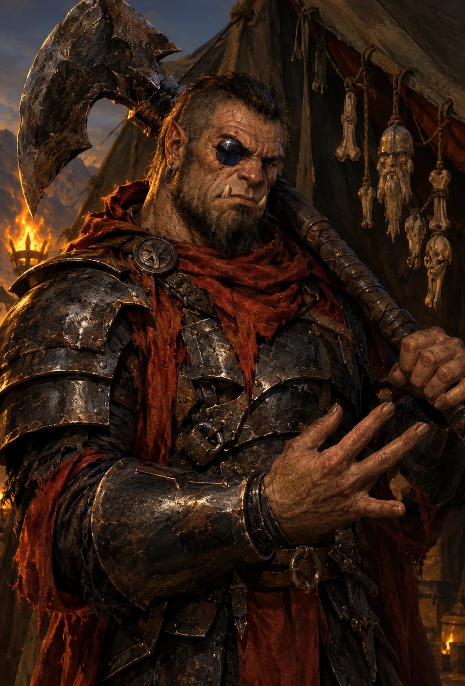

**Mappa M7-C** (Appendice D). I PG entrano da nord, dalla parte della fortezza.
La soglia è illuminata, il fondo no.

**Comparse** *(statistiche: Appendice A.2)*

| Chi | Com'è | Come parla |
|---|---|---|
| le quattro guardie | hobgoblin in armatura nera laccata, tutti uguali di proposito. Vogliono che Zog'tar non li veda mai esitare, perché l'ultimo che ha esitato è sul seggio, fra i teschi | non parlano: al generale rispondono battendo il piatto dello spadone per terra, una volta sì, due no |

**Se arrivano visibili.** A piedi l'invisibilità del re finisce dentro il
secondo blocco, quindi il caso più probabile è che arrivino **nascosti**, non
invisibili. Vale tutto quello che segue, con tre differenze:

- la runa della soglia non ha niente da rivelare: chi entra da lì con un nano
  la fa scattare, ma resta com'era;
- le guardie dentro la tenda si evitano con **Nascondersi** contro il loro
  **Osservare** (Appendice A.2): una prova entrando, un'altra se qualcuno si
  muove. Il buio del fondo non nasconde nessuno: le guardie, hobgoblin, e
  Balvar, nano, vedono al buio fino a 18 m, e la tenda sta tutta in quel
  raggio. Per l'SRD l'oscurità non dà occultamento contro la scurovisione, e
  Nascondersi senza copertura né occultamento non si tenta. La copertura c'è
  dietro i tre pali in fila sotto il colmo (K12, N12 e Q12), la tavola della
  mappa a J10 e lo schienale del seggio. Chi entra senza invisibilità e senza
  arrivare dietro uno di questi è visto;
- se una guardia li vede, si passa alla **Scena 8** senza round di sorpresa.

Balvar li legge comunque. Finché gli parlano sottovoce in nanico antico nessuno
tira niente: nella tenda si ride e si grida. Chi alza la voce, o risponde in
comune, si fa sentire, e si passa alla Scena 8.

**L'invisibilità finisce durante la trattativa.** Parlargli prima di colpire
costa una tacca, e nessuna pozione del gruppo dura tanto: le comprate durano 3
minuti, *volare* 5. Chi torna visibile dietro una delle coperture (un
palo, la tavola, lo schienale del seggio) tira Nascondersi contro l'Osservare
delle guardie, come chi arriva visibile; chi torna visibile allo scoperto, o
sospeso in volo sotto il telo, è visto, e si passa alla Scena 8 senza round di
sorpresa.

**Da dove entrano decide come comincia.** Le rune della soglia sono nella
Scena 6, e qui basta il riassunto. La soglia porta *epurare invisibilità*,
che scatta se la varca un nano e non fa rumore. Il telo sopra il seggio
porta un *glifo di interdizione* legato ai nani, 5d8 sonori con Riflessi
CD 18, e il boato è l'allarme. Il telo est, a sinistra per chi arriva da
nord, non ha niente. Grask è fuori, a due quadretti dal seggio: sveglio
finché l'ultima tacca segnata è la 4ª, addormentato dalla 5ª. Lo stato si
fissa all'atterraggio, e la tacca della trattativa non lo cambia.
Accanto a lui c'è il corno, e quello che si dice lì lo sente il drago (Scena 6,
«Quello che si dice qui lo sente il drago»).

| Come entrano | Cosa succede |
|---|---|
| **dalla soglia, con un nano fra loro** | la runa di *epurare invisibilità* li rende visibili tutti, senza un rumore. Le guardie li vedono: si passa alla **Scena 8**, senza round di sorpresa. Balvar resta seduto |
| **dal telo, dopo il consiglio di Balvar** (*«Non la soglia. Il telo a sinistra.»*) | restano invisibili. La scena va come scritta qui sotto |
| **tagliando la tenda altrove** | restano invisibili, ma il taglio fa rumore: le guardie tirano Ascoltare contro il Muoversi Silenziosamente di chi taglia |

**Come va la scena, in ordine.** Nella tenda ci sono due persone che contano, e
**parla prima quella che non dovrebbe**. Zog'tar è sul seggio con le sue
guardie; **Balvar** è nell'angolo in fondo, dove i bracieri non arrivano. I PG
sono invisibili, o nascosti dietro un palo o la tavola, ma Balvar li **legge**: il suo *Leggere il Fuori-Posto*
percepisce chi non appartiene a questo secolo. Parla in **nanico antico**, a
voce bassa, e nessuno nella tenda capisce: Zog'tar crede che borbotti sulle sue
rune, come fa sempre. Fra i PG, i nani lo capiscono **a fatica**: tutto il senso,
non le sfumature. Thorik lo **legge**. La
conversazione con Balvar si fa **a tre passi dal generale**, ed è questa la
tensione della scena. Quando finisce, o quando
qualcuno colpisce, comincia la Scena 8.

**Se sono ancora invisibili, Balvar non vede la Corona: la sente.** *Leggere il
Fuori-Posto* gli dice dov'è quello che non appartiene a questo secolo, e la
Corona lo è più di tutto il resto. Nel box 2 qui sotto, allora, non guarda
«voi»: guarda il punto in cui siete, uno per uno, e si ferma davanti al capo.


**Scheda d'entrata — Balvar Fuocospento, il runaio esiliato** *(statistiche:
Appendice A)*

<!-- blocco: balvar-chi -->
| | |
|---|---|
| **Aspetto** | nano dello scudo vecchio, grembiule di cuoio, seduto su uno sgabello da bottega. Sulle ginocchia una lastra d'ardesia, in mano una punta di ferro |
| **Vuole** | che Hammerfist cada **in fretta**, perché un assedio lungo è fame, e lui l'ha già vista. E che qualcuno dica che c'era |
| **Suona** | non smette di incidere mentre parla. La punta sull'ardesia continua sotto le frasi |
| **Sa** | **che i PG non sono di questo secolo**, unico in tutta Hammerfist. Dove vanno colpite le mura. La runa-vincolo sulla scaglia del drago, perché l'ha incisa lui |
| **Non dice** | che ha un nipote di diciannove anni sul camminamento. Mai per primo |
| **Ritratto** | qui sotto. Ai giocatori si mostra dopo l'incontro, non prima |
<!-- /blocco -->

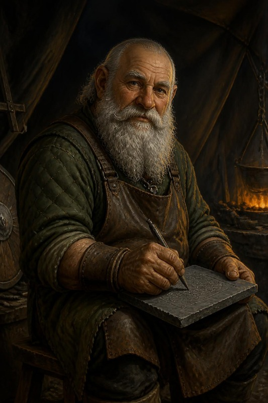

> **Perché esiste.** Due giocatori hanno chiesto la stessa cosa da due lati:
> Artemis non ha mai niente da individuare, Thorik non incontra mai
> incantatori (`DM-CAMPAIGN-PLAYBOOK` §1-bis). Balvar è la risposta — ma non è
> un boss in più appiccicato al modulo: è **il motivo per cui l'orda ha un
> drago**. Toglilo e il duello della Scena 11 cambia. Statblocco: Appendice A.4.

#### Chi è

Un **nano dello scudo**, vecchio, esiliato da Hammerfist prima che i PG
nascessero. Era già un mastro runaio, di altre fortezze, quando Hammerfist fu
eretta: ci arrivò per la sua abilità, e ne divenne il **runaio**, quello che
incideva le protezioni sulle porte. Adesso incide per Zog'tar, e Abbathor gli tiene la
mano ferma.

Non comanda l'orda. **Consiglia**, e per questo è più pericoloso del generale:
Zog'tar sa uccidere diecimila uomini, Balvar sa **dove** vanno colpite le mura.

#### ⚖️ Il grigio — perché **crede di aver ragione**


| | |
|---|---|
| **Vuole** | che Hammerfist **cada in fretta**. Non per odio: perché un assedio lungo significa fame dentro le mura, e lui l'ha già vista una volta |
| **Crede** | che i re nanici mentano ai loro, e che le sue rune abbiano protetto per trent'anni una fortezza che l'ha esiliato **senza processo** |
| **La leva** | = suo nipote. È dentro le mura, ha diciannove anni, e Balvar sa esattamente su quale camminamento monta la guardia |
| **Ricattabile** | sì, e da nessuno che non gliene parli **per primo**. Se i PG lo minacciano, si chiude; se gli dicono che il ragazzo è vivo, no. Non l'hanno mai visto, quindi è una promessa o una bugia: Raggirare contro il suo Percepire Intenzioni **+13** (statblocco in Appendice A). Se ci crede, conta come recuperato |
| **Non è un mostro** | e questo è il punto: se il tavolo lo tratta da mostro, lo scontro funziona lo stesso. Se lo tratta da nano, il master cambia forma |

⚠️ **È una fazione recuperabile, non una fazione debole.** Balvar in combattimento
resta un GS 13, e le sue rune fanno male. Recuperarlo **non lo indebolisce**:
gli cambia bersaglio.

**Cosa fa quando comincia lo scontro**

| Com'è andata con lui | Nella Scena 8 |
|---|---|
| **Recuperato**: il nipote, o il patto *«dite che c'ero»* accettato | non combatte. Resta sullo sgabello e incide. Il suo bersaglio diventa il drago: al primo round dice ai PG dov'è la runa della Catena e come si spezza, e la riga «Individuano la runa» qui sotto è già fatta |
| **Trattativa aperta**, nessuno l'ha minacciato | il primo round guarda. Dal secondo sta con chi sta vincendo: vince chi ha tolto più di metà dei pf all'altra parte, e Zog'tar se nessuno ci è riuscito. Con i PG non combatte il generale in faccia: *dissolvi magie* sui suoi, e la *barriera di lame* fra le guardie e il gruppo |
| **Minacciato, o attaccato** | combatte con Zog'tar: vedi «Come si combatte» più sotto |

**Quanto pesa lo scontro.** Zog'tar (GS 15), Balvar (GS 13), le quattro
guardie (Guerriero 8) e il sacerdote dell'orda (GS 6) insieme fanno **EL
17**, cioè il tetto di APL + 4: più su non si va. Senza Balvar, **EL 16**. Il conto è fatto a mano con le
regole di combinazione della DMG, ed è un'approssimazione.

🚫 **Cosa NON dire.** Che il nipote esiste. Balvar non lo nomina mai per primo:
si arriva al ragazzo solo se qualcuno **guarda** cosa sta incidendo sull'ardesia
(Osservare **CD 20**: è un nome nanico, **Hald**, e sotto una data di nascita;
Hald è il figlio di sua sorella), oppure se
un PG nano gli chiede chi ha lasciato a Hammerfist — **Diplomazia CD 18**, e
funziona solo se non l'hanno ancora minacciato.

> **Read-aloud — il primo incontro, 1 di 3, poi FERMATI.** *In fondo alla tenda, dove
> la luce dei bracieri non arriva, un vecchio è seduto su uno sgabello da
> bottega. Grembiule di cuoio. Sulle ginocchia una lastra di ardesia che sta
> incidendo con una punta di ferro, piano, come se fuori non ci fossero
> diecimila tende e un drago.*

> **Read-aloud — 2 di 3, dopo che qualcuno ha reagito.** *Alza la
> testa e vi guarda lentamente, uno per uno. Sulla gemma del vostro capo si
> ferma un istante di troppo. Poi torna a incidere. Non chiama la guardia.*

> **Read-aloud — 3 di 3, solo quando il silenzio diventa scomodo.** *Il vecchio parla piano, da artigiano, senza fretta: «Quella
> corona la finirono con tre gemme. Tu ne hai due.» Un colpo di punta
> sull'ardesia. «Quindi non è oggi.»*


#### Perché è con l'orda, e perché Zog'tar si fida

- **Perché è con l'orda.** Esiliato senza processo, come dice la sua scheda, ha
  trovato in Abbathor un dio che non gli chiede di perdonare. Il prezzo che ha
  chiesto a Zog'tar non è oro: è che la fortezza cada **in fretta**, e che chi si
  arrende non venga toccato. Sul camminamento c'è suo nipote.
- **Perché Zog'tar si fida.** Non ciecamente: per tre ragioni che vede. Balvar gli
  ha dato un drago, e nessun altro poteva. In dieci notti le sue rune hanno
  fermato due incursioni di esploratori nanici, ed è per questo che gli
  esploratori da allora guardano soltanto dalle mura. E Balvar non chiede il
  comando né il bottino: un uomo che non vuole niente di quello che vuoi tu non
  è un rivale.
- **Cosa Zog'tar non sa.** Il patto sulla resa, che Balvar non gli ha mai detto
  in quei termini.

#### La cosa che lo rende memorabile: sa che non siete di qui

**Leggere il Fuori-Posto** (3/giorno) è l'unica capacità che conta davvero. In
tutta Hammerfist del ≈372 DR, **Balvar è il solo che sa che i PG non
appartengono a questo secolo** — e non lo dice a nessuno, perché
un'informazione che nessuno ha vale più di un'informazione condivisa.

**Come lo sa, e cosa non sa.** *Leggere il Fuori-Posto* gli dice che i PG non
sono di questo secolo, non di quale. Il resto lo capisce dalla **Corona**. Da
giovane, quando era il runaio della fortezza, l'ha vista sulla testa del vecchio
re, quello che l'ha persa contro Skullcrusher cinquant'anni fa: per questo dice
*«la finirono con tre gemme»*. Adesso la vede sulla fronte di uno straniero,
con due gemme accese. Ne deduce che viene da **dopo**, e da molto dopo. L'anno,
i nomi e quello che è successo nel frattempo non li sa.

**Non li smaschera. Tratta.** È un mercante di segreti come Varis è un mercante
di merce, e la scena giusta è la stessa: un affare vero con un amo vero.

**BALVAR (piano, senza alzare gli occhi):** *«Non chiedo chi siete. Chiedo una
cosa sola, e ve la chiedo adesso, perché fra un'ora saremo tutti occupati.»*

*Un colpo di punta sull'ardesia.*

**BALVAR:** *«Quando avrete finito quello che siete venuti a fare, e lo
finirete, lo vedo da come camminate, dite che c'ero.»*

*Posa la punta, e adesso li guarda.*

**BALVAR:** *«Non che ho vinto. Che c'ero. La Cronaca scrive solo i nomi che
qualcuno pronuncia.»*


Questo è il suo prezzo, ed è per questo che ha lasciato passare i PG. Un uomo
cancellato dagli annali che chiede a dei viaggiatori del tempo di **essere
ricordato**. Se accettano, in ARC-08 e ARC-09 gli affreschi della Sala avranno
**un pannello in più**, e nessuno saprà spiegarlo — tranne loro.

#### La Catena: perché il drago combatte per l'orda

Balvar ha inciso una **runa-vincolo** nella scaglia sternale di Skullcrusher.
Non è dominazione: è un **contratto scritto nella carne**, e il drago lo sa,
e lo odia. Questo aggancia direttamente il duello (Scena 11):

| Cosa fanno i PG | Effetto sul duello con Skullcrusher (Scena 11) |
|---|---|
| **Non se ne accorgono** | il duello va come scritto |
| **Individuano la runa** (Sapienza Magica **CD 24**, o Conoscenze storia CD 22 per riconoscere il nanico antico — **è scritta, quindi si legge**) | sanno dove colpire. **Quando**: di notte il drago è sulle colline, quindi la runa si vede all'alba, nel duello, con un'azione di movimento entro 9 m. Nella tenda si legge la **gemella** sul corno (Scena 6), che dice dove sta l'altra; e Balvar, se è recuperato, lo dice lui |
| **Colpiscono la scaglia** | **regola della casa**: il 3.5 non ha colpi mirati. Si attacca la CA del drago **+4**, perché il bersaglio è piccolo, e il primo colpo che va a segno **spezza la Catena** |
| **Balvar la scioglie** (solo se è recuperato) | può farlo, e lo sa, ma **solo toccando la scaglia**: cioè nel cortile, durante il duello. Vale come spezzarla (riga sotto). Per arrivarci torna con i PG (se tornano in volo: Scena 8, «Se Balvar è recuperato»): nel ritorno a piedi tira con loro, e conta per la metà del gruppo (Nascondersi e Muoversi Silenziosamente **−1**: nessun grado, DES +2, armatura completa di mithral −3), alla postierla Durin lo fa entrare se un PG garantisce per lui (Scena 8, «Se Balvar è recuperato»), e nel cortile resta ai margini fino al duello |
| **Spezzano la Catena** | Skullcrusher **smette di combattere per l'orda**. Non diventa alleato — è un drago nero — ma se ne va, e l'assalto alle mura perde le ali. Vale **FERITO GRAVE** se il drago aveva già perso almeno un terzo dei pf, altrimenti **FUGGITO**. È una soglia diversa da quella della fuga della Scena 11, che arriva a un terzo dei pf **rimasti**: la Catena spezzata accorcia la strada |
| **Uccidono Balvar prima dell'alba** | la runa resta (è incisa, non sostenuta), **ma** senza chi la rinnova si indebolisce: Skullcrusher parte con **−2 a tutto** e fugge a **metà** pf invece che a ⅓ |

⚠️ **È qui che il gruppo diventa un gruppo.** Artemis vede l'aura, Thorik legge
il nanico antico, Tordek arriva alla scaglia. Nessuno dei tre ce la fa da solo:
**è esattamente la scena che mancava all'arco.**

#### Che cosa muove Skullcrusher

Il drago non ha mai perso. Cinquant'anni fa, in questa stessa valle, ha ucciso
il re di Hammerfist, e da allora i nani per lui sono una cosa da mangiare
quando ha fame. Per questo ha accettato il patto di Balvar: quando la fortezza
cade, il tesoro del re è suo. A un drago un contratto piace, perché è oro
promesso per iscritto, e la runa sulla scaglia gli è sembrata il sigillo.

Il guinzaglio l'ha scoperto dopo, la prima volta che il corno ha suonato e lui
è tornato senza volerlo. Balvar ci aveva inciso una riga che non gli aveva
letto. Da quella notte odia la Catena più dei nani.
Se non l'ha letta da sé è per arroganza: un drago che non ha mai perso non
cerca la riga piccola. Il resto del patto però regge, e il tesoro del re gli
è ancora dovuto.

**Il corno gli porta le voci**. Odiando la Catena,
l'ha studiata per liberarsene. Spezzarla non ci riesce, ma ha scoperto che la
runa sulla scaglia è gemella di quella incisa sul corno di Grask, e ha
imparato ad ascoltarci dentro: quello che si dice vicino al corno gli arriva
come un sussurro, anche sulle colline. Di notte il corno sta fuori dalla
tenda di Zog'tar, nella custodia incatenata al polso di Grask (Scena 6), e
così all'alba il drago sa i nomi che i PG si sono detti vicino alla tenda.
Chi non ha sentito nominare lo chiama per quello che vede: *la morta
tornata*, *il nano con la Corona*. A *colpo accurato* basta una parola, e la
passata col nome resta com'è (Scena 11, «La passata, il nome, la prima
paura»). I nomi non li chiede: un PG sano di mente non glieli darebbe.

| | |
|---|---|
| **Vuole** | il tesoro di Hammerfist, e uccidere un secondo re **davanti all'orda**, con diecimila bocche che poi lo raccontano |
| **Teme** | che si veda il guinzaglio: che l'orda capisca che il suo drago torna quando lo chiamano |
| **Ha in mano** | le ali. Senza di lui l'assalto è una scala appoggiata alla pietra, e Zog'tar lo sa |
| **Prossimo passo** | all'alba, al corno, cala sul cortile dietro la porta principale: è la porta che gli arieti battono, e il re la difende da dentro. Se la apre, l'orda la vede cedere, e il tesoro è suo |

**Cosa ne fa il tavolo.** Quattro leve, e nessun numero nuovo:

- **Dire la Catena ad alta voce**, in comune o in goblin, dove l'orda sente. È
  la stessa azione di movimento che serve a leggerla (Scena 11). Danni non ne fa,
  ma dal suo turno successivo il drago va su chi l'ha detta, e ci resta. È il modo di tirarlo giù su un PG che lo regge, e chi
  lo fa se lo prende addosso.
- **Offrirgli di spezzarla.** Davanti all'orda rifiuta sempre, perché accettare
  vorrebbe dire ammettere il guinzaglio, e chi l'ha offerto diventa il bersaglio
  preferito come chi lo ha ferito di più. Lontano da quegli occhi ascolterebbe,
  ma il master non prepara quel caso: se il tavolo ci arriva, è del DM.
- **Parlare al corno apposta**. Balvar recuperato
  lo sa o lo intuisce, perché le due rune le ha incise lui, e lo dice se gli
  chiedono come fa il drago a sapere le cose; oppure il tavolo ci arriva da
  sé, dalla battuta d'apertura del duello. Allora vicino al corno si può
  mentire di proposito: un nome scambiato fra due PG, un piano detto ad alta
  voce per non farlo, una trappola. Il drago agisce su quello che ha sentito,
  e grida il nome che crede giusto. Quando la passata gli mostra l'inganno è
  un'altra cosa che l'orda ha visto.
- **Farlo fuggire.** Alla prima paura (⅓ dei pf, Scena 11) non passa sopra il
  campo: va basso, verso le paludi, sotto la sua *oscurità*, per non farsi
  vedere. È l'unica volta che la usa nel duello. L'orda lo vede lo
  stesso, ed è da lì che comincia a sfaldarsi (Scena 13).

#### Come si combatte, se si arriva a combatterlo

**Con tre o cinque PG** vale la riga di scala della Scena 8: la tenda è uno
scontro solo, e Balvar ne fa parte. Cambiano le guardie, non lui.

**Non ingaggiarlo in campo aperto**: non è un duellante, è un **preparatore**.

Le rune incise che regge sono **quattro**, e la quarta è la Catena del drago.
Le altre tre sono qui, incise sapendo che qualcuno sarebbe entrato:

1. sulla **soglia** — *epurare invisibilità* (Scena 6): chi entra da lì con un
   nano diventa visibile, senza un rumore;
2. sul **palo centrale** — *blade barrier*, che scatta e taglia la tenda in
   due, separando il gruppo: 13d6, Riflessi CD 21 per evitarla;
3. **su di sé** — *silenzio*, che attiva a comando: chi conta sulla componente
   verbale è fuori, lui no, perché le rune non ne hanno.

E poi c'è la **lastra d'ardesia**. Non è una runa attiva, perché la quinta non
la reggerebbe, ma lui **continua a incidere mentre combattete**. Falla vedere:
è l'immagine che li terrorizza. *Àncora dimensionale* è fra i suoi
incantesimi: se qualcuno prova a teletrasportarsi fuori, la lancia.

**Tattica**: *righteous might* al round 1 e *slay living* (Tempra CD 20) sul
più fragile al round 2, **prima** del silenzio, perché tutti e due hanno la
componente verbale. Chi fallisce il TS contro *slay living* muore davvero,
come nell'SRD: la cattura del Q29 vale per chi cade a 0 pf, non per chi muore.
Si torna con *rianimare morti* alla cappella, che ha l'unico diamante della
fortezza (5.450 mo, Scena 5), o con *reincarnazione*, se Hella l'ha preparata.
Dal round 3 attiva la runa del *silenzio* su di sé e usa
solo quello che non parla: la *blade barrier* del palo, che è una runa, e il
martello. Se nella tenda qualcuno vola, al round 1 lancia *comando superiore*
al posto di *righteous might*, e al round 2 *slay living* come sopra, oppure
*dissolvi magie* sul volo se il comando non è bastato; *àncora dimensionale* la lancia solo nei primi due
round. Dal round 3, dentro il suo *silenzio*, nessuno dei tre è possibile,
perché tutti hanno la componente verbale (SRD). Numeri in Appendice A.4. Se scende
sotto **30 pf** non fugge e non implora: **finisce di incidere la lastra** e la
lascia lì. Gli costa un'azione di round
pieno, l'ultima: in quel turno non attacca e non lancia.
`[HDYWTDT — il finisher a chi abbatte Balvar: «com'è che lo fai?», e il vecchio
non alza la testa dalla lastra]`. Se il tavolo la legge subito:


> **Read-aloud (Salvatore).** *Tre rune nane, tutte spezzate a metà dallo
> stesso colpo di punta. Sotto, inciso più a fondo, un nome: Hald. Poi una
> freccia, verso nord.*

Il senso si decide in ARC-09. Il nome è quello del nipote, la freccia no:
cosa c'è a nord non lo sa ancora nessuno, nemmeno il master.

#### Se lo divinano: la natura di Balvar

Al 13° il gruppo può lanciare *divinazione*, *comunione*, *individuazione dei
pensieri* e *zona di verità*. Nessuno di questi incantesimi rompe la scena:
ogni risposta porta dove la scena porta comunque, solo un passo prima, e chi ha
lanciato arriva alla trattativa sapendo una cosa in più. Una riga per ciò che
Balvar nasconde.

- **Che cos'è.** *Individuazione del male* lo mostra malvagio: è un chierico di
  Abbathor, neutrale malvagio. Non cambia niente, perché Balvar non finge di
  essere un'altra cosa. Lavora per l'orda e lo si vede.
- **Che sa chi sono.** *Divinazione* o *comunione* confermano che sa che i PG
  non sono di questo secolo, ma non di quale, e che l'ha capito dalla Corona.
  Saperlo prima toglie al tavolo la sorpresa del terzo box, non la trattativa.
- **Il nipote.** *Individuazione dei pensieri* deve vincere la sua Volontà
  (+17), e con un incantesimo di 2° livello ci riesce di rado. Se ci riesce,
  il pensiero in superficie è quello che sta incidendo sull'ardesia: un nome,
  Hald, e una data di nascita. Vale come l'Osservare CD 20 sulla lastra e apre
  la stessa porta: chi gli parla del ragazzo per primo non lo trova chiuso.
- **La Catena.** *Comunione* o *divinazione* sul drago rispondono che è legato
  da una runa, e che l'ha incisa Balvar. Vale come aver letto la gemella sul
  corno: i PG sanno che all'alba devono cercarla sulla scaglia sternale.
- **Il patto con Zog'tar.** In una *zona di verità*, se fallisce il TS sulla
  Volontà, Balvar non può mentire, e alla domanda giusta dice il suo prezzo:
  che la fortezza cada in fretta e che chi si arrende non venga toccato.
  Zog'tar non lo sa. Il nipote invece non lo nomina nemmeno lì, perché la zona
  impedisce di mentire, non obbliga a parlare.
- **Il suo nome.** *Leggende e tradizioni* non trova niente: la Cronaca non
  ha il suo nome, e non l'avrà finché qualcuno non lo pronuncia. È il prezzo
  che chiede ai PG, e chi ha lanciato l'incantesimo lo capisce prima degli
  altri.

#### L'eco a 1372 (il motivo per cui vale la pena)

Balvar è morto da mille anni comunque vada. Ma:

- se i PG hanno **pronunciato il suo nome**, in ARC-08 la Cronaca ha un
  pannello in più — e **Aegis Fang lo riconosce**;
- se hanno **spezzato la Catena**, il carry-over B4 verso **Fauci di Palude**
  cambia di tono: il figlio del drago incatenato ha una ragione in più per
  odiare i nani, o per **non** volere una catena addosso;
- se lo hanno **ucciso senza ascoltarlo**, resta una lastra d'ardesia incisa a
  metà tra le rovine del campo. Qualcuno, in ARC-09, l'ha trovata.

→ Registra l'esito nell'**Echo Ledger** (§7).

<!-- nuova-pagina -->

### SCENA 8 — Zog'tar

<!-- scheda-da-tavolo -->
<!-- tabella: larga -->

| Scena 8 · EL 17, 16 senza Balvar | **La scheda da tavolo**: che cosa succede, chi c'è, cosa vuole e come si conduce; il testo intero segue |
|---|---|
| **Succede** | Lo scontro nella tenda, da quando Zog'tar si alza dal seggio |
| **Dove** | La tenda |
| **Chi c'è** | Zog'tar Deatheye: 283 pf, CA 26 (24 in Ira), iniziativa +9, ascia +29/+24/+19 in Ira (3d6+20). Le quattro guardie; il sacerdote dell'orda, che dorme dietro il seggio; Balvar, se non è passato ai PG. **EL 17** con Balvar, 16 senza. Grask è fuori col corno |
| **Chi vuole cosa** | Zog'tar vuole abbattere chi è entrato, davanti ai suoi. Le guardie lo coprono; Grask non lascia il corno |
| **Si comincia** | Round di sorpresa per i PG se nessuno li ha visti. Campo pre-allertato o ingresso dalla soglia: niente sorpresa |
| **Round 1** | Ira, e l'Occhio di Ossidiana su Thorik: −2 alla CA contro Zog'tar e +2 ai danni che lui gli fa, per 5 round. Due guardie coprono Zog'tar con Aiutare (+2 alla CA); le altre due vanno, in coppia, su chi lancia incantesimi o colpisce da lontano |
| **Round 2-3** | Carica chi fa più danni: Attacco Poderoso −5/+10. Contro chi ha armatura leggera o niente usa invece il Colpo Terrificante e lo scaglia lontano. Contro chi vola: giavellotti +19 |
| **Sotto il 30% dei pf** | Un ultimo Attacco Poderoso pieno, −15/+30: cerca di portare un PG con sé |
| **Balvar e il sacerdote** | Se Balvar sta con i PG, al round 2 entrano due guardie in più dal telo del seggio (resta EL 16). Il sacerdote: *comando* (Volontà CD 13), *benedizione*, *oscurità* |
| **Da ricordare** | 50 danni o più da un colpo solo: Tempra **CD 15** o morte. Finché Zog'tar è in piedi le guardie non scappano; se cade, corrono fuori a gridare, ed è l'allarme. A un grido le ronde arrivano in 1d4+2 round, gli squadroni in 2d4+2 |
| **Via A** | Intimidire **CD 22** con la Corona o la Luce in vista (Sapienza Magica CD 20 per capire che si può): Zog'tar è umiliato, le guardie lo seguono fuori senza combattere e Grask non suona. Zog'tar non sale sulla breccia all'alba |
| **Se va male** | Zog'tar vuole vivi i PG che cadono a 0 pf: incatenati fino all'alba, scompaiono dal palco e ricompaiono nel cortile quando il drago cala, feriti come sono |
| **Sviluppo** | Due domande. Qualcuno esce a gridare, o Grask suona? Se no, è **in silenzio**. Se sì, è un **allarme**: un successo in meno sulle mura. Chi è uscito ha visto un colpo che si fa vedere? Allora è anche **spettacolare**, e all'alba il drago arriva in picchiata. L'esito va nell'Echo Ledger |
| **Il ritorno** | A piedi: cinque blocchi a Nascondersi CD 22, e CD 26 se il corno ha suonato |
| **Tesoro** | Zog'tar: armatura completa di mithral +2 Grande (16.000 mo), ascia a due mani +1 Grande (2.340), 2 pozioni di *cura ferite gravi* (750 l'una). Balvar, se è morto: armatura di mithral +2 (14.500), anello di protezione +2 (8.000), martello runico +1 (2.312), polvere di diamante (400). Con l'allarme si prende solo quello che si stacca con un'azione; senza, spogliare la tenda costa una tacca. L'Occhio resta nell'orbita |
| **Come finisce** | Zog'tar ucciso in silenzio, ucciso in modo spettacolare, catturato, o umiliato e vivo (Via A) |
| **Dove guardare** | Le schede di Zog'tar, delle guardie, del sacerdote e di Balvar; «Tattiche di Zog'tar — round per round»; «Il bottino della tenda e il tempo»; la mappa M7-C |

<!-- /scheda-da-tavolo -->

*La scheda d'entrata di Zog'tar è nella Scena 7, dove i PG lo vedono per la prima volta.*

> **Read-aloud — la tenda, il seggio.** *Il mezzo-ogre si alza
> dal seggio, e i teschi inchiodati sbattono fra loro come nacchere. Non grida
> subito. Prima gira la testa, e la pietra nera dove dovrebbe esserci l'occhio
> si ferma sul più vicino di voi. Poi l'ascia scende dalla spalla.*
>
> **Che fate?**

**Il round di sorpresa.** I PG che nessuno ha visto, invisibili o nascosti, hanno il **round di sorpresa**, cioè
per l'SRD un'azione standard o di movimento a testa, se
nessuno ha parlato ad alta voce o lanciato incantesimi che li rivelano. Parlare
con Balvar in nanico, a bassa voce, **non** conta come parlare ad alta voce: è il
motivo per cui la Scena 7 viene prima.

#### Tattiche di Zog'tar — round per round (stile RHoD)
> È un macellaio arrogante che si crede immortale: non conosce la paura finché
> non gli entra nelle ossa. Non sa che la Morte è già nella tenda.

- **Round di sorpresa** (se nessuno li ha visti né sentiti): un'azione
  standard o di movimento a testa. *È qui che si vince o si complica.* Un
  colpo coordinato gli fa male ma non lo abbatte: fuori dall'Ira ha 283 pf,
  e non perde la Destrezza alla CA nemmeno colto di sorpresa (Schivare
  Prodigioso Migliorato). È voluto: il DM lo vuole in piedi al secondo round.
- **Chi accorre al grido**. Le ronde di orchi più vicine arrivano
  alla tenda in **1d4+2 round**, gli squadroni hobgoblin in **2d4+2**: sono
  «i rinforzi» di cui parla la Scena 7. Statistiche in Appendice A.6. Chi
  resta oltre il loro arrivo combatte l'orda, non più un generale. Le ondate
  non finiscono: dalla prima ronda ne arriva
  un'altra ogni round, e dal primo squadrone un altro ogni due round, finché i
  PG restano nel campo. Un round prima che arrivino si vedono torce muoversi
  sul telo e si sente un ordine gridato in orchesco: è il segno per chi vuole
  uscire prima. Finché Zog'tar è in piedi non entrano nella tenda,
  perché il generale non vuole aiuto davanti alle sue guardie: fanno quadrato
  fuori, attorno al telo, e aspettano chi esce. Chi esce a piedi li trova
  tutti; contro chi vola tirano le lance, e contro chi è invisibile colpiscono
  il quadretto da cui viene il rumore, con il 50% di mancare. Quando Zog'tar
  cade, o scappa, entrano. Smettono solo quando i PG sono fuori dal campo.
  Lo scontro col generale resta a EL 17; i rinforzi sono sopra il tetto per
  scelta, come il drago sulla tenda.
- **La tenda è alta 6 m al palo centrale e 3 m ai lati**. I pali
  sono tre, in fila sotto il colmo e tutti alti 6 m (mappa M7-C): il centrale è
  il palo maestro, con la runa di Balvar. Sotto il
  telo chi vola **non** esce dalla portata dell'ascia: Zog'tar è alto 3 m e
  arriva a 3 m oltre, cioè fino al colmo. Ne esce solo chi sta fuori dal telo.
  Le risposte dell'orda, tutte SRD:
  - **Zog'tar** tiene **tre giavellotti Grandi** accanto al seggio: +19 a
    distanza, 1d8+13 in Ira, incremento 9 m. E se il volo dura, **abbatte il
    palo centrale** (Forza **CD 20**, azione standard): il colmo è fatto di due
    travi incastrate sul palo centrale, e senza quello cadono e si portano
    dietro i pali di testa. Il telo crolla, e chi è
    in volo sotto finisce a terra, intralciato, finché non supera Riflessi
    **CD 15** (un tentativo per round). Le guardie e lui escono dal telo in un
    round;
  - **Balvar**, se combatte: *dissolvi magie* sul volo, e **comando superiore**
    (5° livello, uno slot che aveva libero): una
    parola a un bersaglio per ogni livello, tutti entro 9 m l'uno dall'altro,
    Volontà **CD 20**, e dura fino a 13 round: all'inizio di ogni suo turno dopo il primo, il bersaglio ritenta il TS sulla Volontà, e se riesce l'effetto finisce (SRD). L'ordine è **«Cadi»**
    (*«A terra!»*), uno dei cinque dell'SRD: il bersaglio cade a terra e resta
    prono un round, obbedendo al meglio che può. Finché non riesce il TS
    obbedisce di nuovo a ogni suo turno: da prono agisce, attacca con le
    penalità del prono e lancia, ma non si rialza (SRD, *comando*). Chi vola **scende fino a
    terra** nel suo turno, senza danni da caduta, e si mette prono
    (l'SRD non parla di chi vola: è una scelta del DM): sotto un telo
    alto 6 m ci arriva sempre. Se fosse troppo in alto per toccare terra in un
    turno, l'incantesimo fallisce (SRD). Thorik è immune
    (Mente Vuota della Corona), e per la stessa ragione lo è alla Presenza
    Minacciosa di Zog'tar e alla Presenza Terrificante del drago: per l'SRD
    sono effetti di paura che influenzano la mente, e *mente vuota* protegge
    da tutti. Balvar lancia il comando nei primi due round, prima del suo
    *silenzio* (Scena 7). E *barriera di lame* sul palo. *Àncora dimensionale*
    non c'entra col volo: blocca il teletrasporto e la *porta dimensionale*, e
    chi è ancorato continua a volare (SRD). La tiene per chi prova a sparire;
  - **il sacerdote**: *comando* «Cadi!» (Volontà CD 13) su chi vola: scende a terra e resta prono un round;
  - **le guardie**: giavellotti, +9 a distanza (1d6+4).
- **Il corno e il drago sulla tenda**. Il corno è magico: Balvar ci ha
  inciso la runa gemella della Catena, e quando suona il drago **deve**
  tornare, anche se dorme. Dalle colline ci mette **circa 7 minuti, 70 round**
  dal primo suono. Quindi arriva sulla tenda solo se il corno ha suonato
  **prima** dello scontro (un allarme durante l'infiltrazione, Scena 6) o se i
  PG si attardano dopo. **Se quando arriva Zog'tar o almeno una guardia sono
  ancora in piedi**, Skullcrusher entra nello scontro, ed è uno scontro in cui
  si scappa o si muore: EL **18-19**, oltre il tetto di APL+4, voluto dal DM.
  Si vede arrivare: il corno, poi l'ombra che passa sul telo e il fuoco dei
  bracieri che si piega. L'uscita è il telo tagliato e il buio fuori.
  - **Come combatte, da drago nero che si chiama Skullcrusher**: non atterra fra
    le tende. Strappa il telo con un passaggio radente (Attacco in Volo, artigli
    sul telo: la tenda è scoperchiata) e **soffia sulla linea più lunga che
    prende più PG**, anche se ci sono dentro le sue guardie: se le prende, le
    guarda sciogliersi e ride. Poi resta sopra, a 12-15 m, e picchia su chi è
    isolato o ferito, mai su chi lo sfida. Usa *oscurità* sulla tenda per
    togliere la vista a chi non vede al buio, e *corrompere l'acqua* su chi
    beve. Non insegue fuori dal campo: la Catena lo tiene lì.
  - **Cosa si porta all'alba**: i pf che ha perso stanotte restano persi, e il
    duello della Scena 11 comincia **senza sorpresa**, perché li conosce.
- **Round 1** (se reagisce): **Ira Barbarica** (*«A ME, CANI! ABBATTETE LE
  OMBRE!»*) + **Occhio di Ossidiana** su Thorik (la minaccia). Delle quattro
  guardie, due restano al seggio e due vanno sul PG più esposto (qui sotto).
- **Come combattono le quattro guardie**.
  Due davanti al seggio, sempre, fra Zog'tar e chi lo minaccia: non lo
  lasciano fiancheggiare, e non attaccano. **Lo coprono**, con *Aiutare un
  altro* (SRD): un'azione standard, un attacco contro CA 10, e se riesce
  Zog'tar ha +2 alla CA contro il prossimo attacco di quell'avversario.
  Ognuna copre il generale da un PG diverso, di solito Thorik e Tordek, e
  deve stargli accanto. Le altre due vanno su chi lancia incantesimi o
  colpisce da lontano, in coppia. Contro chi vola tirano i giavellotti, poi
  tornano davanti al seggio. Contro chi è invisibile colpiscono il quadretto da
  cui viene il colpo, con il 50% di mancare. **Finché Zog'tar è in piedi non
  scappano**: lui le guarda. Se cade, le guardie rimaste gettano le armi e
  corrono fuori a gridare, ed è l'allarme anche se Grask dorme. Per questo un
  Zog'tar ucciso in silenzio vuole prima le guardie a terra, o una bolla di
  *silenzio* sulla tenda.
- **Round 2-3**: carica il bersaglio che fa più danni, **Attacco Poderoso**
  moderato (−5/+10) se ha colpito bene.
  Contro chi porta armatura leggera o niente (Artemis, Hella in forma
  normale) non alza l'Attacco Poderoso: usa il **Colpo Terrificante** e lo
  scaglia lontano, contro un palo o fuori dal telo. Un nano scagliato contro
  il telo del seggio (N15–P15) fa scattare il glifo legato ai nani,
  e il boato è un allarme. Separa il gruppo e lascia
  vivo il bersaglio. Se Artemis lo martella, si gira su di lui.
- **Danno massiccio** (regola SRD, attiva nelle regole della casa). Con
  l'Attacco Poderoso pieno o un critico l'ascia supera spesso i 50 danni: il
  bersaglio tira Tempra CD 15 o muore. La cattura del Q29 vale per chi cade a
  0 pf, non per chi fallisce questo TS.
- **Soglia 30% pf**: combatte disperato, cerca di **portare un PG con sé** nella
  morte (un ultimo Attacco Poderoso pieno, −15/+30, Appendice A.2).
- **Se è pre-allertato** (il corridore è arrivato, o c'è stato un allarme):
  è in piedi con l'ascia in mano, le quattro guardie davanti al seggio, e Grask
  è sveglio fuori dalla tenda col corno pronto. Niente round di sorpresa, e
  l'Ira comincia al suo primo turno. Balvar parla lo stesso, se i PG ci
  arrivano: lui non ha fretta.
- **Il sacerdote dell'orda**. Dorme nella
  tenda, su una stuoia dietro il seggio, a N14.
  Si alza al primo grido e agisce dal **round 1**, con *vedere invisibilità*
  già addosso se ha sentito il corno. Lancia *comando* («Cadi!», Volontà CD 13) sul PG più vicino a Zog'tar,
  poi *benedizione* sulle guardie, poi *oscurità* per coprire la ritirata del
  generale. È un adepto: con Balvar, Zog'tar e le guardie la tenda arriva a EL
  17, il tetto. Statistiche in A.2.
- **Se Balvar sta con i PG, entrano le guardie del turno dopo**.
  Vale se è recuperato prima dello scontro, o se passa con i PG alla fine
  del round 1 («sta con chi sta vincendo», Scena 7). Sono due, con i numeri
  delle altre quattro (A.2), e dormono nella tenda accanto: al round 2
  entrano dal telo del seggio e vanno su chi lancia incantesimi. Sei
  guardie, Zog'tar e il sacerdote fanno **EL 16**, un punto sotto il tetto.
  Con cinque PG sono già nella tenda (la riga di scala, più sotto), e non
  se ne aggiungono altre.

**Comparse**

| Chi | Com'è | Come parla |
|---|---|---|
| il sacerdote dell'orda | hobgoblin secco, dagli occhi gialli, la mano sinistra nera di fuliggine fino al polso, un bastone ferrato con appese ossa di dita | canta invece di parlare, sempre la stessa cantilena, e la interrompe solo per dare ordini |
- **Il bottino e il tempo**: le armature della tenda, quanto pesano, quando
  si possono togliere e dove stanno nel buco portatile sono in §8 B, «Il
  bottino della tenda e il tempo».
- **Curarsi prima di ripartire**. Le
  bacchette di cura funzionano anche nella tenda, ma la tenda è circondata
  dalle ronde, e ogni carica è il round di chi la usa. Se il gruppo, in tutto,
  spende **più di 20 cariche** di bacchetta prima di ripartire dalla tenda,
  segna **una tacca** sull'orologio della notte. Il gruppo sceglie: rientrare
  ferito e curarsi alle mura, o perdere la tacca. In tutti e due i casi
  all'alba si vede che è stato nella tenda.
- **Sviluppi.** Zog'tar **esce dalla storia in questa scena**: morto, oppure
  umiliato e cacciato dal suo stesso campo (Via A, qui sotto). Il COME conta
  (► Esito, in fondo alla scena). `[HDYWTDT — il finisher a chi lo abbatte: «com'è che
  lo fai?», e aspetta. Se non vuole, una riga tua e si va avanti.]` Alla sua morte, l'Occhio di Ossidiana si spegne; il
  campo perde il direttore. *Se catturato/interrogato invece che ucciso*: Moradin
  approva la saggezza pragmatica (nessun tono «nessuna pietà» sul Rubino).

La seconda via che non passa dall'iniziativa (la prima, il corridore, è
nella Scena 6):

**Via A — l'Occhio contro il suo padrone** *(Artemis, Hella, chi ha visto la runa)*.
L'**Occhio di Ossidiana** è un artefatto **maledetto** e Zog'tar lo sa a metà:
il prezzo è che la luce divina lo brucia. Chi lo capisce — Sapienza Magica
**CD 20**, oppure **gratis** se hanno addosso la benedizione dei chierici di
Hammerfist (fiducia piena al consiglio, Scena 4) e le vedono reagire — può **mostrargliela invece di colpirlo**:
Intimidire **CD 22** con la Corona scoperta o la Luce di Lathander in mano `[regola della casa: nell'SRD Intimidire si tira contro il livello del bersaglio]`.
Non è un tiro salvezza, quindi la Volontà Indomita di Zog'tar non entra.
- **Riesce** → Zog'tar **arretra**, e arretrando esce dalla tenda davanti alle
  sue guardie. Perde la faccia, e con lei il campo: l'orda all'alba combatte a
  **−1 morale**, che annulla il successo in meno delle mura della Scena 10, se
  c'era. È un'azione standard. Le guardie lo seguono fuori senza combattere e
  Grask non suona; umiliato non vuol dire «vivo all'alba»: non sale sulla
  breccia.
- ► **Esito nuovo**: *umiliato, non ucciso*. 🔴 **Ed è un problema, non un
  premio**: Zog'tar **vive**, e in ARC-08 i discendenti della sua orda, nella Mano Rossa, hanno un generale in più
  nella sua storia. Registra nell'Echo Ledger (§7).

⚠️ **Perché due e non una.** Una via alternativa sola diventa «la soluzione
giusta» e il tavolo la cerca invece di giocare. Due che costano in modi diversi
— una la fama del nemico, l'altra il fiato — restano **scelte**.

#### Le scelte-costo dei PG contro Zog'tar (interazioni d'artefatto)
> ⚠️ **Niente tentazione Lathander/Mask per Artemis** (mai giocata, §1). Le sue
> scelte qui sono **tattiche e morali**, non divine.
- **THORIK — la preghiera a Moradin** (non è la *Benedizione della Forgia* dei Bracieri di Tordek): può chiedere a Moradin +2 sacro ai
  danni vs Zog'tar e guardie, al **costo di essere affaticato** (la condizione SRD) dopo la
  battaglia (peserà su Skullcrusher). *Scelta: potenza ora vs freschezza al drago.*
- **THORIK — finire o interrogare Zog'tar**: colpo finale spettacolare → il
  Rubino registra «nessuna pietà» (tono §7); interrogarlo → «saggezza pragmatica».
- **TORDEK — Cintura della Devastazione**: 4 cariche al giorno, +2d6 ciascuna,
  come dice la sua scheda. Se
  le brucia tutte per l'overkill, la Cintura lo «assaggia»: contro **Fauci nel
  1372** dovrà superare **Volontà CD 18** per non cedere all'aggressività. Se
  **modera** (1-2 cariche, colpi mirati) → Moradin gli concede **+1 sacro ai TS
  vs paura** in futuro. *(Nota: contro Skullcrusher la Cintura si rifiuta, Scena 11.)*
- **ARTEMIS — pulito o spettacolare**: uccidere Zog'tar in **silenzio** (blast
  mirato) tiene basso l'allarme: se nessuno esce dalla tenda a gridare (le
  guardie, qui sopra), Grask non suona e le ronde non arrivano a vedere lo
  scontro (1d4+2 round dal primo grido, o una bolla di *silenzio* sulla tenda), alle mura non c'è il successo in meno
  e il duello comincia senza picchiata; ucciderlo in modo **spettacolare** (esplosione
  davanti alle guardie) sparge terrore ma **fa infuriare Skullcrusher** (il
  duello della Scena 11 inizia in picchiata). È il suo bivio da predone: efficienza vs leggenda.
- **HELLA — controllo o distruzione**: *Intralciare* fuori dalla tenda blocca i
  rinforzi (controllo); fulmini/spine (distruzione). Nessun effetto meccanico
  immediato, ma orienta come gli spiriti/Moradin la giudicheranno alla battaglia
  di Rethmar (ARC-09): bonus a controllo-campo o a danni elementali.
- **PX Zog'tar**: sono dentro le ≈ 3.650/PG delle Scene 6-8 (§8,
  budget PX), con le guardie, il sacerdote e Balvar. Non si sommano. Catturato
  o umiliato vale come ucciso: la DMG dà i PX per l'avversario sconfitto, non
  per quello morto.

- ► **Esito**: *ucciso in silenzio / spettacolare / umiliato e vivo* (Via A). Se
  **spettacolare** (esplosione, decapitazione davanti alle guardie), il terrore
  dilaga MA **Skullcrusher interviene furioso**: non subito, perché di notte è
  sulle colline, ma all'alba il duello inizia col drago già in picchiata: ha un
  round di sorpresa (SRD), e i PG sono colti alla sprovvista fino al loro
  primo turno. Vale anche se di notte il drago li ha già visti, e un'altra riga
  direbbe «senza sorpresa»: vince la picchiata. Se l'orda è stata **pre-allertata** (corridore,
  allarme): un successo in meno sulle mura (Scena 10), e Zog'tar non è di
  sorpresa.
- **Come si decide**. Due domande,
  nell'ordine. **Qualcuno esce dalla tenda a gridare, o Grask suona?** Se no,
  è **in silenzio**: niente picchiata e nessun successo in meno. Se sì, è un
  **allarme**, e costa il successo in meno sulle mura come il campo
  pre-allertato; le guardie che scappano quando lui cade bastano. Conta come
  uscire a gridare anche la ronda che arriva al grido di Zog'tar (1d4+2 round,
  «Chi accorre al grido») e trova lo scontro ancora in corso: grida, come la
  ronda della Scena 6. **Chi è
  uscito ha visto un colpo che si fa vedere?** Un incantesimo ad area, una
  decapitazione, il finisher che il giocatore descrive esibito
  (`[HDYWTDT]`), un Treant che compare nella tenda: allora è anche **spettacolare**, e all'alba il drago arriva
  in picchiata. Un allarme senza spettacolo costa il successo e basta.

**Con un gruppo diverso: la riga di scala**. La
tenda è stata giocata da quattro PG di 13°, ed è a EL 17, il tetto esatto per
APL 13. La riga serve a un gruppo diverso: i numeri restano quelli delle
Appendici A.2 e A.4, cambia chi c'è nella tenda.

- **Con tre PG** (APL 12, tetto 16), o se in un gruppo di quattro manca un PG:
  davanti al seggio ci sono due guardie, non quattro. Le altre due sono fuori,
  al giro delle tende con la ronda, e tornano solo con i rinforzi. Il
  sacerdote dell'orda non si sveglia al primo grido: arriva al corno, insieme
  alle ronde. Zog'tar, Balvar e le due guardie fanno EL 16; senza Balvar,
  EL 15. Le due guardie restano davanti al seggio e non vanno su chi lancia.
- **Con cinque PG** (APL 13, tetto 17): le guardie sono sei. Le due in più sono
  quelle del turno dopo, sedute dietro il seggio, a L14 e Q14, e si alzano al primo grido.
  Due restano davanti a Zog'tar, le altre quattro vanno in coppia su chi lancia
  incantesimi e su chi colpisce da lontano. Con Balvar e il sacerdote la tenda
  resta a EL 17; senza Balvar, EL 16.
- **I rinforzi, il corno e il drago** non cambiano: sono sopra il tetto per
  scelta, con qualunque gruppo.

**Il ritorno a piedi**. Dalla tenda alle
mura si rigiocano i **cinque blocchi** della Scena 6, con le stesse regole.
L'invisibilità del re a questo punto è finita, quindi si tira **Nascondersi
CD 22**. Il ritorno costa **una tacca** di suo, e ogni
blocco fallito ne aggiunge un'altra. Se il corno ha
suonato, la CD sale di **+4** e il drago è in aria (Scena 6). Chi torna in volo
segue «Il ritorno» della variante dall'alto. Vatore (Scena 9) si incontra a
metà strada.

**L'ultimo blocco è la salita**. Il fianco est
si risale all'alba: 100 m di dislivello, e su un pendio ripido ogni quadretto
in salita ne costa due (DMG, Colline). Il blocco dura il doppio, una ventina di
minuti a passo furtivo, ma la tacca resta quella del ritorno. Scalare non
serve. Si tira Nascondersi come negli altri blocchi; sul pendio non ci sono
tende, e ci si nasconde fra le rocce del sentiero. Dall'alto la postierla
vede chi sale: Durin la tiene aperta e li riconosce prima che arrivino.

**Se Balvar è recuperato e il gruppo torna in volo**.
Balvar non vola. Esce dal campo da solo nella confusione dell'alba, con le sue
rune: nessuno lo sorveglia (Scena 6), quindi non tira. Alle mura entra dalla
postierla, che all'alba Durin tiene aperta per gli esploratori. Arriva nel cortile al
round **1d4+2** del duello, e da lì vale la riga «Balvar la scioglie» della
Scena 7.

Se invece i PG se lo **portano in volo**, cambia questo.
La postierla e la notte in catene valgono
anche se rientra **a piedi** con loro:

- **Il peso.** Un nano in armatura completa di mithral fa circa 85 kg. Lo
  regge chi ha Forza 18 o più come carico medio, e col carico medio *volare*
  va a 12 m (SRD), come in armatura. Con lui addosso il volo costa la stessa
  tacca, ma l'andatura è quella dei nani.
- **La postierla, di notte.** Durin riconosce un esiliato. Lo fa entrare solo
  se un PG garantisce per lui, Diplomazia **CD 20**. Fallita, Balvar resta fuori dalle mura fino all'alba e
  si torna alla riga sopra: entra al round 1d4+2.
- **Una notte dentro le mura.** Re Thorek lo vuole in catene nel cortile fino
  al duello, e lui ci sta. Se i PG gli hanno promesso il nipote, è questa la
  notte in cui Hald lo vede, dal camminamento est: la scena è del tavolo.
- **Il duello.** Balvar è nel cortile dal primo round, quindi può sciogliere
  la Catena appena il drago tocca terra o viene inchiodato con le corde, e
  non dal round 1d4+2.
- **Il campo all'alba.** Senza il runaio nessuno rinnova le rune della tenda,
  ma la Catena è incisa e regge lo stesso (Scena 7). Se Zog'tar è vivo, scopre
  all'alba che Balvar non c'è più, e lo sa anche l'orda.

**Se Zog'tar è catturato**. Sa dove
colpiranno all'alba: il punto che Balvar ha segnato sulla mappa, lo stesso che
Hrodgar conosce (Scena 10). Portarlo alle mura vale **un successo in più** nella
prova della Scena 10. Del corno sa che chiama il drago, non come. Dei PG non sa
niente.

**Come si porta via**. Solo legato e privo di
sensi. In volo non si porta: è Grande, in mithral, oltre il carico di
chiunque nel gruppo: con l'armatura sono circa 300 kg. Una
bestia Grande della forma selvatica di Hella lo porta da sola, e il −4 è solo
suo. Nel **buco portatile** di Artemis ci sta: Grande, in armatura, circa
0,5 m³ più il corpo, contro i 7,5 m³ del buco (§8 B). Quanto ci resta vivo,
senz'aria: l'SRD del buco portatile dà aria per 10 minuti a una creatura
Media o a due Piccole. Zog'tar è Grande e respira per due Medie, quindi ci
resta **5 minuti**, poi soffoca. A piedi lo reggono due PG, e il ritorno a piedi (qui
sopra) si tira a **−4** per tutti e due. Se si sveglia e grida, è l'allarme:
il corno suona e la CD sale di +4. **Quando si sveglia** (SRD): steso con
danni letali e stabilizzato, ha il 10% l'ora, quindi sul ritorno si tira una
volta sola, 1 su 1d10; steso con danni non letali si sveglia quando quei danni
scendono sotto i suoi pf, e ne smaltisce 15 l'ora. Imbavagliato non grida, ma
si dibatte: il blocco in cui si sveglia si tira a −8 invece di −4.

**Dopo, se arriva alle mura vivo**. Il re lo fa incatenare
nella cella sotto la torre nord e non lo guarda nemmeno: lo giudicherà dopo
la battaglia, se ci sarà un dopo. Durante il duello resta lì, e non conta.
Se il duello va bene, Re Thorek lo fa giustiziare all'alba del giorno dopo,
davanti all'orda che si ritira, ed è la sua risposta alla promessa di
Zog'tar; i PG a quel punto sono già nel 1372. Che cosa resta di lui nel 1372
è in §7.

**Se va male nella tenda**. Zog'tar non
uccide i PG che cadono: li vuole vivi, e li tiene incatenati nel campo fino
all'alba, per giustiziarli davanti alle mura come ha promesso di fare col re. È
la stessa regola di §6, la profezia è incisa. All'alba, sul palco
dell'esecuzione, **i PG scompaiono nel nulla**, sotto gli occhi dell'orda e
delle mura. Nessuno dei due eserciti sa spiegarlo. Ricompaiono nel cortile
della fortezza nel momento in cui il drago cala, feriti come sono, e il duello
si gioca su M7-B.

<!-- nuova-pagina -->

### SCENA 9 — Vatore, fra le tende

<!-- scheda-da-tavolo -->
<!-- tabella: larga -->

| Scena 9 | **La scheda da tavolo**: che cosa succede, chi c'è, cosa vuole e come si conduce; il testo intero segue |
|---|---|
| **Succede** | Al ritorno, fra le tende, i PG incrociano Vatore, il ladro che diventerà Sal |
| **Dove** | Fra le tende |
| **Chi c'è** | Vatore, da solo, con un fagotto stretto al petto. Non combatte. Per colpirlo: **CA 22, contatto 16**. L'Anello di Artemis diventa gelido |
| **Chi vuole cosa** | Ha paura di quattro persone che non dovrebbero esistere. Che cosa vuole è nella sua scheda d'entrata, sotto |
| **Si comincia** | Dieci minuti di gioco. Si riconosce dalla cera nera sulle dita: Osservare CD 15, se l'hanno cercato in fortezza. Invisibili: non li vede, e li sente solo se falliscono Muoversi Silenziosamente CD 20. Dopo il barile è fermo fra due tende a guardare il fuoco |
| **Lo lasciano andare** | Svanisce col Sigillo. Nel 1372 Sal è intatto: nessun vantaggio, nessun sospetto |
| **Gli parlano** | Percepire Intenzioni o Diplomazia **CD 18**: lascia sfuggire *«Voi non morite. L'ho letto»* e fugge. Se la prova fallisce, se ne va e basta |
| **Lo derubano** | Rapidità di Mano **CD 22**, solo con i gradi: chiedi al tavolo chi li ha. Chi non li ha gli strappa il fagotto di mano: Vatore attiva il Cronolito, il fagotto resta a chi lo stringeva, e Vatore sa chi è stato. Se la prova con i gradi fallisce, se ne accorge e il Cronolito lo porta via col Sigillo |
| **Lo feriscono** | Il primo colpo a segno lo ferisce: urla, e alla fine del suo turno il Cronolito lo porta via. Un incantesimo ostile senza danno vale come un colpo. Chi lo teneva resta col mantello in mano |
| **Provano a ucciderlo** | Non muore: il Cronolito lo salva a 1 pf |
| **Se va male** | L'urlo di Vatore è un allarme: campo pre-allertato, un successo in meno sulle mura, e la ronda arriva in 1d4+2 round |
| **Sviluppo** | Quello che gli fanno torna su Sal nel 1372, e va nel registro di fine serata. Se tornano in volo senza scendere, Vatore è sulle mura all'alba, e lì il suo urlo non costa successi |
| **Tesoro** | Il Sigillo di Ossidiana, solo se lo derubano: artefatto minore di Shar, che contrasta l'Anello di Artemis |
| **Come finisce** | Vatore se ne va comunque: lasciato andare, derubato o ferito |
| **Dove guardare** | «Le risposte del party», con l'eco su Sal riga per riga; «Chi può derubarlo»; «Se lo divinano: Vatore, il Sigillo, Zeth» |

<!-- /scheda-da-tavolo -->

**Scheda d'entrata — Vatore, il ladro che diventerà Sal**

| | |
|---|---|
| **Aspetto** | lo stesso volto di Sal, irriconoscibile nel portamento. Vesti di seta grigia di taglio drow, cappuccio, niente ornamenti. Stringe al petto un fagotto |
| **Vuole** | la stessa cosa che vorrà Sal: potere, e il conto lo pagano altri |
| **Suona** | il tono del collega, non del nemico. Monosillabi. Terrore reverenziale mal nascosto |
| **Sa** | di aver visto quattro persone che non dovrebbero esistere. Che il **Sigillo di Ossidiana** divora anime |
| **Non sa** | niente di Sal. Nessuno al tavolo lo sa |
| **Si riconosce** | è l'incappucciato che ha dato i componenti a Zeth (Scena 5): stessa cera nera sulle dita, Osservare **CD 15** se l'hanno cercato in fortezza |
| **Eco** | la sincronizzazione su Sal nel 1372: sanguina nello stesso punto, gli manca un asso, li teme, li odia. Qualunque cosa facciano, **sopravvive** |
| **Ritratto** | qui sotto. Ai giocatori si mostra dopo l'incontro, non prima |

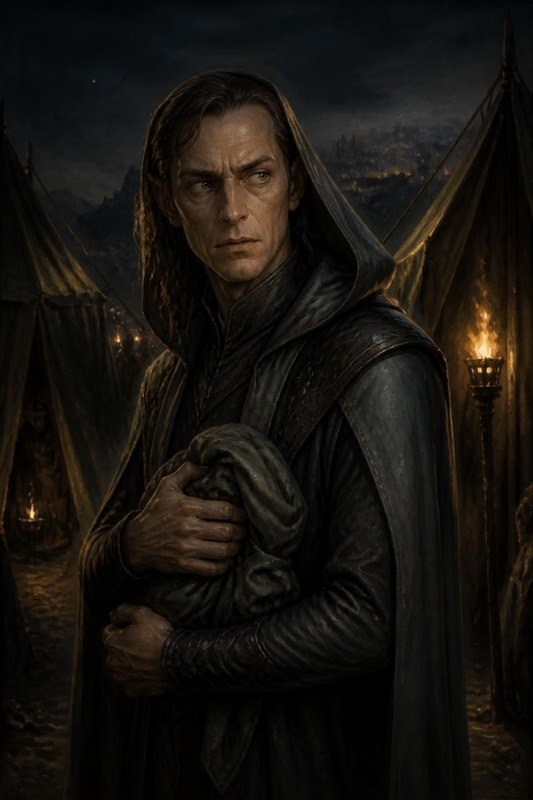

> **La scena «molto bella».**
> **Quando**: al ritorno dalla tenda, fra le tende del campo. Se il tavolo ha
> fretta si sposta nel caos delle mura (Scena 10), e il box funziona uguale. I
> PG **incrociano un ladro** che non c'entra con l'orda — un
> uomo incappucciato che si muove tra le tende con troppa grazia, un fagotto
> stretto al petto. È **Vatore**: mille anni prima di diventare **Salvatore
> «Sal» della Luna d'Argento**, il mercante-spia che li tradirà in ARC-09. Loro
> **non possono saperlo**. Questo è il cuore grigio della scena.

**Chi è, adesso.** Vatore, il «Ladro d'Ombra» di Hammerfist. Ha **appena rubato
il Sigillo di Ossidiana** (Appendice B) e pianifica la fuga nel futuro (userà un
Cronolito). Ha appena visto **quattro ombre uscire vive dalla tenda del generale**, e nelle
cronache che non dovrebbe aver letto i Quattro sono quattro: ne è **ossessionato**. Personalità: freddo, parla il meno possibile, li osserva
con un **terrore reverenziale mal mascherato**.
> **Cosa lo corrompe**. Vatore è **già marcio di
> avidità e sete di potere**: non gli importano le conseguenze. Ha rubato il
> Sigillo *sapendo* che divora anime — e ha deciso che le pagherà con quelle
> degli altri, e poi con la propria. È questa scelta, non un incidente, a
> renderlo **Sal**. Nella scena non è un innocente ingenuo: è un uomo che ha
> già scelto l'ombra, e che ora vede in VOI un potere che vorrebbe rubare.

> **Read-aloud — fra le tende, l'incontro che non capiscono.** *Tra due tende c'è un uomo che non è dell'orda.
> Veste ombre cucite bene, e stringe al petto qualcosa avvolto in un panno.
> Non attacca. E non scappa, non subito. Vi fissa come si fissa una cosa che
> non dovrebbe esistere, e sussurra, più a sé stesso che a voi: «…quattro.
> Eravate davvero in quattro.» Poi gli torna la maschera: un sorriso freddo, e
> un passo indietro verso l'ombra. Che fate?*


**A parte, al giocatore di Artemis**, subito dopo:

> **Read-aloud — l'anello.** *Artemis, l'anello che porti al dito
> è diventato gelido.*

**Le risposte del party (grigie — non sanno cosa diventerà):**

| Approccio | Prova | Cosa succede | Eco su Sal nel 1372 (ARC-09) |
|---|---|---|---|
| **Lo ignorano / lo lasciano andare** | — | Vatore svanisce nell'ombra col Sigillo. | Sal esiste «intatto» in ARC-09 — nessun vantaggio, ma nessun sospetto reciproco. |
| **Gli parlano** (Percepire Intenzioni o Diplomazia CD 18; se fallisce, vale la riga di sopra: se ne va) | 18 | Vatore, terrorizzato, lascia sfuggire un frammento: *«Voi non morite. L'ho letto. Nelle cronache che non sono ancora scritte.»* Poi fugge. | In ARC-09 Sal **esita** un istante di fronte a loro (li ha già temuti mille anni fa): +2 dei PG a Percepire Intenzioni e Diplomazia contro Sal la prima volta. |
| **Lo derubano** (Rapidità di Mano CD 22, solo con i gradi: «Chi può derubarlo», qui sotto) | 22 | Gli sfilano il **Sigillo di Ossidiana** (o parte del bottino). Se la prova fallisce, se ne accorge: niente ferita, ma il **Cronolito** lo porta via come nella riga «Lo feriscono», e il Sigillo va con lui | In ARC-09 Sal si presenta **senza** un asso che avrebbe avuto (il DM toglie a Sal un oggetto/piano — es. l'Olio di Sabotaggio parte scarico). |
| **Lo feriscono** (attacco riuscito) | — | Vatore urla, sanguina, attiva il **Cronolito** e sparisce nel tempo. | **Sincronizzazione**: nel 1372 **Sal sanguina nello stesso punto**, all'improvviso, davanti a chi lo osserva (la maschera vacilla) — i PG lo **riconoscono** come «l'uomo del passato» se collegano i punti. |
| **Cercano di ucciderlo** | scontro breve | Non muore qui (il Cronolito lo salva a 1 pf: *deve* sopravvivere per esistere nel 1372 — paradosso auto-consistente). | Sal in ARC-09 porta una **cicatrice antica** e un odio personale: sa che loro ci hanno provato. Nemico più cattivo, ma più fragile emotivamente. |

> **Perché è grigia (nota di tono).** I PG hanno davanti un ladro spaventato che
> **non ha ancora fatto nulla** — ma che (loro non lo sanno) diventerà un
> traditore. Ucciderlo «preventivamente» è un atto oscuro contro un innocente-per-
> ora; lasciarlo andare significa (senza saperlo) crescere il proprio nemico. Non
> c'è scelta pulita. **Registra tutto**: paga in ARC-09. *(Il paradosso regge
> sempre: Vatore DEVE sopravvivere per diventare Sal — il Cronolito lo garantisce.
> I PG possono segnarlo, derubarlo, terrorizzarlo, non cancellarlo.)*

> **Registrazione**: annota l'esito nel registro di fine serata (il filo
> «[VATORE/SAL]») e nell'Echo Ledger (§7).

**Vatore non ha statistiche, ed è voluto**.
Non combatte. Se lo attaccano, il primo colpo che va a segno lo ferisce (riga
«Lo feriscono») e alla fine del suo turno il **Cronolito** lo porta via. Il suo
urlo è un allarme: il campo è pre-allertato, e alle mura c'è un successo in
meno (Scena 10). La ronda arriva in **1d4+2
round**, come le ronde del campo (Scene 6 e 8). Quel colpo si
tira contro la CA di Sal nel Bestiario: **CA 22, contatto 16**. Il
Cronolito sposta nel tempo, non nello spazio: *àncora dimensionale* non lo
ferma, e nemmeno una lotta. Chi lo teneva si ritrova con il suo mantello in
mano. Un incantesimo ostile senza danno (*charme*, *blocca persone*) vale come
un colpo: nessun tiro salvezza, e alla fine del suo turno il Cronolito lo porta
via.

**Chi può derubarlo.** Rapidità di Mano si usa solo con i gradi: senza, la
prova è una prova di Destrezza e non supera CD 10 (SRD, *Sleight of Hand*).
Nessuna classe del gruppo la ha come abilità di classe, e la scheda di Tordek
al 12° non ha gradi: chiedi al tavolo, prima della scena, se qualcuno li ha
comprati. Per chi non li ha, il fagotto si strappa di mano: lo afferra chi
gli mette le mani addosso, Vatore attiva il Cronolito come quando lo tengono,
e chi stringeva il fagotto se lo ritrova in mano. Vale la riga «Lo derubano»
riuscita, e Vatore sa chi è stato.

**Se uno di loro porta il segno** (la cura con la cera nera, Scena 5). Vatore
guarda quel polso prima di quel volto. Per lui quel PG è della gilda, e il
terrore diventa complicità: parla a lui per primo, a voce bassa, e con lui la
riga «Gli parlano» riesce con **CD 14**. Il segno resta il suo ricordo di loro:
in ARC-09 Sal lo cerca su quel polso.

**Dopo il barile**. Il campo è sveglio e le
bande d'orchi corrono allo spiazzo con le torce: Vatore si ferma fra due tende
a guardare il fuoco, e la scena dall'alto comincia lì. Chi torna a piedi tira
il ritorno della Scena 6 a **CD +2**, perché i lupi si sono stretti sotto le
vie. Se il corno ha suonato, vale anche «Se il corno suona di notte» (Scena 6).

**Se tornano in volo.** Sopra i 20 m nessuno ha motivo di scendere fra le
tende. Lo vedono dall'alto, un incappucciato che si ferma fra due tende e
stringe un fagotto, e l'Anello di Artemis diventa gelido. Se scendono, la
scena comincia da dove atterrano; se no, Vatore è sulle mura all'alba, nel
caos della Scena 10: compare dopo il primo box, e lì il suo urlo non costa
successi, perché l'assalto è già cominciato.

**Se passano invisibili.** Vatore non li vede: nessuno dei suoi sensi li
coglie, e il Sigillo non glieli mostra. Li **sente**, se fanno rumore
(se qualcuno fallisce una prova di Muoversi Silenziosamente **CD 20**, la
stessa del campo). Se non li sente e non si fanno vedere, la scena la aprono loro: vedono un uomo incappucciato che si
ferma fra due tende, si guarda alle spalle e stringe un fagotto. L'Anello di
Artemis diventa gelido lo stesso. Se lo lasciano passare, vale la riga «Lo
ignorano» della tabella; se si mostrano, il box comincia da *«Tra due tende, un
uomo»* e Vatore dice la sua frase dopo averli visti.

#### Se lo divinano: Vatore, il Sigillo, Zeth

Una riga per segreto. Ognuna dà una mezza verità, e nessuna rompe il segreto
lungo: Vatore non sa che diventerà Sal, e nessun incantesimo lo legge in lui.

- **Che cosa pensa Vatore.** *Individuazione dei pensieri* legge «il Cronolito»,
  «la gilda», «non devono vedermi». Mai «Sal».
- **Che cos'è il Sigillo.** *Leggende e tradizioni* dà Shar e il prezzo delle
  anime (Appendice B).
- **I componenti di Zeth.** *Individuazione del magico* mostra necromanzia
  sotto la consacrazione (Scena 5).
- **Chi c'è dietro Zeth.** Se gli chiedono di Zeth e del suo padrone, Vatore
  risponde con la sua gilda, e non nomina il Collezionista.

L'artefatto che stringe al petto è in **Appendice B**.

---

## §5 — ATTO III · L'ALBA

> **Il percorso dell'atto.** Dal primo ariete al ritorno. Le mura, il drago che
> cala sul cortile, il rito all'incudine, la luce del Rubino.
>
> 🛑 **Dove si ferma una serata**: per chi gioca l'arco da capo, la prima serata si ferma al primo box della Scena 10,
> e il resto dell'atto è della sessione dopo. Il gruppo di oggi si è fermato
> prima, alla Scena 5 (§4, «Dove si riprende»), e la sua serata dopo si ferma
> sull'esito del duello, prima della Scena 12.

| Scena | Dove | Chi entra | Prova | Se fanno l'inatteso | Al tavolo |
|---|---|---|---|---|---:|
| **10** · Le mura all'alba | il camminamento est | il capitano delle mura | prova collettiva, una via su tre | sabotano gli arieti: il duello comincia fuori dalle mura (Scena 11) | 15 min |
| **11** · Il duello | il cortile interno | **Skullcrusher il Nero** | combattimento su **M7-B** | due PG a terra nello stesso round, o il gruppo si ritira: intervengono gli avi, «vinto sporco» (§6) | 60-75 min |
| **12** · Il Rituale della Forgia Eterna | l'incudine, nel cortile | Thorgrim · Re Thorek I | nessuna | la scena salta: il re fa murare il torque nell'incudine | 15 min |
| **13** · Il Rubino e il ritorno | il cortile | — | nessuna | nessuno: la luce li prende comunque | 5 min |

<!-- nuova-pagina -->

### SCENA 10 — Le mura all'alba

<!-- scheda-da-tavolo -->
<!-- tabella: larga -->

| Scena 10 · EL 16 se Zog'tar sale | **La scheda da tavolo**: che cosa succede, chi c'è, cosa vuole e come si conduce; il testo intero segue |
|---|---|
| **Succede** | Il primo ariete arriva alle mura, e il gruppo sceglie una via su tre per tenerle |
| **Dove** | Le mura |
| **Chi c'è** | Hrodgar, il capitano delle mura; Hald, il nipote di Balvar; Re Thorek I. Zog'tar e le sue guardie, solo se è vivo all'alba e i successi sono 0 o 1 (EL 16). Vatore, se i PG sono tornati in volo senza scendere |
| **Chi vuole cosa** | L'orda vuole la breccia prima che il sole superi il crinale. Re Thorek e Hrodgar vogliono tenere il camminamento est |
| **Si comincia** | Una prova collettiva: il gruppo sceglie **una** via e tutti tirano quella. Il costo si paga anche riuscendo |
| **Tenere la breccia** | Forza **CD 18**, o un attacco contro **CA 28**. Costo: −2 al primo tiro d'iniziativa del duello |
| **Rincuorare i difensori** | Diplomazia o Guarire **CD 18**: +2 morale alla linea. Costo: un nano con un nome muore |
| **Sabotare gli arieti** | Disattivare o Artigianato **CD 20**: due arieti fuori uso. Costo: il duello comincia fuori dalle mura, con i PG separati di 18 m |
| **Dalla notte** | Si applica dopo i tiri. **Un successo in meno**: campo pre-allertato; Zog'tar vivo all'alba; il boato del barile. **Un successo in più**: Zog'tar catturato e portato alle mura; i due Treant sul fianco dell'orda. Zog'tar umiliato annulla il successo in meno dell'allarme. Cure comprate alla cappella: il dado dei caduti, 1d4 difensori con un nome per ogni tipo di cura |
| **Successi su 4** | **4**: le mura reggono, il re è in piedi dietro i PG. **2-3**: reggono a stento, duello normale. **1**: il camminamento est è perso, il re è a 8 pf. **0**: la breccia cede; il re a 8 pf, e su M7-B sei quadretti di terreno difficile e due nani a terra |
| **Zog'tar sulla breccia** | Sul camminamento Zog'tar si stringe: −4 al colpire e −4 alla CA. **Separa e finisce**: round 1 Ira, l'Occhio su Tordek e un colpo; dal round 2 il Colpo Terrificante butta Thorik nel cortile, poi l'attacco completo −5/+10 su chi resta davanti. Dopo il barile parte da 283 pf (le due pozioni della notte, A.2) e sa che i nani volano. Muore in circa 3 round; un PG muore una volta su tre. Se il drago cala, scende dalla scala. I PE sono quelli della Scena 8 e non si sommano |
| **Sviluppo** | Il fallimento è un costo, mai uno stop: comunque vada, il drago cala (Scena 11). I nomi dei caduti vanno nel registro |
| **Come finisce** | Mura tenute saldamente, tenute a stento o breccia ceduta; poi il drago cala sul cortile |
| **Dove guardare** | «Dove sale l'assalto»; la tabella «Dalla notte»; «Come combatte sulla breccia»; la riga di scala per tre o cinque PG |

<!-- /scheda-da-tavolo -->

Si arriva qui **dove le tacche hanno lasciato i PG** (tabella di uscita
dell'orologio, §4). Se Hella ha vegliato i semi, i **due Treant di Adamantio**
caricano il fianco dell'orda mentre il primo ariete arriva (Scena 5).

> **Read-aloud — le mura.** *Il primo ariete
> arriva alle mura che il sole non è ancora sopra il crinale, e il legno prende
> la pietra con un rimbombo che arriva allo sterno prima che alle orecchie. Il
> camminamento vi si muove sotto i piedi di un dito. Un nano accanto a voi si sputa
> nelle mani e riprende l'ascia senza dire niente; quello dopo di lui ha la
> barba incastrata nella cinghia dell'elmo, e non ha il tempo di liberarla. In
> basso, le scale salgono.*
>
> **Che fate?**

**Dove sale l'assalto**. Dal camminamento la
piana si vede tutta, 100 m sotto. Il primo ariete sale dalla spianata alla
porta per la rampa del fronte sud; le scale arrivano sul tratto est, dove il
fianco della montagna tocca il piede delle mura, ed è lì che sta Hrodgar
 (M7-A, «La rampa della porta»).

Poi, quando le prime scale arrivano in cima, arriva il capitano delle mura.

**Comparse**

| Chi | Com'è | Come parla |
|---|---|---|
| **Hrodgar, il capitano delle mura** | nano con la barba bruciata da un lato, di un'altra battaglia, e un elmo senza cresta perché la cresta si vede da lontano. Vuole tenere il tratto est fino a che il re non gli dice di lasciarlo, e sa dove la pietra è più giovane: lo stesso punto che Balvar ha segnato sulla mappa di Zog'tar | dà gli ordini con una parola sola |
| **Hald, il nipote di Balvar** | nano di diciannove anni, di guardia sul camminamento est col gruppo di Hrodgar; la barba ancora corta, l'ascia troppo nuova. Non sa che lo zio esiliato è vivo, né che è nel campo di Zog'tar | poco e a bassa voce, da recluta; si drizza quando passa il capitano |
| **Zog'tar Deatheye, se è vivo all'alba** | il generale mezzo-ogre, l'ascia in mano e la pietra nera al posto dell'occhio destro, che guida l'orda sotto le mura; con 0-1 successi sale sulla breccia (la tattica sul camminamento è sotto la tabella «Dalla notte», la scheda d'entrata nella Scena 7) | conta, sempre: *«due file», «tre ore», «cento»*. In ira: *«A ME, CANI! ABBATTETE LE OMBRE!»* |

> **Read-aloud — il camminamento.** *Il camminamento è largo
> quanto un tavolo da pranzo e lungo quanto la fortezza. Sotto, l'orda non
> urla più: ha smesso quando ha cominciato a salire, e il silenzio che ha
> lasciato è peggio. Un uncino morde la pietra a tre passi da voi, poi un
> altro, poi sei insieme. Il capitano delle mura guarda voi, non i suoi.*
>
> **Che fate?**

**Le tre vie, e nessuna è quella giusta.** La prova è **collettiva**: il party
sceglie **una** via, tutti tirano quella. Non c'è una scelta migliore — c'è
quella che costa meno a *questo* gruppo.

| Via | Prova | Se riesce | Il costo, anche riuscendo |
|---|---|---|---|
| **Tenere la breccia** | Forza **CD 18**, o un attacco contro **CA 28** | la falla regge; i nani vi vedono farlo | ci si arriva al duello **stanchi**: −2 al primo tiro d'iniziativa del duello (Scena 11) |
| **Rincuorare i difensori** | Diplomazia o Guarire, **CD 18** | +2 morale a tutta la linea per l'assalto | la breccia la tiene qualcun altro, e **qualcuno muore**: un nano con un nome, che il DM annota fra i caduti del 372 |
| **Sabotare gli arieti** | Disattivare o Artigianato, **CD 20** | due arieti fuori uso, l'assalto rallenta di mezz'ora | siete **fuori** dalle mura quando il drago arriva: il duello comincia con i PG separati di 18 m |

**🚫 Modi di fallimento — il fallimento è un costo, mai uno stop.** Nessuna
combinazione di tiri ferma l'avventura: il duello con Skullcrusher si gioca
comunque, perché è già accaduto.

**Prima di contare i successi, raccogli quello che arriva dalla notte.** Vale
un successo in più o in meno, e si applica dopo i tiri:

| Dalla notte | Effetto sulla prova delle mura |
|---|---|
| campo pre-allertato: il corridore è arrivato, o è suonato l'allarme (Scene 6 e 8) | **un successo in meno** |
| Zog'tar umiliato davanti alle guardie (Scena 8) | annulla il successo in meno, se c'era |
| Zog'tar catturato e portato alle mura (Scena 8) | **un successo in più** |
| cure comprate alla cappella (Scena 5) | nessuno sulla prova. Si tira il **dado dei caduti**: 1d4 per ogni tipo di cura comprata (per il gruppo del 25 settembre, quattro tiri). Il numero è quanti difensori con un nome muoiono sulle mura per quella cura mancata; il DM li annota fra i caduti del 372. Non tocca ARC-08 |
| i due Treant dell'alba caricano il fianco dell'orda (Scena 5) | **un successo in più** |
| **Zog'tar è vivo all'alba** (il gruppo ha dormito, o non è arrivato alla tenda) | **un successo in meno**, e Zog'tar guida l'assalto: vedi sotto |
| **il barile sulla tenda**: il boato è un allarme (supplemento, §10) | **un successo in meno**, anche se la tenda è bruciata |
| **il barile, e Zog'tar tirato fuori dal fuoco davanti ai suoi** | vale «umiliato davanti alle guardie»: annulla il successo in meno dell'allarme (B11) |
| **il barile, e Zog'tar vivo** (quasi sempre: §7 del supplemento) | la riga «Zog'tar è vivo all'alba» qui sopra, un successo in meno. Se il barile ha ucciso il sacerdote, sulla breccia sale senza di lui, come già scritto |

**Se Zog'tar è vivo all'alba**. Guida l'orda sotto le mura. Con
**0-1 successi** sale sulla breccia del camminamento est con le sue quattro
guardie, ed è uno scontro sulle mura prima del drago (Appendice A.2; EL 16, senza
Balvar e senza il sacerdote, rimasti al campo). Con **2 o più** resta sotto, a
spronare, e il drago arriva come sempre. In tutti e due i casi Zog'tar vivo è un
eco in §7: la Mano Rossa del 1372 discende anche da lui.
Sulla breccia i PG sono i difensori, non chi entra: **se volano** possono
scendergli addosso e prenderlo alle spalle, ma restano a tiro delle
balestre dell'orda, e chi resta a terra lo affronta sul camminamento; **se sono invisibili**, Zog'tar non li vede arrivare, ma la DES alla CA la
tiene: Schivare Prodigioso Migliorato (Appendice A.2) non lo lascia colto alla
sprovvista nemmeno contro un invisibile.

**Come combatte sulla breccia**. Il
camminamento è largo quanto un tavolo da pranzo: ci si sta in uno, al massimo
in due. Zog'tar è Grande e arriva a 3 m, quindi colpisce oltre il primo nano. Lassù
**si stringe** (SRD): −4 al colpire e −4 alla CA finché resta sul camminamento,
ed è per questo che vuole buttare giù chi ha davanti.

**Che cosa sa all'alba.** Il generale che sale sulla breccia non è quello della
tenda: porta addosso la notte. Ha INT 16, ed è arrogante, non stupido.

| Che cosa è successo di notte | Da dove lo sa | Che cosa cambia lassù |
|---|---|---|
| Il barile | il boato e la botte di Hammerfist nel fuoco (BARILE §8) | sa che i nani volano e vengono dall'alto («Dall'alto. Hanno ali.», B21). Le guardie in fondo alla scala guardano in alto e tengono i giavellotti per chi vola |
| È ustionato | il fuoco della tenda | parte da **283 pf**, pieni: 249 dopo il fuoco (mediana, BARILE §7), più 15 di riposo (SRD), più le due pozioni di *cura ferite gravi* che beve di notte (in media 37, A.2). Il sacerdote non ha cure preparate (A.2) e non lo cura. Gli restano i segni delle ustioni |
| Le guardie sono bruciate | il fuoco della tenda | 20-23 pf l'una, più 8 di riposo: chi scende alle spalle le trova a metà |
| Thorik non si piega | lo vede al round 1: la Presenza Minacciosa gli scivola addosso (Mente Vuota della Corona) | sa chi deve togliere dalla linea per primo |

Sale lo stesso: ai suoi ha detto che chi ha attraversato il fuoco vince (BARILE
§8), e davanti all'orda non può tirarsi indietro. Lassù gioca per separare.

- **Round 1**: Ira, e l'Occhio di Ossidiana su **Tordek**, che la sua Presenza
  può piegare e che in ira ha la CA più bassa dei due nani; con l'azione che
  resta, un colpo d'ascia. Le quattro guardie tengono la testa delle scale alle
  sue spalle: chi vuole arrivargli dietro deve passare da loro.
- **Round 2 e dopo: separa e finisce**. Se i
  due nani gli stanno davanti, il **Colpo Terrificante** (Appendice A.2) butta
  **Thorik** giù dal camminamento: è quello che non si piega, e senza di lui
  Tordek resta solo. Con Thorik nel cortile (due round per rialzarsi e
  risalire la scala), l'**attacco completo** con Attacco Poderoso −5/+10 su chi
  resta davanti, Tordek se è in piedi. Quando Thorik torna in linea, lo butta
  giù di nuovo. **Spingere Migliorato** solo se il bersaglio è già al bordo. Thorik e Tordek hanno la stabilità dei nani,
  +4 contro la spinta (SRD). Sul camminamento non c'è dove arretrare, e un PG
  scagliato oltre il bordo cade nel cortile o fuori, fra l'orda: le mura sono
  alte **4,5 m** (mappa M7-B), cioè 1d6 di caduta (SRD). Fa poco male; il
  guaio è dove si atterra. Chi cade fuori ha un round per rialzarsi, e intorno
  ci sono scale e uncini. Vale per il tratto est, dove fuori c'è il pendio. Dal
  muro sud, che sta sul ciglio del gradone, si cade sulla spianata, 24,5 m più
  in basso: 8d6.
- **Contro chi vola**: i giavellotti, come nella tenda. Non lascia la breccia
  per inseguire nessuno: la breccia è sua.
- **Quanto dura, misurato** (20.000 prove, PG della carta del 05/11, bonus
  d'attacco dei nani stimati). Stretto
  a CA 20, con Artemis e Hella che lo colpiscono dall'alto, Zog'tar muore
  **quasi sempre, in circa 3 round**. Con «separa e finisce» e i 283 pf delle
  due pozioni un PG muore in una prova su tre (35%); con 264 pf ai PG
  restava circa il 76% dei pf per il drago; con il
  solo Colpo su chi ha davanti era l'11% e l'81%. **Se combatte fuori dal
  camminamento**, dove non si stringe, le morti salgono al 69%: sulla breccia
  il generale è forte quanto lo spazio che ha.
- **Sotto il 30% dei pf** fa come nella tenda: cerca di portarsi via qualcuno.
- **Se il drago cala mentre lui è vivo**, Zog'tar scende dalla scala e resta
  sotto le mura a guardare: vuole vedere il drago finirli. Il duello della
  Scena 11 si gioca con lui là sotto, e chi lo cerca lo trova.
- **I PE** sono quelli della Scena 8, e non si sommano. Se Zog'tar si combatte
  solo qui, con le quattro guardie, vale circa **2.600 a testa**: Zog'tar circa 7.800
  e le guardie 2.600 in tutto, diviso quattro (§8 A).
- **Se cade qui**, il colpo finale va al giocatore (`[HDYWTDT]`, §0-ter).


| Successi (su 4) | Cosa cambia davvero |
|---|---|
| 4 | le mura reggono pulite; il duello parte con i PG schierati e **Re Thorek in piedi dietro di loro** |
| 2-3 | reggono a stento. Il duello parte normale |
| 1 | i nani perdono il camminamento est: il duello si combatte **con Re Thorek a 8 pf alle spalle**, e il drago lo punta quando nessun PG lo chiama (Scena 11, «Il re»), e a 8 pf basta un colpo a metterlo a terra |
| 0 | 🔴 **la breccia cede.** Re Thorek è a 8 pf, come con 1 (M7-B). Il duello si combatte **in mezzo ai feriti** portati giù dalle mura: M7-B con 6 quadretti di terreno difficile e **due nani a terra** che Hella può scegliere di raggiungere invece di combattere. Nessun malus: una **scelta in più**, e più dura |

⚠️ **La riga a zero successi è il punto di questa tabella.** Il modo più veloce
di insegnare a un tavolo che indagare e rischiare non conviene è punire il
fallimento con meno gioco. Qui a zero successi **si gioca di più**, non di meno.

- ► **Esito**: *mura tenute saldamente / a stento / breccia ceduta*.

**Con un gruppo diverso: la riga di scala**. Le mura
sono state giocate da quattro PG di 13°, e la tabella conta i successi su
quattro. La riga serve a un gruppo diverso. Quello che arriva dalla notte, un
successo in più o in meno, si applica allo stesso modo.

- **Con tre PG** (APL 12, tetto 16), o se in un gruppo di quattro manca un PG:
  i successi si contano su tre. Tre valgono la riga del 4, due quella del 2-3,
  uno e zero restano le loro righe. Se Zog'tar sale sulla breccia (con 0-1
  successi), porta due guardie e non quattro: le altre due restano in fondo
  alla scala a tenerla. Zog'tar e due guardie fanno EL 15.
- **Con cinque PG** (APL 13, tetto 17): i successi si contano su cinque.
  Cinque valgono la riga del 4, tre o quattro quella del 2-3, uno o due la riga
  dell'1, zero la breccia che cede. Zog'tar sale sulla breccia con 0-2
  successi, e porta le guardie della tenda, che con cinque PG sono diventate
  sei, tutte alla testa delle scale alle sue spalle.
  È la versione più forte, a EL 16, sotto il tetto.

<!-- pagina: una-colonna -->
### C.3 · Il duello in tre scambi (Scena 11)

> **🎚️ [FAST-PLAY] del duello** (se vuoi chiudere veloce): 3 scambi narrati a
> prova di gruppo (un attacco contro **CA 40**, 37 con l'Adulto, o Saltare/Equilibrio **CD 22** per chi lo affronta dalle mura), poi si sceglie l'esito tra i tre
> della Scena 11 in base a quanti scambi i PG hanno «vinto» (0-1 = fuggito, 2 = ferito
> grave, 3 = ucciso). Uno scambio è vinto se metà del gruppo supera la prova.
> Registra comunque le ferite per B4: N = scambi vinti. **[COMBATTIMENTO
> COMPLETO]** = la regia round-per-round della Scena 11, su M7-B.

<!-- nuova-pagina -->

<!-- /pagina -->

<!-- nuova-pagina -->

### SCENA 11 — Il duello con Skullcrusher

<!-- scheda-da-tavolo -->
<!-- tabella: larga -->

| Scena 11 · EL 17 | **La scheda da tavolo**: che cosa succede, chi c'è, cosa vuole e come si conduce; il testo intero segue |
|---|---|
| **Succede** | Skullcrusher cala sul cortile con due wyvern e combatte in passate, gridando i nomi che ha sentito di notte attraverso la Catena |
| **Dove** | Il cortile |
| **Chi c'è** | Skullcrusher il **Vecchio** (GS 17): 337 pf, CA 36 (40 con *armatura magica*), contatto 10. Dal round 2 due wyvern, su chi tiene la corda e su chi vola; fuggono quando fugge lui. **EL 17**. Re Thorek è nel cortile, alle spalle dei PG, a difendere la porta principale |
| **Chi vuole cosa** | Il drago vuole vincere davanti all'orda: per lui il potere è quello che gli altri hanno visto |
| **Si comincia** | Dopo il barile il drago guarda in alto: chi lo aspetta in volo non ha la sorpresa. Dalle mura arrivano: −2 alla prima iniziativa se hanno tenuto la breccia; duello fuori dalle mura, senza fucina né campane, se hanno sabotato gli arieti |
| **Round 1** | Cala dall'alto: Presenza, Volontà **CD 26** (Thorik non tira), poi il soffio aderente sul gruppo più fitto, 16d4, Riflessi **CD 31**. Non atterra. In picchiata, con un round di sorpresa, se Zog'tar è morto in modo spettacolare: Ascoltare CD 20 per agire, e le campane glielo tolgono |
| **Dal round 2** | Una passata a round, a circa 15 m fra un turno e l'altro. A metà del movimento una cosa sola: **grida un nome**, **morde** chi ha nominato il turno prima (+54: il +34 del morso, più il nome), oppure **soffia**, se il soffio è tornato |
| **Chi sceglie** | Nell'ordine: chi ha detto la Catena ad alta voce; chi colpisce l'orda o gli arieti dall'alto; chi tiene la corda dell'ala; chi lo ha ferito di più. Se in un round nessuno lo chiama, va sul re: due colpi lo mettono a terra, uno solo se è a 8 pf. Il re non muore |
| **Le corde** | Azione preparata su «quando picchia». Chi lancia il gancio: contatto a distanza contro **CA 10**, incremento 3 m, entro 15 m da una gru. Chi tira: Forza **CD 25**, +2 per chi aiuta, al massimo tre per corda. Il drago resta a terra un round, e chi aveva preparato un attacco lo porta |
| **La Catena** | Leggerla: azione di movimento entro 9 m. Colpirla: **CA 44**; un attacco di contatto non la raggiunge. Il primo colpo a segno la spezza, e il drago se ne va |
| **Il cortile** | La fucina: 4d6, e niente olfatto per 1d4 round. Le campane tolgono la sorpresa, e chi le suona si fa bersagliare. Chiamare i nani: arrivano, e muoiono |
| **Artefatti** | *Dragondoom* di Aegis Fang funziona, tre volte al giorno. Il Bane contro Fauci qui non vale. La Cintura di Tordek rifiuta di attivarsi |
| **La soglia** | A un terzo dei pf (circa 112) si ferma in aria, una volta sola, ed esita: in quel round non attacca. Al suo turno fugge nell'oscurità, a meno che nel round prima abbia preso almeno due colpi: allora resta un round, e lì si può uccidere. Se Balvar è morto combatte a −2 e fugge a metà dei pf |
| **Se va male** | Due PG a terra nello stesso round, o il gruppo si ritira dal cortile: intervengono gli avi, ed è «vinto sporco» |
| **Sviluppo** | **Conta i colpi a segno** (ferite ancestrali, al massimo 3) e segna se Aegis Fang ha colpito in volo. Esito: ucciso, ferito grave o fuggito. Il colpo finale lo racconta il giocatore. Poi la serata si ferma |
| **Tesoro** | La scaglia del Primo Nero (circa 1.500 mo), solo se il drago è ucciso |
| **Come finisce** | Drago ucciso, ferito grave, fuggito, o vinto sporco |
| **Dove guardare** | Le schede di Skullcrusher Vecchio e delle wyvern; la mappa M7-B; «Chi non vola — cosa fa nei round in quota»; «Esito del duello» |

<!-- /scheda-da-tavolo -->

**Dopo il barile**. Attraverso la
gemella sul corno il drago ha sentito i gridi della notte, «Dall'alto. Hanno
ali.» compreso: all'alba sa che i nani volano e **guarda in alto**. Chi lo
aspetta in volo sopra il cortile non ha la sorpresa. La Catena regge anche se
Balvar è morto nel fuoco: le rune incise sopravvivono al runaio. Se il corno
ha suonato di notte vale «Se il corno suona di notte» (Scena 6): il drago parte
già in quota e conosce il loro odore. Se nessuno l'ha suonato, perché Grask è
morto e nessuno ha aperto la custodia, il drago arriva a metà mattina,
furioso (Scena 6, «Se rubano o rompono il corno»).

**Comparse**

| Chi | Com'è | Come parla |
|---|---|---|
| Aegis Fang | l'ascia di Thorik, che qui riconosce il sangue degli avi | non canta: urla dentro il cranio di chi lo impugna, a frasi brevi in maiuscolo; la sua voce è nella sua pagina fra gli artefatti dei PG |

**Scheda d'entrata — Skullcrusher il Nero, il capostipite** *(statistiche:
Appendice A)*

<!-- blocco: skullcrusher-chi -->
| | |
|---|---|
| **Aspetto** | drago nero vecchio (adulto maturo, se si usa l'Appendice A.1), snello e arrogante: collo lungo, cranio stretto e cornuto, scaglie nere opache con un riflesso verde d'olio. L'acido gli cola dalle fauci chiuse |
| **Vuole** | vincere **davanti all'orda**, perché per lui il potere è quello che gli altri hanno visto |
| **Teme** | che l'orda veda il guinzaglio. Chi dice la Catena ad alta voce se lo tira addosso (Scena 7, «Che cosa muove Skullcrusher») |
| **Suona** | dice **il nome** dell'avversario prima di colpire, ogni volta. Il nome è l'incantesimo, *colpo accurato*: il morso arriva al round dopo. Non lo chiede: lo sa dal corno, o mette un epiteto al suo posto (Scena 7, «Che cosa muove Skullcrusher»). Per il resto provoca e commenta, e se il tavolo ci sta ci si parla |
| **Eco** | la tabella B4 (§7): ogni ferita che gli fate, la Forgia la ricorderà contro **Fauci di Palude** nel 1372 |
| **Ritratto** | la tavola qui sotto. Solo per il DM fino al duello |
<!-- /blocco -->

**SKULLCRUSHER (lento, divertito, forte perché lo sentano le mura):** *«Un re
l'ho già mangiato, qui. Thorik. I tuoi amici lo dicono troppo forte, il tuo
nome, quando credono che il campo dorma.»*

Thorik è un esempio: il drago dice il primo nome che ha sentito alla tenda.
Se non ne ha sentito nessuno, la battuta cambia:

**SKULLCRUSHER (lento, divertito):** *«Un re l'ho già mangiato, qui. Voi, i
nomi ve li siete tenuti. Non importa: comincio dal nano con la Corona.»*

**SKULLCRUSHER (basso, quando sente dire la Catena):** *«Chi te l'ha
insegnata, quella? No. Non importa. Tocca a te.»*

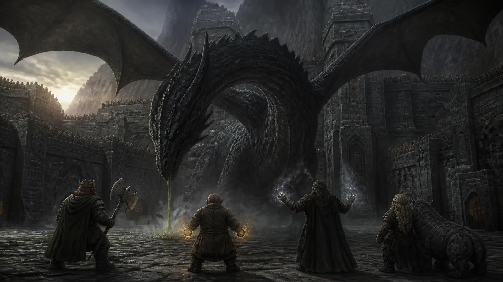

> **Mappa M7-B.** Il drago entra dall'alto (quota ~45 m) e picchia sul cortile
> interno. È il capostipite della stirpe di **Fauci di Palude**: ogni ferita che
> gli infliggete qui, la Forgia la ricorderà mille anni dopo (§7, carry-over B4).

**Quale drago si usa, e quando**.
Stasera il **Vecchio** dell'Appendice A.1-bis, con le 2 wyvern dell'Appendice
A.6 dal round 2: EL 17, il tetto esatto di APL+4 per un gruppo di 13°, e lo
stesso per un gruppo di 14° o per cinque PG. L'**Adulto** dell'Appendice A.1,
con le stesse wyvern, è l'alternativa: per un gruppo di 13° logorato o senza
tutti gli artefatti, per tre PG, e per il DM che non conferma il Vecchio. Le
tattiche qui sotto valgono per tutti e due; dove i numeri cambiano, il primo
è del Vecchio e il secondo dell'Adulto.

**Se il duello comincia fuori dalle mura** (arieti sabotati, alba colta fuori
dal campo).
M7-B non serve: si gioca sulla spianata davanti alla porta, aperta e senza
copertura, con le carcasse degli arieti come unico riparo. I nani sono sulle
mura, a 18 m e 24,5 m più in alto (i 20 m del gradone e i 4,5 delle mura), e
le balestre tirano da lì. La fucina, la cisterna e le campane
della tabella del cortile qui sotto non ci sono; le corde sì, quelle degli arieti
rovesciati, con la stessa prova.

> **Read-aloud — il cortile.** *Prima arriva il freddo: passa
> un'ombra, e l'aria del cortile perde dieci gradi in un respiro, e la pelle
> lo sa prima di voi. Poi il rumore, un risucchio come quello del mare che si
> tira indietro, e le braci della forgia si piegano tutte nella stessa
> direzione. Un nano vicino a voi lascia
> cadere lo scudo e non si china a raccoglierlo.*
>
> *Dove il drago passa basso, la pietra fuma. L'acido gli cola dalle fauci chiuse e si mangia il selciato come acqua
> nella neve.*
>
> **Che fate?**

🎚️ **Se e solo se Thorik tiene Aegis Fang in mano**, un secondo box, corto, e
a lui soltanto.

**AEGIS FANG (non canta: urla, dentro il cranio):** *«SANGUE ANTICO. ARTEFICE
DI LACRIME.»*

> **Read-aloud — la visione, solo per Thorik.** *Per un istante
> la Corona ti mostra due immagini sovrapposte: questo drago adesso, e un altro
> drago sopra mura che bruciano, mura che non hai mai visto.*


#### 🎬 La regia dei primi due round — una battuta per attore

>
> **Non sono numeri nuovi.** CD e danni restano quelli dell'Appendice A. Qui c'è solo
> **cosa leggere, quando**, e sono sei secondi a testa.

**Apertura di round — cosa è cambiato nel mondo.** Prima di ogni giro, una riga
sola: *dove* è il drago (in cielo, in picchiata, a terra) e *cosa* ha lasciato
il round prima (una crepa, un nano che non si rialza, il fumo dell'acido).

**Il giro, in quattro battute** *(ordine di gioco dichiarato: chi ha vinto
l'iniziativa parla per primo, ma la descrizione segue sempre questo ordine)*:

| | Attore | Riuscita — **una riga** | Fallimento — **una riga, e non è «manchi»** |
|---|---|---|---|
| 1 | **THORIK** — regge | l'ascia entra fra due scaglie e ci resta un istante di troppo: il drago **si gira verso di lui**, ed è quello che serviva | il colpo scivola sulla scaglia bagnata d'acido. Thorik resta in piedi, ma adesso ha le mani che bruciano |
| 2 | **TORDEK** — colpisce | il pugno prende l'ala dove l'osso è sottile: un suono secco, e la picchiata si sbilancia | il drago si alza di un metro e il colpo passa sotto. Tordek finisce in avanti e per un momento **non vede dov'è** |
| 3 | **ARTEMIS** — sceglie il bersaglio | il blast arriva **all'occhio**, e per un round il drago tiene la testa girata di tre quarti | l'ombra si apre troppo presto. Il drago la vede arrivare e **ricorda da dove è partita** |
| 4 | **HELLA** — cambia il campo | le radici salgono dal cortile e chiudono una via di fuga: il drago **deve** restare | la pietra non risponde — qui la terra è giovane e non la conosce. Hella sente l'assenza, e le costa |
| 4-bis | **DURIK** — si mette in mezzo | il drago deve scavalcarlo per arrivare a Hella, e scavalcarlo gli costa il turno di picchiata | il soffio lo prende in pieno: la pietra **fuma**, e l'acido gli fa il 50% in più. Durik non arretra. Senza runa il soffio gli fa in media più di 50 danni: danno massiccio, Tempra CD 15 (lui +11) o torna polvere, e la carica rimasta dopo i Treant dell'alba lo riporta per un'ora (Scena 5) |

**Chiusura di round — l'avanzamento visibile.** Una riga che dica cosa è
**cambiato**, non quanti pf restano: la prima scaglia che manca, il fiato che si
accorcia, il primo passo indietro che il drago fa senza volerlo.

> **Round 1 — apertura da leggere.** *L'ombra passa sul cortile prima del
> rumore. Quando il rumore arriva, è il vostro stesso nome gridato da ottocento
> nani che hanno smesso di combattere per guardare in alto.*
>
> **Che fate?**

⚠️ **Dal round 3 si smette.** La regia serve a far **atterrare** l'inizio; se la
tieni per otto round diventa una lettura e il combattimento si ferma.

Dal terzo round si torna alle tattiche del drago, più sopra, e si descrive solo
quello che cambia davvero.

#### Tattiche di Skullcrusher — regia round per round (stile RHoD, aggancio M7-B)
> Scritte dal punto di vista del drago. Skullcrusher è **giovane nella sua
> arroganza**: non ha mai perso, non sa ancora aver paura. È questo che i PG gli
> insegnano — ed è questo che il suo sangue ricorderà.

- **Round 1 — la Presenza.** Cala dall'alto (Presenza Terrificante CD 26 o 25:
  chi fallisce è scosso; Thorik non tira, perché la *mente vuota* della
  Corona lo rende immune agli effetti di paura, Scena 8). Se Zog'tar è morto in modo «spettacolare» (Scena 8), arriva **già
  in picchiata**: ha un round di sorpresa (SRD), e i PG sono colti alla
  sprovvista fino al loro primo turno. La picchiata vince anche sul «senza
  sorpresa» del drago che li ha già visti di notte; agisce nel round di
  sorpresa chi supera Ascoltare CD 20, e con le campane suonate vale la loro
  riga nella tabella delle difese. Apre col **Soffio acido** sul
  gruppo più fitto (Riflessi CD 31 o 30), **aderente**: l'acido resta addosso e al round dopo morde ancora (Appendice A.1). *Non atterra, perché vuole restare in cielo, dove
  si sente un dio.* Chi ha la runa di Zeth (*resistere all'energia*, acido 20)
  e non l'ha attivata al corno dell'alba (Scena 5) la attiva adesso, con
  un'azione standard: prima del soffio, se ha l'iniziativa.
- **Round 2-3 — la passata.** Non si ferma. Ogni turno attraversa il
  cortile con Attacco in Volo, e a metà del movimento fa una cosa sola: il
  soffio, se è tornato, lungo la linea più lunga che trova; il morso su chi
  ha nominato il turno prima; oppure il nome di un altro. Poi va oltre e
  risale. Punisce chi non ha gittata o volo. Bersaglio: «Chi sceglie», qui
  sotto. Fra un turno e l'altro resta a circa 15 m sopra il cortile: Aegis Fang
  scagliata, cinque incrementi da 3 m, ci arriva al limite, e il blast di
  Artemis sempre. *Corrompere l'acqua* sulle
  pozioni: un uso prende le pozioni
  di un solo PG, perché l'SRD guasta 10 piedi cubi, poco più di un quarto di
  metro cubo, entro il raggio della Presenza. Ognuna tira a parte Volontà
  CD 25, e quelle nel buco portatile non le tocca.
- **La passata, il nome, la prima paura**.
  Il drago giovane combatte in movimento e davanti a un pubblico: non si
  ferma mai finché non ha paura, e prima di colpire dice chi colpirà.
  - ***Attacco in Volo*** (SRD, *Flyby Attack*). In volo fa un'azione di
    movimento e un'azione standard in un punto qualsiasi del movimento. Il
    soffio è un'azione standard: lo usa a metà della passata e continua a
    volare. Il morso in passata è un attacco solo.
  - ***Virare*** (SRD, *Wingover*). Una volta per round, con un'azione
    gratuita, gira fino a 180° nonostante la manovrabilità scarsa. La virata
    costa 3 m di volo, e nel round in cui vira non sale: resta in quota o
    scende. È il talento che gli fa girare un drago Enorme dentro un cortile
    di 36 m: entra, soffia, e torna indietro sulla stessa linea quando il
    gruppo pensava di averlo alle spalle. Riscontrato sull'SRD 3.5
    («Monster Feats», *Wingover*): prerequisito velocità di volare.
  - ***Colpo accurato*** (SRD, *true strike*, stregone di 1°). Azione
    standard: +20 di intuizione al prossimo tiro per colpire, entro la fine
    del round dopo, e niente probabilità di mancare per occultamento. La
    componente verbale è il nome: lo grida a metà della passata, forte perché
    lo sentano le mura, e al round dopo morde quel PG a +54 (+50). Il nome
    non lo chiede: è quello sentito di notte attraverso il corno, oppure un
    epiteto preso da quello che vede, *la morta tornata*, e basta una parola
    (Scena 7, «Che cosa muove Skullcrusher»). Il tavolo
    sente il nome un round prima: chi è nominato sa che sarà colpito, e gli
    altri sanno su chi preparare la corda. Oltre all'*armatura magica* ha sei
    slot di 1°. ⚠ Non SRD: l'incantesimo vuole anche un fuoco, un piccolo
    bersaglio di legno, e il drago non lo porta.
  - ***Fluttuare*** (SRD, *Hover*), **una volta sola**: alla prima paura, a
    ⅓ dei pf (la soglia qui sotto). Con un'azione di movimento si ferma in
    aria, e da fermo si sposta in ogni direzione, anche in verticale, a metà
    velocità, nonostante la manovrabilità scarsa. La regola gli darebbe,
    se comincia il turno fermo in aria, un'azione di round completo (morso,
    artigli e coda); alla prima paura **non la usa**: esita, guarda, e in quel
    round non attacca, né soffia, né lancia. Sotto i 6 m dal suolo, sopra le macerie e la cenere del
    cortile, alza una nube di 18 m di raggio: dentro si vede a 3 m, chi è a
    4,5-6 m ha occultamento (20%), chi è a 7,5 m o più occultamento totale
    (50%), e per lanciare un incantesimo nella nube serve Concentrazione
    **CD 21**. La nube spegne le fiamme piccole non magiche.
  - ***Oscurità*** **una volta sola**, alla fuga. Finché l'orda guarda vuole
    essere visto, e non la usa. Quando scappa verso le paludi se la porta
    dietro: è la vergogna, e non deve vederla nessuno.
  - **La sequenza.** Al round 1 il soffio d'apertura. Poi una passata a
    round: il nome di un PG, il morso su chi ha nominato, o il soffio quando
    torna. Scende sotto i 6 m solo per l'attacco completo contro chi lo ha
    inchiodato con le corde: in quel round è a terra e non fluttua, quindi la
    nube non c'è. Si ferma in aria una volta sola, alla prima paura, e lì la
    nube c'è.
  *Momento Artemis*: in volo (Ali d'Ombra) è l'unico che lo raggiunge alla pari.
  *Momento Aegis Fang*: Thorik la **scaglia** — se colpisce in volo, incide la
  **Cicatrice a forma di martello** su un'ala (§7: −2 alla Volare di Fauci nel 1372).
  È un'ascia da guerra nanica +2 *da ritorno*: scagliata, è
  un'arma da mischia lanciata, −4 al tiro e incremento 3 m, e torna in mano a
  Thorik prima del suo turno successivo (SRD, *da ritorno*). «Colpisce in
  volo» vuol dire un tiro a distanza a segno mentre il drago è in quota.
- **La Catena, in ogni round.** Se i PG sanno della runa (Scena 7), leggerla
  sulla scaglia è un'azione di movimento entro 9 m, e colpirla è un attacco
  contro **CA 44** col Vecchio e **41** con l'Adulto: la CA con l'armatura magica, 40 o 37, più 4 perché il bersaglio è piccolo; la runa è sotto la scaglia, e un attacco di contatto non la raggiunge: il primo colpo a segno la spezza, e il drago se ne va. Se
  Balvar è morto prima dell'alba, il drago combatte a **−2** e fugge a metà pf.

**Quando qualcuno la legge**, la prima volta:


> **Read-aloud — la runa sotto la scaglia.** *Sotto la scaglia
> calda del petto, più pallida delle altre, corrono righe di rune naniche
> incise a punta, fitte come i conti di un mercante. L'ultima riga è più piccola e
> più fonda delle altre, ed è quella che il drago non ha mai letto.*

- **La Catena detta ad alta voce**. Chi
  la legge forte, dove l'orda sente, diventa il suo bersaglio dal turno dopo,
  anche se deve scendere. Il perché è in Scena 7, «Che cosa muove Skullcrusher».
- **Chi sceglie, se più cose lo chiamano**. Colpisce
  solo chi prima ha nominato, forte, ogni volta. Il nome non lo
  chiede: o l'ha sentito al corno, o mette al suo posto un epiteto preso da
  quello che vede, che vale lo stesso. Fra
  quelli che lo chiamano, nell'ordine: chi ha detto la Catena ad alta voce;
  chi colpisce l'orda o gli arieti dall'alto, perché gli toglie il tesoro
  davanti a tutti; chi tiene la corda dell'ala;
  chi lo ha ferito di più. A parità decide
  l'arroganza: sceglie quello la cui caduta fa più orrore agli altri, la
  druida appena tornata dalla morte o chi porta la Corona, e lo nomina in modo
  che lo sentano tutti.
  **Quando valgono le altre righe.** Questo ordine viene prima di tutte, con
  tre eccezioni. Il soffio d'apertura del round 1 va sul gruppo più fitto,
  perché non ha ancora nominato nessuno. I nani chiamati dal tavolo prendono
  l'attacco pieno nel round in cui arrivano, come dice la tabella del
  cortile, e dal round dopo l'ordine torna questo. Chi tira con le balestre o
  suona le campane lo chiama solo nei round in cui nessun PG lo chiama: in
  quei round le fa tacere con la coda, in passata (2d6+16 o 2d6+15), e viene
  prima del re. Il soffio lo tiene per i PG.
- **Il re**. Re Thorek sta nel cortile alle spalle
  dei PG, davanti alla porta principale che gli arieti battono: è per la porta
  e per lui che il drago cala lì, e non sulle mura. Se in un round nessun PG ha chiamato il drago (la Catena detta, l'orda
  colpita dall'alto, la corda, le ferite) e nessuno ha tirato con le balestre o
  suonato le campane, Skullcrusher va su di lui: è il secondo re
  che vuole mangiare davanti all'orda. Chi sta sulla linea del soffio o
  accanto al re prende il colpo al posto suo. ⚠ Non SRD: in 3.5 non c'è
  un'azione per prendere un colpo al posto di un altro; qui basta essere lì.
  Hella invece ce l'ha: lo *Scudo del Custode* della Collana (1 al giorno,
  azione immediata) prende su di lei, dimezzato, il danno di un alleato entro
  9 m, e Thorik è accelerato per 3 round verso chi è stato protetto (stato
  della campagna, §7, «I tre Doni»).
  Il re non muore, perché alla Scena 12 è vivo. Per colpirlo non si tira: due
  colpi del drago lo mettono a terra, stabile, e uno solo se è già a 8 pf
  (Scena 10). Il Rubino lo ricorda come il
  giorno in cui il re è caduto.
- **Soglia: quando gli resta un terzo dei pf, ~112 col Vecchio e ~100 con l'Adulto — la prima paura.** Per la prima volta nella sua vita,
  Skullcrusher **esita**, e **si ferma in aria** (*Fluttuare*): è l'unica
  volta nel duello, e in quel round **non attacca**. È il momento dei tre esiti (sotto). Al suo turno
  fugge nelle paludi sotto la sua *oscurità*, a meno che nel round prima abbia preso **almeno due
  colpi**: allora resta fermo lì un round ancora, e lì si può uccidere (le soglie,
  più sotto). *«Qualcosa in lui — nel
  sangue — capisce che questi quattro non sarebbero dovuti esistere.»*
- **«La Forgia ricorda» (meccanica cardine).** **CONTA i colpi a segno** su
  Skullcrusher (ferite ancestrali, N≤3) — è il dato per il carry-over B4 (§7).
  Moradin, nella mente di Thorik: *«Ogni ferita che infliggi ora all'antenato,
  la mia Forgia la ricorderà quando affronterai il discendente.»*
- ***Dragondoom* di Aegis Fang funziona**:
  3 volte al giorno, come contro ogni drago Grande o più (+1d6 per
  la taglia sopra la Media). La Catena non la blocca, e la Cintura qui sotto
  non c'entra.
- **Il Bane contro Fauci qui non vale**.
  Aegis Fang lo ha imparato all'affresco A7 contro Fauci di Palude, e contro
  il suo capostipite tace. Contro Skullcrusher l'ascia ha la *Dragondoom* e
  basta: il +2, i 3d6, il critico ×4 e lo *Scosso* tornano contro Fauci, nel
  1372.
- **La Cintura di Tordek RIFIUTA di attivarsi** qui (*«il vero scontro appartiene
  al futuro»*): coerenza col 1372, non nerf. È voluto — Tordek vince senza.
- **Sviluppi.** Comunque finisca (ucciso/ferito/fuggito), il sangue di
  Skullcrusher **sopravvive**: se ferito o fuggito, si ritira nelle paludi a
  leccarsi le ferite e a generare la stirpe che, mille anni dopo, culminerà in
  **Fauci di Palude**. Se **ucciso**, la stirpe nasce comunque (aveva già figli):
  la profezia non spezza il sangue, lo **segna** (carry-over B4). In ogni caso,
  con il drago via, l'orda perde lo sprone e si sfalda entro poche ore (→ Scena
  13). Se Skullcrusher ha **visto** Aegis Fang scagliata, il terrore di
  quell'arma entra nel sangue: Fauci, mille anni dopo, la riconoscerà (gancio
  inverso B4).

#### 🧭 Dove sono i PG all'alba — dove cala il drago, e come

> **Perché c'è.** Le tattiche qui sopra danno per scontato che i PG siano nel
> cortile, accanto al re. Il tavolo può essere altrove: sulle mura dopo la
> Scena 10, fuori, in volo, invisibile, o nemmeno lì. Il drago non li cerca per
> nome: il nome è la componente di *colpo accurato*, non un motivo. Cala sul suo
> obiettivo, e i PG diventano bersaglio quando ci stanno in mezzo o quando lo
> chiamano («Chi sceglie», qui sopra). Tutto quello che usa è nella sua scheda
> (Appendice A.1-bis): niente numeri nuovi.

**Perché va sui PG, e non solo sul re.** Tre motivi, e nessuno è il nome:

- **La Corona.** Il drago ha già mangiato un re in questa valle. Un nano con
  una corona in testa, per lui, è un re: Thorik è un bersaglio come Re Thorek.
- **Il barile.** Dai gridi della notte, attraverso il corno, sa che i nani
  volanti hanno bruciato la tenda del generale (B21). Se l'assalto fallisce,
  il tesoro che il patto gli promette non arriva mai.
- **La strada.** Chi sta fra lui e il suo obiettivo, lo sta fermando.

**Il round 1.** Il soffio d'apertura va sul gruppo più fitto **attorno al suo
obiettivo**, cioè al re o alla porta. I PG lontani da lì non li cerca finché
non lo chiamano.

**Prima di partire, al corno.** Dopo il barile sa che i nani volano: lancia
*vedere invisibilità* prima di lasciare le colline. Col Vecchio dura 70
minuti (incantatore di 7°), quindi copre il volo di 70 round e tutto il
duello. Le wyvern no: non vedono gli invisibili, li fiutano entro 9 m.

<!-- tabella: larga -->

| Dove sono i PG | Dove cala | Come combatte |
|---|---|---|
| **Nel cortile, col re** | il cortile, M7-B | come scritto qui sopra |
| **Sulle mura**, dopo la Scena 10 | dietro la porta principale, sul cortile: è lì che apre la strada agli arieti, ed è lì che il re la difende | la prima passata la fa lungo il camminamento sud, se i PG ci stanno in fila: è largo un quadretto, e la linea di 30 m del soffio li prende tutti. Poi va alla porta. I PG scelgono: restare in alto, con la gittata e le gru (le corde partono dal camminamento), o scendere nel cortile (4,5 m di scala). Da lì vale M7-B |
| **Fuori dalle mura** | la spianata davanti alla porta | come «Se il duello comincia fuori dalle mura», più sopra |
| **In volo, visibili** | dove sono loro, se lo intercettano prima della fortezza; altrimenti la porta | **La quota è sua.** Vola a 45 m, loro a 18 (12 in armatura media o pesante): decide lui quando ingaggiare, e sta sempre più in alto. **Il soffio** in linea sui volanti allineati. ***Dissolvi magie* ad area**, solo su chi in aria lo minaccia: chi lancia incantesimi o deflagra, chi porta un barile. I nani in volo che non lo raggiungono li lascia stare, perché a terra tornerebbero utili. Raggio 6 m, gittata 51 m, prova d20+7: contro il *volare* della pozione (CD 16) riesce 6 volte su 10, contro l'invisibilità comprata (CD 14) 7 su 10, contro quella del re (incantatore di 12°, CD 23) 1 su 4. La forma selvatica di Hella è soprannaturale e non si dissolve; per le Ali d'Ombra dell'Anello di Artemis decide il DM, perché la scheda dell'Anello non lo dice. **Chi perde il volo** scende di 18 m a round per 1d6 round e atterra illeso se tocca terra in tempo; altrimenti cade per il resto, 1d6 ogni 3 m (SRD, *volare*). Sopra la piana scende in mezzo all'orda. ***Lentezza*** (Volontà CD 17, gittata 12 m) su chi lo insegue. ***Virare*** per tornare sulla stessa linea. Le **wyvern** su chi vola, come scritto. Non si ferma in aria: *Fluttuare* resta per la prima paura |
| **In volo, invisibili** | come sopra | con *vedere invisibilità* già addosso li vede come visibili, e vale la riga sopra. Il nome gridato li trova comunque: *colpo accurato* ignora l'occultamento |
| **Con il corno rubato** | dov'è il corno | come «Se suonano loro il corno rubato» (Scena 6): va prima su chi lo tiene |
| **Non ci sono**: ancora nel campo, dispersi, colti fuori dall'alba | dietro la porta | fa il suo lavoro. Due colpi mettono a terra il re, stabile (il re non muore). La porta cede: su M7-B vale la riga «0 successi» della Scena 10, sei quadretti di terreno difficile e due nani a terra. Quando i PG arrivano il duello comincia dove sono, e il drago non è sorpreso |

#### 🧠 Quando il tavolo fa una cosa che qui non è scritta — come ragiona il drago

> **Perché c'è.** Il barile sulla tenda non era previsto da nessuna pagina, e il
> modulo ha dovuto inseguirlo con un supplemento intero. Il prossimo colpo di
> genio del tavolo arriverà all'alba, contro il drago. Qui non ci sono le
> risposte: c'è **come pensa**, così il DM risponde in un minuto e sempre allo
> stesso modo. Vale il §0-ter: assorbi, poi rilancia.

**Le sue quattro domande, nell'ordine.** Davanti a una cosa nuova Skullcrusher
non si chiede «che cos'è», ma:

1. **Mi fa perdere davanti all'orda?** È la cosa che teme di più dopo il
   guinzaglio. Quello che lo umilia in pubblico lo fa tornare su chi l'ha
   fatto, subito, anche contro il suo interesse.
2. **Mi toglie il tesoro?** Il patto paga solo se la fortezza cade. Quello
   che ferma l'assalto (gli arieti, la porta, l'orda colpita) è un bersaglio
   anche se a lui non fa niente.
3. **Mi tira giù?** Tutto quello che lo porta a terra o lo inchioda (le corde,
   la perdita di quota) per lui è la morte: sale. È arrogante, non stupido.
4. **Mi tocca la Catena?** Chi la nomina o la sfiora diventa il suo bersaglio
   (Scena 7).

**Come legge una sorpresa.** INT 18, SAG 19, Sapienza Magica +29,
*individuazione del magico* fra i trucchetti. La **prima** volta una trovata
funziona per intero: è il premio del tavolo, e il DM non la attenua. Al suo
turno dopo il drago sale fuori portata, guarda e capisce che cos'era. La
**seconda** volta la stessa trovata non lo prende più alla sprovvista: la
evita, o la punisce su chi l'ha fatta. È lo stesso principio di «Il nemico
impara» del supplemento del barile, applicato a lui. Una trovata nuova, invece,
vale di nuovo per intero.

**Cosa non fa mai.** Non tratta davanti all'orda (Scena 7). Non si ferma in
aria prima della prima paura. Non insegue nessuno lontano dalla fortezza
finché l'assalto è aperto: il tesoro è lì.

**Gli esempi, a partire dal barile**

| La trovata | Come la legge | Che cosa fa |
|---|---|---|
| **Un barile, o un altro oggetto pesante, lasciato cadere sul drago** | domanda 3: lo vuole tirare giù | Finché vola non lo si prende: da 48 m l'oggetto cade in circa 3 secondi, e in quel tempo lui si sposta di una ventina di metri. Funziona solo quando è fermo: inchiodato dalle corde o fermo in aria alla prima paura. Allora vale l'oggetto in caduta del supplemento (15d6 da 48 m, senza TS), e le fiale della fenice gli bruciano addosso, perché è immune all'acido, non al fuoco. Dopo il primo, sale sopra chi tiene i barili e lo morde dall'alto |
| **Un barile sull'orda o sugli arieti, all'alba** | domanda 2, e anche la 1: è il colpo che ferma l'assalto, davanti a tutti | chi l'ha sganciato entra in «Chi sceglie», subito dopo chi ha detto la Catena: il drago gli va addosso in quota, con il soffio in linea e il *dissolvi magie* della tabella qui sopra, sopra la piana |
| **Un'illusione** (un drago finto, un re finto, un esercito sulle mura) | nessuna delle quattro, finché non la tocca | interagendoci tira Volontà (+20) per non crederci; la prima volta ci casca se fallisce, poi la riconosce. Il *suono fantasma* lo conosce anche lui |
| **Attirarlo lontano dagli occhi dell'orda** (il corno rubato, una trappola fuori vista) | domanda 1 al contrario: lì nessuno lo guarda | ci viene, furioso (Scena 6). Lontano dall'orda è l'unico posto dove ascolterebbe un'offerta sulla Catena (Scena 7): se il tavolo ci arriva, la scena è del DM |
| **Colpire il re, la porta o gli arieti invece di lui** | domande 2 e 1 | non cambia obiettivo: va dove il suo tesoro è in pericolo, e la scelta del tavolo diventa una corsa |
| **Una cosa che non è in nessuna riga** | le quattro domande, nell'ordine | la prima risposta «sì» dice che cosa fa. Se sono tutti «no», la ignora e continua la passata |

#### 🏟️ IL CORTILE — cosa c'è, e cosa ci si può fare che qui non è scritto

> **Perché questa tabella esiste.** Il duello aveva la regia, le tattiche del
> drago e la scalatura, ma **niente sull'arena**: un tavolo che volesse essere
> furbo non trovava appigli, e restava l'iniziativa. Qui non ci sono soluzioni
> pronte — ci sono **cose**, e una riga su cosa succede se qualcuno le usa.
> Per tutto il resto vale il §0-ter: **assorbi, poi rilancia**.

| Nel cortile c'è | Se qualcuno lo usa |
|---|---|
| **Le corde delle gru sulle mura**, tese e bagnate | tirarle mentre è basso: prova di **Forza CD 25**, e chi aiuta dà **+2** a testa (aiutare, SRD: Forza CD 10), al massimo tre per corda; i nani possono essere fra loro, e il soffio li prende come nella riga dei nani. Non lo atterra: gli **inchioda un'ala a terra per un round**, ed è tutto quello che serve |
| **La fucina originale**, accesa da stanotte | ci si può spingere dentro qualcosa. Il drago è **immune all'acido, non al calore della forgia**: 4d6 e — più utile — il fumo gli toglie l'olfatto per 1d4 round |
| **La cisterna sotto il pozzo** | l'acido colpisce l'acqua e **ribolle**: nuvola che oscura, −4 agli attacchi di tutti. Danneggia i PG quanto lui. È una **scelta**, non un trucco |
| **Le campane della torre nord** | il suono nell'aria fredda copre il battito d'ali: con le campane suonate il drago **perde il round di sorpresa** della picchiata: Ascoltare CD 20 per sentirlo arrivare (e chi le suona si fa **bersagliare**) |
| **Ottocento nani che guardano** | chiamarli è gratis. Arrivano, **e muoiono**: il DM ne annota i nomi fra i caduti del 372. Il drago fa un attacco pieno su di loro invece che sui PG. Nessuno lo dice al tavolo prima |

#### 🪂 Chi non vola — cosa fa nei round in quota

Il drago resta in cielo dai round 2-3, e la domanda del tavolo arriverà: *«e io
che non volo?»*. La risposta non è «aspetti». Per Tordek, prima di tutto:

- **Tordek e i Bracieri.** Contro il drago rifiuta la Cintura, non i
  Bracieri, che sono un altro oggetto: Castigo del Drago (+2 al potenziamento
  e +2d6 contro i draghi), Salto Fiammeggiante 3 volte al giorno, e la
  Collina, che la prima volta scatta da sola quando uno scontro con una
  creatura Enorme lo porta sotto metà pf (scheda dei Bracieri in
  `PG/Artefatti/Artefatti-Pg/Tordek/`). Skullcrusher è Enorme.
  L'Ancoraggio della Montagna non c'è più: al rito è diventato il Dono di
  Hella (log del 25).

Per tutti, tre cose SRD:

- **Preparare un'azione, sul momento giusto.** Il morso ha portata 4,5 m: in
  volo Skullcrusher morde da lì e risale, e non entra mai nel metro e mezzo di
  un nano. Un'azione preparata su *«quando scende»* non scatta. Scatta su
  *«quando le corde lo inchiodano»*: nel round a terra chi l'ha preparata
  colpisce per primo, poi è attacco completo. È il round di Thorik e di Tordek,
  e il colpo preparato di Tordek può essere il suo Pugno Stordente.
- **Le corde delle gru** (la tabella qui sopra). Si fa **tutto
  nello stesso momento**, con azioni preparate sullo stesso innesco: *«quando
  il drago picchia sotto i 9 m»*, cioè ogni volta che scende a mordere qualcuno
  nel cortile. I ruoli:
  - **chi lancia il gancio** (sul camminamento, accanto alla gru): attacco di
    contatto a distanza, incremento 3 m, contro la CA di contatto del drago (**10**).
    È un'arma da lancio, quindi arriva a cinque incrementi, 15 m, con −2 al
    tiro per ogni incremento intero di distanza (SRD, gittata): dalle gru in
    B10 e W10 il gancio prende il drago quando picchia entro 15 m da una
    delle due, contando anche la quota;
  - **chi tira** (a terra, alla corda): se il gancio prende, **Forza CD 25**
    subito, nella stessa azione preparata; chi tira insieme aiuta, +2 a testa
    (aiutare, Forza CD 10);
  - **chi colpisce**: con l'ala inchiodata il drago resta a terra **un round**,
    e chi aveva preparato un attacco lo porta adesso.
  Così Thorik e Tordek hanno sempre un'azione mentre il drago è in quota:
  preparano la corda. Se il gancio manca, l'azione preparata va persa, come
  dice l'SRD. È il momento in cui il drago smette di essere in cielo per tutti.
- **Le balestre delle mura.** Sul camminamento ci sono le balestre pesanti dei
  difensori: 1d10, incremento 36 m, un
  round intero per ricaricarle. Contro la sua RD 10/magia un dardo normale non
  fa danni. Serve ad altro: un colpo a segno, per il suo orgoglio, è un insulto,
  e il drago si gira su chi l'ha fatto.
  Chi tira, attira, e lascia respirare chi sta sotto.

Il DM non deve inventare niente di più. Se il giocatore trova una quarta via, è
§0-ter.

🚫 **Cosa NON dire.** Che la fucina funziona contro di lui. Se lo dici, la
tabella diventa un elenco di mosse; se aspetti, resta un cortile. Il DM **non
legge questa tabella ai giocatori**: la tiene sotto gli occhi e risponde.

⚠️ **E se hanno un'idea che non è in tabella**, la risposta è già scritta in
§0-ter: sì, e adesso c'è un problema nuovo. **Questa tabella è un esempio di
tono, non l'elenco delle cose permesse.**

#### ► ESITO DEL DUELLO (aperto — MAI fisso) → carry-over B4 (§7)

`[HDYWTDT — il finisher a chi mette a terra il drago. «Com'è che lo fai?», e
aspetta. È il momento più grosso della campagna finora: non riempirlo tu.]`

1. **UCCISO** (0 pf): impresa immensa, la profezia in pieno. → Fauci nel 1372
   parte con **−10% PF** e Presenza ridotta contro i portatori (B4).
2. **FERITO GRAVE** (fugge quando gli resta un terzo dei pf, ~112 su 337 o ~100 su 297): esito «medio», il più probabile. →
   Fauci perde **un uso del soffio** (B4).
3. **FUGGITO** (i PG scelgono la sopravvivenza / non lo intaccano): quasi illeso,
   ma **vi ha visti e riconosciuti**. → Fauci **+2 iniziativa** ma morale
   fragile (fugge sotto 75 pf invece di 50) (B4).
**Le soglie**: a ⅓ dei pf fugge al suo turno, a meno che nel round
prima abbia subito almeno due colpi (allora resta un round ancora). Se Balvar è
morto e il drago fugge a **metà** pf, l'esito è **FERITO GRAVE**.
*Registra esito + N ferite + se Aegis Fang colpì in volo.*

#### Sidebar — Scalare lo scontro (stile RHoD)
| Situazione | Aggiustamento |
|---|---|
| Il gruppo di stasera, e ogni party **straripante** (4 PG di 13° con la fiducia piena del consiglio, tutti gli artefatti e il banco della fucina speso, o 4 PG di 14°) | Skullcrusher **Vecchio e Avanzato** (GS 17): **337 pf**, CA 36 (40 con *armatura magica*), soffio 16d4 CD 31, Presenza CD 26, morso +34; statistiche in Appendice A.1-bis. Con lui, dal round 2, le 2 **wyvern** (SRD, *Wyvern*: GS 6, 59 pf, CA 18, volare 18 m, pungiglione +10 con veleno Tempra CD 17, 2d6 COS, morso +8 2d8+4; Appendice A.6). Per un gruppo di 13° fanno EL 17, il tetto esatto di APL+4; per uno di 14°, APL+3. Le wyvern vanno su chi tiene la corda dell'ala e su chi vola; quando il drago fugge o muore, fuggono anche loro. Il gruppo di 13° straripante ha le wyvern |
| Un gruppo di 13° che non è straripante, o il DM non conferma il Vecchio | l'**Adulto** dell'Appendice A.1, con le 2 wyvern: EL 14 sulla carta, 15 al tavolo |
| Party **logorato** (il campo e le mura andati male, risorse spese, Hella ancora fragile) | Skullcrusher NON usa il soffio 2 volte di fila; quando gli restano ~100 pf **fugge subito**, senza il round in più (esito FERITO GRAVE garantito) |
| **Hella appena risorta** — vuoi proteggerla | Riga da scegliere, non di base: il drago la ignora finché non lo ferisce (predatore: va per la minaccia, non per la novità). Senza questa scelta vale «Chi sceglie», che la mette fra i preferiti — dà alla giocatrice spazio per il suo primo scontro |
| **Tre PG** (APL 12, tetto 16), o un gruppo di quattro a cui manca qualcuno | lo stesso drago di A.1, che resta sotto il tetto. Nella regia si salta la riga di chi manca; se manca Hella, manca anche Durik. Alle corde la terza mano la dà un nano, che il soffio prende come nella riga dei nani del cortile |
| **Cinque PG** (APL 13, tetto 17) | il Vecchio della prima riga con le 2 **wyvern** dal round 2, con la stessa tattica: EL 17, il tetto |
| **Con le wyvern**, quanto vale | due GS 6 fanno EL 8, molti punti sotto il drago, e aggiungono meno di mezzo punto. Col Vecchio il duello è **EL 17**; PX per un gruppo di 13°: 16.250 in tutto, cioè **≈ 4.060 a testa** con quattro PG e **3.250** con cinque. Con l'Adulto resta **EL 14** sulla carta, 15 al tavolo: 6.500 in tutto, **1.625 a testa** con quattro PG e **1.300** con cinque (§8 A) |
| Un PG **abbattuto** | Skullcrusher lo ignora (caccia chi è in piedi e lo minaccia): finestra per stabilizzarlo |

## §6 — CONTINGENZE & SCONFITTA

| Mossa | Risposta del modulo |
|---|---|
| **Vogliono cambiare il passato** (salvare qualcuno destinato a morire, avvisare i nani di eventi futuri) | Timeline auto-consistente: ci **provano**, ma «va sempre come doveva». Il nano che vogliono salvare muore comunque, in un altro modo. Non è fato crudele: è che **è già successo**. Ottimo pathos, zero paradossi. |
| **Cercano tesori/conoscenze da riportare nel futuro** | Possono. Torna ciò che **portano addosso** quando il Rubino si accende, anche se l'hanno comprato alla fucina (Scena 5); le conoscenze tornano con chi le sa. Vale per tutto, pozioni, pergamene, bacchette e rune comprese, per la stessa ragione dell'ascia e dello scudo. Resta qui ciò che consumano, vendono o lasciano, e ritorna come reliquia (§7). Il **Sigillo di Ossidiana** rubato a Vatore (Appendice B) torna come il resto, e con lui il Cronolito che lo lega a Vatore: è il gancio ARC-09. |
| **Attaccano la pattuglia di Durin** (Scena 2) | Durin è un Guerriero 6 con sei veterani: contro PG di 13° livello non regge un round, e lo sa. Alla prima ferita grave getta l'ascia e grida *«Se siete dei nostri, dimostratelo!»*. I PG arrivano alla porta lo stesso, con Durin ferito, e al consiglio (Scena 4) la CD della prova sale di **+4**. Se Durin muore, un veterano senza nome prende il suo posto, e il DM annota Durin fra i caduti del 372 |
| **Vogliono reclutare Thorgrim / portarlo nel futuro** | Impossibile (non è «loro»): Thorgrim resta, e la sua eco è l'affresco A3 della Sala della Forgia. Commovente: si separano da un fratello che è già polvere da mille anni. |
| **Vogliono attaccare il drago di notte, sulle colline** | Si può. Le colline sono a qualche chilometro, e il drago vede al buio e sente chi è invisibile entro 18 m. Di notte non combatte per l'orda: combatte due round per orgoglio, poi vola via, perché la Catena lo lega al campo e non alle colline. Il danno che ha preso **resta** all'alba, ma il duello comincia **senza sorpresa**: li conosce. Costa **2 tacche**, e la Scena 7 resta da fare |
| **Evitano del tutto il duello con Skullcrusher** | Difficile ma possibile (montaggio): allora il Rubino si accende comunque (la fortezza regge), ma **senza ferite ancestrali** → nessun carry-over B4 (Fauci al 1372 a piena forza). La scelta ha un prezzo futuro. |
| **FALLIMENTO — il duello va malissimo / un PG cade / fuggono sconfitti** | Non c'è TPK: la timeline **esige** che vincano (la profezia È incisa). Se il combattimento crolla (**due PG a terra nello stesso round**, o il gruppo che **si ritira dal cortile**), gli antenati, chiamati da Thorgrim che dà l'ordine, **intervengono** e ricacciano il drago (a caro prezzo: molti nani antichi muoiono — pathos, e il DM ne annota i nomi fra i caduti del 372). I PG vincono «sporco»: **nessuna ferita ancestrale** registrata, il Rubino si accende col tono «misericordia/dovere», e portano il peso di essere stati salvati dagli avi che erano venuti a salvare. |

---

<!-- pagina: una-colonna -->
## §7 — ECHO LEDGER (le conseguenze che attraversano gli archi)

| Evento (qui) | Eco | Quando riemerge | Dove si gestisce |
|---|---|---|---|
| **Esito del duello con Skullcrusher** (Scena 11) | UCCISO/FERITO/FUGGITO → effetto quantificato su Fauci di Palude | ARC-08 (boss di Hammerfist) | **«La Forgia ricorda le ferite»** + statblock Fauci ARC-08 |
| **Ferite ancestrali segnate** (N≤3) | +N TxC **o** +Nd6 ai portatori vs Fauci; Aegis Fang in volo → cicatrice d'ala (−2 Volare Fauci) | ARC-08 | B4 §3 |
| **Aegis Fang «sente» Fauci** (gancio inverso) | +2 circostanza a Thorik vs Fauci + preavviso del soffio | ARC-08 | B4 §4 |
| **Vatore segnato/derubato/ferito** (Scena 9) | sincronizzazione su Sal nel 1372 (sanguina / manca un asso / vi teme) | ARC-09 (Sal mercante-spia) | registro di fine serata + scheda di Sal |
| **Seme del Ghostlord** (Scena 5, incontro con Zeth) | i PG assistono all'inizio della Lichificazione di Zeth (i componenti li porta Vatore, per il Collezionista: Q4-bis) | ARC-09 (dilemma etico di Hella su Zeth il Murato) | registro di fine serata + scheda del Ghostlord |
| **Zog'tar catturato, o umiliato e vivo** (Scena 8) | un generale mezzo-ogre che sopravvive alla notte del 372: giustiziato dal re se catturato, ramingo se umiliato. Nel 1372 è un nome nelle cronache dell'assedio antico | ARC-08 | registro di fine serata |
| **La notte del barile** (Scena 6, variante del barile) | chi è morto nel fuoco (Zog'tar, Balvar, il sacerdote, Grask, le guardie), se il corno ha suonato, e se Zog'tar è uscito dal fuoco davanti ai suoi. Balvar vivo non tratta più da solo; morto, la lastra col nome di Hald resta fra le ceneri e qualcuno la trova. Zog'tar vivo dorme ogni notte in un posto diverso, e il campo guarda il cielo: un secondo barile non trova più niente di facile | Scena 10 · Scena 11 · ARC-08, se Zog'tar è vivo (riga qui sopra) · ARC-09 (la lastra di Hald) | registro di fine serata + supplemento «Il barile sulla tenda» §10 |
| **Scelte-costo vs Zog'tar** (Scena 8) | Thorik affaticato / Cintura di Tordek «assaggiata» o disciplinata / tono del Rubino | ARC-08 (vs Fauci) | Scena 8 + B4 |
| **Tono del Rubino** (esito duello) | «nessuna pietà» (UCCISO) / «dovere» (FERITO) / «vigile» (FUGGITO) → colore della Corona in ARC-08 (vedi sotto) | ARC-08 ingresso | registro delle conseguenze dell'arco |
| **La Senzienza arriva calda o fredda** (cap. VII §3, dopo il Rubino) | il ramo lo ha deciso cap. III §5: se Thorik ha donato il +2 di deflessione la Corona **commenta**, se ha rifiutato **informa e basta**. ⚠️ Il freddo è **reversibile** | ARC-08 e ARC-09, ogni volta che la Corona parla | stato degli artefatti · registro delle conseguenze |
| **Aegis Fang allo Stage 1** (Scena 12) | l'ascia ha smesso di interrogare Thorik — **oppure** lo giudica, e il giudizio finisce la prima volta che lui rischia qualcosa di suo per Hella | ARC-08, alla prima scena che riguarda Hella o nani da proteggere | scheda di Aegis Fang + stato degli artefatti |
| **La prima frase dell'ascia, detta dal giocatore** (`[HDYWTDT]`, Scena 12) | quella frase è canone: ottocento nani l'hanno sentita, e a Hammerfist qualcuno la **ripeterà storta** | ARC-08, arrivo al Cuore della Montagna | registro delle conseguenze |
| **La fucina** (Scena 5): monete, oggetti venduti, l'ascia del gelo, i due pezzi del capo fabbro | monete di re non ancora nati murate nella fortezza; le cose vendute tornano come reliquie | ARC-08, a Hammerfist | registro delle conseguenze |
| **Il dado dei caduti** (Scena 5): i difensori del 372 morti per le cure comprate dai PG | nessuna perdita nel 1372: solo i nomi, nel pannello in più della Sala degli affreschi | ARC-08 | registro di fine serata |
| **Cronache dei Quattro Eroi compiute** | fama crescente presso i nani → Custodi Eterni | ARC-08 E5 / Cerimonia 100 Asce | ARC-08 |
| **Sigillo di Ossidiana** (se rubato a Vatore) | artefatto di Shar (anti-luce / furto d'ombra, divora anime) — vedi Appendice B; contrasta l'Anello di Artemis | ARC-09 | filo «[SIGILLO DI OSSIDIANA]» + scheda di Sal |

**Il tono del Rubino, se i segni non concordano**: vince l'esito del duello. La
targa, la morte di Zog'tar e il «vinto sporco» colorano solo la prima frase
della Corona.

<!-- /pagina -->

---

## §8 — AVANZAMENTO (budget PX per scena + tesoro pregenerato)

### A. Budget PX del beat (party 4 PG, APL 13)
| Scena | Tipo | PX/PG |
|---|---|---|
| Scene 1-4: l'arrivo, Durin, la targa, il consiglio | storia/social | 600 |
| Scene 6-8: la tenda intera, Zog'tar (GS 15), Balvar (GS 13), le quattro guardie (GS 8) e il sacerdote (GS 6) | combattimento | **≈ 3.650** (≈ 14.600 in tutto); **≈ 3.000** se Balvar è recuperato, con le due guardie del turno dopo |
| Scena 6: la pattuglia dei tre fallimenti (EL 10), se si combatte | combattimento | ≈ 350 (≈ 1.400 in tutto) |
| Scena 6: la squadra dei lupi (EL 9), se si combatte | combattimento | ≈ 250 (≈ 975 in tutto) |
| Scena 10: le mura | montaggio/eroico | 600 |
| Scena 9: Vatore (scena grigia, qualunque esito) | roleplay grigio | 500 |
| **Scena 11: Skullcrusher Vecchio (GS 17), stasera** | boss | **3.900** (tabella DMG: 15.600 per un gruppo di 13°, diviso per 4) |
| Scena 11: Skullcrusher Adulto (GS 14), se si usa A.1 | boss | **1.460** (tabella DMG: 5.850 per un gruppo di 13°, diviso per 4) |
| Scena 11: le 2 wyvern (GS 6) | combattimento | **≈ 160** (tabella DMG: 325 l'una per un gruppo di 13°, 650 in tutto, diviso per 4). Il duello vale **≈ 4.060** a testa col Vecchio, EL 17; **1.625** con l'Adulto, EL 14 |
| Scene 12-13: il Rituale e il Rubino | premio di storia maggiore | 800 |
| **TOTALE beat** (la tenda intera, senza pattuglia né lupi) | | **~10.210/PG** col Vecchio e le wyvern, stasera (duello a ≈ 4.060); **~7.775/PG** con l'Adulto e le wyvern (duello a 1.625); **~7.610/PG** con l'Adulto da solo |

> **Il gruppo di oggi, dal registro dei PX**.
> Il foglio dei PX del DM arriva al consiglio della Scena 4 con:
> - **Thorik, Tordek e Artemis** oltre i 105.000 PX (Fuoco 7.700 con Therysol,
>   Terra 11.800, Sala 400, affreschi 1.900, rito 1.900, Scene 1-4 600, più il
>   finale dell'ARC-06 e la prova della Corona);
> - **Hella** a **86.354**: è morta dalla Corona al rito, e ha preso il finale
>   dell'ARC-06, la prova della Corona, il viaggio dello spirito (800), i 300 di A8
>   e la serata del 25/09.
>
> Vale la regola 3.5 di un livello alla volta: i tre salgono al **14°** e i loro
> PX restano fermi a **104.999**, quindi i PX di questo beat per loro non contano
> più. **Hella prende il 14° in questa notte**: le mancano 4.646 PX, e la tenda
> intera (≈ 3.650), Vatore (500) e le mura (600) li coprono prima del duello.
> Per tutti e quattro il livello si prende al primo riposo, dopo la battaglia
> (cap. VII §8, D90). Le parti giocate non si ritoccano.
>
> 

⚠️ **Il conto SRD è più basso.** La tabella dei PX della DMG dà il totale
dell'incontro, da dividere fra i PG: Skullcrusher (GS 14) contro un gruppo di
13° vale 5.850 in tutto, cioè circa **1.460 a testa**; il Vecchio (GS 17)
15.600, circa **3.900 a testa**; e Zog'tar (GS 15) circa
1.950: sconfitto, cioè ucciso, umiliato o catturato, sono gli stessi PX. Il
duello e la tenda sono al conto della tabella; i GS
molto sotto l'APL, come le guardie e il sacerdote, sono stimati, quindi i
numeri portano «≈». Le scene senza scontro restano
premi di storia, come sempre.

### B. Tesoro PREGENERATO (i doni di Re Thorek I + il bottino del passato)
| Dove | Oggetto (pregenerato) | Valore |
|---|---|---|
| Scena 4 (il consiglio, se fiducia piena) | **Benedizione degli Antenati**: 4 **pozioni di *cura ferite gravi*** dell'antica fucina, all'11° livello dell'incantatore (curano 3d8+11). Al tavolo le ha consegnate **il sergente** per ordine del re, e i giocatori le chiamano «di CFC»: curano quanto una CFC al minimo livello | 6.600 mo (3 × 11 × 50 l'una) |
| Scena 4 (il consiglio, se fiducia piena) | **La dotazione per il campo**, scelta dal tavolo: 4 pozioni d'*invisibilità* all'incantatore di 12° (dal basso) **oppure** 5 pozioni di *volare* al 5° (dall'alto). Dimezzata se il consiglio fallisce | 4.800 mo (4 × 2 × 12 × 50) · 3.750 mo (5 × 750) |
| Scena 12, Momento 5 (dono del re, di persona) | **Torque di Thorek I**, sempre, anche senza fiducia piena: è il dono del re a chi porta la Corona — monile nanico antico (+1 sacro ai TS vs paura; e nel 1372 è una **reliquia storica**: i nani si scoprono il capo davanti a chi lo porta) | ~2.000 mo + valore storico |
| Scena 9 (se derubano Vatore) | **Sigillo di Ossidiana** — artefatto minore di Shar (Manto di Notte + Furto della Notte, divora anime; contrasta l'Anello di Artemis — Appendice B) | speciale (gancio ARC-09) |
| Scena 10 (bottino dell'orda antica, se sabotano gli arieti) | armi orchesche primitive (poco valore). Il **corno da guerra di ferro nero** che chiama il drago è incatenato al polso di Grask, alla tenda: si prende solo lì (Scena 6, variante dall'alto; 300 mo, e nel 1372 una reliquia) | ~300 mo |
| Scena 8 (la tenda, con Zog'tar e i suoi a terra) | **Zog'tar**: armatura completa di mithral +2 Grande (16.000: 1.500 × 2 per la taglia, 9.000 di mithral, 4.000 di +2; si vende, non si indossa) · ascia a due mani +1 Grande (2.340) · 2 pozioni di *cura ferite gravi* (750 l'una), che nella tenda non ha ancora bevuto: le beve solo la notte dopo il barile, e chi lo spoglia all'alba non le trova. **Balvar**, se è morto: armatura completa di mithral +2 Media, che a un nano va bene (14.500) · anello di protezione +2 (8.000) · martello da guerra runico +1 (2.312) · la polvere di diamante dei glifi di una sera (400). **Le quattro guardie**: armatura completa, spadone e giavellotti (≈ 1.550 l'una). L'Occhio di Ossidiana resta nell'orbita: è maledetto e non si vende | ≈ 49.750 mo di listino, ≈ 24.500 senza Balvar; alla vendita la metà (SRD). Quanto se ne porta via dipende dal campo: qui sotto |
| Scena 11 (resti di Skullcrusher, se UCCISO) | **scaglia del Primo Nero** — trofeo: materiale per **1 oggetto ad acido** (arma/armatura +1d6 acido, o focus per incantesimi acidi; a discrezione del fabbro), e prova che la profezia è compiuta | ~1.500 mo |

**Il bottino della tenda e il tempo**. Il
campo nemico non dà tempo infinito, e il conto lo fa l'allarme. Stanotte non
lo compra nessuno: Gunnvor non prende niente d'orchi, e il forziere del re ha
già speso quello che aveva. Si vende nel 1372, a metà, al banco di ARC-08.
L'armatura di Zog'tar è preda presa ai nani: Re Thorek la riconosce, e se i PG
gliela portano la riprende in cambio della sua parola, non di monete.

- **Se qualcuno ha gridato o il corno ha suonato**, le ronde arrivano in
  **1d4+2 round**, gli squadroni in **2d4+2** e il drago in 70 (Scena 8). In
  quei round si prende solo quello che si stacca con un'azione: le armi,
  l'anello, la borsa della polvere. Le armature restano addosso ai morti,
  perché una completa si toglie in **1d4+1 minuti** (SRD), la metà con
  qualcuno che aiuta, e in un minuto il campo è già nella tenda.
- **Se nessuno ha dato l'allarme** (Zog'tar ucciso in silenzio, D51), c'è il
  tempo di spogliare la tenda, e costa **una tacca** (§4). Il peso viaggia con
  chi lo porta: l'armatura di Zog'tar sono 25 kg di mithral, quella di Balvar
  12,5, ogni completa delle guardie 25. Chi esce carico di ferro torna con le
  regole del carico dell'SRD **e** con la penalità del ferro che sbatte:
  **−2** a Muoversi Silenziosamente e a
  Nascondersi per ogni armatura portata e non indossata, sul blocco del
  ritorno.
- **Il buco portatile**, se il gruppo ne ha uno. Limite di peso non ne ha, ma ha
  un fondo: 1,8 m di diametro e 3 m di profondità (SRD), circa **7,5 m³**.
  Quello che ci sta dentro non sbatte e non pesa. A occhio, impacchettati: una
  completa Media circa 0,15 m³, una Grande circa 0,5, uno scudo o un'arma a
  due mani circa 0,05. La tenda intera fa circa 1,5 m³. Se il
  buco è già pieno di quello che il gruppo ha raccolto nelle avventure di
  prima, il DM fa il conto prima di dire sì, e se sfora **lo dice ai PG**:
  quello che non entra si porta a mano, con la penalità qui sopra. E un telo nero steso sul pavimento della
  tenda di un generale si vede.

> ⚠️ **Cosa torna nel 1372**: ciò che i PG **portano
> addosso** quando il Rubino si accende, doni del re compresi, più il Sigillo
> rubato (§6). Quello che hanno **consumato** qui resta qui. Quello che hanno
> **venduto** alla fucina (Scena 5) resta qui, e ritorna come reliquia (§7).

---

## §9 — PONTE verso il ritorno a Hammerfist + HANDOUT & ASSET

**Ponte.** Il Rubino acceso, la profezia compiuta, la Corona a **tre gemme**: la
luce strappa i quattro al passato. Ma non tornano nella Sala della Forgia da cui
erano partiti — il Rubino, «la Possanza Nanica», li deposita **dove serve**:
al **Cuore della Montagna**, sotto Hammerfist, il **Giorno 3 dell'assedio del
1372**, mentre la fortezza brucia sopra di loro. → **il Ritorno a
Hammerfist** (cap. VII, il raccordo all'ARC-08).

### Handout giocatore
1. **Le Cronache dei Quattro Eroi** — la pagina di profezia, consegnata alla
   soglia prima di partire (cap. III §8-ter): *«Quattro Eroi salveranno la fortezza dall'orda
   e dal drago Skullcrusher il Nero»*, senza «dal futuro»: quello lo
   capisce il tavolo. I giocatori scoprono di
   **essere** la profezia (il momento più forte dell'arco).
2. **La tabella di carry-over B4** (per il DM): esito del duello → effetto su
   Fauci nel 1372.
3. **Statblock di Skullcrusher** (Appendice A.1) per il duello.
4. **Il piano di battaglia di Re Thorek I**, nel volume dei giocatori,
   da mettere sul tavolo di guerra (Scena 4).
5. **Il banco della fucina**, nel volume dei giocatori: la lavagna di
   Gunnvor, con i prezzi di stanotte. Si consegna quando la convincono ad aprire
   il banco (Scena 5), non prima.

### Immagini (atlante C1 — momenti d'uso)
| Momento | Immagine |
|---|---|
| Il portale del Tempo / l'arrivo | `Immagini/tavola-portale-del-tempo.jpg`, in apertura della Scena 1. Sostituisce `Immagini/PortaleDellaForgiaEterna.webp`, che è la fotografia di un blocco di testo |
| La fortezza giovane, all'arrivo | `Immagini/tavola-hammerfist-giovane.jpg`, Scena 1; e `Immagini/tavola-hammerfist-giovane-porta.jpg` per la porta e la targa, Scena 3 |
| Skullcrusher nel cortile | `Immagini/web/tavola-skullcrusher-nel-cortile.jpg`, sotto la scheda del drago (Scena 11) |
| I ritratti del cast | sotto le schede d'entrata, da `Immagini/ritratti/` (Zog'tar da `Immagini/web/`) |
| L'affresco del Tempo (partenza) | `Immagini/Sala Forgia Eterna - Camera Ottagono con 8 Affreschi Divini (Parte 2).webp` |

### Musica
- **`Musica/LaCanzoneDellePietre.mp3`** — all'accensione del **Rubino** (Scena
  13): la leggenda che si compie merita il tema della pietra al suo apice.

---


---

<!-- pagina: una-colonna -->
## APPENDICE A — STATISTICHE

> Una pagina A4 a una colonna, da tenere aperta durante gli scontri. I numeri
> stanno **solo qui**: le schede d'entrata nelle scene dicono chi è
> il PNG, questa appendice dice quanto fa male.

### A.1 · Skullcrusher il Nero (Scena 11)

Skullcrusher è un **drago nero adulto maturo** dell'SRD, con la
resistenza agli incantesimi e la lista degli incantesimi. I numeri sono quelli
della tabella del drago nero (d20srd.org, *Dragon, True*); talenti, abilità e
incantesimi conosciuti sono quelli dell'SRD. Sopra c'è il template **Avanzato**
di PF1e, nella versione completa (+4 a tutte le caratteristiche, +2 di armatura
naturale), **senza alzare il GS**: vale come un GS 15 e si conta come 14.

{{monster,frame
## Skullcrusher il Nero, il Primo Nero
*Drago Enorme (acqua), caotico malvagio · drago nero adulto maturo, Avanzato · capostipite di Fauci di Palude* · GS 14
___
**Taglia** Enorme · **Spazio** 4,5 m (3×3 quadretti) · **Portata** 3 m (2 quadretti); 4,5 m (3 quadretti) con il morso
**Iniziativa** +6 · **Sensi** percezione cieca 18 m, scurovisione 36 m, visione crepuscolare ×4; Ascoltare +29, Osservare +29

**DIFESA**
___
**CA 33** (−2 taglia, +2 DES, +23 naturale), contatto 10, impreparato 31; **37 con *armatura magica***, che si lancia prima del duello e dura 5 ore: al duello della Scena 11 è **già addosso**, quindi CA 37 · **pf 297** (22d12+154) · TS Temp +20, Rifl +17, Vol +19 · RD 10/magia · RI 21 · immune acido, sonno, paralisi  

**ATTACCO**
___
Vel 18 m, volare 45 m (scarsa), nuotare 18 m · **Mischia** morso +30 (2d8+10), 2 artigli +25 (2d6+5), 2 ali +25 (1d8+5), colpo di coda +25 (2d6+15) · Spazio 4,5 m, portata 3 m (morso 4,5 m) · **Schiacciare** (in volo o saltando, azione standard) 2d8+15, Riflessi CD 28 o immobilizzati; solo contro creature Piccole o minori: i nani e i PG Medi non li schiaccia · **Soffio acido** (Sop) linea di 30 m, 14d4, Riflessi CD 30 dimezza (28 + Capacità Focalizzata), di nuovo dopo 1d4 round · **Capacità magiche** 3/giorno *oscurità* (raggio 21 m); 1/giorno *corrompere l'acqua* (CD 25: rovina anche le pozioni che un PG ha addosso, se falliscono il TS) · **Incantesimi da stregone** (incantatore di 5°, CD 14 + livello): 0 (6/giorno) *individuazione del magico, lettura del magico, mano magica, resistenza, suono fantasma, frastornare*; 1° (7/giorno) *armatura magica, scudo, colpo accurato, dardo incantato*; 2° (5/giorno) *vedere invisibilità, immagine speculare*  

**TATTICHE**
___
Il duello della Scena 11: combatte in passata, dice il nome prima di colpire e fugge a ⅓ dei pf. In A.1-ter, «Cosa cambia al tavolo», i numeri che contano nel duello.  

**STATISTICHE**
___
For 31, Des 14, Cos 25, Int 18, Sag 19, Car 18 · BAB +22; Lotta +40 · **Talenti** Attacco in Volo, Capacità Focalizzata (soffio), Fluttuare, Iniziativa Migliorata, Riflessi Fulminei, Soffio Impregnante, Virare, Volontà di Ferro · **Abilità** Ascoltare +29, Cercare +29, Concentrazione +32, Intimidire +29, Muoversi Silenziosamente +27, Nascondersi +19, Osservare +29, Sapienza Magica +29, Nuotare +18  

**CAPACITÀ SPECIALI**
___
- **Soffio impregnante**, quando lo sceglie: chi ne prende danno ne riprende metà al round dopo; toglierselo è un'azione di round completo con Riflessi CD 30 (+2 rotolando a terra, e si resta proni); la ricarica sale di 1 round.  
- **Presenza Terrificante** (Str): raggio 63 m, Volontà CD 25; chi ha meno di 22 DV è scosso per 4d6 round (4 DV o meno: in preda al panico); chi supera il TS è immune per 24 ore.  
- **Respirare sott'acqua** (Str).  
}}

**Perché GS 14** (scelta del DM): la nota D8 lo voleva GS 12, un Adulto «potenziato» senza numeri. Adesso è un drago dell'SRD intero, Avanzato senza alzare il GS. EL 14 sulla carta, 15 al tavolo: sotto il tetto di APL+4. Il vero climax resta Fauci nel 1372: qui si semina.
- Boost log: due talenti cambiati, scelti fra le versioni più forti (regola del DM: prima il 3.5 completo, poi PF1e, poi SRD) — GS 14 → 14 (vale 15), EL invariato — il DM vuole la versione più terrificante. *Virare* → **Capacità Focalizzata (soffio)** (SRD, *Ability Focus*: +2 alla CD, soffio CD 28 → 30). *Attacco Poderoso* → **Soffio Impregnante** (*Clinging Breath*) `[Private source — Draconomicon (WotC 2003), p. 67]`: talento di metasoffio, **fuori dall'SRD**; si sceglie a ogni soffio, e quando lo usa la ricarica sale di 1 round. Diverge dall'SRD solo qui: il resto del blocco è il drago nero adulto maturo dell'SRD con il template Avanzato. Restano *Ghermire*, *Fluttuare* e *Attacco in Volo*, che la Scena 11 usa, e *Riflessi Fulminei* e *Volontà di Ferro*, che reggono i TS. Il telaio è stato riverificato sulla tabella SRD (*Black Dragon*, adulto maturo: 22 DV, FOR 27, COS 21, CA 29, soffio 14d4 CD 26, Presenza CD 23, RI 21, LI 5) e il template rifatto: i numeri del blocco tornano tutti. Il grado d'età sopra (Vecchio, GS 16) resta al gruppo di 14° per D60. 🔎 Il testo del talento viene da una trascrizione secondaria del Draconomicon.
- Boost log: un talento cambiato: *Ghermire* → **Virare** (SRD, *Wingover*) — GS 14 → 14 (vale 15), EL invariato — la presa in bocca è la firma di Fauci di Palude contro Thorik, e il duello del 372 non deve ripetere quello del 1372. Skullcrusher combatte in passata e dice il nome prima di colpire, con *colpo accurato*, che aveva già. Il drago è meno letale sul singolo PG: niente picco della presa, il soffio in bocca e la caduta. Vale anche per il Vecchio, che ha i talenti di questo blocco.


### A.1-bis · Skullcrusher Vecchio, il drago di stasera

La riga di prima usava il drago **Vecchio** dell'SRD senza template, e ne veniva
fuori un drago **più debole** di quello di base (287 pf e CD 27/24 contro 297 e
28/25). Questo è il Vecchio dell'SRD (d20srd.org, *Dragon, True*) con lo stesso
template Avanzato di A.1. Si usa con il gruppo di stasera, insieme alle 2
wyvern di A.6: per un gruppo di 13° fanno EL 17, il tetto esatto di APL+4
. Con un
gruppo di 14° è APL+3. L'Adulto di A.1 resta per i gruppi più deboli (Scena
11, «Quale drago si usa, e quando»).

<!-- blocco: skullcrusher-vecchio-scheda -->
{{monster,frame
## Skullcrusher Vecchio
*Drago Enorme (acqua), caotico malvagio · drago nero Vecchio dell'SRD, Avanzato* · GS 17 (Vecchio GS 16, +1 Avanzato)
___
**Taglia** Enorme · **Spazio** 4,5 m (3×3 quadretti) · **Portata** 3 m (2 quadretti); 4,5 m (3 quadretti) con il morso
**Iniziativa** +6 · **Sensi** percezione cieca 18 m, scurovisione 36 m, visione crepuscolare ×4; Ascoltare +31, Osservare +31 (Allerta, +2: SRD)

**DIFESA**
___
**CA 36** (−2 taglia, +2 DES, +26 nat), contatto 10, impreparato 34; **40 con *armatura magica*** · **pf 337** (25d12+175) · TS Temp +21, Rifl +18, Vol +20 · RD 10/magia · RI 22 · immune acido, sonno, paralisi  

**ATTACCO**
___
Vel 18 m, volare 45 m (scarsa), nuotare 18 m · **Mischia** morso +34 (2d8+11), 2 artigli +29 (2d6+5), 2 ali +29 (1d8+5), colpo di coda +29 (2d6+16) · **Schiacciare** 2d8+16, Riflessi CD 29 (solo creature Piccole o minori) · **Soffio acido** (Sop) linea di 30 m, 16d4, Riflessi CD 31 dimezza, di nuovo dopo 1d4 round (1d4+1 se impregnante, sotto) · **Capacità magiche** 3/giorno *oscurità* (raggio 24 m); 1/giorno *corrompere l'acqua* (CD 26, la CD della sua Presenza Terrificante, come nell'SRD: rovina anche le pozioni che un PG ha addosso, se falliscono il TS); 1/giorno *crescita vegetale* · **Incantesimi da stregone** (incantatore di 7°, CD 14 + livello): 0 (6/giorno) *individuazione del magico, lettura del magico, mano magica, resistenza, suono fantasma, frastornare*; 1° (7/giorno) *armatura magica, scudo, colpo accurato, dardo incantato*; 2° (7/giorno) *vedere invisibilità, immagine speculare*; 3° (5/giorno) *dissolvi magie, lentezza* (CD 17) (i conosciuti dell'Adulto più i due di 3°, come D64: scelta di Jfs del 19/11)  

**TATTICHE**
___
Il duello della Scena 11: combatte in passata, dice il nome prima di colpire e fugge a ⅓ dei pf, circa **112 pf**. In A.1-ter, «Cosa cambia al tavolo», i numeri che contano nel duello.  

**STATISTICHE**
___
For 33, Des 14, Cos 25, Int 18, Sag 19, Car 18 · BAB +25; Lotta +44 · **Talenti** Attacco in Volo, Capacità Focalizzata (soffio), Fluttuare, Iniziativa Migliorata, Riflessi Fulminei, Soffio Impregnante, Virare (non Ghermire), Volontà di Ferro, più Allerta · **Abilità** Ascoltare +31, Cercare +29, Concentrazione +32, Intimidire +29, Muoversi Silenziosamente +27, Nascondersi +19, Osservare +31, Sapienza Magica +29, Nuotare +18: come l'Adulto più Allerta (il blocco non spende i gradi dei tre DV in più)  

**CAPACITÀ SPECIALI**
___
- **Presenza Terrificante**: raggio 72 m, Volontà CD 26 (meno di 25 DV).  
- **Soffio impregnante**, quando lo sceglie: chi ne prende danno ne riprende metà al round dopo; toglierselo è un'azione di round completo con Riflessi CD 31 (+2 rotolando a terra, e si resta proni); la ricarica sale di 1 round.  
- **Respirare sott'acqua** (Str).  
}}
<!-- /blocco -->

I tiri salvezza, i bonus d'attacco e le CD sono quelli dell'SRD rifatti con il
template: +2 di COS ai DV per i pf, la FOR per l'attacco, ½ DV + COS per il
soffio e lo schiacciare (+2 al soffio per Capacità Focalizzata), ½ DV + CAR per la Presenza. I talenti sono quelli di
A.1, Riflessi Fulminei e Volontà di Ferro compresi; il nono, che il Vecchio ha
in più, è Allerta, che non cambia i numeri del combattimento. Fugge a ⅓ dei pf come in A.1:
circa **112 pf**. Gli incantesimi conosciuti
in più rispetto all'adulto maturo (due di 3° livello) li sceglie il DM dalla
lista dello stregone: *dissolvi magie* e *lentezza*.
PX alla tabella DMG: circa 15.600 per un gruppo di 13°, cioè **≈ 3.900 a
testa**, e 12.600 per un gruppo di 14°, cioè **≈ 3.150 a testa**. Le wyvern
si sommano a parte (§8 A).

- Boost log: drago nero **Vecchio** dell'SRD invece dell'adulto maturo, con il template Avanzato PF1e completo — GS 16 → 17 — solo per il party straripante di 14°, dove EL 17 = APL+3; il DM vuole che la riga renda il duello più duro, non più facile.
- Boost log: usato anche con il gruppo di 13°, con le 2 wyvern, e *Ghermire* → **Virare** come in A.1 — GS 17 → 17; EL 17 = APL+4, il tetto esatto — la simulazione del duello lo dà come l'unica versione che regge contro tutti e tre i modi di giocarlo senza una morte probabile, purché senza la presa in bocca.

### A.1-ter · Cosa cambia al tavolo, con l'Adulto o con il Vecchio


- **I PG invisibili non gli sfuggono da vicino.** La percezione cieca
  localizza tutto entro 18 m: sa in che quadretto è un PG invisibile, che
  però conserva l'occultamento totale, 50% di mancare (SRD, *percezione
  cieca*). *Vedere invisibilità* dura 10 minuti per livello: 50 con
  l'Adulto (incantatore di 5°), 70 col Vecchio (7°). Dopo il barile lo lancia
  al corno dell'alba, prima di partire, e i PG invisibili sono visibili per
  tutto il duello. Di notte sulle colline non l'ha
  lanciato, perché non si aspetta nessuno.
- **Il soffio fa più male**: 14d4 (in media 35) invece di 12d4, e Riflessi
  CD 30; col Vecchio 16d4 (in media 40), CD 31. La runa di Zeth (*resistere all'energia* 20) ne toglie ancora più
  della metà.
- **L'acido resta addosso** (*Soffio Impregnante*). Quando lo sceglie,
  chi ha preso danno dal soffio ne riprende metà all'inizio del round dopo:
  17 in media a chi ha fallito il TS, 8-9 a chi l'ha superato. La runa di Zeth
  toglie 20 anche a questo, che è un danno a sé, e di solito lo spegne tutto.
  Il prezzo per il drago: la ricarica è 1d4+1 round. Lo usa al primo soffio,
  quando il gruppo è fitto, e non quando ha fretta di soffiare di nuovo.
  Chi ce l'ha addosso può toglierlo con un'azione di round completo e un
  Riflessi alla CD del soffio (+2 rotolando a terra, e resta prono); l'acqua
  non lo spegne, *dissolvi magie* sì, alla stessa CD (*Draconomicon* p. 67,
  verificato su dnd.arkalseif.info il 2026-11-19).
- **La RI 21** (22 col Vecchio): un incantatore di 12°-13° livello la supera con 8 o 9 sul d20
  (d20 + livello contro 21), quindi un incantesimo su tre circa si spegne. Col
  Vecchio servono 9 o 10, e se ne spengono quattro o cinque su dieci. Le
  invocazioni di Artemis la subiscono come gli incantesimi.
- **RD 10/magia**: le armi dei PG sono magiche; le balestre delle mura, no.
- ***Corrompere l'acqua*** può rovinare le pozioni in tasca a un PG (TS
  dell'oggetto sulla Volontà del portatore). Lo usa al primo turno libero dal
  soffio, se vede qualcuno bere (Scena 11, round 2-3).
- **Il nome** (*colpo accurato*): +20 al prossimo attacco entro il round
  dopo, e l'occultamento non conta. Il morso sul PG nominato è a +50 (+54 col Vecchio), e
  l'invisibilità di Artemis non lo salva. Lo lancia a metà della passata, con
  Attacco in Volo, e il morso arriva alla passata dopo (Scena 11). Il nome
  non lo chiede: è quello sentito di notte attraverso il corno, o un epiteto
  (Scena 7).

### A.2 · Zog'tar Deatheye e le sue quattro guardie (Scena 8)

<!-- blocco: zogtar-scheda -->
{{monster,frame
## Zog'tar Deatheye, generale dell'orda antica
*Mezzo-Ogre/Orco Grande, caotico malvagio · Barbaro 14 / Guerriero 1* · GS 15 (Avanzato)
___
**Taglia** Grande · **Spazio** 3 m (2×2 quadretti) · **Portata** 3 m (2 quadretti)
**Iniziativa** +9 · **Sensi** scurovisione 18 m (ogre e mezzorco, SRD); Ascoltare +11, Osservare +3

**DIFESA**
___
**CA 26** (−1 taglia, +10 arm. completa di mithral +2, +3 DES, +4 nat), contatto 12, impreparato 26 (Schivare Prodigioso Migliorato); 24 in Ira. Il mithral alza la DES massima a +3 (SRD); è preda presa ai nani, e i nani la riconoscono · **pf 283** (15 DV, massimi per dado), 328 in Ira Superiore · TS Tempra +18 (+21 in Ira), Riflessi +9, Volontà +9 (+12 in Ira; +16 contro gli ammaliamenti, Volontà Indomita) · RD 3/— (barbaro 13) · Schivare Prodigioso Migliorato · Percepire Trappole +4 · Volontà Indomita (14°)  

**ATTACCO**
___
Vel 12 m · **Mischia** in Ira, ascia a due mani +1 +29/+24/+19 (3d6+20, 20/×3); fuori dall'Ira (round di sorpresa) +26/+21/+16 (3d6+16) · **Distanza** 3 giavellotti Grandi +19 (BAB 15, DES +5, −1 taglia) (1d8+13 in Ira, 1d8+10 fuori dall'Ira), incremento 9 m · **Colpo Terrificante** (azione standard) +25 in Ira, 3d6+20; Riflessi con CD pari al danno, o vola via di 3 m e cade prono (+1d6 a lui e all'ostacolo se ne incontra uno) · **Attacco Poderoso** a due mani: fino a −15 al colpire per +30 ai danni  

**TATTICHE**
___
La tenda della Scena 8: le quattro guardie gli tengono la CA, il sacerdote sta nella tenda.  

**STATISTICHE**
___
For 30 (36 in Ira), Des 20, Cos 24 (30 in Ira), Int 16, Sag 16, Car 18 · BAB +15; Lotta +29 (+32 in Ira) · **Talenti** (7) Attacco Poderoso, Spingere Migliorato, Colpo Terrificante (talento da mostro, SRD), Ira Extra, Iniziativa Migliorata, Volontà di Ferro, Arma Focalizzata (ascia) · **Abilità** Ascoltare +11, Osservare +3, Intimidire +14 (8 gradi in Ascoltare, 10 in Intimidire, nessuno in Osservare) · **Altro equipaggiamento** armatura completa di mithral +2, ascia a due mani +1, 3 giavellotti (tutto di taglia Grande), 2 pozioni di *cura ferite gravi* (LI 5, 3d8+5, 750 mo l'una); Occhio di Ossidiana (sotto)  

**CAPACITÀ SPECIALI**
___
- **Ira Barbarica Superiore** (6/giorno, con Ira Extra): +6 FOR, +6 COS, +3 Volontà, −2 CA, 13 round. Dopo l'Ira è affaticato (l'Ira Instancabile arriva al 17°).  
- **Presenza Minacciosa**: entro 9 m, quando attacca o carica, Volontà CD 21 o scosso 1d4 round; chi supera il TS è immune per 24 ore (10 + ½ DV + CAR, e il resto come la presenza terrificante dei draghi; D57).  
- **Occhio di Ossidiana** (artefatto minore maledetto, incastonato al posto dell'occhio destro, canone del DM): 3/giorno, azione di movimento, marca un bersaglio: −2 CA contro Zog'tar e +2 danni subiti da lui, 5 round. Prezzo: Zog'tar è **vulnerabile alla luce divina** (Luce di Lathander, Corona).  
}}
<!-- /blocco -->

<!-- blocco: guardie-scheda -->
{{monster,frame
## Guardia di Zog'tar (4)
*Hobgoblin Medio · Guerriero 8 SRD sulle caratteristiche dell'hobgoblin* · GS 8
___
**Taglia** Media · **Spazio** 1,5 m (1 quadretto) ciascuno · **Portata** 1,5 m (1 quadretto)
**Iniziativa** +1 · **Sensi** scurovisione 18 m; Ascoltare +1, Osservare +1 (senza gradi nelle due abilità)

**DIFESA**
___
**CA** 19, +8 arm. completa, +1 DES, il massimo che l'armatura lascia; spadone, niente scudo  
**pf** 60  
**TS** Temp +8, Rifl +3, Vol +1  

**ATTACCO**
___
**Velocità** 6 m (armatura pesante)  
**Mischia** spadone +14 (2d6+6/19-20)  
**Distanza** giavellotti +9 (1d6+4), incremento 9 m  

**STATISTICHE**
___
Linguaggi: Comune, Goblin  
Altro equipaggiamento: armatura completa, spadone, giavellotti  
}}
<!-- /blocco -->


**Il sacerdote dell'orda** (Scena 8)

<!-- blocco: sacerdote-scheda -->
{{monster,frame
## Sacerdote dell'orda
*Hobgoblin Medio · Adepto 7* · GS 6
___
**Taglia** Media · **Spazio** 1,5 m (1 quadretto) · **Portata** 1,5 m (1 quadretto)
**Iniziativa** +2 · **Sensi** scurovisione 18 m; Ascoltare +2, Osservare +2

**DIFESA**
___
**CA 12** (+2 DES) · **pf 38** (7d6+14) · TS Temp +4, Rifl +4, Vol +7  

**ATTACCO**
___
Vel 9 m · **Mischia** bastone ferrato +3 (1d6) · **Incantesimi** (3/4/3; CD 12 + livello): 0 *guida, individuazione del magico, luce*; 1° *benedizione, causare paura, comando, protezione dal bene*; 2° *vedere invisibilità, oscurità, forza del toro*  

**TATTICHE**
___
Sta nella tenda di Zog'tar (Scena 8).  

**STATISTICHE**
___
For 10, Des 14, Cos 15, Int 14, Sag 15, Car 8 · **Abilità** Ascoltare +2, Osservare +2, Concentrazione +12 · **Linguaggi** Comune, Goblin · **Altro equipaggiamento** bastone ferrato  
}}
<!-- /blocco -->

### A.3 · Durin Rocciadura (Scena 2)

{{monster,frame
## Durin Rocciadura
*Nano Medio · Guerriero 6* · GS 6
___
**Taglia** Media · **Spazio** 1,5 m (1 quadretto) · **Portata** 1,5 m (1 quadretto)
**Sensi** scurovisione 18 m

**DIFESA**
___
**CA 21** (arm. completa +1, scudo pesante perfetto) · **pf 52** · TS Temp +8, Rifl +2, Vol +4  

**ATTACCO**
___
**Mischia** ascia da guerra nanica +1 +11 (1d10+5, ×3), a una mano  

**TATTICHE**
___
Non vuole lo scontro con i PG e sa di non reggerlo: alla prima ferita grave getta l'ascia e grida *«Se siete dei nostri, dimostratelo!»* (§6, «Attaccano la pattuglia di Durin»). Nella Scena 6 li accompagna fino alla postierla e lì resta (la tiene aperta per il ritorno, Scena 8).  

**STATISTICHE**
___
For 18, Cos 16, Sag 14 · BAB +6; Lotta +10 · **Linguaggi** Comune, Nanico · **Qualità speciali** tratti dei nani (SRD) · **Altro equipaggiamento** armatura completa +1, scudo pesante perfetto, ascia da guerra nanica +1  
}}

**Onesto e leale fino alla morte** una volta convinto; antenato di Othrek (Hammerfist 1372).

### A.4 · Balvar Fuocospento (Scena 7)

<!-- include: Bestiario/villain/balvar-fuocospento-cr13.md#scheda -->
{{monster,frame
## Balvar Fuocospento, il Consigliere dell'Orda
*Umanoide Medio (nano), Chierico 9 di Abbathor / Runecaster 4, NE* · GS 13
___
**Taglia** Media · **Spazio** 1,5 m (1 quadretto) · **Portata** 1,5 m (1 quadretto)
**Iniziativa** +2 · **Sensi** scurovisione 18 m; Ascoltare +5, Osservare +5

**DIFESA**
___
**CA 24**, contatto 14, colto 22 (armatura completa di mithral +2, anello di protezione +2, DES +2) · **pf 101** (13 DV) · TS Temp +13, Rifl +8, **Vol +17** (+2 razziale vs magia) · immune a paura (patto con Abbathor) · **Debolezza** le sue rune sono **scritte** — chi legge il nanico antico e le vede può contrastarle (vedi il modulo).  

**ATTACCO**
___
Vel 6 m · **Mischia** martello da guerra runico +1 +11/+6 (1d8+2/x3) · Domini **Inganno** e **Runa** (dominio Runa = FRCS). Incantesimi da **chierico di 13° livello**: è chierico 9 **e** Runecaster 4, e il Runecaster avanza il lancio (per questo ha *blade barrier*, che è di 6°). CD 15+liv: tipici *dispel magic, magic circle against good, greater magic weapon, divination, righteous might, blade barrier, slay living, silence, invisibility purge, glyph of warding, dimensional anchor*, *greater command* (uno slot di 5° libero).  

**TATTICHE**
___
Dipendono da come è andata con lui prima dello scontro: il viaggio a mille anni fa, Scena 7, «Cosa fa quando comincia lo scontro» (canone, decisione Q21 del DM) (recuperato non combatte e indica la runa della Catena; trattativa aperta guarda un round e poi sta con chi vince; minacciato combatte con Zog'tar, come dice «Come si combatte, se si arriva a combatterlo» nella stessa scena). **Morale**: sotto 30 pf non fugge e non implora, finisce di incidere la lastra con un'azione di round completo, l'ultima, e in quel turno non attacca e non lancia (decisioni D52 e D71 del DM, nella stessa scena).  

**STATISTICHE**
___
For 12, Des 14, Cos 16, Int 16, **Sag 20**, Car 14 · BAB +9; Lotta +10 · **Abilità** Percepire Intenzioni +13, Concentrazione +19, Sapienza Magica +19, Conoscenze (storia) +19, Artigianato (incidere rune) +19 (il conto dei gradi è nella nota in testa) · **Talenti** Incidere Rune `[Private source — FRCS]`, Volontà di Ferro, Riflessi Fulminei, Incantare in Combattimento, Scrivere Pergamene · **Equipaggiamento** armatura completa di mithral +2, anello di protezione +2, martello da guerra runico +1, polvere di diamante per i glifi  

**CAPACITÀ SPECIALI**
___
- **Rune incise (Runecaster 4)**: incide fino a **4 rune persistenti** su superfici o creature consenzienti/legate; una runa incisa **non consuma slot al momento dell'uso** e scatta alla condizione scritta. Alla tenda di Zog'tar (ARC-07 questo capitolo, Scene 6 e 7): *invisibility purge* sulla soglia, *blade barrier* sul palo centrale, *silence* su sé stesso, **la Catena** (sotto). *Dimensional anchor* lo lancia, non lo incide.  
- **La Catena di Skullcrusher (Su, unica)**: la runa-vincolo incisa nella scaglia sternale del drago. Finché regge, **Skullcrusher combatte per l'orda**. Non è dominazione — è un **contratto scritto nella carne**, e il drago lo sa.  
- **Leggere il Fuori-Posto (Su, 3/giorno)**: come *detect magic* ma sulle **anomalie temporali**: percepisce chi non appartiene a questo secolo. **È il solo, in tutta Hammerfist ≈372 DR, che sa cosa sono i PG.**  
}}
<!-- /include -->

Le CD degli incantesimi che contano in questa scena (chierico di 13° livello,
**CD 15 + livello**): *blade barrier* (13d6, Riflessi CD 21), *slay living*
(Tempra CD 20), *greater command* (Volontà CD 20). Le quattro rune incise, qui:
la soglia, il palo centrale, sé stesso, e la Catena (Scena 7).


### A.5 · Re Thorek I e Thorgrim Barbadiferro (Scena 4)

Non combattono. Re Thorek I è un Guerriero 16 senza statblocco completo; come
bersaglio del drago vale la soglia a colpi della Scena 11, «Il re»;
Thorgrim è un vecchio, vivo e fragile, che non combatte. Se il tavolo li porta in combattimento, è una
scelta del DM, e va segnata nel registro della serata.

### A.6 · Le creature del campo (Scena 6)

Sono le complicazioni dello skill challenge, e si usano con le statistiche
standard dell'SRD. Le schede di worg, goblin, orchi e hobgoblin del
Bestiario sono della Mano Rossa del 1372: qui valgono quelle SRD di
questa tabella.

| Creatura | Da dove viene | Cosa conta |
|---|---|---|
| **Pattuglia di 4 orchi** | complicazione 3 | è una ronda, con i numeri dell'orco della ronda qui sotto; passano a 6 m |
| **Cavalieri dei lupi** | il primo e l'ultimo blocco | il worg qui sotto. Goblin in sella: combattente 1, Ascoltare e Osservare +2 |
| **Vedette goblin** | complicazione 4 | goblin SRD (GS 1/3): Ascoltare e Osservare +2, scurovisione 18 m |
| **Squadrone di 6 hobgoblin** | complicazione 6 | a 24 m; manda il corridore. Nello skill challenge sente con Ascoltare e Osservare +2 (Scena 6); se combatte, ha i numeri della pattuglia dei tre fallimenti, qui sotto |
| **Ronda di orchi** | accorre alla tenda e agli scontri (Scene 6 e 8) | quattro orchi della ronda, qui sotto (gli stessi di cap. VII A.1), col loro sergente |
| **La pattuglia dei tre fallimenti** | skill challenge | otto hobgoblin guerrieri di 4° livello, EL 10, qui sotto; ogni round 1d6, con 1 uno corre alla tenda |
| **Treant di Adamantio** | la Collana di Hella (Scene 5, 8, 10, 11) | qui sotto in breve; la scheda intera è in cap. III A.2 |
| **Wyvern** (2, scalatura per un gruppo di 13°) | scortano il drago dal round 2 (Scena 11) | qui sotto |
| **Gli sciamani del campo** | dopo il corno | adepti orchi di 5° livello (GS 4), circa quindici: incantesimi 3/2/1, con *vedere invisibilità* fra quelli di 2° |

{{monster,frame
## Worg dei cavalieri dei lupi
*Bestia magica Media · worg SRD* · GS 2
___
**Taglia** Media · **Spazio** 1,5 m (1 quadretto) · **Portata** 1,5 m (1 quadretto)
**Sensi** olfatto 9 m; Ascoltare +6, Osservare +6

**DIFESA**
___
**CA** 14  
**pf** 30  
**TS** Temp +5, Rifl +6, Vol +3  

**ATTACCO**
___
**Mischia** morso +7 (1d6+4) e sbilanciare  

*worg dell'SRD; i tiri salvezza sono quelli della sua scheda SRD*
}}

{{monster,frame
## Orco della ronda
*Orco Medio · guerriero 1 SRD* · GS ½
___
**Taglia** Media · **Spazio** 1,5 m (1 quadretto) · **Portata** 1,5 m (1 quadretto)
**Sensi** scurovisione 18 m

**DIFESA**
___
**CA** 13, contatto 10  
**pf** 5  
**TS** Temp +3, Rifl +0, Vol −2  

**ATTACCO**
___
**Mischia** falchion +4 (2d4+4/18-20)  
**Distanza** giavellotto +1 (1d6+3)  

**TATTICHE**
___
Il sergente, guerriero 3 nel testo, ha i numeri dell'orco guerriero 4 del Bestiario, GS 3: 30 pf, CA 16, falchion +7 (2d4+3).  

**STATISTICHE**
___
Linguaggi: Comune, Orchesco  
Qualità speciali: sensibilità alla luce (abbagliato in piena luce solare o in *luce diurna*)  
Altro equipaggiamento: cuoio borchiato, falchion, giavellotto  
}}

{{monster,frame
## Hobgoblin della pattuglia (8)
*Hobgoblin Medio · guerriero 4 SRD, con Arma Focalizzata e Specializzata* · GS 4
___
**Taglia** Media · **Spazio** 1,5 m (1 quadretto) ciascuno · **Portata** 1,5 m (1 quadretto)
**Iniziativa** +1 · **Sensi** scurovisione 18 m; Ascoltare −1, Osservare −1

**DIFESA**
___
**CA** 15  
**pf** 30  
**TS** Temp +6, Rifl +2, Vol +0  

**ATTACCO**
___
**Velocità** 9 m  
**Mischia** spada lunga +6 (1d8+3/19-20)  

**STATISTICHE**
___
Linguaggi: Comune, Goblin  
Altro equipaggiamento: cuoio borchiato, scudo leggero, spada lunga  

*in otto fanno EL 10; i numeri sono calcolati sull'SRD*
}}

{{monster,frame
## Treant di Adamantio
*Vegetale Grande, evocato dalla Collana di Hella* · GS ~10
___
**Taglia** Grande · **Spazio** 3 m (2×2 quadretti) · **Portata** 3 m (2 quadretti)

**DIFESA**
___
**CA** 24, RD 10/adamantio, vulnerabile al fuoco  
**pf** 95  
**TS** Temp +12, Rifl +3, Vol +8  

**ATTACCO**
___
**Velocità** 9 m  
**Mischia** 2 schianti +18 (2d8+9), danni doppi alle strutture  
**Speciale** Travolgere 2d8+13 (Riflessi CD 24)  

**TATTICHE**
___
Dura 1 ora.  

**STATISTICHE**
___
For 29  

*la scheda intera è nell'appendice delle statistiche della Resurrezione di Hella*
}}

<!-- blocco: wyvern-scheda -->
{{monster,frame
## Wyvern (2)
*Drago Grande · wyvern SRD* · GS 6
___
**Taglia** Grande · **Spazio** 3 m (2×2 quadretti) ciascuno · **Portata** 1,5 m (1 quadretto)
**Iniziativa** +1 · **Sensi** scurovisione 18 m, visione crepuscolare, fiuto

**DIFESA**
___
**CA** 18  
**pf** 59  
**TS** Temp +7, Rifl +6, Vol +6  

**ATTACCO**
___
**Velocità** 6 m, volare 18 m (scarsa)  
**Mischia** pungiglione +10 (1d6+4 e veleno, Tempra CD 17, 2d6 COS), morso +8 (2d8+4)  

**TATTICHE**
___
Vanno su chi tiene la corda dell'ala e su chi vola.  

**STATISTICHE**
___
Lotta: +15  
Talenti: Allerta, Attacco in Volo, Capacità Focalizzata (veleno), Multiattacco  

*wyvern dell'SRD; i tiri salvezza sono quelli della sua scheda SRD*
}}
<!-- /blocco -->

<!-- nuova-pagina -->

<!-- /pagina -->

<!-- pagina: una-colonna -->
## APPENDICE B — IL SIGILLO DI OSSIDIANA

> **Cos'è.** Un sigillo/anello-sigillo di **ossidiana nera**, gelido al tatto,
> che «beve» la luce intorno; inciso con la runa-vuoto di **Shar** (Signora della
> Notte, dea di perdita, oscurità e segreti). È ciò che Vatore ha appena rubato,
> e ciò con cui diventerà **Sal**. Shar è più pertinente di Mask perché il
> **prezzo è la perdita di anime**, non solo il furto.

| Potere | Effetto |
|---|---|
| **1 · Manto di Notte Assoluta** (passivo, gratis) | Entro **9 m** dal portatore gli incantesimi di **luce** di livello ≤2 sono **soppressi**; *daylight* e superiori richiedono **prova di livello incantatore CD 20** o falliscono. La luce non-magica è solo attenuata (penombra). |
| **2 · Furto della Notte** (1/giorno, azione) | Il portatore compie **un'azione furtiva** (furto, colpo, passaggio) come se fosse **invisibile e silenzioso** per **1 round**. NON attivabile in piena luce naturale. |

> **⚖️ IL PREZZO — «consuma anime» (il cuore oscuro dell'oggetto).** Ogni uso del
> **Potere 2** — e ogni giorno in cui il **Potere 1** resta attivo oltre la prima
> ora — **divora un'anima**: infliggi **1 livello negativo** a una creatura
> senziente **toccata nelle ultime 24 h** (il Sigillo «raccoglie» il pegno), o
> consuma un'**anima intrappolata** (gemma-spirito, non-morto legato). **Se
> nessuna anima è disponibile, consuma il PORTATORE**: 1 livello negativo a sé,
> che diventa **permanente** dopo 24 h se non redento (*restoration*). È il
> meccanismo che trasforma **Vatore in Sal**: lo usa sugli altri, poi su sé
> stesso, e la **sete di potere lo acceca** al conto che sta accumulando.

**Se lo rubano stanotte, è sempre acceso**.
Un'ora dopo che è in mano a un PG, il DM sceglie chi paga: la creatura toccata
per ultima, compagni e Durik compresi. Il Sigillo non si spegne: anche nel buco
portatile conta come portatore chi ce l'ha messo. Resta soppresso solo in mano
ad Artemis, come dice l'aggancio qui sotto.

> **⚔️ AGGANCIO — l'Anello di Artemis (Lathander vs Shar).** L'Anello Riforgiato
> di Artemis porta una **scintilla di Lathander** (dio dell'**Alba**, nemesi
> cosmica di Shar). Se **Artemis** impugna il Sigillo, i due artefatti si
> **annullano a vicenda**: (a) il Manto di Notte **non può sopprimere** la luce
> d'Alba dell'Anello; (b) i **poteri di luce/alba dell'Anello diventano
> instabili o non disponibili** finché porta il Sigillo — e viceversa il Sigillo
> è **soppresso** in sua mano. Artemis deve **scegliere quale servire**: Notte o
> Alba. È il suo **bivio d'artefatto per l'ARC-09** (se lo prende lui, il DM lo
> gioca come una lotta interna tra i due patroni; se lo prende un altro PG, il
> prezzo delle anime è pieno).

> **Gancio ARC-09.** Se i PG lo **rubano a Vatore** e lo riportano nel presente
> (paradosso auto-consistente del Cronolito), Sal si presenta **senza il suo
> asso** e la **sincronizzazione** con lui si complica (vedi la tabella della Scena 9). Il
> filo è «[SIGILLO DI OSSIDIANA]», nel registro di fine serata.

<!-- nuova-pagina -->

<!-- /pagina -->

<!-- pagina: una-colonna -->
## APPENDICE D — MAPPE

> Le mappe stanno su pagine intere, disegnate come le piante delle città, con
> i luoghi, le zone e la legenda nella pagina dopo. Sotto ci sono le griglie da
> cui sono generate: si modifica la griglia e si rigenera l'immagine, mai il
> contrario.

### Le mappe

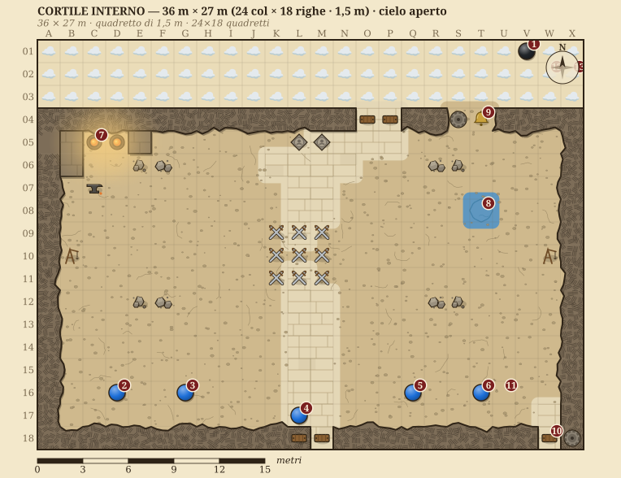

<!-- nuova-pagina -->

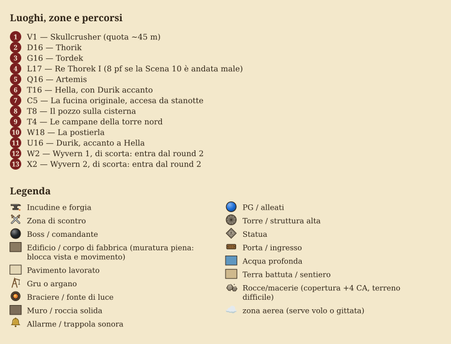

<!-- nuova-pagina -->

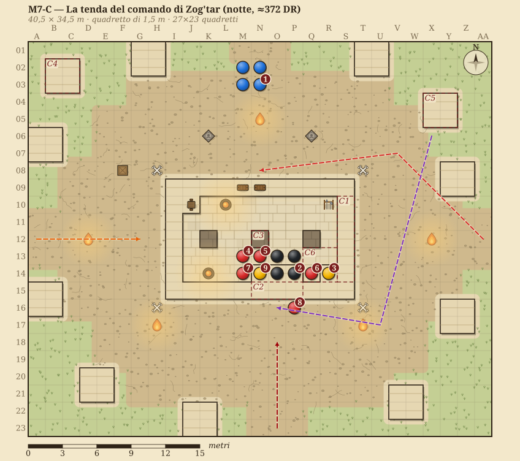

<!-- nuova-pagina -->

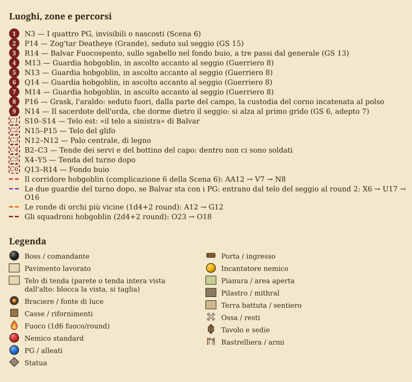

<!-- nuova-pagina -->

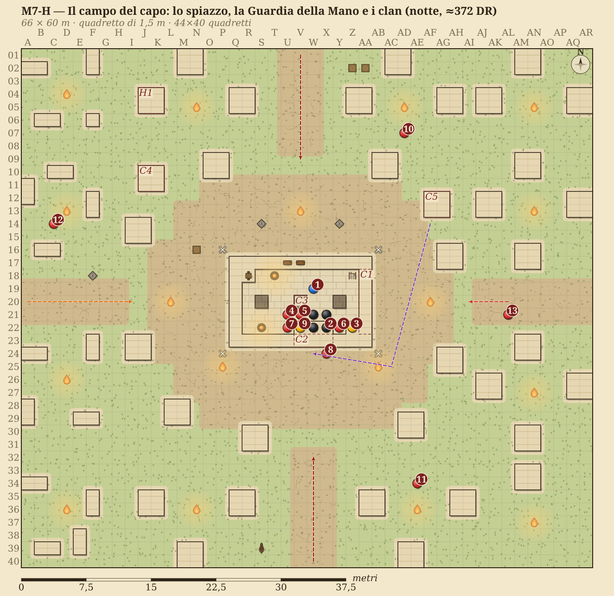

<!-- nuova-pagina -->

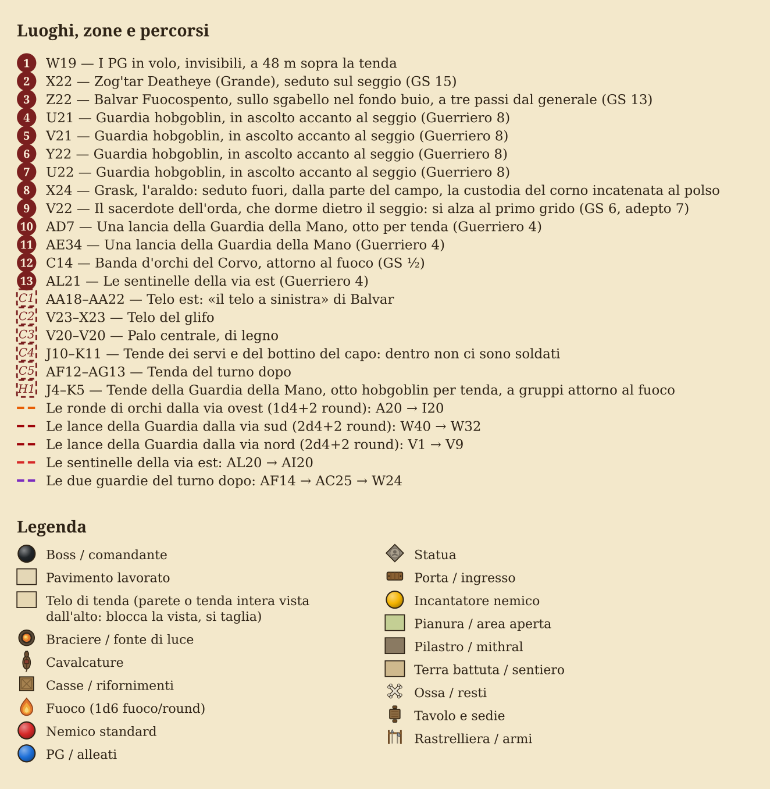

<!-- nuova-pagina -->

### Le griglie (scala 1,5 m/quadretto)

> 📗 **Versione a piena scheda tattica** (posizioni PG/PNG/villain, terreno &
> altitudini, tattiche di villain/mostri, evoluzione) nell'**Atlante Mappe
> Definitivo**. Le griglie qui sotto sono
> identiche; là hanno gli add-on DM. Le piante di M7-B e M7-C sono all'inizio di
> questa appendice; M7-A, la vista strategica non in scala, è uno schema
> disegnato nello stesso stile.

#### MAPPA M7-A — HAMMERFIST ≈372 DR: fortezza, campo dell'orda, mura (strategica)

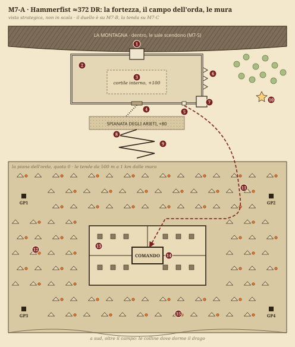

<!-- nuova-pagina -->

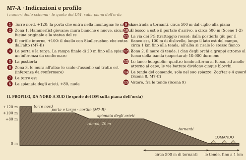

<!-- nuova-pagina -->


Le quote sono del DM: piana 0, spianata degli arieti
+80, porta e cortile +100, torre nord +120, le tende fra 500 m e 1 km dalle
mura. La rampa fra la spianata e la porta, le scale sul tratto est e la torre
nord sul suo gradone sono inferenze da confermare: sono scritte, con le loro
ragioni, nelle note di M7-A dell'Atlante.

#### MAPPA M7-B — L'ARENA DEL DUELLO (cortile interno · Skullcrusher)

La pianta di M7-B è all'inizio di questa appendice.


Le posizioni dei PG sono di riferimento: le sceglie il tavolo, e se non le
sceglie sfalsale su due righe, perché una linea di 30 m lungo la riga 16 li
prende tutti. Il re è alle loro spalle, a L17.

Il cortile sta a +100 m sulla piana dell'orda. Dal camminamento sud si guarda
giù: la spianata degli arieti 20 m più in basso, nuda, e oltre il ciglio la
piana, 100 m sotto, con le tende fino all'orizzonte.

### Sotto la montagna: la Scena 5

La sezione M7-S e gli stati del 1372 delle stesse sale stanno nell'atlante di
Hammerfist dall'alto in basso.

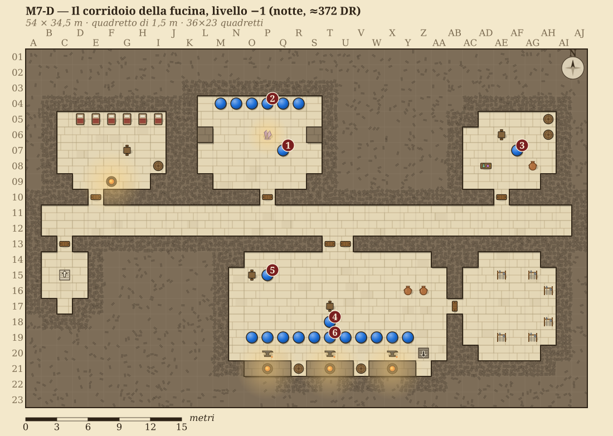

<!-- nuova-pagina -->

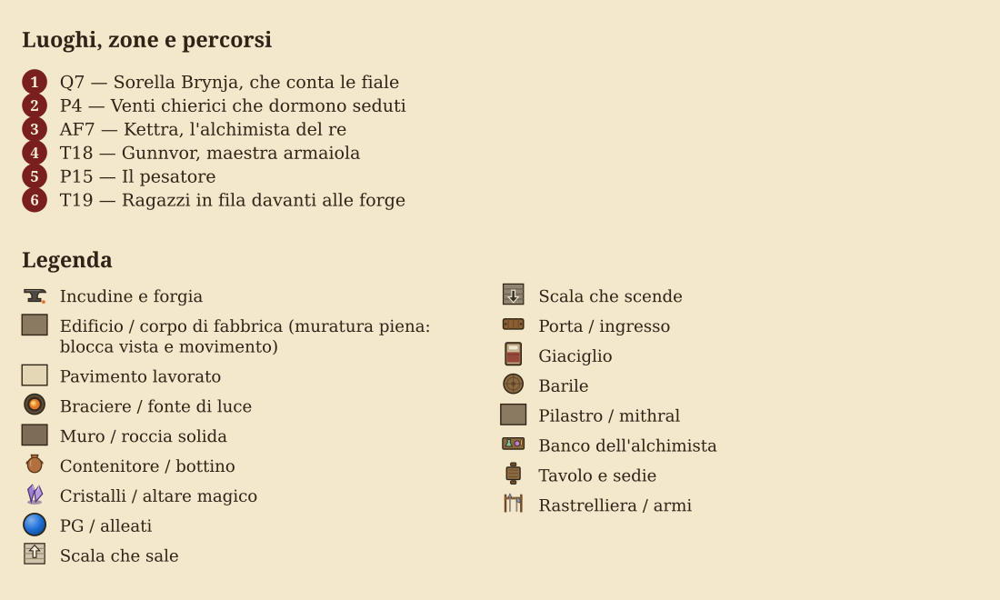

<!-- nuova-pagina -->

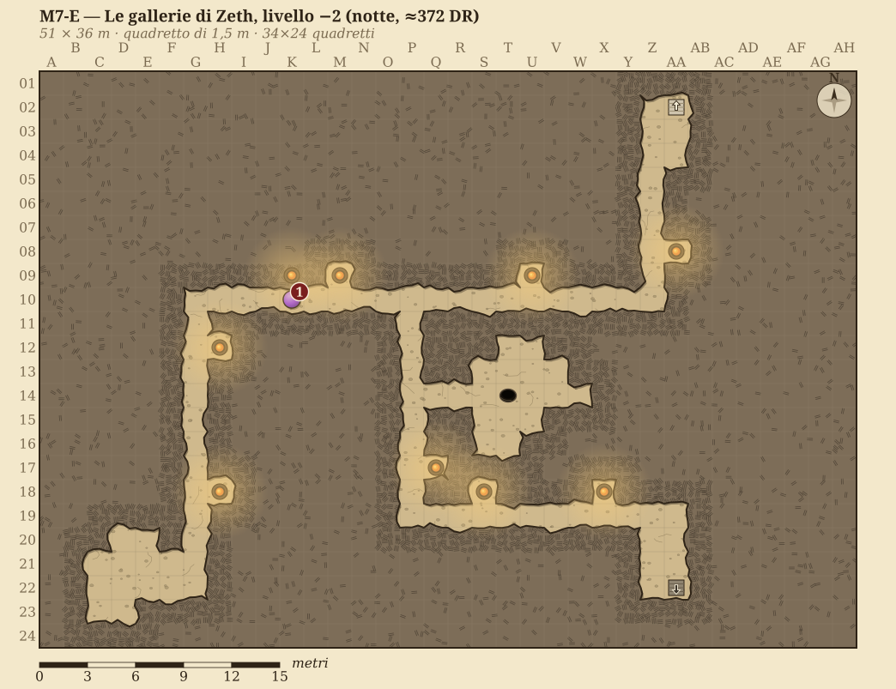

<!-- nuova-pagina -->

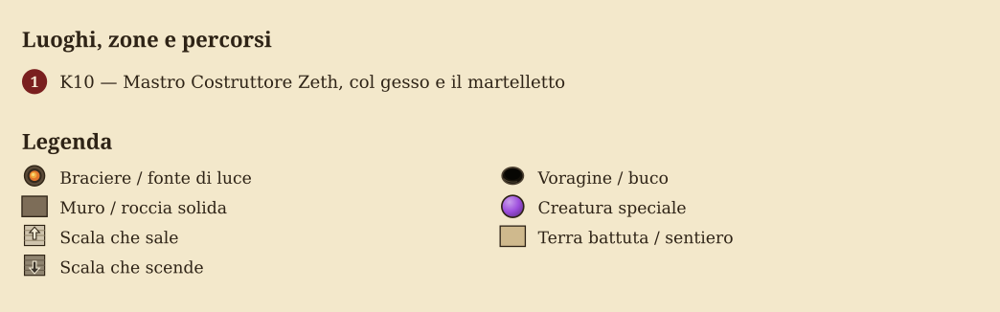

<!-- nuova-pagina -->

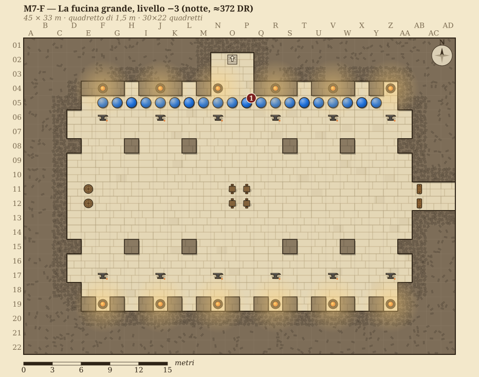

<!-- nuova-pagina -->

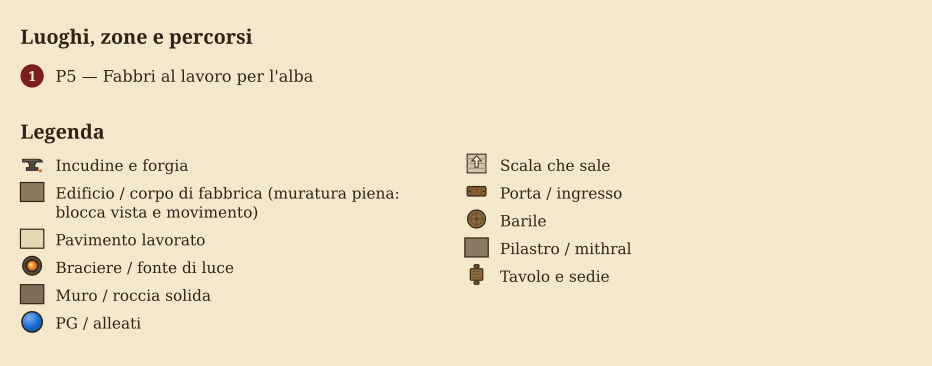

<!-- nuova-pagina -->

#### MAPPA M7-C — LA TENDA DEL COMANDO (Scene 7 e 8)

 La tenda misura 13,5 m × 7,5 m di pavimento, 16,5 m ×
10,5 m col telo: un padiglione di pelle nera a tre pali in fila sotto il colmo,
alto 6 m al colmo e 3 m alle pareti. Sta sola in mezzo allo spiazzo del
capo, terra battuta senza recinto, come il campo di un capo nomade: davanti
alla soglia il fuoco del consiglio, ridotto a brace, e i pali dei trofei; sul
bordo, staccate, le tende dei servi e del bottino. Su M7-H, a venti o trenta
metri, ci sono le lance della Guardia della Mano attorno ai loro fuochi e, a
ovest, i ripari dei clan degli orchi. Se il tavolo bombarda la tenda
dall'alto, le regole sono nel supplemento «Il barile sulla tenda» (ARC-07).

**Dove sta chi, se la griglia non è stampata.** I PG arrivano da nord, per la
via, a M2–N3. La soglia è a nord, M9–N9, in piena luce del braciere a L10. I
tre pali sono a K12, N12 e Q12; quello centrale, N12, porta la runa della
barriera di lame. Zog'tar siede sul seggio a O13–P14, con il braciere del
seggio a K14; le quattro guardie gli stanno attorno, a M13, N13, Q14 e M14.
Balvar è sullo sgabello a R14, nel fondo buio Q13–R14. Il telo est, «il telo a
sinistra», va da S10 a S14; il telo del glifo è quello sopra il seggio,
N15–P15. Grask è seduto fuori, a P16, due quadretti dietro il seggio, e il
sacerdote dorme sulla sua stuoia, a N14. Nella loro tenda, X4–Y5, a 9 m dal
telo, sul bordo nord-est dello spiazzo, dormono le due guardie del turno dopo.

<!-- /pagina -->


\page

# VII · Il ritorno a Hammerfist

{{note
##### ⚠ SOLO DM
Questo capitolo è materiale del DM: non mostrarlo ai giocatori.
}}

<!-- module-type: hub -->
# ARC-07 · DEFINITIVO #5 — IL RITORNO A HAMMERFIST (la cucitura del Rubino)
## Il Portale della Forgia Eterna — dal −1000 al Cuore della Montagna, Giorno 3 del 1372


> **Il ritorno, in tre scene brevi.** Il Rubino strappa i PG dal −1000 e li
> posa nel Cuore della Montagna, sotto Hammerfist, nell'istante in cui le porte
> cedono. Le griglie sono due: CM-1, la caverna intera **a 3 m per quadretto**,
> e CM-2, il lato nord dalla porta all'altare a 1,5 m, dove si gioca la pulizia.
>
> **Quando si gioca**: subito dopo la vittoria del −1000 (cap. IV). Chiude
> l'ARC-07 e apre l'ARC-08 (Battaglia di Hammerfist).
>
> **Canone in uscita** : Corona 3 gemme
> accese; Cuore di Moradin SPESO; Thorik −4 DES / +2 COS / +4 CAR
> permanenti (la Corona gli dà +3 di deviazione alla CA, +2 se al rito di
> Hella ha donato: è lo stesso punto, non un malus in più); Hella viva
> (Ibrido Treant, Collana, Durik); party APL 13.

---

## INDICE DEL MODULO

| § | Sezione | Contenuto |
|---|---|---|
| §0 | Quickstart DM | la serata in tre frasi, chi c'è, cosa segnare da cap. IV, cosa stampare, i tempi |
| §0-bis | Quick-Reference | i due rami dell'arrivo, le CD, i nemici in una riga, effetti dell'apparizione, stato in uscita, box PF1e |
| §0-ter | Idee che non sono scritte qui | assorbi e rilancia; il finisher al giocatore |
| §1 | Highlight per PG | cosa ciascuno riporta a casa dalla leggenda |
| §2 | Le due Zone | Atlante: lo Strappo fra le Ere · il Cuore della Montagna |
| §3 | Scena 1 · Lo strappo | il Rubino, il filo, il salto |
| §4 | Scena 2 · L'apparizione | l'arrivo in 30 secondi, dove sono tutti, un gesto a testa, Re Thorek e Madre Dana, la Corona intera |
| §5 | Scena 3 · La pulizia e il passaggio | lo scontro in 30 secondi, round per round, tattiche, «se i PG…», il passaggio di consegne, il portale |
| §6 | Contingenze & fallimento | «se i PG fanno X», cosa costa ogni fallimento |
| §7 | Echo Ledger — chiusura d'arco | tutti gli echi armati per ARC-08/09 |
| §8 | Avanzamento | premio di completamento arco + ricchezza in uscita |
| §9 | Ponte all'ARC-08 + Handout & Asset | |
| App. A | Statistiche | gli orchi, gli hobgoblin sergenti, il Treant, Durik, Dana, Re Thorek, le Cantitrici |
| App. B | Mappe | CM-1 Il Cuore della Montagna (vista d'insieme, 3 m/quadretto) · CM-2 il lato nord (1,5 m, la pulizia) · l'apparizione |

---

## §0 — QUICKSTART DM

> 🧭 **La serata in tre frasi.** Il Rubino strappa i PG dalla vittoria del
> −1000 e li posa sull'altare del Cuore della Montagna, la caverna sacra sotto
> Hammerfist, il Giorno 3 dell'assedio del 1372, nell'istante in cui le porte
> di mithral cedono agli orchi. La loro apparizione mette in fuga gli orchi,
> salva **Re Thorek**, che sta morendo d'acido sull'altare, e rialza novanta nani
> allo stremo. Poi **venti hobgoblin sergenti** entrano con un ordine solo,
> uccidere il re: cinque passano lo schieramento dei nani, e quando cadono Re Thorek
> indica in alto, verso il drago, e **Madre Dana** apre il portale per i
> bastioni dell'ARC-08.

**Dove siete.** I PG hanno appena vinto la battaglia antica (cap. IV). Sulla
fronte di Thorik il **Rubino**, la Possanza Nanica, si è acceso, e la sua
luce li strappa via dal −1000. Non li riporta in un interludio tranquillo: li
deposita **dove serve**, al **Cuore della Montagna**, il **Giorno 3
dell'assedio del 1372**, mentre la fortezza sta per cadere.

**Cosa fa questo beat.** È la chiusura dell'ARC-07 e la scintilla dell'ARC-08,
in tre tempi: (1) il ritorno attraverso le ere (Scena 1); (2) la
**manifestazione** che ribalta una disfatta certa: salva Re Thorek morente,
riaccende 90 nani allo stremo, semina il panico tra i nemici (Scena 2); (3) una
breve pulizia e il **passaggio di consegne**: Re Thorek indica in alto (Fauci
di Palude devasta le mura), Madre Dana apre il portale verso i bastioni, e
**inizia l'ARC-08** (Scena 3).

**Chi c'è.**

| Chi | In che stato | Cosa vuole |
|---|---|---|
| i 4 PG | leggenda viva, Corona a 3 gemme, ancora sotto l'Aura della Forgia (§0-bis) | lo decidono loro |
| **Re Thorek** | a **8 pf**, cosciente ma a occhi chiusi, incapace di combattere: l'acido del soffio del drago, preso sulle mura prima della ritirata, lo sta finendo | che la fortezza regga |
| **Madre Superiora Dana** | chierica, allo stremo: le resta un solo *muro di pietra* | tenere vivo il re |
| **90 guerrieri nanici** | allo stremo dopo due giorni d'assedio | tenere l'altare |
| circa 30 orchi | sfondano le porte, e fuggono appena la luce li prende | uscire vivi |
| **20 hobgoblin sergenti** | entrano dopo l'aura, che non li tocca | uccidere il re: è l'ordine che hanno |

I generali dell'orda e Fauci di Palude sono dell'ARC-08: qui ci sono solo la
loro ombra e la minaccia.

### Prima di aprire, segna da cap. IV

Con poco tempo per leggere: §0, §0-bis, Scene 2 e 3, Appendice A.

| Da segnare | Serve a |
|---|---|
| come è finito il duello, e le ferite lasciate al drago. Se è **FUGGITO**, anche il perché: ritirata dei PG, Catena spezzata, o un drago che non sono riusciti a intaccare (cap. VI Scena 11) | il ramo dell'arrivo (§0-bis, «I due rami»), §6, §7, la copertina del §9 |
| cosa è successo con Vatore, e **chi porta il Sigillo di Ossidiana**, se l'hanno rubato | §7. Il Sigillo arriva acceso («Il Viaggio a 1.000 Anni fa» Appendice B,): entro 9 m dal portatore la luce non magica scende a penombra, e lì il *Passo d'Ombra* di Artemis torna a funzionare. In mano ad Artemis il Sigillo è soppresso, e i poteri di luce dell'Anello diventano instabili. Un'ora dopo che è in mano a un PG il DM sceglie chi paga il livello negativo |
| il tono del Rubino | §7 |
| **la notte del barile** (cap. IV Scena 6, variante del barile): chi è morto nel fuoco fra Zog'tar, Balvar, il sacerdote e Grask, se il corno ha suonato, se Zog'tar è uscito dal fuoco davanti ai suoi | §7. Nel 1372 non cambia nessuna scena di questo master. Se Balvar è morto, la lastra col nome di Hald aspetta fra le ceneri fino all'ARC-09 |
| se Re Thorek I ha dato il torque a Thorik, o se la Scena 12 è saltata e il torque è murato nell'incudine | Scena 2, la scheda di Re Thorek. Murato, lo tirano fuori i nani del 1372 quando riconoscono la Corona («Il Viaggio a 1.000 Anni fa» Scena 12): lo porta a Thorik uno dei dieci capi, dopo il passaggio di consegne |
| se Thorik ha chiesto contro Zog'tar la **Benedizione della Forgia** (cap. VI Scena 8) | Scena 2 e 3: senza riposo è ancora **affaticato**, −2 a Forza e Destrezza, e non può correre né caricare (SRD). Al varco ci va a passo normale |
| come Tordek ha usato la Cintura contro Zog'tar: tutte le cariche (la Cintura l'ha «assaggiata») o una o due (disciplinata) (cap. VI Scena 8) | §7 |
| se i **Treant** chiamati all'alba sono ancora in campo, e quanti semi restano | Scena 2, il gesto di Hella (la riga dei Treant) |
| quali incantesimi restano a Hella: *muro di pietra*, *muro di spine*, *ristorare inferiore* | Scena 3, «Se i PG…»: la porta e le cure del re |
| chi ha la boccetta n. 4 di Kettra, quella con la cera nera, e se qualcuno l'ha bevuta (cap. IV Scena 5) | Scena 3, «Se i PG…», la cura del re; §7 |
| se Thorik ha già usato oggi l'*Aura di Comando* | Scena 2, il gesto di Thorik |
| quanti semi della Collana sono ancora carichi, se l'Evocazione è spenta, se Durik è in piedi | Scena 2, il gesto di Hella |
| quante cariche della Cintura restano a Tordek | Scena 3 |
| se al rito Thorik ha donato la deflessione, e se Hella ha già speso oggi lo *Scudo del Custode* | la CA di Thorik, il gesto di Hella, la prima battuta della Senzienza |

**Cosa stampare.** La **Quick-Reference §0-bis**; le mappe **CM-1** e
**CM-2** (Appendice B); la pagina dell'**Appendice A**, da tenere aperta durante la
Scena 3; l'handout **«Lo Stato dei Custodi»** (§9); gli statblocchi completi di
**Re Thorek** e di **Madre Dana**, dalla Guida DM dell'ARC-08, fra i PNG
Alleati; le pagine giocatore degli artefatti allo stadio di oggi,
che sono anche la seconda metà dell'handout del §9.

| ✉ Cosa si consegna | Quando |
|---|---|
| «Lo Stato dei Custodi», uno per giocatore | Scena 3, prima del portale |
| la tavola dell'Affresco A8, una per il tavolo: finché non c'è la stampa, la si descrive a voce (§9) | Scena 3, prima del portale |

**I tempi della serata**.

| Scena | Quanto dura | Il segnale per passare oltre | Se il segnale non arriva |
|---|---|---|---|
| 1 · Lo strappo | 2-3 minuti | tutti hanno tirato la Volontà, tranne Thorik che ne è immune | si passa lo stesso: non c'è niente da fare nel filo |
| 2 · L'apparizione | 10-15 minuti | ognuno ha fatto il suo gesto, o ha detto che aspetta | gli hobgoblin entrano alla fine del round 1, e la scena è già la 3 |
| 3 · La pulizia | 5 minuti in fast-play, 30-40 in combattimento completo | l'ultimo hobgoblin passato cade o getta le armi | con meno di 45 minuti di serata, fast-play; a 40 minuti di scontro, un blocco di nani travolge chi resta |
| 3 · Il passaggio | 10 minuti | PX e handout consegnati | Re Thorek indica in alto e lo dice lui: «SOPRA.» |

**Se lo divinano**. Una riga per segreto. Thorik
ha *comunione* una volta al mese dalla Corona, ma solo in un Nodo Terrestre
(pagina giocatore della Corona), e il Cuore della Montagna lo è: è la caverna
sacra sotto la fortezza, consacrata a Moradin. Le risposte
:

| Segreto | Lo rompe | Chi lancia ottiene | Il modulo va avanti così |
|---|---|---|---|
| il drago sopra la montagna (Scena 3) | *divinazione*, *comunione* | Fauci di Palude è sulle mura, e ha il sangue di Skullcrusher | niente cambia: lo dicono Re Thorek e Aegis Fang al passaggio di consegne |
| che cosa vogliono gli hobgoblin (Scena 3) | *individuazione dei pensieri* su un sergente | il re, e nient'altro: è l'ordine che hanno | la tattica resta quella |
| il viaggio nel tempo, visto dai nani (§6) | *individuazione dei pensieri* su Dana o su Re Thorek | niente del viaggio: Dana pensa a una profezia che si compie | il segreto regge, perché qui nessuno lo sa |
| da dove viene il portale (Scena 3) | *individuazione del magico* sull'altare | un'aura divina forte, di Moradin | Dana apre il portale come scritto |

**Dove porta.** → **ARC-08: La Battaglia di Hammerfist**, che continua nel
ponte d'arrivo dell'ARC-08 e nella Guida DM
della battaglia. L'ARC-07 è **chiuso**: la leggenda che le Cronache dei Quattro
Eroi promettevano è compiuta.

---

## §0-bis — QUICK-REFERENCE DM (una pagina)

### I due rami dell'arrivo

Prima di leggere la Scena 2, guarda come è finito il duello di cap. IV.

| | **Ramo luminoso** (di norma) | **Ramo «meno luminoso»** |
|---|---|---|
| **Quando** | sempre, tranne il caso a destra | il duello di cap. IV è finito **FUGGITO** perché i PG si sono ritirati, o **VINTO SPORCO**. La Catena spezzata è una vittoria e non conta. FUGGITO perché non sono riusciti a intaccarlo: ramo «meno luminoso», come chi ha giocato male il −1000 (§6) |
| **Morale dei nani** | +6 (netto +2) | +4 |
| **Gli orchi** | Volontà CD 25 contro l'aura: ne restano **due scossi**, il capo forse fra loro | niente TS: l'aura mette in fuga tutti tranne **cinque orchi e il capo**, che restano scossi |
| **Gli hobgoblin entrano** | alla fine del round 1 | alla fine del round di sorpresa |
| **Quanti passano lo schieramento** | 5; **3** con l'ordine di Thorik nel round di sorpresa; **2** con anche il preavviso di Artemis. Ordine dato nel round 1, prima che entrino: **4**; preavviso senza ordine: **4**; ordine nel round 1 più preavviso: **3** | **5**, qualunque cosa facciano Thorik e Artemis |
| **Il box del primo round** | «ne restano due» | «ne restano cinque, stretti intorno al più grosso» |
| **Lo scontro** | 4-5 round, una prova di forza | 3-4 round, uno scontro vero; Dana è davvero in pericolo |
| **Il resto** | | uguale, Re Thorek compreso. L'ARC-08 comincia con i nani più fragili |

Le etichette sono quelle del registro di cap. IV. **FUGGITO**: il drago se ne
va quasi illeso, perché i PG hanno scelto di salvarsi (cap. VI Scena 11, esito
del duello). **VINTO SPORCO**: il drago l'hanno ricacciato gli avi, non i PG
 (cap. VI §6). **La Catena spezzata**: il drago smette di combattere per l'orda.

### Le CD della serata

| Cosa | Prova | Dove |
|---|---|---|
| lo strappo fra le ere | Volontà **CD 15** o frastornati 1 round | Scena 1 |
| l'aura, per ogni orco | Volontà **CD 25**: passa solo col 20, e resta scosso | Scena 2 |
| salire sull'altare | Scalare **CD 15**, un round | Scena 2 |
| scendere dall'altare | salto di 3 m: 1d6, o niente con Saltare o Acrobazia **CD 15** | Scena 2 |
| le radici di Hella alla porta | Riflessi **CD 15** | Scena 2 |
| l'*Aura di Comando* di Thorik | *comando*, Volontà **CD 15** | Scena 2 |
| la pergamena di *ristorare*, letta da Artemis | Usare Oggetti Magici **CD 27** | Scena 3 |
| le stalattiti che crollano | Riflessi **CD 18** annulla 4d6 | CM-1 |
| stabilizzare Dana a terra | Guarire **CD 15** | §6 |

### I nemici e gli alleati in una riga (numeri completi in Appendice A)

| Chi | pf | CA | Quando smette |
|---|---|---|---|
| orco scosso | 5, il capo 8 | 13 | se il capo cade getta le armi; senza capo, quando cade il compagno |
| hobgoblin sergente | 37 | 21, 19 senza scudo | getta le armi quando di quelli passati ne restano in piedi meno della metà; se ne sono passati due, combatte fino all'ultimo |
| Madre Dana | 20 + 2d8 (142 massimi) | 29 | la abbattono cinque o sei frecce, o due critici |
| Re Thorek | 8, esausto (196 massimi) | 27 da esausto, +4 contro gli attacchi a distanza perché è steso (A.6) | non muore in questo capitolo |

### Effetti immediati dell'Apparizione (Scena 2, automatici, no TS per gli alleati)

| Beneficiari | Effetto |
|---|---|
| 90 nani + Dana | **+6 morale** att/danni/TS (annulla il −4 della disperazione, dopo due giorni d'assedio → netto **+2**); guariscono **2d8 pf**; **immuni a paura 1 ora**; +3 m velocità |
| **Re Thorek** | l'acido **interrotto**; **stabilizzato** (non muore); riapre gli occhi. Non guarisce: resta a 8 pf ed **esausto** (l'acido). Potrebbe alzarsi, a metà velocità e con −6 a Forza e Destrezza, ma Dana lo tiene giù e lui obbedisce: la cura vera di Dana arriva nell'ARC-08. Parla e comanda, non combatte |
| Nemici nella caverna (~30 orchi) | **Volontà CD 25** contro l'aura dell'Apparizione, come la presenza terrificante dell'SRD: ogni orco tira. |
| | A differenza dell'SRD chi fa 20 resta scosso, e l'effetto dura tutta la scena: chi fugge non torna. |
| | Con Volontà −2 contro CD 25 passa solo chi fa 20, e resta **scosso** (−2 ai tiri per colpire, ai TS e alle prove); tutti gli altri sono **in panico** e fuggono dalla porta. |
| | Il DM non tira trenta TS: uno su venti resta, e restano **due orchi**. Il capo tira il suo a parte: se fa 20 è uno dei due (Scena 2). La Scena 3 si gioca con loro e con i nemici che arrivano dopo (CM-2) |

### Lo stato dell'ARC-07 in uscita
- **Corona di Adamantio**: **3 gemme accese** (Topazio, il Tempo Immutabile; Smeraldo, la Vera Terra; Rubino, la Possanza Nanica: i nomi della pagina giocatore). Il Rubino si è usato **una volta sola**, come motore del ritorno; speso, **resta nell'incasso** e **la Corona si completa**: +3 e Senzienza dall'arrivo (Scena 2).
- **Cuore di Moradin**: **SPESO** (resurrezione).
- **L'Aura della Forgia** («Il Viaggio a 1.000 Anni fa» Scena 12): attiva fino all'alba del giorno dopo, quindi i PG arrivano con *Possenza Divina* e *Protezione dal Male* ancora addosso. L'alba è quella del 1372: il salto non ne consuma la durata. *Protezione dal Male* dà +2 di deviazione alla CA, come la Corona: i bonus di deviazione non si sommano e vale il più alto (SRD), quindi Thorik non conta mai +5.
- **Thorik**: **−4 DES / +2 COS / +4 CAR** permanenti; la Corona gli dà **+3** di deviazione alla CA, **+2** se al rito di Hella ha donato la deflessione (cap. III §5): lo stesso punto, contato una volta. **Hella**: viva (Ibrido Treant, Collana, Durik). **Bracieri** completi. **Ring** riforgiato.
- **Carry-over B4** verso Fauci, cioè quello che il duello del −1000 lascia al drago di oggi: registrato al cap. IV (esito Skullcrusher + N ferite).
- **Countdown**: siete arrivati al **Giorno 3** (≈ il giorno 18-19 del conto della marcia dell'Orda): il **sync** con l'ARC-08. Valore preciso in consegna, secondo il registro dei riposi (cap. II §0-bis): **≈ 3g 03h** se hanno dormito prima di Terros, **≈ 3g 15h** se no. Il viaggio a −1.000 **non consuma orologio**. Il Rubino li deposita **sempre** nel Cuore della Montagna (Scena 1): l'arrivo è fisso, e l'orologio decide cosa è successo sopra.

### In che stato consegni il party all'ARC-08 (per ramo dell'orologio)

Il ramo cambia **come si apre** la Battaglia di Hammerfist, non se si vince.
Il numero è quanto resta del conto alla rovescia dell'assedio, e non è il
«Giorno 3»: più è alto, meno l'assedio è andato avanti. In tutti i rami i PG
arrivano nel Cuore della Montagna, nell'ultima resistenza della Scena 2, con il
drago sulle mura.

| Orologio in consegna | Cosa trovano arrivando | Effetto sull'ARC-08 |
|---|---|---|
| **≈ 3g 15h** (nessun riposo prima di Terros: è il ramo del gruppo di oggi) | la **prima ondata è appena passata**: sulle mura i nani tengono ancora, ma una colonna d'orchi è scesa dalle gallerie di Zeth dietro i nani in ritirata, fino alle porte del Cuore | la **Fase 0** dell'ARC-08 si gioca **dopo** il drago ai bastioni: prima il Cuore della Montagna, poi Fauci, poi il consiglio di guerra per le ondate che restano |
| **≈ 3g 03h** (riposo prima di Terros: l'altro ramo) | la **prima ondata è passata da ore**: una torre in posizione a est, i primi caduti sui camminamenti, il fumo che piega col vento | **Fase 0 accorciata**: un solo giro di preparativi invece di due. I nani hanno già dei feriti da curare, e il consiglio di guerra si tiene **in piedi**, non seduti |
| **sotto 2 giorni** (solo con altri due riposi ordinari, improbabile). La stessa riga vale, qualunque sia l'orologio, se si fermano un'ora nella caverna dopo la pulizia, per dormire o no (§6) | **breccia aperta**, combattimento dentro le mura sopra la caverna | il pannello velato dell'Affresco A8 e **Fase 0 dura** (cap. II §8) |

> ⚠️ **Nessuno dei due rami probabili è una punizione.** La differenza è di
> tono e di respiro, non di vittoria: chi ha dormito arriva riposato in un
> assedio più avanti, chi non ha dormito arriva stanco in un assedio più
> indietro. È lo scambio giusto, e vale la pena farglielo notare a cose fatte:
> dopo la battaglia, non prima.

### 🐾 Supporto Pathfinder 1e (dove il 3.5 è vago) — opzionale, dichiarato
> - **Il ritorno nel tempo**: nessun costo meccanico ai PG (il Rubino paga, ed è
>   speso). Torna tutto quello che portano addosso, comprato al banco della
>   fucina compreso: pozioni, pergamene, bacchette, rune (Scena 1)
>. Il Sigillo di Ossidiana, se l'hanno
>   rubato a Vatore, torna come il resto, e acceso («Il Viaggio a 1.000 Anni fa» Appendice B). Al
>   −1000 resta solo ciò che hanno consumato, venduto o lasciato. Trattalo come
>   una **cornice**, non un puzzle.
> - **L'Aura dell'Apparizione** (Scena 2): è la presenza terrificante dell'SRD, CD 25,
>   un TS per creatura (in PF1e, *frightful presence*).

---

## §0-ter — QUANDO UN GIOCATORE HA UN'IDEA CHE NON È SCRITTA QUI

La regola della campagna è **assorbi, poi rilancia** (*yes-and with teeth*):
l'invenzione del giocatore entra nel canone **e** genera una complicazione. La
risposta è sì, e subito dopo c'è un problema nuovo. Tre esempi per questa
caverna, e sono canone:

| Il giocatore dice | Si assorbe, e si rilancia |
|---|---|
| *«Grido agli orchi in fuga, in orchesco, chi siamo»* | Funziona: corrono più forte. **E portano il nome all'orda**: nell'ARC-08 i generali sanno già che i Quattro sono tornati |
| *«Metto il torque di Thorek I nella mano del re»* | Re Thorek lo stringe, e lo riconosce prima del viso. **E i nani l'hanno visto**: da quel momento gli ordini li aspettano da Thorik, anche quelli che toccherebbero al re |
| *«Lego con le radici i due orchi scossi e li interrogo»* | Parlano, e sanno che il drago è sopra. **Ma due prigionieri vanno tenuti**: chi li guarda, mentre gli altri passano dal portale? |

Se l'idea è specifica e il giocatore accetta che il mondo reagisca, funziona.
Se è generica («cerco un modo»), chiedi *«come, di preciso?»*, e poi funziona.

**Il finisher va al giocatore.** Questo master non ha un boss. Il colpo che
chiude l'arco è quello che abbatte l'ultimo hobgoblin ai piedi dell'altare, e
lì la narrazione passa a chi l'ha tirato:
`[HDYWTDT — il finisher a chi chiude la pulizia]`, nella Scena 3. Al giocatore
si chiede *«com'è che lo fai?»*, e si aspetta. Se non vuole, descrivi tu in una
riga e vai avanti.

---

## §1 — HIGHLIGHT ASIMMETRICI PER PG (per il DM: cosa riporta a casa ciascuno)

### 🛡️ THORIK — la profezia chiusa
- Torna con la **Corona completa** (3 gemme) e con la certezza, incisa nelle
  ossa, di **essere** ciò che le Cronache promettevano. Non porta più un mito:
  **è** il mito. Ma ha pagato in Destrezza, **quattro punti** fra la Corona e il
  rito dello Smeraldo, e nessuno intorno a lui se n'è accorto: lo elogiano per
  il Peso che regge, non per la velocità che ha venduto. In più, un drago che
  nel presente lo aspetta (Fauci → ARC-08).
- Aegis Fang, all'arrivo, **sente Fauci sopra** (*«sangue Skullcrusher chiama»*):
  è il gancio inverso del carry-over B4 che si arma per Hammerfist.

### 🌙 HELLA — la casa che è natura
- Torna viva in una Hammerfist che brucia: la **casa**. Per l'Ibrido Treant
  proteggere il focolare è ora *letteralmente* natura. Attorno a lei, all'arrivo,
  **radici cristalline crescono spontanee** dall'altare: è il segno del suo
  legame col Sogno della Terra, e del **Debito della Radice** (cap. III §6), che
  segue chi l'ha preso. Per il gruppo di oggi l'ha preso Thorik, al rito, e
  Hella lo sente ancora suo (eco E-07g).

### ⚒️ TORDEK — il pugno che ha imparato a trattenersi
- Torna con i Bracieri completi e la disciplina della Cintura, che al −1000 si è
  rifiutata contro Skullcrusher: il vero scontro è Fauci, sui bastioni, nell'ARC-08.
  Nella Scena 3 la Cintura funziona come contro Zog'tar (cap. VI Scena 8): 4
  cariche al giorno, e quelle che spende qui non le ha contro il drago. Prima
  di un colpo in mischia Tordek spende una carica, con un'azione gratuita, e il
  colpo fa **+2d6** danni; le cariche tornano all'alba.
- Il suo momento è **rivedere Hella viva al suo fianco nel presente**: non un
  ricordo, non uno spirito. Lei.

### 🔮 ARTEMIS — il predone che ha visto il futuro del suo nemico
- Torna sapendo cosa non dovrebbe sapere: ha visto **Vatore** (cap. VI §5). Se
  lo ha segnato o derubato, la **sincronizzazione** lo aspetta in ARC-09 (Sal).
- L'Anello, all'arrivo, pulsa fra luce e ombra. Non è un dono divino: è la sua
  natura riforgiata che riconosce di essere **tornata a casa** nel tempo giusto.

---

## §2 — LE DUE ZONE (Atlante)

### ZONA 1 — Lo Strappo fra le Ere (il ritorno)
Il box è nella **Scena 1**.

**Terreno (callout):** transizione, nessuna azione durante lo strappo. TS
**Volontà CD 15** o **frastornati 1 round** all'arrivo: lo strappo fra le ere
scuote la mente, e si resiste con la Volontà; frastornato e non stordito, così
nessuno lascia cadere quello che ha in mano.
Il beat chiede ai PG Volontà (lo strappo) e Riflessi (le stalattiti), mai
Tempra: è voluto, perché è una transizione e non uno scontro pieno.

### ZONA 2 — Il Cuore della Montagna (la caverna sacra sotto Hammerfist, 1372)
I box sono nella **Scena 2**.

**Terreno (callout):** altare centrale rialzato; 10 statue-pilastro
(copertura); porte di mithral a nord, che stanno cedendo e sono anche
**l'unico ingresso**: non c'è una via di fuga, e l'unica uscita che non passa
dagli orchi è il portale di Dana (Scena 3). **Zona sacra** (Consacrazione di
Moradin: +1 ai TS vs paura per i difensori). Vedi CM-1.

**Dati per il DM (non da leggere).** Caverna di **100 × 80 m**, alta 40, su una
griglia da **3 m** a quadretto (MAPPA CM-1, Appendice B; il lato nord a 1,5 m è la carta CM-2). Altare **+3 m**, Ø 6 m,
in P-Q 13-14; le dieci statue, alte 4 m, sul cerchio a 20 m; lo schieramento dei nani
a 30 m; la porta, 6 × 6 m, in P-Q01, a **36 m** dall'altare; due piattaforme
laterali a +1,5 m (B-C13 e d-e13). Luce piena ovunque, dalle stalattiti di
cristallo: niente *oscurità*. Le stalattiti possono crollare su effetti ad area
potenti (*terremoto* e simili): 4d6 contundenti, raggio 3 m, Riflessi CD 18 annulla.

| Occhi | Orecchie | Pelle e naso | Cosa NON dire |
|---|---|---|---|
| la luce delle stalattiti, piena fino agli angoli; dieci re di pietra con gli occhi di rubino; le rune delle porte che si spengono | gli arieti sulle porte, poi gli orchi; il respiro dei feriti; dopo, il fischietto degli hobgoblin | il fumo dei bracieri, il sangue, l'acido sull'armatura del re | che il drago è sopra le mura adesso: lo dice Re Thorek, alla fine. Il nome Fauci i PG lo sanno già, da Aegis Fang (cap. II A7). Cosa sanno Dana e il re del viaggio: niente (§6). Che gli hobgoblin stanno per entrare: lo dice il varco, nella Scena 3 |

---

## §3 — L'ACCENSIONE DEL RUBINO & IL RITORNO (la regia del salto)

> Riusa la regia di P5-DEFINITIVO §4.2-4.3. Il Rubino si accende **alla vittoria
> antica** («Il Viaggio a 1.000 Anni fa» Scene 12-13): è il **motore del ritorno**, si usa **una volta
> sola**, e dopo l'uso **la Corona si completa** (Scena 2,).

**Meccanica.** Alla vittoria, il potere del Rubino, la *Possanza Nanica*, e la **Forgia del 1372**, che
fa da ancora, agganciano i loro spiriti e li tirano attraverso le ere. Il Cuore
di Moradin è speso nella resurrezione e fa parte della Forgia: non entra in
questa meccanica. **Non atterrano nella Sala
della Forgia deserta** : il Rubino li deposita nel
**punto più nero della battaglia presente**, il Cuore della Montagna (Scena 2).

### SCENA 1 — Lo strappo fra le ere

**In scena** — Dove: lo strappo — Chi: nessuno

Si legge subito dopo l'ultimo box di cap. IV, quello in cui la luce comincia a
tirare: l'accensione del Rubino e la voce di Moradin stanno là, nelle tre
battute della Scena 13. Qui c'è solo il filo, e nessuna azione.

> **Read-aloud — lo strappo, il filo.** *Il rosso vi stringe in
> un filo tirato attraverso mille anni, e non fa male: è una vertigine calda, in
> cui le cose accadono al contrario. Il drago risale in cielo, il generale si
> rialza dalla polvere, le mura anneriscono di secoli in pochi battiti, e un re
> torna polvere mentre la sua stirpe arriva fino a un altro re, steso su una
> pietra. Poi fumo, e il rombo di una battaglia. Siete tornati, e siete tornati
> nel momento peggiore.*

All'arrivo, **Volontà CD 15** o frastornati 1 round (§2, Zona 1). Chi la
fallisce arriva con gli altri, ma resta frastornato mentre gli altri fanno il
loro primo gesto (Scena 2). Thorik non tira: la *Mente Vuota* della Corona lo
rende immune agli effetti mentali, e la pagina a tre gemme che il giocatore ha
in mano lo dice. Il suo primo ordine da portatore della Corona arriva sempre
col primo gesto della Scena 2, nel giro dei gesti.

**Che cosa torna con loro.** Tutto quello che portano addosso, comprato al
banco della fucina compreso: pozioni, pergamene, bacchette, rune, come l'ascia
e lo scudo del capo fabbro (cap. VI §6).
La ricchezza si riconta nell'ARC-08.


---

## §4 — LA MANIFESTAZIONE (l'arrivo che ribalta la disfatta) — il momento corale

> Il beat corale del finale: i quattro appaiono **insieme**, come una cosa sola,
> nell'istante in cui tutto è perduto. È il pagamento di tutto l'arco.

### SCENA 2 — L'apparizione

**In scena** — Dove: la caverna — Chi: Re Thorek · Madre Superiora Dagmar Forgiapietra · i novanta nani · gli orchi e il loro capo

I PG compaiono sull'altare nell'istante in cui le porte di mithral cedono, e la
loro luce mette in fuga gli orchi.

> 🧭 **L'arrivo in 30 secondi.**
> 1. Ramo luminoso o «meno luminoso»? (§0-bis, «I due rami»). Cambia la morale e chi resta.
> 2. Leggi i quattro box in fila: **la caverna** · **l'ultima resistenza** · **sono tornati** · **voi**. Nel terzo Dana dice *«Sono tornati»*; il quarto chiude su «Che fate?».
> 3. L'aura scatta con l'apparizione, e i TS degli orchi si risolvono subito: restano **due orchi scossi**, il capo forse fra loro.
> 4. Re Thorek riapre gli occhi: *«Tu… portatore… degno. Finalmente… campioni veri.»*
> 5. **Round di sorpresa**: un gesto a testa (tabella qui sotto). Chi ha fallito la Volontà della Scena 1 lo perde.
> 6. Iniziativa, e si passa alla **Scena 3**. Alla fine del round 1 entrano **20 hobgoblin sergenti**, che l'aura non tocca.
>
> L'ordine è canone: aura, sorpresa, iniziativa.

**Dove sono tutti** (MAPPA CM-1, quadretti da 3 m)

| Chi | Dove | Da sapere |
|---|---|---|
| i PG | sull'altare, P-Q 13-14 | è alto 3 m: si sale con Scalare CD 15 in un round, si scende con un salto (1d6, o niente con Saltare o Acrobazia CD 15) |
| Re Thorek | steso sull'altare, ⚫ P14 | 8 pf, esausto, non si alza |
| Madre Dana | in ginocchio sul re | prende su di sé il colpo che lo ucciderebbe |
| i novanta nani | lo schieramento 🔵 a 30 m dall'altare, rivolto alla porta: al centro, davanti al varco, 40 guerrieri su quattro file di scudi con dietro 12 balestrieri e 6 capi; ai lati due ali piegate all'indietro verso l'altare, ciascuna di 10 guerrieri, 4 balestrieri e 2 capi | il DM li muove come tre blocchi |
| le dieci statue 🗿 | il cerchio a 20 m (Q07 · U09 · W12 · W16 · U19 · Q21 · M19 · K16 · K12 · M09) | copertura |
| la porta 🚪 | P-Q01, a nord, a **36 m** dall'altare, oltre lo schieramento | unico ingresso. Nel round di sorpresa chi combatte in mischia non ci arriva |
| gli orchi 🔴 | entrati dalla porta (righe 02-03) | in fuga dopo l'aura. I due scossi che restano sono già dentro lo schieramento |
| le piattaforme 🟨 | B-C13 a ovest, d-e13 a est, +1,5 m, con stalagmiti 🔺 | posti da tiratore, copertura parziale |

Sulla carta **CM-2** (1,5 m a quadretto, Appendice B), dove si gioca la
Scena 3, le stesse cose stanno così: l'altare in M-P 25-28, col re e Dana in
N-O 26-27 e i PG intorno; i due orchi scossi in L15-M15; il varco della porta
in M-P 01-02, coi battenti abbattuti in M03 e P03; le sette statue del lato
nord in O-P 13-14 (Q07), G-H 17-18 (M09), W-X 17-18 (U09), C-D 23-24 (K12),
a-b 23-24 (W12), C-D 31-32 (K16) e a-b 31-32 (W16). Le distanze restano
quelle scritte: 36 m dalla porta all'altare, 30 m allo schieramento.

> **Read-aloud — la caverna, sotto la luce.** *Sotto la luce che vi
> porta si apre una caverna grande come una cattedrale. Le stalattiti fanno
> luce da sole, fredda, fino agli angoli. Al centro c'è un altare di basalto, e
> intorno dieci statue di re con gli occhi di rubino. A nord le porte di mithral
> gemono sotto gli arieti, e le rune incise sui battenti si spengono una alla volta.*

> **Read-aloud — la caverna, l'ultima resistenza.** *Oggi la
> caverna è un mattatoio: novanta nani, di trecento, fanno muro davanti
> all'altare, e la prima fila guarda le porte. Sull'altare è steso un re, la
> barba impastata di sangue e d'acido, il respiro un sibilo. Una sacerdotessa
> anziana prega su di lui, e le mani le tremano. È il terzo giorno, l'ora in cui
> la fortezza doveva cadere. Le porte di mithral cedono con un colpo solo, e gli
> orchi entrano urlando. In quell'istante, sopra l'altare, la luce: oro, verde e
> rosso che girano in una sfera di metallo fuso che pulsa come un cuore.*

> **Read-aloud — la caverna, sono tornati.** *Nani e orchi si
> fermano nello stesso respiro. Nel silenzio la sacerdotessa alza la testa, e
> dice piano: «Sono tornati.»*

> **Read-aloud — la caverna, voi.** *La sfera si apre, e i vostri
> piedi toccano la pietra dell'altare. Sulla fronte di Thorik brillano tre
> gemme e l'ascia canta una nota di guerra che risuona nella pietra; i pugni di
> Tordek ardono, l'anello di Artemis pulsa fra luce e ombra, intorno a Hella
> spuntano dalla pietra radici di cristallo. Novanta nani rialzano la testa
> tutti insieme, e gli orchi no. Che fate?*

**Dati per il DM (non da leggere).** Stasera si gioca la **regia breve**, quella
dell'ARC-07: i PG arrivano quando le porte cedono, e la scena finisce con la
Scena 3. Il trigger è la fine del Round 2 dell'ultima resistenza; sul lato
ARC-07 quei due round **non si giocano**, li raccontano i box qui sopra. Si
giocano solo nella **regia lunga** dell'ARC-08 (Incontro 3B, MAPPA CM-1), dove i
PG arrivano al Round 8.

**Il re non muore in questo capitolo**: il colpo che lo porterebbe sotto 0 lo prende
Dana, che gli si getta sopra. Dana ha 20 pf più i
2d8 dell'Apparizione, e la abbattono cinque o sei frecce, o due critici
: allora vale la riga «Madre Dana cade» del §6.
Caduta Dana, il colpo che ucciderebbe il re lo prende il primo dei dieci capi
che sale sull'altare, **Hrolf Spaccascudi**, e gli hobgoblin passano a tirare a chi è sull'altare.
Nel ramo luminoso succede di rado, perché i tiri al re cominciano al round 6
.

#### Il round di sorpresa, un gesto a testa

Nessuno qui deve tirare, ma ognuno può scegliere. Sono proposte, e ogni scelta
si ricorda (§7). Le statistiche di Treant e Durik sono in Appendice A.

| PG · gesto | Cosa fa | Cosa cambia |
|---|---|---|
| **Thorik** · il primo ordine ai novanta, dall'altare | è il primo ordine da portatore della Corona. Se lo dà nel round di sorpresa, i tre blocchi avanzano nel round 1 e il muro di scudi si fa sul varco, prima che entrino gli hobgoblin | ne passano **3** invece di 5 (nel ramo «meno luminoso», 5 comunque) |
| **Thorik** · più tardi, l'*Aura di Comando* | se oggi non l'ha già usata al −1000: 1/giorno, *comando* CD 15 dalla pagina della Corona, su **una** creatura come l'incantesimo dell'SRD, a gittata vicina (16,5 m al 13°). Il capo degli orchi alla porta, a 36 m, è fuori portata finché non passa lo schieramento | se il capo è uno dei due rimasti, «Fuggi!» lo manda via, e l'altro scosso, senza più nessuno che lo tenga, scappa con lui |
| **Tordek** · coprire il re col corpo | il re è lì sull'altare, a un passo: Tordek gli dà copertura morbida, +4 alla CA contro gli attacchi a distanza (SRD) | gli archi degli hobgoblin, se lo scontro dura |
| **Tordek** · scendere fra l'altare e lo schieramento | un salto di 3 m: 1d6, o nessun danno con Saltare o Acrobazia CD 15 (SRD) | è il primo che gli orchi scossi caricano (Scena 3) |
| **Artemis** · guardare dall'altare | vede tutta la caverna: chi scappa, chi resta, e il capo degli orchi che ha smesso di urlare. Il capo tira contro l'aura come gli altri: se fallisce scappa per primo, se fa 20 è uno dei due che restano, e se cade l'altro scappa | il bersaglio giusto per il «Fuggi!» di Thorik |
| **Artemis** · volare sopra la porta | le Ali d'Ombra danno 18 m di volo, a volontà e con un'azione gratuita (pagina dell'Anello), e la porta è a 36 m: 18 m nel round di sorpresa e 18 nel round 1, con l'azione di movimento. Arriva prima della fine del round 1, quando la fila di scudi è ancora nel corridoio, e grida il preavviso, che è un'azione gratuita come ogni parlare (SRD): le resta l'azione standard. Il *Passo d'Ombra* qui non serve: vuole penombra, e la caverna è in luce piena | i nani avvisati vincono il primo scambio del muro di scudi: con l'ordine di Thorik ne passano **2**. Se nel round 1 fa altro, li vede entrare e il preavviso non c'è |
| **Hella** · radici intorno al re | le radici che le crescono intorno sono sue: chiuse sul re, copertura totale per un round | |
| **Hella** · radici verso la porta | fanno come *intralciare*, ma su un'area di 6 m di raggio (Riflessi CD 15), per un round soltanto. Nel round di sorpresa prendono gli orchi in fuga, non gli hobgoblin, che entrano dopo | chi resta intralciato non può fuggire: si rannicchia come ogni creatura in panico messa all'angolo (SRD) e si arrende |
| **Hella** · lo *Scudo del Custode* | solo se al rito Thorik ha donato la deflessione: 1/giorno, immediata, prende dimezzato il danno di un alleato entro 9 m, e Thorik è accelerato 3 round verso chi lei ha protetto | |
| **Hella** · i Treant di Adamantio | si chiamano con la Collana, uno per seme ancora carico (i semi tornano all'alba): un'azione standard, e arrivano alla fine del round. Durano 1 ora (cap. III Appendice A.2; qui Appendice A.3) | chiamarli **tutti e due insieme** spegne per un mese l'Evocazione dei Guardiani, il potere della Collana che li chiama (niente Treant, e Durik torna solo all'alba): va detto alla giocatrice prima che scelga. Se al −1000 li ha già chiamati insieme di notte, è spenta; chiamarli insieme all'alba non la spegne (cap. IV). L'alba del 1372 non è ancora arrivata: i semi spesi al −1000 sono ancora spesi. I Treant chiamati all'alba del 372, se la loro ora non è finita, restano al −1000 e svaniscono a fine durata; il seme resta speso fino all'alba del 1372. Quelli chiamati qui compaiono ai piedi dell'altare, dentro lo schieramento |
| **Hella** · Durik | arriva con lei, perché è legato alla Collana (cap. IV): sta accanto a Hella e va dove lei lo manda (Appendice A.4) | se il drago l'ha distrutto nel duello, Hella lo richiama col seme III, se è carico e l'Evocazione non è spenta: torna subito, per un'ora (cap. III §7). Altrimenti torna all'alba |

**Le radici di Hella si usano una volta per scena**,
intorno al re o verso la porta: un'azione standard, alla gittata di
*intralciare* (lunga: 264 m al 12° livello di incantatore, SRD).

**Comparse**

| Chi | Com'è | Come parla |
|---|---|---|
| i novanta nani | a trenta metri dall'altare, rivolti alle porte: un blocco spesso di scudi davanti al varco e due ali più sottili piegate verso l'altare; sessanta guerrieri, venti balestrieri, dieci capi. Hanno fatto due giorni di assedio e si vede nelle braccia | fino all'apparizione non parlano, contano. Dopo gridano tutti insieme una parola sola, il nome della fortezza |
| gli orchi | berserker entrati con le porte, sporchi di fumo e di sangue nanico. Trovano davanti una luce che non capiscono | urlano per farsi coraggio. Quando la luce li colpisce smettono, e chi scappa scappa senza voltarsi |
| Hrolf Spaccascudi e Yrsa Portastendardo | due dei dieci capi, gli unici con un nome. Hrolf è il primo che sale sull'altare quando cade Dana. Yrsa tiene lo stendardo di Hammerfist in mezzo al blocco di scudi, e quando i novanta gridano lo alza | Hrolf non parla, si mette davanti. Yrsa grida il nome della fortezza per prima, e gli altri le vanno dietro |
| il capo degli orchi | il più grosso, con un elmo nanico preso sulle mura. Vuole uscire vivo e tenersi l'elmo | urla ordini in orchesco finché ha qualcuno a cui darli, poi niente |

**Scheda d'entrata — Re Thorek Hammerfist, il re che doveva morire oggi** *(statistiche: Appendice A.6, e la Guida DM dell'ARC-08, PNG Alleati)*

| | |
|---|---|
| **Aspetto** | barba grigia intrecciata di fili d'oro, occhi azzurri. Oggi è steso sull'altare, a **8 pf**, l'armatura mangiata dall'acido del drago |
| **Vuole** | che la fortezza regga. Subito dopo, sapere chi porta la Corona |
| **Suona** | a fiato corto, per frasi spezzate: *«Tu… portatore… degno.»* In piedi comanda senza alzare la voce |
| **Sa** | che il drago devasta ancora le mura sopra di loro, e che se il drago non cade la battaglia è persa comunque (Scena 3) |
| **Non sa** | niente del viaggio. Nessuno qui ne sa niente (§6) |
| **Non combatte** | stabilizzato ma a 8 pf, ed esausto. Guerriero 15 / Nobile 2, GS 16 |
| **Eco** | la sua stirpe discende dal Re Thorek I che i PG hanno appena lasciato giovane (cap. IV Scena 4). Se Thorik porta il torque di Thorek I, il re lo vede prima del viso, e ci resta con gli occhi |

⚠️ A voce **Thorek** e **Thorik** si confondono: di' sempre **«Re Thorek»**.

**Scheda d'entrata — Madre Superiora Dagmar Forgiapietra, detta Dana, la voce del tempio** *(statistiche: Appendice A.5, e la Guida DM dell'ARC-08, PNG Alleati)*

| | |
|---|---|
| **Aspetto** | anziana anche per una nana, rughe fonde, scintille dorate intorno al martello. Oggi è in ginocchio sul re, e le mani le tremano |
| **Vuole** | tenere vivo il re, e dopo di lui i novanta |
| **Suona** | sussurra le preghiere e tuona le benedizioni. Legge tutto come profezia: *«Sono tornati»* |
| **Sa** | aprire un portale ai bastioni della Porta Ovest (Scena 3) |
| **Non sa** | del viaggio: lo legge come una profezia compiuta (§6) |
| **Combatte** | Chierica 12 di Moradin / Cantante Divina 3, GS 14, ma arriva allo stremo: **20 pf**, più i 2d8 che le dà l'Apparizione. Degli incantesimi del giorno le resta solo un *muro di pietra* (Scena 3) |

> **Perché conta (nota di regia).** Non è un deus ex machina: è **eucatastrofe
> seminata**. La speranza arriva al momento più nero *perché* i PG hanno pagato
> tutto l'arco per arrivarci (LotR). Lascia che il tavolo lo **senta**: la
> stanza che trattiene il fiato, i nani che rialzano il capo, il re che non
> muore. È il momento per cui l'ARC-07 esiste.

#### La Corona si completa, dopo l'uso

Il Rubino è arrivato sull'incudine del 372 (il −1000) da solo, alla vittoria, e la Corona
l'ha preso; ma finché non era speso era soltanto il motore del viaggio, e la
Corona restava a +2 e muta («Il Viaggio a 1.000 Anni fa» Scena 12). Il viaggio lo spende: quel fuoco
non torna. La pietra però resta nell'incasso, e **da quel momento la Corona è
intera**.

- **Corona di Protezione +3** di deviazione alla CA (o **+2** se al rito di Hella Thorik ha donato la
  deflessione), attiva **dall'arrivo**: vale già nel round di sorpresa.
- **La Senzienza** si sveglia all'arrivo, e parla la prima volta che Thorik ha
  un respiro: al più tardi quando la Scena 2 si chiude. I due rami sono canone
 (cap. III §5):

| Al rito di cap. III, Thorik… | La Senzienza arriva | E la prima cosa che dice |
|---|---|---|
| **ha donato** il +2 di deflessione | **sveglia**, e con qualcosa da dire su di lui: una voce bassa, quasi divertita, che parla a Thorik come a un apprendista che ha appena fatto una cosa giusta | *«Tre volte hai pagato tu. La terza non te l'ho chiesta io.»* |
| **ha rifiutato** | **fredda**: i poteri sì, il tono no | una voce corretta e senza calore, che dà informazioni e non commenti. ⚠️ **Reversibile**: si scalda in ARC-09, quando lui rischia qualcosa di suo |

> 🎭 **Grigio politico.** La Corona **non è dalla parte di Thorik**. Il suo *Want* non riguarda il portatore:
> è la montagna. Ha accettato tre gemme e un pegno
> perché le servivano, e lo dirà con la stessa calma con cui dice tutto il resto.

> **Read-aloud — la corona intera.** *La pietra nuova ha smesso di
> battere da sola. Per la prima volta da quando Thorik l'ha in testa, l'oro torna
> indietro da tutte e tre le pietre, e la luce che ne esce non è di nessuna delle
> tre: è di quello che adesso sono insieme. Il metallo gli si raffredda contro la
> fronte, e resta caldo come una mano.*

---

## §5 — LA PULIZIA (opzionale) E IL PASSAGGIO ALL'ARC-08

### SCENA 3 — La pulizia e il passaggio

**In scena** — Dove: la caverna — Chi: Re Thorek · Madre Superiora Dagmar Forgiapietra · gli orchi · gli hobgoblin sergenti · Aegis Fang

Restano due orchi scossi, e alla fine del round 1 entrano venti hobgoblin
sergenti che vogliono il re: cinque passano lo schieramento, e quando cadono comincia
il passaggio di consegne. **La battaglia non si gioca qui**: questa è la pulizia
della caverna, l'ultimo respiro dell'ARC-07 prima che cominci quella vera.

> 🧭 **Lo scontro in 30 secondi.**
> - **Chi combatte i PG**: i due orchi scossi rimasti dopo l'aura (§0-bis), forse col capo; poi i **cinque hobgoblin** che passano lo schieramento (3 con l'ordine di Thorik, 2 con anche il preavviso di Artemis; nel ramo «meno luminoso» sempre 5, e sei orchi). Gli altri quindici li tengono i nani.
> - **Cosa vogliono**: gli orchi uscire vivi; gli hobgoblin **il re**, e nient'altro.
> - **Quando finisce**: quando l'ultimo degli hobgoblin che hanno passato lo schieramento cade o getta le armi. Poi il silenzio, e il passaggio di consegne.
> - **Due modalità**: 🎚️ **[FAST-PLAY]**, due round narrati senza tiri; 🎚️ **[COMBATTIMENTO COMPLETO]**, 4-5 round su CM-2 (3-4 nel ramo «meno luminoso»).
> - **Sul tavolo**: CM-2 (Appendice B; CM-1 per vedere la caverna intera) e la pagina delle statistiche (Appendice A).

**Chi resta, e chi arriva**. Dopo l'aura, nella
caverna restano due orchi scossi. Dei circa 30 orchi berserker entrati con le
porte, quasi tutti stanno già scappando. Lo scontro lo fanno i nemici che
arrivano dopo, dalla riga 3-5 della tabella delle ondate, in fondo alla mappa
CM-1: **20 hobgoblin sergenti**, alla fine del round 1 della pulizia. L'aura è
scattata prima che entrassero, e non li tocca: fanno muro di scudi alla porta.
I tre blocchi di nani ne tengono quindici; cinque passano lo schieramento
. Se Thorik ha dato l'ordine nel round di
sorpresa ne passano tre; se anche Artemis li ha visti dalla porta e ha dato il
preavviso, due; gli altri casi, l'ordine dato
nel round 1 e il preavviso senza ordine, sono nel §0-bis, «I due rami»; nel ramo «meno luminoso» ne
passano cinque comunque. Dopo di loro non arriva più
nessuno: l'ondata seguente, i bugbear, è dell'ARC-08.

**Venti nemici, ma i PG ne combattono cinque.** Non è un'orda da spazzare con un
incantesimo ad area: quindici sono già impegnati coi nani alla porta, e i cinque
che passano arrivano in fila, uno scontro solo con i due orchi ancora in piedi.

**Il segno che arrivano**. Alla fine del
round di sorpresa, dal corridoio nord arriva un fischio, poi un altro: è il
fischietto con cui i sergenti danno gli ordini. Il tavolo sa che qualcosa sta
venendo. Nel ramo «meno luminoso» il fischio arriva insieme agli scudi, perché
gli hobgoblin entrano in quel momento: nessun preavviso. Il conto di chi passa non cambia: lo cambiano solo l'ordine di Thorik e
il preavviso di Artemis.

- **🎚️ [FAST-PLAY]**: i PG, i Treant e i 90 nani potenziati finiscono gli orchi
  rimasti e respingono gli hobgoblin in **2 round** (in combattimento completo
  sono 4-5). È un massacro, con zero perdite naniche: sono troppo potenziati
  dall'Apparizione. Narrazione, nessun tiro necessario.
- **🎚️ [COMBATTIMENTO COMPLETO]**: si giocano 4-5 round su CM-2 come «scontro di
  apertura» a bassa posta. Serve a far **provare ai giocatori la nuova potenza**
  (Corona 3 gemme, Hella viva, Bracieri completi) prima dell'ARC-08: un round di
  gloria, non un rischio. I poteri nuovi stanno nelle pagine giocatore degli
  artefatti (la Corona allo stadio S3, i Bracieri, l'Anello, la Collana), non qui.

> **Read-aloud — la caverna, il primo round.** *Gli orchi
> scappano verso la porta, e ne restano due, con le lame alte e le gambe che
> tremano. Dietro i fuggiaschi, nel varco, compare uno scudo, poi un altro: una
> fila che non scappa e non urla, e avanza al passo, in silenzio. Un fischio, e
> gli scudi si chiudono. Che fate?*

Il box si legge alla fine del round 1, quando gli hobgoblin entrano; nel ramo
«meno luminoso», alla fine del round di sorpresa. Letto prima, li fa entrare un
round in anticipo e il preavviso di Artemis non serve più.
Nel ramo «meno luminoso», al posto di «ne restano due» di' «ne restano cinque,
stretti intorno al più grosso».

#### Regia dei round — Sviluppi, come evolve la scena

| Round | Ramo luminoso | Ramo «meno luminoso» | I nani |
|---|---|---|---|
| Round di sorpresa | l'aura è risolta, gli orchi fuggono; un gesto a testa (Scena 2) | restano cinque orchi scossi e il capo; **alla fine del round entrano gli hobgoblin** | fermi, nello schieramento |
| Round 1 | gli orchi in panico (§0-bis) si sparpagliano; i nani potenziati e i Treant di Hella li incalzano verso le porte, e chi resta è circondato. **Alla fine del round entrano gli hobgoblin** | gli hobgoblin aprono un varco nello schieramento | incalzano gli orchi; con l'ordine di Thorik avanzano e fanno muro sul varco |
| Round 2 | **cinque hobgoblin aprono un varco** nello schieramento, a 30 m dall'altare (il lato nord, verso la porta) | i cinque corrono verso l'altare | tengono il muro di scudi sui quindici |
| Round 3 | i cinque corrono: 18 m a round in armatura pesante, senza la Destrezza alla CA | **tre ai piedi dell'altare alla fine del round**; i due in coda si fermano a distanza di tiro, lasciano la spada e passano il round a sfilare lo scudo e a estrarre l'arco | |
| Round 4 | **ai piedi dell'altare alla fine del round**. Non salgono | i due in coda tirano al re; gli altri tre passano all'arco | **finiscono i quindici alla porta entro la fine del round** |
| Round 5 | passano all'arco: spada a terra, scudo via, arco in mano | tirano anche i tre | |
| Round 6 | tirano al re, se lo scontro dura ancora; il colpo che lo porterebbe sotto 0 lo prende Dana. Mentre Dana copre il re, chi tira al re tira contro la CA di contatto di Dana, 14, e il danno è suo. ⚠ Non SRD. Senza scudo la loro CA scende a 19; quella del re è in A.6 | | |

Chi vuole fermare gli hobgoblin prima scende dall'altare e va al varco. Quando
l'ultimo di quelli che hanno passato lo schieramento cade o getta le armi, la caverna è
sgombra, e il silenzio dopo il boato è il momento del passaggio di consegne.

`[HDYWTDT — il finisher a chi chiude la pulizia]`: il PG che abbatte l'ultimo
hobgoblin, o che lo costringe a gettare la spada, racconta lui come.

#### Tattiche, round per round (dal punto di vista di chi combatte)

- **Gli orchi scossi** (Appendice A.1). Sono già dentro lo schieramento, fra i nani e
  l'altare. Dal round 1 si stringono al capo e
  caricano il primo PG che scende dall'altare; se il capo cade, gettano le armi
. Se il capo non è fra loro, i due caricano
  insieme il primo che scende, e quando uno cade l'altro getta l'arma. Se nessuno
  scende, tirano i giavellotti al PG più vicino che vedono; chi non vedono non lo
  cercano. Contro chi vola non hanno altro che i giavellotti.
- **Gli hobgoblin sergenti** (Appendice A.2).
  Puntano il re, perché è l'ordine che hanno; contro chi vola tirano con l'arco.
  Con lo scudo pesante al braccio l'arco lungo non si usa (SRD), quindi chi non
  ha un nemico in mischia passa all'arco in un round intero: lascia cadere la
  spada (azione gratuita), si sfila lo scudo e prende l'arco (due azioni di
  movimento, senza Estrazione Rapida), e tira dal round dopo, con la sua CA scesa a 19; gli altri
  restano a scudi alti. Ai piedi dell'altare non salgono: con −8 di penalità
  d'armatura lo Scalare CD 15 non riesce mai: Forza +2 meno 8 fa −6, e anche
con 20 si arriva a 14 (SRD). Arrivati alla fine del
  round 4, passano all'arco nel round 5 e tirano al re dal round 6, se lo scontro
  dura ancora; il colpo che lo porterebbe sotto 0 lo prende Dana (Scena 2). Non
  si ritirano; gettano le armi quando di quelli che hanno passato lo schieramento ne
  restano in piedi meno della metà: due su cinque, uno su tre. Se ne sono passati
  due, combattono fino all'ultimo. Contro chi è invisibile non cambiano niente:
  il loro bersaglio è il re, e il re si vede.
- **I novanta nani** non si tirano: il DM li muove come tre blocchi (le tre file
  della mappa), e un blocco travolge ciò che ha davanti
. Travolto vuol dire fuori dallo scontro,
  senza tiri. Quello che i nani fanno agli hobgoblin è già nel conto di chi
  passa: i cinque hanno passato tutte e tre le file, balestrieri e capi
  compresi, e i nani non li inseguono, perché tengono il varco sugli altri quindici.
- **Nel ramo «meno luminoso»** non si tira contro l'aura: restano cinque orchi
  scossi e il capo, e gli hobgoblin entrano già alla fine del round di sorpresa.
  La pulizia diventa uno scontro vero di 3-4 round prima del passaggio
, con il calendario anticipato di un round
  (tabella qui sopra). L'ordine di Thorik e il preavviso di Artemis arrivano
  tardi, perché gli hobgoblin sono già dentro: lo schieramento ne lascia passare cinque,
  qualunque cosa facciano. Il primo tiro al re arriva
  dentro i 3-4 round dello scontro: qui Dana è davvero in pericolo
.

**Comparse**

| Chi | Com'è | Come parla |
|---|---|---|
| gli hobgoblin sergenti | venti, in armatura completa e con lo scudo pesante al braccio, entrano al passo dietro gli orchi che scappano. Hanno un ordine solo, il re | non urlano. Gli ordini li dà un fischietto, e a ogni fischio la fila cambia forma |
| Aegis Fang | l'ascia di Thorik, sveglia dal rito del −1000. Qui sente il sangue di Skullcrusher nel drago sopra la montagna | canta, non parla: frasi brevi e in maiuscolo, che tutti nella caverna sentono (pagina dell'artefatto) |

#### Se i PG…

| …fanno questo | Il modulo risponde |
|---|---|
| **curano Re Thorek** invece di combattere | lo tiene giù l'esausto, non i pf. L'Apparizione ha già fermato l'acido; ha **196 pf** massimi (ARC-08). *Ristorare* o *guarigione* tolgono l'esausto (il gruppo ne ha pergamene); *ristorare inferiore* lo porta ad affaticato, e da affaticato si rialza già. Quando non è più esausto si rialza, anche se è ancora a 8 pf; ogni cura in più gli alza i pf. *Ristorare* e *ristorare inferiore* si lanciano in 3 round, anche da pergamena; *guarigione* in un'azione standard (SRD). *Ristorare* è da chierico: la pergamena la legge Artemis con Usare Oggetti Magici (CD 27). *Ristorare inferiore* è anche da druido, e Hella lo lancia o lo legge. Gli orchi durano i round del lancio in più, ma Re Thorek si rialza e guida i suoi nell'ARC-08. La sua *Presenza Regale* (+3 morale, ARC-08) **non si somma** al bonus dell'Apparizione: i bonus morali non si sommano, vale il più alto (SRD). Nel ramo «meno luminoso» (+4) la sua *Chiamata alle Armi* (+5, 3 al giorno) lo supera, e vale quella. Il premio è un altro: all'ARC-08 il re arriva in piedi e guida i suoi. Scelta valida, premiala. **Se gli danno la boccetta n. 4 di Kettra**, quella con la cera nera: cura 3d8+5 come una *cura ferite gravi*, e il re si porta addosso il riflesso violaceo sotto la pelle del polso, che vedono soltanto gli agenti della gilda del Collezionista; lo toglie *rimuovi maledizione* (cap. IV Scena 5). È un'eco per l'ARC-08 e l'ARC-09 (§7) |
| **chiudono la porta** | i battenti di mithral sono scardinati dagli arieti e non si chiudono: il varco, 6 m, si blocca solo con la magia (*muro di pietra*, *muro di spine*). Se è bloccato prima della fine del round 1, gli hobgoblin restano fuori e la pulizia finisce con gli orchi rimasti; gli orchi in panico chiusi dentro si rannicchiano (SRD) e si arrendono. Nel ramo «meno luminoso» è troppo tardi: gli hobgoblin sono già dentro alla fine del round di sorpresa, e il muro chiude fuori soltanto l'ondata dopo. Una porta murata con *muro di pietra* regge. Regge anche il *muro di spine*: chi lo forza fa una prova di Forza con un'azione di round completo, e avanza di 1,5 m ogni 5 punti oltre 20, quindi gli serve almeno 25, e un sergente arriva al massimo a 22. Con le armi da taglio si apre la strada al ritmo di 30 cm ogni 10 minuti, e il fuoco magico lo brucia in 10 minuti (SRD). Hella, druida di 12°, li ha tutti e due nella lista (SRD), se li ha preparati |
| **inseguono gli orchi nel corridoio** | chi insegue nel round 1 trova gli hobgoblin nel corridoio, a muro di scudi: la prima fila lo attacca, le altre gli passano accanto senza fermarsi, perché l'ordine è il re, ed entrano alla fine del round come sempre. Quanti passano lo schieramento resta il conto di questa scena. Gli orchi in panico chiusi fra lui e gli scudi si rannicchiano (SRD) e si arrendono. Se la porta è già murata, chi insegue trova il corridoio vuoto fino alla prima svolta, e sente l'orda sopra di sé |
| **chiedono a Dana di chiudere il varco** | lo chiude con il suo ultimo *muro di pietra*: è la riga qui sopra |
| **restano tutti sull'altare** | gli orchi tirano i giavellotti, gli hobgoblin arrivano ai piedi dell'altare alla fine del round 4 e passano all'arco: lo scontro dura di più, e i colpi al re arrivano (Dana) |

**Vie senza combattere.** Contro gli orchi ce ne sono tre: il «Fuggi!» di
Thorik sul capo, le radici di Hella che li chiudono all'angolo, e lasciarli
scappare. Contro gli hobgoblin una sola: murare il varco prima della fine del
round 1. Il resto è il fast-play.

**Scalare lo scontro**. Il gruppo è all'APL
13 contro sergenti di GS 5: cinque fanno un EL intorno a 9, ed è uno scontro per
sentirsi forti. Si scala in tempo, non in numeri: con poco tempo, il fast-play.
**Con tre giocatori** il quarto PG arriva lo stesso, perché il Rubino li tira
tutti e quattro. Lo tira e lo muove un giocatore presente, anche nel round di
sorpresa; le scelte di canone, come il finisher, restano del giocatore assente
. Se nessuno fa il suo gesto, senza Thorik ne
passano cinque, senza Artemis non c'è il preavviso, senza Hella niente radici
né Treant. **Con cinque PG** passano lo schieramento sei hobgoblin invece di cinque, e
l'ordine e il preavviso ne tolgono gli stessi.

> **Read-aloud — la caverna, il silenzio.** *L'ultimo nemico
> sparisce nel corridoio nord, e il rumore se ne va con lui. Restano il fumo
> dei bracieri, il respiro dei feriti, e novanta nani che guardano voi e non
> sanno cosa dire. Poi il re, da terra, alza un braccio verso il soffitto.*

#### Il passaggio di consegne

> **RE THOREK (a fiato corto, dall'altare):** *«Campioni di Moradin. Avete salvato il cuore di
> Hammerfist. Ma la battaglia non è finita. SOPRA. Il
> drago. Fauci di Palude. Devasta ancora le mura. Se non cade, tutto è perduto
> comunque.»*
>
> **MADRE SUPERIORA DAGMAR (in piedi, la voce che torna ferma):** *«Posso aprire un portale diretto ai bastioni della Porta
> Ovest. Là il drago apparirà quando vi sentirà: la vendetta del sangue chiama.»*
>
> **AEGIS FANG (canta):** *«Sangue Skullcrusher chiama! Fauci ci SENTE! Verrà. E
> finiremo ciò che abbiamo cominciato mille anni fa.»*

Fauci di Palude discende da Skullcrusher: è l'eredità del carry-over B4, e
l'ascia lo sente.

**Chi si trova qui**, nel minuto prima del portale:

| | |
|---|---|
| **Comando** | Re Thorek, steso sull'altare: parla e comanda, non combatte |
| **Culto** | Madre Dana e le Cantitrici della Pietra: hanno speso tutto sulle mura |
| **Rimedi** | nessuno oltre il *muro di pietra* di Dana convertito in cura; le cure sono quelle del gruppo |
| **Bottega** | nessuno: si combatte. Il banco di Hammerfist del 1372 è nell'ARC-08 |
| **Messaggi** | nessuno: la caverna ha un solo ingresso, e fuori c'è l'orda. L'unica strada è il portale |
| **Guardia** | i novanta nani, in tre blocchi |

**Il bottino.** Armature, spade e archi degli hobgoblin caduti restano nella
caverna: sono il primo pezzo del bottino dell'orda, e li conta l'ARC-08 (B4),
non questo master (§8 B).

**Le cure di Dana.** Se qualcuno chiede perché Dana non cura il re: le due
*guarigioni* di stamattina le ha spese sulle mura.
Lei e le Cantitrici hanno speso tutto sulle mura, niente *ristorare*; a Dana
resta solo un *muro di pietra*, che lancia se un PG le chiede di chiudere il
varco. Se un PG le chiede invece di curare, Dana
può convertire quel *muro di pietra* in una cura spontanea di 5° livello o
inferiore, come ogni chierico buono (SRD), per esempio *cura ferite leggere di
massa*: allora il varco non lo chiude più nessuno, a meno che Hella non abbia preparato un muro. Si può, perché il *muro di
pietra* di Dana sta in uno slot normale e non in quello di dominio (Guida DM
dell'ARC-08). La cura non toglie l'esausto al re.

**✉ Si consegna qui, prima del portale**: i PX (§8), l'handout «Lo Stato dei
Custodi» (§9), uno per giocatore, e la tavola dell'Affresco A8 (§9), una per il
tavolo.

**Il portale.** È un arco di luce dorata che Dana apre sulla parete con una
preghiera di un round; dall'altra parte entrano il vento e il fumo dei bastioni
. Il potere è del luogo: lo apre l'altare
consacrato del Cuore della Montagna, e la preghiera lo chiede
. Resta aperto 1 minuto
(10 round), poi si chiude.

> **Read-aloud — la caverna, il portale.** *Dana prega per il tempo
> di un respiro, e sulla parete si apre un arco di luce dorata. Dall'altra parte
> entrano il vento e il fumo dei bastioni, con un odore di pietra bruciata.
> Lassù, attraverso la roccia, arriva un boato lungo, poi un altro, e Aegis Fang
> ha smesso di cantare: ascolta. Che fate?*

→ **Dana apre il portale. Fine dell'ARC-07. Inizia l'ARC-08** (la Battaglia di
Hammerfist), che continua nel ponte d'arrivo dell'ARC-08
e nella Guida DM.

---

## §6 — CONTINGENZE & FALLIMENTO

| Mossa | Risposta del modulo |
|---|---|
| **Vogliono riposare prima di combattere** | Impossibile: sono materializzati **in mezzo** all'ultima resistenza, le porte già cedute. Il riposo è dall'altra parte della battaglia (ARC-08) |
| **Vogliono curare o salvare Re Thorek subito** | Scena 3, «Se i PG…», la prima riga |
| **Chiudono la porta, o inseguono gli orchi nel corridoio** | Scena 3, «Se i PG…». Sul lato ARC-07, dopo gli hobgoblin della Scena 3, la caverna resta sgombra: la prossima ondata, i bugbear, è dell'ARC-08 |
| **Chiedono conto del viaggio a Dana o a Re Thorek** | Nessuno sa del viaggio temporale: è un segreto di Moradin. Dana lo legge come profezia compiuta. I PG possono rivelare o tacere: rivelare rafforza il mito (Custodi Eterni), tacere lo rende leggenda ancora più grande |
| **Madre Dana cade, o non può aprire il portale** | La caverna ha un solo ingresso, e fuori c'è l'orda. Il portale lo apre allora una delle **Cantitrici della Pietra**, le chieriche-barde che Dana guida (chierica 8 / barda 4, GS 12; i loro incantesimi sono spesi sulle mura come quelli di Dana, Scena 3), in ginocchio fra i capi dello schieramento, più lente e con la voce che trema. Dana a terra perde 1 pf a round finché un nano non la stabilizza con Guarire CD 15 (SRD), e il primo che ci prova è uno dei capi: Dana cade, non muore. L'ARC-08 comincia uguale, con un'ombra in più |
| **Si fermano a curarsi dopo la pulizia** | Dana e le Cantitrici hanno speso tutto sulle mura (Scena 3): l'unica cura che resta è il *muro di pietra* di Dana convertito, se non l'ha già lanciato. Le cure sono quelle del gruppo, nel round che serve ad aprire il portale. Fermarsi di più costa: ogni 10 minuti Fauci abbatte una torre della Porta Ovest, e l'ARC-08 comincia con una torre in meno. Dopo sei torri, cioè un'ora, la Porta Ovest cade: dormire nella caverna si può, ma l'ARC-08 si apre sulla riga «breccia aperta» del §0-bis, e quel sonno è il primo riposo, quindi il livello si prende lì (§8) |
| **Vogliono inseguire subito Fauci, o saltare il passaggio di consegne** | Possono! Il portale di Dana è la via più rapida ai bastioni. Non c'è un cancello, c'è solo il ritmo: da qui in poi è ARC-08 |
| **FALLIMENTO — e se arrivassero «troppo tardi»?** | Non possono: il Rubino li deposita **esattamente** all'istante giusto (il tempo è auto-consistente: è già accaduto così). Se il tavolo ha giocato malissimo il −1000, l'Apparizione è **meno luminosa**: il criterio e cosa cambia stanno nel §0-bis, «I due rami». Il resto della tabella degli effetti resta uguale, Re Thorek compreso. L'ARC-08 comincia con i nani più fragili. Mai un game-over: un ingresso più duro, non una sconfitta |

### Modi di fallimento: cosa costa, e cosa non ferma

Ogni fallimento di questo master è un costo, non un blocco.

| Se… | Costa | Non ferma |
|---|---|---|
| un PG fallisce la Volontà dello strappo | il suo round di sorpresa | arriva con gli altri, e agisce dal round 1 |
| il duello di cap. IV è finito male | il ramo «meno luminoso»: +4 invece di +6, sei orchi, hobgoblin un round prima | l'apparizione, il re salvo, il portale |
| gli hobgoblin arrivano a tirare al re | Dana, che prende il colpo | il re non muore in questo capitolo |
| Dana cade | il portale lo apre una Cantitrice; l'ARC-08 con un'ombra in più | il passaggio all'ARC-08 |
| il gruppo si ferma nella caverna | una torre ogni 10 minuti; dopo un'ora la breccia | il livello, che si prende con quel sonno |

---

## §7 — ECHO LEDGER — CHIUSURA D'ARCO (tutti gli echi armati per ARC-08/09)

> Questo è il **riepilogo di tutto ciò che l'ARC-07 consegna al futuro**. Il DM
> lo usi come checklist all'apertura dell'ARC-08. Per il **dettaglio** di
> ciascun eco (varianti di tono del Rubino, Uovo di Fauci → ARC-10, Thorgrim →
> Cerimonia 100 Asce) c'è il riferimento esteso degli echi dell'ARC-07.

| Eco/filo (origine) | Stato in uscita | Dove paga |
|---|---|---|
| **Carry-over B4** (Skullcrusher→Fauci, cap. IV) | esito duello + N ferite registrati | ARC-08 (statblock Fauci) |
| **Aegis Fang «sente» Fauci** (#2 A7 / cap. IV) | il Bane contro Fauci (cap. II §4, A7, versione del 25 settembre): +2 al tiro per colpire, +3d6 ai danni, critico ×4, e *Scosso* 1/incontro (Volontà CD 22); più il preavviso del soffio | ARC-08 |
| **La Cintura di Tordek contro Zog'tar** (cap. VI Scena 8) | «assaggiata» se ha bruciato tutte le cariche: contro Fauci Volontà CD 18 per non cedere all'aggressività. Disciplinata se ne ha spese 1-2: +1 sacro ai TS contro la paura | ARC-08 (vs Fauci) |
| **Debito della Radice** (cap. III §6) | pegno al Sogno della Terra (A/B/C, o il quarto ramo: Thorik ha preso il debito su di sé, eco E-07g) | ARC-09 (Cerchio Sacro/Ghostlord) |
| **Seme del Ghostlord** («Il Viaggio a 1.000 Anni fa» §1-bis) | Zeth avviato alla lichificazione (mano del Collezionista) | ARC-09 (dilemma di Hella) |
| **Vatore/Sal** (cap. VI §5) | sincronizzazione (se segnato/derubato/ferito) | ARC-09 (Sal) |
| **La notte del barile** (cap. IV Scena 6, supplemento «Il barile sulla tenda» §10) | chi è morto nel fuoco; il corno suonato o no; Zog'tar vivo, umiliato o morto. Balvar morto: la lastra col nome di Hald resta fra le ceneri | ARC-08, se Zog'tar è vivo (cap. VI §7) · ARC-09 (la lastra) |
| **Il segno della cera nera** (cap. IV Scena 5, la boccetta n. 4) | chi l'ha bevuta, PG o Re Thorek, porta il riflesso violaceo sotto il polso, finché non lo toglie *rimuovi maledizione*. Lo vedono gli agenti della gilda del Collezionista, e in ARC-09 Sal lo cerca su quel polso | ARC-08/09 |
| **Seme-Mercato di Varis** (cap. I §6-bis) | Marchio di Varis / rispetto | ARC-09 |
| **Doni mancati alla resurrezione** (cap. III §5) | Hella senza RD 3 / Timeless / Rinascita, se rifiutati | ARC-08/09 |
| **Tono del Rubino** (cap. IV) | «nessuna pietà / dovere / vigile» | ARC-08 (colore Corona) |
| **Cronache dei Quattro Eroi compiute** | fama presso i nani → **Custodi Eterni** | ARC-08 E5 / Cerimonia 100 Asce |
| **La Cronaca Vivente** (cap. II) | A8 verso il 100% (il finale che i PG dipingono) | ARC-08/09 |
| **I gesti del round di sorpresa** (Scena 2) | chi ha dato il primo ordine, chi ha coperto il re, chi ha visto per primo | ARC-08: i nani se lo ricordano |

---

## §8 — AVANZAMENTO (premio di completamento arco + ricchezza in uscita)

### A. Budget PX
| Voce | PX/PG |
|---|---|
| Ritorno + Manifestazione (chiusura d'arco, premio maggiore) | 1.000 |
| Pulizia della caverna (opzionale; in tutte e due le modalità) | 300 |
| **PREMIO DI COMPLETAMENTO ARCO-07** (il viaggio-leggenda concluso) | **2.000** |
| **TOTALE beat** | **~3.300/PG** |

> **Somma d'arco (ARC-07)**: Terra ~11.600 + Affreschi ~1.900 + Resurrezione
> ~1.900 + Viaggio ~7.600 + Ritorno ~3.300 = **~26.300/PG**, più il Fuoco (P3).
> **Per il gruppo di oggi** il conto vero è nel registro dei PX:
> Thorik, Tordek e Artemis hanno i PX del 14° già all'arrivo e restano fermi a
> 104.999 (un livello alla volta). Hella li raggiunge durante la notte di cap. IV.
> Il livello si prende al
> primo riposo, cioè dopo la battaglia di Hammerfist. Se dormono nel Cuore della Montagna, quello è il primo riposo e il livello si prende lì, al prezzo della breccia (§6). Le parti giocate non si ritoccano.

### B. Tesoro pregenerato (in uscita — handoff agli audit a valle)
> Questo beat **non genera loot ordinario nuovo** (è un arrivo in battaglia): il
> «tesoro pregenerato» qui è l'**inventario d'uscita d'arco consolidato**, che
> diventa l'**ingresso ARC-08**.

| Voce (portata nell'ARC-08) | Stato | Valore/nota |
|---|---|---|
| **Corona di Adamantio** (3 gemme accese) | artefatto intero: il Rubino è speso come motore, e resta nell'incasso | non vendibile · +3 di deviazione e Senzienza dall'arrivo (Scena 2) |
| **Bracieri Gemelli** (completi, coscienza propria) | artefatto | Tordek |
| **Ring riforgiato** (Anello di Artemis) | artefatto | pulsa luce/ombra |
| **Collana di Durik / Ibrido Treant** (Hella) | artefatto vivo | resurrezione consolidata |
| **Aegis Fang** (canta contro Fauci) | artefatto | Bane contro Fauci (cap. II A7): +2 al colpire, +3d6, critico ×4, *Scosso* 1/incontro CD 22 (B4) |
| Bottino ordinario del Piano della Terra | consolidato | ~34.950 mo |
| Corredo recuperato di Hella (cap. III) | consolidato | ~16.900 mo |
| Acquisti e vendite del 372 alla fucina | tornano con loro (Scena 1, G2-14) | cap. IV Scena 5, «Il conto della fucina», e il log `sessione-4`: 47.967 mo comprate, 28.364 vendute |
| Torque di Thorek I | se l'ha dato alla Scena 12, o se l'hanno tirato fuori dall'incudine | cap. VI §8 B |
| Sigillo di Ossidiana | solo se rubato a Vatore | «Il Viaggio a 1.000 Anni fa» Appendice B: artefatto minore, gancio ARC-09 |

> Il **delta di WBL ordinario si colma a Hammerfist** (ARC-08 B4): armeria nanica,
> gratitudine di Re Thorek, bottino dell'orda. Nessun doppio conteggio; gli artefatti sono fuori-WBL per canone.

---

## §9 — PONTE all'ARC-08 + HANDOUT & ASSET

**Ponte.** Il portale di Madre Dana si apre sui bastioni della Porta Ovest,
dove Fauci di Palude aspetta il sangue che lo ha già sconfitto una volta, mille
anni fa. L'ARC-07 è **compiuto**: i PG sono la leggenda che le Cronache
promettevano, e la leggenda ha un ultimo drago da affrontare. → **ARC-08: La
Battaglia di Hammerfist**, con il ponte d'arrivo e la Guida DM. Là, tutto ciò
che hanno fatto nel passato presenterà il conto.

**Dall'altra parte del portale, la scena non c'è ancora.** Nessun file
dell'ARC-08 parte dai bastioni della Porta Ovest attraverso il portale di Dana.
La Guida DM passa dall'Incontro 3B alla Sessione 4 facendo emergere i PG sui
bastioni dopo mezza giornata di battaglia sotterranea, e il ponte d'arrivo
racconta l'arrivo nel Cuore della Montagna, cioè la Scena 2, con uno stato del
gruppo superato. Finché il raccordo non è scritto, il DM apre la Sessione 4
della Guida (l'Incontro 4A, la battaglia aerea contro Fauci) dall'uscita del portale, subito, e con
lo stato del §0-bis. Il raccordo va scritto. Il ponte d'arrivo
dell'ARC-08 è allineato allo stato in uscita: −4 DES / +2 COS /
+4 CAR, i tre Doni, Durik sempre presente, il Cuore di Moradin che non aggancia
gli spiriti, e il §3.4 che riprende dall'Incontro 4A.

### Handout giocatore
1. **«Lo Stato dei Custodi»**, da consegnare a chiusura d'arco, uno per
   giocatore (Scena 3, «✉ Si consegna qui»). Sono due cose: la **pagina
   giocatore del suo artefatto** allo stadio di oggi (Corona S3, Bracieri,
   Anello, Collana), che esiste già fra le pagine degli artefatti, e questa
   copertina, con le righe da riempire al tavolo:

   > **Lo Stato dei Custodi** — *il giorno in cui siete tornati*
   >
   > Siete partiti in quattro dalla Sala della Forgia, e in quattro siete
   > tornati, mille anni più tardi, nel Cuore della Montagna.
   >
   > **Quello che avete pagato.** Thorik: la Destrezza (−4), per sempre. Chi ha
   > donato al rito di Hella porta il dono nel suo seme, e il seme ricorda.
   >
   > **Quello che vi aspetta.** Sopra di voi c'è un drago che ha il sangue di
   > Skullcrusher. Il duello del −1000 è finito così: ______________.
   > Le ferite che gli avete lasciato: ______________.
   >
   > **Quello che vi portate.** La Corona ha tre gemme accese. Il resto sta
   > nelle vostre pagine.
2. **La tavola dell'Affresco A8** (cap. II §4, A8), all'**80%**, perché la
   resurrezione l'ha già fatta salire: i quattro, Hella compresa e viva, con
   Hammerfist sullo sfondo e i festeggiamenti appena abbozzati. L'ARC-08 la
   porterà al 100%. Il repo non ha ancora una tavola da stampare: finché manca,
   il DM la descrive a voce con queste parole, e la stampa entra nella lista
   delle immagini qui sotto.

### Immagini (atlante C1 — momenti d'uso)
Nessuna immagine del repo mostra ancora questa scena. Mancano la caverna con l'altare, la sfera, la Corona a tre gemme, Re
Thorek e Madre Dana, e la tavola dell'Affresco A8 all'80%.

### Musica
- **La Canzone delle Pietre**, all'**Apparizione**
  (Scena 2): il tema della pietra al suo apice assoluto, la leggenda che entra
  in scena. È l'ultima nota dell'ARC-07 e la prima dell'ARC-08.

---

<!-- pagina: una-colonna -->

## APPENDICE A — STATISTICHE (una pagina, da tenere aperta durante la Scena 3)

### A.1 · Gli orchi, e il loro capo (Scene 2-3)

Orco dell'SRD, guerriero di 1°, GS ½: **5 pf**, CA 13 (contatto 10, colto alla
sprovvista 13), falchion +4 in mischia (2d4+4/18-20) o giavellotto +1 a distanza
(1d6+3). Tempra +3 Riflessi +0 Volontà −2, scurovisione 18 m, sensibili alla
luce; la luce della caverna non è luce del giorno, e non li abbaglia.
«Berserker» è il nome che dà loro l'orda: sono l'orco dell'SRD, non il barbaro
del Bestiario. Chi è rimasto è **scosso**: −2 ai tiri per colpire, ai TS e alle
prove. **Il capo** è l'orco più grosso, con un elmo nanico preso sulle mura: le
stesse statistiche, e **8 pf** invece di 5.

### A.2 · Gli hobgoblin sergenti (Scena 3)

Guerriero di 5°, GS 5: **37 pf**, CA 21 (19 senza scudo), velocità 6 m
(armatura completa), spada lunga perfetta +9 (1d8+4/19-20), arco lungo +6
(1d8/×3), Tempra +6 Riflessi +2 Volontà +1, Attacco Poderoso e Incalzare, Arma
Focalizzata e Specializzazione nell'Arma (spada lunga), Riflessi in
Combattimento; +1 morale agli hobgoblin entro 3 m, il comando del sergente
(scheda del Bestiario). Il +1 non è compreso nel +9 e nel +6: in fila ogni
sergente ne ha un altro entro 3 m, e tira a **+10** con la spada e a **+7** con
l'arco. **Immuni alla paura**, da veterani addestrati: lo dice la tabella delle
ondate dell'Atlante dell'ARC-08 (Appendice B), non l'SRD. Corsa in armatura
pesante: 18 m a round, senza la Destrezza alla CA. Scalare con −8 di penalità
d'armatura.

### A.3 · Il Treant di Adamantio (Hella, Scena 2)

Grande, **90 pf**, CA 24, RD 10/adamantio, velocità 9 m, 2 schianti +18
(2d8+9), FOR 29, Tempra +12 Riflessi +3 Volontà +8, Travolgere 2d8+13
(Riflessi CD 24 dimezza), vulnerabile al fuoco; dura 1 ora (cap. III Appendice A.2).

### A.4 · Durik (Hella, Scena 2)

Medio, **102 pf**, CA 21, velocità 12 m, morso +15 (2d6+6) (cap. IV).

### A.5 · Madre Superiora Dagmar Forgiapietra, detta Dana (Scene 2-3)

Chierica 12 di Moradin / Cantante Divina 3, GS 14: CA 29 (contatto 14, colta
alla sprovvista 28), iniziativa +1, 142 pf massimi, ma
arriva allo stremo: **20 pf**, più i 2d8 dell'Apparizione.
Degli incantesimi del giorno le resta un *muro di pietra*, convertibile in una
cura spontanea di 5° o inferiore. Mentre copre il re, le frecce rivolte a lui
tirano contro la sua CA di contatto. Lo statblocco completo è nella Guida DM
dell'ARC-08.

### A.6 · Re Thorek Hammerfist (Scene 2-3)

Guerriero 15 / Nobile 2, GS 16: 196 pf massimi, oggi **8 pf**, stabilizzato ed
**esausto** (metà velocità, −6 a Forza e Destrezza). Non combatte. Riposato ha
CA 30 (contatto 13, colto alla sprovvista 29); da esausto la Destrezza scende
da 13 a 7, e la CA a **27** (contatto 10, colto alla sprovvista 27). Steso
sull'altare ha +4 alla CA contro gli attacchi a distanza e −4 contro quelli in
mischia (SRD). In piedi,
nell'ARC-08: *Presenza Regale* (+3 morale), *Chiamata alle Armi* (+5, 3 al
giorno). Lo statblocco completo è nella Guida DM dell'ARC-08.

### A.7 · Le Cantitrici della Pietra (§6)

Chierica 8 / barda 4, GS 12; gli incantesimi del giorno spesi sulle mura. In
ginocchio sul re, sull'altare.

<!-- /pagina -->

---

## APPENDICE B — MAPPE (scala 1,5 m/quadretto; CM-1 è la vista d'insieme a 3 m, vedi sotto)

> Le mappe tattiche stanno su pagine intere, disegnate come le piante delle
> città, con luoghi, zone e legenda nella pagina dopo. Le griglie da cui sono
> generate restano nel sorgente: si modifica la griglia e si rigenera la pianta.

> 📗 **Versione a piena scheda tattica** (posizioni PG/PNG/villain, terreno &
> altitudini, tattiche di villain/mostri, evoluzione) nell'**Atlante Mappe
> Definitivo** dell'ARC-07. Le griglie qui sotto sono
> identiche; là hanno gli add-on DM. **I booklet includono l'Atlante.**

> 🗺️ **Le sale sopra il Cuore, nel 1372**: la ritirata del Giorno 3
> e la riconquista passano dalle gallerie di Zeth e dalla fucina grande. Le
> griglie del 1372 (M7-D, M7-E, M7-F) e la sezione M7-S stanno nelle mappe di
> Hammerfist 372-1372.

### MAPPA CM-1 — IL CUORE DELLA MONTAGNA (arrivo & apparizione · Incontro 3B)

> **Geometria CANONICA** (invariata): la **MAPPA 5** dell'Atlante di Hammerfist
> dell'ARC-08.
> Caverna-cattedrale **100 m × 80 m × 40 m** di altezza.
> ⚠️ **Scala 3 m/quadretto**: è la deviazione A4 dalla convenzione 1,5 m. La
> griglia originale è disegnata così, e non è stata ridisegnata per non
> alterare posizioni e portate già usate nel testo. Ora è
> dichiarata vista d'insieme (`@tipo strategica`): le miniature si muovono
> sulla carta **CM-2**, qui sotto, a 1,5 m. Non mischiare quadretti di mappe a
> scale diverse.

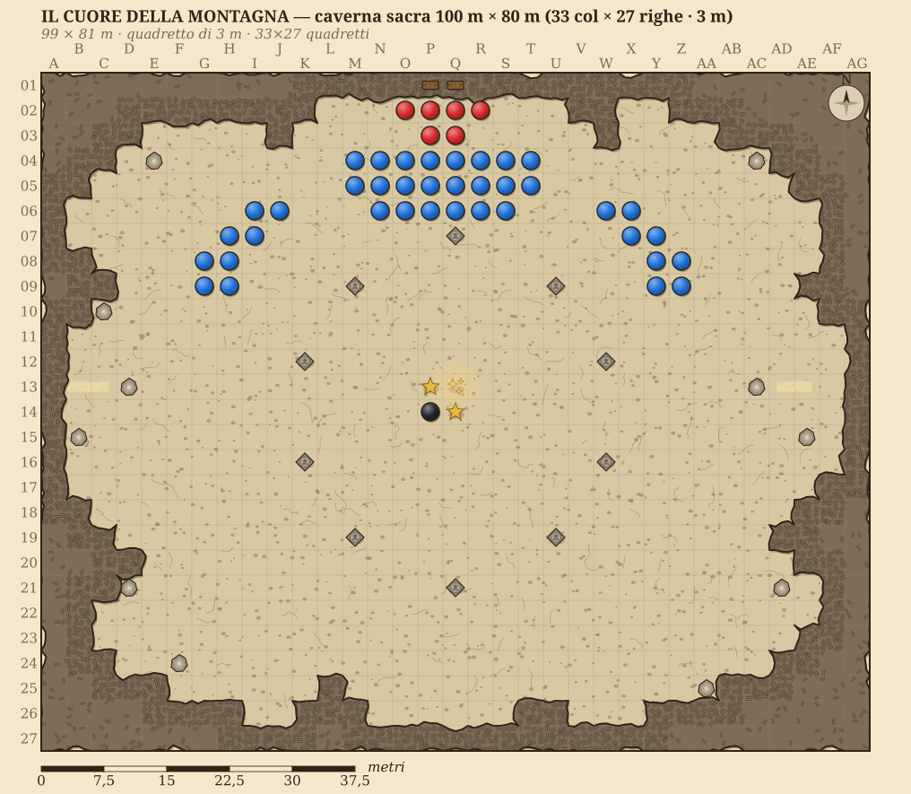

<!-- nuova-pagina -->

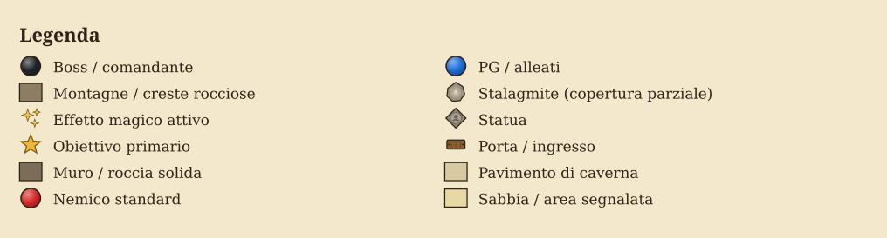

<!-- nuova-pagina -->


> Il varco che gli hobgoblin aprono nello schieramento è sul lato nord, fra la porta e
> l'altare (riga 04). Dove sono tutti: Scena 2, «Dove sono tutti». Le 🔴 alle
> righe 02-03 sono l'ondata che entra; i due orchi scossi che restano dopo
> l'aura non sono segnati, e stanno dentro lo schieramento, fra i nani e l'altare
>.

### ⏫ EVENTO CLIMAX — L'APPARIZIONE (la sfera dorata)

```
                    [SOFFITTO 40 m]
                    🌟🌟🌟🌟🌟🌟🌟🌟   stalattiti bioluminescenti
                           │  (round 6-7: la sfera si forma e SCENDE lenta)
                           ▼
                      ✨✨✨✨✨
                    ✨  SFERA   ✨
                   ✨   DORATA   ✨   ← Ø 3 m · TRICOLORE
                    ✨ oro·verde ✨      (Topazio+Smeraldo+Rubino)
                      ✨·rosso✨
                           │
                           ▼  ROUND 8 (breve: le porte cedono): ESPLOSIONE DI LUCE
                      💥💥💥💥💥
                           │
                           ▼
                      ⭐ ALTARE ⭐  (+3 m)
                         ⚫ Re Thorek (8 pf → occhi che si aprono)
              [4 SILHOUETTE EMERGONO]
         🛡️ Thorik   🥋 Tordek   🔮 Artemis   🌙 Hella
              💫 I RUMBLING STONES SONO ARRIVATI 💫
```

- **Tipo / scala**: santuario + epic reveal (Incontro **3B**, il CLIMAX della
  Sessione 3 dell'ARC-08; lato ARC-07 = questo capitolo Scene 1-2). **3 m/quadretto**.
- **Terreno & altitudini**: altare **+3 m** (P-Q 13-14, basalto nero, rune
  d'oro); piattaforme laterali **+1,5 m** (B-C13 ovest, d-e13 est: posizioni
  sopraelevate per tiratori, stalagmiti 🔺 = copertura parziale); soffitto
  **40 m**: le stalattiti possono **crollare** su effetti ad area potenti
  (Terremoto ecc.): 4d6 contundenti, raggio 3 m, **Riflessi CD 18** annulla.
- **Posizioni**: **90 nani** schierati a 30 m, rivolti alla porta (al centro, davanti al varco, 40 guerrieri su quattro file di scudi con dietro 12 balestrieri e 6 capi; ai lati due ali piegate all'indietro verso l'altare, ciascuna di 10 guerrieri, 4 balestrieri e 2 capi) + **Re Thorek** ⚫ sull'altare,
  critico a 8 pf, l'acido che lo consuma finché l'Apparizione non lo ferma, cosciente a occhi chiusi, incapace di combattere); **10
  statue** 🗿 sul cerchio a 20 m (Q07·U09·W12·W16·U19·Q21·M19·K16·K12·M09);
  nemici dalla **porta nord** P-Q01.
- **Le ondate (Incontro 3B — se giocato per intero, lato ARC-08)**:
  | Round | Ondata | Note tattiche |
  |---|---|---|
  | 1-2 | **30 Orchi berserker** | carica sconsiderata porta→altare |
  | 3-5 | **20 Hobgoblin sergenti** | muro di scudi, **immuni a paura**, tengono impegnati i nani (nella regia breve entrano dopo l'aura, che quindi non li tocca comunque) |
  | 6-8 | **15 Bugbear assassini** | Nascondersi +12, puntano i capi e Re Thorek — **interrotti dall'Apparizione** |
  | 9-10 | **Grimjaw + 10 Orog** (se vivo) | vede il ribaltone: ritirata strategica O sfida personale a Thorik; se già morto → capitano minore, auto-ritirata |
- **⏱️ Timing dell'Apparizione (due regie valide)**: giocando il **3B completo**
  (lato ARC-08, coi PNG giocabili Borin/Dara/Harbek/Nala; nella regia breve
  sono fra i dieci capi al centro, e non parlano) i PG appaiono al
  **Round 8**, nel mezzo dell'ondata 3; giocando **solo il lato ARC-07**
  (questo capitolo Scena 2, arrivo compresso) appaiono nell'istante in cui le porte cedono.
  Stessa scena, stesso altare: cambia solo quanto assedio si gioca prima.
- **Effetti immediati dell'Apparizione**: nani **+6 morale** (da −4 a +2),
  guariscono **2d8 pf**, **immuni a paura 1 h**; nemici **Volontà CD 25**: chi
  fallisce è in panico e fugge, chi fa 20 è scosso;
  Re Thorek apre gli occhi (riconosce Thorik: la Corona risuona); gli **occhi di
  rubino delle 10 statue si ACCENDONO** (benedizione ancestrale); i PG hanno un
  **round di sorpresa**.
- **Transizione**: da PNG giocabili → veri PG. Poi pulizia (questo capitolo Scena 3, doppia
  modalità) → portale di Dana → bastioni (ARC-08, il ponte d'arrivo).
- **Riferimento**: geometria/ondate = Atlante-08 **MAPPA 5**; regia lato ARC-07
  = questo capitolo Scene 1-3; cucitura = il ponte d'arrivo dell'ARC-08.

### MAPPA CM-2 — IL LATO NORD DEL CUORE (la pulizia · Scena 3, combattimento completo)

> **Carta tattica a 1,5 m** dello stesso spazio di CM-1: il lato nord della
> caverna, dalla porta di mithral all'altare, 42 m × 48 m. Si gioca qui il
> 🎚️ [COMBATTIMENTO COMPLETO] della Scena 3. CM-1 resta la vista d'insieme,
> a 3 m, per sapere dove stanno i blocchi dei nani e da dove arrivano le ondate.
> Ogni quadretto di CM-1 vale due per due quadretti di CM-2: la statua Q07
> di CM-1 è la O-P 13-14 di CM-2, l'altare P-Q 13-14 è la M-P 25-28.
> Bracieri 🏮, caduti 🦴 e le punte di roccia di un quadretto lungo la parete
> nord sono dettagli della carta a 1,5 m, che la vista a 3 m non disegna.

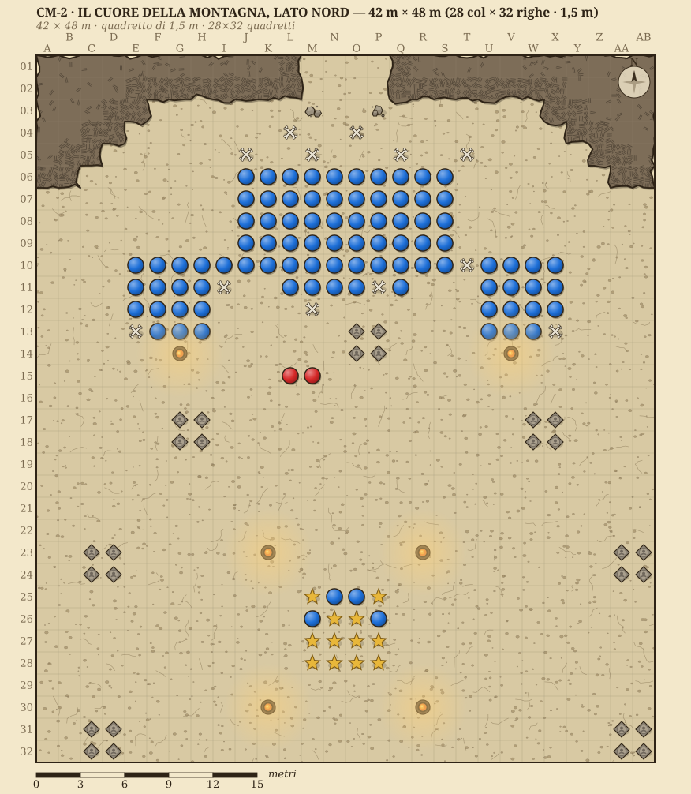

<!-- nuova-pagina -->

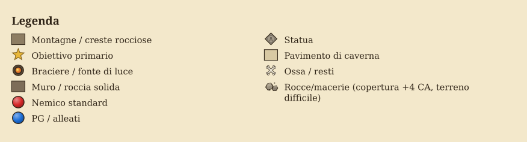

<!-- nuova-pagina -->


- **Distanze**: dal varco della porta al bordo dell'altare 33 m, 22 quadretti;
  dallo schieramento dei nani al centro dell'altare 30 m; dai due orchi scossi al
  bordo dell'altare 13,5 m, 9 quadretti. Gli hobgoblin, 6 m di velocità in
  armatura pesante, correndo coprono 18 m a round: la regia dei round della
  Scena 3 resta quella scritta.
- **Come si entra e come si gira**: il varco della porta è a nord; i bordi
  est, ovest e sud sono tagli della carta, e la caverna continua oltre (CM-1).
  Si gira attorno all'altare e alle statue; chi sale sull'altare (Scalare CD
  15) ha la quota di 3 m.
- **Chi c'è al primo round della pulizia**: i PG sull'altare, il re e Dana al
  centro; lo schieramento dei nani a nord; i due orchi scossi fra lo schieramento e l'altare.
  Gli hobgoblin non ci sono ancora: entrano dal varco alla fine del round 1.


\page

# VIII · La Forgia ricorda le ferite

{{note
##### ⚠ SOLO DM
Questo capitolo è materiale del DM: non mostrarlo ai giocatori.
}}

# B4 — "LA FORGIA RICORDA LE FERITE" (tabella di carry-over)
## Ponte meccanico P5 (duello con Skullcrusher, ≈372 DR) → ARC-08 (Fauci di Palude, 1372 DR)

> **Stato (B4)**: ⭐ deliverable cross-arc più importante dell'arco. Traduce
> l'**esito del duello con Skullcrusher** (oggi cap. VI, Scena 11; nel vecchio P5 fast-play era la Scena 5) in un
> **effetto quantificato** sullo statblock di **Fauci di Palude** nell'ARC-08
> (GS 15, 337 PF).
>
> **Fonte narrativa**: Moradin, P5-DEFINITIVO-PARTE2 r.290 — *«Ogni ferita che
> infliggi ora all'antenato, la mia Forgia la ricorderà quando affronterai il
> discendente.»* + Aegis Fang, P6 r.746 (*"sangue Skullcrusher chiama"*).
>
> ✅ **Canone di carry-over.** Sistema
> **D&D 3.5** — solo bonus tipizzati (competenza/circostanza/morale), **niente
> vantaggio/svantaggio 5e**. (Il DM può sempre ritoccare in corsa, ma questi
> sono i valori di riferimento su cui l'ARC-08 può contare.)

---

## 1. INPUT DAL P5 (cosa registra il fast-play)

Dalla **Scena 11 di cap. VI**, il duello, si registrano due dati (nel vecchio P5 era la Scena 5; stasera la Scena 5 è la notte nella fortezza):

1. **Esito del duello**: `UCCISO` / `FERITO GRAVE` / `FUGGITO`.
2. **Ferite ancestrali segnate** (`N`): numero di colpi andati a segno su
   Skullcrusher durante il duello (la "Cicatrice della Forgia"). Cap
   consigliato **N ≤ 3** ai fini del bonus. Con un gruppo di 13° tre colpi a
   segno arrivano già al secondo round: **N arriva a 3 quasi sempre**, e il
   bonus pieno è l'esito normale, non il premio raro.

---

## 2. TABELLA ESITO → EFFETTO SU FAUCI DI PALUDE (1372)

| Esito del duello | Effetto sullo statblock di Fauci (GS 15, 337 PF) | Razionale |
|---|---|---|
| **UCCISO** (Skullcrusher a 0 pf) | **Cicatrice ancestrale attiva**: Fauci entra in campo con **−10% PF** (337 → **303 PF**) e **Presenza Terrificante CD 25 → 23** contro i **portatori degli artefatti** (Thorik/Corona, Tordek/Bracieri+Cintura, Hella/Collana, Artemis/Ring). | La stirpe porta la ferita mortale del capostipite: il sangue "ricorda" di poter cadere. |
| **FERITO GRAVE** (fugge sotto ⅓ pf) | **−1 uso del soffio**: il primo **Soffio a Cono** (1/giorno) è **indisponibile**; il soffio in linea parte comunque ma la **prima** volta a −2 alla CD (27 invece di 29). Nessuna riduzione di PF. | La ferita non è letale ma "storpia" l'arma migliore del sangue. |
| **FUGGITO** (Skullcrusher si allontana quasi illeso) | Fauci **vi ha visti e riconosciuti**: **+2 iniziativa** e nessuna sorpresa contro di voi (sa chi siete) **MA morale fragile** — **fugge sotto i 137 PF** invece di 112 (soglia di ritirata alzata di 25). | Il drago è forte ma il sangue teme già i "quattro del futuro": più cauto, meno disposto a morire. |

---

## 3. BONUS PER "FERITE ANCESTRALI SEGNATE" (N)

Indipendente dall'esito (si somma), riflette P5-DEF-P2 r.294:

- **Ogni ferita ancestrale segnata** dà ai **portatori d'artefatto**, **solo
  contro Fauci nel 1372**, a **scelta unica del gruppo** all'inizio della
  battaglia:
  - **+1 di competenza ai tiri per colpire** contro Fauci, **oppure**
  - **+1d6 danni** ai colpi che vanno a segno su Fauci.
- Cap: **N ≤ 3** (max **+3 TxC** o **+3d6**).
- **Cicatrice fisica** (se Aegis Fang colpì Skullcrusher in volo, cap. VI Scena 11):
  Fauci ha una **cicatrice a forma di martello** su un'ala → **−2 metri alla
  Volare** (45 → 43) e i PG che lo sanno hanno **+2 di circostanza** a
  colpirlo mentre è in volo.

---

## 4. IL GANCIO INVERSO — AEGIS FANG "SENTE" FAUCI

- Quando Fauci di Palude entra in scena nel 1372, **Aegis Fang canta**
  (*"sangue Skullcrusher chiama"*, P6 r.746). Meccanicamente: **Thorik ottiene
  +2 di circostanza ai tiri per colpire contro Fauci** (bonus di circostanza
  3.5, definito e non 5e) e **avverte in anticipo** il primo soffio di Fauci
  (può dichiarare *pronto a ripararsi* → TS Riflessi del soffio **+2**).
- È l'eco meccanica del legame ancestrale: l'arma che uccise il capostipite
  riconosce il discendente.


\page

# IX · Conseguenze ed echi dell'arco

{{note
##### ⚠ SOLO DM
Questo capitolo è materiale del DM: non mostrarlo ai giocatori.
}}

# ARC-07 — CONSEGUENZE ED ECHI (tabella echi)
## Il Portale della Forgia Eterna (task C3)

> **Cosa**: raccoglie i **ganci a lungo periodo** dell'arco nel formato echi di
> ARC-09 (**evento → eco → quando riemerge → file che lo gestisce**), con
> **varianti per esito del duello** con Skullcrusher (P5). Cross-link alla
> **tabella echi ARC-08 (C2)** perché **uovo** e **Rubino** attraversano
> entrambi gli archi. Collocazione dell'uovo (§3) **approvata dal DM**; le varianti di tono del Rubino (§2) sono colore RP a
> discrezione del DM.
>
> 🔗 **Rapporto con l'Echo Ledger.** L'**Echo
> Ledger** è la **checklist operativa
> di chiusura d'arco** (una riga per filo armato: carry-over B4, Debito della
> Radice, Ghostlord, Vatore/Sal, Varis, Doni mancati, Cronaca Vivente — «stato
> in uscita → dove paga»). **Questo file è il riferimento DETTAGLIATO** che il
> Ledger riassume: qui vivono le **varianti di tono del Rubino** (§2), l'**Uovo
> di Fauci → ARC-10** (§3) e **Thorgrim → Cerimonia 100 Asce**, che il Ledger
> non ripete. Nessuna duplicazione: il Ledger elenca, questo file spiega.

---

## 1. TABELLA ECHI

| Evento (ARC-07) | Eco | Quando riemerge | File che lo gestisce |
|---|---|---|---|
| **Uovo di Fauci di Palude** (P6 r.994, sezione deprecata ma hook vivo) | Un uovo di drago nero nascosto sopravvive alla morte di Fauci → **nemesi futura** | **ARC-10** (qualunque sia l'esito ARC-08) | Questo file + **ARC-08 C2** (eco gemella); custode ↓ |
| **Eco "nessuna pietà" del Rubino** (P5-DEF-P2) | Il **tono della Corona** cambia in base a **come finisce il duello** con Skullcrusher (severità vs misericordia) | Ogni uso della Corona **dopo** il P5, e all'ingresso ARC-08 | Questo file (§2 varianti) |
| **Cronache dei Quattro Eroi** | La profezia compiuta diventa **fama crescente presso i nani** | **ARC-08 E5** (Custodi Eterni) e Cerimonia delle 100 Asce | ARC-08 E5 / handout C2 |
| **Thorgrim Barbadiferro** | L'antico portatore di Aegis Fang **riecheggia** nel presente | **Cerimonia delle 100 Asce** (ARC-08) | Cerimonia delle 100 Asce, ARC-08 |
| ⭐ **Il dono della deflessione** (cap. III §5, rito di Hella) | Se Thorik dona il **+2 di deflessione**: la Corona resta a **+1**, Hella ha lo **Scudo del Custode**, e ogni volta che lei lo usa **lui scatta verso chi è stato protetto** | Ogni scena in cui Hella prende un colpo per qualcuno, **da subito** | cap. III §5 + scheda Corona §«Il dono al rito di Hella» |
| ⭐ **Il bivio della Senzienza** («Il Viaggio a 1.000 Anni fa» Scena 12) | La Corona si sveglia **calda** o **fredda** secondo quel dono, e il tono **non è cosmetico**: decide come parla per tutto ARC-09 | **Rituale 4**, alla vittoria a −1.000; poi ogni uso della Corona | §2-bis qui sotto |
| ⭐ **Aegis Fang Stage 1** | L'Assedio vinto sveglia l'ascia, che smette di dubitare **o** comincia a giudicare | **Rituale 4**, subito dopo la Senzienza | «Il Viaggio a 1.000 Anni fa» Scena 12, Momento 3 |

---

## 2-bis. IL BIVIO DELLA SENZIENZA — il ramo che attraversa tre archi


La scelta si fa a cap. III §5, al rito di resurrezione, e **si incassa a
«Il Viaggio a 1.000 Anni fa» Scena 12**, un beat dopo. Fra le due cose il giocatore non deve
sentire niente: è l'intervallo che la rende una scelta e non una transazione.

| Al rito di cap. III, Thorik… | La Corona al Rituale 4 | La prima cosa che dice | Cosa cambia in ARC-09 |
|---|---|---|---|
| **ha donato** il +2 di deflessione | 🟢 **calda** | *«Tre volte hai pagato tu. La terza non te l'ho chiesta io.»* | parla per prima, avverte, e una volta **si sbaglia** — perché una voce che non sbaglia mai è un oracolo, non un personaggio |
| **ha rifiutato** | 🔴 **fredda** | una voce corretta e senza calore: dà informazioni, non commenti | risponde solo se interrogata. 🔓 **Reversibile**, e il punto di riscossione è scritto: **la prima volta che Thorik rischia qualcosa di suo per Hella** |

🎭 **Grigio politico, e vale per entrambi i rami.** La Corona **non è dalla
parte di Thorik**: il suo *Want* è la montagna. Ha accettato tre gemme e un
pegno perché le servivano, e lo dirà con la stessa calma con cui dice tutto il
resto. Il ramo caldo non la rende un'alleata, la rende **una che parla**.

🪓 **E Aegis Fang ascolta lo stesso bivio.** *«Ho visto. Non chiedo più.»* se
Thorik ha donato; *«Ho visto anche cosa non hai dato.»* se ha rifiutato.
L'ascia non lo abbandona: lo **guarda**, e il giudizio finisce nello stesso
momento in cui si scalda la Corona. I due artefatti si sciolgono insieme,
perché guardano la stessa cosa.

⚠️ **Da segnare appena il rito di cap. III è giocato**, qui:
finché la casella è vuota, «Il Viaggio a 1.000 Anni fa» Scena 12 ha due rami e il DM non sa quale
leggere.

| | Scelta di Thorik | Data | Segnato |
|---|---|---|---|
| ⬜ | donato / rifiutato | … | ⬜ |

---

## 2. VARIANTI PER ESITO DEL DUELLO (eco del Rubino)

L'esito del duello con Skullcrusher (P5 Scena 5) colora il **tono del Rubino /
della Corona** — eco narrativa, distinta dal carry-over **meccanico** B4:

| Esito duello | Eco del Rubino («la Possanza Nanica») | Riflesso RP nell'ARC-08 |
|---|---|---|
| **UCCISO** | *"Nessuna pietà"* — la Corona è **severa, implacabile**: la leggenda è stata scritta col sangue | Thorik parla con autorità dura; i nani lo trattano da eroe-giudice |
| **FERITO GRAVE** | Tono **equilibrio/dovere** — la ferita ricordata, non la morte | il più neutro; la Corona "pesa" ma non domina |
| **FUGGITO** | Tono **guardingo** — il sangue antico è sfuggito, e **sa chi siete**: la Corona è vigile, quasi inquieta | presagio: Fauci vi riconosce (coerente col ramo "fuggito" del B4) |

> ⚠️ Distinzione: questa è **atmosfera** (tono della Corona). Gli **effetti
> numerici** su Fauci stanno SOLO in
> cap. VIII (B4). Non duplicare qui.

---

## 3. L'UOVO — CUSTODE DESIGNATO

Collocazione dell'uovo (hook P6), **approvata dal DM**:

- **Dove**: un covo di palude isolato nei **Blackfens**, lontano dalla linea di
  marcia dell'orda — sopravvive alla battaglia di Hammerfist.
- **Chi lo cova**: un **servitore superstite di Fauci** (un hobgoblin drake-keeper
  o un piccolo drago nero giovane) che lo custodisce in attesa che si schiuda.
- **Innesco ARC-10**: l'uovo si schiude anni dopo → un drago nero adulto con la
  **memoria di sangue** dei "quattro del futuro" (nemesi che chiude il cerchio
  aperto da Skullcrusher).

Cross-link: **ARC-08 C2** tratta l'uovo come **eco gemella** (attraversa i due
archi); coordinare lì la collocazione definitiva per non duplicare.

---

## 4. HANDOFF

Nessun eco di questo file **contraddice** ARC-08/09: il Rubino resta
**single-use speso** dopo l'arco; l'uovo e le
Cronache sono ganci **coordinati** con ARC-08 C2/E5.


\page

# X · Durik, il compagno di Hella

{{note
##### ⚠ SOLO DM
Questo capitolo è materiale del DM: non mostrarlo ai giocatori.
}}

# Durik, il guardiano di pietra


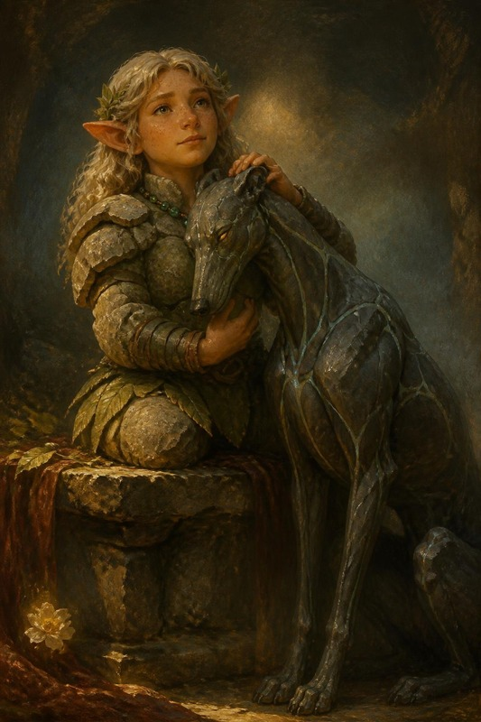

> *Era il tuo cane da galoppo, ed è morto prima di te. Nel tuo viaggio fra i morti il suo ricordo è caduto nella pietra,
> e la pietra se l'è tenuto.*
>
> *Quando la montagna ha ceduto lo Smeraldo, la polvere del guardiano sconfitto
> ha preso la sua forma. Mithral intrecciato a roccia scura, come muscolo a
> osso. Occhi di topazio. Non abbaia più: quando vuole dirti qualcosa fa un
> click, come una pietra che si assesta in un muro a secco.*
>
> *A Moradin avevi risposto che doveva proteggere te. Lo fa. Si mette sempre
> fra te e quello che ti vuole male, e non gliel'hai mai insegnato.*

---

## Le statistiche

**Durik Riforgiato** · Bestia magica (animale potenziato, sottotipo Terra) ·
Media · Neutrale Buono · compagno di Hella

| Voce | Valore |
|---|---|
| **Dadi Vita** | 12d10+36 · **102 pf** ¹ |
| **Iniziativa** | +2 |
| **Velocità** | 12 m · scavare 3 m in terra morbida |
| **CA** | **21** (+2 DES, +9 naturale) · contatto 12 · colto alla sprovvista 19 |
| **Attacco base / Lotta** | +9 / +15 |
| **Attacco** | morso **+15** mischia (**2d6+6**, 19-20/×2) |
| **Attacco completo** | morso **+15** (2d6+6) e 2 artigli **+13** (1d4+3) |
| **Spazio / portata** | 1,5 m / 1,5 m |
| **Tiri salvezza** | Tempra **+11** · Riflessi **+10** · Volontà **+6** |
| **Caratteristiche** | FOR 22 · DES 15 · COS 17 · INT 4 · SAG 14 · CAR 8 |

¹ *12 DV, 12d10+36 punti ferita.*

### Cosa sa fare

| Capacità | Effetto |
|---|---|
| **Riduzione del danno 5/adamantio** (Str) | la corteccia di granito e mithral regge a tutto tranne l'adamantio |
| **Colpi magici** (Sop) | i suoi attacchi superano la RD come armi magiche; il **morso conta come adamantio** |
| **Percezione tellurica 18 m** (Str) | sente chi si muove a terra entro 18 m, anche al buio, anche invisibile. Non chi vola |
| **Immunità** (Str) | charme, compulsione, paralisi, sonno, pietrificazione, veleno |
| **Resistenza al freddo 10** (Str) | |
| **Vulnerabilità all'acido** | l'acido gli fa **+50%**: la pietra si corrode |
| **Fedeltà assoluta** (Str) | nessuna magia lo mette contro di te. Chi prova a charmarlo o dominarlo deve superare **Volontà CD 18** o perde l'incantesimo |
| **Legame** (Sop) | gli dai ordini col pensiero entro **18 m**, senza parlare. Oltre, fa l'ultima cosa che gli hai chiesto, o ti protegge |
| **Empatia della pietra** (Sop) | sente il tuo umore a qualunque distanza, e ti manda il suo: pericolo, calma, fretta. Viaggia nel Sogno della Terra, finché uno dei due ha pietra sotto i piedi |

---

## Come si gioca

**Sta sempre con te.** Cammina al tuo fianco come un compagno normale. Non
serve evocarlo.

**Se non gli dai ordini, ti protegge.** Si mette fra te e il pericolo che
percepisce. Chi vuole arrivarti addosso deve passare da lui o girargli
intorno.

**Il click vuol dire: sotto.** Quando Durik fa il click, qualcosa si muove a
terra entro 18 m. Chiedi al DM dove.

**Non è fatto per combattere da solo.** È uno scudo che morde. Rende bene a
fianco di Thorik o di Tordek, per prendere un nemico ai fianchi, o quando
afferra e tiene fermo qualcuno mentre gli altri lavorano. Mandato da solo
contro un nemico grosso, non regge.

**Se viene distrutto** torna polvere, e la polvere torna nel terzo seme della
Collana. Con una carica dell'**Evocazione dei Guardiani** lo richiami subito,
per un'ora. All'alba è di nuovo intero, e resta. Se l'Evocazione è spenta,
perché hai chiamato i due Treant insieme, non puoi richiamarlo subito: torna
all'alba. I due Treant chiamati insieme all'alba della battaglia sono
l'eccezione: l'Evocazione non si spegne, e la carica che resta richiama Durik.

---

## Come cresce

Durik non cresce con i tuoi livelli. Cresce con le **Prove di Risonanza**:
momenti in cui il legame fra voi si mette alla prova. Il DM te lo dice quando
succede, di solito dopo.

| Prove | Cosa cambia |
|---|---|
| **1** ✅ | 12 DV, il morso passa a 2d6+6. *È già successa: è il motivo per cui è così* |
| 2 | RD **8**/adamantio · percezione tellurica **27 m** |
| 3 | diventa **Grande**: +4 FOR, −2 DES, +4 armatura naturale; nuovo attacco, schianto 2d6+9 |
| 4 | **immune all'acido**; il morso conta anche come ferro freddo |
| 5 | immune a tutti i danni da energia; +2 SAG, e capisce le tue parole senza ambiguità |


\page

# XI · La cassetta del DM: cast, pronuncia, read-aloud, suoni

{{note
##### ⚠ SOLO DM
Questo capitolo è materiale del DM: non mostrarlo ai giocatori.
}}

# ARC-07 — La cassetta del DM

> **A cosa serve.** L'arco ha cinque master e quasi tredicimila righe. Sono
> scritti bene e sono profondi, ma **al tavolo non si consultano**: nessuno cerca
> un PNG in mezzo a milleseicento righe mentre quattro persone aspettano.
>

⚠️ **Cosa questo file NON fa.** Non riscrive niente, non aggiunge fatti e non
decide nulla: **rimanda**. Dove i master tacciono — ed è il caso di qualche tic
vocale — la voce è stata scelta qui ed è canone, e il DM la cambia senza
chiedere il permesso a nessuno. I master restano la fonte di verità.

| § | Cosa |
|---|---|
| 1 | Il foglio del cast — chi parla, cosa vuole, come suona |
| 2 | Come si pronunciano |
| 3 | Indice dei read-aloud — **260 blocchi**, dove sono |
| 4 | I suoni dell'arco |
| 5 | Il momento da fotografare, uno per master |
| 6 | Accessibilità |

---

## §1 · Il foglio del cast

Una riga a testa. **Il tic vocale è la colonna che conta**: è ciò che rende un
PNG riconoscibile senza fare accenti, ed è la cosa che al tavolo si dimentica per
prima.

### Chi sta dall'altra parte

| Chi | Cosa vuole | Il tic | Dove |
|---|---|---|---|
| **Terros l'Antico** — guardiano del Nodo di Terra, GS 15 | che nessuno tocchi lo Smeraldo. Non odia: **custodisce** | parla **lentissimo**, come chi non ha mai avuto fretta in diecimila anni. Non alza mai la voce, nemmeno quando colpisce | cap. I §8 |
| **La Sentinella di Mithral** — l'anticamera | verificare chi entra. Non uccide chi supera la prova | **non parla**: risponde battendo. Un colpo = no, due = passa. | cap. I §7b |
| **Skullcrusher il Nero** — il duello a −1000 | vincere davanti all'orda, perché il potere è ciò che gli altri hanno visto | dice **il nome** dell'avversario prima di colpire, ogni volta | cap. VI Scena 11 |
| **Zog'tar** — il generale dell'orda | prendere Hammerfist. Sa uccidere diecimila uomini | parla ai suoi **contando**: «due file», «tre ore», «cento» | cap. VI Scena 8 |
| **Balvar Fuocospento** — il runaio esiliato, consigliere | incidere di nuovo, per chi glielo lascia fare | **non smette di lavorare mentre ti parla**. La punta sull'ardesia continua sotto le sue frasi | cap. VI Scena 7 |
| **Grask** — l'araldo col corno, fuori dalla tenda | non perdere più il corno | **non parla: soffia** | capp. IV e VI Scene 6-8 |
| **Vatore** (Sal a −1000) | la stessa cosa che vuole Sal oggi, mille anni prima | il tono del **collega**, non del nemico. Riconosce una firma, non un debito | cap. VI Scena 9 |

### Chi sta dalla vostra

| Chi | Cosa vuole | Il tic | Dove |
|---|---|---|---|
| **Durik** — il cane di pietra di Hella, nato dalla polvere di Terros al rito dello Smeraldo | stare fra Hella e il pericolo («Protegge Hella», la risposta data a Moradin nel viaggio) | **non parla e non abbaia**: suoni di pietra, un click, uno strofinio, una faglia lontana. Il click vuol dire che qualcosa si muove sotto i piedi | cap. I §9 fase 3 · cap. III §7 |
| **Therysol** — veglia il corpo di Hella | che qualcuno resti col morto. Non scende: veglia | frasi **corte e complete**. Non chiede mai niente | cap. II, cap. III |
| **Re Thorek I** — Hammerfist ≈372 DR | reggere le mura fino all'alba | parla **al plurale** anche quando parla di sé: «la fortezza pensa» | cap. IV Scena 4 |
| **Durin** — la pattuglia, di notte | portare a casa i suoi | ride **prima** di dire una cosa seria | cap. IV Scena 2, Appendice A |
| **Thorgrim Barbadiferro** — l'antenato | che l'ascia torni in una mano che sa perché | nomina **il sangue**, mai la persona: «il sangue riconosce il sangue» | cap. IV Scena 4 |
| **Sorella Brynja** — la cappella della fortezza | che all'alba ci siano incantesimi per le mura | **conta ad alta voce**, sempre; fa ogni domanda due volte, la seconda più piano | cap. IV Scena 5 |
| **Kettra** — l'alchimista del re | finire le fiasche per le mura prima dell'alba | **ride** quando qualcosa sta quasi per andare storto, e solo allora | cap. IV Scena 5 |
| **Gunnvor** — la maestra armaiola | che i duecento vecchi e ragazzi vadano sulle mura con un'arma vera | conta tutto in **braccia**: una pozione «vale un braccio» | cap. IV Scena 5 |
| **Hrodgar** — il capitano delle mura | tenere il tratto est finché il re non gli dice di lasciarlo | dà gli ordini con **una parola sola** | cap. VI Scena 10 |
| **Hald** — il nipote di Balvar, di guardia | il master non lo dice: è una recluta di diciannove anni, e non sa che lo zio esiliato è vivo, né che è nel campo | poco e **a bassa voce**; si drizza quando passa il capitano | cap. VI Scena 10 |
| **Il Custode** (ruolo, non persona) | leggere i pannelli e ricordare un fatto vero | — (è una funzione: la assume un PG) | cap. II §3-4 |

⚠️ **Fauci** e **Skullcrusher** arrivano da prima di quest'arco e tornano dopo:
la loro voce sta dove è nata, nella Battaglia di Hammerfist.
Non rifarla qui — **due versioni di una stessa voce sono peggio di nessuna**.

---

## §2 · Come si pronunciano

Un nome su cui il DM esita è un nome che sparisce dal gioco: si sente una volta,
non torna, e il PNG resta senza etichetta.

| Si scrive | Si dice | Nota |
|---|---|---|
| **Terros** | *TÈR-ros*, accento sulla prima | non «terròs» |
| **Zog'tar** | *ZOG-tar*, l'apostrofo è uno stacco netto, non una vocale | |
| **Balvar Fuocospento** | *BAL-var*, e il cognome **si traduce sempre**: è un soprannome, non un casato | |
| **Thorgrim** | *TÒR-grim*, la *h* non si sente | come Thorik |
| **Thorek** | *TÒ-rek* | ⚠️ si confonde con **Thorik** (il PG) a voce: dì sempre «**Re** Thorek» |
| **Therysol** | *te-RÌ-sol* | |
| **Durik** | *DÙ-rik* | ⚠️ e si confonde con **Durin**: uno emerge dal rituale, l'altro è la pattuglia di mille anni fa. Se li usi nella stessa serata, chiama il secondo «Durin della pattuglia» |
| **Vatore** | *va-TÓ-re* | è **Sal** a −1000: al tavolo non dirlo mai per primo |
| **Kettra** | *KÈT-tra* | |
| **Brynja** | *BRÌN-ia* | la *j* si legge *i* |
| **Gunnvor** | *GÙNN-vor* | |
| **Grask** | *GRASK*, una sillaba | |
| **Hrodgar** | *RÒD-gar*, la *h* non si sente | |
| **Hald** | *HALD*, una sillaba, la *h* aspirata | ⚠️ non confonderlo con **Hella**: chiamalo «il ragazzo di Hrodgar» se serve |
| **Hammerfist** | all'inglese, *HÀMMER-fist* | è così che lo dicono i giocatori da nove archi: non correggerli |

---

## §3 · Indice dei read-aloud — 260 blocchi

> **Perché esiste.** Un read-aloud si prova **prima, ad alta voce**: è l'unico
> modo perché suoni come una scena invece che come un paragrafo. Con 260 blocchi
> sparsi su cinque file, senza un indice non si prova niente e si legge tutto a
> freddo.

**Come si usa**: la sera prima, apri le tre righe più dense della sessione che
giocherai e leggile a voce. Tre. Non trenta.

### Il Piano della Terra & Terros — **130 blocchi**

| N. | Dove |
|---|---|
| 15 | Meccanica sintetica (3.5) — dentro §6-bis |
| 10 | §6-bis Seme-Mercato di Varis |
| 10 | §7b Anticamera della Magnetite — la Sentinella |
| 8 | L'apertura dell'Affresco A5 |
| 7 | testata dell'arco · 7 in §8b Il Distacco |
| 6 | §8a L'arrivo — i primi sei secondi |
| 5 | §9 fase 2, la regia dei tre round |
| 4 | §6 Cristalli Viventi · 4 in §8c-2b · 4 in §9 fase 1 · 4 in Round 1 |
| 3 | §7a il salto co-op · Skill Challenge · Round 2 · fase 3 |
| ≤2 | §1 highlight · §2 ingresso · §3 gravità · §4 viaggio · le 4 zone · eventi · §5 Xorn · §10 · §11-bis · §12 |

### Il Ritorno e gli Affreschi — **39 blocchi**

| N. | Dove |
|---|---|
| 6 | ⚒️ Tordek — le mani fredde, e poi lo zaino |
| 4 | testata |
| 3 | 🔮 Artemis — la porta · 🌙 Hella — dall'altra parte |
| 2 | Artemis davanti alla porta del Tempo · 🛡️ Thorik · «prima la regola» |
| 1 | gli otto affreschi (A1-A8), zone A e B, §3 Cronaca, §5 Visione Condivisa, §6 Stanza della Corona, mappa S-2 |

### La Resurrezione di Hella — **30 blocchi**

| N. | Dove |
|---|---|
| 7 | §6 Il debito della radice |
| 5 | testata |
| 4 | §4 Il rito corale · §7 Il risveglio |
| 3 | §3 Il Cuore di Moradin |
| ≤2 | §2 l'altare · §5 i tre doni · §8 il racconto delle prove · tesoro |

### Il Viaggio a Mille Anni fa — **43 blocchi**

| N. | Dove |
|---|---|
| 7 | Scena 9 Vatore · 7 il Sigillo di Ossidiana (Appendice B) |
| 6 | Scena 7, Balvar |
| 4 | testata · Scena 11 Skullcrusher |
| ≤2 | §0 quickstart · le 3 zone · le altre scene · supporto PF1e |

### Il Ritorno a Hammerfist — **18 blocchi**

| N. | Dove |
|---|---|
| 5 | testata |
| 3 | §5 La pulizia → passaggio all'ARC-08 |
| 2 | §3 L'accensione del Rubino · §4 La manifestazione · mappa CM-1 |
| 1 | stato di consegna all'ARC-08 · zone 1-2 · budget PX |


---

## §4 · I suoni dell'arco

**Descrizioni, mai titoli di brani**: ognuno usa quello che ha, e il file non
invecchia con le piattaforme (ADR-0018 «regola dei suoni»).

> **La regola di quest'arco**, e non è quella dell'ARC-08. Là il fragore era lo
> stato di riposo e i suoni si spegnevano per fare spazio. **Qui il silenzio è lo
> stato di riposo**: il Piano della Terra non ha vento, non ha uccelli, non ha
> acqua. Ogni suono che metti dentro **pesa il doppio**, e va tolto appena ha
> fatto il suo lavoro.

| Momento | Che suono |
|---|---|
| **L'ingresso nel Piano** (cap. I §2) | il **cambio di gravità si sente**: un tonfo sordo sotto lo sterno, una volta sola. Poi niente, e il niente dura |
| **Il viaggio, zone 1-4** (cap. I §4) | il passo sul cristallo, che cambia timbro a ogni zona: vetro, poi legno, poi pietra bagnata. **È l'unico cue del viaggio** |
| **Il campo dei Cristalli Viventi** (cap. I §6) | un accordo lunghissimo, appena udibile, che **c'era già da prima** che entrassero. Se il tavolo se ne accorge tardi, è perfetto |
| **La Sentinella** (cap. I §7b) | metallo su metallo, **due colpi**, e poi il silenzio che aspetta una risposta |
| **Terros — l'arrivo** (cap. I §8a) | ⚠️ **taglia tutto.** Il boss entra nel vuoto: nessuna musica sotto i primi sei secondi. La roccia che si muove è l'unico suono, e arriva **da sotto** |
| **Il Rituale dello Smeraldo** (cap. I §9) | qui, e **solo qui**, un tono che cresce per tre round e si chiude di colpo sull'incastonatura |
| **La Sala e gli Affreschi** (cap. II) | eco lunga di stanza vuota. Le voci dei PG tornano indietro: falle tornare anche quando parlano piano |
| **Il Cuore di Moradin** (cap. III §3-4) | **un battito.** Uno solo, lento, che si sente col corpo più che con l'orecchio. Smette quando Hella apre gli occhi |
| **Hammerfist ≈372 DR, di notte** (cap. IV zona 2) | diecimila tende: cuoio, ferro, e voci in una lingua che non si capisce. **Mai grida**: è un accampamento che dorme |
| **Le mura all'alba** (cap. VI Scena 10) | tamburi, e sotto i tamburi **il drago che non si vede ancora** |
| **Il duello con Skullcrusher** (cap. VI Scena 11) | il pubblico. Non i colpi: **la folla che reagisce ai colpi** |
| **Il ritorno e la manifestazione** (cap. VII §4) | silenzio pieno, poi **una voce sola** che riconosce chi è arrivato |

---

## §5 · Il momento da fotografare

Uno per master: il picco che il DM sa in anticipo, e che non manda di fretta.

| Master | Il momento | Perché è quello |
|---|---|---|
| cap. I | **Il Distacco** — l'Altare si centra sul guardiano (§8b) | è il round in cui il tavolo capisce che la stanza combatte con loro, non contro |
| cap. II | **La Visione Condivisa** dei Quattro Eroi (§5) | l'unico momento dell'arco in cui i quattro vedono **la stessa cosa** |
| cap. III | **Hella apre gli occhi** (§7) | tre sessioni di lutto si chiudono in una riga. Non aggiungere niente dopo |
| cap. IV | **Il colpo finale del duello** (Scena 11): chi abbatte Skullcrusher, e *«com'è che lo fai?»* | il drago di mille anni fa cade per mano loro, o fugge ferito. Il gesto di Thorgrim con l'ascia di Thorik (Scena 4) è già stato giocato |
| cap. VII | **La manifestazione** (§4) | la disfatta che si ribalta davanti a chi l'aveva già data per persa |

⚠️ **La regola**: un beat che non sa qual è il suo picco lo brucia correndo. Se la
serata è in ritardo, **si taglia altro** — non questo.

---

## §6 · Accessibilità

- **Daltonismo**: nelle mappe dell'arco il colore non porta mai da solo
  un'informazione — le zone hanno anche un simbolo e un numero. Se descrivi a
  voce, di' *«la piattaforma tre»*, non *«quella verde»*.
- **Dislessia e carico di lettura**: nessun giocatore deve leggere handout in
  silenzio al tavolo. Gli affreschi (cap. II §4) **si raccontano**, non si passano.
- **Carico cognitivo**: la gravità 2× (cap. I §3) è la regola che affatica di più.
  Tienila su **un foglietto solo**, e ripetila a voce ogni volta che qualcuno
  dichiara un movimento invece di aspettare che se la ricordino.
- **Sicurezza emotiva**: quest'arco contiene una **resurrezione** e il lutto che
  la precede. È il tipo di scena che tocca cose vere: se qualcuno al tavolo ha
  perso qualcuno di recente, si chiede prima, in privato, e si è pronti a
  giocarla più corta.
- **Ritmo**: il master cap. I è lungo il doppio degli altri. Se la sessione è di
  tre ore, **arriva fino alla Sentinella e fermati lì**: è una soglia naturale.


