# Il Giardino di Sale e Calce

*Avventura autoconclusiva per Pathfinder 1e: Qasr al-Milah, la città sul sale, e ciò che vive sotto la sua acqua*

{{note
**Sistema:** Pathfinder GdR, prima edizione. Le creature vengono dal Bestiario, avanzate a conti nell'appendice; quello che non è nel manuale è segnato dove compare.
**Party:** quattro PG di 13° livello, di qualunque classe. Ogni scontro ha la sua riga di scala per l'11° e il 15°.
**EL:** 8-17
**Durata:** una sessione lunga (6-7 h) o due sedute
**Aree:** due ingressi e 16 aree su quattro livelli, più la città
**Tono:** orrore acquatico in una città del deserto che muore di sete senza saperlo
}}

{{note
**Un modulo a parte.** Esiste una versione per D&D 3.5 che si gioca a Rethmar dentro una campagna. Questa non ne ha bisogno: stessa cisterna, stesso aboleth, un'altra città, nessun legame.
}}

## La verità

Sotto la piazza del **Pozzo dei Sospiri**, nel cuore di **Qasr al-Milah**, c'è la **Grande Cisterna di Tufo**: 57 metri per 37, diciotto metri di volta, pilastri di tufo, passerelle e catene. La scavarono quattro secoli fa i Re del Sale, che regnavano sulla piana prima che ci fosse una città, e da allora raccoglie le rare piogge e le falde profonde. Decine di migliaia di persone vivono di quell'acqua.

Scavando, i Re del Sale trovarono una sorgente salata e dentro qualcosa che dormiva: **Karkator**, un aboleth antico con sangue d'immondo. Murarono la sorgente con lui dentro e la chiamarono il **Santuario di Sale**. Nella sorgente, nei secoli, è cresciuto il **Cuore di Selenite**, una gemma del Piano dell'Acqua.

Trentun anni fa la città affidò la cisterna a **Mastro Tariq**, un ingegnere che la conosce pietra per pietra. Tre anni fa, riparando il fondo della vasca, Tariq sentì una voce nell'acqua. La voce disse di chiamarsi **Hasharr, il Pozzo Senza Fondo**, e gli promise che la sua opera sarebbe durata per sempre. Era Karkator. Tariq è diventato il suo chierico, ha riaperto il Santuario e ha messo il Cuore nei perni di bronzo antico sull'isolotto della sorgente.

Da un mese il Cuore corrompe l'acqua. Chi la beve per giorni smette di parlare e comincia a ubbidire. Karkator vuole quello che vuole ogni aboleth, una città di schiavi, e ha cominciato dal basso: i portatori d'acqua, i poveri dei pozzi bassi. Dal fondo del Santuario i suoi schiavi scavano una galleria verso il **pozzo privato del palazzo**: quando l'acqua del Visir sarà corrotta, la città avrà un padrone nuovo.

In mezzo c'è **Hamid il Sensale**, mercante d'acqua, che vende a peso d'oro l'acqua delle sue cisterne private mentre quella pubblica peggiora. Hamid non sa cosa ci sia sotto. Sa che Tariq lo paga per tenere lontani i curiosi, e che più la cisterna va male più lui guadagna.

**I PG possono vincere senza combattere tutti.** Tariq crede di servire un dio. Se capisce che Karkator lo sostituirà con il Visir appena lo scavo arriverà al palazzo, cambia parte. Hamid si vende al migliore offerente.

### Perché adesso

Da quattro settimane l'acqua dei pozzi bassi sa di sale e lascia un velo iridescente nel secchio. Fra i portatori d'acqua una trentina di persone ha smesso di parlare: lavorano, mangiano, la notte scendono verso il Pozzo dei Sospiri. Il Visir **Karim ibn-Suleiman** ha chiuso la cisterna «per lavori», su consiglio di Tariq, e la città beve l'acqua di Hamid. Fra dieci giorni arriva la grande carovana del sale, e con lei tremila persone e i loro animali. Se per allora l'acqua non torna, Qasr al-Milah si svuota.

## Gli ingressi

| Ingresso | Come lo trovano | Dove arriva | Cosa li aspetta |
|---|---|---|---|
| **P · Il Pozzo dei Sospiri** (QM-1) | il Visir: la gabbia del pozzo grande è la strada degli ingegneri | a +15 m, sulle passerelle alte (G1) | gli sgherri di Hamid in piazza, poi i Ragni delle Catene. La Torre si raggiunge per il ponte maestro |
| **W · La galleria del wadi** (QM-6) | Nadia la Cieca, o il ragazzo Samir: «l'acqua esce salata nel wadi, e di notte qualcuno ci entra» | a −12 m, dietro il Santuario (S1) | il chuul nella canaletta e lo scavo verso il palazzo. Si prende Karkator alle spalle, ma la Torre resta da fare dopo, o mai |

## Le tavole

Le piante dall'ingresso al fondo. I pilastri sono gli stessi in QM-2 e QM-3: chi cala da una catena arriva nel quadretto corrispondente.

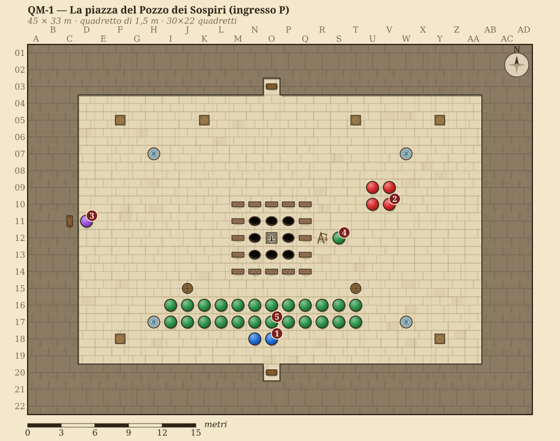

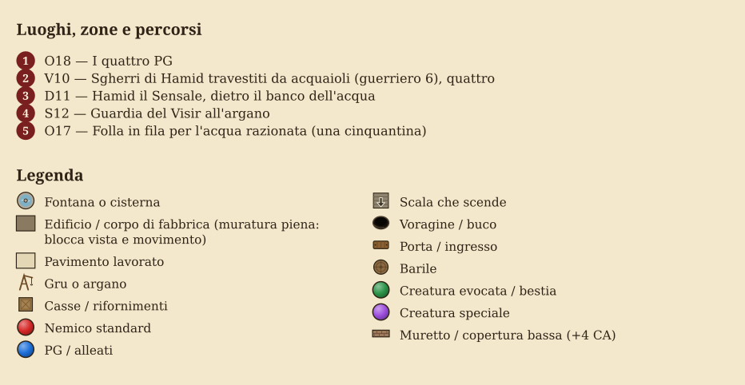

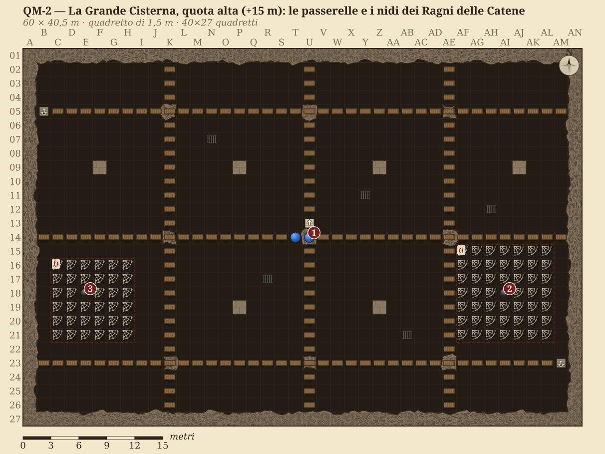

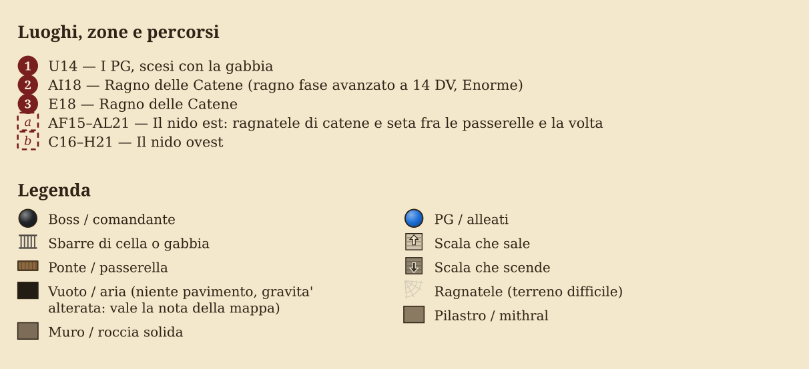

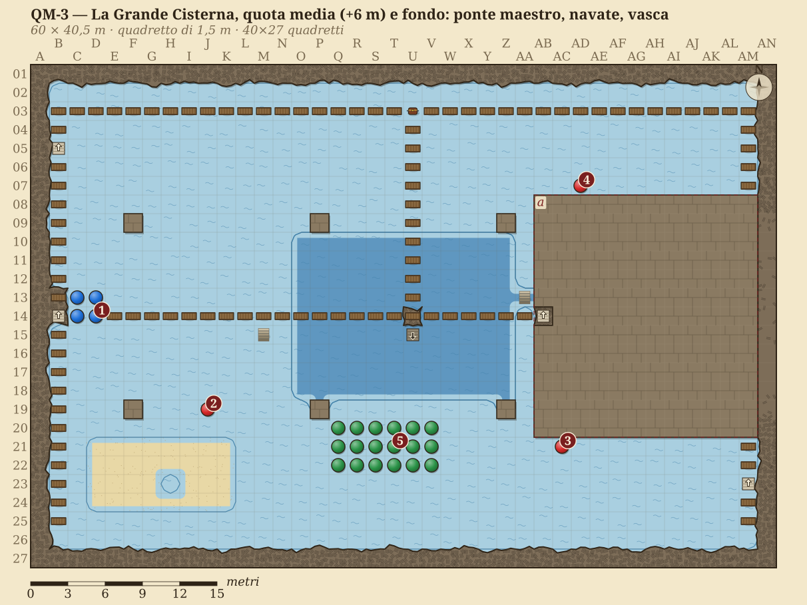

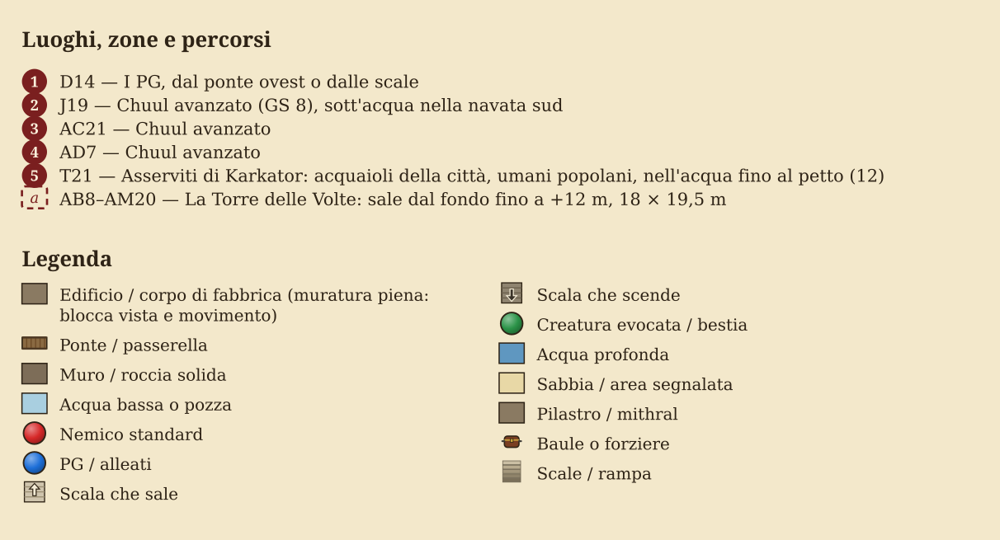

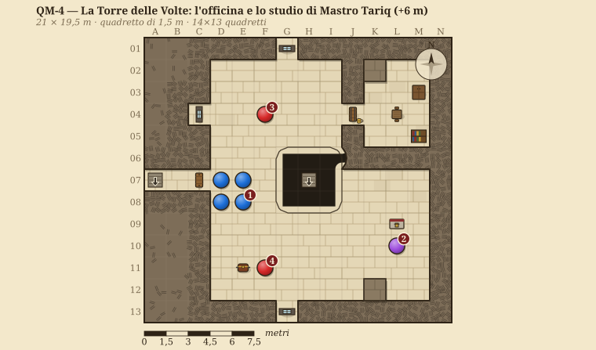

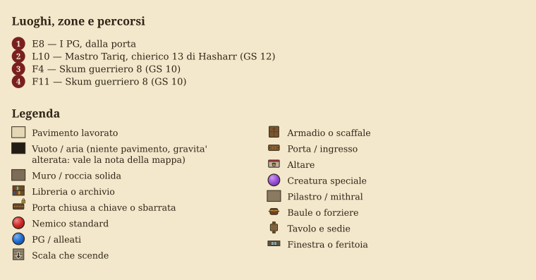

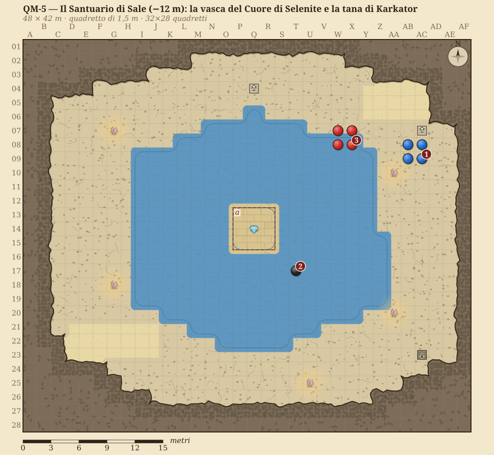

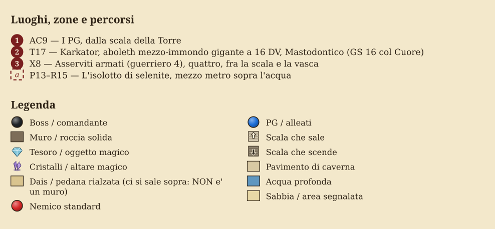

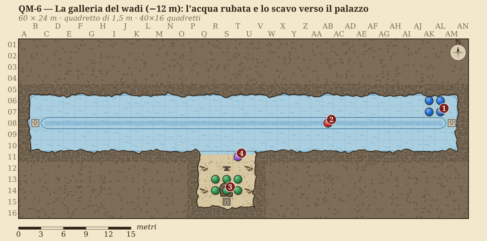

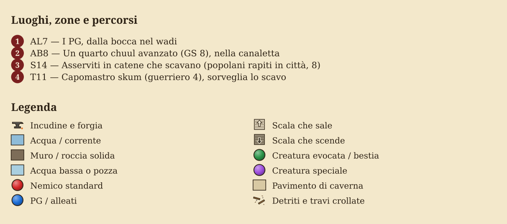

**Le quote.** Il pavimento delle navate è la quota 0. La volta è a +18 m, le passerelle alte a +15, il ponte maestro e i cornicioni a +6, la vasca centrale scende a −6, e sotto di lei il Santuario di Sale e la galleria del wadi stanno a −12. La piazza è a +21. La volta del Santuario è a −1, sotto un metro di roccia. La sorgente è in pressione: la sua acqua risale la galleria fino al letto del wadi, a +13, fuori dalle mura.

## Il cast

### Karkator, il Signore del Sale

Un aboleth Mastodontico lungo sedici metri, con la pelle che il sale ha reso bianca e screpolata come un fondale prosciugato. Il sangue d'immondo gli ha dato due ali di membrana grigia e una bocca piena di denti che un aboleth non dovrebbe avere. Ricorda i Re del Sale che lo murarono: per lui Qasr al-Milah è una città di ladri seduta sulla sua acqua.

**Come parla.** Mette le parole nella testa, nella lingua di chi ascolta, con la voce della persona che quella creatura ha amato di più.

> *La voce non viene dall'acqua. Viene da dietro di te, ed è la voce di qualcuno che hai sepolto. «Avete sete. Tutti, quassù, avete sete. Bevete. Io vi ricorderò quando nessun altro lo farà.»*

**GS 16** con il Cuore acceso, 15 senza.

### Mastro Tariq, l'ingegnere delle acque

Un uomo piccolo, sessant'anni, barba rossa tinta all'henné, le mani di un artigiano. Ama la cisterna più della città. Crede che Hasharr sia un dio e che la sua opera durerà per sempre.

**Come parla.** Lento, preciso, con i numeri: «Quattrocentoventi anni. Ottantamila anfore. Nessuna crepa che io non conosca.»

**La leva.** Mostrargli i disegni dello scavo (sono nel suo studio, T2) e fargli capire che lo scavo non serve alla cisterna ma al palazzo: Karkator vuole il Visir, e allora Tariq non gli servirà più. **Conoscenze (ingegneria) CD 20** per leggerlo nei disegni, poi **Diplomazia o Raggirare CD 25** (CD 20 con i disegni in mano). Convinto, Tariq dice del Cuore e della rigenerazione, e scende con i PG fino alla scala.

### Hamid il Sensale

Grasso, gentile, profumato di gelsomino, con un anello d'oro per dito. Vende l'acqua delle sue cisterne a dieci volte il prezzo. Paga quattro sgherri vestiti da acquaioli che stanno in piazza e riferiscono a Tariq.

**La leva.** Si compra (500 mo e la promessa di un posto nella nuova gestione della cisterna) o si spaventa (**Intimidire CD 22**). Comprato o spaventato, ritira gli sgherri e dice del pozzo di servizio da cui manda i messaggi a Tariq.

### Gli altri

| PNG | Chi è | Cosa sa | Leva |
|---|---|---|---|
| **Visir Karim ibn-Suleiman** | governatore di Qasr al-Milah, cinquant'anni, stanco, onesto | che manca un terzo dell'acqua dichiarata, e che i muti aumentano | affida la missione ai PG e paga (vedi il tesoro). Non sa di Tariq: lo difende finché non vede le prove |
| **Nadia la Cieca** | oracolo del Sole di mezzogiorno, sessant'anni, occhi bianchi | che l'acqua è maledetta da qualcosa di vivo e antico | dà 3 pozioni di *respirare sott'acqua* e una bacchetta di *rimuovi maledizione* (LI 5, 12 cariche); avverte della «cattedrale bianca sotto la cattedrale d'acqua» |
| **Capitano Yusuf** | capo della guardia del Pozzo, all'argano | che la gabbia scende sei metri sulle passerelle, e che da un mese nessuno di quelli che sono scesi è tornato | apre la gabbia con il sigillo del Visir |
| **Samir** | ragazzo dei portatori d'acqua, 13 anni | gli uomini-pesce nel wadi, di notte | indizio dell'ingresso W |

## Le leve di classe

I PG sono di qualunque classe. Queste leve sono quelle che la cisterna offre a chi ha certi strumenti; un tavolo che non ne ha nessuna gioca lo stesso, con più rischio.

| Chi | La leva | Dove | Prova o costo | Cosa cambia |
|---|---|---|---|---|
| **Druido o chierico dell'acqua** | *controllare acqua* abbassa la vasca centrale di sei metri | G6, S1 | un incantesimo di 4° livello | si scende al Santuario senza nuotare nell'acqua di Karkator, e lui non sente arrivare nessuno |
| **Druido** | aprire gli scarichi fra le radici pietrificate sotto le navate | G5 | Conoscenze (natura) CD 20, 10 minuti | le navate si svuotano: i chuul restano allo scoperto e perdono il vantaggio dell'acqua |
| **Monaco** | correre sulle catene e sui muri (Acrobazia, movimento veloce) | G1, T3 | Acrobazia CD 20 sulle catene | arriva dove il gruppo cade, e stacca i perni del Cuore a mani nude (i colpi senz'armi contano come armi magiche) |
| **Guerriero** | la teleferica: lancia un'arma legata a una catena fra due pilastri | G1, G4 | tiro per colpire contro CA 10, Forza CD 20 per tendere la catena | chi non vola attraversa le navate senza scendere fra i chuul |
| **Chi vola** | fare da esca ai ragni | G1 | nessuna, ma rischia le catene e la risonanza | tiene i ragni lontani dagli altri per due round. Se lo ancorano resta appeso: gli altri devono andarlo a prendere |
| **Arcanista, mago, cinetista** | sintonizzarsi col Cuore | S2 | Sapienza Magica o Utilizzare Congegni Magici CD 28 | è la scelta di tenerlo corrotto (Atto III), e ha un prezzo |
| **Chierico o paladino buono** | *santificare* o *consacrare* sul Cuore | S2, dopo | un incantesimo di 5° o 2° livello | purifica il Cuore (Atto III) |
| **Chiunque con fuoco o danno buono** | ferire Karkator davvero | S1 | nessuna | è il danno che la rigenerazione non toglie |

**Contro Karkator conta la RI.** Ha RI 26: un incantatore di 13° la supera col 13 sul d20 (con Incantesimi Inarrestabili prima). *Controllare acqua*, *santificare*, le evocazioni e i potenziamenti sugli alleati non la permettono e funzionano sempre.

## Atto I — La città che ha sete

**Obiettivo dell'atto:** i PG devono uscirne sapendo che l'acqua è corrotta da qualcosa sotto la piazza e avendo trovato almeno un ingresso. Da 45 a 75 minuti.

### Ganci (usane uno, gli altri diventano scene)

1. **Il Visir li convoca.** Hanno fama, sono di passaggio con una carovana: la città ha bisogno di qualcuno che non dipenda da Hamid.
2. **Un compagno beve.** Uno dei loro servitori o un PNG amico ha bevuto ai pozzi bassi, e da due giorni non parla.
3. **Nadia li cerca.** «Il sole mi ha mostrato quattro ombre che scendono. Siete voi.»

> *La piazza del Pozzo dei Sospiri è piena di gente e silenziosa. La fila per l'acqua di Hamid gira due volte attorno alla bocca del pozzo grande, chiusa da una grata. Le donne hanno le anfore, i bambini le borracce. Nessuno parla. Dietro il banco d'acqua un uomo grasso conta le monete con le dita piene d'anelli, e quattro acquaioli che non portano acqua guardano chi arriva.*

### Le dicerie della fila (1d6, una falsa)

| d6 | Diceria |
|---|---|
| 1 | «I muti scendono al pozzo di notte. Li ho visti fermi davanti alla grata, come in preghiera.» |
| 2 | «Mastro Tariq non esce dalla cisterna da un mese. Gli calano il cibo con la gabbia, per quattro.» |
| 3 | «Nel wadi l'acqua esce salata. Prima non usciva affatto.» |
| 4 | «Chi beve ai pozzi bassi ha la pelle che luccica, come bagnata anche quando è asciutta.» |
| 5 | «Hamid ha comprato le sue cisterne tre mesi fa. Come sapeva che sarebbe servita?» |
| 6 | «È la carovana del sale che porta la maledizione, ogni anno.» (falsa) |

### Le scene dell'atto

**Il palazzo.** Il Visir li riceve nel cortile delle fontane spente. Offre 5.000 mo subito e 10.000 a lavoro fatto, più una casa in città. Dà il sigillo per la gabbia.

**La casa di Nadia.** Nella città bassa, fra le tende dei portatori d'acqua. Nadia tocca la borraccia di un PG e dice cosa c'è dentro: «Qualcosa di vecchio, che sogna.» Dà le pozioni e la bacchetta. **Sapienza Magica CD 25** sul velo nella borraccia: è il muco di un aboleth.

**Il banco di Hamid.** Hamid nega tutto con un sorriso. Gli sgherri seguono i PG.

**Il wadi.** Chi segue la diceria 3 o Samir trova la grata della galleria nel letto del wadi, a un'ora dalle mura. **Percezione CD 20**: impronte palmate nel fango.

**Il cancello.** Se dopo un'ora i PG non hanno un ingresso, il Visir li manda dal Capitano Yusuf: la gabbia non si nega a nessuno.

## Atto II — La Grande Cisterna

### P1 · La piazza del Pozzo dei Sospiri (QM-1)

Vedi l'Atto I. Scendere di giorno vuol dire farlo davanti a cinquanta persone; di notte, davanti agli sgherri.

### P2 · La gabbia

Una gabbia di ferro per quattro persone, calata dall'argano per sei metri attraverso la volta. Arriva al centro delle passerelle alte (G1). **Il rischio:** se gli sgherri di Hamid sono in piazza e i PG scendono senza averli tolti di mezzo, uno di loro taglia la fune a metà discesa. La gabbia cade per tre metri sulle passerelle (1d6 a chi è dentro) e si incastra; chi era aggrappato fuori fa un TS su Riflessi CD 15 o cade fino all'acqua, 15 m sotto (5d6, dimezzati dall'acqua profonda). In più Hamid manda il ragazzo da Tariq: la Torre è allertata.

### G1 · Le passerelle alte (QM-2)

> *La gabbia esce dalla volta e sotto non c'è niente. Una sala grande come una cattedrale, buia, con l'acqua quindici metri più in basso che riflette la luce della tua lanterna in mille punti. Le passerelle partono dalla gabbia in quattro direzioni, assi di legno su travi di ferro, senza parapetto. E dalla volta pendono catene, decine di catene, che scendono fino all'acqua. Qualcuna si muove. Non c'è vento.*

**Incontro (EL 12):** i due Ragni delle Catene. **Round 1:** passano eterei e si muovono sotto le passerelle. **Round 2:** tornano materiali alle spalle del PG più isolato, mordono e lo ancorano con le catene. **Dal round 3:** uno tiene l'ancorato, l'altro va sul volatore: le catene a 15 m lo raggiungono anche in aria, e la risonanza lo assorda. Si ritirano nell'Etereo sotto il 25% dei pf e avvisano la Torre.

**Chi cade dalle passerelle** fa un TS su Riflessi CD 15 per afferrare una catena: se lo passa resta appeso e risale in un round (Scalare CD 15), se lo fallisce cade fino al ponte (9 m, 3d6) o all'acqua del fondo (15 m, 5d6: un metro d'acqua non attutisce).

**Scala:** all'11° un solo ragno con l'archetipo giovane in più; al 15° tre ragni.

### G2 e G3 · I nidi dei ragni

Due intrichi di catene e seta fra le passerelle e la volta, a est e a ovest: si arriva scalando le catene (Scalare CD 15, 3 m). Dentro, quello che resta di chi è sceso prima: due operai, un ladro, un ingegnere del Visir. **Tesoro:** vedi la tabella.

### G4 · Il ponte maestro (QM-3)

> *Il ponte attraversa la sala a mezza altezza, dritto come una lama, con un parapetto di ferro battuto che qualcuno ha decorato di onde. In fondo c'è una torre che sale dall'acqua fino quasi alla volta, con le feritoie illuminate di verde. Sotto il ponte, nell'acqua delle navate, si muovono delle ombre lunghe come barche.*

Il ponte è lungo 39 m dal cornicione ovest alla porta della Torre, sotto le feritoie per tutta la lunghezza. Chi lo percorre senza nascondersi è visto dalla Torre (Percezione degli skum di vedetta contro Furtività).

### G5 · Le navate allagate

Un metro d'acqua sul fondo, banchi di sale affiorati, e dodici asserviti che raschiano il sale dalle pareti. **Incontro facoltativo (EL 11):** tre chuul avanzati sott'acqua, che salgono solo su chi scende dal ponte o ci cade. Gli asserviti non combattono. Portarli su è il conflitto della scena: non si oppongono, ma Karkator li richiama ogni ora e tornano verso l'acqua finché non li libera *rimuovi maledizione* (la bacchetta di Nadia ne cura dodici) o la sua morte.

**Scala:** all'11° due chuul; al 15° quattro.

### G6 · La vasca centrale

Sei metri d'acqua torbida con il velo iridescente del muco. Sul fondo, il pozzo di scarico: un sifone di sei metri che porta al Santuario (Nuotare CD 15, due round in apnea). È la strada più breve verso Karkator, e la più pericolosa: si arriva nella sua acqua, e lui la sente.

### G7 · Le paratoie

Sul ponte nord, sopra le bocche che portano l'acqua alle fontane della città. Tariq le ha regolate perché le fontane ricevano poco e l'acqua sfoghi nel wadi. **Conoscenze (ingegneria) CD 15**: rimetterle come erano, in un'ora, restituisce l'acqua alla città anche se il Cuore resta acceso (l'acqua resta corrotta, ma Hamid perde il suo mercato).

### T1 · L'officina della Torre (QM-4)

> *Dentro la Torre fa caldo e c'è odore di olio e di calce. Sui tavoli ci sono modelli di chiuse in ottone grandi come un bambino, disegni fissati con i chiodi, un compasso lungo un braccio. Nel mezzo la scala a chiocciola sprofonda in un pozzo di luce verde. Un uomo piccolo con la barba rossa si alza dallo scrittoio e si pulisce le mani sul grembiule, come un artigiano interrotto.*

**Incontro (EL 14):** Mastro Tariq e due skum guerriero 8.

**La Torre tranquilla o allertata.** È allertata se Hamid ha avvisato, se i ragni sono fuggiti, se i chuul hanno combattuto o se qualcuno ha mosso una paratoia. *Tranquilla*: Tariq è allo scrittoio e gli skum ai lati della porta, con addosso solo le due *veste magica* dell'alba. *Allertata*: Tariq ha già lanciato *resistenza agli incantesimi*, *libertà di movimento*, *potere giusto* e *camminare nell'aria* e aspetta dietro la tromba della scala; due skum di vedetta stanno sul terrazzo a +12 m. In più ha avvisato Karkator.

**Round per round.** Round 1: *barriera di lame* (13d6, Riflessi CD 22 dimezza) fra la porta e la tromba; gli skum spingono chi passa verso la tromba (Spingere Migliorato; chi ci cade prende 6d6, vedi T3). Round 2: *blasfemia* se almeno due PG sono a portata (al LI 13 i PG di 13° restano frastornati un round se falliscono la Volontà), altrimenti *dissolvi magie superiore* sul volatore. Dal round 3: *uccidere i viventi* sul guerriero più vicino, *colpo infuocato* sui gruppi. Sotto i 30 pf scende la tromba con *camminare nell'aria* e grida il nome del suo dio: arriva al Santuario in due round, e lo scontro finale sale di un EL.

**Parlare con Tariq.** Funziona prima dello scontro o quando è sotto la metà dei pf. Vedi la leva nel cast.

**Scala:** all'11° un solo skum e Tariq senza *barriera di lame*; al 15° tre skum.

### T2 · Lo studio di Tariq

Dietro una porta chiusa con *serratura arcana* (Disattivare Congegni CD 30, o le chiavi di Tariq). Lo scrittoio, i trattati antichi, lo scaffale delle carte.

{{note
**Le carte dello studio.** **Percezione CD 15** per trovarle, **Linguistica CD 20** per capirle:
- i disegni dello scavo dal Santuario al pozzo del palazzo, con la data in cui deve arrivare: la notte prima della carovana;
- le ricevute di Hamid, pagato per tenere lontani i curiosi;
- una pagina scritta da Tariq in una grafia che non è la sua, sempre la stessa frase: «Il Visir berrà per ultimo.»

Sono la prova che scagiona la città davanti al Visir e che convince Tariq.
}}

### T3 · La scala a chiocciola

Diciotto metri di scala di pietra attorno a un pozzo aperto, fino al Santuario. Chi ci cade prende 6d6. Il pozzo è illuminato dal basso dalla luce verde del Cuore.

### S1 · Il Santuario di Sale (QM-5)

> *La scala finisce in una grotta bianca. Le pareti sono sale, sale puro, cresciuto in colonne e in ventagli che riflettono una luce verde e fredda. La luce viene dal centro di una vasca immobile, da una pietra grande come un cuore umano incastrata in un isolotto di cristallo. L'acqua della vasca non ha onde. Poi ne ha una, lunghissima, che parte dal centro e arriva fino ai tuoi piedi. Qualcosa sotto si è voltato.*

**Incontro (EL 16, 17 con Tariq):** Karkator e quattro asserviti armati.

**Karkator avvisato o no.** È avvisato se la Torre era allertata, se Tariq è fuggito da lui o se qualcuno ha toccato l'acqua della vasca o delle navate di sopra. Avvisato, ha già *aura sacrilega* (CA 30) quando i PG entrano. Non avvisato, il round di sorpresa è dei PG, e al primo round lancia l'aura: chi arriva da W senza toccare l'acqua di sopra lo trova così.

**Round per round.** Round 1: *dominare mostri* (Volontà CD 24) sul combattente più forte, che da quel momento lo difende. Round 2: *blasfemia* (LI 16, Volontà CD 22: chi fallisce è frastornato un round e perde 2d6 di Forza per 2d4 round) o *avvizzimento orrendo* (16d6, Tempra CD 23 dimezza) se i PG sono sparsi. Round 3: *inversione della gravità*. Poi la mischia: morso, artigli e quattro tentacoli, e una prova di lottare per trascinare un PG sott'acqua, dove la nube di muco (Tempra CD 28) gli toglie l'aria.

**La gravità invertita.** Una volta al giorno, dal Cuore, al LI 15: fino a sette cubi di 3 m sulla riva e sull'isolotto. La vasca resta fuori, quindi l'acqua rimane dov'è. Dura fino a 15 round, e Karkator la congeda quando vuole, purché resti entro 18 m dal Cuore. Chi è nell'area cade verso la volta della grotta, 11 m più su, e prende 3d6; altrettanti quando la gravità torna, salvo chi ricade nella vasca. Con un TS su Riflessi CD 20 ci si aggrappa a una colonna di sale e si resta dove si è. Chi vola non cade.

**Come finisce.** Finché il Cuore è nei perni, ogni danno che non sia fuoco o buono è non letale, e a ogni suo turno la rigenerazione ne toglie 15. Karkator sviene quando il non letale accumulato supera i pf che gli restano, e fugge nella galleria del wadi quando il non letale accumulato arriva a 200. Se i perni sono rotti o il Cuore è a più di 18 m la rigenerazione finisce: il danno torna letale, e lui fugge sotto i 50 pf. Se fugge con i perni interi si porta via il Cuore.

**Scala:** all'11° Karkator senza l'archetipo gigante (Enorme, GS 14 col Cuore) e senza *blasfemia*; al 15° con l'archetipo avanzato in più (GS 17) e sei asserviti.

### S2 · Il Cuore di Selenite

Il Cuore è incastrato in quattro perni di bronzo antico sull'isolotto, mezzo metro sopra l'acqua. **Arrivarci.** Dalla riva più vicina sono sette quadretti di vasca (10,5 m): Nuotare CD 10, perché l'acqua salata sostiene. Chi nuota adiacente a Karkator sott'acqua fa il TS contro la nube di muco (Tempra CD 28), e gli asserviti sulla riva prendono gli attacchi d'opportunità. Si arriva anche in volo, con *camminare sull'acqua* o con una catena tesa dalla riva. Staccarlo: rompere due perni (durezza 5, 20 pf ciascuno) o una prova di Forza CD 24. È la chiave dello scontro: senza il Cuore, Karkator perde la rigenerazione, il volo veloce e l'*armatura magica*. Chi lo tocca a pelle fa un TS contro *dominare mostri* (Volontà CD 24) quando lo prende e poi uno al minuto finché lo tocca, finché l'aboleth vive. In una borsa o preso con i guanti non scatta. Chi fallisce riporta il Cuore nei perni.

> *Il Cuore è caldo. È l'unica cosa calda di tutta la grotta. Dentro, nella luce verde, si muove qualcosa che sembra acqua e non lo è, e da lì viene un rumore lontano di risacca: un mare che nessuno di voi ha mai visto, senza rive.*

### W1 · La bocca nel wadi

Una grata di ferro mangiata dal sale nel letto asciutto del wadi, a un'ora dalle mura. Dietro, l'acqua salata esce in un rivolo e la galleria sale per 300 m. Aprire la grata: **Forza CD 23** o le chiavi di Tariq.

### W2 · La galleria del wadi (QM-6)

Acqua al ginocchio, la canaletta profonda al centro, e la galleria laterale dello scavo verso il palazzo, puntellata. **Incontro (EL 8):** un chuul avanzato nella canaletta. Otto asserviti scavano in catene, sorvegliati da un capomastro skum che al primo segno dei PG fugge verso il Santuario ad avvisare Karkator. **La scelta dello scavo:** due puntelli abbattuti (durezza 5, 20 pf ciascuno) fanno crollare la galleria laterale e salvano il pozzo del palazzo; il rumore avvisa Karkator.

## Atto III — Cosa fare del Cuore

Lo scontro con Karkator finisce in tre modi: muore, fugge nella galleria, o i PG si ritirano. Se resta il Cuore, la scelta su cosa farne è dei giocatori.

| Scelta | Come | Cosa costa | Cosa dà |
|---|---|---|---|
| **Purificarlo** | *consacrare* sul Cuore, poi un'ora di preghiera all'alba; o *santificare*. Nadia lo sa fare, ma non scende: il Cuore va staccato e portato da lei | un'ora e un incantatore disposto | il Cuore diventa un oggetto meraviglioso (appendice); la cisterna è pulita in un giorno |
| **Distruggerlo** | durezza 20, 80 pf, o *disgiunzione arcana* | il valore | la cisterna è pulita in 24 ore |
| **Tenerlo corrotto** | Sapienza Magica o Utilizzare Congegni Magici CD 28 | qualcosa nel Piano dell'Acqua ascolta chi lo usa, e ogni uso lo avvicina | *inversione della gravità* una volta per settimana |
| **Venderlo a Hamid** | Hamid offre 25.000 mo | Hamid ne farà un'arma per comprarsi la città | l'oro, e un nemico ricco |

## Le conseguenze in città

| Scelta | Cosa succede |
|---|---|
| Cuore purificato, Karkator morto | la cisterna è pulita in un giorno, i muti guariscono in una settimana, la carovana arriva in una città viva. Il Visir paga e offre ai PG il titolo di Custodi dell'Acqua |
| Cuore distrutto | come sopra, senza l'oggetto |
| Karkator fuggito | l'acqua si pulisce, ma fra un anno la sorgente torna salata: un gancio per un'altra avventura |
| Tariq catturato vivo | il Visir lo processa; se i PG mostrano le carte, lo condanna all'esilio e non a morte, e Tariq ripara le paratoie prima di partire |
| Tariq ucciso | le paratoie vanno riparate da qualcuno (un giorno, Conoscenze (ingegneria) CD 25) |
| Scavo crollato | il pozzo del palazzo è salvo. Se lo scavo resta aperto e Karkator è vivo, il Visir è il primo asservito della nuova stagione |
| Hamid smascherato | il Visir gli confisca le cisterne e le dà alla città |
| Cuore venduto a Hamid | fra un mese Hamid ha la guardia del Pozzo dalla sua parte, e il Visir chiede aiuto ai PG un'altra volta |

## La regola dei tre indizi

| Rivelazione | Canale 1 | Canale 2 | Canale 3 |
|---|---|---|---|
| L'acqua è corrotta da qualcosa di vivo | Nadia e la borraccia | Sapienza Magica sul velo | diceria 4 |
| La fonte è sotto la piazza | *individuazione del magico*: l'aura forte viene dal basso | i muti davanti alla grata (diceria 1) | il Visir e i conti dell'acqua |
| Tariq è coinvolto | la cisterna chiusa «per lavori» | diceria 2 | le ricevute di Hamid |
| C'è un ingresso nascosto | Samir | diceria 3 | le impronte nel wadi |
| Il Cuore dà la forza a Karkator | la luce verde dalla scala | la rigenerazione che si vede in combattimento | Tariq, se parla |

## Il tesoro

| Dove | Cosa | Valore |
|---|---|---|
| Nidi dei ragni (G2-G3) | 2 pozioni di *cura ferite gravi*, *bracciali dell'armatura +3*, monete e pietre degli operai | circa 12.000 mo |
| Chuul (G5 e W2) | sul fondo: gioielli degli annegati, una *bacchetta di dardi incantati* (LI 9, 30 cariche) | circa 9.000 mo |
| Mastro Tariq | armatura completa +2, scudo pesante di metallo +1, tridente +1, *amuleto della Saggezza +4*, *mantello della resistenza +2*, *anello di protezione +1* | circa 31.000 mo |
| Santuario (S1) | il tributo di Karkator: gemme e oggetti dei Re del Sale | circa 15.000 mo |
| Il Cuore purificato | oggetto meraviglioso (appendice) | 18.000 mo |
| Il Visir | 5.000 mo subito e 10.000 a lavoro fatto | 15.000 mo |
| **Totale** | | **circa 100.000 mo** |

Il tesoro è tarato sul modulo gemello per D&D 3.5 e va riscontrato sulla tabella del tesoro per incontro del manuale del Pathfinder prima di stamparlo.

## Modi di fallimento al tavolo

| Modo di fallimento | Sintomo | Causa | Mitigazione |
|---|---|---|---|
| **Karkator è un muro** | rigenerazione 15, RD 10/magia: il gruppo lo colpisce e non scende | il Cuore è ancora nei perni | la luce verde dalla scala, la rigenerazione che si vede, Tariq che lo dice. Se il tavolo non ci arriva, Karkator insegue un PG oltre i 18 m e la rigenerazione si spegne |
| **Annegamento a catena** | un PG dominato o paralizzato finisce sott'acqua | chuul e tentacoli in acqua profonda | le pozioni di Nadia; *libertà di movimento*. Chiedi al tavolo prima di scendere chi può respirare in acqua |
| **Gravità invertita** | quattro PG sulla volta e Karkator sotto | il potere del Cuore al round 3 | il TS su Riflessi per aggrapparsi; chi vola non cade; dura finché Karkator resta entro 18 m dal Cuore |
| **L'atto in città dura troppo** | due ore di indagine | troppi PNG | il Visir li manda da Yusuf dopo un'ora |
| **I PG ignorano lo scavo** | la galleria resta, e nessuno ha deciso | lo scavo sembra decorazione | il capomastro che fugge, le carte dello studio, la frase «Il Visir berrà per ultimo» |

## Igiene di licenza

| Elemento | Stato | Nota |
|---|---|---|
| Aboleth, mezzo-immondo, ragno fase, chuul, skum, archetipi semplici | Bestiario del Pathfinder, OGL 1.0a | avanzati con le regole del Bestiario; i conti sono nell'appendice |
| Lancio di catene, scalare sulle catene, risonanza dei Ragni | originali del modulo | costruiti sulla ragnatela dei mostri universali |
| Il Cuore di Selenite, Hasharr, Qasr al-Milah, i Re del Sale | originali del modulo | |
| Ambientazione | nessuna | chi gioca nel mondo ufficiale del Pathfinder può mettere Qasr al-Milah in uno dei suoi deserti; i nomi di quel mondo restano fuori da questo testo perché non sono contenuto aperto |

## Piano in tre fasi

### Fase 1 — Prima della serata

- Scegli la riga di scala di ogni scontro sul livello del tavolo.
- Chiedi ai giocatori chi respira sott'acqua, chi vola e cosa portano contro la dominazione e la paralisi.
- Stampa le piante QM-1, QM-2 e QM-5: sono quelle che si usano di più.

### Fase 2 — Al tavolo

- Tieni il conto della Torre tranquilla o allertata e di Karkator avvisato o no: decidono i due scontri più duri.
- Nel Santuario tieni il conto del danno non letale su Karkator a parte dai pf.

### Fase 3 — Dopo

- Segna le scelte dell'Atto III e le conseguenze in città.
- Annota cosa ha funzionato e cosa no nella scheda di playtest della guida.
