# Il Giardino di Sale e Calce

*Avventura autoconclusiva per D&D 3.5 nella campagna RumblingStone: Rethmar prima dell'assedio, l'acqua della città e ciò che ci vive sotto*

{{note
**Sistema:** D&D 3.5 (it). Le creature sono SRD avanzate a conti; quello che non è SRD è segnato dove compare.
**Party:** i quattro PG della campagna al 13° livello: Thorik, Tordek, Hella e Artemis (decisione D7 del DM: Hella c'è, anche se nel canone in quel momento è morta)
**EL:** 12-17
**Durata:** una sessione lunga (6-7 h) o due sedute
**Aree:** tre ingressi e 14 aree su quattro livelli, più la città
**Quando:** fra il Giorno 28 e il Giorno 38 del March Clock, prima che l'orda arrivi davanti a Rethmar (Giorno 42)
**Tono:** orrore acquatico, indagine in una città che si prepara alla guerra, scelte che contano per l'assedio
}}

{{note
**Cosa è canone e cosa no.** Questa versione è canonica: si gioca a Rethmar e le sue conseguenze entrano nell'assedio di ARC-09 attraverso i contatori che la campagna ha già (Fronte, Morale Cittadino, contingenti, clock dei villain). Nessun contatore nuovo. La versione Pathfinder, nella città di Qasr al-Milah, è un'altra avventura e non tocca il canone.
}}

## La verità

Sotto il **Mercato del Ponte**, il foro alla testa del ponte sul Cannath, c'è la **Grande Cisterna di Rethmar**: 57 metri per 37, diciotto metri di volta, pilastri di tufo, passerelle e catene. La scavò trentun anni fa un ingegnere venuto dal Calimshan, **Mastro Tariq**, e la gilda degli acquaioli la gestisce da allora. Con l'orda in marcia è l'acqua della città: chi la tiene decide quanto Rethmar resiste.

Tre padroni la vogliono, e nessuno si fida degli altri due.

- **Sonjak**, la matrona drow, vuole una strada sotto le mura per la Notte dei Drow e una città assetata per l'assalto. Dalla galleria di drenaggio sul fondo della cisterna i suoi schiavi scavano da sei settimane un tunnel che arriva ai campi drow sotto la linea di Rethmar.
- **Il Collezionista** vuole il **Cuore di Selenite**, una gemma del Piano dell'Acqua strappata a un santuario del Sottosuolo. Il Cuore cresce solo dentro una sorgente salata sotto una città viva, e la cisterna di Tariq ne aveva una, murata dai Calishiti: il **Santuario di Sale**.
- **Karkator**, l'aboleth mezzo-immondo uscito dagli esperimenti di Sonjak sulle aberrazioni, vuole quello che vuole ogni aboleth: una città di schiavi. Il Cuore lo nutre e gli dà potere sull'acqua, e lui usa l'acqua per asservire chi la beve.

In mezzo c'è **Sal**, Salvatore della Luna d'Argento, l'agente di superficie di Sonjak e del Collezionista. Ha comprato Tariq, che invecchiando si era votato in segreto a **Umberlee**, con la promessa che la dea gli avrebbe lasciato la sua opera più grande. Tariq ha riaperto il Santuario, ci ha portato Karkator, ha messo il Cuore nei perni di bronzo e da allora fa sfogare la cisterna verso il fiume perché la città non si accorga di quanto ne manca.

**I PG possono vincere senza combattere tutti.** Sonjak vuole il tunnel e del Cuore non le importa; il Collezionista vuole il Cuore e il tunnel lo considera un rischio; Karkator obbedisce a chi lo nutre, e Tariq teme Karkator più di Sal. Chi lo capisce può mettere uno contro l'altro.

### Perché adesso

Da tre settimane l'acqua dei pozzi bassi sa di sale e lascia un velo iridescente nel secchio. Fra i profughi di Lorana, che bevono per primi dai pozzi bassi, una ventina di persone ha smesso di parlare: lavorano, mangiano, la notte scendono al fiume. La gilda degli acquaioli ha razionato l'acqua del Mercato del Ponte «per i lavori alla paratoia». Il Consiglio non ne sa niente, e **Brenna Sorvane**, che deve preparare la città all'assedio, ha contato le botti e i conti non tornano.

## Gli ingressi

La cisterna ha tre ingressi, e ognuno porta in un punto diverso: chi scende da una parte trova minacce diverse e affronta gli scontri in un altro ordine. È una scelta da lasciare ai giocatori, e conviene dirgli che c'è.

| Ingresso | Come lo trovano | Dove arrivano | Chi li aspetta | Ordine degli scontri |
|---|---|---|---|---|
| **A · La cripta della Cattedrale di Lathander** (GS-1) | da Tredora Occhidoro o da Brenna: la cisterna era benedetta dal clero dell'Alba e dalla cripta parte la galleria di servizio. Tredora ha la chiave | a +6 m, sul ponte maestro, davanti alla Torre delle Volte | gli skum e Tariq, avvisati o no dal sacrestano di Sal | Torre, poi Santuario; i ragni e i chuul si possono evitare |
| **B · Lo sfioratore calishita** (GS-1b, nascosto) | va scoperto: vedi gli indizi qui sotto | a −12 m, nella galleria di drenaggio sotto la riva del Cannath | la corrente, un chuul nella canaletta, lo scavo dei drow e gli asserviti in catene | galleria, poi Santuario alle spalle di Karkator; la Torre si può lasciare per ultima o saltare |
| **C · Il pozzo grande del mercato** (GS-1c) | è sotto gli occhi di tutti: la gabbia della gilda sotto la piazza | a +15 m, sulle passerelle alte | i Ragni delle Catene e, se la Torre è allertata, la nube acida di Tariq | ragni, poi Torre, poi Santuario: è la strada più lunga |

**Gli indizi dello sfioratore** (ne basta uno; senza nessuno l'ingresso B non c'è):

- **I profughi di Lorana.** Un ragazzo del campo, Iven, ha visto di notte «uomini con la pelle da pesce» uscire dal fiume sotto il ponte e rientrarci con dei sacchi. Ha paura di dirlo: Diplomazia CD 15, o basta portargli acqua pulita.
- **La corrente rovesciata.** A valle del pilone sud del ponte il Cannath fa un gorgo che gira contro corrente. Sopravvivenza o Conoscenze (natura) CD 20: c'è acqua che esce da sotto la riva, e molta.
- **La bottega di Tariq.** Nella sua casa sul foro, chiusa da un mese, fra i disegni della cisterna c'è quello dello sfioratore di troppo pieno, con lo sbocco segnato «sotto la seconda pila». Cercare CD 20; Conoscenze (architettura e ingegneria) CD 15 per capire che porta al fondo.

## Le tavole

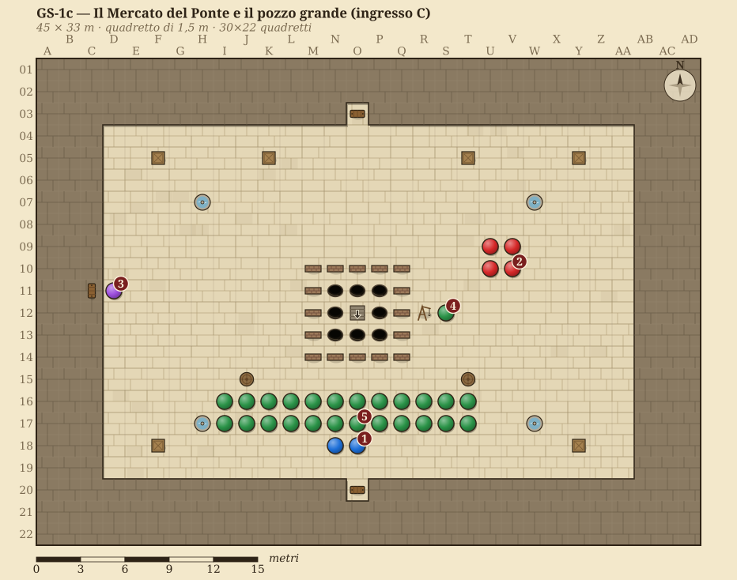

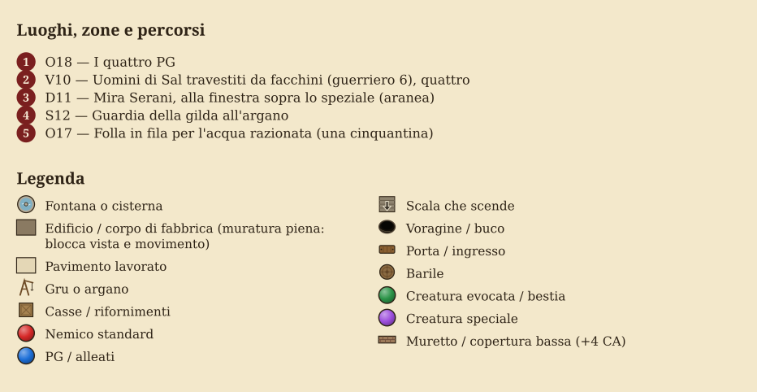

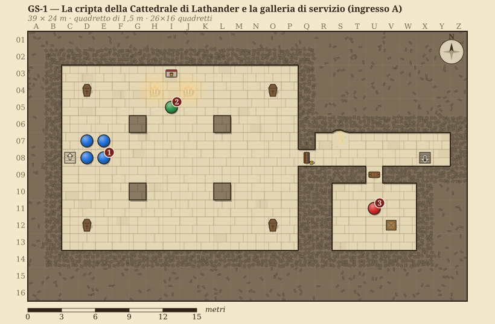

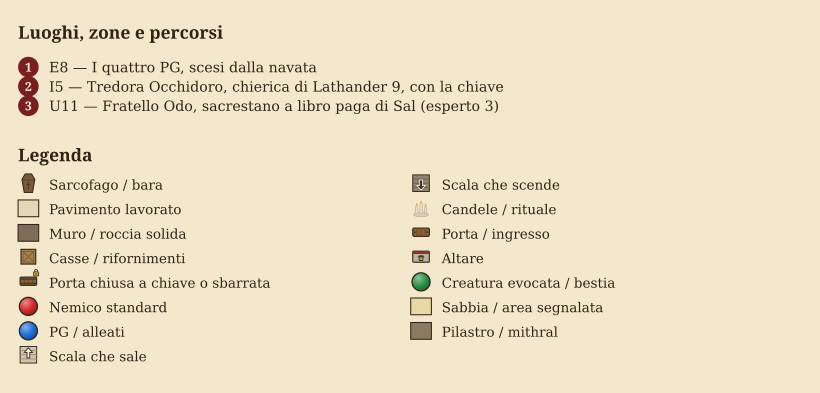

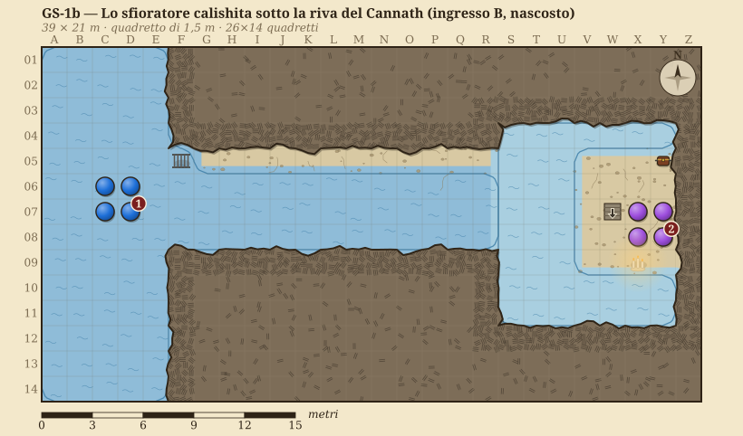

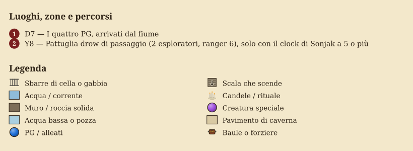

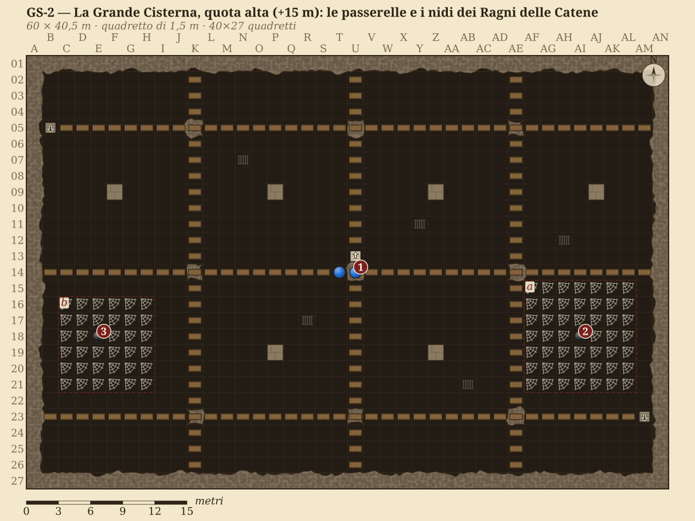

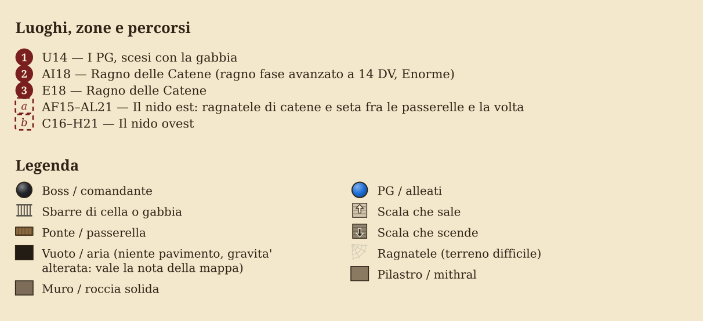

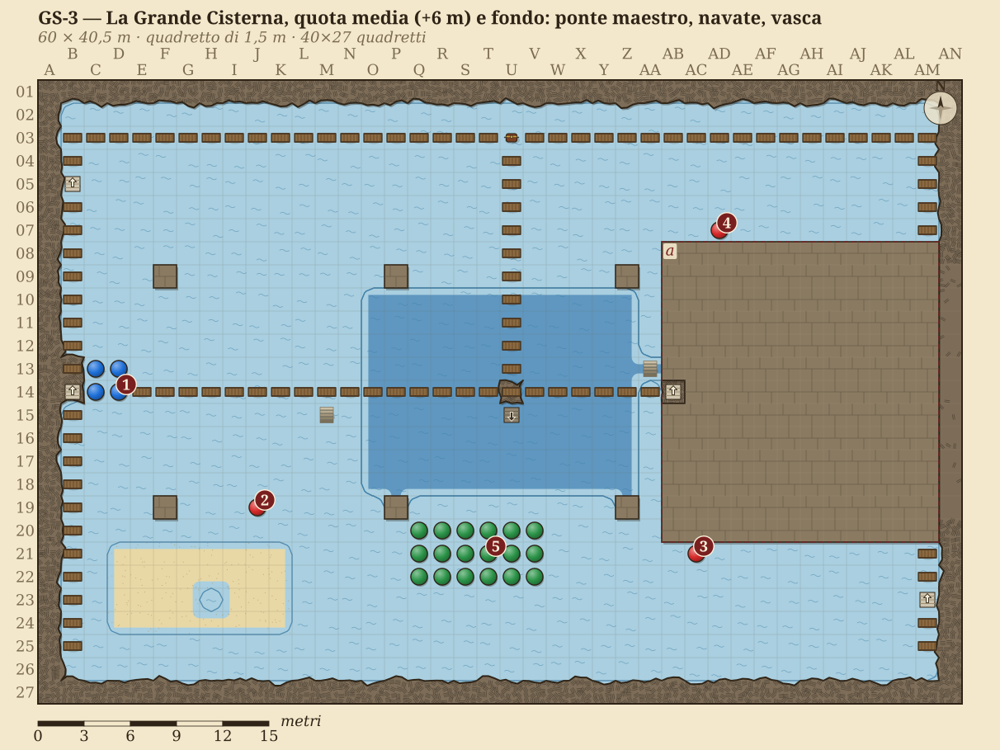

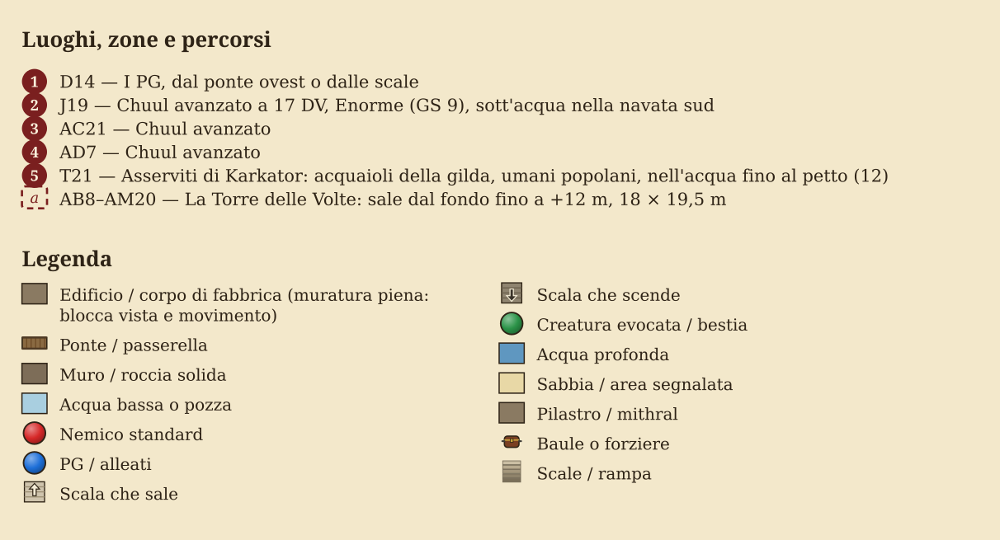

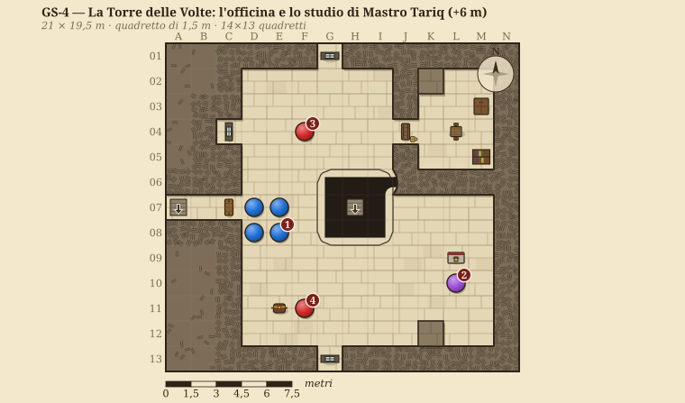

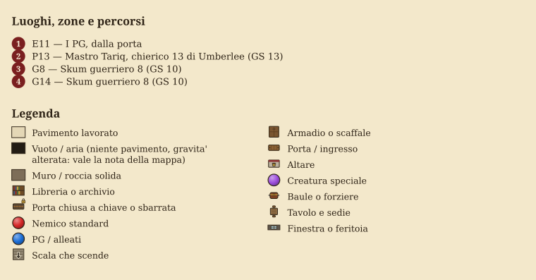

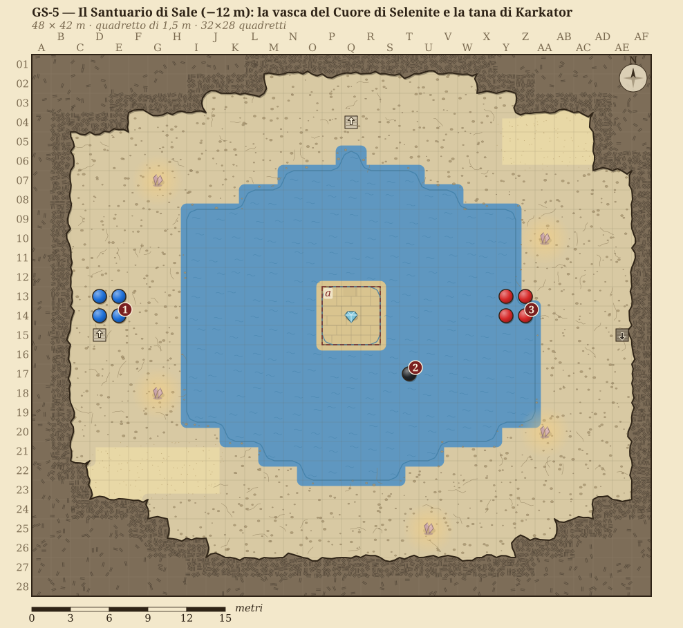

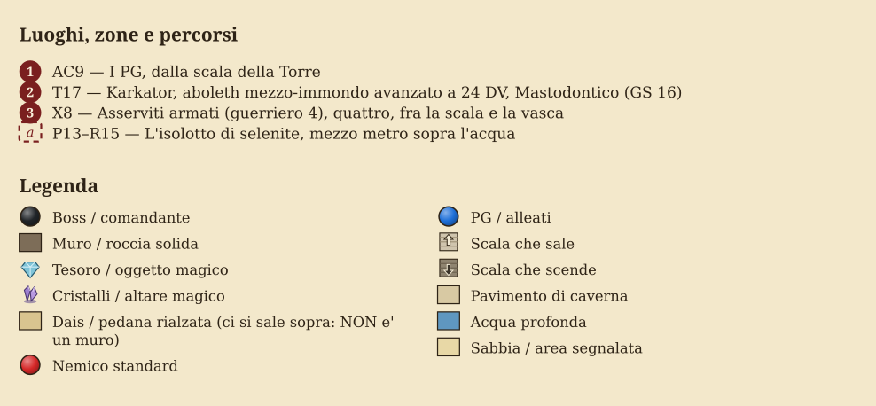

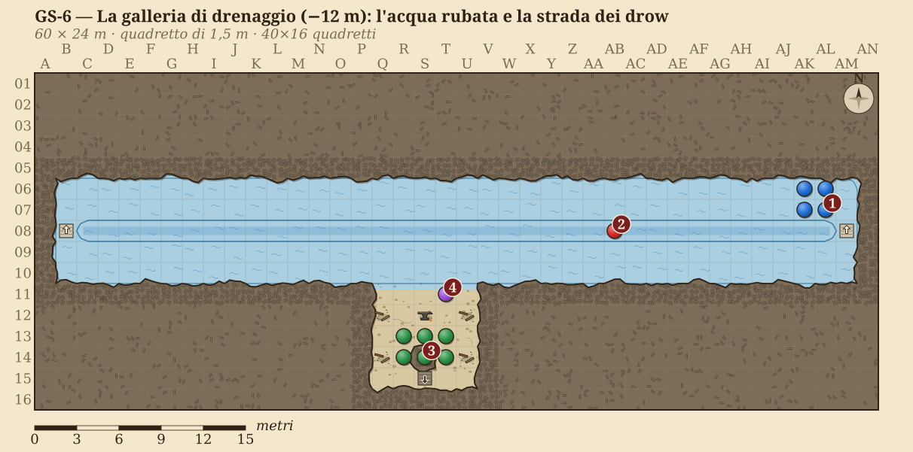

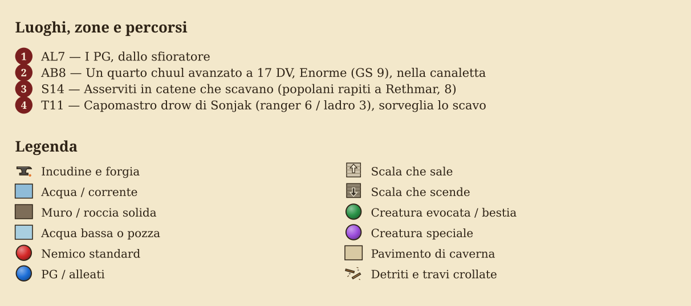

**Le quote.** Il pavimento delle navate della cisterna è la quota 0 del modulo. La volta è a +18 m, le passerelle alte a +15, il ponte maestro e i cornicioni a +6, la vasca centrale scende a −6 e sotto di lei il Santuario di Sale e la galleria di drenaggio stanno a −12. La piazza del mercato è a +21. I pilastri sono gli stessi in GS-2 e GS-3: chi cala da una catena arriva nel quadretto corrispondente.

## Il cast

Gli statblocchi completi sono nell'appendice. Qui c'è quello che serve per interpretarli.

### Karkator, il Signore del Sale

Un aboleth Mastodontico, lungo sedici metri, con la pelle che il sale ha reso bianca e screpolata come un fondale prosciugato. Il sangue d'immondo gli ha dato due ali di membrana grigia, inutili fuori dall'acqua senza il Cuore, e una bocca piena di denti che un aboleth non dovrebbe avere. Ricorda la Corte del Sale dei Calishiti, che costruirono sopra la sua sorgente quattro secoli fa: per lui Rethmar è il secondo tentativo dei ladri di prendersi la sua acqua.

**Cosa vuole.** Una città di schiavi che gli porti sale, carne e preghiere. Il tunnel di Sonjak non gli interessa; il Cuore sì, perché gli dà la rigenerazione e il dominio sull'acqua.

**Come parla.** Non parla: mette le parole nella testa, nella lingua di chi ascolta, con la voce della persona che quella creatura ha amato di più. Ai PG parla con la voce dei loro morti. Se ha davanti Hella, parla con la voce del bosco sacro.

> *La voce non viene dall'acqua. Viene da dietro di te, ed è la voce di qualcuno che hai sepolto. «Avete sete. Tutti, quassù, avete sete. Bevete. Io vi ricorderò quando nessun altro lo farà.»*

**GS 16** con il Cuore acceso, 15 senza.

### Mastro Tariq, l'ingegnere delle acque

Sessant'anni, piccolo, la barba tinta di henné come si usa a Calimport, le mani rovinate dalla calce. Ha costruito la cisterna più bella del Nord e nessuno a Rethmar sa il suo nome: per la città è «quello della gilda». Si è votato a Umberlee perché il mare, almeno, non dimentica chi lo onora. Non è asservito: Karkator lo domina con la paura, non con la mente, e i suoi incantesimi vengono da una fede vera.

**Cosa vuole.** Che la sua opera sopravviva a tutti. Sal gli ha promesso che dopo la guerra la cisterna sarà il tempio di Umberlee nel Nord, con il suo nome sulla porta.

**La leva.** Tariq teme Karkator e disprezza Sal. Se i PG gli mostrano che il tunnel dei drow farà crollare il fondo della cisterna (vero: lo scavo taglia la fondazione della vasca, Conoscenze (architettura e ingegneria) CD 20 per vederlo nei disegni), Tariq esita. **Raggirare o Diplomazia CD 25** e la prova del tunnel: Tariq si arrende e consegna le carte (scelta 6). **Intimidire** non funziona: ha più paura dell'aboleth che di loro.

> *«Trentun anni. Trentun anni che porto acqua a gente che non sa come mi chiamo. Voi siete venuti a romperla. Come tutti.»*

**GS 13.**

### Sal, l'uomo con l'anello di sale

Non scende nella cisterna e non combatte qui. Ma è dappertutto: paga il sacrestano della Cattedrale, i facchini della piazza, la guardia dell'argano. Se i PG lo cercano, lo trovano alla mescita di Kellin al Ponte Nuovo (n. 23 della pianta), sorridente, con un anello d'argento in cui è incastonato un cristallo di sale. Parla di affari, di statue, di quanto sono belli i loro artefatti. Profila i PG come fa sempre (il suo clock è quello delle armi degli eroi): ogni minuto passato con lui è un minuto in cui guarda Aegis Fang.

**Se i PG lo minacciano** sorride e se ne va: la città è sua più di quanto sia loro, e la guardia cittadina arriva prima che loro possano provare qualcosa. Le prove contro di lui sono nello studio di Tariq.

### Mira Serani, la spia del Collezionista

L'aranea vive sopra la bottega dello speziale sul lato ovest della piazza, in forma umana, e da lì guarda il pozzo grande. Non interviene mai. Riferisce: se vede i PG scendere, il Collezionista lo sa prima di sera, e se i PG risalgono con il Cuore, Mira li segue. Se la scoprono, vale quello che il Bestiario dice di lei.

### Gli altri

| PNG | Chi è | Cosa sa | Leva |
|---|---|---|---|
| **Brenna Sorvane** | consigliera militare di Rethmar, prepara la città all'assedio | ha contato le botti: manca un terzo dell'acqua che la gilda dichiara | affida la missione ai PG e riceve Tariq se lo portano vivo. Vuole discrezione: un'acqua avvelenata a due settimane dall'assedio è panico |
| **Tredora Occhidoro** | somma sacerdotessa di Lathander, alla Cattedrale | la porta di ferro della cripta e la benedizione delle acque, l'ultima trentun anni fa | dà la chiave; può scendere fino alla soglia e *consacrare* il Cuore (scelta 1). Non va messa in pericolo: la città ne ha bisogno |
| **Fratello Odo** | sacrestano della Cattedrale, esperto 3 | che un uomo con l'anello di sale lo paga perché avvisi se qualcuno chiede della porta di ferro | crolla con Intimidire CD 15. Se non lo scoprono, la Torre è avvisata |
| **Lorana** | guida dei profughi accampati fuori dalle mura | che i suoi sono i primi a stare male | i profughi sono i testimoni dello sfioratore |
| **Iven** | ragazzo del campo dei profughi, 14 anni | gli uomini-pesce sotto il ponte | indizio dell'ingresso B |
| **Kesk Martellacqua** | capo della gilda degli acquaioli, umano popolano | che Tariq ha chiuso la cisterna «per lavori» e lo paga bene | non è complice, è avido: Intimidire o Diplomazia CD 18 e dice dei facchini nuovi. Se è nominato davanti al Consiglio, la gilda perde la cisterna |

## Atto I — Rethmar ha sete

**Obiettivo dell'atto:** i PG devono uscirne sapendo che l'acqua è corrotta da qualcosa che sta sotto la piazza, e avendo trovato almeno un ingresso. Da 60 a 90 minuti.

### Ganci (usane uno, gli altri diventano scene)

- **Brenna conta le botti.** Brenna Sorvane convoca i PG al Torrione: le botti razionate non tornano, e due delle sue guardie, che bevono dal pozzo del foro, la notte vanno al fiume. Chiede di scoprire cosa succede senza che il Consiglio lo sappia, prima dell'assedio. Paga con il favore del Consiglio, non con l'oro: truppe, viveri, una scelta sullo schieramento.
- **I muti del campo.** Lorana chiede aiuto per i suoi: venti profughi hanno smesso di parlare. **Guarire CD 20**: nessuna malattia; **Sapienza Magica CD 25** su uno di loro: è un effetto di ammaliamento, e la pelle dietro le orecchie è umida e trasparente come quella di un pesce. È l'inizio della trasformazione del muco di Karkator.
- **L'acqua di Thorik.** Un nano del seguito di Thorik riempie la borraccia al pozzo del foro e la porta al re. **Osservare CD 15**: nella luce c'è un velo iridescente. **Sapienza Magica CD 22** con *individuazione del magico*: un'aura debole di ammaliamento, e un'altra, più forte, che viene da molto più in basso.

### La città che si prepara

Rethmar a due settimane dall'assedio: carri di pietre verso le mura, ragazzi che imparano a tenere una picca nel foro, file per l'acqua. Ogni scena dell'atto ha attorno questa città, e i PG ne sono gli eroi: la gente li riconosce, chiede, offre. Usala per far capire che la cisterna conta.

> *La fila per l'acqua parte dal pozzo grande e gira due volte attorno alle statue del Circolo degli Otto. La gente ha le brocche, i secchi, una donna ha un elmo rovesciato. Due guardie della gilda versano un mestolo a testa. Nessuno protesta: si guardano le scarpe. Sopra le teste, dal portico del municipio, qualcuno ha appeso uno striscione con il sole di Lathander e una scritta fresca di vernice: «Rethmar non cade».*

### Le dicerie della fila (1d6, una falsa)

| d6 | Diceria | Vero? |
|---|---|---|
| 1 | La gilda vende l'acqua buona ai ricchi del quartiere alto, e a noi lascia quella salata | Falso: è salata per tutti |
| 2 | Mastro Tariq non esce da un mese; dicono che sia malato, ma la sua serva porta via la spesa per quattro | Vero: la porta agli skum della Torre |
| 3 | Di notte, dalle grate dei pozzi di luce, si sente come una campana sott'acqua | Vero: sono le catene dei ragni |
| 4 | Ai profughi è venuta la febbre del fiume, quella che fa diventare muti | Vero a metà: non è una febbre |
| 5 | I facchini nuovi della gilda non bevono mai | Vero: sono uomini di Sal, e sanno |
| 6 | La Cattedrale benediceva l'acqua, una volta, e da quando ha smesso la città ha avuto solo guai | Vero: è la strada verso l'ingresso A |

### Le scene dell'atto

**La piazza del pozzo (GS-1c).** Vedi la mappa. Di giorno la fila, la guardia della gilda all'argano e quattro facchini che contano chi passa. Kesk Martellacqua non lascia scendere nessuno senza un ordine del Consiglio, che Brenna può dare, ma è un ordine scritto e Sal lo saprà. Di notte la piazza è vuota, l'argano chiuso col lucchetto (Scassinare CD 25), e i facchini di Sal dormono sotto il portico.

**La Cattedrale (GS-1).** Tredora riceve i PG nella navata.

> *La Cattedrale di Lathander ha le vetrate a est, e anche nel tardo pomeriggio sembra mattina. Tredora Occhidoro scende i gradini dell'altare con una chiave di ferro lunga come un avambraccio. «L'ultimo che l'ha usata era il mio maestro. Benedicevamo l'acqua all'equinozio, scendevamo con il sole di bronzo e cantavamo alla vasca. Poi la gilda disse che costava troppo, e la porta restò chiusa.» Guarda la chiave. «Se è vero quello che dite, avremmo dovuto continuare.»*

**La bottega di Tariq.** Una casa stretta sul lato nord del foro, chiusa. Dentro: disegni, modelli di chiuse in ottone, una conchiglia nera sull'altarino della camera. **Sapienza (religione) CD 15**: è il simbolo di Umberlee, la Regina della Rabbia, dea del mare che annega. Fra i disegni c'è lo sfioratore (indizio dell'ingresso B) e la pianta della cisterna senza il Santuario: chi la confronta con la pianta della gilda (Kesk ce l'ha) vede che sotto la vasca c'è uno spazio che nessuno ha disegnato.

**La mescita di Kellin.** Sal, se i PG lo cercano. Vedi il cast.

**Il campo dei profughi.** Lorana, i muti, Iven.

> *I muti stanno seduti in fila contro il muro della baracca, le mani in grembo. Respirano piano, con la bocca un poco aperta. Una donna ha le guance bagnate, ma non piange: è la pelle che suda acqua. Quando passi le guardano tutti nello stesso momento, e nello stesso momento distolgono gli occhi.*

{{note
**Curare i muti adesso.** Il muco li sta trasformando lentamente: chi beve l'acqua corrotta fa un TS su Tempra CD 15 al giorno (la corruzione nell'acqua è diluita, non è il muco a contatto), e dopo tre fallimenti è asservito a Karkator finché lui vive o finché non gli si lancia *rimuovi maledizione* (CD 31 per la prova di livello dell'incantatore, perché la fonte è il muco di Karkator) o *guarigione*. **Regola del modulo**, costruita sul muco dell'SRD. Uccidere Karkator libera tutti gli asserviti entro un giorno; staccare il Cuore ferma la corruzione dell'acqua.
}}

## Atto II — La Grande Cisterna

Le aree sono numerate per livello: **A** la cripta e la galleria di servizio, **B** lo sfioratore e la galleria di drenaggio, **C** la piazza e la gabbia, **G** la Grande Cisterna, **T** la Torre, **S** il Santuario. Ogni area dice come reagisce chi c'è a seconda dell'ingresso da cui arrivano i PG.

### A1 · La cripta dei vescovi dell'Alba (GS-1)

> *Sotto la Cattedrale l'aria è asciutta e sa di cera. Quattro pilastri di marmo rosa reggono una volta a crociera dipinta di stelle, e fra le stelle c'è un sole che sorge. In fondo, oltre i sarcofagi dei vescovi, una porta di ferro senza maniglia ha sull'architrave lo stesso sole, inciso così a fondo che le dita ci entrano.*

Nessuno scontro. Tredora apre la porta. **Ascoltare CD 18**: qualcuno trattiene il fiato nella sacrestia bassa. È Fratello Odo (vedi il cast). Scoperto o no, cambia l'allerta della Torre.

**La soglia.** Il sole sull'architrave è una consacrazione permanente del vecchio clero: un non morto che passa sotto prende 2d6 danni (Sapienza Magica CD 20 per riconoscerla). Qui non ci sono non morti; serve se i PG ci portano un nemico.

### A2 · La galleria di servizio

Quattrocento metri di tufo in discesa, larghi 2,4 m, con gli anelli per le torce ogni quindici passi. Cinque minuti di cammino. A metà, **Osservare CD 20**: impronte fresche di piedi palmati che vanno e vengono fino a un punto e poi tornano indietro. Gli skum la usano per rubare la spesa dalla cucina della Cattedrale.

La galleria sbuca sul cornicione ovest della cisterna, a +6 m, all'imbocco del ponte maestro (G4).

### B1 · Lo sfioratore (GS-1b)

> *Sotto la seconda pila del ponte, dove l'acqua gira al contrario, la riva ha una bocca. È un arco di mattoni gialli, mezzo sommerso, e la grata che lo chiudeva è piegata in fuori come se qualcosa l'avesse spinta da dentro. Dall'arco esce acqua fredda, con un odore di sale che il fiume non ha.*

Si entra nuotando (Nuotare CD 15 nella corrente del Cannath) o calandosi dal pilone. Il canale è lungo sessanta metri, con l'acqua alla cintura che corre verso il fiume. In fondo c'è la camera della paratoia, con l'argano ingrassato di fresco e una candela di grasso di pesce spenta da poco.

**La paratoia.** Chiuderla (Forza CD 18, 2 round all'argano) ferma lo sfogo: in tre giorni l'acqua della città torna a salire. Tariq se ne accorge entro un'ora e la Torre si allerta.

**I drow.** Se il clock di Sonjak è a 5 o più, due esploratori drow stanno sulla banchina e fuggono nella galleria al primo segno dei PG: non combattono. Prenderne uno vivo (sono ranger 6, con *oscurità* e la velocità dei drow) è una caccia, non uno scontro, e vale la scelta 12.

### B2 · La galleria di drenaggio (GS-6)

> *La galleria è più grande di qualunque strada di Rethmar: una volta a botte di mattoni calishiti, larga quanto una navata, con una canaletta nel mezzo dove l'acqua corre nera e veloce. Ai lati l'acqua arriva al ginocchio. Da qualche parte avanti, nel buio, qualcuno batte un piccone, piano, sempre allo stesso ritmo.*

**Incontro (EL 9):** un chuul avanzato nella canaletta. Sale su chi cammina accanto all'acqua profonda: presa migliorata con le chele, poi i tentacoli paralizzanti. Chi è paralizzato in acqua profonda annega (regole SRD).

### B3 · Lo scavo dei drow

Una galleria laterale verso sud, puntellata, che scende verso il Sottosuolo. Otto asserviti in catene scavano: sono popolani di Rethmar scomparsi nell'ultimo mese, con la pelle già trasparente dietro le orecchie. Li sorveglia un capomastro drow che non combatte e fugge giù per lo scavo.

> *Gli uomini in catene non si voltano. Scavano. Uno di loro ha ancora addosso il grembiule da fornaio, e ha le mani spellate fino alla carne. Quando la luce lo raggiunge si ferma un momento, poi riprende, e canticchia una canzone che le madri di Rethmar cantano ai bambini.*

**La scelta dello scavo.** Due puntelli abbattuti (durezza 5, 20 pf ciascuno) fanno crollare la galleria laterale: il tunnel di Sonjak è chiuso (scelta 10). Oppure lo si lascia aperto per tendere un'imboscata ai drow la notte della Fase 0 (scelta 11). **Conoscenze (architettura e ingegneria) CD 20**: lo scavo passa sotto la fondazione della vasca. Se continua, fra qualche settimana la cisterna crolla. È la prova che convince Tariq.

### C1 · La piazza del pozzo grande (GS-1c)

Vedi l'Atto I. Scendere di giorno vuol dire farlo davanti a cinquanta persone; di notte, davanti agli uomini di Sal.

### C2 · La gabbia

Una gabbia di ferro per quattro persone, calata dall'argano per sei metri attraverso la volta. Arriva al centro delle passerelle alte (G1). **Il rischio:** se i facchini di Sal sono in piazza e i PG scendono senza averli tolti di mezzo, uno di loro taglia la fune a metà discesa (vedi la mappa).

### G1 · Le passerelle alte (GS-2)

> *La gabbia esce dalla volta e sotto non c'è niente. Una sala grande come una cattedrale, buia, con l'acqua venti metri più in basso che riflette la luce della tua lanterna in mille punti. Le passerelle partono dalla gabbia in quattro direzioni, assi di legno su travi di ferro, senza parapetto. E dalla volta pendono catene, decine di catene, che scendono fino all'acqua. Qualcuna si muove. Non c'è vento.*

**Incontro (EL 12):** i due Ragni delle Catene. Vedi la mappa per la disposizione e le tattiche. **Chi arriva da A o da B** può non incontrarli mai: i ragni restano sulle volte finché qualcuno non tocca le catene.

### G2 e G3 · I nidi dei ragni

Due intrichi di catene e seta fra le passerelle e la volta, a est e a ovest. Dentro, quello che resta di chi è sceso prima: due operai della gilda, un ladro di Rethmar, un nano del seguito di Thorik scomparso la settimana scorsa (il re lo riconosce dall'anello del clan). **Tesoro:** vedi la tabella.

### G4 · Il ponte maestro (GS-3)

> *Il ponte attraversa la sala a mezza altezza, dritto come una lama, con un parapetto di ferro battuto che qualcuno ha decorato di onde. In fondo c'è una torre che sale dall'acqua fino quasi alla volta, con le feritoie illuminate di verde. Sotto il ponte, nell'acqua delle navate, si muovono delle ombre lunghe come barche.*

Il ponte è lungo 43,5 m dal cornicione ovest alla porta della Torre ed è sotto le feritoie per tutta la lunghezza. Chi lo percorre senza nascondersi è visto dalla Torre (Osservare degli skum di vedetta contro Nascondersi, con la penalità di −10 per chi corre).

### G5 · Le navate allagate

Un metro d'acqua sul fondo, banchi di sale affiorati, e dodici asserviti che raschiano il sale dalle pareti perché Karkator lo vuole. **Incontro facoltativo (EL 12):** tre chuul avanzati sott'acqua. Salgono solo su chi scende dal ponte o ci cade. Gli asserviti non combattono; liberarli e portarli su è la scelta 8, ed è il conflitto della scena.

### G6 · La vasca centrale

Sei metri d'acqua torbida con il velo iridescente del muco. Sul fondo, il pozzo di scarico: un sifone di sei metri che porta al Santuario di Sale (Nuotare CD 15, due round in apnea). È la strada più breve verso Karkator, e la più pericolosa: si arriva nella sua acqua.

### G7 · Le paratoie

Sul ponte nord, sopra le bocche che portano l'acqua alle fontane della città. Tariq le ha regolate perché le fontane ricevano poco e la cisterna sfoghi verso il fiume. **Conoscenze (architettura e ingegneria) CD 15**: rimetterle come erano, in un'ora di lavoro, restituisce l'acqua alla città anche se il Cuore resta acceso (ma l'acqua resta corrotta).

### T1 · L'officina della Torre (GS-4)

> *Dentro la Torre fa caldo e c'è odore di olio e di calce. Sui tavoli ci sono modelli di chiuse in ottone grandi come un bambino, disegni fissati con i chiodi, un compasso lungo un braccio. Nel mezzo la scala a chiocciola sprofonda in un pozzo di luce verde. Un uomo piccolo con la barba rossa si alza dallo scrittoio e si pulisce le mani sul grembiule, come un artigiano interrotto.*

**Incontro (EL 15):** Mastro Tariq e due skum guerriero 8. Le tattiche e gli stati sono sulla mappa. **Chi arriva da A** entra dalla porta, nel pieno dell'officina. **Chi arriva da B** sale la scala a chiocciola dal Santuario e prende Tariq alle spalle; ma allora Karkator è già sveglio. **Chi arriva da C** ha fatto rumore con i ragni, e la Torre è allertata.

**Parlare con Tariq.** Funziona solo prima che cominci lo scontro o quando è sotto la metà dei pf. Vedi la leva nel cast.

### T2 · Lo studio di Tariq

Dietro una porta chiusa con *serratura arcana* (Scassinare CD 30, o le chiavi di Tariq). Lo scrittoio, i trattati calishiti, lo scaffale delle carte.

{{note
**Le carte dello studio (scelta 12).** **Cercare CD 15** per trovarle, **Decifrare Scritture o Sapienza (locali) CD 20** per capirle:
- tre ricevute di Sal, pagate in pietre di luna, con il sigillo dell'anello di sale;
- un ordine in drow (Linguaggio drow, o *comprensione dei linguaggi*) firmato «Matrona Sajak», il nome che Sonjak usa con Sal: data e ora in cui i lavoratori devono aver finito lo scavo, «prima che le torri del re arrivino a Rethmar»;
- la lettera di un agente del Collezionista che chiede a Tariq di «non lasciare che la gemma sia toccata dalla luce del mattino».

Sono le prove dei traffici fra Sonjak e il Collezionista: valgono quanto le lettere di Ghaurush per trattare con Zin'thara.
}}

### T3 · La scala a chiocciola

Diciotto metri di scala di pietra attorno a un pozzo aperto, fino al Santuario. Chi ci cade prende 6d6. Il pozzo è illuminato dal basso dalla luce verde del Cuore.

### S1 · Il Santuario di Sale (GS-5)

> *La scala finisce in una grotta bianca. Le pareti sono sale, sale puro, cresciuto in colonne e in ventagli che riflettono una luce verde e fredda. La luce viene dal centro di una vasca immobile, da una pietra grande come un cuore umano incastrata in un isolotto di cristallo. L'acqua della vasca non ha onde. Poi ne ha una, lunghissima, che parte dal centro e arriva fino ai tuoi piedi. Qualcosa sotto si è voltato.*

**Incontro (EL 16, 17 con Tariq):** Karkator e quattro asserviti armati. Tattiche, gravità invertita e Cuore sono sulla mappa.

**Chi arriva da A o da C** ha già combattuto Tariq, e Karkator lo sa. **Chi arriva da B** sale la rampa dalla galleria di drenaggio e prende l'aboleth dal lato meno difeso, lontano dall'isolotto; ma se Tariq è ancora vivo, scende la scala al secondo round.

### S2 · Il Cuore di Selenite

Il Cuore è incastrato in quattro perni di bronzo calishita sull'isolotto. Staccarlo: rompere due perni (durezza 10, 30 pf ciascuno) o una prova di Forza CD 28. Chi lo tiene in mano subisce ogni round un tentativo di *asservire* di Karkator (Volontà CD 29) finché l'aboleth vive.

> *Il Cuore è caldo. È l'unica cosa calda di tutta la grotta. Dentro, nella luce verde, si muove qualcosa che sembra acqua e non lo è, e da lì viene un rumore lontano di risacca: un mare che nessuno di voi ha mai visto, senza rive.*

## Atto III — Cosa fare del Cuore

Lo scontro con Karkator finisce in tre modi: muore, fugge nella galleria verso il Sottosuolo, o i PG si ritirano. In ogni caso resta il Cuore, e la scelta su cosa farne è dei giocatori. È la scena per cui il modulo esiste: non risolverla tu.

| Scelta | Come | Cosa costa | Cosa dà |
|---|---|---|---|
| **Purificarlo** (scelta 1) | Tredora o un chierico buono: *consacrare* sull'isolotto, poi un'ora di preghiera all'alba; Hella con *santificare*. Senza Tredora, Sapienza Magica CD 25 per capire come | un'ora e un incantatore disposto; il Collezionista lo saprà | il Cuore diventa un oggetto meraviglioso (appendice); la cisterna è pulita in un giorno |
| **Distruggerlo** (scelta 2) | durezza 20, 80 pf, o *disgiunzione* | niente, se non il valore | la cisterna è pulita in 24 ore; il Collezionista perde il premio per sempre |
| **Tenerlo corrotto** (scelta 3) | Artemis si sintonizza: Sapienza Magica o Utilizzare Oggetti Magici CD 28 | un patto con qualcosa che ascolta nel Piano dell'Acqua. Ogni uso fa sentire il Cuore a Sonjak | un'arma per l'assedio: una volta, *inversione della gravità* su un settore |
| **Darlo al Collezionista** | Mira Serani lo chiede, con una contropartita | il Collezionista avanza di 1 il suo clock e ha quello che voleva | un favore: il Collezionista lascia stare per una fase il Conte Valerius o un altro fronte che il DM sceglie |

## Le conseguenze sull'assedio

Le scelte dei PG entrano nell'assedio di Rethmar attraverso i contatori che ARC-09 ha già. Ogni riga dice cosa cambia per i difensori e cosa per gli attaccanti; i valori si sommano a quelli della matrice degli esiti e del Morale Cittadino.

| # | Scelta | Difensori | Attaccanti |
|---|---|---|---|
| 1 | Purificare il Cuore | acqua pulita per tutto l'assedio: Morale Cittadino +1; il Fronte non scende mai per sete | il Collezionista ha perso il premio e lo cerca: un incontro con lui fra la Fase 2 e la 4 diventa probabile |
| 2 | Distruggere il Cuore | la cisterna è pulita in 24 ore; si toglie il malus e basta | — |
| 3 | Tenere il Cuore corrotto | una volta nell'assedio *inversione della gravità* su un settore: nega una carta drago o una breccia | ogni uso fa avanzare di 1 il clock di Sonjak; Morale −1 se si sa |
| 4 | Rendere pubblica la corruzione prima di risolverla | Morale −1 subito, +2 se poi la risolvono in pubblico | Mira lo riferisce: l'orda sa che la città ha poca acqua (CD di Morale delle ondate +2 finché la cisterna non è pulita) |
| 5 | Tenere tutto segreto | nessun malus subito; se falliscono, al Giorno 40 Morale −2 invece di −1 | — |
| 6 | Catturare Tariq vivo e portarlo al Consiglio | Morale +1. Tariq sa dell'Olio del Sabotaggio di Sal: se i PG agiscono, il trigger del clock di Sal non scatta | Sal capisce di essere scoperto: la consegna delle statue a Varis (Fase 4) scatta un giorno prima |
| 7 | Uccidere Tariq | nessuna testimonianza; le chiuse vanno riparate (un giorno, Conoscenze (architettura e ingegneria) CD 25) | — |
| 8 | Curare gli asserviti | 150 miliziani di nuovo in forza nel contingente della guarnigione; Morale +1 | — |
| 9 | Lasciare gli asserviti al loro destino | la guarnigione perde 150 uomini; Morale −1 se si sa | nella Notte dei Drow gli asserviti aprono la poterna: un settore parte già in breccia |
| 10 | Murare o far crollare lo scavo dei drow | sabotaggio drow +1 (una strada in meno per la Fase 0) | la Notte dei Drow perde un'ondata |
| 11 | Lasciare lo scavo aperto e tendere un'imboscata | se riesce, sabotaggio drow +2 e i prigionieri drow parlano | se fallisce, la cisterna è la testa di ponte della Fase 0 sotto il Mercato del Ponte |
| 12 | Leggere le carte dello studio | prove dei traffici fra Sonjak e il Collezionista: il clock di Zin'thara sale di 2 | — |
| 13 | Lasciare vivi i Ragni delle Catene | — | nella Notte dei Drow i ragni escono dai pozzi di luce: un assassinio automatico su un comandante |
| 14 | Lasciar fuggire Karkator | — | in Fase 2 Karkator è il centro di un rituale di Sonjak: una carta evento in più, GS 16 |
| 15 | Il tempo | ogni giorno nella cisterna è un giorno di March Clock | — |

**Se al Giorno 40 il Cuore è ancora acceso** valgono la riga del Morale «cisterne avvelenate non risolte» (−1), il Fronte −1 e la riga 9. **Il risultato migliore** (Cuore purificato, Tariq catturato, scavo chiuso o imboscata riuscita, asserviti curati) dà Fronte +1, Morale da +3 a +4, 150 uomini e sabotaggio drow 2: da solo non cambia lo scenario dell'assedio, ma sposta quello medio verso l'ottimale insieme alle altre quest.

## La regola dei tre indizi

| Rivelazione | Canale 1 | Canale 2 | Canale 3 |
|---|---|---|---|
| L'acqua è corrotta da qualcosa di vivo | i muti del campo (Sapienza Magica) | il velo nella borraccia di Thorik | diceria 4 |
| La fonte è sotto la piazza | *individuazione del magico*: l'aura forte viene dal basso | Brenna e le botti | dicerie 3 e 5 |
| Tariq è coinvolto | la bottega chiusa e la conchiglia di Umberlee | diceria 2 | Kesk Martellacqua |
| C'è un ingresso nascosto | Iven | il gorgo sotto il ponte | il disegno nella bottega |
| Sal paga la gente | Fratello Odo | i facchini che non bevono | le ricevute nello studio |
| Il Cuore dà la forza a Karkator | la luce verde dalla scala | la rigenerazione che si vede in combattimento | Tariq, se parla |

## Il tesoro

Il budget SRD per quattro PG di 13° con questi scontri va da 63.000 mo (tre scontri) a circa 97.000 (tutti e cinque). Il tesoro qui sotto sta dentro.

| Dove | Cosa | Valore |
|---|---|---|
| Nidi dei ragni (G2-G3) | anello del clan del nano scomparso (da rendere a Thorik), 2 pozioni di *cura ferite gravi*, *bracciali dell'armatura +3*, monete e pietre degli operai | circa 13.500 mo |
| Chuul (G5 e B2) | sul fondo: gioielli di chi è annegato, una *bacchetta di dardi incantati* (LI 9, 30 cariche) | circa 9.000 mo |
| Mastro Tariq | armatura completa +2, scudo pesante di metallo +1, tridente +1, *periapto della Saggezza +4*, *mantello della resistenza +2*, *anello di protezione +1*, simbolo sacro | circa 31.000 mo |
| Studio (T2) | le pietre di luna di Sal non ancora spese | 6.000 mo |
| Santuario (S1) | il tributo di Karkator: gemme e oggetti dei Calishiti della Corte del Sale | circa 17.000 mo |
| Il Cuore purificato | oggetto meraviglioso (appendice) | 18.000 mo (prezzo calcolato) |
| **Totale** | | **circa 94.500 mo** |

Se il Cuore viene distrutto o dato via il totale scende a circa 76.500, dentro il budget. La ricompensa di Rethmar non è in oro: è il favore del Consiglio, che vale una scelta di schieramento in più nell'assedio (la decide il DM con Brenna).

**PX:** si calcolano con la tabella SRD per ogni scontro vinto o evitato con un piano (Atto I compreso: convincere Tariq vale come averlo sconfitto).

## Modi di fallimento al tavolo

| Modo di fallimento | Sintomo | Causa | Mitigazione |
|---|---|---|---|
| **Karkator è un muro** | rigenerazione 15, RD 10/magia, RI 34: il gruppo lo colpisce e non scende | il Cuore è ancora nei perni | la luce verde dalla scala, la rigenerazione che si vede, Tariq che lo dice: tre semine. Se il tavolo non ci arriva, Karkator si allontana dall'isolotto per inseguire un PG e la rigenerazione si spegne oltre i 18 m |
| **Annegamento a catena** | un PG paralizzato o asservito finisce sott'acqua e muore in tre round | chuul e tentacoli di Karkator in acqua profonda | Hella con *libertà di movimento* e forma acquatica; *respirare sott'acqua* nell'equipaggiamento. Chiedi al tavolo prima di scendere chi può respirare in acqua (A2: il repo non lo dice) |
| **Gravità invertita** | quattro PG sulla volta e Karkator sotto | il potere del Cuore al round 3 | dura finché Karkator la tiene, ma lui deve restare entro 18 m dal Cuore; Artemis vola e non cade, Tordek dimezza con la caduta lenta |
| **L'atto in città dura troppo** | due ore di indagine e la cisterna a mezzanotte | troppi PNG | Brenna ha già la risposta per l'ingresso C. Se dopo 60 minuti i PG non hanno un ingresso, Tredora manda a chiamarli |
| **Tredora muore** | la Cattedrale perde la sua chierica a due settimane dall'assedio | i PG la portano nello scontro | Tredora si ferma sul ponte ovest e lo dice. Se la portano oltre, il costo è nella sua scheda (−2 Morale se cade in pubblico) |
| **I PG ignorano lo scavo** | la galleria resta, e nessuno ha deciso | lo scavo sembra decorazione | il capomastro drow che fugge, l'anello del clan, le carte: il tunnel deve diventare la domanda «e adesso?». Se non ci arrivano, è la scelta 11 fallita per omissione |

## Decisioni di progettazione (ADR)

{{note
**ADR-01 — Tre padroni, una cisterna.**
*Contesto:* un boss da GS 16 contro quattro PG di 13° è letale o banale.
*Decisione:* Sonjak, il Collezionista e Karkator vogliono cose diverse dalla stessa cisterna, e Tariq teme uno e disprezza l'altro.
*Conseguenze:* lo scontro finale va da EL 16 a 17 secondo quello che i PG hanno fatto prima, e convincere Tariq lo rende più facile. In cambio il DM tiene tre agende; la tabella delle conseguenze serve a questo.
}}

{{note
**ADR-02 — Tre ingressi, tre ordini degli scontri.**
*Contesto:* il DM voleva un ingresso dalla cripta della Cattedrale e uno nascosto, con minacce diverse.
*Decisione:* tre ingressi a tre quote: +6 dalla Cattedrale, −12 dallo sfioratore, +15 dal pozzo del mercato.
*Conseguenze:* ogni area dice come reagisce a seconda dell'ingresso. Il modulo è più lungo da preparare, ma la scelta dell'ingresso è dei giocatori e ha un peso.
}}

{{note
**ADR-03 — Le conseguenze passano dai contatori che ci sono già.**
*Decisione:* nessun clock nuovo: Fronte, Morale Cittadino, contingenti, clock di Sonjak, Sal, Zin'thara e del Collezionista.
*Conseguenze:* il modulo entra nell'assedio senza toccare le regole di ARC-09. Il prezzo è che chi gioca il modulo da solo, fuori dalla campagna, deve ignorare la tabella.
}}

{{note
**ADR-04 — Il Cuore è la regola che decide lo scontro.**
*Decisione:* finché il Cuore è nei perni Karkator rigenera e vola; staccarlo lo riporta a GS 15.
*Conseguenze:* il combattimento ha un obiettivo diverso dal boss, e il gruppo con un guerriero forte e un monaco veloce ha qualcosa da fare oltre a colpire. Va seminato tre volte o diventa un muro.
}}

## Igiene di licenza

| Elemento | Stato | Nota |
|---|---|---|
| Aboleth, mezzo-immondo, ragno fase, chuul, skum | SRD 3.5, OGL 1.0a | avanzati con le regole SRD; i conti sono nell'appendice |
| Lancio di catene, scalare sulle catene, risonanza dei Ragni | originali del modulo | costruiti sulla ragnatela del bebilith SRD |
| Il Cuore di Selenite | originale del modulo | prezzo calcolato con le regole SRD degli oggetti magici |
| Umberlee, Lathander, Rethmar, Sonjak, Sal, il Collezionista | Forgotten Realms e canone della campagna | **non OGL.** Questo modulo è materiale del DM per il tavolo, non si pubblica. La versione da pubblicare è quella Pathfinder, che non ha nessuno di questi nomi |

## Piano in tre fasi

### Fase 1 — Prima della serata

- Chiedi ai giocatori chi respira sott'acqua, chi vola oltre ad Artemis e cosa portano contro il veleno e la paralisi: il repo non ha l'equipaggiamento completo di Thorik, Tordek e Hella.
- Segna il punto del March Clock: il modulo sta fra il Giorno 28 e il 38. Ogni giorno nella cisterna conta.
- Segna i clock di Sonjak e di Sal: decidono se ci sono i drow allo sfioratore e quanto Sal sa.
- Decidi se Tredora può scendere (dipende dallo schieramento dei chierici, se è già stato deciso).

### Fase 2 — Al tavolo

- **Atto I, 60-90 minuti.** Cancello: i PG sanno che l'acqua è corrotta da sotto la piazza e hanno almeno un ingresso.
- **Atto II, 3-4 ore.** Cancello: hanno raggiunto il Santuario. Punto di taglio naturale per due sedute: la fine dello scontro nella Torre.
- **Atto III, 30 minuti.** Il Cuore, poi la tabella delle conseguenze letta insieme ai giocatori: devono vedere cosa hanno cambiato.

### Fase 3 — Dopo

- Aggiorna Fronte, Morale, contingenti e clock nello stato della campagna, riga per riga della tabella.
- **Agency:** almeno un padrone della cisterna è stato aggirato invece che combattuto?
- **Comprensione:** i giocatori sanno spiegare perché Tariq ha tradito? Se no, la leva nel cast non è arrivata.
- **Peso:** la scelta sul Cuore è stata discussa? Se l'hanno distrutto senza parlarne, la tentazione del patto non era abbastanza forte.

— *L'acqua dei pozzi bassi di Rethmar torna dolce nove giorni prima dell'orda. Nessuno, nel foro, sa dire perché.* —
