# Architettura di RumblingStone

Come è fatto il repo e come girano le sue catene, con un diagramma per
ognuna. I diagrammi sono in Mermaid: GitHub li disegna da solo, e in locale
li mostra qualunque editor con l'anteprima Markdown.

Chi cerca **perché** una cosa è fatta così trova la decisione negli ADR
([`plans/adr/`](../plans/adr/)), citati sotto ogni diagramma. Chi cerca
**come si usa** uno strumento parte dal
[registro dei tool](tools/README.md), che è generato dal manifest.

## Indice

1. [Il sistema e chi lo usa](#1-il-sistema-e-chi-lo-usa)
2. [Le parti del repo](#2-le-parti-del-repo)
3. [L'infrastruttura software](#3-linfrastruttura-software)
4. [Come si integrano strumenti e fonti](#4-come-si-integrano-strumenti-e-fonti)
5. [La regola che tiene insieme tutto](#5-la-regola-che-tiene-insieme-tutto)
6. [I casi d'uso](#6-i-casi-duso)
7. [I rami](#7-i-rami)
8. [La serata: prima, al tavolo, dopo](#8-la-serata-prima-al-tavolo-dopo)
9. [Il ciclo del master e il giro delle letture](#9-il-ciclo-del-master-e-il-giro-delle-letture)
10. [La prosa si misura, poi decide il DM](#10-la-prosa-si-misura-poi-decide-il-dm)
11. [La catena delle mappe](#11-la-catena-delle-mappe)
12. [La catena dei booklet](#12-la-catena-dei-booklet)
13. [La catena delle skill](#13-la-catena-delle-skill)
14. [Il giro di una modifica: dal thread al merge](#14-il-giro-di-una-modifica-dal-thread-al-merge)
15. [Le decisioni del DM](#15-le-decisioni-del-dm)
16. [La piattaforma e i suoi tre canali](#16-la-piattaforma-e-i-suoi-tre-canali)
17. [Il rilascio](#17-il-rilascio)
18. [Il flusso della qualità: mappe, moduli, regole](#18-il-flusso-della-qualità-mappe-moduli-regole)
19. [Dove sta cosa](#19-dove-sta-cosa)

---

## 1. Il sistema e chi lo usa

Il repo è una campagna di D&D 3.5 (Red Hand of Doom portata nella Valle di
Cannath, Forgotten Realms 1372 DR) più gli strumenti che la preparano, la
controllano e la stampano. Ci lavorano il DM, gli agenti AI e la CI di GitHub.
I giocatori ne vedono solo ciò che il DM stampa o manda.

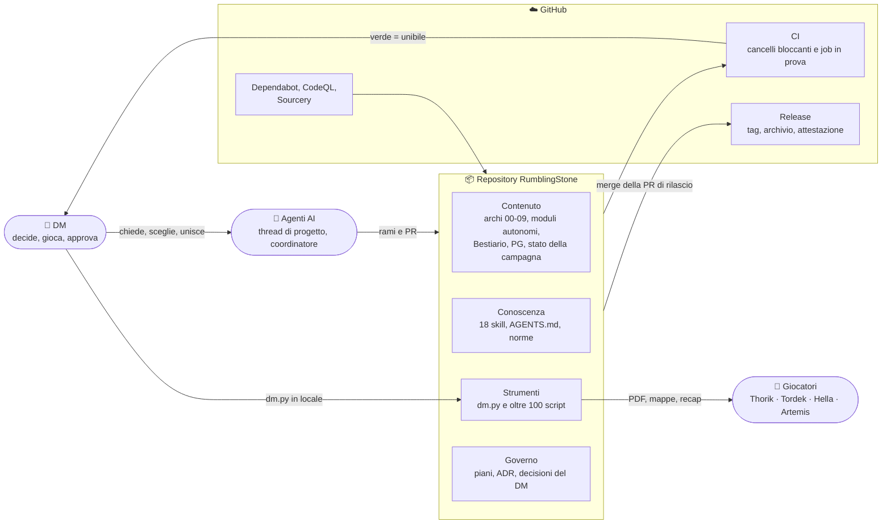

Riferimenti: [ADR-0002](../plans/adr/ADR-0002-cli-unica-dm-orchestratore.md) (un solo punto d'ingresso, `dm.py`),
[ADR-0081](../plans/adr/ADR-0081-il-contratto-d-ambiente.md) (la CI è lo
standard), [ADR-0099](../plans/adr/ADR-0099-la-piattaforma-ha-tre-canali-come-debian.md).

## 2. Le parti del repo

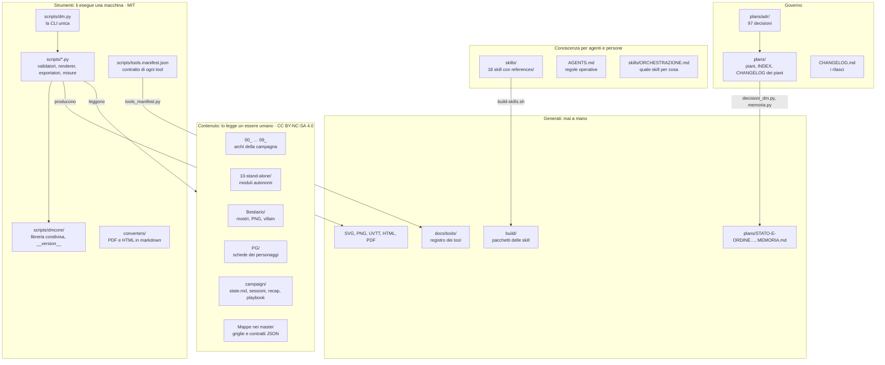

Il taglio delle licenze è in [`LICENSES.md`](../LICENSES.md): se lo legge un
essere umano al tavolo è testo, se lo esegue una macchina è strumento
([ADR-0029](../plans/adr/ADR-0029-licenza-doppia-testo-e-script.md)).

## 3. L'infrastruttura software

Dove gira cosa. Gli strumenti devono partire sul portatile del DM la sera
della sessione, spesso senza rete: per questo il nucleo è Python 3.13 con la
sola libreria standard più tre eccezioni dichiarate
([ADR-0037](../plans/adr/ADR-0037-stdlib-only-e-le-sue-eccezioni.md)), e ogni
binario esterno è facoltativo con un ripiego scritto in `scripts/binari.py`.

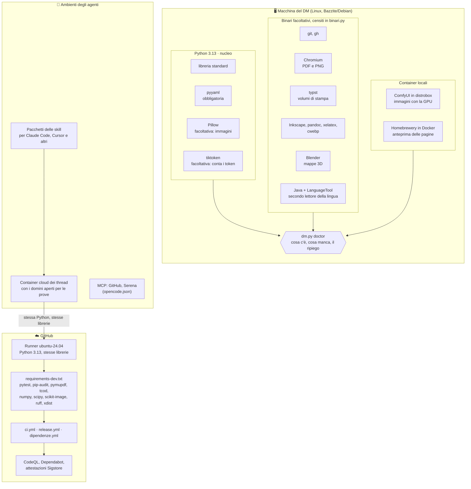

| Strato | Cosa contiene | Chi decide la versione |
|---|---|---|
| Nucleo | Python 3.13, pyyaml, Pillow, tiktoken | ADR-0037, ADR-0099 (Python sale con Debian) |
| Sviluppo e prove | `requirements-dev.txt` | Dependabot propone, la CI misura |
| Binari | git, gh, Chromium, typst, Blender, Inkscape, pandoc, LanguageTool | `scripts/binari.py`, `dm.py doctor` |
| Container | ComfyUI (`scripts/comfyui-local/`), Homebrewery (`scripts/homebrew-local/`) | i loro README |
| Convertitori | `converters/`: motori PDF, OCR, HTML | dipendenze proprie, job `convertitori` in testing |
| CI | GitHub Actions, azioni fissate a una versione | Dependabot, ADR-0099 |

## 4. Come si integrano strumenti e fonti

Il repo prende materiale da fuori (regole, moduli in PDF, generatori di
città, corpus di prosa, modelli) e lo fa passare sempre dalla stessa porta:
diventa markdown o JSON nel repo, passa i cancelli, e solo allora produce
qualcosa. Le fonti di regole entrano nelle skill con la loro licenza (OGL
1.0a) e la loro provenienza
([ADR-0005](../plans/adr/ADR-0005-confini-ip-uso-non-commerciale.md)).

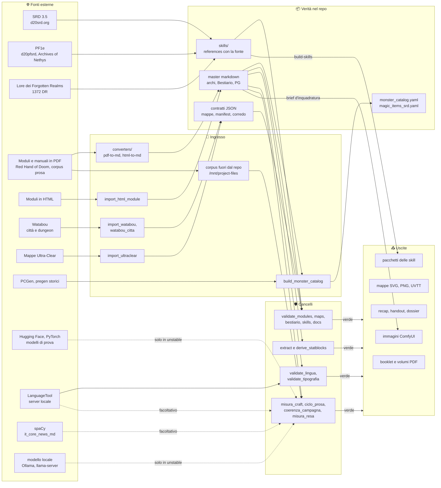

Tre regole tengono in ordine questo traffico:

- **Il materiale con diritti resta fuori dal repo.** I PDF dei moduli, i
  corpus di prosa e i pesi dei modelli vivono in cartelle esterne; nel repo
  entrano solo le misure e il markdown che il progetto ha scritto
  ([GUIDA-CONDIVISIONE-IP](guides/GUIDA-CONDIVISIONE-IP.md)).
- **Ogni dato di regole porta la sua fonte.** Uno statblocco dice da dove
  viene il numero (SRD, PF1e, `[GENERATO]` da uno script, `[INFERRED]` in
  attesa del DM); il gioco preferisce la versione più forte e segna dove
  diverge dall'SRD.
- **Un componente nuovo passa dai canali.** Un modello di Hugging Face, una
  libreria di sintassi o un generatore nuovo entrano in unstable e salgono
  solo con una misura (§16).

## 5. La regola che tiene insieme tutto

**Il markdown è la verità, tutto il resto si rigenera**
([ADR-0003](../plans/adr/ADR-0003-markdown-master-layout-generati.md)). Non si corregge un PDF, un SVG o un `.typ`: si
corregge il master e si rifà.

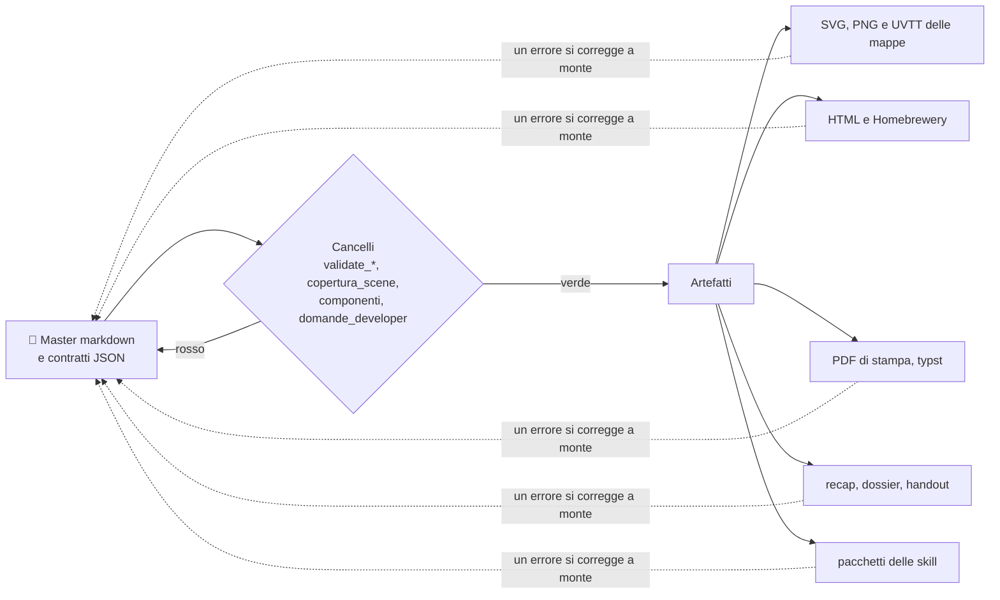

## 6. I casi d'uso

Chi fa cosa con il repo, un diagramma per attore. Gli ovali sono i casi
d'uso, le frecce piene chi li avvia, le tratteggiate le inclusioni (un caso
d'uso che ne usa un altro) e i rimandi.

**Il DM e i giocatori**

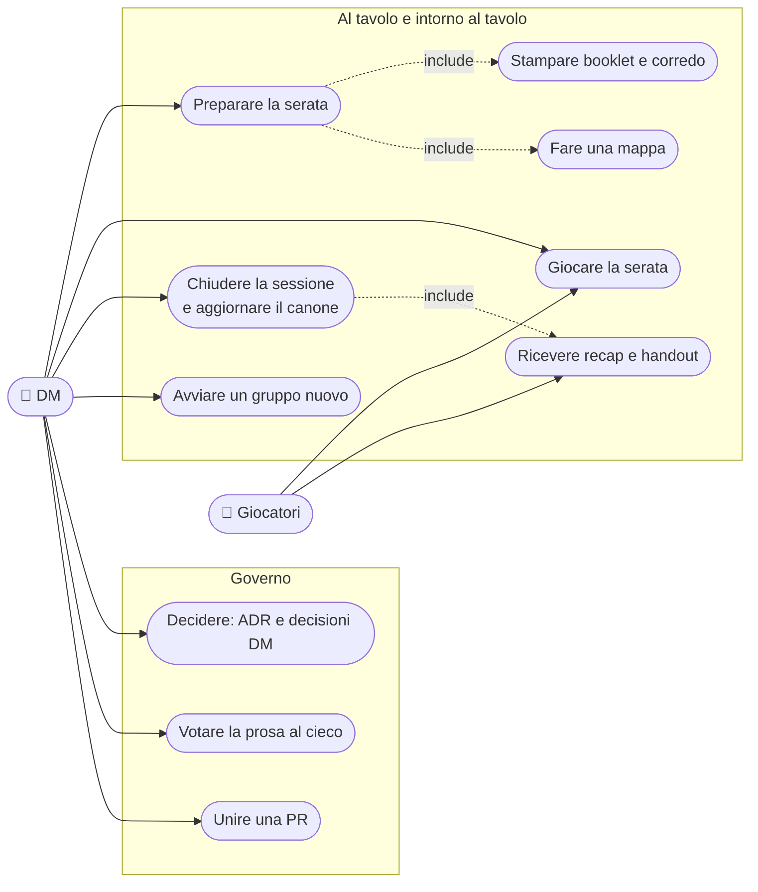

**L'agente AI**

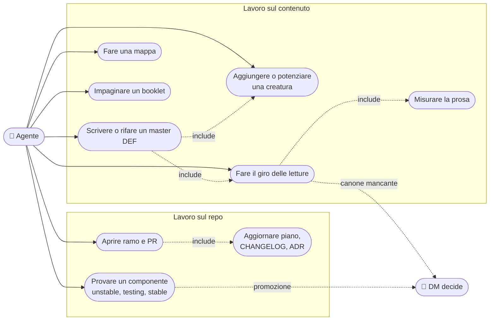

**La CI e il rilascio**

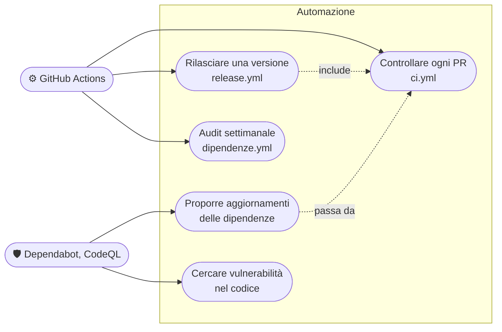

| Caso d'uso | Chi | Come | Dove si legge |
|---|---|---|---|
| Preparare la serata | DM | `dm.py prep`, `dm.py corredo` | [Playbook](../campaign/DM-CAMPAIGN-PLAYBOOK.md) §2 |
| Chiudere la sessione | DM | `dm.py session end` sul ramo di gruppo | [ADR-0007](../plans/adr/ADR-0007-scritture-canone-triplo-vincolo.md) |
| Scrivere un master DEF | agente | ciclo in sette passi, §9 | skill `rumblingstone-module-standard` |
| Il giro delle letture | agente, DM | otto passi, §9 | [ADR-0095](../plans/adr/ADR-0095-il-giro-ha-correzione-verifica-e-seconda-passata.md) |
| Misurare la prosa | agente, DM | `dm.py prosa misura`, `ciclo`, `mqm`, voto al cieco | [ADR-0093](../plans/adr/ADR-0093-la-prosa-migliora-se-la-sceglie-il-dm-alla-cieca.md) |
| Riscrivere un box | agente, DM | `dm.py prosa coerenza` → `sintassi` → `migliora` → `cieco` | §10.2, [ADR-0101](../plans/adr/ADR-0101-la-prosa-ha-una-catena-sola.md) |
| Provare un modello locale | DM | `dm.py prosa banco`, poi `voto` | §10.4, [ADR-0089](../plans/adr/ADR-0089-un-llm-locale-per-la-prosa-si-misura-prima.md) |
| Fare una mappa | agente | `compile_map_json` → `render_map_svg` | [GUIDA-MAPPE](guides/GUIDA-MAPPE.md) |
| Stampare | agente, DM | `dm.py volume`, `dm.py corredo` | [GUIDA-BOOKLET-E-PDF](guides/GUIDA-BOOKLET-E-PDF.md) |
| Una creatura | agente | `dm.py bestiario`, skill `npc-villain-boosting` | [GUIDA-BESTIARIO](guides/GUIDA-BESTIARIO.md) |
| Decidere | DM | tabelle `decisioni-dm` nei piani, ADR | §15 |
| Controllare una PR | CI | `ci.yml` | §14 |
| Rilasciare | CI | `release.yml` al merge | §17, [RILASCIO](RILASCIO.md) |
| La piattaforma | agente, DM | canali di ADR-0099 | §16 |
| Un gruppo nuovo | DM | `dm.py gruppo nuovo` | Playbook §7 |

## 7. I rami

`main` ha il modulo come va giocato da un gruppo qualsiasi. Ogni gruppo ha il
suo ramo `campaign-group-<nome>`, dove vive il canone giocato: `state.md`, i
diari, le scelte del tavolo. Il lavoro sul repo passa da rami brevi e da una
PR.

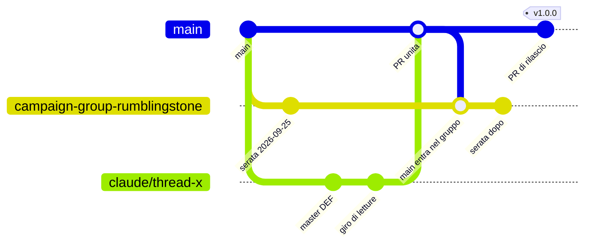

Il canone giocato non torna mai su `main` da solo: le patch del ramo di gruppo
le applica il DM. Riferimenti:
[ADR-0007](../plans/adr/ADR-0007-scritture-canone-triplo-vincolo.md),
[ADR-0090](../plans/adr/ADR-0090-la-partita-riparte-su-un-ramo-di-gruppo-nuovo.md) (il ramo di gruppo del primo tavolo).

## 8. La serata: prima, al tavolo, dopo

Nessuno script gira durante la partita: è una scelta. Le scritture di canone
passano dal **triplo vincolo** di ADR-0007: ramo di gruppo, diff confermato dal
DM, solo dentro le regioni `<!-- auto:begin … -->`.

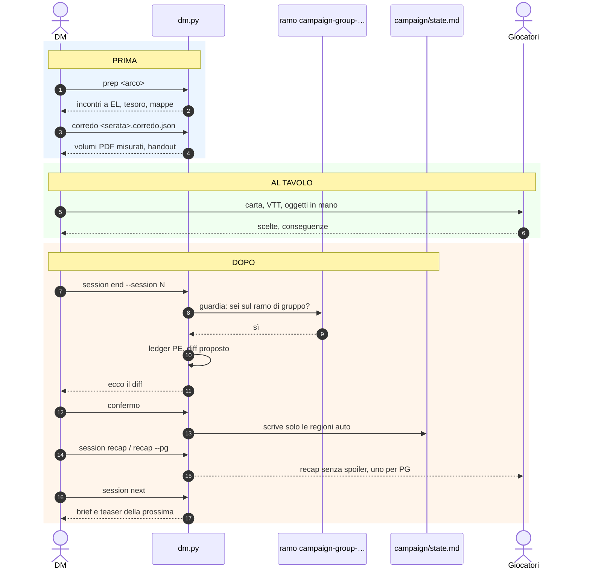

## 9. Il ciclo del master e il giro delle letture

Un master diventa **DEF** quando ha fatto sette passi
([ADR-0075](../plans/adr/ADR-0075-il-ciclo-del-master-vale-per-ogni-piano.md), skill `rumblingstone-module-standard`). I passi 1-5
sono cancelli che la CI misura; il 6 e il 7 li fanno agenti. Il passo 6 è **il
giro**, che dal 2026-10-18 ha otto passi
([ADR-0095](../plans/adr/ADR-0095-il-giro-ha-correzione-verifica-e-seconda-passata.md)).

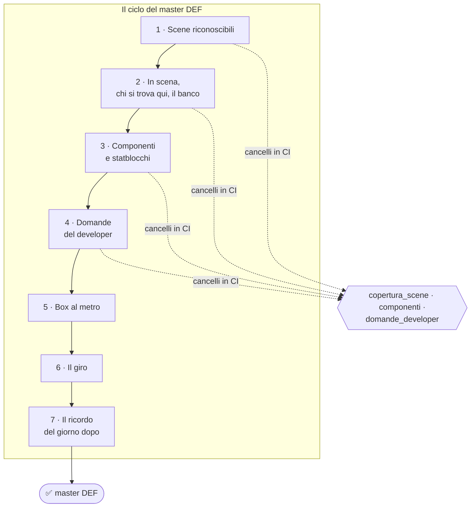

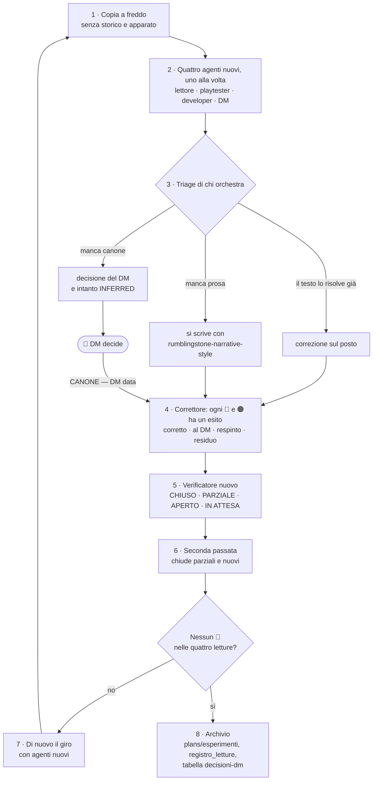

Un tipo di rilievo che ricompare in due master diversi diventa una regola di
`copertura_scene.py` o di `domande_developer.py`: le letture trovano, i
cancelli impediscono che torni.

## 10. La prosa si misura, poi decide il DM

La prosa nuova entra solo se non peggiora la misura e, nei casi indecisi, se il
DM la sceglie al cieco ([ADR-0093](../plans/adr/ADR-0093-la-prosa-migliora-se-la-sceglie-il-dm-alla-cieca.md), [ADR-0097](../plans/adr/ADR-0097-scrittura-italiana-entra-come-eccezione.md) per l'eccezione
della scrittura italiana). Gli strumenti stanno in una catena sola, con un
ingresso solo, `dm.py prosa <azione>`
([ADR-0101](../plans/adr/ADR-0101-la-prosa-ha-una-catena-sola.md)).

### 10.1 La catena

```mermaid
flowchart LR
    subgraph MIS["1 · misurare"]
        direction TB
        A1["misura<br/>misura_craft"]
        A2["ciclo<br/>ciclo_prosa"]
        A3["mqm<br/>punteggio_mqm"]
        A4["sintassi<br/>misura_sintassi"]
    end
    subgraph CTL["2 · controllare"]
        direction TB
        B1["coerenza<br/>coerenza_campagna"]
        B2["domande<br/>domande_developer"]
    end
    subgraph RIS["3 · riscrivere"]
        direction TB
        C0["candidate<br/>le scrive un agente"]
        C1["migliora<br/>migliora_prosa"]
    end
    subgraph DEC["4 · decidere"]
        direction TB
        D1["cieco<br/>cieco_versioni"]
        D2(["👤 DM"])
    end
    BOX["Box di un master"] --> MIS --> CTL --> RIS
    C0 --> C1
    C1 -->|"la migliore<br/>delle rimaste"| D1 --> D2
    D2 -->|"vince la nuova"| IN["entra nel master"]
    D2 -->|"vince la vecchia"| KEEP["resta la vecchia"]
    IN & KEEP --> FROZEN["CONGELATI.json<br/>i box votati non si toccano"]
    D2 -->|"ogni voto"| VOTI[("pipeline/VOTI.json")]
    VOTI -.->|"riaddestra"| C1
```

La fase 3 non genera niente: `migliora` scarta le candidate che cambiano un
fatto, che impoveriscono il box o che violano una delle regole misurabili di
`read-aloud-adulti.md` §2-ter, e ordina le rimaste. Il modello supera la
soglia scritta in `pipeline/SOGLIA.txt` dal 2026-10-23 (0,661 in leave-one-out
su 59 coppie): se anche la migliore perde contro l'originale, resta
l'originale e la coppia non va al cieco.

| Azione | Script | Canale (§16) | In CI |
|---|---|---|---|
| `misura` | `misura_craft` | stable | cancelli e tetti dei box |
| `ciclo` | `ciclo_prosa` | stable | `box_impoveriti`, verdetto misurato |
| `mqm` | `punteggio_mqm` | stable | contro la baseline |
| `sintassi` | `misura_sintassi` | unstable, spaCy facoltativo | no |
| `coerenza` | `coerenza_campagna` | testing | `fatti --check plans/coerenza-residui.json` |
| `domande` | `domande_developer` | stable | sui master nuovi |
| `migliora` | `migliora_prosa` | unstable | solo `--help` |
| `cieco` | `cieco_versioni` | stable | no: decide il DM |
| `banco` | `banco_prosa_locale` | unstable (ADR-0089) | `corsa --dry-run` |
| `voto` | `voto_scrittura` | stable | i test |

### 10.2 Caso d'uso: riscrivere un box che c'era

Il caso più frequente: un agente rifà un box di un master già giocato o già
votato. La sequenza mostra chi chiama chi; le frecce tratteggiate sono le
risposte.

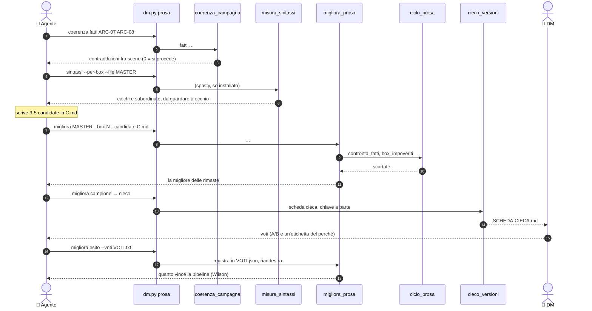

### 10.3 Caso d'uso: una PR tocca un master

La CI non riscrive e non vota: ferma solo ciò che peggiora o contraddice.

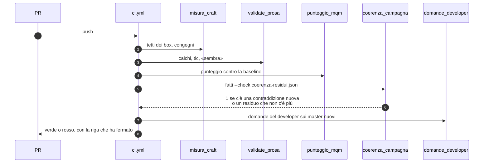

### 10.4 Caso d'uso: provare un modello locale

Il modello locale (ADR-0089) produce candidate come un agente; il giudice è lo
stesso.

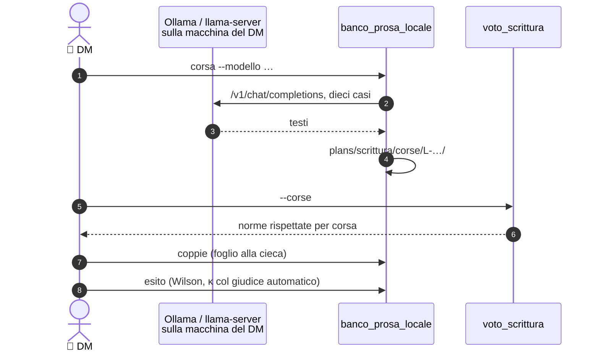

### 10.5 Come dipendono fra loro

Chi importa chi, e le tre dipendenze di fuori. Le frecce vanno da chi usa a
chi è usato; le tratteggiate sono facoltative e degradano senza fermare la
catena (`binari.py`, catene «sintassi della prosa» e «secondo lettore
LanguageTool»).

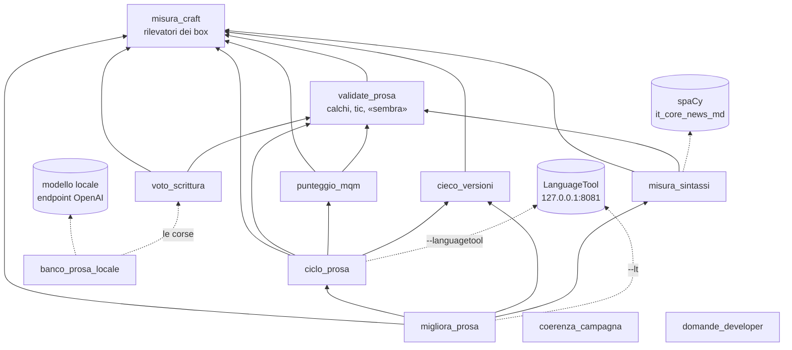

`coerenza_campagna` e `domande_developer` non dipendono dagli altri: leggono i
master e lo schema dei fronti (`scripts/schemas/fronti_orologi.schema.json`).

### 10.6 Cosa ha detto la misura

| Prova (2026-10-22/23) | Esito | Conseguenza |
|---|---|---|
| 17 misure di prosa della letteratura sui 38 voti ciechi | nessuna prevede il voto | niente cancelli di prosa nuovi |
| catena vecchia contro nuova, 16 box al cieco | vecchia 8, nuova 5, pari 1 | tre cautele in §2-ter, nessuna sostituzione |
| modello di preferenza di `migliora` | 0,611 il 22; col voto del 23, 0,661 su 59 coppie (Wilson basso 0,534) e 5 su 5 in prospettiva | scarta le candidate che perdono contro l'originale; il resto va al cieco |
| prima prova della pipeline al cieco | pipeline 4, originale 1, pari 1 (soglia 5 su 6) | miglioramento non dimostrato |
| LanguageTool sui box | 1 rilievo vero su 30, 6 errori piantati su 20 | filtro spento finché un gruppo non arriva a 0,70 |
| Stanza contro spaCy (PR #270) | non vince | resta spaCy |
| coerenza fra ARC-07 e ARC-08 | contraddizioni vere, 4 residui dichiarati | cancello in CI |

## 11. La catena delle mappe

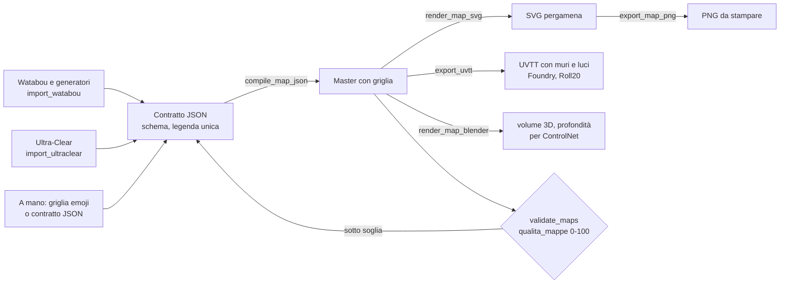

Riferimenti: [ADR-0048](../plans/adr/ADR-0048-legenda-funzionale-fonte-unica.md) (legenda funzionale, fonte unica), [ADR-0098](../plans/adr/ADR-0098-la-qualita-delle-mappe-si-misura-con-uno-standard.md) (standard di
qualità delle mappe), [GUIDA-MAPPE](guides/GUIDA-MAPPE.md).

## 12. La catena dei booklet

Due binari che leggono lo stesso manifest
([ADR-0020](../plans/adr/ADR-0020-edizione-da-stampa-su-un-secondo-binario.md)).

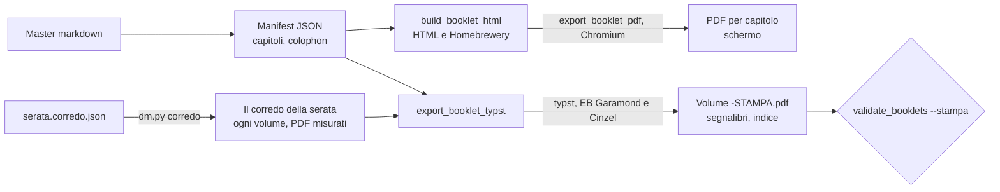

## 13. La catena delle skill

Le skill sono la conoscenza che gli agenti caricano: regole 3.5, canone,
stile, mestieri. Si scrivono una volta in `skills/` e si impacchettano per
ogni agente.

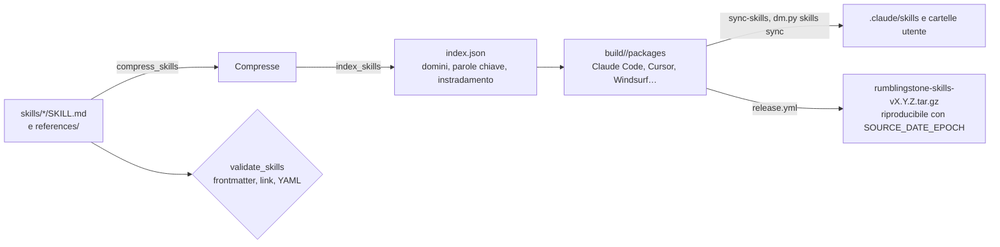

## 14. Il giro di una modifica: dal thread al merge

Ogni lavoro sul repo è un thread di progetto, un ramo e una PR. La CI decide se
si può unire, il DM decide se si unisce.

```mermaid
sequenceDiagram
    autonumber
    actor DM
    participant CO as Coordinatore
    participant TH as Thread agente
    participant GH as GitHub PR
    participant CI as CI ci.yml
    participant BOT as CodeQL, Sourcery

    DM->>CO: richiesta nella chat di progetto
    CO->>TH: apre un thread con la richiesta
    TH->>TH: piano, misure prima
    TH->>GH: ramo claude/…, PR in bozza
    GH->>CI: validate, testing, convertitori, build
    GH->>BOT: analisi e revisione
    CI-->>TH: rosso: si corregge e si rispinge
    BOT-->>TH: rilievi: corretti o motivati
    CI-->>GH: verde
    TH->>DM: risultato, decisioni aperte
    DM-->>TH: scelte, ok
    TH->>GH: aggiorna piano, CHANGELOG, ADR
    DM->>GH: unisci
    GH->>CI: CI su main
```

Il job principale della CI (`validate`) ha oltre 50 passi bloccanti: Python
compilato, cancelli dei documenti e dei piani, prosa, mappe, bestiario, skill,
statblocchi, test. Nella stessa PR il piano, la riga in `plans/INDEX.md` e
quella in `plans/CHANGELOG.md` vanno insieme (regola d'oro,
`check_plans_discipline.py`).

## 15. Le decisioni del DM

```mermaid
flowchart LR
    Q["Domanda nata dal lavoro<br/>piano, giro, misura"] --> T["Tabella decisioni-dm<br/>nel piano, con la proposta"]
    T --> DM(["👤 DM risponde"])
    DM --> E["Riga decisa: ~~Dn~~ ✅<br/>con le sue parole fra « »"]
    E --> ECO["Eco: decise, aperte,<br/>cambiate, dedotto da me"]
    E -->|"decisioni_dm.py --emit"| ST["STATO-E-ORDINE §4"]
    E -->|"se è strutturale"| ADR["ADR: contesto, alternative,<br/>decisione, conseguenze, da rivedere se"]
    E -->|"nel master"| CAN["CANONE — DM data"]
    ADR -->|"validate_docs"| IDX["docs/INDEX.md"]
```

Le decisioni stanno nei piani perché `decisioni_dm.py` legge solo quelle; un
ADR si scrive quando la decisione cambia la struttura. I numeri degli ADR si
prenotano in `plans/adr-prenotati.json`.

## 16. La piattaforma e i suoi tre canali

Ogni componente di terzi (Python, librerie, binari, strumenti, azioni CI) sta
in un canale, come i pacchetti in Debian
([ADR-0099](../plans/adr/ADR-0099-la-piattaforma-ha-tre-canali-come-debian.md)).

```mermaid
stateDiagram-v2
    [*] --> unstable: si prova a mano<br/>in un ramo o in plans/esperimenti
    unstable --> testing: licenza libera, misura prima e dopo,<br/>guadagno nominato, ok del DM
    testing --> stable: 14 giorni e 10 run su main,<br/>zero falsi allarmi, tempo ≤ +5%, ok del DM
    stable --> testing: boccia a torto o rompe,<br/>si scende il giorno stesso
    testing --> unstable: la misura non regge
    stable --> oldstable: Debian sale di versione
    oldstable --> [*]: dopo tre mesi
```

| Componente | Canale al 2026-10-23 |
|---|---|
| Python 3.13 (Debian 13), pytest, pip-audit, typst, Dependabot | stable |
| ruff (regole-bug), uv, pytest-xdist, job dei convertitori, workflow Release, riscontro SRD (ADR-0103) | testing |
| spaCy, Stanza, LLM locale, mypy | unstable |

## 17. Il rilascio

Rilasciare è unire una PR
([ADR-0100](../plans/adr/ADR-0100-il-rilascio-e-una-pr.md), guida in
[RILASCIO](RILASCIO.md)).

```mermaid
sequenceDiagram
    autonumber
    actor DM
    participant PR as PR di rilascio
    participant MAIN as main
    participant REL as release.yml
    participant PLAN as release_plan.py
    participant CI as ci.yml
    participant SIG as Sigstore
    participant GHR as GitHub Release

    DM->>PR: CHANGELOG ## [X.Y.Z] e __version__
    DM->>MAIN: unisci
    MAIN->>REL: push che tocca CHANGELOG.md
    REL->>PLAN: quale versione, quale commit?
    PLAN-->>REL: vX.Y.Z sul commit della PR,<br/>o la testa se le skill non sono cambiate
    REL->>REL: il commit è nella storia di main?
    REL->>CI: tutta la CI su quel commit
    CI-->>REL: verde
    REL->>REL: build-skills, tar riproducibile, SHA256SUMS
    REL->>SIG: attestazione di provenienza
    REL->>GHR: tag vX.Y.Z, archivio, note dal CHANGELOG
    note over REL,GHR: a ogni push che tocca il CHANGELOG<br/>le note pubblicate si riallineano
```

## 18. Il flusso della qualità: mappe, moduli, regole

Gli strumenti che misurano la qualità sono nati uno per volta, ognuno con il
suo ADR. Qui stanno in un flusso solo, descritto come si descrive un servizio
di revisione del codice (Sourcery e simili): prima chi lo usa e per che cosa,
poi i componenti, poi i dati che passano fra loro. Tutti rispondono alla
stessa domanda, «questo master si può giocare così com'è scritto?», guardando
tre cose diverse: la mappa, il testo, la regola.

### Casi d'uso

| Attore | Obiettivo | Comando | Uscita | Canale |
|---|---|---|---|---|
| CI, a ogni PR | una mappa non mente (intestazione, griglia, legenda) | `python3 scripts/validate_maps.py` | errori, exit 1 | bloccante |
| CI, a ogni PR | il corpus delle mappe misurato sullo standard | `python3 scripts/qualita_mappe.py --solo-errori` | rilievi E e A, voto 0-100 | rapporto non bloccante |
| chi rifà una mappa | sapere se il rifacimento ha cambiato la tattica | `python3 scripts/qualita_mappe.py --json OUT --profonde` | metriche senza soglia (space syntax, `qualita_mappe_profonde`) | a mano |
| chi rifà una mappa | quanto è cambiata e se il voto è salito per quello | `python3 scripts/confronta_mappe.py --versioni A=REF C=HEAD --base C --out DIR FILE.md` | `confronto.json`, SVG affiancati | a mano |
| chi scrive un master | i congegni di mestiere e i box al metro dei banchi | `python3 scripts/misura_craft.py --box` | conteggi per arco, box fuori soglia | a mano |
| chi riscrive la prosa | il riscritto migliora, o va al cieco del DM | `python3 scripts/ciclo_prosa.py misura …` | verdetto misurato; il registro | `registro --check` bloccante |
| CI, a ogni PR | si gioca? volo, rumore, TS, soglie del boss | `python3 scripts/domande_developer.py --check` | rilievi con la ragione delle deroghe | bloccante |
| agenti del giro (ADR-0095) | una lettura a freddo, una scena alla volta | `python3 scripts/lettura_a_scene.py servi …` | rapporti di lettore, playtester, developer, DM | a mano, agenti |
| CI, a ogni PR | nessuna lettura scaduta, nessun 🔴 senza stato | `python3 scripts/registro_letture.py --check` | registro delle letture | bloccante (avviso finché vuoto) |
| chi fa il triage | una regola «a memoria» del giro è davvero nell'SRD | `python3 scripts/riscontro_srd.py riscontra FILE.yaml` | concorda, discorda, non trovata, con la citazione | testing (job `riscontro-srd`) |
| il DM | decidere le discordanze e i rilievi aperti | tabella `decisioni-dm` del piano | `[CANONE — DM data]` nel master | decisione umana |

### Il flusso

```mermaid
flowchart LR
    subgraph IN["Ingresso"]
        MAP["Griglie emoji<br/>nei master"]
        TXT["Master DEF<br/>prosa e statblocchi"]
        FONTI[("SRD 3.5 e PRD PF1e<br/>cache fuori dal repo,<br/>sha256 fissati")]
    end
    subgraph MAPPE["Mappe (ADR-0098)"]
        VM["validate_maps"] --> QM["qualita_mappe<br/>voto 0-100"]
        QM --> QP["qualita_mappe_profonde<br/>senza soglia"]
        QM --> CM["confronta_mappe<br/>versione contro versione"]
    end
    subgraph MODULI["Moduli (ADR-0095)"]
        MC["misura_craft"] --> CP["ciclo_prosa"]
        DD["domande_developer"]
        GF["giro a freddo<br/>lettura_a_scene"] --> RL["registro_letture"]
    end
    subgraph REGOLE["Regole (ADR-0103)"]
        RS["riscontro_srd"]
    end
    MAP --> VM
    TXT --> MC
    TXT --> DD
    TXT --> GF
    TXT --> RS
    FONTI --> RS
    GF -->|"rilievi «a memoria»"| RS
    CM & QP & CP & DD & RL & RS --> TRI{"Triage"}
    TRI -->|"il testo lo risolve"| FIX["correzione<br/>nel master"]
    TRI -->|"è una scelta"| DM(["👤 DM decide"])
    DM --> FIX
    FIX -->|"si rimisura"| TXT
```

Il giro a freddo trova i rilievi; la misura dice se sono veri; il triage li
smista. La freccia dal giro al riscontro è il passo nuovo: un rilievo che un
lettore ha controllato a memoria diventa una voce del file dei riscontri e
arriva al triage con la citazione dell'SRD, non con un ricordo.

### Componenti e dati

```mermaid
flowchart TB
    subgraph COMP["Componenti"]
        direction LR
        C1["validate_maps · qualita_mappe<br/>confronta_mappe"]
        C2["misura_craft · ciclo_prosa<br/>domande_developer"]
        C3["lettura_a_scene<br/>registro_letture"]
        C4["riscontro_srd"]
    end
    subgraph DATI["Dati"]
        direction LR
        D1[/"scripts/legend.json<br/>standard-qualita-mappe.md"/]
        D2[/"CONGELATI.json<br/>domande-developer.json"/]
        D3[/"registro delle letture<br/>rapporti in plans/esperimenti"/]
        D4[/"riscontri-*.yaml<br/>regex, confronto, scala"/]
        D5[("~/.cache/rumblingstone/srd<br/>OGL 1.0a")]
    end
    subgraph OUT["Uscite"]
        direction LR
        O1["voto, metriche JSON, SVG"]
        O2["verdetti, rilievi con deroga"]
        O3["rilievi 🔴 🟠 con stato"]
        O4["tabella con citazioni,<br/>riepilogo del run CI"]
    end
    D1 --> C1 --> O1
    D2 --> C2 --> O2
    D3 --> C3 --> O3
    D4 --> C4
    D5 --> C4 --> O4
```

Il riscontro è l'unico di questi strumenti che legge un testo esterno al
repo. Lo legge da una cache con commit e sha256 fissati nel codice, e la
rete che manca la dice con l'exit 3. Il primo uso, su DEF-1 e DEF-2 di
ARC-08, è in
[RISCONTRO-ARC08](../plans/esperimenti/ricerca-rete-2026-10-23/RISCONTRO-ARC08.md).

## 19. Dove sta cosa

| Cerco… | Dove |
|---|---|
| lo stato della campagna giocata | `campaign/state.md` sul ramo di gruppo |
| un master di un arco | `0N_…/ARC0N-DEF-*.md` |
| una creatura | `Bestiario/`, catalogo `scripts/monster_catalog.yaml` |
| come si usa uno script | [`docs/tools/README.md`](tools/README.md), `python3 scripts/<script>.py --help` |
| se una regola del master è nell'SRD | `python3 scripts/riscontro_srd.py regola NOME` o `riscontra FILE.yaml` (ADR-0103) |
| perché una cosa è fatta così | [`plans/adr/`](../plans/adr/), indice in [`docs/INDEX.md`](INDEX.md) §4 |
| cosa resta da fare | [`plans/INDEX.md`](../plans/INDEX.md), [`plans/STATO-E-ORDINE-DEI-PIANI.md`](../plans/STATO-E-ORDINE-DEI-PIANI.md) |
| cosa è cambiato fra due versioni | [`CHANGELOG.md`](../CHANGELOG.md) |
| come si prepara una macchina | [`guides/GUIDA-SETUP-MACCHINA.md`](guides/GUIDA-SETUP-MACCHINA.md) |
| le regole per gli agenti | [`AGENTS.md`](../AGENTS.md), [`skills/ORCHESTRAZIONE.md`](../skills/ORCHESTRAZIONE.md) |
