# Architettura di RumblingStone

> Forma: **spiegazione** ([Diátaxis](../../plans/adr/ADR-0123-la-documentazione-segue-diataxis.md)).

Come è fatto il repo e come girano le sue catene, con un diagramma per
ognuna. I diagrammi sono in Mermaid: GitHub li disegna da solo, e in locale
li mostra qualunque editor con l'anteprima Markdown.

Chi cerca **perché** una cosa è fatta così trova la decisione negli ADR
([`plans/adr/`](../../plans/adr/)), citati sotto ogni diagramma. Chi cerca
**come si usa** uno strumento parte dal
[registro dei tool](../tools/README.md), che è generato dal manifest.

## Indice

1. [Il sistema e chi lo usa](#1-il-sistema-e-chi-lo-usa)
2. [Le parti del repo](#2-le-parti-del-repo)
3. [L'infrastruttura software](#3-linfrastruttura-software)
4. [Come si integrano strumenti e fonti](#4-come-si-integrano-strumenti-e-fonti)
5. [La regola che tiene insieme tutto](#5-la-regola-che-tiene-insieme-tutto)
6. [I casi d'uso](#6-i-casi-duso)
7. [I rami](#7-i-rami)
8. [La serata: prima, al tavolo, dopo](#8-la-serata-prima-al-tavolo-dopo)
9. [Il ciclo del master e il giro delle letture](#9-il-ciclo-del-master-e-il-giro-delle-letture)
10. [La prosa si misura, poi decide il DM](#10-la-prosa-si-misura-poi-decide-il-dm)
11. [La catena delle mappe](#11-la-catena-delle-mappe)
12. [La catena dei booklet](#12-la-catena-dei-booklet)
13. [La catena delle skill](#13-la-catena-delle-skill)
14. [Il giro di una modifica: dal thread al merge](#14-il-giro-di-una-modifica-dal-thread-al-merge)
    - 14.1 [Agenti, hook e cancelli del thread](#141-agenti-hook-e-cancelli-del-thread)
15. [Le decisioni del DM](#15-le-decisioni-del-dm)
16. [La piattaforma e i suoi tre canali](#16-la-piattaforma-e-i-suoi-tre-canali)
17. [Il rilascio](#17-il-rilascio)
18. [Il flusso della qualità: mappe, moduli, regole, stampa](#18-il-flusso-della-qualità-mappe-moduli-regole-stampa)
19. [Il motore delle regole e i sistemi di gioco](#19-il-motore-delle-regole-e-i-sistemi-di-gioco)
20. [Da dove viene un fatto, un termine, un numero](#20-da-dove-viene-un-fatto-un-termine-un-numero)
21. [Dove sta cosa](#21-dove-sta-cosa)

---

## 1. Il sistema e chi lo usa

Il repo è una campagna di D&D 3.5 (Red Hand of Doom portata nella Valle di
Cannath, Forgotten Realms 1372 DR), con due moduli autonomi in Pathfinder 1e,
più gli strumenti che la preparano, la controllano e la stampano. Gli
strumenti non conoscono nessun gioco: le regole di ogni sistema stanno in un
plugin di dati (§19). Ci lavorano il DM, gli agenti AI e la CI di GitHub.
I giocatori ne vedono solo ciò che il DM stampa o manda.

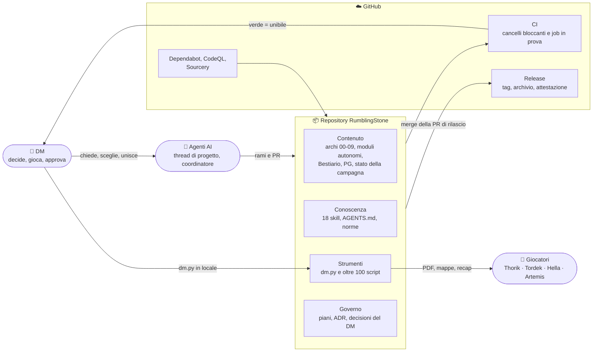

Riferimenti: [ADR-0002](../../plans/adr/ADR-0002-cli-unica-dm-orchestratore.md) (un solo punto d'ingresso, `dm.py`),
[ADR-0081](../../plans/adr/ADR-0081-il-contratto-d-ambiente.md) (la CI è lo
standard), [ADR-0099](../../plans/adr/ADR-0099-la-piattaforma-ha-tre-canali-come-debian.md).

## 2. Le parti del repo

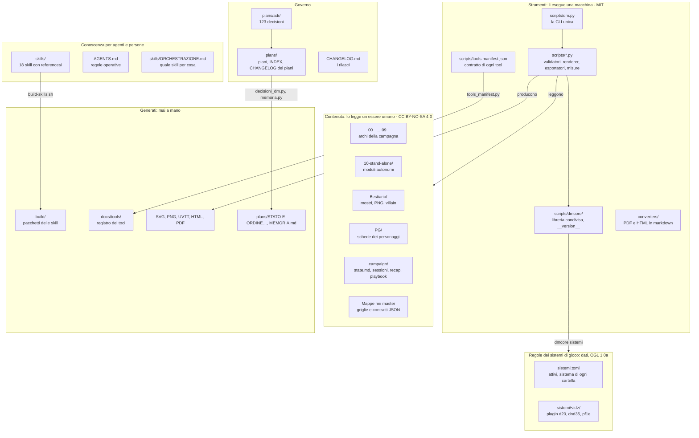

Il taglio delle licenze è in [`LICENSES.md`](../../LICENSES.md): se lo legge un
essere umano al tavolo è testo, se lo esegue una macchina è strumento
([ADR-0029](../../plans/adr/ADR-0029-licenza-doppia-testo-e-script.md)).

## 3. L'infrastruttura software

Dove gira cosa. Gli strumenti devono partire sul portatile del DM la sera
della sessione, spesso senza rete: per questo il nucleo è Python 3.13 con la
sola libreria standard più tre eccezioni dichiarate
([ADR-0037](../../plans/adr/ADR-0037-stdlib-only-e-le-sue-eccezioni.md)), e ogni
binario esterno è facoltativo con un ripiego scritto in `scripts/binari.py`.
Dal 2026-11-08 typst e l'imposizione arrivano da PyPI con il resto delle
dipendenze, e il rilascio porta un archivio di wheel per installare senza
rete (`scripts/bundle_offline.py`,
[ADR-0116](../../plans/adr/ADR-0116-typst-si-installa-da-pypi.md), che supera
ADR-0113 e toglie mise).

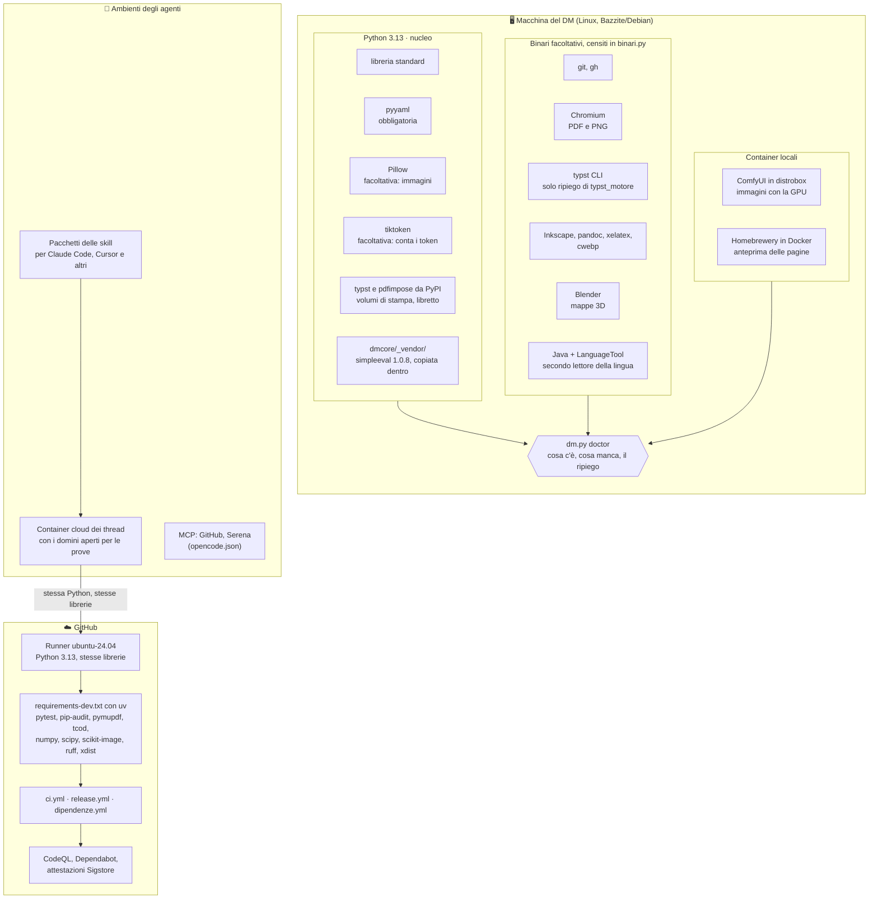

| Strato | Cosa contiene | Chi decide la versione |
|---|---|---|
| Nucleo | Python 3.13, pyyaml, Pillow, tiktoken, markdown-it-py; `typst==0.15.2` e `pdfimpose==2.10.0` in `requirements.txt` | ADR-0037, ADR-0099 (Python sale con Debian), ADR-0116 (typst e imposizione da PyPI, Dependabot) |
| Librerie copiate dentro | `scripts/dmcore/_vendor/`: simpleeval 1.0.8 (MIT), con versione, sha256 e licenza in `LIBRERIE.toml` | ADR-0112 (D1: standard di fatto e misura che migliora) |
| Sviluppo e prove | `requirements-dev.txt` | Dependabot propone, la CI misura |
| Binari | git, gh, Chromium, Blender, Inkscape, pandoc, LanguageTool; la CLI typst solo come ripiego (`RUMBLINGSTONE_TYPST=cli`) | `scripts/binari.py`, `dm.py doctor`, `python3 scripts/typst_motore.py` |
| Container | ComfyUI (`scripts/comfyui-local/`), Homebrewery (`scripts/homebrew-local/`) | i loro README |
| Convertitori | `converters/`: motori PDF, OCR, HTML | dipendenze proprie, job `convertitori` in testing |
| CI | GitHub Actions, azioni fissate a una versione | Dependabot, ADR-0099 |

## 4. Come si integrano strumenti e fonti

Il repo prende materiale da fuori (regole, moduli in PDF, generatori di
città, corpus di prosa, modelli) e lo fa passare sempre dalla stessa porta:
diventa markdown o JSON nel repo, passa i cancelli, e solo allora produce
qualcosa. Le fonti di regole entrano nelle skill con la loro licenza (OGL
1.0a) e la loro provenienza
([ADR-0005](../../plans/adr/ADR-0005-confini-ip-uso-non-commerciale.md)).

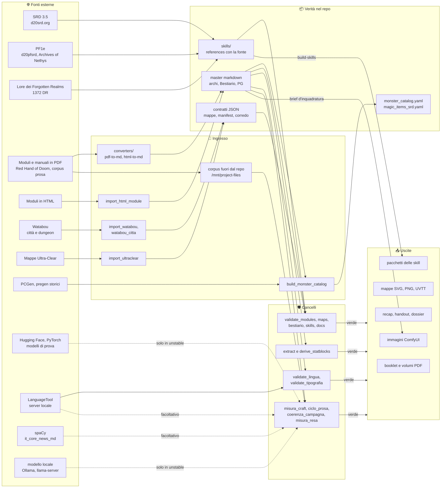

Tre regole tengono in ordine questo traffico:

- **Il materiale con diritti resta fuori dal repo.** I PDF dei moduli, i
  corpus di prosa e i pesi dei modelli vivono in cartelle esterne; nel repo
  entrano solo le misure e il markdown che il progetto ha scritto
  ([GUIDA-CONDIVISIONE-IP](../how-to/GUIDA-CONDIVISIONE-IP.md)).
- **Ogni dato di regole porta la sua fonte.** Uno statblocco dice da dove
  viene il numero (SRD, PF1e, `[GENERATO]` da uno script, una marca INFERRED con
  domanda e base in attesa del DM, [GUIDA-MARCATURE](../reference/GUIDA-MARCATURE.md)); il gioco preferisce la versione più forte e segna dove
  diverge dall'SRD.
- **Un componente nuovo passa dai canali.** Un modello di Hugging Face, una
  libreria di sintassi o un generatore nuovo entrano in unstable e salgono
  solo con una misura (§16).

## 5. La regola che tiene insieme tutto

**Il markdown è la verità, tutto il resto si rigenera**
([ADR-0003](../../plans/adr/ADR-0003-markdown-master-layout-generati.md)). Non si corregge un PDF, un SVG o un `.typ`: si
corregge il master e si rifà.

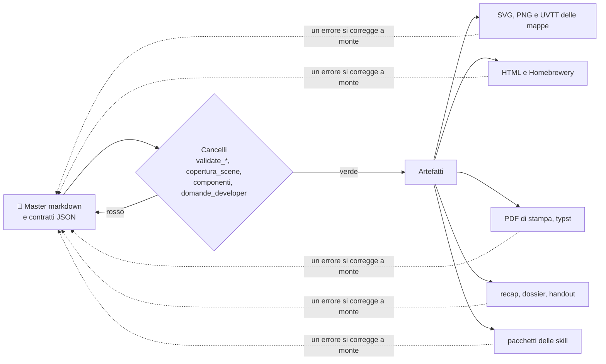

## 6. I casi d'uso

Chi fa cosa con il repo, un diagramma per attore. Gli ovali sono i casi
d'uso, le frecce piene chi li avvia, le tratteggiate le inclusioni (un caso
d'uso che ne usa un altro) e i rimandi.

**Il DM e i giocatori**

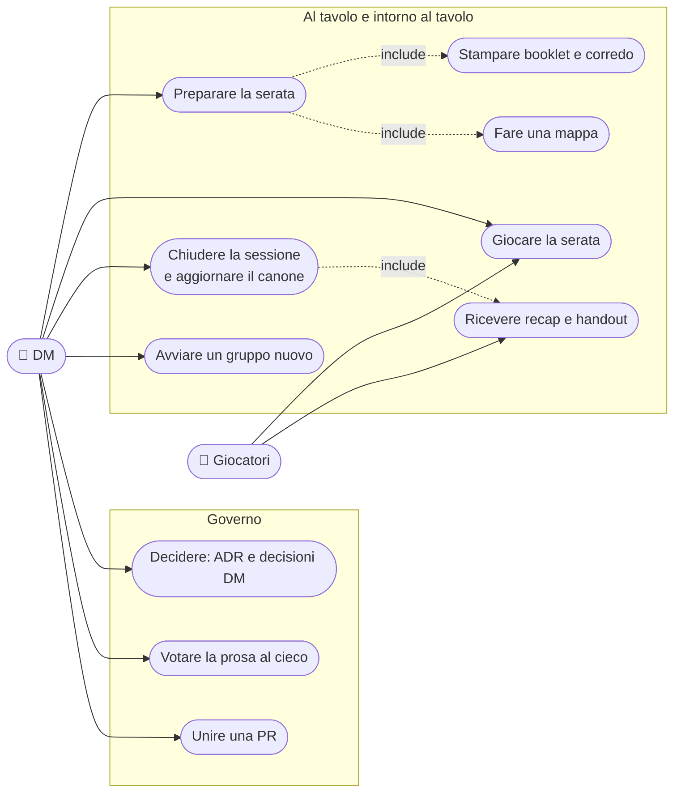

**L'agente AI**

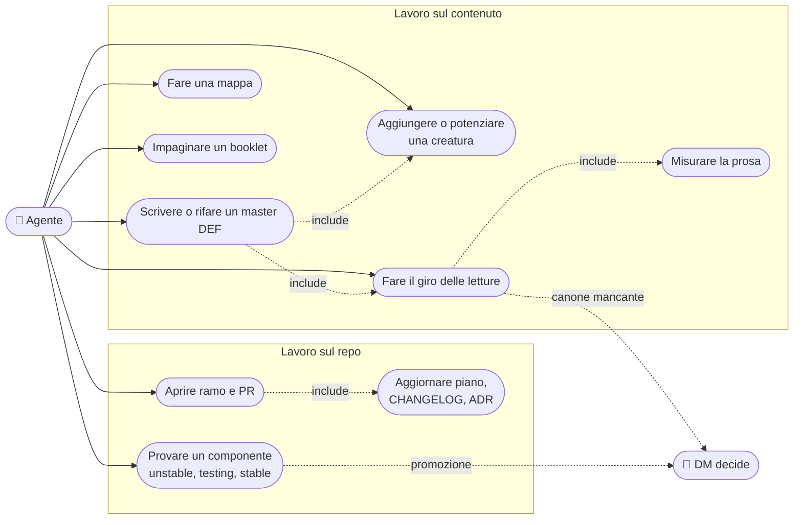

**La CI e il rilascio**

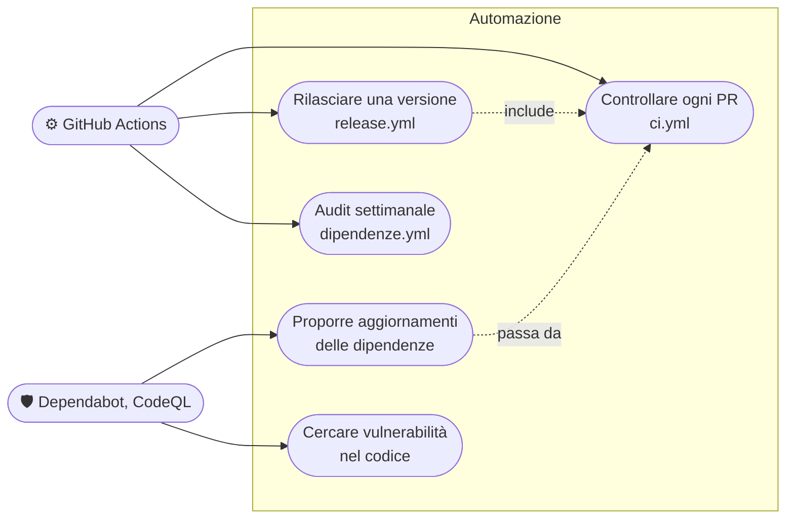

| Caso d'uso | Chi | Come | Dove si legge |
|---|---|---|---|
| Preparare la serata | DM | `dm.py prep`, `dm.py corredo` | [Playbook](../../campaign/DM-CAMPAIGN-PLAYBOOK.md) §2 |
| Chiudere la sessione | DM | `dm.py session end` sul ramo di gruppo | [ADR-0007](../../plans/adr/ADR-0007-scritture-canone-triplo-vincolo.md) |
| Scrivere un master DEF | agente | ciclo in sette passi, §9 | skill `rumblingstone-module-standard` |
| Il giro delle letture | agente, DM | otto passi, §9 | [ADR-0095](../../plans/adr/ADR-0095-il-giro-ha-correzione-verifica-e-seconda-passata.md) |
| Misurare la prosa | agente, DM | `dm.py prosa misura`, `ciclo`, `mqm`, voto al cieco | [ADR-0093](../../plans/adr/ADR-0093-la-prosa-migliora-se-la-sceglie-il-dm-alla-cieca.md) |
| Riscrivere un box | agente, DM | `dm.py prosa coerenza` → `sintassi` → `migliora` → `cieco` | §10.2, [ADR-0101](../../plans/adr/ADR-0101-la-prosa-ha-una-catena-sola.md) |
| Provare un modello locale | DM | `dm.py prosa banco`, poi `voto` | §10.4, [ADR-0089](../../plans/adr/ADR-0089-un-llm-locale-per-la-prosa-si-misura-prima.md) |
| Fare una mappa | agente | `compile_map_json` → `render_map_svg` | [GUIDA-MAPPE](../how-to/GUIDA-MAPPE.md) |
| Stampare | agente, DM | `dm.py volume`, `dm.py corredo` | [GUIDA-BOOKLET-E-PDF](../how-to/GUIDA-BOOKLET-E-PDF.md) |
| Una creatura | agente | `dm.py bestiario`, skill `npc-villain-boosting` | [GUIDA-BESTIARIO](../how-to/GUIDA-BESTIARIO.md) |
| Decidere | DM | tabelle `decisioni-dm` nei piani, ADR | §15 |
| Controllare una PR | CI | `ci.yml` | §14 |
| Rilasciare | CI | `release.yml` al merge | §17, [RILASCIO](../how-to/RILASCIO.md) |
| La piattaforma | agente, DM | canali di ADR-0099 | §16 |
| Un gruppo nuovo | DM | `dm.py gruppo nuovo` | Playbook §7 |

## 7. I rami

`main` ha il modulo come va giocato da un gruppo qualsiasi. Ogni gruppo ha il
suo ramo `campaign-group-<nome>`, dove vive il canone giocato: `state.md`, i
diari, le scelte del tavolo. Il lavoro sul repo passa da rami brevi e da una
PR.

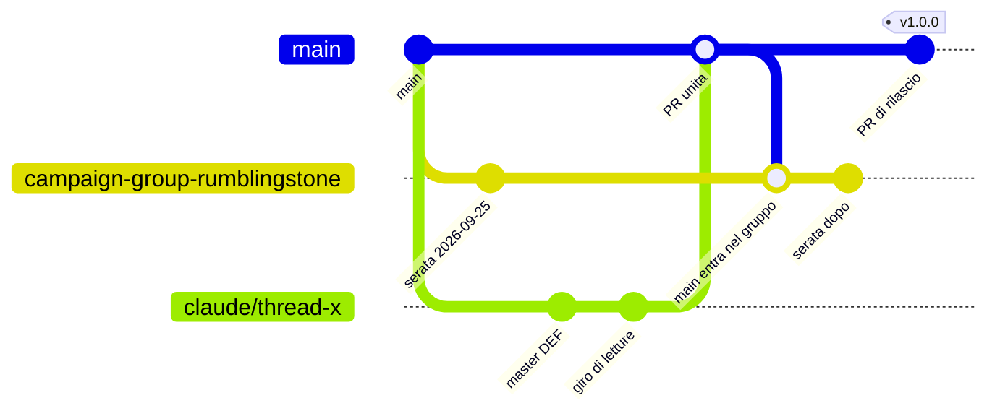

Il canone giocato non torna mai su `main` da solo: le patch del ramo di gruppo
le applica il DM. Riferimenti:
[ADR-0007](../../plans/adr/ADR-0007-scritture-canone-triplo-vincolo.md),
[ADR-0090](../../plans/adr/ADR-0090-la-partita-riparte-su-un-ramo-di-gruppo-nuovo.md) (il ramo di gruppo del primo tavolo).

## 8. La serata: prima, al tavolo, dopo

Nessuno script gira durante la partita: è una scelta. Le scritture di canone
passano dal **triplo vincolo** di ADR-0007: ramo di gruppo, diff confermato dal
DM, solo dentro le regioni `<!-- auto:begin … -->`.

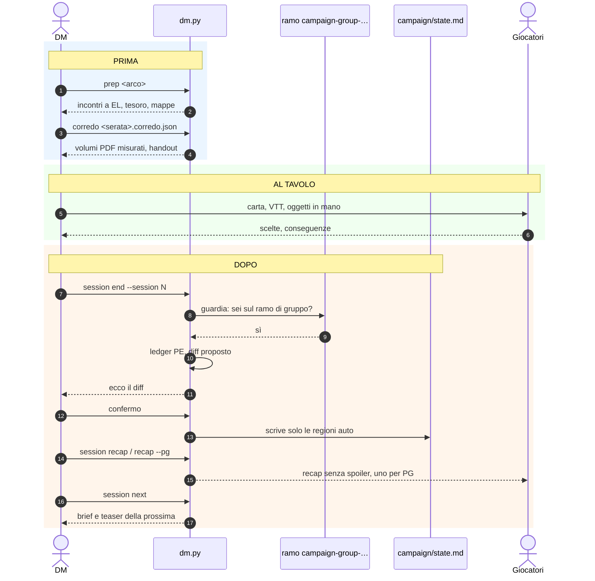

## 9. Il ciclo del master e il giro delle letture

Un master diventa **DEF** quando ha fatto sette passi
([ADR-0075](../../plans/adr/ADR-0075-il-ciclo-del-master-vale-per-ogni-piano.md), skill `rumblingstone-module-standard`). I passi 1-5
sono cancelli che la CI misura; il 6 e il 7 li fanno agenti. Il passo 6 è **il
giro**, che dal 2026-10-18 ha otto passi
([ADR-0095](../../plans/adr/ADR-0095-il-giro-ha-correzione-verifica-e-seconda-passata.md)).

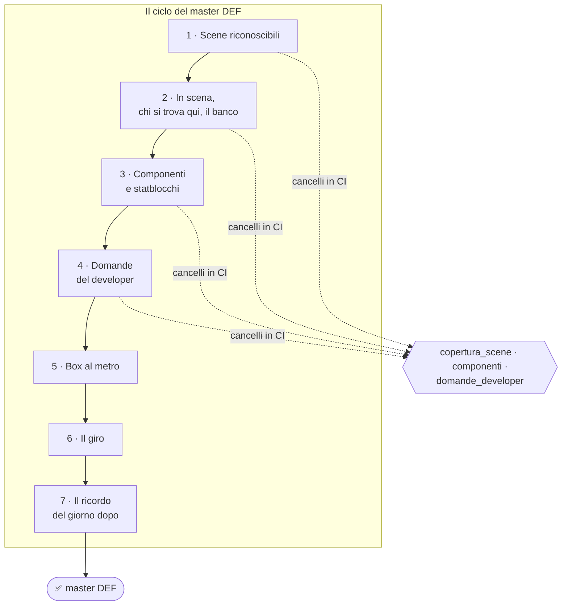

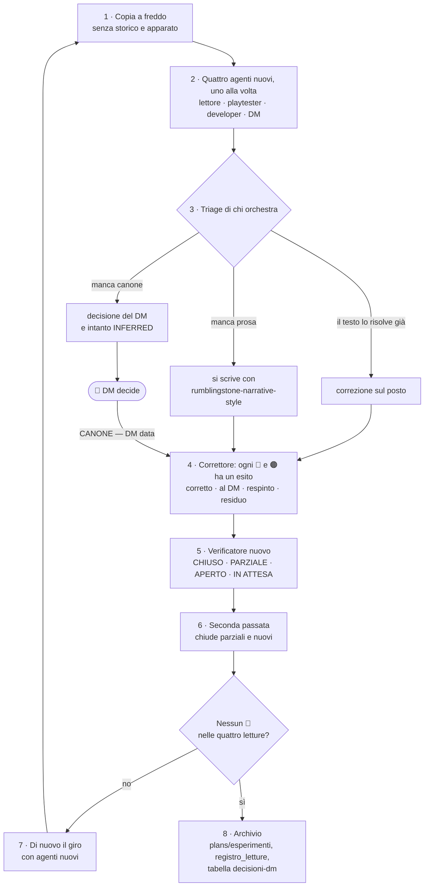

Un tipo di rilievo che ricompare in due master diversi diventa una regola di
`copertura_scene.py` o di `domande_developer.py`: le letture trovano, i
cancelli impediscono che torni.

## 10. La prosa si misura, poi decide il DM

La prosa nuova entra solo se non peggiora la misura e, nei casi indecisi, se il
DM la sceglie al cieco ([ADR-0093](../../plans/adr/ADR-0093-la-prosa-migliora-se-la-sceglie-il-dm-alla-cieca.md), [ADR-0097](../../plans/adr/ADR-0097-scrittura-italiana-entra-come-eccezione.md) per l'eccezione
della scrittura italiana). Gli strumenti stanno in una catena sola, con un
ingresso solo, `dm.py prosa <azione>`
([ADR-0101](../../plans/adr/ADR-0101-la-prosa-ha-una-catena-sola.md)).

### 10.1 La catena

```mermaid
flowchart LR
    subgraph MIS["1 · misurare"]
        direction TB
        A1["misura<br/>misura_craft"]
        A2["ciclo<br/>ciclo_prosa"]
        A3["mqm<br/>punteggio_mqm"]
        A4["sintassi<br/>misura_sintassi"]
    end
    subgraph CTL["2 · controllare"]
        direction TB
        B1["coerenza<br/>coerenza_campagna"]
        B2["domande<br/>domande_developer"]
    end
    subgraph RIS["3 · riscrivere"]
        direction TB
        C0["candidate<br/>le scrive un agente"]
        C1["migliora<br/>migliora_prosa"]
    end
    subgraph DEC["4 · decidere"]
        direction TB
        D1["cieco<br/>cieco_versioni"]
        D2(["👤 DM"])
    end
    BOX["Box di un master"] --> MIS --> CTL --> RIS
    C0 --> C1
    C1 -->|"la migliore<br/>delle rimaste"| D1 --> D2
    D2 -->|"vince la nuova"| IN["entra nel master"]
    D2 -->|"vince la vecchia"| KEEP["resta la vecchia"]
    IN & KEEP --> FROZEN["CONGELATI.json<br/>i box votati non si toccano"]
    D2 -->|"ogni voto"| VOTI[("pipeline/VOTI.json")]
    VOTI -.->|"riaddestra"| C1
```

La fase 3 non genera niente: `migliora` scarta le candidate che cambiano un
fatto, che impoveriscono il box o che violano una delle regole misurabili di
`read-aloud-adulti.md` §2-ter, e ordina le rimaste. Il modello supera la
soglia scritta in `pipeline/SOGLIA.txt` dal 2026-10-23 (0,661 in leave-one-out
su 59 coppie): se anche la migliore perde contro l'originale, resta
l'originale e la coppia non va al cieco.

| Azione | Script | Canale (§16) | In CI |
|---|---|---|---|
| `misura` | `misura_craft` | stable | cancelli e tetti dei box |
| `ciclo` | `ciclo_prosa` | stable | `box_impoveriti`, verdetto misurato; in locale la riga che contraddice l'originale (NLI, `misura_fedelta_nli`) torna com'era |
| `mqm` | `punteggio_mqm` | stable | contro la baseline |
| `sintassi` | `misura_sintassi` | unstable, spaCy facoltativo | no |
| `coerenza` | `coerenza_campagna` | testing | `fatti --check plans/coerenza-residui.json` |
| `domande` | `domande_developer` | stable | sui master nuovi |
| `migliora` | `migliora_prosa` | unstable | solo `--help` |
| `cieco` | `cieco_versioni` | stable | no: decide il DM |
| `banco` | `banco_prosa_locale` | unstable (ADR-0089) | `corsa --dry-run` |
| `voto` | `voto_scrittura` | stable | i test |

### 10.2 Caso d'uso: riscrivere un box che c'era

Il caso più frequente: un agente rifà un box di un master già giocato o già
votato. La sequenza mostra chi chiama chi; le frecce tratteggiate sono le
risposte.

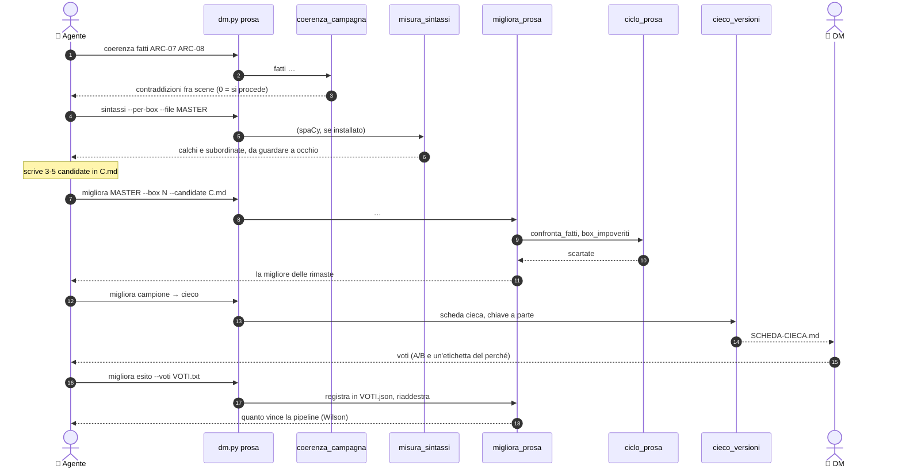

### 10.3 Caso d'uso: una PR tocca un master

La CI non riscrive e non vota: ferma solo ciò che peggiora o contraddice.

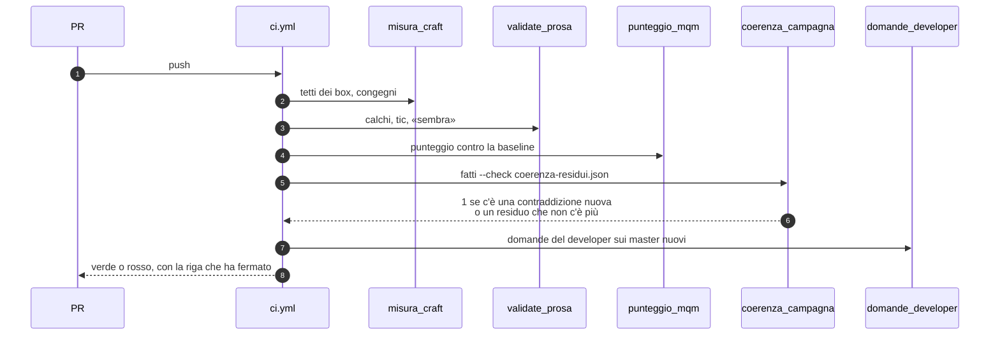

### 10.4 Caso d'uso: provare un modello locale

Il modello locale (ADR-0089) produce candidate come un agente; il giudice è lo
stesso.

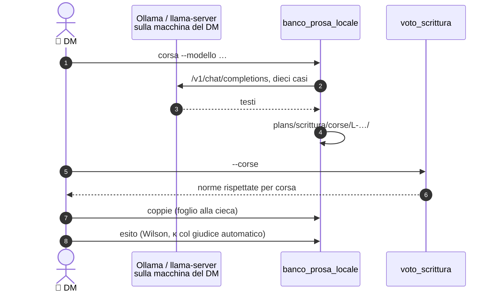

### 10.5 Come dipendono fra loro

Chi importa chi, e le tre dipendenze di fuori. Le frecce vanno da chi usa a
chi è usato; le tratteggiate sono facoltative e degradano senza fermare la
catena (`binari.py`, catene «sintassi della prosa» e «secondo lettore
LanguageTool»).

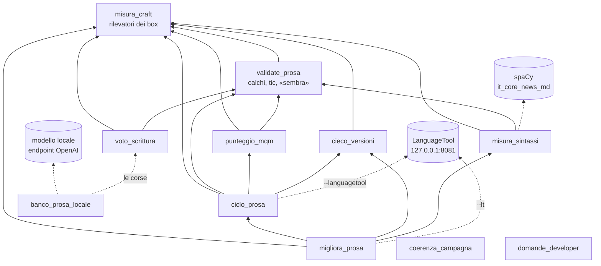

`coerenza_campagna` e `domande_developer` non dipendono dagli altri: leggono i
master e lo schema dei fronti (`scripts/schemas/fronti_orologi.schema.json`).

### 10.6 Cosa ha detto la misura

| Prova (2026-10-22/23) | Esito | Conseguenza |
|---|---|---|
| 17 misure di prosa della letteratura sui 38 voti ciechi | nessuna prevede il voto | niente cancelli di prosa nuovi |
| catena vecchia contro nuova, 16 box al cieco | vecchia 8, nuova 5, pari 1 | tre cautele in §2-ter, nessuna sostituzione |
| modello di preferenza di `migliora` | 0,611 il 22; col voto del 23, 0,661 su 59 coppie (Wilson basso 0,534) e 5 su 5 in prospettiva | scarta le candidate che perdono contro l'originale; il resto va al cieco |
| prima prova della pipeline al cieco | pipeline 4, originale 1, pari 1 (soglia 5 su 6) | miglioramento non dimostrato |
| LanguageTool sui box | 1 rilievo vero su 30, 6 errori piantati su 20 | filtro spento finché un gruppo non arriva a 0,70 |
| Stanza contro spaCy (PR #270) | non vince | resta spaCy |
| coerenza fra ARC-07 e ARC-08 | contraddizioni vere, 4 residui dichiarati | cancello in CI |

## 11. La catena delle mappe

Una mappa nasce come griglia o contratto JSON e se ne ricavano tutte le
versioni. Ogni griglia a emoji di campagna ha il suo contratto JSON che,
ricompilato, la ridà identica cella per cella; i simboli fuori legenda stanno
in `simboli_locali`, e il cancello è `test_contratti_mappe.py` con
`render_map_svg --strict`
([ADR-0117](../../plans/adr/ADR-0117-ogni-mappa-ha-il-suo-contratto-json.md),
accettata il 2026-11-10). Lo schermo e i VTT usano pergamena e texture; un booklet stampa solo
la pianta di stampa, con le scritte a 7,4 pt e senza filtri
([ADR-0106](../../plans/adr/ADR-0106-ogni-mappa-si-stampa-in-pianta.md)).

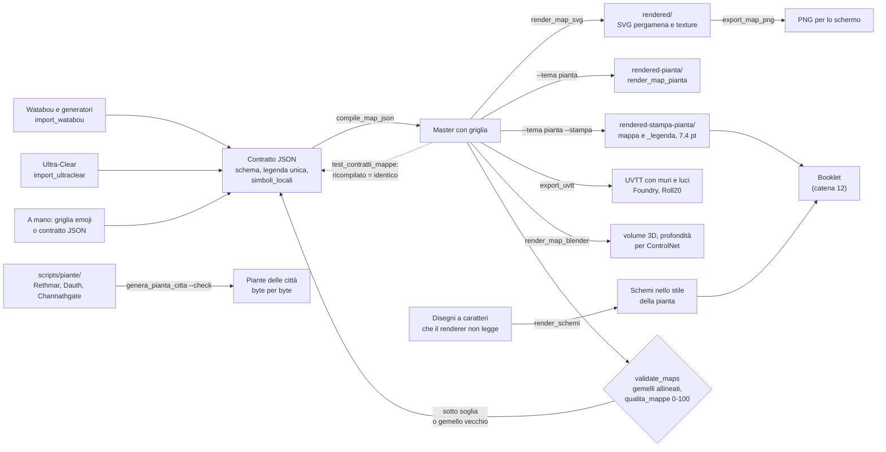

`validate_maps` pretende accanto a ogni `rendered/` il gemello in
`rendered-stampa-pianta/` allineato al master; `validate_booklets` ferma un
booklet che stampa la pergamena o un disegno a caratteri al posto dello
schema; `render_schemi.py --check` e `genera_pianta_citta.py --tutte --check`
girano in CI.

Riferimenti: [ADR-0048](../../plans/adr/ADR-0048-legenda-funzionale-fonte-unica.md) (legenda funzionale, fonte unica), [ADR-0098](../../plans/adr/ADR-0098-la-qualita-delle-mappe-si-misura-con-uno-standard.md) (standard di
qualità delle mappe), [ADR-0102](../../plans/adr/ADR-0102-lo-stile-delle-piante-e-i-generatori-delle-citta-nel-repo.md) (tema pianta e generatori delle città),
[ADR-0106](../../plans/adr/ADR-0106-ogni-mappa-si-stampa-in-pianta.md) (ogni mappa si stampa in pianta), [ADR-0117](../../plans/adr/ADR-0117-ogni-mappa-ha-il-suo-contratto-json.md) (contratto JSON di ogni mappa), [GUIDA-MAPPE](../how-to/GUIDA-MAPPE.md) §5.4-5.5.

## 12. La catena dei booklet

Due binari che leggono lo stesso manifest
([ADR-0020](../../plans/adr/ADR-0020-edizione-da-stampa-su-un-secondo-binario.md)).
Prima di comporre, il binario di stampa porta in ogni capitolo chi ci si
incontra, e alla fine il volume si misura come un controllo di prestampa.

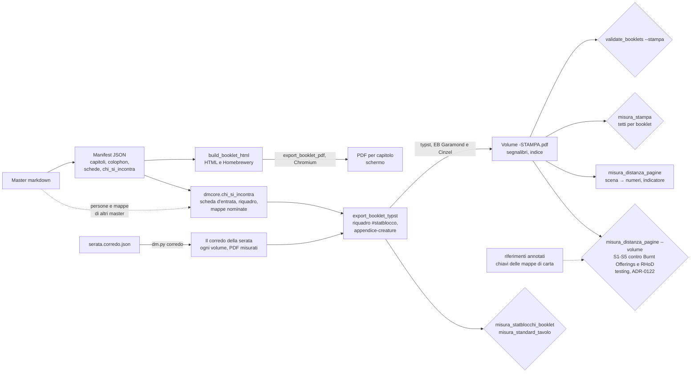

Il manifest decide dove esce il riquadro intero di ogni creatura (chiave
`schede`): `"appendice"` mette nell'incontro una riga con nome, GS, CA, pf,
rimando e tattica, e il riquadro in fondo al volume; `"qui"` lo lascia dove il
master lo scrive; `"entrambe"` fa tutte e due le cose. Con
`"chi_si_incontra": true` (di solito insieme a `"entrambe"`) il capitolo
riceve, per ogni persona con un nome che vi si incontra, la scheda d'entrata
con il ritratto e il riquadro con la tattica, e per ogni mappa che nomina la
pianta di stampa. Il master non cambia: cambia solo quello che va in stampa,
e la misura legge lo stesso testo. Al 2026-11-03 il modo è adottato in sei
booklet; Terros resta fuori perché la misura peggiorava.

| Misura | Cosa guarda | In CI |
|---|---|---|
| `validate_booklets --stampa` | ogni volume compila; niente pergamena né disegni a caratteri in stampa | bloccante |
| `misura_statblocchi_booklet --check` | le schede che non escono nel riquadro, per booklet | bloccante, tetto che scende |
| `misura_stampa --tutti --check` | corpo sotto 7 pt, testo oltre la gabbia, immagini sotto 300 dpi, riquadri spezzati, font | job `stampa-misurata`, tetti in `docs/audit/stampa-booklet.json` |
| `misura_standard_tavolo` | per capitolo e persona: numeri, aspetto, ritratto, chi è, cosa vuole, tattica, mappa; note di lavoro in stampa | cricchetto nei test sulle note di lavoro |
| `misura_distanza_pagine` | sul PDF, le pagine fra dove una persona agisce e la pagina con CA e pf | indicatore, a mano |
| `misura_distanza_pagine --volume` | lo standard del volume (ADR-0122): introduzione di capitolo (S1), chiavi d'area testo ↔ mappa (S2), mappa entro una pagina (S3), appendice regione e PNG (S4), ritratto dei PNG principali (S5), con le soglie prese da *Burnt Offerings* e *Red Hand of Doom* in `docs/audit/volume-booklet.json` | job `stampa-misurata`, passo non bloccante (testing) |

Riferimenti: [ADR-0105](../../plans/adr/ADR-0105-ogni-creatura-esce-nello-stesso-riquadro.md) (un riquadro per tutte le creature),
[ADR-0106](../../plans/adr/ADR-0106-ogni-mappa-si-stampa-in-pianta.md) (mappe in pianta),
[ADR-0107](../../plans/adr/ADR-0107-chi-si-incontra-sta-nel-capitolo.md) (chi si incontra sta nel capitolo),
[ADR-0108](../../plans/adr/ADR-0108-i-cancelli-deterministici-stanno-in-ogni-skill.md) (cricchetti e distanza in pagine),
[ADR-0122](../../plans/adr/ADR-0122-il-volume-segue-lo-schema-degli-adventure-path.md) (lo standard del volume),
[GUIDA-BOOKLET-E-PDF](../how-to/GUIDA-BOOKLET-E-PDF.md).

## 13. La catena delle skill

Le skill sono la conoscenza che gli agenti caricano: regole 3.5, canone,
stile, mestieri. Si scrivono una volta in `skills/` e si impacchettano per
ogni agente. Ogni `SKILL.md` chiude con la sezione «Cancelli
deterministici»: i comandi che verificano il lavoro fatto con quella skill
senza giudizio umano
([ADR-0108](../../plans/adr/ADR-0108-i-cancelli-deterministici-stanno-in-ogni-skill.md)).

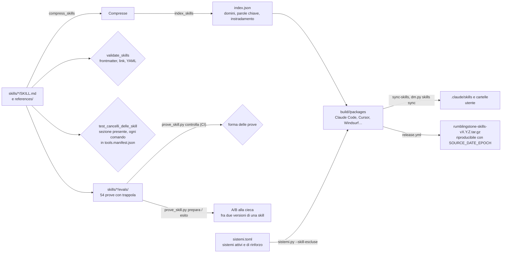

Dal 2026-11-08 ogni `SKILL.md` segue una scheda fissa (Quando no, Fonti,
Vincoli sui fatti, Procedura, Formato d'uscita, Prima di consegnare, Cancelli
deterministici) e ogni skill ha almeno tre prove con trappola nella forma di
`claude plugin eval`. Una versione nuova di una skill entra solo se la prova
A/B alla cieca non peggiora gli inventati senza marca: nel lotto 2 sono scesi
da 32 a 30 su 54 consegne
([ADR-0114](../../plans/adr/ADR-0114-ogni-prompt-ha-una-scheda-e-le-sue-prove.md),
guida in [GUIDA-SCHEDE-PROMPT](../reference/GUIDA-SCHEDE-PROMPT.md)). Le skill di
un sistema spento non si impacchettano: `build-skills.sh` e `sync-skills.sh`
chiedono a `sistemi.py --skill-escluse` quali saltare (ADR-0111).

Una skill nuova senza la sezione, o con un comando che il manifest dei tool
non dichiara, rompe i test. Il giudice della prosa resta il cieco del DM
([ADR-0093](../../plans/adr/ADR-0093-la-prosa-migliora-se-la-sceglie-il-dm-alla-cieca.md)):
le skill di stile hanno cancelli che contano, non che giudicano.

## 14. Il giro di una modifica: dal thread al merge

Ogni lavoro sul repo è un thread di progetto, un ramo e una PR. La CI decide se
si può unire, il DM decide se si unisce.

```mermaid
sequenceDiagram
    autonumber
    actor DM
    participant CO as Coordinatore
    participant TH as Thread agente
    participant GH as GitHub PR
    participant CI as CI ci.yml
    participant BOT as CodeQL, Sourcery

    DM->>CO: richiesta nella chat di progetto
    CO->>TH: apre un thread con la richiesta
    TH->>TH: piano, misure prima
    TH->>GH: ramo claude/…, PR in bozza
    GH->>CI: validate, testing, convertitori, build
    GH->>BOT: analisi e revisione
    CI-->>TH: rosso: si corregge e si rispinge
    BOT-->>TH: rilievi: corretti o motivati
    CI-->>GH: verde
    TH->>DM: risultato, decisioni aperte
    DM-->>TH: scelte, ok
    TH->>GH: aggiorna piano, CHANGELOG, ADR
    DM->>GH: unisci
    GH->>CI: CI su main
```

Il job principale della CI (`validate`) ha oltre 50 passi bloccanti: Python
compilato, cancelli dei documenti e dei piani, prosa, mappe, bestiario, skill,
statblocchi, test. Nella stessa PR il piano, la riga in `plans/INDEX.md` e
quella in `plans/CHANGELOG.md` vanno insieme (regola d'oro,
`check_plans_discipline.py`).

### 14.1 Agenti, hook e cancelli del thread

Un thread di progetto parte fuori dal repo, nella cartella che contiene il
clone. `scripts/claude-progetto.sh` gli porta la configurazione del repo
(ADR-0140), e le regole di `AGENTS.md` arrivano divise in `.claude/rules/`,
ognuna con i file a cui serve (ADR-0141). Il lavoro lo fanno i tredici agenti
di `.claude/agents/`, che il thread lancia uno dopo l'altro: un agente non ne
avvia altri. Gli hook stanno intorno a ogni passo, e alcuni fermano.

```mermaid
flowchart LR
    I[Istruzioni del thread<br/>riga «Catena:»] --> P[UserPromptSubmit<br/>instradamento_agenti --prompt]
    P -->|suggerisce agente e catena<br/>registro locale| T[Thread]
    T -->|Agent| A[Agenti di .claude/agents/<br/>Autori · Tecnici · Verificatori]
    A -->|Edit, Write| V[PreToolUse<br/>vincolo_skill]
    V -->|prosa senza skill| X1[bloccata]
    T -->|git push, PR| C[PreToolUse<br/>instradamento_agenti --cancello]
    C -->|catena dal registro<br/>o dalla trascrizione| X2[bloccato se manca un agente<br/>o autore-documenti]
    C -->|canone su main,<br/>ramo di gruppo riscritto| X3[bloccato]
    C --> PR[PR]
    PR --> CI[ci.yml: cricchetto della prosa,<br/>verifica_px, verifica_rimandi,<br/>prove degli agenti,<br/>documentazione_allineata]
```

| Anello | Cosa ferma | ADR |
|---|---|---|
| `vincolo_skill.py` (PreToolUse su Edit e Write) | la prosa di gioco scritta senza `rumblingstone-narrative-style` | ADR-0146 |
| `instradamento_agenti.py --prompt`, `--stop` | niente: suggerisce e misura | ADR-0146 |
| `instradamento_agenti.py --cancello` | push e PR finché manca un agente della riga «Catena:», letta dal registro o, per il messaggio di avvio del thread, dalla trascrizione; il canone fuori dal ramo di gruppo | ADR-0146, ADR-0149, ADR-0153 |
| `cricchetto_prosa.py` in CI | una norma di prosa che peggiora sui file di gioco cambiati | ADR-0146 |
| `verifica_px.py`, `verifica_rimandi.py`, `.claude/agent-evals/` in CI | somme di PX e rimandi sbagliati; un agente che non passa i suoi tre casi | ADR-0148 |
| `documentazione_allineata.py` in CI | un agente, uno script, un workflow o un hook aggiunto senza la riga nel suo indice; il debito vecchio sta sotto un tetto che scende | ADR-0153 |
| `documentazione_allineata.py --attiva` nella routine del lunedì | niente: se una delle quattro regole scatta (debito oltre il tetto; agente, workflow o hook scoperto; ARCHITETTURA indietro di 3 ADR o di uno con più di 14 giorni; un indice fermo da 30 giorni) chiede al coordinatore un thread con `autore-documenti` e la lista del lavoro | ADR-0153 |

I registri degli hook (`.claude/.uso-*.jsonl`) restano nel container del
thread e muoiono con lui: dicono cosa è successo in un thread, non nella
storia del repo. Il cancello della documentazione controlla che un elemento
sia citato, non che la descrizione sia giusta. Un documento che resta indietro
senza che una PR aggiunga niente di scoperto lo trova la routine del lunedì,
che spende token solo quando `--attiva` dice che serve.

## 15. Le decisioni del DM

```mermaid
flowchart LR
    Q["Domanda nata dal lavoro<br/>piano, giro, misura"] --> T["Tabella decisioni-dm<br/>nel piano, con la proposta"]
    T --> DM(["👤 DM risponde"])
    DM --> E["Riga decisa: ~~Dn~~ ✅<br/>con le sue parole fra « »"]
    E --> ECO["Eco: decise, aperte,<br/>cambiate, dedotto da me"]
    E -->|"decisioni_dm.py --emit"| ST["STATO-E-ORDINE §4"]
    E -->|"se è strutturale"| ADR["ADR: contesto, alternative,<br/>decisione, conseguenze, da rivedere se"]
    E -->|"nel master"| CAN["CANONE — DM data"]
    ADR -->|"validate_docs"| IDX["docs/INDEX.md"]
```

Le decisioni stanno nei piani perché `decisioni_dm.py` legge solo quelle; un
ADR si scrive quando la decisione cambia la struttura. I numeri degli ADR si
prenotano in `plans/adr-prenotati.json`.

## 16. La piattaforma e i suoi tre canali

Ogni componente di terzi (Python, librerie, binari, strumenti, azioni CI) sta
in un canale, come i pacchetti in Debian
([ADR-0099](../../plans/adr/ADR-0099-la-piattaforma-ha-tre-canali-come-debian.md)).

```mermaid
stateDiagram-v2
    [*] --> unstable: si prova a mano<br/>in un ramo o in plans/esperimenti
    unstable --> testing: licenza libera, misura prima e dopo,<br/>guadagno nominato, ok del DM
    testing --> stable: 14 giorni e 10 run su main,<br/>zero falsi allarmi, tempo ≤ +5%, ok del DM
    stable --> testing: boccia a torto o rompe,<br/>si scende il giorno stesso
    testing --> unstable: la misura non regge
    stable --> oldstable: Debian sale di versione
    oldstable --> [*]: dopo tre mesi
```

| Componente | Canale al 2026-11-25 |
|---|---|
| Python 3.13 (Debian 13), pytest, pip-audit, Dependabot, typst e pdfimpose da PyPI (ADR-0116); ruff, uv e il job dei convertitori dal 2026-11-08 (#353, misure in `plans/esperimenti/promozioni-2026-11-08/`); dal 2026-11-25 pytest-xdist nel passo pytest del job principale e i cancelli delle marche sulle righe cambiate (`controlla_marche.py`, ADR-0109), della scheda in `validate_skills` (ADR-0114), dei numeri (`--cancello-numeri`, ADR-0118), dei 14 conti PF1e ora `fatti` (ADR-0119) e della *d* eufonica (ADR-0120), scelta del DM D8 (misure in `plans/esperimenti/promozioni-2026-11-25/`) | stable |
| workflow Release, riscontro SRD (ADR-0103), shapely e i generatori delle città (ADR-0102), il job della suite su Python 3.14 (non bloccante) | testing |
| `misura_plugin_regole.py` (ADR-0121), ancora in `plans/esperimenti/plugin-regole-2026-11-09/` | prova, fuori dalla CI |
| spaCy, Stanza, LLM locale, mypy, sentence-transformers (`misura_ripetizioni_frasi`), transformers con un NLI multilingue (`misura_fedelta_nli`), tutti solo in locale | unstable |
| NLI per le contraddizioni fra file, varianti dei nomi, numeri incrociati (provati due volte per ADR-0108) | non adottati: nessun guadagno misurato |

## 17. Il rilascio

Rilasciare è unire una PR
([ADR-0100](../../plans/adr/ADR-0100-il-rilascio-e-una-pr.md), guida in
[RILASCIO](../how-to/RILASCIO.md)).

```mermaid
sequenceDiagram
    autonumber
    actor DM
    participant PR as PR di rilascio
    participant MAIN as main
    participant REL as release.yml
    participant PLAN as release_plan.py
    participant CI as ci.yml
    participant SIG as Sigstore
    participant GHR as GitHub Release

    DM->>PR: CHANGELOG ## [X.Y.Z] e __version__
    DM->>MAIN: unisci
    MAIN->>REL: push che tocca CHANGELOG.md
    REL->>PLAN: quale versione, quale commit?
    PLAN-->>REL: vX.Y.Z sul commit della PR,<br/>o la testa se le skill non sono cambiate
    REL->>REL: il commit è nella storia di main?
    REL->>CI: tutta la CI su quel commit
    CI-->>REL: verde
    REL->>REL: build-skills, tar riproducibile, SHA256SUMS
    REL->>SIG: attestazione di provenienza
    REL->>GHR: tag vX.Y.Z, archivio, note dal CHANGELOG
    note over REL,GHR: a ogni push che tocca il CHANGELOG<br/>le note pubblicate si riallineano
```

## 18. Il flusso della qualità: mappe, moduli, regole, stampa

Gli strumenti che misurano la qualità sono nati uno per volta, ognuno con il
suo ADR. Qui stanno in un flusso solo, descritto come si descrive un servizio
di revisione del codice (Sourcery e simili): prima chi lo usa e per che cosa,
poi i componenti, poi i dati che passano fra loro. Tutti rispondono alla
stessa domanda, «questo master si può giocare così com'è scritto?», guardando
quattro cose diverse: la mappa, il testo, la regola e la pagina stampata che
il DM ha davanti al tavolo.

### Casi d'uso

| Attore | Obiettivo | Comando | Uscita | Canale |
|---|---|---|---|---|
| CI, a ogni PR | una mappa non mente (intestazione, griglia, legenda) | `python3 scripts/validate_maps.py` | errori, exit 1 | bloccante |
| CI, a ogni PR | il corpus delle mappe misurato sullo standard | `python3 scripts/qualita_mappe.py --solo-errori` | rilievi E e A, voto 0-100 | rapporto non bloccante |
| chi rifà una mappa | sapere se il rifacimento ha cambiato la tattica | `python3 scripts/qualita_mappe.py --json OUT --profonde` | metriche senza soglia (space syntax, `qualita_mappe_profonde`) | a mano |
| chi rifà una mappa | quanto è cambiata e se il voto è salito per quello | `python3 scripts/confronta_mappe.py --versioni A=REF C=HEAD --base C --out DIR FILE.md` | `confronto.json`, SVG affiancati | a mano |
| chi scrive un master | i congegni di mestiere e i box al metro dei banchi | `python3 scripts/misura_craft.py --box` | conteggi per arco, box fuori soglia | a mano |
| chi riscrive la prosa | il riscritto migliora, o va al cieco del DM | `python3 scripts/ciclo_prosa.py misura …` | verdetto misurato; il registro | `registro --check` bloccante |
| CI, a ogni PR | si gioca? volo, rumore, TS, soglie del boss | `python3 scripts/domande_developer.py --check` | rilievi con la ragione delle deroghe | bloccante |
| agenti del giro (ADR-0095) | una lettura a freddo, una scena alla volta | `python3 scripts/lettura_a_scene.py servi …` | rapporti di lettore, playtester, developer, DM | a mano, agenti |
| CI, a ogni PR | nessuna lettura scaduta, nessun 🔴 senza stato | `python3 scripts/registro_letture.py --check` | registro delle letture | bloccante (avviso finché vuoto) |
| chi fa il triage | una regola «a memoria» del giro è davvero nell'SRD | `python3 scripts/riscontro_srd.py riscontra FILE.yaml` | concorda, discorda, non trovata, con la citazione | testing (job `riscontro-srd`) |
| CI, a ogni PR | i conti degli statblocchi, anche dei boss recintati di ADR-0091 | `python3 scripts/conformita_statblocchi.py --master` | pf, CA, CD, scurovisione che non tornano | cricchetto nei test (ADR-0108) |
| CI, a ogni PR | le schede dei moduli PF1e con le regole del PRD: BAB, TS, BMC, DMC, contatto, sensi, incantesimi, incanalare (ADR-0119) | `python3 scripts/conformita_statblocchi.py --cancello-moduli` | ✗ sui conti `fatti`, ⚠ su un conto `in_prova` (oggi nessuno); `--severo` fa bloccare anche quelli | bloccante: i 14 conti sono `fatti` dal 2026-11-25 |
| CI, a ogni PR | la *d* eufonica fuori norma nei testi di contenuto (ADR-0120) | `python3 scripts/validate_lingua.py` | ✗ con file, riga e forma corretta | bloccante dal 2026-11-25, nel passo della lingua |
| chi prepara la serata | al tavolo chi si incontra ha tutto nel capitolo | `python3 scripts/misura_standard_tavolo.py` | sei elementi per capitolo e persona, mappe, note di lavoro in stampa | indicatore; cricchetto sulle note |
| chi prepara la serata | quante pagine sfoglia il DM per i numeri | `python3 scripts/misura_distanza_pagine.py PDF` | mediana delle distanze per persona | indicatore, a mano |
| CI, a ogni PR | il volume ha la struttura degli AP: introduzioni, chiavi d'area, mappe vicine, appendici, ritratti (ADR-0122) | `python3 scripts/misura_distanza_pagine.py --volume --tutti --check` | ✗ per booklet e misura sotto la soglia dei riferimenti | testing, non bloccante (job `stampa-misurata`) |
| CI, a ogni PR | il volume regge la prestampa | `python3 scripts/misura_stampa.py --tutti --check` | corpo, gabbia, dpi, riquadri spezzati | job `stampa-misurata`, tetti |
| CI, a ogni PR | un box non dice al gruppo cosa capisce o sa («capite che…») | `python3 scripts/misura_box_telecomando.py --check` | colpi fuori da `ACCETTATI` | cancello nei test (`test_misure_rigorose`) |
| chi riscrive la prosa | un'immagine già usata in un altro box, anche con altre parole | `python3 scripts/misura_ripetizioni_frasi.py --check` | coppie sopra 0,80 (embedding MiniLM) fuori da `plans/scrittura/ripetizioni-accettate.json` | cancello locale |
| chi riscrive la prosa | il riscritto non contraddice l'originale | `python3 scripts/misura_fedelta_nli.py --ripara ORIGINALE RISCRITTO`, e da sé in `ciclo_prosa revisione` e `misura` | la riga che contraddice torna com'era | correzione automatica, solo in locale |
| chi scrive con una skill | il lavoro passa i cancelli che la skill dichiara | sezione «Cancelli deterministici» del `SKILL.md` | i comandi da far girare | `test_cancelli_delle_skill` |
| il DM | decidere le discordanze e i rilievi aperti | tabella `decisioni-dm` del piano | `[CANONE — DM data]` nel master | decisione umana |

### Il flusso

```mermaid
flowchart LR
    subgraph IN["Ingresso"]
        MAP["Griglie emoji<br/>nei master"]
        TXT["Master DEF<br/>prosa e statblocchi"]
        FONTI[("SRD 3.5 e PRD PF1e<br/>cache fuori dal repo,<br/>sha256 fissati")]
    end
    subgraph MAPPE["Mappe (ADR-0098)"]
        VM["validate_maps"] --> QM["qualita_mappe<br/>voto 0-100"]
        QM --> QP["qualita_mappe_profonde<br/>senza soglia"]
        QM --> CM["confronta_mappe<br/>versione contro versione"]
    end
    subgraph MODULI["Moduli (ADR-0095)"]
        MC["misura_craft"] --> CP["ciclo_prosa"]
        BT["misura_box_telecomando<br/>misura_ripetizioni_frasi"] --> CP
        FN["misura_fedelta_nli<br/>ripara"] --> CP
        DD["domande_developer"]
        GF["giro a freddo<br/>lettura_a_scene"] --> RL["registro_letture"]
    end
    subgraph REGOLE["Regole (ADR-0103, ADR-0108, ADR-0119)"]
        RS["riscontro_srd"]
        CS["conformita_statblocchi<br/>--master"]
        CM2["conformita_statblocchi<br/>--cancello-moduli<br/>regole PF1e dal PRD"]
        FONTI --> CM2
    end
    subgraph STAMPA["Stampa (ADR-0105…0108, ADR-0122)"]
        ST["misura_standard_tavolo"]
        DP["misura_distanza_pagine<br/>e --volume S1-S5"]
        MP["misura_stampa"]
    end
    MAP --> VM
    TXT --> MC
    TXT --> BT
    TXT --> DD
    TXT --> GF
    TXT --> RS
    TXT --> CS
    TXT -->|"booklet"| ST
    TXT -->|"PDF"| DP
    TXT -->|"PDF"| MP
    FONTI --> RS
    GF -->|"rilievi «a memoria»"| RS
    CM & QP & CP & DD & RL & RS & CS & ST & DP & MP --> TRI{"Triage"}
    TRI -->|"il testo lo risolve"| FIX["correzione<br/>nel master"]
    TRI -->|"è una scelta"| DM(["👤 DM decide"])
    DM --> FIX
    FIX -->|"si rimisura"| TXT
```

Il giro a freddo trova i rilievi; la misura dice se sono veri; il triage li
smista. La freccia dal giro al riscontro è il passo nuovo: un rilievo che un
lettore ha controllato a memoria diventa una voce del file dei riscontri e
arriva al triage con la citazione dell'SRD, non con un ricordo.

La stampa è il ramo più recente. Nasce dalla serata del 2026-11-02, quando i
validatori erano verdi e il DM ha dovuto cercare Zog'tar in tre punti del
booklet. Le sue misure leggono quello che va davvero in stampa, e le
correzioni che trovano nei master vanno al DM come proposte: i tetti scendono
a mano quando lui le applica, perché sono canone. Con la PR #308 il DM le ha
applicate ad ARC-07 e il cricchetto dei conti è a zero.

Tre controlli della prosa sono stati scartati alla prima prova e sono entrati
dopo una configurazione più rigorosa (ricerca sui guardrail, §8 e §9; PR #308
e #309). `misura_box_telecomando --check` è un cancello che gira nei test.
`misura_ripetizioni_frasi --check` è un cancello locale, con l'elenco delle
ripetizioni volute. `misura_fedelta_nli` corregge da sé: dentro `ciclo_prosa`
la riga del riscritto che contraddice l'originale torna com'era (F1 0,83 sulle
26 coppie etichettate dal DM, contro 0,62 dei soli numeri). Gli ultimi due
vogliono `sentence-transformers` e `transformers`, quindi girano solo in
locale. Il giudice della prosa resta il cieco del DM.

### Componenti e dati

```mermaid
flowchart TB
    subgraph COMP["Componenti"]
        direction LR
        C1["validate_maps · qualita_mappe<br/>confronta_mappe"]
        C2["misura_craft · ciclo_prosa<br/>domande_developer"]
        C3["lettura_a_scene<br/>registro_letture"]
        C4["riscontro_srd"]
    end
    subgraph DATI["Dati"]
        direction LR
        D1[/"scripts/legend.json<br/>standard-qualita-mappe.md"/]
        D2[/"CONGELATI.json<br/>domande-developer.json"/]
        D3[/"registro delle letture<br/>rapporti in plans/esperimenti"/]
        D4[/"riscontri-*.yaml<br/>regex, confronto, scala"/]
        D5[("~/.cache/rumblingstone/srd<br/>OGL 1.0a")]
    end
    subgraph OUT["Uscite"]
        direction LR
        O1["voto, metriche JSON, SVG"]
        O2["verdetti, rilievi con deroga"]
        O3["rilievi 🔴 🟠 con stato"]
        O4["tabella con citazioni,<br/>riepilogo del run CI"]
    end
    D1 --> C1 --> O1
    D2 --> C2 --> O2
    D3 --> C3 --> O3
    D4 --> C4
    D5 --> C4 --> O4
```

Il riscontro è l'unico di questi strumenti che legge un testo esterno al
repo. Lo legge da una cache con commit e sha256 fissati nel codice, e la
rete che manca la dice con l'exit 3. Il primo uso, su DEF-1 e DEF-2 di
ARC-08, è in
[RISCONTRO-ARC08](../../plans/esperimenti/ricerca-rete-2026-10-23/RISCONTRO-ARC08.md).

## 19. Il motore delle regole e i sistemi di gioco

Fino al 2026-11-07 le regole 3.5 erano costanti negli script: 31 script su
202 dipendevano dal sistema, con tre modi diversi di riconoscerlo. Oggi il
nucleo non conosce nessun gioco. Tutto quello che è regola sta in
`sistemi/<id>/` come dato, formula o funzione registrata, e uno strumento lo
riceve per il sistema del file su cui lavora
([ADR-0111](../../plans/adr/ADR-0111-il-sistema-di-gioco-e-un-plugin-di-dati.md),
[ADR-0112](../../plans/adr/ADR-0112-il-motore-e-agnostico-e-le-regole-d20-sono-dati-e-formule.md),
tutte e due accettate). Il modello è quello di PCGen e Foundry VTT: un
microkernel guidato dai dati.

```mermaid
flowchart LR
    subgraph CFG["Configurazione"]
        STOML["sistemi.toml<br/>predefinito, attivi, rinforzo,<br/>[moduli] cartella → sistema,<br/>[ambientazioni], [opzioni.pf1e]"]
        CAT["sistemi/catalogo.toml<br/>23 capacità"]
    end
    subgraph PLUG["Plugin in sistemi/"]
        D20["d20 · famiglia<br/>formule, statblocco, stampa,<br/>termini vietati; codice: potenze"]
        D35["dnd35 · sistema<br/>creature, talenti, PE, incontri,<br/>incantesimi, fonti SRD"]
        PF["pf1e · sistema<br/>classi, creature, talenti, PE, tesoro,<br/>conformità PRD; codice: somma_px"]
        D35 -->|"eredita, con motivo"| D20
        PF -->|"eredita, con motivo"| D20
    end
    subgraph CORE["Nucleo: scripts/dmcore/"]
        SIS["sistemi.py<br/>sistema_di · capacita · dati<br/>regole · modulo · regole_diverse"]
        FOR["formule.py<br/>simpleeval ristretto<br/>(_vendor/)"]
    end
    subgraph TOOLS["Strumenti"]
        MAN["tools.manifest.json<br/>sistema.capacita di ogni tool"]
        T["genera_creatura · conformita_statblocchi<br/>suggest_encounter · suggest_loot<br/>update_xp · derive_statblocks · …"]
    end
    STOML --> SIS
    CAT --> SIS
    PLUG --> SIS
    SIS --> FOR
    T -->|"regole(sistema_di(file))"| SIS
    MAN --> GATE{"sistemi.py --check<br/>in CI"}
    CFG --> GATE
    PLUG --> GATE
    GATE -. "dm.py sistemi" .- DMS(["DM o agente"])
```

Un plugin dichiara ogni capacità del catalogo in uno di quattro modi: `dati`
(i file TOML che la coprono), `codice` (ancora cablata, con il lotto che la
migra), `eredita` (da un altro plugin, con il motivo) o `non_supportato` (con
il motivo). Non c'è eredità implicita: una capacità che un plugin attivo non
dichiara è un buco, e il cancello lo dice. Il cancello controlla anche che
ogni formula usi solo nomi dichiarati, che ogni funzione registrata in
`[moduli]` si carichi solo da `sistemi/<id>/codice/`, e che la riga
«**Sistema:**» di un modulo dica lo stesso sistema di `sistemi.toml`.

Cosa succede quando uno strumento lavora su un file di un modulo PF1e:

```mermaid
sequenceDiagram
    autonumber
    participant T as strumento
    participant S as dmcore.sistemi
    participant P as plugin pf1e
    participant F as famiglia d20
    T->>S: sistema_di("10-stand-alone/Il-Drappo-di-Tarsilia/…")
    S-->>T: "pf1e" (il percorso più lungo in [moduli])
    T->>S: regole_diverse("pf1e", strumento)
    alt lo strumento è scritto sulle tabelle 3.5 e pf1e legge altri dati
        S-->>T: le capacità diverse
        T-->>T: salta il file e dice quali regole mancano
    else stessi dati o strumento che legge il sistema
        T->>S: regole("pf1e").dati("creature.conformita")
        S->>P: [capacita] creature.conformita
        P-->>S: dati = conformita.toml, conformita_prd.toml
        T->>S: regole("pf1e").dati("formule.regole")
        S->>P: [capacita] formule.regole
        P-->>S: eredita = "d20"
        S->>F: [capacita] formule.regole
        F-->>S: dati = formule.toml
        T->>S: modulo("pf1e", "somma_px")
        S->>P: [moduli] somma_px = "incontri:somma_px"
        S-->>T: la funzione, caricata con importlib<br/>solo da sistemi/pf1e/codice/
    end
```

Nessun modulo del nucleo legge un sistema all'import: lo sceglie il
chiamante, dal file. I nomi di sempre (`T.TIPI`, `I.LISTE`, …) restano come
involucro del sistema predefinito e danno i valori di prima. Ogni lotto della
migrazione è passato dal banco d'invarianza: le 12 impronte dei moduli 3.5
sono rimaste identiche byte per byte.

| Pezzo | Dove | Stato su main al 2026-11-12 (c2cc7756) |
|---|---|---|
| Configurazione e caricatore unico | `sistemi.toml`, `scripts/dmcore/sistemi.py` | fatto (L0-L8 di PIANO-SISTEMI-DI-GIOCO-PLUGIN) |
| Fonti delle regole come dati | `sistemi/<id>/dati/fonti.toml`, letto da `riscontro_srd.py` | fatto (F1) |
| Contesto esplicito, niente letture all'import | `regole(id)`, `regole_di(file)` | fatto (F2) |
| Formule come espressioni | `sistemi/d20/dati/formule.toml`, `dmcore/formule.py` | fatto per sei formule (F3); il BAB per frazione resta in Python |
| Strumenti per sistema del file | `regole_diverse`, capacità `creature.conformita` | fatto (F4) |
| Funzioni registrate nel plugin | `[moduli]`, `sistemi/<id>/codice/` | fatto (F5): «potenze» e «somma_px» |
| Schema JSON per ogni file di dati (ADR-0112 §3) | — | **non ancora nel codice**: `sistemi.py --check` controlla la struttura del plugin, non i campi dei file di dati |
| Regole complete delle creature (lotti 1-5, #369-#375) | capacità `creature.talenti` (`sistemi/<id>/dati/talenti.toml`, regola in `dmcore/talenti.py`; in PF1e anche i requisiti di 18 classi di prestigio in `[requisiti]`); in `creature.toml` le tabelle `[tratti_tipo]` (costrutti e non morti senza Costituzione, melme e parassiti senza Intelligenza) e `[pf_bonus_costrutti]` (pf bonus per taglia) | fatto: tratti dei tipi 45/45 in 3.5 e PF1e, bonus dei costrutti 9/9; li usa `genera_creatura` (e `creature_pf1e` per PF1e) |
| Verifica di una scheda via MCP (ADR-0124, proposta) | `scripts/verifica_talenti.py`, `scripts/verifica_scheda.py`, capacità `creature.gradi` e `creature.liste_incantesimi`; talenti e classi dei manuali 3.5 fuori SRD solo con nomi e numeri | fatto: prerequisiti dei talenti nell'ordine SRD d20 → 3.5 → PF1e, gradi, incantesimi per livello, numeri di `conformita_statblocchi` in una chiamata |
| Cumulo dei bonus per tipo (ADR-0126, proposta) | capacità `bonus.cumulo` in `sistemi/d20/dati/bonus.toml`, `dmcore/bonus.py` | lotto 1 di 12 del programma «regole senza omissioni»: `verifica_scheda` giudica TS e attacco senza tolleranza; gli altri lotti cambieranno questa riga |
| Coerenza della storia (ADR-0125, accettata) | `coerenza_campagna.py fatti … --state` contro `campaign/state.yaml` | in testing, solo sui fatti strutturati |
| Prova con un plugin d20 finto e uno non d20 | `scripts/tests/dati/prova-d20-due/`, `prova-mucchio-d10/` | fatto: d20 senza toccare il nucleo; non d20 lavorato per intero da 4 strumenti e in parte da 3 (suggest_encounter, genera_creatura, verifica_scheda), 15 lo rifiutano. Resta una prova, non un sistema supportato |

Riferimenti: [ADR-0111](../../plans/adr/ADR-0111-il-sistema-di-gioco-e-un-plugin-di-dati.md),
[ADR-0112](../../plans/adr/ADR-0112-il-motore-e-agnostico-e-le-regole-d20-sono-dati-e-formule.md),
[ADR-0124](../../plans/adr/ADR-0124-le-regole-si-verificano-in-python-e-l-llm-riceve-regola-e-controesempio.md),
[ADR-0125](../../plans/adr/ADR-0125-la-coerenza-della-storia-si-verifica-contro-state-yaml-solo-sui-fatti-strutturati.md),
[ADR-0126](../../plans/adr/ADR-0126-una-scheda-si-verifica-senza-omissioni-e-col-motore-dichiarato.md),
[GUIDA-SISTEMI-DI-GIOCO](../how-to/GUIDA-SISTEMI-DI-GIOCO.md) (uso),
[RIFERIMENTO-PLUGIN-DI-SISTEMA](../reference/RIFERIMENTO-PLUGIN-DI-SISTEMA.md) (chi scrive un plugin).

## 20. Da dove viene un fatto, un termine, un numero

Tre cancelli rispondono alla stessa domanda: chi ha deciso questa cosa, e si
può rifare? Un fatto della storia ha una marca. Un termine di regola ha una
riga in una tabella con la fonte. Un numero di combattimento si ricostruisce
dalla scheda con la regola del suo sistema.

```mermaid
flowchart TB
    subgraph FATTI["Fatti (ADR-0109)"]
        INF["[INFERRED — domanda; base: …]<br/>scritto da un agente"]
        CAN["[CANONE — DM data, codice]<br/>deciso dal DM"]
        GEN["[GENERATO]<br/>uscito da uno script"]
        INF -->|"il DM decide"| CAN
        CM{"controlla_marche.py<br/>righe cambiate della PR"}
        INF --> CM
    end
    subgraph TERMINI["Termini (ADR-0110)"]
        LT[/"lessico_it_35.tsv · lessico_it_pf1.tsv<br/>italiano → SRD 3.5 / PRD, con fonte"/]
        LR{"lessico_regole.py controlla<br/>talenti: 0 sconosciuti"}
        LT --> LR
    end
    subgraph NUMERI["Numeri (ADR-0118, ADR-0119)"]
        SCH["scheda: DV, caratteristiche,<br/>talenti, armi, armatura"]
        PLG[("plugin del sistema<br/>conformita.toml,<br/>conformita_prd.toml, formule")]
        CN{"conformita_statblocchi<br/>--cancello-numeri<br/>--cancello-moduli"}
        BL[/"docs/audit/numeri-baseline.json<br/>cricchetto"/]
        SCH --> CN
        PLG --> CN
        BL --> CN
    end
    subgraph TAB["Tabelle dei plugin (ADR-0121)"]
        MPR{"misura_plugin_regole.py<br/>riga per riga"}
        SRD[("SRD 3.5 e PRD PF1e<br/>in cache, sha256 fissati")]
        SRD --> MPR
        PLG --> MPR
    end
    TESTO["master, Bestiario,<br/>stand alone, booklet"] --> CM & LR & CN
    CM & LR & CN & MPR --> ESITO{"torna?"}
    ESITO -->|"no, ed è un errore"| FIX["si corregge,<br/>prima e dopo misurati"]
    ESITO -->|"no, ed è una scelta"| DM(["👤 DM, con una card"])
    DM --> CAN
```

- **Fatti.** La grammatica è una sola, in [GUIDA-MARCATURE](../reference/GUIDA-MARCATURE.md):
  un INFERRED porta la domanda e la base, un CANONE la data e il codice della
  decisione. `controlla_marche.py` guarda solo le righe cambiate da una PR e
  in CI blocca dal 2026-11-25.
- **Termini.** Ogni nome italiano di una regola ha una riga nelle tabelle di
  `scripts/` con la sua fonte; sui talenti il cancello è a 0 sconosciuti, su
  incantesimi, abilità e oggetti per ora solo il conto (job `lessico-regole`).
- **Numeri.** Un numero entra solo se la regola lo ricostruisce, e fra quelli
  che si ricostruiscono vince il più forte. Il cancello dei numeri rifà pf,
  CA, TS, BAB, lotta o BMC, attacco, iniziativa, CD e l'AU delle unità sul
  Bestiario, i master, i recinti e gli stand alone, contro un cricchetto.
  Le schede PF1e si contano con le regole che `estrai_prd_pf1e.py` genera dal
  PRD; i 14 conti nuovi sono partiti `in_prova` e sono `fatti`, quindi
  bloccanti, dal 2026-11-25.
- **Tabelle.** Le tabelle dei plugin si misurano contro la fonte e non contro
  la loro dichiarazione: al 2026-11-10, dopo i lotti delle regole complete, dnd35
  ha 790 righe giuste su 791 verificabili e pf1e 217 su 217. Una divergenza voluta dal DM (il livello
  d'incantatore −3 di ranger e paladino anche in 3.5) sta nei dati con la
  fonte.

Riferimenti: [ADR-0109](../../plans/adr/ADR-0109-una-marcatura-sola-e-il-dm-decide-il-canone.md),
[ADR-0110](../../plans/adr/ADR-0110-i-termini-ufficiali-hanno-una-tabella-e-un-cancello.md),
[ADR-0118](../../plans/adr/ADR-0118-un-numero-entra-solo-se-la-regola-lo-calcola.md),
[ADR-0119](../../plans/adr/ADR-0119-le-regole-pf1e-del-cancello-vengono-dal-prd.md),
[ADR-0121](../../plans/adr/ADR-0121-un-plugin-di-regole-si-misura-contro-la-fonte.md).

## 21. Dove sta cosa

| Cerco… | Dove |
|---|---|
| lo stato della campagna giocata | `campaign/state.md` sul ramo di gruppo |
| un master di un arco | `0N_…/ARC0N-DEF-*.md` |
| una creatura | `Bestiario/`, catalogo `scripts/monster_catalog.yaml` |
| come si usa uno script | [`docs/tools/README.md`](../tools/README.md), `python3 scripts/<script>.py --help` |
| se una regola del master è nell'SRD | `python3 scripts/riscontro_srd.py regola NOME` o `riscontra FILE.yaml` (ADR-0103) |
| la mappa che va in un booklet | `rendered-stampa-pianta/` accanto al master (ADR-0106) |
| perché un capitolo stampato ha schede che il master non ha lì | `scripts/dmcore/chi_si_incontra.py`, chiave `chi_si_incontra` del manifest (ADR-0107) |
| il sistema di gioco di un file, e cosa sa fare ogni strumento con ogni sistema | `python3 scripts/dm.py sistemi --di FILE`, `python3 scripts/dm.py sistemi` (ADR-0111) |
| le regole di un sistema | `sistemi/<id>/sistema.toml` e `sistemi/<id>/dati/` (ADR-0112) |
| se un numero di una scheda si ricostruisce | `python3 scripts/conformita_statblocchi.py --cancello-numeri` (ADR-0118) |
| il nome ufficiale di una regola | `scripts/lessico_it_35.tsv`, `scripts/lessico_it_pf1.tsv`, `python3 scripts/lessico_regole.py` (ADR-0110) |
| come si marca chi ha deciso un fatto | [`reference/GUIDA-MARCATURE.md`](../reference/GUIDA-MARCATURE.md) (ADR-0109) |
| i comandi che verificano una skill | la sezione «Cancelli deterministici» del suo `SKILL.md` (ADR-0108) |
| i tetti delle misure di stampa | `docs/audit/stampa-booklet.json`, `docs/audit/statblocchi-booklet.json` |
| perché una cosa è fatta così | [`plans/adr/`](../../plans/adr/), indice in [`docs/INDEX.md`](../INDEX.md) §4 |
| cosa resta da fare | [`plans/INDEX.md`](../../plans/INDEX.md), [`plans/STATO-E-ORDINE-DEI-PIANI.md`](../../plans/STATO-E-ORDINE-DEI-PIANI.md) |
| cosa è cambiato fra due versioni | [`CHANGELOG.md`](../../CHANGELOG.md) |
| una guida, un riferimento, una spiegazione | `docs/how-to/`, `docs/reference/`, `docs/explanation/`, `docs/tutorials/`, indice in [`docs/INDEX.md`](../INDEX.md) §3 (Diátaxis, ADR-0123) |
| come si prepara una macchina | [`tutorials/GUIDA-SETUP-MACCHINA.md`](../tutorials/GUIDA-SETUP-MACCHINA.md) |
| le regole per gli agenti | [`AGENTS.md`](../../AGENTS.md), [`skills/ORCHESTRAZIONE.md`](../../skills/ORCHESTRAZIONE.md) |
| quale agente per un lavoro, e gli hook che lo accompagnano | [`AGENTS.md`](../../AGENTS.md) «Gli agenti di `.claude/agents/`», [`how-to/GUIDA-CONFIGURAZIONE-CLAUDE.md`](../how-to/GUIDA-CONFIGURAZIONE-CLAUDE.md), §14.1 qui sopra (ADR-0146, ADR-0153) |
